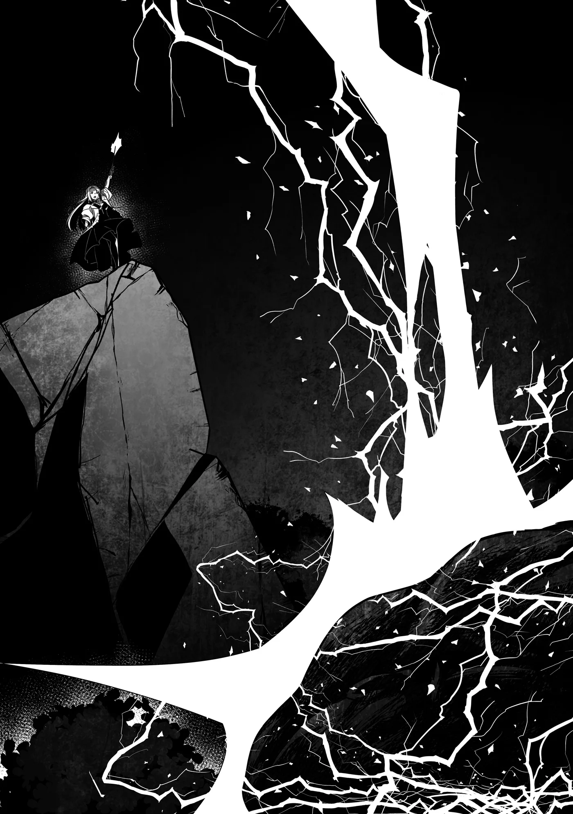
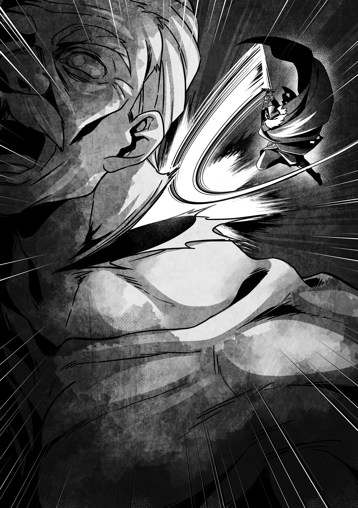

# Chương 248: Tập 11 Chương 1 - Tập Kích Bất Ngờ (5)

"Họ tới rồi!"

Lorraine có thể nhìn thấy gã Cự Nhân đang tiến xuyên qua khu rừng về phía mình, húc đổ và bứng gốc cây cối như một cơn lốc xoáy hủy diệt. Kích thước khổng lồ của hắn từng dấy lên nỗi sợ hãi mang tính bản năng bên trong cô khi nhìn thấy hắn ở cự ly gần trước đó, nhưng việc quan sát hắn từ đằng xa cũng đáng sợ theo cách riêng. Khi ngẫm về việc Cự Nhân từng phổ biến hơn nhiều vào các thời đại đã qua và hẳn đã có lúc họ từng đe dọa con người, điều đó khiến cô tự hỏi làm thế nào mà nhân loại lại có thể sống sót để phát triển rực rỡ như ngày nay.

Dẫu vậy, cô có thể ngẫm nghĩ về quá khứ sau. Ngay lúc này, chỉ có duy nhất một điều cô cần phải làm: chuẩn bị một đòn tấn công đủ uy lực để hạ gục gã Cự Nhân.

Nhằm tạo cho mình góc bắn chuẩn xác nhất vào mục tiêu, Lorraine đã nhờ Augurey nhắn lại với Rentt rằng hãy "dụ gã Cự Nhân tới nơi nào đó mà tôi có thể tung ma pháp đánh vào mạn sườn hắn". Dường như Augurey đã hoàn thành tốt nhiệm vụ của mình, bởi lẽ gã Cự Nhân già đang tiến thẳng về đúng hướng họ đã dự trù.

Tất cả những gì còn lại là định hình Ma Lực, cấu trúc ma pháp và khai hỏa, nhưng nói thì bao giờ cũng dễ hơn làm. Ngay cả Lorraine cũng chẳng sở hữu nguồn Ma Lực vô tận. Tình hình càng chẳng mấy khả quan khi cô có lẽ đã tiêu tốn nhiều Ma Lực hơn mức cần thiết cho phép Glacies Cometes thi triển trước đó. Ban đầu ma pháp ấy vốn không được thiết kế để tạo ra một khối cầu băng khổng lồ đến nhường ấy—nó chỉ thành ra như vậy bởi cô đã chắp vá nó bằng cách cưỡng ép dồn lực. Tất nhiên cô vẫn còn Ma Lực để xoay xở, nhưng chưa đủ để có thể hoàn toàn an tâm về những gì mình sắp sửa làm.

Dù vậy, cô đâu còn sự lựa chọn nào khác. Một đám mây bụi mù mịt đang không ngừng áp sát. Rentt và Augurey hẳn đang ở ngay dưới chân gã Cự Nhân, chạy thục mạng như điên. Nếu cô thất bại, đó sẽ là dấu chấm hết cho tất cả bọn họ. Cô không thể để điều đó xảy ra.

Lorraine bắt đầu định hình Ma Lực. Vì không rõ gã Cự Nhân già sở hữu những loại dị năng nào, cô cẩn trọng thực hiện hết mức có thể để tránh bị hắn chú ý. Việc này tốn nhiều thời gian hơn thường lệ, nhưng cô đã ước lượng sơ bộ được tốc độ cùng khoảng cách của mục tiêu. Chỉ cần giữ được bình tĩnh, mọi chuyện rồi sẽ ổn thỏa. Và rồi thời khắc ấy đã điểm.

"Lorraine!"

Cô nghe thấy giọng của Rentt. Tiếng gọi không quá lớn; trên thực tế, âm thanh gã Cự Nhân tàn phá xung quanh gần như đã át đi nó. Dù vậy, Lorraine vẫn nghe thấy. Với cô, việc bỏ lỡ nó là điều bất khả thi. Đôi mắt cô chợt lóe lên mở to, và ngay khoảnh khắc gã Cự Nhân già đặt chân vào vị trí cô đã chọn, cô ngâm xướng câu chú của mình.

"Terra Cavus!"

Một lượng Ma Lực khổng lồ tụ lại quanh chân gã Cự Nhân già, tạo nên một tiếng nổ lớn khi làm sụt lún khoảng đất xung quanh. Chiếc hố đủ lớn để nuốt trọn toàn bộ cơ thể gã Cự Nhân già. Việc mặt đất dưới chân đột ngột biến mất khiến hắn ngã nhào, nhưng hắn nhanh chóng gượng dậy. Thế nhưng, Lorraine vẫn chưa dừng lại ở đó.

"Chưa hết đâu! Yiesh Gadólmagén!"

Vô số ngọn giáo kim loại cỡ lớn thành hình, mỗi ngọn đều tích tụ một lượng Ma Lực hùng hậu để gia tăng uy lực. Ngay khoảnh khắc ngưng tụ hoàn toàn, chúng lao thẳng về phía gã Cự Nhân đang ngã trên mặt đất.

Lớp da của gã Cự Nhân già cứng đến mức từng bật nảy cả một nhát chém tích tụ Khí Lực của Rentt, nhưng Lorraine chẳng hề ngần ngại dồn đầy Ma Lực vào những ngọn giáo, mang lại cho chúng sức công phá đáng kể. Dù vậy, dẫu đã đâm xuyên qua cơ thể gã Cự Nhân già, chúng làm được điều đó một cách đầy chật vật, và dường như chẳng có vết thương nào thực sự nghiêm trọng. Độ bền bỉ đến khó tin của hắn quả thực vô cùng ấn tượng.

"Và giờ thì, đòn cuối cùng... Hazina Barqrasūl!"

Chỉ trong chớp mắt, những đám mây đen vần vũ cuồn cuộn ngưng tụ trên bầu trời, rồi từ đó giáng xuống một tia sét khổng lồ. Nó đánh trúng gã Cự Nhân già với một tiếng nổ vang rền đinh tai nhức óc, và ánh sáng phát ra từ nó nhuộm trắng xóa cả một vùng xung quanh đến lóa mắt.

◆◇◆◇◆

Không gian ngập ngụa mùi khét lẹt của da thịt cháy sém cùng thứ mùi hăng hắc đặc trưng đọng lại sau một cú sét đánh. Cộng thêm bụi mù mịt khắp không khí, cảm giác thực sự chẳng mấy dễ chịu. Tạm gác chuyện đó sang một bên, có vẻ như chuỗi ma pháp của Lorraine đã phát huy tác dụng. Ngoài kia hẳn vẫn có những sinh vật đủ sức chịu đựng được đòn oanh kích dữ dội đến nhường ấy, nhưng tôi khá chắc chắn rằng số lượng đó chẳng có là bao.

"Thật là... điên rồ," Augurey thốt lên. Hai chúng tôi vừa kịp thoát ra khỏi phạm vi công kích từ ma pháp của Lorraine và chứng kiến toàn bộ sự việc ở cự ly gần.

Nếu bị đòn đó đánh trúng, tôi có cảm giác rằng ngay cả cơ thể Undead của mình cũng khó lòng tránh khỏi kết cục bị xóa sổ hoàn toàn. Và dẫu không cảm thấy đau đớn, rõ ràng tôi vẫn biết sợ, bởi lẽ bản năng mách bảo tôi rằng nếu tia sét đó giáng trúng mình, tôi sẽ vĩnh viễn tan biến. Liệu điều đó có nghĩa là tôi vẫn còn sống, dẫu cho bản thân là một Undead chăng? Ý nghĩa của sự sống cùng những câu hỏi triết học tương tự như sắp sửa bung ra và quay cuồng trong đầu tôi, nhưng tôi đã đè nén chúng xuống. Giờ không phải là lúc.

"Người ta vẫn bảo một ma pháp sư dày dạn kinh nghiệm có thể sánh ngang với cả một đạo quân," tôi nói. "Và sau khi chứng kiến cảnh tượng vừa rồi, tôi hoàn toàn hiểu được lý do tại sao."

"Một đạo quân cơ à?" Augurey đáp lại. "Linh tính mách bảo tôi rằng chỉ một đạo quân thôi thì e là chưa đủ đâu. Tôi chưa từng nhìn thấy bất kỳ ma pháp nào trong số đó trước đây cả."

"Lorraine am hiểu kha khá ma pháp cổ đại. Tôi sẽ chẳng ngạc nhiên nếu toàn bộ số đó đều là những ví dụ điển hình đâu. Cô ấy bảo mình không hay dùng chúng vì chúng ngốn quá nhiều Ma Lực, nhưng tôi đoán dẫu không tốn Ma Lực đi chăng nữa, chúng cũng chẳng phải loại ma pháp mà người ta sẽ đem ra xài mỗi ngày."

Gã Cự Nhân già đã đập phá, nghiền nát và bứng gốc cả một khoảng rừng rộng lớn, nhưng Lorraine cũng chẳng hề kém cạnh chút nào nếu xét về mức độ tàn phá thuần túy mà cô gây ra.

Tôi vẫn luôn coi gã Cự Nhân già như một con quái vật, nhưng hóa ra bấy lâu nay tổ đội của chúng tôi cũng có một con quái vật khác. Nói đúng hơn là hai; tôi không thể quên tính cả bản thân mình vào. Khoan đã, vậy điều đó có nghĩa Augurey là người bình thường duy nhất sao? Tự dưng tôi cảm thấy có chút áy náy. Thôi thì, sao cũng được. Dù sao thì chính những ủy thác của anh ấy mới dẫn tới tất cả những chuyện này. Tôi cho rằng thế là huề cả làng rồi.

"Dù vậy, cậu nghĩ thế đã đủ chưa?" Augurey hỏi, vẻ mặt nghiêm trọng. "Ý tôi là, nếu chưa đủ thì tôi mới thấy kinh ngạc đấy, nhưng mà..."

Anh ấy đang nhìn về phía gã Cự Nhân già, nhưng cây cối xung quanh vẫn đang bốc khói nghi ngút sau cú sét đánh, nên chẳng ai trong hai chúng tôi có thể xác nhận được điều gì vào lúc này. Tôi khá chắc rằng mọi chuyện đã kết thúc, nhưng cẩn tắc vô ưu vẫn hơn.

Làn khói dần tan biến, để lộ ra trước mắt chúng tôi một thứ gì đó khổng lồ và cháy sém—gã Cự Nhân già. Hắn không bị cháy đen thui toàn thân—có lẽ do kích thước quá đồ sộ—nhưng phần lớn cơ thể hắn đã bị thiêu đốt thành một màu đen kịt pha nâu cháy. Tia sét rõ ràng đã đánh trúng đích.

Tôi không thấy bóng dáng những ngọn giáo kim loại của Lorraine đâu nữa, nên tôi đoán chúng đã cạn kiệt Ma Lực mà tan biến. Thế nhưng, những vết thủng mà chúng đâm vào người gã Cự Nhân già vẫn còn đó, và tôi có thể thấy khói đang phụt ra từ những lỗ thủng ấy. Xem chừng tia sét đã xuyên vào khá sâu.

Bất chấp kích thước của gã Cự Nhân già và bất chấp việc hắn đi ngược lại lẽ thường đến mức nào, xét cho cùng thì hắn vẫn là một sinh vật sống. Một tia sét hùng mạnh chạy dọc khắp cơ thể rõ ràng không phải là thứ có thể xem thường.

"Chúng ta hạ được hắn rồi, phải không?" Augurey lẩm bẩm. Cả hai chúng tôi đều chầm chậm tiến lại gần gã Cự Nhân già. Dù vậy, chúng tôi vẫn giương cao kiếm, sẵn sàng cho khả năng hắn có thể gượng dậy.

Augurey bước tới chỗ gã Cự Nhân già và dùng mũi kiếm chọc chọc vào người hắn. Không có phản hồi nào.

"Có vẻ chúng ta hạ được hắn thật rồi," Augurey quay lại bảo tôi. "Ơn trời là thế."

Thế nhưng ngay khi anh vừa thở phào nhẹ nhõm...

"Augurey!" tôi hét lên.

Kèm theo một luồng gió rít rền rĩ, cánh tay của gã Cự Nhân già vung rộng ra ngoài. Tôi chộp lấy Augurey rồi bật nhảy lùi lại phía sau, nhanh chóng kéo dãn khoảng cách.

"Grrraaahhh!" Gã Cự Nhân già phát ra một tiếng gầm nửa người nửa thú, rồi bắt đầu chậm rãi ngồi dậy. Hắn chống tay xuống đất, dồn sức đẩy mạnh để đứng lên.

"Đùa nhau chắc?!" Augurey nói. Anh vẫn đang nằm trong vòng tay tôi, trừng mắt nhìn gã Cự Nhân già.

Tôi chẳng thể trách việc anh ấy bị sốc; bản thân tôi cũng vậy. Từ "phi thường" thậm chí còn chưa đủ để miêu tả sức chịu đựng cùng độ trâu bò cần thiết để có thể đứng dậy sau khi lĩnh trọn một trận oanh tạc ma pháp dữ dội đến nhường ấy. Gã Cự Nhân già đơn giản là một con quái vật phá vỡ mọi quy tắc.

"Nhưng hắn cũng bị thương nặng rồi," tôi nói, đặt Augurey xuống đất. "Điều đó là chắc chắn."

Bình tĩnh quan sát gã Cự Nhân già, tôi có thể nhận ra các chuyển động của hắn rõ ràng đã chậm chạp hơn hẳn. Tôi cũng có thể nghe thấy các khớp xương của hắn kêu răng rắc khi hắn cố gượng đứng dậy. Tia sét của Lorraine đã gây ra một lượng sát thương rất lớn.

Cuối cùng, gã Cự Nhân già cũng đứng thẳng dậy. Đôi mắt đỏ ngầu trên khuôn mặt cháy sém ghim chặt vào Augurey và tôi, rồi kèm theo một tiếng gầm gừ, hắn lao thẳng về phía hai chúng tôi. Mọi nét điềm tĩnh trước đây của hắn đều đã biến mất hoàn toàn.

"Augurey! Anh tiếp tục được chứ?!" tôi hét lớn.

"Tôi có thể chơi cả ngày cũng được! Vấn đề duy nhất là làm thế quái nào chúng ta hạ gục được hắn đây?"

"Để tôi lo. Tôi có một con bài tẩy có thể đem ra dùng. Dù vậy tôi không rõ liệu thanh kiếm của mình có chịu nổi quá một lần hay không, nên nếu tôi chém trượt thì coi như chúng ta xong đời."

Gã Cự Nhân già đã bắt đầu cuộc tấn công nhắm vào chúng tôi, nên cả hai chúng tôi vừa né tránh vừa gọi nhau. "Con bài tẩy" mà tôi nhắc tới chính là Thần Ma Khí Dung Hợp Thuật. Dẫu thanh kiếm của tôi từng được rèn để chịu được bất kỳ nguồn năng lượng nào trong cả ba, nó nhiều khả năng chẳng thể nào chống đỡ nổi khi cả ba kết hợp lại cùng một lúc.

Kỹ thuật này khiến cho bất cứ thứ gì nó đánh trúng đều bị co rúm lại một cách dữ dội vào bên trong, và rất có thể điều tương tự cũng sẽ xảy ra với thanh kiếm của tôi. Đó là lý do tại sao tôi muốn tránh dùng nó nhiều nhất có thể, nhưng nếu bây giờ không phải thời điểm thích hợp thì tôi cũng chẳng biết khi nào mới phải nữa. Vẫn có khả năng nó thậm chí chẳng phát huy tác dụng, hoặc không đủ để trở thành một đòn kết liễu, nhưng điều đó vẫn tốt hơn là chẳng làm gì rồi ngồi chờ thất bại. Nếu tôi phải thua—dù tôi chẳng hề có ý định đó—thì đó cũng chỉ là sau khi tôi đã dốc hết mọi thứ mình có. Và ngay cả khi ấy, tôi cũng đã chuẩn bị sẵn tâm lý bỏ chạy trước khi gục ngã.

Đào tẩu trước đây dường như không phải là một lựa chọn khả dĩ, nhưng giờ đây khi gã Cự Nhân già đã bị thương nặng đến mức này, cả ba chúng tôi có lẽ có thể xoay xở được. Tôi không nghĩ hắn sẽ đuổi theo chúng tôi trong tình trạng hiện tại, và tôi cũng tự tin vào khả năng tẩu thoát của cả nhóm.

Điều đó làm dấy lên vấn đề về Ferrici cùng dân làng, nhưng tôi cho rằng chúng tôi luôn có thể sơ tán họ tới nơi khác. Hoặc là bắt Goblin và Siren làm con tin rồi cố gắng mặc cả. Việc cân nhắc điều đó chắc chắn biến tôi thành kẻ phản diện, nhưng này, bất kỳ thủ đoạn cần thiết nào cũng phải đem ra dùng thôi.

Dù sao đi nữa, chẳng có điều gì trong số đó quan trọng bằng những việc tôi phải làm ngay lúc này, nên tốt nhất là tôi nên tập trung vào hiện tại.

"Được ăn cả ngã về không hả?" Augurey nói. "Được thôi, tôi không ghét ý đó đâu. Lần này tôi làm mồi nhử chứ gì?"

"Anh chắc chứ?" tôi hỏi.

"Tôi sẽ cứ thế cắm đầu chạy nếu thấy mình sắp chết, nên đừng trách tôi nếu chuyện đó xảy ra đấy nhé. Vả lại, tôi đâu thể để cậu và Lorraine ôm đồm hết mọi việc được."

"Vậy trông cậy cả vào anh đấy. Nhưng đừng có làm quá sức. Không như tôi, anh đâu thể bị nghiền nát bấy mà vẫn ung dung bước đi lành lặn được đâu."

Mặc dù sự thật là bản thân tôi cũng chẳng hẳn làm được điều đó, bởi lẽ tôi không rõ mình phải chịu đựng bao nhiêu lần trước khi tan biến hoàn toàn. Tôi có thể phỏng đoán dựa trên những con Ma Cà Rồng trẻ tuổi mà mình từng chạm trán ở Maalt, nhưng điều đó còn lâu mới chắc chắn.

Nói tóm lại, mối nguy hiểm là chia đều cho cả hai. Augurey và tôi chỉ việc dốc hết sức mình có thể. Chúng tôi siết chặt tinh thần cho nhiệm vụ trước mắt—dù trước đó chúng tôi cũng đâu phải chưa sẵn sàng.

◆◇◆◇◆

"Này! Đằng này cơ mà!" Augurey hét lớn. Đúng như những gì vừa nói với tôi, anh đã cố tình lao ra ngay trước mặt gã Cự Nhân già để làm mồi nhử.

Vấn đề là liệu đối thủ của chúng tôi có cắn câu hay không, nhưng tôi đoán rằng nếu hắn không nhìn thấy tôi, hắn sẽ chẳng còn lựa chọn nào khác ngoài việc nhắm vào mục tiêu hữu hình duy nhất. Do đó, tôi sử dụng Phân Liệt và ẩn mình vào những bóng râm của khu rừng để đảm bảo hắn dồn hết sự chú ý vào Augurey.

Nếu có ai nhìn thấy tôi trong trạng thái này, trừ khi họ nắm được manh mối về thân phận của tôi, bằng không họ sẽ nghĩ tôi chẳng qua chỉ là một vệt bóng tối. Dù gã Cự Nhân già hẳn có đôi chút mường tượng rằng tôi không phải người bình thường, tôi không nghĩ hắn đã nắm rõ về tôi đến mức biết tôi có thể hòa mình vào bóng tối.

Thực tế đã chứng minh tôi đúng. Gã Cự Nhân già liếc về phía tôi trong thoáng chốc, nhưng dường như hắn không nhận ra tôi, bởi hắn nhanh chóng chuyển sự tập trung trở lại Augurey và bắt đầu di chuyển ra xa. Hắn thậm chí có thể đang nghi ngờ có một cái bẫy nào đó, nhưng đằng nào thì hắn cũng chẳng còn sự lựa chọn nào khác.

Tôi từng lo lắng về việc Augurey sẽ cầm cự tốt đến mức nào, nhưng trước sự kinh ngạc của tôi, anh ấy đang làm rất tốt. Việc phong cách chiến đấu của anh chú trọng vào tốc độ thay vì sức mạnh đang mang lại hiệu quả rõ rệt. Một phần là do các chuyển động của đối thủ đã chậm chạp đi đáng kể, nhưng Augurey đang né tránh những đòn tấn công của gã Cự Nhân già một cách vô cùng dư dả. Dĩ nhiên, điều đó chẳng hề làm giảm bớt mối nguy hiểm mà Augurey đang phải đối mặt, bởi lẽ chỉ cần một sơ sẩy nhỏ thôi cũng đủ khiến anh chịu trọng thương—hoặc thậm chí có thể bỏ mạng.

Càng hạ gục gã Cự Nhân già sớm chừng nào thì càng tốt chừng nấy. Tôi ngẫm nghĩ xem mình nên nhắm đòn đánh vào đâu và đi đến kết luận rằng nhắm vào đầu có lẽ là phương án tốt nhất. Gã Cự Nhân già đã chứng minh rằng tay chân hắn có thể chịu đòn bầm dập mà vẫn tiếp tục chiến đấu. Trong trường hợp đó, làm thế nào để tôi với tới đầu hắn? Tôi cân nhắc việc dùng đôi cánh để bay lên, nhưng điều đó quá mạo hiểm. Tôi chỉ có duy nhất một cơ hội trong chuyện này; tôi không thể lãng phí nó vào một thứ quá đỗi bấp bênh như vậy. Tôi phải nghĩ ra cách khác—

"Á!"

Nhưng trước khi tôi kịp nghĩ ra, tôi thấy chân của Augurey vướng phải một rễ cây.

Nắm đấm của gã Cự Nhân già vung thẳng vào Augurey, nhưng trước khi nó kịp chạm tới, tôi lao vụt ra, túm lấy người bạn của mình và chạy dạt sang một bên... nơi tôi nhận ra đường đi của mình đã bị cây cối chặn đứng.

Không còn lựa chọn nào khác, tôi dậm chân nhảy lên hết sức có thể. Cánh tay của gã Cự Nhân già quét qua bên dưới tôi, chỉ sượt qua trong gang tấc, và tôi đáp xuống ngay trên cánh tay hắn khi nó lướt qua. Nhưng ngay khi sự chú ý của gã Cự Nhân già sắp sửa dồn vào tôi, tôi nghe thấy âm thanh của một câu ngâm xướng.

"Gadól Barák!"

Một tia sét dày đặc giáng thẳng xuống người gã Cự Nhân già. Nó phát ra từ Lorraine. Rõ ràng cô vẫn có thể xoay xở thi triển những ma pháp như thế này ngay cả sau trận oanh tạc hoành tráng mà cô đã tung ra trước đó.

Một âm thanh tanh tách vang lên bên tai tôi khi một phần tia sét truyền qua cơ thể gã Cự Nhân già rồi chạy vào người tôi, nhưng ngoài điều đó ra, nhìn chung tôi không bị ảnh hưởng mấy. Tôi vẫn cử động được. Lần này tôi không phải cảm ơn cơ thể quái vật của mình; chính chiếc áo choàng của tôi đã hoàn thành tốt nhiệm vụ đó.

Dù vậy, người tôi đã bắt đầu hơi tê dại, và tôi khá chắc rằng việc lãnh thêm bất kỳ luồng điện nào nữa cũng sẽ là một ý tồi. Tôi nhảy phắt khỏi người gã Cự Nhân già trong lúc hắn còn đang mải lùi lại vì cơn co giật từ tia sét và một lần nữa ẩn mình vào trong những tán cây.

Tôi đặt Augurey xuống, rồi khi nhận thấy âm thanh duy nhất anh phát ra chỉ là những tiếng lầm bầm lắp bắp không thành lời, tôi dùng một chút Thần Lực để chữa trị cho anh.

"Chao ôi, ma pháp đó làm tôi tơi tả thật đấy," anh nói. "Xin lỗi nhé. Tôi chưa hoàn thành nhiệm vụ rồi."

Tôi không nghĩ điều đó là đúng, xét theo màn thể hiện vừa rồi của anh ngoài kia. Trên hết, tình huống ấy vừa nảy ra cho tôi một ý tưởng. Nó tương đối đơn giản, nhưng tôi nghĩ nó có cơ hội thành công. Tôi nói với Augurey, và anh gật đầu.

"Cách đó... có khi hiệu quả đấy. Ý tôi là, nó cũng chẳng khác mấy so với những gì cậu vừa làm. Chà, nó vẫn điên rồ thật, nhưng vì là cậu nên mới thế cơ mà."

Và thế là tôi đã nhận được sự đồng thuận của Augurey.

Hai chúng tôi lại xông ra nghênh chiến với gã Cự Nhân già một lần nữa. Augurey, y hệt như lúc nãy, lao ra phía trước và bắt đầu né tránh những đòn tấn công của đối phương. Trong khi đó, tôi dõi mắt quan sát hắn thật kỹ, chờ đợi thời cơ hoàn hảo...

Chính là lúc này!

Tôi bung hết sức bình sinh lao nhanh nhất có thể. Gã Cự Nhân già vừa tung ra một cú đấm, và hệ quả là người hắn hơi khom xuống. Góc nghiêng nhẹ giữa hai chân và đầu khiến lưng hắn tạo thành một con dốc đứng.

Đúng vậy, một con dốc. Tôi nhảy tót lên. Sau khi thấy tôi làm vậy, Augurey lách người né tránh cú đấm trong gang tấc rồi lùi lại phía sau.

"Hử?!" Gã Cự Nhân già lập tức cố rướn thẳng người dậy.

May mắn thay, tôi đã kịp tới được đích đến của mình: sau gáy hắn. Đó là tử huyệt trên cơ thể của bất kỳ sinh vật sống nào, đồng thời cũng là điểm mù dễ tổn thương nhất, và dẫu có một số sinh vật dai sức phi thường hay mang gai nhọn sắc bén cùng những lớp phòng ngự tương tự, cơ thể của một Cự Nhân về cơ bản cũng giống như con người, chỉ là to lớn và cứng cáp hơn mà thôi.

Nói tóm lại, các cơ quan trọng yếu cùng những điểm yếu của họ cũng nằm ở các vị trí tương tự, nên sau gáy của gã Cự Nhân già chính là điểm hoàn hảo để tôi giáng đòn. Có lẽ vậy. Dù trường hợp nào đi nữa thì tôi cũng đã phóng lao phải theo lao rồi. Nếu cách này không hiệu quả, tôi sẽ chuyển sang hạ sách tiếp theo: vội vã rút lui. Còn ở thời điểm hiện tại, tôi truyền toàn bộ Ma Lực, Thần Lực cùng Khí Lực của mình vào thanh kiếm rồi vung nó hết sức bình sinh.

Gã Cự Nhân già bị thương quá nặng nên không kịp trở tay. Hắn đã không thể phòng thủ trước đòn đánh của tôi. Nhát chém trúng thẳng vào sau gáy hắn, và bất chấp thực tế là tôi lúc này đang rơi tự do giữa không trung, tôi vẫn nhìn thấy rõ mồn một da thịt hắn lập tức bắt đầu co rúm lại.

Rồi tôi thấy một tia máu phụt bắn ra từ cổ gã Cự Nhân già, kèm theo âm thanh của thứ gì đó vỡ toạc.

"Được rồi!" Tôi tạo dáng ăn mừng chiến thắng giữa không trung... rồi chợt nhận ra điều gì sắp sửa xảy ra. "Khoan đã, chết tiệt!"

Nhưng mọi chuyện đã quá muộn. Gã Cự Nhân già gục rũ rượi về phía trước và bắt đầu đổ sụp xuống theo đúng hướng tôi đang rơi. Chẳng cần phải là thiên tài cũng đủ hiểu tôi sắp sửa bị đè bẹp dí thành tương, và xét theo tình hình lúc này, xem chừng tôi khó lòng nhận được một sự giải cứu kịp thời. Chà, ít nhất thì tôi khá chắc rằng mình sẽ không chết.

Truyền Khí Lực vào đôi cánh có lẽ đã cứu được tôi, nhưng đáng tiếc thay, tôi vừa tiêu hao đến giọt sức lực cuối cùng của mình. Dù mười giây nữa có lẽ là đủ để tôi hồi phục lượng Khí Lực cần thiết để truyền vào cánh, tôi chắc chắn sẽ bị đè bẹp dí trước khi thời khắc đó đến.

Tôi thầm cầu nguyện rằng đây không phải là lần bị đè bẹp cuối cùng của mình. Dĩ nhiên, tôi đang nói về việc sử dụng Phân Liệt để hồi phục cơ thể. Tôi nghĩ mình vẫn có thể xoay xở được, nhưng tôi chẳng thể dám chắc chắn.

Và rồi, kèm theo một tiếng bẹp vang dội, tôi bị đè bẹp dí. Và tôi nói nghiêm túc đấy—chẳng có chút nghi ngờ nào, chẳng có pha né đòn vào phút chót nào, chẳng có gì cả. Tôi thực sự đã bị nghiền nát bấy thành tương.
