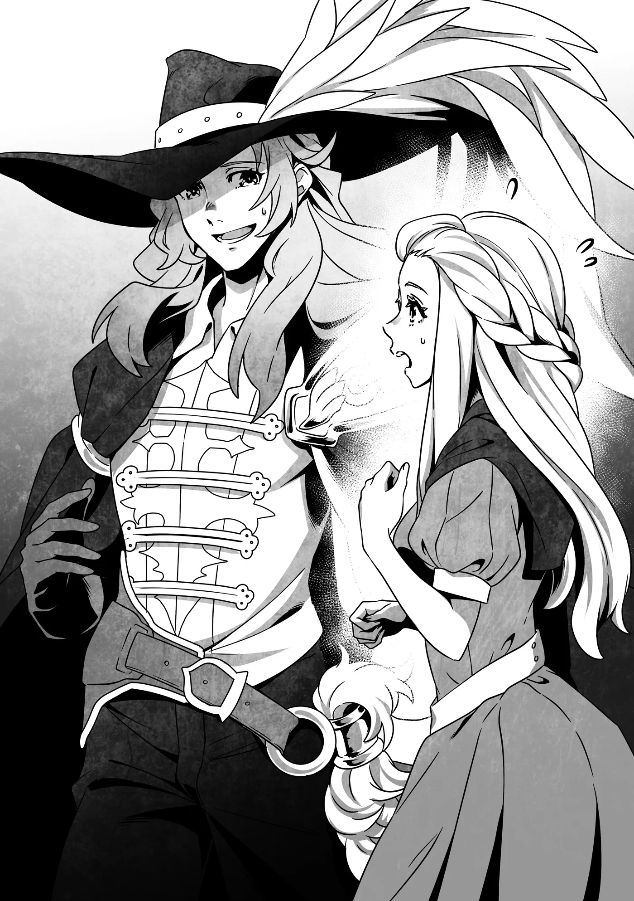
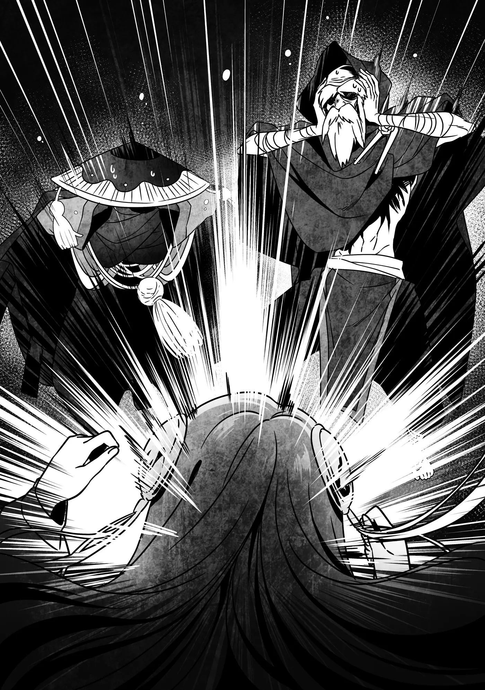

# Chương 251: Tập 11 Chương 1 - Tập Kích Bất Ngờ (8)

Khi chúng tôi gặp lại Ferrici, cô bé dồn dập hỏi chúng tôi cả một tràng câu hỏi, điều này cũng hoàn toàn dễ hiểu. Cách đây không lâu, khu vực xung quanh vừa phải hứng chịu một chuỗi chấn động và những vụ nổ kinh hoàng. Có một gã Cự Nhân nhô cả người lên khỏi khu rừng, lại còn cả một tia sét với uy lực mạnh đến mức vô lý giáng xuống nữa. Nếu không biết rõ sự tình, khéo tôi cũng sẽ tin ngay nếu có ai đó bảo rằng ngày tận thế đã đến. Dù vậy, chúng tôi cũng không thể tiết lộ toàn bộ chi tiết cho Ferrici, nhưng điều đó không có nghĩa là chúng tôi phải để cô bé hoàn toàn mù mịt chẳng hay biết gì.

"Kẻ địch của bọn anh xuất hiện, và bọn anh đã đánh bại hắn," tôi nói. "Còn tia sét đó là ma pháp của Lorraine. Em đừng lo. Mọi chuyện giờ đã ổn thỏa cả rồi."

"Thật vậy sao ạ?" Ferrici hỏi.

Có điều cô bé đâu có hỏi tôi; cô bé đang hỏi Augurey đấy chứ. Chắc hẳn cô bé rất tin tưởng anh.

Augurey mỉm cười. "Phải rồi. Còn về quý ông lớn tuổi này, ông ấy là... một trong những đồng bọn của kẻ địch. Bọn anh vẫn cần phải tra hỏi ông ấy vài điều. Bọn anh không hề ngược đãi người già đâu nhé, được chứ?"

Giải thích phần đó là rất quan trọng. Nếu không nói rõ, trông chúng tôi chẳng khác nào một lũ điên trói gô một ông lão lại.

Ferrici có vẻ đã chấp nhận lời giải thích. Mạo hiểm giả luôn có những chuyện rắc rối mà người ngoài khó lòng thấu hiểu, nên có lẽ cô bé nghĩ đây cũng chỉ là một phần trong số đó. Phần lớn dân làng đều được nuôi dạy với sự cảnh giác lành mạnh trước mạo hiểm giả và được căn dặn tránh lại gần họ để không bị cuốn vào những trò tai quái của họ. Với người lớn thì là chuyện khác, nhưng cảm giác này có phần giống như bị đối xử như một loài dã thú vậy.

Ferrici chỉ đơn giản đáp, "Em thấy hơi tội nghiệp cho ông ấy, nhưng em đoán các anh chị cũng không còn lựa chọn nào khác..."

◆◇◆◇◆

Đáng ngạc nhiên là sau khi chúng tôi quay trở lại, chủ quán trọ đã nồng nhiệt chào đón chúng tôi. Tôi rất mừng; tôi từng đinh ninh rằng khi về đến nơi thì hành lý của chúng tôi đã bị tống ra trước cửa và chủ quán trọ đang chực sẵn để đuổi chúng tôi đi. Cảnh tượng đó khéo lại khá buồn cười, vì nó đồng nghĩa với việc Siren—người mà chúng tôi nhốt trong phòng của Lorraine—cũng sẽ bị ném ra ngoài đường. Nhưng nghĩ lại thì, Lorraine ắt hẳn đã đưa ra lời giải thích nào đó với chủ quán trọ về ả rồi. Cô ấy luôn chu toàn trong những chuyện kiểu như thế này.

Dù sao thì chúng tôi cũng đâu có bị đuổi khỏi làng hay gì tương tự, nên tôi cũng không quá lo lắng về việc quay về và thấy toàn bộ đồ đạc của mình bị vứt ra ngoài.

"Vậy Siren đâu rồi?" ông lão hỏi khi chúng tôi bước vào quán trọ.

Ông ta dĩ nhiên biết ả đang ở đâu đó quanh đây, nhưng chúng tôi vẫn chưa cho ông ta biết cụ thể. Chúng tôi mới chỉ bảo với ông ta rằng mình đã bắt giữ và khống chế ả.

"Cô ta ở lối này." Lorraine dẫn chúng tôi về phòng cô. Khi cô mở cửa, chúng tôi nhìn thấy Siren đang bị trói nằm trên giường. Ả nhìn thấy chúng tôi khi chúng tôi bước vào.

"Ưm ưm!"

Ngay khi nhìn thấy, ả liền cố gắng nói, nhưng giẻ bịt miệng mà chúng tôi nhét vào khiến lời lẽ của ả không thể nghe ra được gì. Dù vậy, tôi có thể nhận ra ả chẳng hề hài lòng với tình cảnh hiện tại, điều đó có lẽ cũng chẳng cần phải nói ra. Nếu ở vào vị trí của ả, tôi cũng sẽ ghét cay ghét đắng chuyện này.

"Tôi đoán chúng ta nên cởi trói cho cô ta chứ?" Lorraine hỏi ông lão.

Lorraine có lẽ nghĩ rằng với bao nhiêu điều cần phải giải thích, để người phụ nữ bị trói thế này sẽ vô cùng bất tiện. Tuy nhiên, ông lão—người mà tôi từng nghĩ thuộc tuýp người biết quan tâm đến đồng đội—chỉ liếc nhìn Siren một cái rồi thở dài.

"Không, cứ để kệ con bé đó một lúc đi," ông ta nói. "Nó sẽ chỉ cằn nhằn đến điếc cả tai chúng ta thôi. Hãy gọi Goblin tới đây. Thằng bé sẽ hiểu chuyện nhanh hơn."

Chà, phũ thật đấy.

Siren, người nãy giờ vẫn lắng nghe, bắt đầu gào to hơn nữa, nhưng mọi người đều phớt lờ ả.

"Vậy để tôi đi," Augurey nói. Anh quay sang ông lão. "Tôi cho là chúng ta sẽ dùng căn phòng này để nói chuyện chứ?"

"Được đấy," ông lão đáp. "Dù sao thì chúng ta cũng cần phải giải thích cho cả Siren hiểu nữa."

Augurey rời đi để gọi Goblin tới.

◆◇◆◇◆

"Ông... chuyện này rốt cuộc là sao?"

Goblin, người mà trước đây chúng tôi biết đến với cái tên Yattul, trông vừa bối rối vừa kinh ngạc khi bước vào phòng. Augurey đi vào ngay sau hắn và đóng cửa lại. Trước tiếng cửa đóng, Goblin giật nảy mình một chút. Bản năng có lẽ đang mách bảo hắn rằng mình đã bị mắc bẫy và rơi vào vòng vây.

Dẫu vậy, có vẻ như ông lão đã đúng về khả năng giữ một cái đầu lạnh của Goblin, bởi sự căng thẳng nhanh chóng tan biến khỏi đôi vai hắn. Hắn không hề có biểu hiện hung bạo nào. Tôi có thể nhận thấy việc giải thích mọi chuyện cho hắn sẽ dễ dàng hơn nhiều so với Siren.

"Có nhiều chuyện đã xảy ra," ông lão nói, "nhưng ta sẽ đi thẳng vào vấn đề. Ta đã thua—thua hoàn toàn—trong một trận đối đầu trực diện. Vậy nên phi vụ này coi như hỏng rồi."

Thật bất ngờ, người lộ vẻ kinh ngạc nhất lại chính là Siren. Những tiếng gào nghẹn ngào liên tục của ả im bặt khi khóe miệng ả chùng xuống rồi khép chặt lại hoàn toàn. Có lẽ dù có thái độ đối địch với ông lão, ả vẫn đặt rất nhiều niềm tin vào sức mạnh của ông ta. Goblin trông cũng sững sờ, như thể không dám tin vào những gì mình vừa nghe thấy.

Ông lão tiếp tục một cách điềm tĩnh, bằng tông giọng nghe như đang răn dạy bọn họ. "Bọn họ là những quái vật thực sự. Trong đời ta, hiếm khi ta gặp được ai mạnh đến thế. Ta đã dốc toàn bộ dị năng của mình và chiến đấu mà không hề lơ là cảnh giác, nhưng ta vẫn thua. Chẳng thể làm gì khác ngoài việc thừa nhận thất bại. Đó là những cảm nghĩ chân thực nhất của ta."

Trái ngược với những lời lẽ ôn tồn của ông lão, giọng điệu của Goblin lại đầy bối rối. "Tôi chẳng muốn tin chút nào, nhưng nếu ông đã nói vậy thì... Nhưng chuyện đó có ý nghĩa gì với chúng ta chứ?! Chúng ta đã làm hỏng nhiệm vụ! Tôi biết là không thể khẳng định chắc chắn họ sẽ giết chúng ta, nhưng hãy nghĩ xem thân chủ là ai! Bọn họ nhất định sẽ bắt chúng ta phải trả giá bằng cách nào đó!"

"Quả đúng vậy," ông lão đáp. "Chuyện đó quả thực sẽ rất rắc rối, đúng chứ? Nhưng ba người bọn họ đã đưa ra cho ta một đề xuất. Bọn họ muốn gặp thủ lĩnh để đàm phán. Hơn nữa, tổ chức và thân chủ của chúng ta mới là bên phải chịu trách nhiệm cho thất bại này, chứ không phải chúng ta. Bọn họ đã không cung cấp thông tin chính xác cho chúng ta. Nếu chúng ta có thể làm cho họ hiểu được điều đó, thì có lẽ tất cả chúng ta đều có thể đi đến một giải pháp hòa bình."

◆◇◆◇◆

"Thủ... thủ lĩnh sao? Nhưng chuyện đó..."

Goblin có vẻ ngập ngừng, nhưng ông lão không hề nhượng bộ.

"Ta hiểu cảm giác của cậu. Cậu đang nghĩ rằng đó là một quyết định quá lớn đối với chúng ta, hoặc làm thế sẽ là phản bội tổ chức, nhưng với tình hình hiện tại, đằng nào chúng ta nhiều khả năng cũng phải chết. Trong trường hợp xấu nhất, ta có thể tự mình trốn chạy, nhưng cậu và Siren liệu có ổn với điều đó không? Ta sẽ không ngăn cản nếu hai đứa muốn thế, nhưng..."

Ông ta có lẽ thực tế không hề nghĩ mình có thể làm vậy. Nếu Goblin từ chối và chúng tôi không thể gặp mặt thủ lĩnh của họ, thì tất cả chúng tôi đều biết mình sẽ phải làm gì với ông lão. Đâu thể nào chúng tôi cứ thế thả ông ta đi để rồi trong tương lai ông ta quay lại cắn chúng tôi được. Tôi đoán chúng tôi quả thực có quyền lựa chọn cố ý thả ông ta đi, nhưng khả năng chúng tôi phải đưa ra quyết định đó là rất mong manh, nên tạm thời tôi gác lại suy nghĩ về chuyện ấy.

"Dĩ nhiên là không rồi," Goblin đáp. "Tôi cũng đâu có muốn chết. Tôi chịu ơn tổ chức... nhưng chưa đến mức phải bỏ mạng vì nó. Dù sao thì tôi cũng đã tính giải nghệ sớm rồi."

"Hóa ra là vậy sao?" ông lão hỏi. "Ta thực ra cũng định khuyên cậu làm điều đó sau nhiệm vụ này đấy."

"Hóa ra ông đã nhận ra rồi à, ông già?"

"Cậu là một kẻ nhân hậu. Không như ta, cậu vốn không thích hợp với công việc này. Thật may mắn là mọi màn kịch mà cậu diễn dưới vỏ bọc một thương nhân đã dần trở thành một điều gì đó chân thực hơn."

"Phải đấy. Tôi nghĩ nếu tiếp tục nghề thương nhân rong thì mình vẫn sẽ sống tốt. Nhưng có vẻ sẽ còn lâu lắm tôi mới đạt được giấc mơ đó, nhất là khi mớ hỗn độn này đang xảy ra."

"Đừng nói vậy. Hãy coi đây là cơ hội để biến nó thành phi vụ cuối cùng của cậu và phấn đấu vì điều đó xem sao. Nghĩ theo cách ấy, cậu sẽ cảm thấy khác ngay thôi."

"Ông thì nói thế, nhưng mà... Thôi, sao cũng được. Tranh cãi chuyện đó cũng vô ích. Mà này, mọi người nghiêm túc đấy chứ? Về chuyện gặp thủ lĩnh ấy?"

Goblin hướng phần sau cùng của câu hỏi thẳng về phía chúng tôi. Nhìn biểu hiện thì có vẻ như ông lão đã thuyết phục hắn thành công.

"Chúng tôi hoàn toàn nghiêm túc," Lorraine đáp. "Chúng tôi đã nghe rõ ngọn ngành lý do vì sao các người lại nhắm vào chúng tôi, và nói thẳng thắn thì tôi đã chịu đựng quá đủ cái trò vô nghĩa này rồi. Chỉ cần nghĩ đến việc tổ chức của các người sẽ phái thêm nhiều kẻ như ông ta đến đối phó với chúng tôi thôi cũng đủ khiến tôi nhức cả đầu. Thú thật là tôi chỉ muốn nói chuyện với bất kỳ ai nắm quyền lãnh đạo để tôi có thể dẹp bỏ mọi nỗi lo lắng của mình."

Điều đó dường như đã chạm đúng tâm lý của Goblin, bởi nét mặt hắn thoáng hiện vẻ đồng cảm. "Phải đấy, ông già là một trong những tay thiện chiến hơn cả trong tổ chức của chúng tôi. Tôi có nghe vài người kể lại rằng hồi còn trẻ ông ấy thực sự vô cùng ngang tàng. Chuyện các vị đánh bại được ông ấy... thực sự có phần hơi phi lý đấy. Tôi không hề nghi ngờ các vị hay gì đâu, nhất là khi chính bản thân ông ấy đã thừa nhận điều đó. Chỉ là, ngoài kia chẳng có mấy ai làm nổi điều đó cả."

"Chúng tôi chỉ gặp được một chuỗi vận may liên tiếp mà thôi," Lorraine nói. Cô quay sang Augurey và tôi. "Tôi không bao giờ muốn thử lại điều gì tương tự như thế nữa đâu. Đúng chứ?"

"Chuẩn đấy," tôi mệt mỏi đáp lời.

"Cô nói quá đúng luôn," Augurey lên tiếng, giọng nghe cũng kiệt sức chẳng kém.

Ông lão khịt mũi. "Vậy là tất cả chúng ta đều đồng lòng rồi đấy. Đừng để bọn họ đánh lừa, Goblin. Bọn họ còn quái vật hơn cả ta nữa cơ. Nói thẳng thừng ra thì, bọn họ là những kẻ tồi tệ nhất nếu phải đối đầu làm kẻ thù. Lý do ta muốn bọn họ nói chuyện với thủ lĩnh là vì ta không muốn phải đối đầu với bọn họ thêm lần nào nữa. Ta cũng không muốn tổ chức làm điều đó, xét vì lợi ích của chính tổ chức. Cậu có thể chuyển lời nhắn đó tới thủ lĩnh được không?"

"Tôi cũng phần nào đoán trước được chuyện này rồi," Goblin nói. "Vậy là tôi sẽ đi sao?"

"Còn ai vào đây nữa chứ?" ông lão hỏi. "Tất cả chúng ta mà cùng đi thì sẽ chỉ làm ầm ĩ lên thôi."

"Làm ầm ĩ sao? Nghe đâu có đến mức—"

"Ý ta khi nói 'làm ầm ĩ' là tất cả chúng ta sẽ bị tóm gọn và xử tử ngay tại chỗ đấy."

"Ồ, phải rồi. Hóa ra là kiểu 'làm ầm ĩ' đó. Tôi đoán ông nói đúng vậy. Nhưng vẫn có khả năng chuyện đó sẽ xảy đến với tôi nếu tôi đi một mình đấy."

"Bọn họ vẫn chưa biết chúng ta đã thất bại, nên ta không nghĩ chuyện đó xảy ra đâu. Cứ tìm cách lừa bọn họ để chúng ta được gặp thủ lĩnh bằng cách nào đó đi. Cậu sẽ nghĩ ra cách thôi mà."

"Ông chẳng bao giờ thèm bận tâm đến mấy chi tiết vụn vặt nhỉ? Y hệt như cái cơ thể của ông vậy."

"Có lẽ dị năng của chúng ta cũng ảnh hưởng đến cả tính cách nữa, nhỉ? Trông cậy cả vào cậu đấy."

"Biết rồi, biết rồi. Đã lỡ dấn một đồng xu đồng thì phải theo tới một đồng xu vàng thôi, đâm lao thì phải theo lao vậy. Bằng cách nào đó tôi sẽ lo liệu êm xuôi."

Đúng lúc đó thì Siren lại bắt đầu gào thét nghẹn ngào. Rõ ràng là ả rốt cuộc cũng đã hoàn hồn sau cú sốc khi nghe tin về thất bại của ông lão. Chúng tôi quay lại nhìn ả rồi khựng lại. Tôi nghĩ tất cả chúng tôi suýt nữa thì quên khuấy mất sự hiện diện của ả trong phòng.

Rồi sau cùng, tôi lên tiếng, "Chúng ta có nên cởi trói cho cô ta không? Đằng nào thì chúng ta cũng gần như bàn xong việc rồi, nên chắc là ổn thôi nhỉ?"

Ông lão gật đầu. "Cũng nên làm vậy đi. Nhưng ta cảnh báo trước đấy; sẽ ầm ĩ lắm cho xem. Các ngươi chắc chắn là đã chuẩn bị tinh thần rồi chứ?"

"Ông nghĩ thế sao?" Lorraine hỏi. "Cá nhân tôi thì thấy sẽ ổn thôi mà. Đây, để tôi làm cho."

Cô bắt đầu ngâm xướng thứ gì đó nghe như một câu thần chú để cởi bỏ dây trói của Siren, và đó chính xác là những gì diễn ra khi cô dứt lời. Tuy nhiên, miếng bịt miệng thì không mang tính ma thuật, nên Siren tự mình tháo nó ra ngay lập tức khi tay chân ả đã được tự do.

"Này!" Siren hét lên. "Tôi không có quyền lên tiếng trong chuyện này chắc?! Hai người nghĩ tôi sẽ ngồi yên ở đây mà để mặc chuyện này xảy ra sao?!"

"Các ngươi thấy ta nói đúng chưa?" ông lão bình phẩm.

"Đừng nói với tôi là nãy giờ cô ta chẳng thèm nghe gì đấy nhé," Goblin nói.

Cả hai người họ đều bịt tai lại khi nói. Cảnh tượng đó có thể khiến người ta tự hỏi liệu họ có thực sự là đồng đội của nhau hay không, nhưng có lẽ chính vì họ quá thân thiết nên mới phản ứng theo cách như vậy.

Siren nhảy phắt xuống khỏi giường và bước ngay tới trước mặt bọn họ. "Tôi có nghe đấy chứ! Hai người thực sự nghĩ mình sẽ làm trót lọt chuyện đó sao?! Bộ hai người đã quên mất tổ chức có thể đáng sợ đến mức nào rồi à?!"

Dẫu vậy, ông lão và Goblin không hề nao núng; họ vẫn duy trì tư thế thủ thế của mình.

Nghe qua thì có vẻ như ả đang kích động cuồng loạn, nhưng những điều ả nói thực chất lại khá hữu lý. Dẫu vậy, ả không phải là kẻ giỏi nắm bắt bầu không khí cho lắm. Dù sao thì chúng tôi cũng đã đi đến một kết luận đâu ra đấy cả rồi.

Siren tiếp theo đó quay sang phía chúng tôi. "Còn ba người các ngươi nữa! Làm như bọn ta sẽ đời nào chịu đồng ý—"

Ả tự ngắt lời mình rồi co rúm người lùi lại khi Lorraine bước lên phía trước. Trong khi những người còn lại trong chúng tôi đều ngơ ngác trước những gì vừa xảy ra, Lorraine đã giơ đũa phép lên chĩa thẳng vào Siren.

"Tôi có thể làm lại lần nữa đấy, nếu cô muốn," Lorraine nói.

Tôi hoàn toàn mù tịt về điều cô ấy đang nói, nhưng nhìn từ phản ứng của Siren thì rõ ràng ả hiểu rất rõ.

"Á! K-Không dám phiền cô đâu ạ! Tôi đã chịu đựng quá đủ chuyện đó rồi! Tôi sẽ ngoan ngoãn mà, được chứ? Tôi sẽ nghe lời!"

Và rồi ả bắt đầu nức nở khóc. Augurey, có lẽ cũng thấy tội nghiệp cho ả như tôi, tiến lại gần và đưa cho ả chiếc khăn tay của mình. Sau đó, tất cả mọi người trong phòng ngoại trừ Siren đều quay sang nhìn Lorraine. Tôi có thể nhận thấy tất cả chúng tôi đều đang nghĩ cùng một điều: Rốt cuộc cô ấy đã làm gì với ả vậy?

Nhưng tất cả chúng tôi đều quá sợ hãi để dám cất tiếng hỏi.
