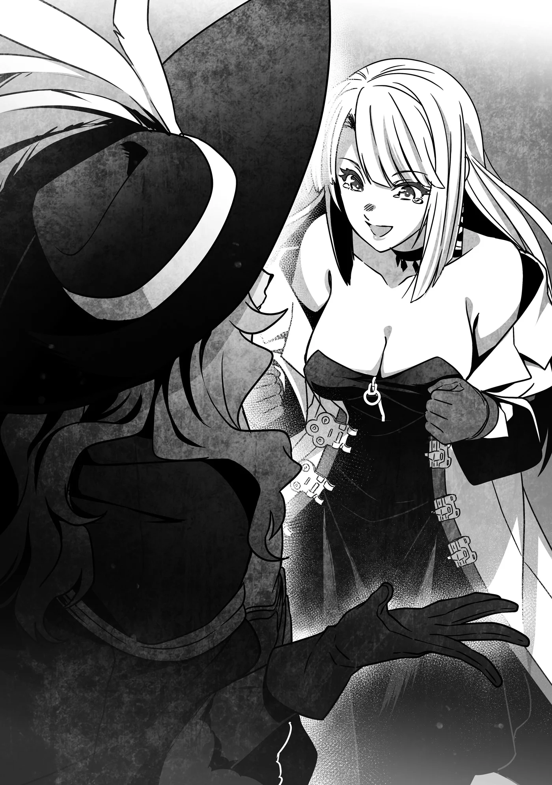

# Chương 255: Tập 11 Chương 2 - Khởi Hành (4)

"À, phải rồi, Lorraine." Augurey trông đầy vẻ thích thú. "Cô nên nghe chuyện vừa xảy ra ở Hội lúc nãy đi."

Dù là tôi thì cũng chẳng khó để đoán ra anh ta sắp sửa nói điều gì.

"Có chuyện gì xảy ra sao?" Lorraine hỏi.

"Chắc chắn là có rồi!" Augurey đáp. "Rentt cuối cùng cũng đủ điều kiện tham gia kỳ thi thăng hạng Ngân Cấp đấy!"

"Thật sao? Chúc mừng anh nhé, Rentt! Sau bao nhiêu lâu cuối cùng ngày này cũng tới. Dù có hơi bực mình một chút khi anh sắp sửa ngang hàng với tôi... nhưng những dịp vui thế này đâu phải lúc nào cũng có. Tối nay chúng ta làm một chầu rượu ăn mừng chứ?"

Nhìn Lorraine hào hứng thế kia, người ngoài khéo lại tưởng chuyện đó xảy ra với cô ấy chứ chẳng phải tôi.

Ông lão tỏ vẻ khó hiểu trước thái độ của Lorraine và Augurey. "Với thực lực của cậu, việc đạt được tư cách thi Ngân Cấp chẳng phải quá đỗi dễ dàng sao? Đó thực sự là chuyện đáng để vui mừng đến thế à?"

"Vấn đề là," Lorraine giải thích, "dưới góc nhìn của ông thì có lẽ đúng là vậy. Nhưng với chúng tôi... lại hoàn toàn khác. Thực sự là vậy đấy."

Khóe mắt cô thoáng chút ngấn lệ. Dẫu vậy cô nhanh chóng trấn tĩnh lại và kìm nén không để giọt nước mắt nào rơi xuống, có lẽ là bởi lòng tự tôn của cô không cho phép điều đó.

Ông lão nghiêng đầu sang một bên. "Ý cô là sao? Tất cả chúng ta đều thấy rõ uy lực của đòn đánh mà cậu ta giáng vào ta rồi mà. Với cậu ta, một kỳ thi thăng hạng cỏn con đáng lý phải..."

Từ diễn biến của cuộc trò chuyện, ông ta có lẽ đã phần nào đoán được rằng tôi phải mất rất nhiều thời gian mới chạm được đến cột mốc này, nhưng lại hoàn toàn mù tịt về nguyên do đằng sau. Chuyện đó thực ra cũng hoàn toàn dễ hiểu.

Dẫu vậy, chúng tôi đâu thể đi sâu vào chi tiết mà không để lộ chuyện tôi là quái vật, nên tôi đành trả lời một cách lấp lửng. "Biết nói sao nhỉ? Tôi đã trải qua mười năm ở Đồng Cấp, kiếm sống bằng việc săn Slime và Goblin. Suốt khoảng thời gian đó, tôi luôn nuôi mục tiêu vươn lên... nhưng chưa từng làm được. Khi ấy, tôi cảm thấy như mình hoàn toàn mù mịt trước con đường phía trước."

"Ngay cả với thực lực của cậu sao?" ông lão hỏi.

"Vâng. Chuyện tôi mạnh lên phần nào cũng chỉ là sự trùng hợp ngẫu nhiên mà thôi. Tôi... chưa từng nghĩ chuyện đó sẽ xảy đến. Dẫu vậy, giờ đây cuối cùng tôi cũng đã có cơ hội trở thành mạo hiểm giả Ngân Cấp. Tôi vui sướng khôn xiết."

"Hừm... Trùng hợp sao? Ta nghĩ ta hiểu ý cậu rồi. Vậy là dị năng của cậu mới chỉ thức tỉnh gần đây thôi à?"

Giọng điệu của ông lão như thể vừa nảy ra một ý tưởng. Đáng tiếc là ông ta hoàn toàn đoán sai bét. Đúng là gần đây tôi mới biến thành quái vật, nhưng đâu phải tôi có thể cứ thế toạc móng heo ra được. Dẫu vậy, sau khi ngẫm nghĩ một chút, tôi nhận ra suy đoán của ông ta thực chất lại khá sát với tình cảnh của mình. Nghe có vẻ cũng là một vỏ bọc hữu ích, nên tôi quyết định hùa theo luôn.

"Dạ, đại khái là thế đấy ạ," tôi nói.

"Ra là vậy. Chà, chẳng có quy luật hay lý do cụ thể nào cho thời điểm mà dị năng quyết định thức tỉnh cả. Cũng giống như việc có người sở hữu chúng ngay từ lúc mới lọt lòng, lại có những kẻ bỗng một ngày thức giấc nhận ra mình có được nó. Xét theo khía cạnh đó thì cậu thuộc diện nở muộn đấy."

Lorraine lên tiếng, giọng đầy vẻ tò mò. "Vậy với ông thì chuyện đó xảy ra khi nào?"

"Ta có thể vận dụng dị năng từ hồi còn bé xíu. Siren và Goblin cũng vậy. Nếu bị gặng hỏi thì ta sẽ bảo những trường hợp như bọn ta chiếm đại đa số, nhưng ai mà biết được chứ? Đây đâu phải một lĩnh vực được nghiên cứu bài bản, và những kẻ thức tỉnh dị năng muộn thường có số phận bi kịch hơn bọn ta nhiều."

"Ý ông là sao?"

"Cô sẽ cảm thấy thế nào nếu một ngày nọ, bạn của cô đột nhiên biến thành quái vật?"

Lorraine và Augurey có vẻ sững sờ trước câu hỏi của ông lão. Bản thân tôi cũng hơi giật mình—ông ta vừa miêu tả trúng phóc tình cảnh của tôi—nhưng khi ông ta nói tiếp, tôi hiểu ra hướng đi của câu chuyện và dần thả lỏng.

"Hai người hiểu ý ta rồi đấy. Chuyện một ai đó thức tỉnh dị năng khi đã lớn tuổi cũng tương tự như vậy thôi. Còn nhớ cuộc thảo luận của chúng ta về việc những kẻ ngoại tộc bị bài xích không? Thực tế đó lại càng đúng đắn hơn bao giờ hết. Một đứa trẻ... vẫn có thể được yêu thương, cũng như được thương hại, vì chúng sinh ra vốn dĩ đã như thế. Nhưng người lớn thì... Chà, họ trở thành những con quái vật không thể giải thích nổi. Đó là cách duy nhất mà người đời nhìn nhận họ. Và chẳng có mấy ai muốn tiếp tục làm bạn với một con quái vật, phải không?"

Lorraine và Augurey nở nụ cười cay đắng.

"Tôi sẽ không bao giờ bỏ rơi một người bạn chỉ vì vẻ ngoài của họ thay đổi," Lorraine nói, giọng điệu ôn tồn. "Miễn là con người bên trong họ vẫn trước sau như một, thì điều đó sẽ mãi mãi không đổi. Dù rằng... có lẽ tôi sẽ yêu cầu họ hợp tác trong vài cuộc thí nghiệm của mình."

Augurey lên tiếng với vẻ hòa nhã không kém. "Tôi cũng vậy thôi. Nếu việc khác biệt với đám đông là đủ để cắt đứt một tình bạn, thì tôi mới là kẻ gặp rắc rối to đấy. Mọi người đều nhìn tôi như một gã lập dị, ông biết mà. Vì trang phục của tôi. Nhưng cũng chính là vì trang phục của tôi nữa."

Cả hai bọn họ đều kết thúc bằng một câu đùa, nhưng tôi biết họ đang hoàn toàn nghiêm túc. Tôi tự hỏi không biết họ đang nói về ai nhỉ. Đùa chút thôi. Dĩ nhiên người đó là tôi rồi.

Ông lão dường như cũng nhận ra điều đó. "Cậu có những người bạn tốt đấy, Rentt."

"Tôi đoán là vậy nhỉ?"

Khóe mắt tôi nóng lên, nhưng nước mắt vốn chẳng phải thứ mà cơ thể tôi có thể tiết ra. Tôi có thể khóc nếu muốn, nhưng kìm nén chúng lại cũng dễ dàng chẳng kém. Cảm giác như tôi có khả năng kiểm soát cơ thể chuẩn xác hơn rất nhiều so với thời còn làm người. Đó không phải chuyện xấu, nhưng nó lại khiến tôi cảm thấy có phần cô độc. Vào những khoảnh khắc như thế này, sẽ tuyệt biết bao nếu tôi có thể thành thật với cảm xúc của mình mà bật khóc.

"Ta cho rằng lý do cậu vẫn giữ được sự điềm tĩnh phi thường đến vậy dẫu cho dị năng thức tỉnh muộn màng là bởi bên cạnh cậu có những người như hai vị này," ông lão nói. "Nhưng với phần lớn đồng loại của bọn ta, thế giới này không hề tử tế đến thế. Những kẻ sở hữu dị năng luôn phải hứng chịu ác ý cùng sự phản bội... và rất nhiều người rốt cuộc đã bị tha hóa vì điều đó."

"Trông ông chẳng giống một người trong số họ chút nào," Lorraine nói.

"Ta khiến tất cả phải câm miệng bằng chính sức mạnh của mình. Vả lại, giờ ta cũng đã già rồi. Việc nuôi dưỡng ngọn lửa thù hận đối với người khác là một điều khó khăn đến bất ngờ đấy. Hơn nữa, hiện tại ta cũng có thứ cần phải bảo vệ. Chính mối liên kết giữa một người với đồng loại mới giúp họ được làm người, phải không? Kể cả khi họ có lỡ là một con quái vật đi chăng nữa."

Ông lão rõ ràng đang nghĩ về bản thân mình, Goblin và Siren, nhưng những lời lẽ ấy cũng vang vọng sâu sắc trong lòng tôi bởi tôi nghĩ ông ta nói hoàn toàn chuẩn xác. Tôi có những người như Lorraine và Augurey, những người chấp nhận con người thật của tôi. Chính vì lẽ đó, dẫu cho thể xác này là của một con quái vật, tôi vẫn có thể là chính mình. Tôi dám chắc về điều đó.

Nếu thủ lĩnh của tổ chức những kẻ sở hữu dị năng kia cũng có nét gì đó giống ông lão, thì đó có lẽ chẳng phải một nhóm quá đỗi tồi tệ—nói đúng hơn là đối với một tổ chức chuyên nhận nhiệm vụ ám sát. Nhưng mà này, khéo họ cũng nhận cả những loại ủy thác khác nữa chứ nhỉ?

◆◇◆◇◆

Phành phạch phành phạch!

Một âm thanh vang lên từ bên ngoài cửa sổ. Tôi nhìn sang và thấy đó là một con bồ câu, và sau khi quan sát kỹ hơn, tôi nhận ra có thứ gì đó được buộc vào chân nó.

"Đó là chim bồ câu đưa thư mà Goblin hay dùng đấy," ông lão nói. "Nếu muốn, các cậu có thể mở cửa sổ cho nó bay vào."

Tôi đoán ông ta cho chúng tôi cơ hội từ chối là bởi có khả năng nó sẽ gây hại cho chúng tôi theo cách nào đó. Suy cho cùng, vẫn có khả năng mảnh giấy đã được khắc một ma pháp trận kích hoạt ma pháp ngay khoảnh khắc mở ra. Dẫu rằng việc sản xuất hàng loạt thứ như thế sẽ rất hiệu quả cho các phi vụ ám sát, nhưng nó lại không thực tế chút nào nếu tính đến tất cả các khoản chi phí liên quan.

Khoản đầu tư đắt đỏ nhất chính là bản thân con bồ câu. Việc huấn luyện một con chim có thể bay tới đúng đích đến mong muốn đòi hỏi thời gian, tiền bạc cùng vô vàn thứ khác. Để rồi nó sẽ tan biến trong tích tắc. Chẳng hiệu quả chút nào.

Sau khi nhìn con bồ câu, chúng tôi quay sang Lorraine. Với ma nhãn của mình, cô ấy có thể nhìn thấu những cạm bẫy kiểu đó.

Giấy có khắc ma pháp trận là một dạng ma cụ, và vì ma pháp chắc chắn sẽ kích hoạt khi mở giấy ra, nên nó thường được nạp sẵn Ma Lực từ trước. Đó là lý do nó không thực sự được ứng dụng làm vũ khí; một con mắt tinh tường hoàn toàn có thể nhìn thấu nó.

Lorraine cẩn thận quan sát nó một lúc rồi gật đầu. "Chắc không sao đâu."

Tôi mở cửa sổ ra và con bồ câu vỗ cánh bay tới đậu ngay trên đầu Siren.

Cô ta khựng lại một nhịp rồi mới nói, "Biến đi coi," nhưng lại chẳng hề có động thái xua nó đi. Có lẽ cô ta thích động vật.

Ông lão bước lại gần cô ta, vừa đi vừa nói với chúng tôi. "Thấy chưa? Ta đã bảo là động vật rất thích con bé mà." Ông ta tháo mảnh giấy ghi chú khỏi chân con bồ câu, mở ra rồi đưa cho chúng tôi xem.

Đáng tiếc là toàn bộ đều được viết bằng mật mã, nên chúng tôi chịu chết chẳng hiểu nó ghi cái gì. Chúng tôi nhờ ông lão giải mã, và trong lúc ông ta làm việc đó, cuộc trò chuyện dần dà chuyển hướng sang dị năng của Siren.

"Hay thật đấy," tôi nói. "Nó bay thẳng tới chỗ Siren luôn. Trông cũng vui mắt phết."

"Ừ, một con chim thì dễ thương đấy," Siren uể oải nói, "nhưng anh cứ thử vác cái dị năng này đi đến nơi nào có hàng trăm con chim mà xem. Cảm giác như sắp chết đến nơi ấy."

Tôi mường tượng ra cảnh tượng đó, và quả thực kinh hoàng. Ngay từ đầu, chim chóc—nhất là lũ chim hoang dã—vốn là loài động vật bẩn thỉu đến bất ngờ. Với số lượng đủ lớn, phân của chúng sẽ rơi lộp bộp vung vãi khắp mọi nơi. Thật tởm lợm.

"Nhưng ở trong rừng cô đâu có gặp vấn đề gì," tôi nói. Chúng tôi vừa băng qua những cánh rừng cách đây vài ngày, và tôi không hề thấy bất kỳ sự tụ tập bất thường nào của chim muông hay muông thú quanh cô ta cả.

"Tôi có thể kiềm chế nó nếu muốn," Siren đáp. "Nhưng không phải lúc nào tôi cũng làm được như vậy đâu. Những gì tôi từng phải trải qua..."

Có vẻ như cô ta lập tức mang những gì mình vừa nói ra thực hành ngay, bởi tư thế của cô ta hơi chuyển dịch như thể đang tập trung vào một luồng sức mạnh vô hình nào đó. Con bồ câu lập tức bay khỏi đầu cô ta như thể vừa được giải thoát khỏi một câu thần chú và đậu lên chiếc giá treo mũ ở góc phòng.

Siren thở hắt ra. "Làm vậy lúc nào cũng khiến tôi mệt lử." Cô ta vừa thả lỏng người thì con bồ câu liền giật nảy mình rồi bay vù trở lại ngự trên đỉnh đầu cô ta.

"Nếu việc đó làm cô kiệt sức nhanh đến vậy, thì chuyến hành trình vừa qua hẳn phải vất vả lắm," Lorraine nói.

"Khoảng cách cũng là một yếu tố nữa," Siren đáp. "Nếu chúng ở cự ly gần thế này, tôi cần phải tập trung cao độ. Nhưng nếu chúng ở, chẳng hạn như bên ngoài căn phòng này hay ở xa hơn, thì tôi không cần phải cố gắng nhiều đến thế."

Dẫu thoạt nghe qua thì đó có vẻ là một thứ sức mạnh cực kỳ tiện lợi, xét đến việc nó về cơ bản là ma thuật không cần tiêu tốn Ma Lực để duy trì, nhưng dường như nó không hẳn chỉ toàn những điểm ưu việt. Nó cũng đi kèm với những nỗi khổ riêng. Vốn dĩ những dị năng đặc thù luôn gắn liền với gian truân trắc trở, nên thực sự khó lòng mà ghen tị với việc sở hữu chúng được.

Ông lão trông như thể đã đọc xong, nên tôi liền lên tiếng. "Vậy trong thư nói gì thế ạ?"

"Goblin đã gặp thủ lĩnh và thu xếp đạt được một thỏa thuận rồi," ông ta đáp.

"Tôi biết giao việc đó cho cậu ta là hoàn toàn đúng đắn mà."

Augurey huýt sáo một tiếng. "Không tệ." Cử chỉ đó trông có vẻ hờ hững, nhưng tính cách anh ta vốn dĩ là như vậy. "Vậy địa điểm gặp mặt ở đâu? Và chúng ta đi ngay bây giờ sao?"

"Không, như thế thì gấp gáp quá," ông lão nói. "Ngày mai các cậu mới tới căn cứ của bọn ta."

"Ông sẽ dẫn chúng tôi tới đó chứ?"

"Nếu các cậu không phiền. Nhưng ta có chút đắn đo nếu tất cả chúng ta cùng đi. Một người trong số các cậu nên ở lại. Nếu có thể, ta cũng muốn Siren làm điều tương tự."

Ông lão, theo mọi lẽ thường tình, hẳn đang nghĩ đến việc bọn họ có thể bị xử tử vì làm thất bại nhiệm vụ nếu cùng đi. Nghe như thể ông ta muốn ít nhất Siren cũng có thể giữ được mạng sống. Thêm vào đó, nếu chúng tôi để cô ta ở lại cùng một người trong nhóm và tổ chức quyết định ra tay thủ tiêu những người còn lại đến căn cứ, chúng tôi có thể đe dọa sẽ vạch trần bọn chúng để khiến chúng phải cân nhắc lại. Nhìn chung, đề xuất của ông lão dường như là phương án tốt nhất. Vấn đề duy nhất là...

"Ai sẽ ở lại đây?" Lorraine hỏi, nhìn tôi và Augurey.

Augurey nhanh nhảu đáp, "Tôi nghĩ người đó nên là tôi. Ồ, nhưng không phải vì tôi sợ đâu đấy nhé, hiểu chứ? Bọn chúng có thể phái người tới đây sau khi các cậu rời đi, và vì tôi am hiểu thành phố này hơn, tôi sẽ làm tốt hơn trong việc dắt mũi bọn chúng."

"Đúng vậy, anh làm được đấy," Lorraine nói. "Rentt và tôi không rành rẽ vương đô cho lắm. Anh thấy thế này có ổn không, Rentt?"

Tôi gật đầu.

◆◇◆◇◆

"Này," Goblin nói khi bước vào phòng. "Mọi người chắc chẳng cần tôi nữa đâu, nhưng tôi vẫn quay lại đây. Tôi cũng có chuyện này cần phải nói với mọi người nữa."

Hôm nay là ngày chúng tôi sẽ hướng tới căn cứ của tổ chức, với sự dẫn đường của ông lão. Đáng lý chẳng có lý do thực sự nào để Goblin phải tạt qua đây, xét đến việc chúng tôi đã nhận được chim bồ câu đưa thư của hắn, nhưng nghe qua sự tình thì dù sao bọn họ cũng đã phái hắn tới đón chúng tôi. Trông hắn có vẻ hơi bơ phờ, và nhìn vào diện mạo của hắn, tôi phần nào đoán ra được lý do.

"Sao anh lại tơi tả thế kia?" tôi hỏi.

Khắp người Goblin đầy rẫy những vết thương. Bộ quần áo hắn mặc tuy còn mới nhưng chẳng thể che giấu hết mọi thương tích. Dẫu không có vết thương nào trông quá nghiêm trọng, nhưng những vết sẹo và bầm tím thực tế đã phủ kín khắp cơ thể hắn. Chắc hẳn tổ chức đã phát hiện ra từ trước việc hắn làm hỏng nhiệm vụ và tra tấn hắn một trận tơi bời.

"À, về chuyện đó thì..." Goblin gãi đầu. "Tôi đã giải thích những gì xảy ra cho mọi người nghe—ý tôi khi nói 'mọi người' là chỉ những người đích thân ông già chiêu mộ thôi, chứ không phải những kẻ khác—nhưng chẳng ai thèm tin khi tôi nói rằng ông già đã thua hai Ngân Cấp và một Đồng Cấp cả. Dù rằng tôi đã có lời khẳng định của ông già về chuyện đó, lại tận mắt thấy ma pháp khổng lồ mà cô bắn ra đằng xa, nên tôi cứ khăng khăng lặp đi lặp lại mãi... nhưng vô ích. Rốt cuộc lại biến thành một vụ ẩu đả nhỏ, nên tôi mới ra nông nỗi này đây."

Ông lão lộ vẻ bực dọc. "Lũ nhóc ranh này... Thôi, thây kệ vậy. Bọn chúng sẽ hiểu ra nếu nghe chính miệng ta nói."

Hôm nay ông ta sẽ cùng chúng tôi tới căn cứ, nên tôi cho rằng mọi khúc mắc rồi sẽ được làm sáng tỏ thôi. Bọn chúng chắc chắn phải tin nếu điều đó thốt ra từ chính đương sự... phải chứ? Dù sao thì tôi cũng mong là vậy.

Goblin dường như cũng có cùng mối hoài nghi như tôi, bởi hắn lên tiếng với ánh mắt nhìn xa xăm. "Chúng ta chỉ có thể hy vọng vậy thôi... Dù sao thì tôi tới đây cũng là để nhắc mọi người hãy cẩn thận. Chẳng biết đằng nào mà lần với lũ người đó đâu. À, còn về vấn đề chính thì không có khúc mắc gì cả. Thủ lĩnh rất sẵn lòng gặp mặt mọi người."

"Làm cách nào anh thuyết phục được ông ta đồng ý thế?" Lorraine hỏi.

"Tôi đã bảo là, 'Sau khi quan sát kỹ lưỡng các mục tiêu, chúng tôi phát hiện ra có sự sai lệch trong những thông tin trước đó được cung cấp. Do đó, thật vô cùng đáng tiếc khi việc tiếp xúc trực tiếp đã trở nên cần thiết. Hơn nữa, theo đánh giá của Spriggan, các mục tiêu là những nhân vật mà việc biến họ thành kẻ thù sẽ rất rắc rối. Chúng tôi không chắc về cơ hội thành công của mình nếu không có viện binh, nhưng chẳng còn lựa chọn nào khác, chúng tôi buộc phải đối đầu với họ.'"

Goblin tiếp tục. "'Sau đó, các mục tiêu bày tỏ với chúng tôi mong muốn được diện kiến cấp trên của chúng ta. Lẽ dĩ nhiên đây không phải là một yêu cầu đơn giản, nhưng vì tin rằng điều đó đem lại lợi ích, chúng tôi đã quay về để báo cáo và xin ý kiến chỉ thị tiếp theo. Nếu ngài không muốn lắng nghe họ phân trần, thì có lẽ việc dẫn họ trở về căn cứ tác chiến của chúng ta cũng có thể coi là chúng tôi đã hoàn thành nhiệm vụ chăng?' Đại khái đó là những gì tôi cố gắng truyền đạt."

Hử, vậy là hắn đã quyết định bám sát phần lớn sự thật sao? Nghe qua thì có vẻ hắn không hề đả động đến chuyện bọn họ đã thua chúng tôi hay chuyện chúng tôi muốn họ chấm dứt việc nhắm vào mình, nhưng đó vốn dĩ là những chủ đề rất khó nói ra. Tôi nghĩ đó là một lựa chọn đúng đắn, bởi nếu hắn đi quá sâu vào chi tiết, nhiều khả năng bọn chúng sẽ chỉ coi hắn là kẻ phản bội mà thôi.

Dẫu vậy, dựa trên những gì Goblin vừa nói, chắc chắn vẫn có khả năng tổ chức sẽ tìm cách giết chúng tôi khi chúng tôi đến căn cứ của họ. Tôi thì bằng cách này hay cách khác vẫn sẽ xoay xở được, nhưng Lorraine thì... Thực ra, cô ấy hoàn toàn đủ khả năng tự bảo vệ bản thân. Dù sao đi nữa, trong trường hợp xấu nhất, chúng tôi vẫn có nhiều phương án ứng phó. Gác chuyện đó sang một bên...

"'Spriggan' sao?" tôi hỏi.

Một trong những từ ngữ mà Goblin vừa dùng khiến tôi thấy tò mò. Chà, qua ngữ cảnh thì tôi có thể nhận ra cái tên đó đang ám chỉ ai. Tôi chỉ nêu ra vì muốn có một câu trả lời chắc chắn hơn mà thôi.

"Ta dám chắc cậu đã đoán ra rồi, nhưng đó chính là ta đấy," ông lão nói. "Ta được gọi là 'Spriggan'."

"Spriggan..." Lorraine lặp lại. "Một loài tiên có khả năng hóa khổng lồ. Tương truyền chúng có nét tương đồng với Người Lùn, nhưng người ta không biết nhiều chi tiết cụ thể về chúng. Tôi đoán mật danh đó bắt nguồn từ chính dị năng của ông."

"Phải. Cũng giống hệt như 'Goblin' và 'Siren' vậy. Dù ta phải thú nhận rằng hiếm khi ta phải giải thích điều đó cho người khác nghe thế này."

Ông lão nở nụ cười gượng gạo. Ông ta vẫn buộc phải nói thật với chúng tôi, nên rõ ràng là chúng tôi đã tình cờ nắm được một điều gì đó hết sức quan trọng.

Augurey quay sang nhìn ông lã—nhìn Spriggan, vẻ đầy tò mò. "Các thành viên khác trong tổ chức của ông cũng có những cái tên tương tự sao?"

"Không phải tất cả mọi người, nhưng phần lớn các nhân vật chủ chốt thì đúng là như vậy."

"Tại sao những người khác lại không?"

"Trong số bọn ta có không ít người sở hữu dị năng yếu ớt, hoặc những năng lực khá mơ hồ. Việc tìm ra một cái tên đại diện chính xác cho nét riêng biệt của họ là rất khó. Nhưng đằng nào bọn ta cũng chỉ sử dụng mật danh trong nội bộ tổ chức mà thôi. Tất cả chúng ta dĩ nhiên đều có tên thật của riêng mình, nên bọn ta không quá câu nệ về mật danh. Cậu có thể coi đó như một hình thức giải trí cũng được."

Ông ta nói đúng; cái cách họ chọn mật danh nghe qua quả thực có phần hơi qua loa. Nếu chỉ sử dụng chúng trong nội bộ, thì việc giữ mọi thứ đơn giản cũng là điều hợp lý. Xét đến thực tế là chúng đáng lý phải được giữ bí mật, thì việc chúng tôi phát hiện ra có phần hơi đen đủi cho bọn họ.

"Thủ lĩnh cũng có mật danh chứ?" Lorraine hỏi.

Có lẽ cô ấy tính toán rằng nếu biết được mật danh của hắn, chúng tôi có thể nghĩ ra vài biện pháp đối phó. Tính tò mò nhiều khả năng cũng là một lý do lớn khiến cô ấy hỏi câu đó. Nếu tất cả những gì cô ấy muốn chỉ là biện pháp đối phó, cô ấy đã có thể hỏi thẳng về dị năng của tên thủ lĩnh rồi.

"Thủ lĩnh chỉ là thủ lĩnh thôi," Goblin nói. "Cái tên đó cũng chẳng đại diện cho bất kỳ loại năng lực nào cả."

"Dị năng của tên thủ lĩnh là gì?"

"Lẽ tự nhiên là tôi rất muốn bảo rằng mình không thể nói cho cô biết... Như thế trông tôi chẳng phải sẽ vô cùng dũng cảm và bảnh bao sao? Nhưng sự thật thì, tôi e là mình thực sự chẳng biết gì cả."
