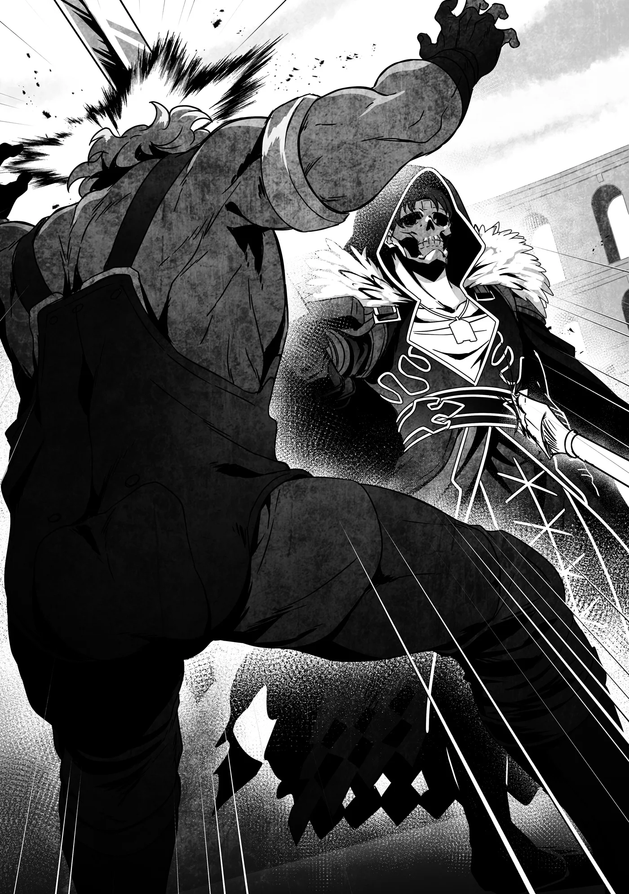

# Chương 259: Tập 11 Chương 3 - Tổ Chức (4)

Giờ thì, tôi đã nắm khá rõ dị năng của Vaasa. Cũng như tôi, cậu ta có thể vẫn còn bài tẩy giấu kín, nhưng nếu cứ vì thế mà chùn bước không dám tấn công thì trận đấu này sẽ chẳng đi đến đâu. Giao tranh luôn đi liền với rủi ro. Chiến thắng chỉ thuộc về kẻ biết rõ điều đó mà vẫn dám dấn bước. Hoặc ít ra lý lẽ của tôi là thế.

"Được rồi, tiếp tục nào," tôi nói. "Tôi tới đây."

Tôi vốn chẳng cần phải báo trước như vậy, nhưng nhìn bộ dạng Vaasa thì dường như cậu ta vẫn còn đôi chút thất thần sau những cú sốc vừa rồi. Dù hoàn toàn có thể tận dụng lợi thế đó để tấn công, tôi lại không muốn cậu ta kêu ca thua không phục sau trận đấu. Tôi muốn thắng trận này một cách đường đường chính chính. Đấy là nếu như chuyện sở hữu một cơ thể chịu đòn chí mạng vẫn lành lặn lại như mới được coi là "công bằng."

Vaasa gằn giọng. "Tới đi!"

Mấy lời của tôi đã kéo cậu ta ra khỏi cơn thất thần, và vẻ mặt cậu ta nghiêm túc trở lại khi siết chặt cây giáo trên tay. Thế thủ của cậu ta rất kín kẽ, chẳng lộ chút sơ hở nào. Tôi không rõ cậu ta đã hồi sức được bao nhiêu phần, nhưng rõ ràng cậu ta không còn để cái vẻ quái dị của tôi làm lung lạc tinh thần nữa.

Thấy vậy, tôi lại lao lên. Lần này, tôi vận dụng kiếm thuật bài bản để chém tới. Làm đối thủ con người trở tay không kịp bằng những cử động phi nhân loại thì cũng hay đấy, nhưng xét về mặt uy lực, những động tác gượng gạo, trái tự nhiên đó chỉ đạt chừng bảy mươi phần trăm hiệu quả so với đòn đánh chuẩn mực. Lý do duy nhất tôi làm được là nhờ dùng Khí Lực và Ma Lực để cưỡng ép cơ thể. Còn trong một trận đấu nghiêm túc, thứ kiếm thuật mà tôi dày công mài giũa từ hồi mới vào nghề mạo hiểm giả vẫn thoải mái và thuận tay hơn nhiều.

Thế nhưng, có lẽ đòn tấn công quá dễ đoán nên Vaasa đã dùng giáo gạt thanh kiếm của tôi sang bên. Cậu ta liền thuận đà hạ giáo xuống, nhắm thẳng vào lồng ngực đang hoàn toàn sơ hở của tôi mà đâm tới. Nhưng thế cũng chẳng sao, bởi tôi chỉ việc ngửa rạp người ra sau là né được đòn đâm của cậu ta.

"Lại nữa sao?!" Vaasa hét lên.

Đây chẳng phải lần đầu cậu ta thấy cảnh này, nhưng tôi không trách cậu ta vì chưa kịp thích nghi. Ai đời lại nghĩ đối thủ của mình sẽ làm cái trò đó trong lúc giao đấu cơ chứ?

Vaasa khựng lại một thoáng, có lẽ vì chưa biết phải xử lý cây giáo ra sao tiếp theo. Tôi thuận đà ngửa người, chống hai tay xuống đất phía sau rồi mượn trớn tung người trồng cây chuối, đá hết sức vào ngay dưới mũi giáo đang khựng lại của cậu ta. Chưa dừng lại ở đó, tôi chống tay bật ngược ra sau thành một cú lộn nhào, vừa chạm chân xuống đất là đạp mạnh lao thẳng về phía Vaasa.

Mọi chuyện diễn ra chỉ trong chớp mắt, nên cậu ta còn chưa kịp thu giáo về thế thủ. Lúc này, cậu ta thấy rõ tôi và đọc được nước đi tiếp theo, nhưng chẳng tài nào cản nổi. Tôi áp sát, vung thanh kiếm nãy giờ giấu sau lưng chém ngang một đường vào ngực cậu ta.

Chỉ nghe thấy một tiếng keng chói tai vang lên thật lớn. Tôi nhìn kỹ hơn thì thấy thứ gì đó như một tấm kim loại đang bọc trước ngực Vaasa. Rõ ràng ban nãy nó không hề có ở đó, vì cậu ta vốn chỉ mặc giáp da nhẹ.

Đồng nghĩa với việc tấm kim loại ắt hẳn do dị năng của cậu ta tạo ra. Như để chứng minh, ngay khoảnh khắc sau, nó biến đổi hình dạng thành vô số vật phóng tựa mũi tên bắn thẳng về phía tôi. Chúng nhỏ hơn nhiều so với mấy thanh dao găm lúc nãy, nhưng với số lượng áp đảo thế này thì khó mà né hết.

Tôi không thể lùi thẳng ra sau vì khoảng cách quá gần, nên đành vừa thụt lùi vừa di chuyển zích zắc. Dẫu vậy, tôi vẫn không tránh được hết, và một mũi tên đã sượt qua vai tôi. May mà có lớp áo choàng cản lại, và khả năng phòng hộ đáng tin cậy của nó hiếm khi để thứ gì lọt qua. Mũi tên con con bật văng ra ngoài.

Thấy tôi lùi bước, Vaasa như được tiếp thêm khí thế liền lao tới. Những đòn giáo của cậu ta dồn dập và hung mãnh. Mở màn bằng một cú chém dọc, tôi vừa né xong thì cậu ta lập tức quét ngang, rồi khi tôi nhảy lùi ra sau lại biến thành một cú đâm thẳng.

Thanh kiếm của tôi đang hạ thấp, và tôi không kịp giương lên đỡ. Cậu ta xoáy mạnh mũi giáo khi đâm, nên nếu trúng đòn, nó sẽ xuyên rất sâu. Tôi hiển nhiên chẳng muốn chuyện đó xảy ra, nhưng hễ toan né thì hàng loạt mũi tên kim loại lại xuất hiện chắn đường và lao thẳng về phía tôi.

Dị năng của Vaasa đối phó phiền toái thật sự. Tôi buộc phải thừa nhận trong những tình huống thế này, năng lực ấy đúng là đáng giá ngàn vàng.

Tên hay giáo? Đằng nào thì cũng bị đâm thôi, chết tiệt. Dẫu vậy, chọn tên vẫn là nước đi hiển nhiên hơn: chúng ít uy lực hơn giáo. Chẳng còn cách nào khác, tôi lao thẳng về phía đám tên. Đó là cách duy nhất để thoát khỏi mũi giáo của cậu ta.

"Hử?!"

Bị vài mũi tên cắm vào người chẳng phải chuyện gì to tát với cái thân xác này, nhưng Vaasa dường như không ngờ tôi lại làm vậy. Trông cậu ta có vẻ ngạc nhiên, dù không choáng váng như lần trước, và cây giáo vẫn không hề dừng lại.

Thực ra thế thì hơi tiếc, vì nếu cậu ta khựng lại thì tôi đã có khoảng trống để thoát thân. Dù sao đi nữa, đúng như dự tính, tôi đâm đầu vào làn mưa tên kim loại do dị năng của Vaasa tạo ra, để mặc chúng cắm vào mạn sườn trái. Có điều vì vừa mới ngưng hình nên lực phóng không mạnh như tôi tưởng, tôi chỉ bị vài vết thương nông ngoài da.

Tôi thầm cảm tạ vận may, rồi chớp lấy chút thời gian ngắn ngủi vừa tự tạo ra, tôi giương kiếm lên, truyền Khí Lực vào lưỡi kiếm và chém mạnh vào đầu giáo của Vaasa.

Cậu ta đã áp sát và dồn tôi vào thế bí bằng đợt công kích dồn dập, nhưng đây cũng chính là cơ hội lớn nhất của tôi. Thêm vào đó, vì đám tên vẫn còn cắm trên người tôi, khó mà tin cậu ta có thể dùng dị năng để phòng thủ. Phán đoán của tôi nãy giờ mách bảo rằng cậu ta không thể tạo thêm kim loại nếu chưa thu hồi số đã tạo ra. Cũng có thể cậu ta chỉ đang vờ vịt, nhưng lúc này, tôi sẵn sàng đặt cược vào canh bạc đó.

Và tôi đã cược đúng. Thanh kiếm truyền Khí Lực của tôi chém trúng ngay bên dưới mũi giáo của cậu ta và chém đứt ngọt xớt, hất văng mũi giáo ra xa.

"Chết tiệt thật!" Vaasa hét lên.

Cậu ta lập tức dừng công kích và lùi lại, hẳn vì nhận ra tiếp tục giáp lá cà lúc này chẳng khôn ngoan chút nào.

Thế là trả đũa xong. Tôi nhìn sang Vaasa, bụng thầm mong chặt gãy vũ khí là phân định thắng thua luôn cho rồi, nhưng trông cậu ta vẫn còn hăng máu lắm. Trận đấu vẫn chưa kết thúc...

◆◇◆◇◆

Tôi tự hỏi giờ Vaasa định đánh tiếp bằng cách nào. Khi tôi còn đang quan sát, cậu ta bắt đầu lộ rõ vẻ tập trung cao độ. Rồi kim loại bắt đầu thành hình nơi đầu cây giáo gãy, tạo nên một mũi giáo mới toanh.

À. Có lẽ tôi nên lường trước điều đó, xét theo dị năng của cậu ta. Dẫu vậy, nó có thể bền chắc và cứng cáp đến đâu chứ? Trông chỉ như một món chắp vá vội vàng. Nhưng muốn biết thì chỉ có một cách duy nhất để kiểm chứng. Trước khi Vaasa kịp chuẩn bị xong xuôi, tôi lao thẳng về phía cậu ta.

Vaasa hừ một tiếng; cậu ta chẳng hề mong tôi đứng đợi mà phản ứng ngay tắp lự. Cậu ta dùng khoảng cán giáo giữa hai tay nắm để chặn đứng nhát kiếm bổ xuống của tôi. Ở cự ly gần, tôi thấy phần tay cầm được bọc một lớp kim loại mỏng, mang lại cảm giác gia cố cực kỳ chắc chắn.

Dị năng của cậu ta quả thực vô cùng biến hóa. Nếu chịu khó động não và mài giũa thêm, cậu ta có thể trở nên rất đáng gờm; nhưng ở trình độ hiện tại, tôi vẫn thừa sức trên cơ cậu ta.

Có lẽ ông lão cũng đặt nhiều kỳ vọng vào Vaasa. Nếu ông ấy bắt cậu ta giao chiến với muôn vàn đối thủ khác nhau nhằm tích lũy kinh nghiệm, thì... Khoan đã nào. Tôi cũng là một trong số đối thủ đó đấy à? Tính ông lão thì việc dàn xếp mọi chuyện để phe mình kiếm chác được chút lợi ích chẳng có gì lạ.

Thế đánh của Vaasa lúc này đã có đôi chút khác biệt. Không phải chậm đi, mà chỉ đơn giản là đổi lối đánh. Trước đó, cậu ta đâm và chém như bất kỳ giáo thủ nào khác, nhưng giờ cậu ta lại di chuyển chẳng khác gì một người múa côn. Hẳn cậu ta đã rèn luyện cả hai ngón đòn để dù mũi giáo gãy vẫn chiến đấu tiếp được. Nghĩ lại thì hoàn toàn hợp lý, vì cậu ta có thể dùng dị năng tái tạo mũi giáo ngay giữa trận rồi đổi ngược lại làm giáo thủ.

Xét theo nghề nghiệp của cậu ta, tôi đoán không phải lúc nào cậu ta cũng cần giết mục tiêu. Đôi khi còn phải bắt sống mang về. Chuyện tổ chức nhúng tay vào các vụ bắt cóc tống tiền nghe chừng hoàn toàn có cơ sở. Gặp những trường hợp đó, đâm một lỗ trên người nạn nhân làm họ mất mạng thì rắc rối to. Dùng côn giúp cậu ta dễ bề kiềm chế đòn đánh, có thể dùng để tẩn cho một trận, đánh bất tỉnh đối phương, đại loại thế.

Cây côn của Vaasa đảo qua đảo lại như múa để đỡ gạt, trong khi kiếm của tôi đâm chém từ những góc độ và thời điểm quái dị khiến cậu ta không tài nào tập trung nổi lấy một giây. Có vẻ cậu ta đã dần quen với sự kỳ dị và khó lường từ cơ thể tôi, nhưng thói quen vận động đã ăn sâu bám rễ bao năm đâu phải muốn sửa trong một sớm một chiều là xong. Thứ thương thuật vốn xây dựng trên tiền đề đối thủ có phạm vi cử động của một con người bình thường thì khó lòng mà đỡ nổi các đường kiếm của tôi.

Nếu đụng độ những cao thủ hàng đầu thì mấy chiêu quái gở của tôi hiển nhiên chẳng bõ bèn gì. Ngoài kia không thiếu những người như Nive, thân pháp thoăn thoắt uyển chuyển tới mức có thể một mình đối phó cả Ma Cà Rồng dùng Phân Liệt.

Đẳng cấp của cô ấy là một thế giới hoàn toàn khác biệt, còn Vaasa thì chưa với tới tầm đó. Dần dà, các đòn kiếm của tôi bắt đầu chạm trúng đích. Thể lực của cậu ta đang cạn kiệt. Phải liên tục chống đỡ những chuyển động quái dị cùng những cú đâm từ hướng hiểm không chỉ vắt kiệt sức bền thể chất, mà còn bào mòn cả tinh thần.

Trái lại, với tôi thì ngay từ đầu vốn dĩ chẳng có khái niệm thể lực, còn sức chịu đựng tinh thần cũng vững vàng hơn hẳn so với hồi còn làm người. Nếu muốn, tôi có thể chiến đấu ba hoặc bốn ngày liên tục. Đọ sức bền với một đối thủ Undead là trận chiến gian nan vô cùng. Mà đó còn chưa phải tất cả; tôi có thể xem hàng tá vết thương chí mạng như không. Giờ thì tôi hiểu vì sao thời cổ đại người ta lại khiếp sợ Undead đến thế.

"Khốn khiếp!" Vaasa lầm bầm, trừng mắt nhìn tôi. Cậu ta hẳn hiểu rằng tình thế của mình chỉ ngày một tệ đi. Cậu ta siết chặt cây giáo. Mũi giáo đã tái tạo xong xuôi, và cậu ta lại di chuyển như một giáo thủ.

"Đến lúc kết thúc trận này rồi," tôi nói.

"Đừng hòng!" Cậu ta thủ thế giáo rồi đâm thẳng về phía tôi.

So với một kẻ mình mẩy đầy vết thương như cậu ta, tôi về cơ bản vẫn bình an vô sự. Nói đúng ra thì chúng tôi gây sát thương cho nhau ngang ngửa; chỉ có điều tôi chịu đòn nện thay vì những vết chém. Cơ mà thân xác Undead của tôi lần nào cũng lành lại trong chớp mắt, nên nhìn từ bề ngoài, tôi hoàn toàn nguyên vẹn không chút xây xát. Dĩ nhiên lượng sinh mệnh lực tôi rút ra được là có hạn, nhưng việc cơ thể luôn giữ được phong độ hoàn hảo cho tới lúc cạn kiệt quả thực quá đỗi bất công.

Cơ thể nó tự vận hành như thế đâu phải lỗi của tôi, nên có gì thì cũng thông cảm cho tôi một chút. Dẫu vậy, tôi quả thực cảm thấy có chút áy náy khi trận đấu này chẳng mang lại cảm giác "đường đường chính chính" chút nào.

Đòn đâm của Vaasa nhắm thẳng vào tôi, nhưng lực đòn đã yếu đi nhiều. Tôi nghĩ bụng sẽ rất dễ né tránh, nào ngờ vừa thoáng nghĩ vậy...

"Đỡ lấy này!" Vaasa quát lớn, rồi mũi giáo của cậu ta bay thẳng về phía tôi như một mũi tên.

À. Cậu ta làm được trò đó là nhờ dùng dị năng tạo ra mũi giáo. Dù không khiến tôi trở tay không kịp, nhưng vật phóng lại bay nhanh và mạnh hơn đôi chút so với tôi dự tính. Có lẽ việc bị dồn vào chân tường đã mang lại cho cậu ta một nguồn sức mạnh bộc phát, hoặc cậu ta đã bày mưu tính kế để đặt cược tất cả vào khoảnh khắc này. Tôi cũng chẳng rõ. Chỉ biết mũi giáo lao thẳng tắp và cắm phập vào bụng tôi trước khi tôi kịp né tránh.

"Trúng rồi!" Như được tiếp thêm khí thế, Vaasa bước tới để bồi thêm đòn tấn công tiếp theo. Đó là lẽ tự nhiên; thông thường, đó sẽ là dạng vết thương làm cùn mòn phản xạ của một người dù họ có cố gượng chiến đấu đến đâu chăng nữa. Tuy nhiên...

"Hơi nhói một chút đấy." Bụng vẫn còn găm mũi giáo, tôi mặc kệ nó mà sấn lại gần Vaasa, cử động của tôi chẳng hề có chút khác biệt nào so với lúc trước.

"C-Cái gì cơ?!"

Hiển nhiên, việc tôi chẳng hề có phản ứng nào đã khiến cậu ta cuống cuồng, điều đó cũng hoàn toàn dễ hiểu. Chẳng có con người nào bị một mũi tên đâm trúng bụng mà mặt vẫn tỉnh queo như không, huống hồ là di chuyển không chút trở ngại. Nhưng khổ nỗi tôi đâu phải con người, thế là xong chuyện. Ngay từ đầu, nếu là con người thì có lẽ tôi đã chẳng thể giành chiến thắng rồi.

Trong lúc suy ngẫm điều đó, tôi vung thanh kiếm bổ thẳng xuống đầu cậu ta. Dĩ nhiên tôi không định lấy mạng cậu ta, nên chỉ dùng bản kiếm. Đòn đánh chuẩn xác không lệch một ly, nện trúng đích.

"Ặc!"

Vaasa lập tức ngã gục xuống. Mắt cậu ta trợn ngược lên, rồi nằm bất động trên sàn.

"Này, cậu vẫn còn sống... đúng không đấy?" Hơi lo rằng mình đã lỡ tay vung kiếm quá mạnh, tôi tiến lại gần để kiểm tra tình trạng của cậu ta.

Thấy cậu ta quả thực vẫn còn sống, tôi nhìn về phía ông lão.

"Nó bất tỉnh nhân sự rồi. Phần thắng thuộc về cậu, Rentt."

◆◇◆◇◆

"C-Cái quái gì vừa xảy ra thế?!" một giọng nói vang lên bên cạnh Lorraine, từ phía khán đài. Ông lão lúc này đã bước xuống sàn đấu để kiểm tra xem Vaasa có thực sự ngất đi hay không.

Dù đảm nhiệm vai trò trọng tài của trận đấu, tất cả những gì ông cần làm chỉ là tuyên bố bắt đầu và ngăn chặn sự can thiệp từ bên ngoài, thế nên việc ông ngồi trên khán đài cũng chẳng có vấn đề gì. Dù vậy, ông buộc phải xuống tận nơi để xác nhận xem Vaasa còn sống hay chỉ đơn thuần ngất đi, nhưng đó là điều hiển nhiên.

Lorraine nhìn về hướng phát ra tiếng la hét và trông thấy Fuana Thông Ma Pháp. Cô bé dường như không thể tin vào mắt mình trước trận đấu vừa chứng kiến. Nỗi hoài nghi của cô bé hẳn không bắt nguồn từ thất bại của Vaasa hay tinh thần đồng đội cùng niềm tin dành cho cậu ta, mà đơn giản chỉ là vì những cử động của Rentt.

Lorraine là người ở bên cạnh Rentt lâu nhất kể từ lúc anh có được cơ thể Undead, ấy thế mà đôi khi chính cô vẫn cảm thấy khó tin. Thật dễ hiểu khi một người lần đầu tiên chứng kiến lại chịu cú sốc lớn đến nhường nào.

Nhận thấy cơ hội để trêu đùa đôi chút, Lorraine cất tiếng hỏi Fuana. "Có chuyện gì sao?"

"'Có chuyện gì sao' á? Dĩ nhiên là có rồi! Bộ cô không nhìn thấy hả?!"

"Thấy cái gì cơ?"

"Anh ta di chuyển cứ như thể không có xương sống vậy! Vaasa đã đánh trúng đích không ít lần, thế mà anh ta chẳng hề có chút phản ứng nào! Ngay cả đoạn cuối khi mũi giáo cắm phập vào bụng anh ta cũng trơ trơ ra đấy!"

Undead trên thực tế vẫn có xương sống, nhưng cơ thể của họ lại mềm dẻo chẳng khác nào loài thân mềm. Đặc điểm độc nhất vô nhị của họ là hầu như mọi dạng thương tổn gây ra lên cơ thể đều vô nghĩa cho đến khi sự tồn tại của họ không còn có thể duy trì được nữa và tan biến. Đó là lý do tại sao Rentt không hề phản ứng trước các đòn đánh của Vaasa, hay thậm chí cả mũi giáo. Tuy nhiên, cô đâu thể giải thích chuyện đó ra, mà dẫu có giải thích được đi chăng nữa, cũng chẳng có gì đảm bảo Fuana sẽ tin lấy nửa lời. Chẳng còn lựa chọn nào khác, Lorraine đành đưa ra một lời thoái thác nghe có phần hơi thiếu chính xác đôi chút.

"Đó chỉ là dị năng của anh ấy thôi mà, phải không? Khi thấy Vaasa sử dụng dị năng của cậu ta—tên là Cường Thiết đúng chứ?—tôi cũng có cảm giác y hệt. Một dị năng có thể tạo ra vũ khí từ hư không ư? Tôi đã muốn hét vào mặt cậu ta rằng hãy biết tôn trọng các định luật vật lý hơn một chút đấy."

Thú thật, cô cũng đang thắc mắc không hiểu Vaasa làm cách nào để thực hiện được điều đó. Cô có thể thấu hiểu ma pháp và khí thuật, bởi lẽ chúng là những hiện tượng vận hành nhờ các nguồn năng lượng tương ứng là Ma Lực và Khí Lực. Dẫu vậy, cô vẫn có cảm giác rằng các dị năng bắt nguồn từ một thứ gì đó khác. Chúng dường như không sử dụng bất kỳ loại năng lượng nào. Có lẽ, cũng giống như Ma Lực, chỉ những ai sở hữu nó mới có thể cảm nhận được, nhưng...

Xét theo khía cạnh đó, cả Rentt lẫn Vaasa đều có vẻ dị thường như nhau đối với một con người "bình thường" như cô.

Dù bản thân cũng là người sở hữu dị năng, Fuana rõ ràng vẫn cảm thấy Rentt quá đỗi kỳ quặc. "Ngay cả ông già cũng sẽ có chút phản ứng sau khi trúng nhiều đòn đến thế! Dị năng đó đúng là... đúng là kỳ quái hết sức!"

"Cô nghĩ vậy sao?" Lorraine nói. "Tôi tự hỏi không biết giới hạn về phạm vi của các dị năng là đến đâu. Dù chính bản thân tôi cũng chẳng nắm rõ cho lắm..."

Trước khi cuộc trò chuyện tréo ngoe của họ có thể tiếp diễn...

"Phù, cuối cùng cũng thắng được rồi."

Rentt bước lại gần khán đài. Bên cạnh anh là ông lão đang vác Vaasa trên vai—lại còn hết sức dễ dàng, điều gần như mang lại cảm giác kỳ quặc xét theo thân hình đồ sộ của gã đàn ông đang bất tỉnh, nhưng xét theo bản chất thực sự của ông lão thì chuyện đó hoàn toàn dễ hiểu. Nếu muốn, ông có thể hóa lớn gấp nhiều lần so với Vaasa.

Ông lão bước tới khán đài rồi tiện tay quẳng Vaasa vào trong.

"Khoan đã nào," Rentt lo lắng nói. "Cậu ta có sao không đấy? Tôi chỉ vừa đánh bất tỉnh cậu ta thôi. Chẳng phải ông nên nhẹ tay với cậu ta hơn một chút sao...?"

Ông lão khịt mũi. "Nó đâu phải khổ luyện đến mức đó để rồi bị thương tổn chỉ vì trò cỏn con như vậy. Hơn nữa, nó đã quá đỗi mất cảnh giác. Đối xử thô bạo một chút cũng chẳng làm nó chết được đâu."

"Cá nhân tôi thì thấy cậu ta đã chiến đấu rất cừ. Đặc biệt là khi xét đến việc đối thủ của cậu ta là tôi."

"Hử? Ta thấy vẻ bất mãn thoáng hiện trên mặt cậu đấy à?"

"Không, không phải thế... Tôi chỉ thấy bản thân thắng hơi thiếu công bằng một chút thôi."

Rentt hẳn đang nói về việc anh về cơ bản đã ỷ vào thân xác Undead để cưỡng ép giành chiến thắng. Ngay cả khi trình độ dị năng tương đương, hay thậm chí kém một bậc, thì nguồn thể lực và sức chống chịu vô tận rốt cuộc vẫn có thể mang lại chiến thắng cho anh. Về bản chất, có lẽ anh cảm thấy mình không giành chiến thắng bằng chính thực lực.

Tuy nhiên, ông lão đáp lại, "Ngay cả khi cậu dùng dị năng để ép thắng, điều đó vẫn được tính là bản lĩnh của chính cậu. Ngay từ đầu, hãy thử nghĩ xem: bọn ta là một tổ chức trong thế giới ngầm từng cố ám sát cậu. Thằng nhóc dám thách đấu trực diện với cậu mà chẳng thèm điều tra trước bất cứ điều gì rồi chuốc lấy thất bại. Quá rõ ràng để thấy ai trong hai người mới là kẻ ngốc."

Giọng điệu của ông lão mang vẻ tự giễu, nhiều khả năng là vì chính ông cũng từng phạm phải sai lầm tương tự chỉ vài ngày trước. Dẫu vậy, ngay cả khi đó, ông cùng Goblin và Siren đã nhận được thông tin từ tổ chức, cố hết sức tránh gây chú ý, và chỉ tìm đến giải pháp dùng vũ lực sau khi mọi phương án khác đều đổ bể. So sánh ra thì Vaasa lại chọn cách lao đầu vào một cách mù quáng, điều này càng củng cố thêm cho lý lẽ của ông lão.

"Ông nghĩ vậy sao?" Rentt hỏi.

"Phải. Xét theo khía cạnh đó, đây là thất bại toàn diện của nó. Cậu đã cất công thu thập thông tin về nó từ ta và nghênh chiến sau khi vạch ra những đối sách hợp lý. Hy vọng rằng sau chuyện này nó sẽ rút ra được bài học cho mình..."

"Tôi biết ngay mà. Ông đã mượn tay tôi để dạy cho cậu ta một bài học."

"Ồ? Cậu nhận ra rồi à? Thế cũng tốt mà, phải không? Đôi bên cùng có lợi, chẳng ai thiệt thòi."

"Đó là chỉ khi tổ chức của ông không tiếp tục nhắm vào chúng tôi nữa..."

Họ đến đây chính là để ngăn chặn điều đó, nhưng chẳng ai có thể nói trước chuyện gì sẽ xảy ra.

"Ta chắc chắn cũng không mong thế đâu," ông lão nói. "Ta đã chịu đựng đám các cậu quá đủ rồi. Đừng lo. Nếu có lệnh giáng xuống, ta sẽ từ chối."

"Ừm, thôi thì... tạm gác chuyện đó lại vậy." Rentt quay sang Lorraine và Fuana. "Vậy hai người là cặp đấu tiếp theo đúng chứ? Đã sẵn sàng chưa?"

"Rồi, tôi có thể bắt đầu bất cứ lúc nào," Lorraine đáp.

"Hả?!" Fuana thốt lên. "Ơ, t-tôi, ừm, phải rồi, tôi lúc nào cũng sẵn sàng!"

Giọng cô bé nghe run rẩy một cách kỳ lạ. Rõ ràng, trận đấu của Rentt đã mang lại cú sốc không hề nhỏ đối với cô bé.
