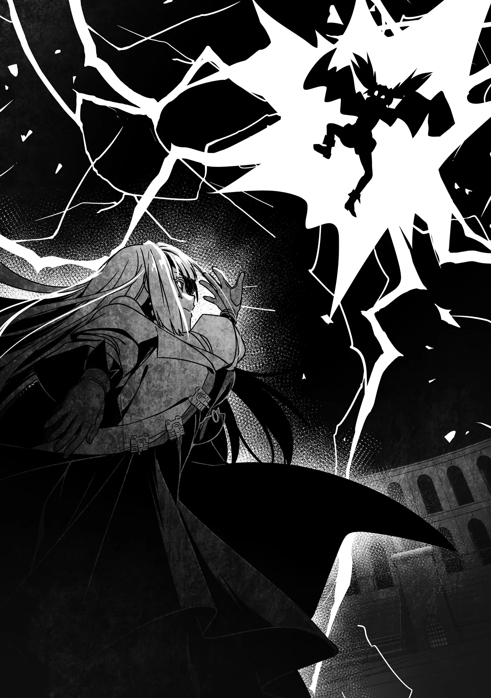
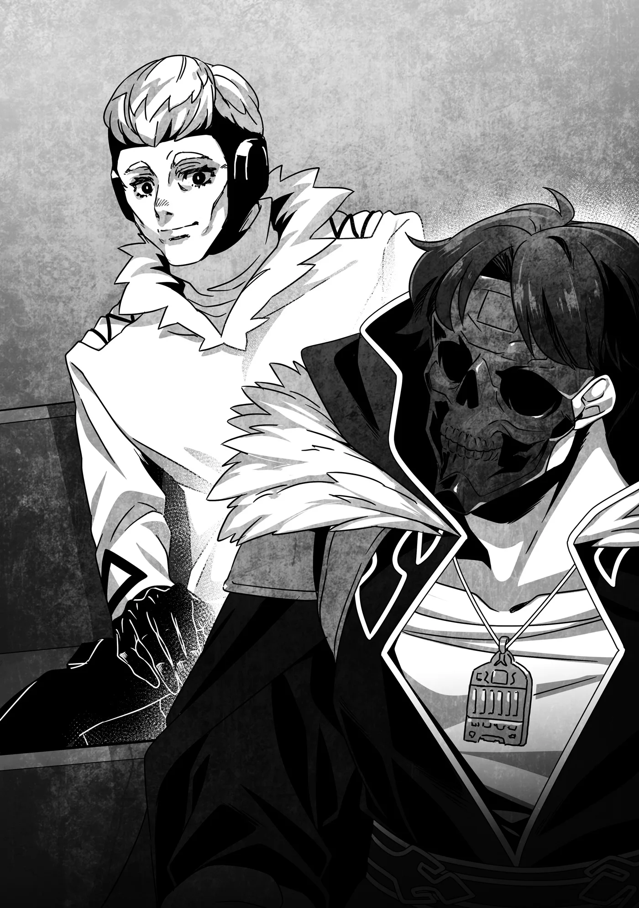

# Chương 261: Tập 11 Chương 3 - Tổ Chức (6)

"Chỉ có thế thôi sao?" Lorraine hỏi, nhìn thẳng vào mắt đối thủ. Dù toàn thân cô gái đã cháy sém, đôi mắt ấy vẫn chưa hề đánh mất chiến ý.

"Vậy thì tôi sẽ kết thúc chuyện này sớm thôi."

Chỉ nhìn bề ngoài thì khó mà phân định trong tình huống này ai mới là kẻ phản diện. Lorraine là một mạo hiểm giả đàng hoàng, còn Fuana lại thuộc một tổ chức sát thủ, nên có lẽ người ta sẽ xem Fuana là kẻ xấu. Thế nhưng lúc này, nhìn từ góc độ nào Lorraine cũng chẳng khác gì một nữ phản diện: như một mụ phù thủy đang khinh khỉnh nhìn xuống cô bé ngây thơ vô tội và từ từ dồn ép đối phương vào chân tường.

"Chưa xong đâu!" Fuana hét lên rồi đạp mạnh xuống mặt đất.

Lorraine biết đòn sấm sét vừa rồi hẳn phải khiến cơ thể đối thủ chịu thương tổn đáng kể, nhưng cô ta di chuyển nhanh tới mức cô chẳng nhận ra nổi dấu hiệu thương tật nào. Chỉ trong chớp mắt, Fuana đã áp sát Lorraine, nắm đấm vung sẵn giữa không trung, nhưng quanh Lorraine lại được bảo vệ bởi vô số lớp Khiên Chắn. Dù nắm đấm của Fuana đập vỡ từng lớp một, cô lại dựng lên lớp mới nhanh không kém, không, thậm chí còn nhanh hơn, khiến đòn đánh của cô ta chẳng tài nào chạm nổi vào người. Mà đâu chỉ có thế.

"Barqharba Sijn."

Khả năng tấn công của cô cũng chẳng hề kém cạnh. Câu niệm chú vừa dứt, mười ngọn giáo sét liền xuất hiện từ trên không rồi cắm phập xuống mặt đất, vây lấy Fuana. Khoảng không phía trên vẫn còn trống, Fuana toan nhảy vọt lên thoát thân, nhưng trước khi cô ta kịp làm vậy, sấm sét lại hiện ra bịt kín khoảng trống, hoàn tất nhà giam. Rồi...

"Shikhrér," Lorraine lẩm bẩm.

Những ngọn giáo sét vây quanh Fuana nổ lách tách, rồi bắt đầu đánh vào bên trong. Sấm sét giáng xuống dữ dội như mưa rào. Không còn chỗ nào để né tránh, tất cả những gì Fuana có thể làm là chịu trận để những tia sét nện thẳng vào cơ thể. Hầu như chẳng ai hứng trọn một đợt tấn công như thế mà vẫn đứng vững nổi, nhưng trước sự ngạc nhiên của Lorraine, sau hơn chục giây sét đánh liên hồi và nhà giam tan biến, Fuana lại lao vọt về phía cô với khí thế mãnh liệt.

"Ồ?" Lorraine thích thú nói. "Cô chịu được đòn đó sao? Tôi cứ tưởng nó đã đánh trúng trực diện rồi chứ, xem ra không phải."

"Hừ," Fuana đáp. "Cảm ơn vì đã tặng cho tôi ma pháp của cô nhé!"

"Cái gì?!"

Cô cố đoán xem câu đó có ý gì, nhưng nắm đấm của Fuana đã lao thẳng tới trước mặt. Trong thoáng chốc, Lorraine thấy hành động này thật ngốc nghếch vì cô ta lại lặp lại y nguyên đòn tấn công lúc trước, nhưng ý nghĩ ấy lập tức tan biến ngay khi cú đấm chạm đích.

"Hự!"

Lần đầu tiên, nắm đấm của Fuana đập xuyên qua toàn bộ các lớp Khiên Chắn của Lorraine, rồi nện thẳng vào cánh tay cô. Dù Lorraine đã cố hết sức giảm bớt lực va chạm, suy cho cùng cô vẫn là một ma pháp sư. Dẫu có dùng Ma Lực cường hóa thể chất, bấy nhiêu cũng không đủ để giúp cô hoàn toàn miễn nhiễm trước cú đấm đó. Cô lập tức nhảy lùi lại để kéo giãn khoảng cách với Fuana, nhưng cánh tay của cô...

"Cảm giác hơi... tê dại."

Nó tê rần như thể vừa bị sét đánh trúng. Cô quan sát kỹ Fuana đang đuổi theo bồi thêm đòn nữa và nhận ra cơ thể cô ta đang được bao bọc bởi những tia sét nổ lách tách. Đó là...

Trong lúc đầu óc cô đang xoay chuyển rất nhanh, Fuana đã lại tung cú đấm tiếp theo. Cú đấm một lần nữa phá vỡ các lớp khiên, nhưng lần này cô đã lường trước và ước lượng được phần nào uy lực của nó. Cô liền dựng thêm nhiều lớp Khiên Chắn dày hơn, thành công chặn đứng nắm đấm lại bên ngoài.

Fuana chẳng hề bỏ cuộc. Cô ta vặn người, tung một cú đá vòng cầu nhắm thẳng vào khoảng trống mà nắm đấm vừa rút về để lại. Cú đá đập vỡ nát những lớp Khiên Chắn còn lại và hất văng Lorraine ra xa. Thế nhưng Fuana không chịu buông tha, cô ta đạp mạnh xuống đất rồi phóng vọt lên không trung, thu hẹp khoảng cách.

"Kết thúc rồi!" Fuana lộn một vòng giữa không trung, rồi tung cú đá bổ nhào thẳng xuống chỗ Lorraine.

Quả nhiên là vậy, Lorraine thích thú nghĩ thầm. Thứ bao quanh chân cô ta chắc chắn là sấm sét.

"Nhưng vẫn chưa hoàn thiện đâu," Lorraine lẩm bẩm.

Cô bắn một phát Fotiá Volídas ngay giữa không trung để chỉnh lại quỹ đạo và đẩy mình né khỏi cú đá bổ nhào của Fuana. Chạm đất trước đối thủ, cô nhắm thẳng vào Fuana khi cô ta vẫn còn chưa kịp tiếp đất, rồi...

"Barák Seará!"

Sấm sét ngưng tụ thành một khối cầu bọc lấy Fuana, rồi hòa lẫn cùng gió lốc, liên hồi đánh và chém xé vào bên trong như một cơn bão dữ dội.

Fuana thét lên.

Ma pháp chỉ kéo dài chừng mười giây. Thế nhưng đó là mười giây hứng trọn toàn bộ nanh vuốt cuồng bạo của cơn bão. Cuối cùng, Fuana người ngợm bốc khói cháy sém rơi từ trên không xuống, đổ ập xuống mặt đất.

Lorraine nhìn về phía ông lão, và ông liền bước xuống sàn đấu để kiểm tra Fuana.

"Con bé vẫn còn sống," ông nói. "Đừng lo. Sức chịu đựng bền bỉ là điểm đáng khen duy nhất của con bé đấy. Ồ, mà suýt nữa thì quên: người chiến thắng là... Lorraine!"

◆◇◆◇◆

"Cô ứng biến xuất sắc thật đấy," ông lão nói với Lorraine khi cả hai cùng trở lại khán đài. Giọng ông ấy đầy vẻ thán phục. "Đến cả ta cũng chẳng biết Fuana lại làm được như vậy."

"Ý ông là chuyện cô ta bọc sấm sét quanh người ấy à?" Lorraine hỏi.

"Ừm. Ta chịu, chẳng biết đấy là trò gì."

"Tôi cũng chưa chắc chắn hoàn toàn, nhưng tôi cho là cô ta đã tái sử dụng ma pháp tôi vừa đánh lên người cô ta để làm thành lớp giáp. Hẳn là một ma pháp nguyên bản do chính cô ta sáng tạo ra. Danh hiệu 'Thông Ma Pháp' của cô ta xem ra cũng chẳng sai chút nào."

"Ồ? Ấn tượng đến mức đó cơ à?"

Nghe hai người nói chuyện, tôi bỗng nảy ra một thắc mắc: "Nhưng cuối cùng cô vẫn hạ được cô ta bằng Barák Seará đấy thôi? Nếu đã khoác được ma pháp của người khác lên người, sao cô ta không làm thế với đòn đó?"

"Chưa hỏi cô ta thì tôi cũng không dám chắc," Lorraine đáp, "nhưng có vẻ ma pháp của cô ta vẫn chưa hoàn thiện. Đúng là cô ta đã khoác được sấm sét của tôi, nhưng khi quan sát kỹ hơn, tôi nhận thấy cô ta vẫn bị chính thứ đó làm bị thương. Vết thương của cô ta cứ tăng dần lên từng khắc, còn Ma Lực thì tiêu hao vọt lên tới mức chóng mặt. Dù vậy, bản thân ý tưởng đó cực kỳ hấp dẫn. Ma pháp này nhìn qua thì đơn giản, nhưng tôi nghĩ thực ra nó rất sâu sắc. Chính tôi cũng rất muốn thử nghiên cứu về nó."

◆◇◆◇◆

"Ư..."

Một lúc sau, Fuana tỉnh lại. Vết thương của cô ta phần lớn đã lành, nhờ Lorraine lấy bình thuốc hồi phục mang sẵn bên mình dội lên người cô ta.

Dù có lẽ Lorraine sẽ nổi giận nếu tôi nói thẳng ra, nhưng tôi nghĩ có khi cô ấy làm vậy vì thấy áy náy nếu bỏ mặc một cô bé bị thương tích và bỏng rát khắp người.

Lorraine liền lẩm bẩm: "Sẽ cản trở cho tôi lắm nếu cô ta mất đi khả năng dùng ma pháp đó vì chuyện này."

Đúng là Lorraine, chẳng bao giờ ngại sống đúng với bản tính của mình. Nhưng kể cả Fuana có không thể dùng lại ma pháp khoác phép thuật của người khác làm áo giáp đó nữa, Lorraine cũng đã thấy tận mắt một lần rồi. Với đôi ma nhãn của mình, hẳn cô ấy đã nhìn thấu cấu trúc ma pháp ở một mức độ nhất định, nên có lẽ cũng chẳng ảnh hưởng gì mấy. Dù vậy, vì chiêu đó vẫn chưa hoàn thiện, nên hướng tư duy và ý kiến của chính người tạo ra nó chắc chắn vẫn vô cùng giá trị.

Tôi đoán Lorraine đã tính hết tất cả những điều đó khi quyết định chữa trị cho Fuana. Và biết đâu, chỉ là biết đâu thôi, một phần lý do là vì cô ấy thực sự không muốn bỏ mặc một cô bé bị thương. Bất chấp vẻ bề ngoài, tận đáy lòng Lorraine là một người phụ nữ tốt bụng. Dĩ nhiên, miễn là không dính dáng gì đến chuyện thí nghiệm.

Fuana từ từ ngồi dậy, nhìn quanh một lượt rồi làu bàu: "Tôi thua rồi. Cô còn bắt tôi phải dùng tới cả Hấp Ma Khôi Giáp nữa."

"Cô thấy trong người thế nào rồi?" Lorraine hỏi. "Tôi có bôi thuốc lên vết thương nên phần lớn đã lành rồi, nhưng tổn thương nội tạng bên trong thì chưa biết thế nào đâu. Này, cô nên uống cái này để phòng hờ đi."

Cô ấy đưa cho Fuana một bình thuốc khác. Sắc xanh lam của nó trông chẳng mấy bắt mắt, nhưng thuốc do Lorraine điều chế lại khá ngon.

Mùi vị của thuốc hồi phục có thể khác nhau rất nhiều tùy vào người điều chế. Nguyên liệu cũng quan trọng, nhưng người điều chế mới là người quyết định xem nên chú trọng vào mặt nào. Có người chỉ quan tâm đến việc làm sao cho hiệu quả hồi phục cao nhất có thể (hỏi tôi thì tôi thấy điều đó cực kỳ hợp lý), nhưng cũng có người nghĩ đằng nào cũng là làm đồ uống thì tội gì không làm cho ngon miệng. Lorraine thuộc kiểu người điều chế thứ hai, cô ấy coi trọng cả hương vị lẫn hiệu quả.

Fuana nhận lấy bình thuốc được đưa cho rồi cứ thế nhìn chằm chằm một hồi.

"Đừng lo, không có độc đâu," ông lão nói. "Nếu họ muốn lấy mạng con thì nãy giờ có thiếu gì cơ hội để ra tay."

Fuana gật đầu ra vẻ đã tin, rồi bắt đầu uống ừng ực cho đến cạn sạch.

"Ngon thật đấy," uống xong cô ta nói. Giọng cô ta nghe có vẻ không vui vì điều đó, nhưng nét mặt lại lộ rõ vẻ thỏa mãn. Trông cô ta lúc này cũng đã khỏe khoắn, hồng hào trở lại so với vẻ tiều tụy ban nãy. Có lẽ là nhờ thuốc đã ngấm khắp cơ thể và chữa lành phần bên trong. Vì bình thuốc đầu tiên chỉ được dội lên người, nên nó chẳng tác dụng được mấy tới nội tạng.

Đó chính là điểm mà ma pháp và Thần Lực vượt trội hơn thuốc hồi phục. Ma pháp trị liệu cùng nghi thức thanh tẩy tác động lên toàn thân cùng một lúc, còn thuốc thì bắt đầu từ chỗ bôi rồi mới từ từ thấm ra ngoài. Càng đi sâu vào bên trong cơ thể, hiệu quả hồi phục của thuốc càng giảm. Muốn tránh chuyện đó thì phải uống trực tiếp, nhưng giữa lúc đang giao chiến, hoặc khi muốn cho một người đang bất tỉnh như Fuana vừa rồi dùng thuốc, thì việc đó khá là khó khăn.

Dù vậy, thuốc cũng không phải chỉ toàn nhược điểm; một khi đã điều chế xong thì ai cũng dùng được. Hơn nữa, chỉ cần bảo quản cẩn thận thì các thành phần nguyên liệu để được bao lâu, thuốc cũng giữ được bấy lâu. Trong khi đó, ma pháp trị liệu hay nghi thức thanh tẩy chỉ dùng được chừng nào người thi triển còn đủ sức. Nhìn chung, bên nào cũng có ưu và nhược điểm riêng.

"Mừng là cô có vẻ đã khỏe lại," Lorraine nói. "Giờ thì, vào chuyện chính thôi..."

"Ừm," Fuana đáp. "Các người muốn gặp Thủ lĩnh chứ gì? Thế thì—"

"Không, ý tôi là cái ma pháp nguyên bản cô dùng lúc nãy cơ. Hình như cô gọi nó là 'Hấp Ma Khôi Giáp' nhỉ."

Khoan đã, cô ấy bảo "không" là nghĩa làm sao? Chúng tôi đến đây là để gặp Thủ lĩnh, và tôi dám cá mình không phải người duy nhất ở đây đang rất muốn chỉ ra điều đó. Thế nhưng tính tò mò của Lorraine đã nổi lên rồi thì chẳng gì cản nổi cô ấy nữa.

"Tôi đã nắm sơ được cấu trúc của nó, nhưng vẫn còn vài điều muốn hỏi," cô ấy nói tiếp. "Hơn nữa, đây rõ ràng vẫn là một ma pháp chưa hoàn thiện. Nhìn cô chật vật kiểm soát nó cộng với việc nó làm chính cơ thể cô bị thương là tôi biết. Nhưng tôi nghĩ nó có tiềm năng đáng kinh ngạc đấy, và một khi được hoàn thiện, nó chắc chắn sẽ trở thành một vũ khí đáng gờm cho giới ma pháp sư chúng ta. Nào, tôi có một số giả thuyết muốn trao đổi với cô đây, thế nên..."

"Ơ... ơ..."

Fuana trông có vẻ hơi ngần ngại, nhưng một khi Lorraine đã như thế này thì tôi cũng đành bó tay không sao cản được. Chúng tôi chỉ còn nước đợi cho đến khi cô ấy thỏa mãn mà thôi. Thế nên khi ông lão và Goblin quay sang nhìn tôi, tất cả những gì tôi có thể làm để đáp lại chỉ là lắc đầu.

◆◇◆◇◆

Một lúc sau...

"Tôi hiểu ý cô định nói rồi," Fuana lên tiếng. "Cô muốn tôi dạy nó cho cô chứ gì. Nhưng ma pháp đó quan trọng với tôi lắm đấy nhé, đâu thể cứ thế cho không được."

Lorraine gật đầu lia lịa. "Đương nhiên rồi. Phát minh mới thì phải được đền đáp xứng đáng chứ. Cô muốn gì nào? Tiền à? Bao nhiêu tôi cũng trả. Hay là ma pháp? Cô có muốn biết vài cấm thuật không? Hoặc ma pháp cổ đại chẳng hạn? Tôi rất sẵn lòng dạy cho cô."

Lorraine đúng là chẳng giữ kẽ chút nào.

Dù chính Fuana đòi thù lao trước, cô ta vẫn ngơ ngác như thể không ngờ mình lại được đề nghị hậu hĩnh đến thế. Tuy nhiên cô ta rõ ràng vẫn rất muốn học, nên ngập ngừng nói: "Th-Thế thì... dạy tôi ma pháp mà cô đã dùng làm ông già bị thương nặng ấy. Thế là được."

Có lẽ cô ta nghĩ Lorraine sẽ chùn bước nếu bị đòi một loại ma pháp mạnh đến mức đó.

Thế nhưng, Lorraine chẳng chút đắn đo mà đáp ngay: "Được thôi. Cô có muốn bắt đầu luôn bây giờ không? Có điều chỗ đó có hơn một ma pháp đấy, nên chắc cô sẽ mất chút thời gian mới học hết được. Ồ, chắc tôi nên biểu diễn mẫu cho cô xem trước nhỉ. Tôi xin mượn sàn đấu một lát nhé, nếu mọi người không phiền."

Nói rồi cô ấy đi xuống sàn đấu. Goblin rất nhanh ý, chẳng cần nói lời nào đã chạy vọt sang bật lại kết giới Ma Lực.

Chắc ai cũng đoán được chuyện gì diễn ra tiếp theo. Lorraine đã mở một màn trình diễn ma pháp hoành tráng, gồm cả ba ma pháp cô ấy từng dùng để đánh ông lão tơi bời. Năng lượng hủy diệt cùng quy mô khủng khiếp của chúng khiến kết giới Ma Lực rung lên bần bật đầy đáng lo ngại.

Fuana há hốc mồm, im lặng đứng nhìn trong kinh ngạc. Dù vậy cô ta vẫn chăm chú theo dõi, và tôi đoán phẩm chất ma pháp sư trong người cô ta hẳn đang thực sự háo hức muốn học hỏi...

"Mấy thứ đó thì đời nào mình học nổi trong một sớm một chiều..."

Hoặc là không. Dù sao thì lời hứa vẫn là lời hứa, và vì cô ta đã trả lời các câu hỏi của Lorraine về ma pháp của mình, tôi nghĩ cô ta cũng thật lòng muốn thực hiện đúng phần giao kèo của mình.

◆◇◆◇◆

Trong lúc chúng tôi đang xem Lorraine thi triển ma pháp, tôi bỗng nghe thấy một giọng nói vang lên từ phía sau lưng.

"Cô ấy cừ thật đấy. Mà cũng phải thôi, đánh bại được cả Gilli cơ mà."

"Gilli?" tôi lơ đễnh đáp lại, mắt vẫn dõi theo Lorraine. "Ai thế?"

"Ồ, ông ấy không nói tên cho cậu biết à? Thế nếu ta nói 'Spriggan' thì cậu có nhận ra không? Tên thật của ông ấy là Gilli Flood. Ở phương nam có một thành phố nổi tiếng về đấu võ đài, ở đó người ta biết đến ông ấy dưới cái tên 'Gilli Quái Vật'. Ta đã chiêu mộ ông ấy, lập nên tổ chức này... và thế là mới có ngày hôm nay. Mà nhân tiện, ta thấy áy náy về chuyện vừa xảy ra lắm. Cả với nhóm của cậu lẫn đội của ông ấy. Kẻ mà ta cài làm tai mắt trong giới hoàng tộc đã phản bội chúng ta đấy. Đưa toàn thông tin sai lệch. Ta đã quay về ngay khi có thể, nhưng mọi thứ đã rối tinh rối mù cả lên rồi. Bận đến mức ta còn chẳng có thời gian xử lý công việc ở Hội nữa."

Mãi đến tận giữa chừng, tôi vẫn chỉ nghe bằng nửa tai vì cứ nghĩ đó chỉ là Goblin vừa quay lại. Nhưng rồi tôi nhận ra giọng người này nghe hoàn toàn khác, và lúc đó nội dung những gì ông ấy vừa nói mới thực sự ngấm vào đầu tôi.

Tôi quay người lại, và đúng như dự đoán, đó không phải là Goblin. Đó là một người đàn ông rất khó đoán tuổi. Trông ông ấy không còn trẻ, tôi đoán cũng phải ngoài năm mươi, nhưng chịu không thể đoán cụ thể hơn được nữa. Vóc dáng ông ấy không quá to lớn, với một mạo hiểm giả thì chỉ ở mức trung bình, nhưng ngay cả qua lớp quần áo, tôi vẫn nhận ra cơ thể đó đã được rèn luyện vô cùng săn chắc.

Hơn nữa, dù ông ấy đang điềm nhiên ngồi trên ghế khán giả như thể chẳng có chuyện gì bất thường, tôi lại không nhìn ra bất kỳ sơ hở nào ở con người này. Tôi biết ngay rằng nếu giao đấu thì mình chẳng có chút cơ hội nào. Thậm chí tôi còn chẳng nghĩ mình có thể bỏ chạy. Ông ấy toát ra một khí tức nguy hiểm cảnh báo tôi rằng mình sẽ bay đầu trước khi kịp chạy thoát được một quãng kha khá. Dù vậy, bất chấp tất cả những điều đó, nét mặt ông ấy lại rất vui vẻ, hoặc có thể gọi là không chút sợ hãi. Dù là gì đi nữa, nó cũng không mang lại cảm giác khó chịu.

Tôi có phần thấy mến ông ấy. Ở người đàn ông này có một sức hút gì đó tự nhiên lôi cuốn người khác. Dù vậy, lúc này tôi còn những chuyện quan trọng hơn cần phải bận tâm.

"Ông là ai?" tôi hỏi.

Giọng tôi phát ra nghe bình tĩnh và dửng dưng, nhưng trong lòng tôi thì hoàn toàn ngược lại. Có điều hoảng loạn cũng chẳng giúp ích được gì. Tôi hoàn toàn không nhận ra người đàn ông này đã lại gần mình từ lúc nào. Nếu ông ấy quyết định tấn công, tôi chắc chắn sẽ không kịp phản ứng.

Thêm vào đó, tôi thậm chí còn chẳng hình dung nổi cảnh mình thoát được một trận đối đầu trực diện với ông ấy, nói gì đến chuyện chiến thắng. Đấy là đã tính đến cả cơ thể hiện tại của tôi rồi đấy. Nói ngắn gọn, cả bản năng lẫn lý trí đều mách bảo tôi rằng hoảng sợ lúc này là hoàn toàn vô nghĩa.

"Ta hả? Ta là—"

Người đàn ông có vẻ rất vui lòng trả lời tôi, nhưng trước khi ông ấy kịp nói, Vaasa đã lồm cồm ngồi dậy với vẻ mặt ngơ ngác từ một chiếc ghế phía sau lưng ông ấy.

"Ư... Đ-Đây là đâu...?"

Rồi Vaasa nhìn thấy người đàn ông ngồi giữa hai chúng tôi. Mắt cậu ta mở to hết cỡ và lập tức lật đật bò tới quỳ sụp dưới chân ông ấy.

"Th-Thủ lĩnh! S-Sao ngài lại ở một nơi thế này?!"

À. Ra đây là Thủ lĩnh của họ. Tôi hoàn toàn tin điều đó. Khí chất, sức hút lẫn phong thái điềm tĩnh của người đàn ông này, chỉ một nhân vật thực sự xuất chúng mới có được những phẩm chất ấy. Ngay cả một kẻ gần như mù tịt về khoản nhìn người và phán đoán như tôi còn nhận ra được, thì bất kỳ ai đứng trước ông ấy hẳn cũng sẽ có chung ấn tượng như vậy thôi.

Người đàn ông tỏ vẻ hơi tiếc vì bị Vaasa cướp mất màn tự giới thiệu, nhưng ông ấy vẫn quay sang tôi và nói tiếp.

"Đấy, cậu thấy rồi đấy. Ta là Thủ lĩnh của tổ chức này. Tên ta là Jean Seebeck. Rất vui được gặp cậu."

Đơn giản vậy đấy. Và giờ người ta đã xưng tên, tôi cũng phải báo lại tên mình, đúng chứ? Việc ông ấy là Thủ lĩnh của một tổ chức sát thủ không có nghĩa là tôi được phép quên đi phép lịch sự. Thật ra, có khi ngược lại mới đúng: địa vị của ông ấy khiến cái bản tính của một kẻ thuộc cấp trong tôi tự động trỗi dậy.

Đùa thôi.

"Tôi là Rentt, một mạo hiểm giả Đồng Cấp," tôi nói. "Tôi đến đây vì... tôi cùng bạn đồng hành muốn tới gặp ngài."

"Ta biết. Cơ mà, Đồng Cấp ư? Vaasa đây cũng ngang ngửa Ngân Cấp đấy nhé. Thậm chí nếu dùng dị năng thì còn xấp xỉ Kim Cấp. À thì, có lẽ chưa tới mức đó, nhất là trong một trận đấu trực diện. Dù vậy, cậu ta cũng đâu có lơ là tới mức để một Đồng Cấp đánh bại."

Người đàn ông đang nói chuyện với tôi, nhưng Vaasa đứng một bên lắng nghe thì mắt lại ánh lên vẻ vui sướng. Trông cậu ta lúc này khá là trẻ con, nhưng có lẽ điều đó chỉ cho thấy cậu ta ngưỡng mộ Thủ lĩnh của mình đến mức nào. Người đàn ông này chắc chắn thuộc mẫu người rộng lượng, khoáng đạt. Cung cách ấy tự nhiên khiến người ta muốn đi theo ông ấy.

"Ngài đã xem các trận đấu sao?" tôi hỏi.

"Ta có xem. Phía trên kia có một chỗ nhìn xuống rất rõ. Rồi vị tiểu thư đằng kia bắt đầu tung ma pháp cổ đại ra khắp nơi, nên ta mới đi xuống để nhìn cho kỹ hơn. Cảm ơn vì màn biểu diễn nhé. Rất cuốn hút đấy."

Dù tôi nghi là Lorraine chẳng quen với kiểu được đối xử như "tiểu thư" thế này cho lắm, nhưng ngoài kia chắc chắn chẳng có mấy ma pháp sư đột nhập vào một tổ chức sát thủ rồi lại đem ma pháp cổ đại ra biểu diễn như vậy. Tôi hoàn toàn hiểu được vì sao cô ấy lại thu hút sự chú ý của vị Thủ lĩnh này.

"Ngài không định ngăn bọn tôi lại sao?" tôi hỏi. "Bọn tôi đã tự ý giao đấu mà không xin phép ngài."

"Với ta thì các cậu muốn đánh bao nhiêu cũng được. Dù nói thật thì mãi lúc nãy ta mới để ý thấy. Lúc đó trận của cậu với Vaasa đã bắt đầu rồi, nên ta nghĩ xen ngang vào thì thật bất lịch sự. Nếu thấy hai cậu có vẻ định lấy mạng nhau thì ta đã cản rồi, nhưng xem chừng chẳng ai có ý định đó cả."

Tôi không muốn giết Vaasa thì chắc chắn rồi, nhưng về phía cậu ta thì có đúng là vậy không? Tôi nhớ rất rõ là cậu ta đã phóng dao găm nhắm thẳng vào những chỗ hiểm trên người mình.

"Thì, tôi đã định dừng lại ngay trước lúc đâm trúng rồi mà," Vaasa lên tiếng phân bua.

Cho dù có bỏ qua chuyện lời đó thật hay giả, thì một khi máu nóng đã bốc lên đầu, người ta rất dễ quên mất cái ý định nương tay đó. Thôi kệ đi, cứ coi như là vậy đi.

"Dù sao thì đó cũng là một trận đấu rất thú vị," người đàn ông nói. "Ta không biết là cậu có dị năng đấy, Rentt. Ít nhất thì hồi cậu còn ở Maalt, ta chưa từng nhận được báo cáo nào như thế."

"Cũng phải thôi. Chuyện này mới có gần đây thôi."

Người đàn ông vui vẻ gật đầu. "Ha ha! Ra thế. Chắc thỉnh thoảng cũng có những chuyện thế này xảy ra."

Tôi từng hình dung Thủ lĩnh của một tổ chức sát thủ phải là một kẻ đáng sợ và không thể nhân nhượng hơn nhiều, nhưng ông ấy lại tỏ ra khá biết điều. Có lẽ ông ấy sẽ chịu lắng nghe chúng tôi trình bày. Tuy nhiên, trước khi bàn tới chuyện đó, tôi chợt nhớ ra mình vừa nghe thấy một điều hơi bị điên rồ, nên nghĩ bụng phải hỏi chuyện đó trước đã.

"À này," tôi cất lời.

"Sao thế?"

"Chẳng phải Jean Seebeck... là tên của Tổng Hội Trưởng sao?" Tôi đã thấy cái tên này nghe quen quen, nhưng mãi đến giờ mới sực nhớ ra mình từng nghe thấy nó ở đâu.

"Ừ, đúng rồi đấy," người đàn ông thản nhiên đáp.

Từ tận đáy lòng, một ý nghĩ chợt ập đến: Rồi xong... Quả này nguy to thật rồi.

Liệu mình có sống sót rời khỏi đây được không đấy?
