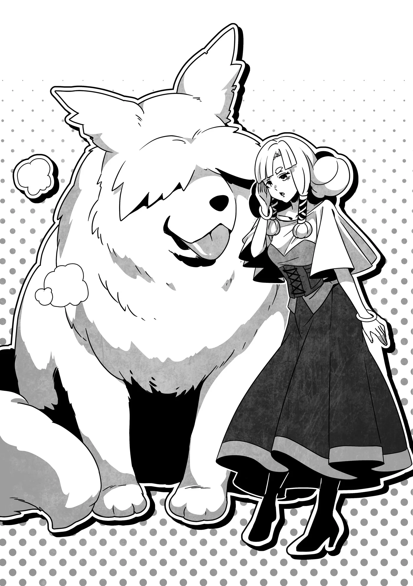

# Chương 266: Tập 11 Chương 4 - Thánh Giả và Cô Nhi Viện (3)

Con chó vừa mới nói đấy ư? Về mặt lý thuyết, tôi đoán thực chất nó là một con quái vật thuộc phân loài chó. Nhưng dẫu vậy, việc nó biết nói vẫn là điều vô cùng kỳ lạ. Nền văn minh không phải là thứ chưa từng tồn tại ở loài quái vật; các chủng Goblin từng lập nên các khu định cư, và đôi khi thậm chí còn học được cả tiếng người.

Cũng hợp lý khi cho rằng các loài quái vật hình người sở hữu những cơ quan tương tự con người, nên nếu cố gắng nói chuyện, có lẽ chúng hoàn toàn có thể làm được. Ngoài bản thân tôi ra thì Isaac và Laura cũng thuộc nhóm đó. Dẫu vậy, mọi chuyện lại hoàn toàn khác khi nhắc tới quái vật dạng thú. Họa chăng chỉ có những cá thể cấp bậc cao mới có khả năng nói tiếng người.

Người ta đồn rằng trong những trường hợp như thế, chúng hoặc là sử dụng chính dây thanh đới của mình, hoặc là cất lời thông qua một năng lực gọi là thần giao cách cảm.

Sinh vật trước mặt tôi—tên là Pochi thì phải?—rõ ràng vừa cất tiếng sủa bằng miệng như một con chó thông thường, nhưng... tôi tự hỏi rốt cuộc nó đã dùng phương thức nào.

Kinh ngạc, tôi cất lời: "Vừa rồi có ai khác...?"

"Hửm? Có chuyện gì sao anh?" người phụ nữ trẻ vừa ngăn Pochi ban nãy cất tiếng hỏi.

"À thì, ý tôi là... Hử?"

Nhìn phản ứng của cô ấy, có vẻ như cô không hề nhận ra con chó vừa nói chuyện. Chẳng lẽ chỉ có mỗi mình tôi nghe thấy thôi sao?

"Rentt," Lorraine lên tiếng. "Trước mắt thì sao chúng ta không tự giới thiệu bản thân trước đã nhỉ?"

Vậy ra đó không phải là do tôi tưởng tượng.

Cụm từ "trước mắt thì" chứa đựng rất nhiều hàm ý sâu xa. Với mọi người xung quanh thì nghe nó hoàn toàn bình thường, nhưng tôi đã nắm bắt được ngụ ý ẩn giấu bên trong. Việc chúng tôi có thể thấu hiểu nhau theo cách này chỉ càng chứng minh Lorraine và tôi đã quen biết nhau lâu đến nhường nào. Cô ấy cũng nghe thấy con chó nói chuyện.

"Cô nói phải," tôi bảo. "Thật thất lễ quá. Tôi là Rentt, còn đây là Lorraine. Chúng tôi kiếm sống bằng nghề mạo hiểm giả."

Tôi bỏ lửng câu hỏi "Còn cô là...?", nhưng người phụ nữ trẻ đang ghì chặt lấy chú chó đã nhanh chóng hiểu ý.

"Tôi là Mel Patiche, người phụ trách Cô Nhi Viện Thứ Ba Vistelya, chính là nơi chúng ta đang đứng đây. Đây là Pochi. Còn đây là..."

Cô nhìn lũ trẻ, và từng đứa một bắt đầu cất lời tự giới thiệu.

Có hơn một chục đứa trẻ ở đây, nhưng tôi vẫn cố gắng ghi nhớ hết tên của chúng... hoặc ít nhất là tôi nghĩ mình làm được. Đó là một kỹ năng vô giá đối với mạo hiểm giả. Nếu không thể nắm vững điều đó, bạn sẽ gặp rắc rối to mỗi khi gia nhập một tổ đội ngẫu nhiên để làm nhiệm vụ.

Khỏi phải nói, Lorraine đã thuộc lòng tên của tất cả lũ trẻ chỉ trong chốc lát. Cô ấy chẳng giống tôi chút nào, kẻ luôn chật vật với những mẹo ghi nhớ. Đôi khi, tôi ước gì cô ấy có thể chia cho tôi bớt một phần trí thông minh của mình.

"Còn tôi là Elza Olgado," Elza nói, khép lại màn giới thiệu. "Dù là mọi người đều biết cả rồi. Nào các em, tôi có mang quà đến này. Đủ cho tất cả mọi người luôn nhé."

Cô hướng lũ trẻ về phía những chồng bánh ngọt, thứ chẳng biết từ lúc nào đã được chuyển từ tay tôi sang tay Lorraine. Lũ trẻ lập tức ùa tới vây quanh cô ấy rồi bắt đầu giật lấy bánh từ tay cô như thể một đám cướp đang lột sạch toàn bộ tài sản trần tục của nạn nhân.

"Đến lũ cướp còn biết giữ chút chừng mực hơn đấy," Lorraine lầm bầm sau khi mọi chuyện đã xong xuôi. Mái tóc cô rối bời và hơi thở thì đứt quãng.

Dĩ nhiên là cô ấy chỉ nói đùa thôi. Lũ cướp thực sự mà dám tấn công cô thì sẽ phải nếm mùi bất ngờ cay đắng ngay. Dẫu vậy, cảnh tượng cô bị bao vây nồng nhiệt đến mức ấy khiến sự so sánh kia quả thực hết sức xác đáng.

Lũ trẻ vừa quét qua người Lorraine như một cơn bão đã biến mất tăm đi đâu đó cùng với chiến lợi phẩm của mình.

"Tôi nghĩ tụi nhỏ đang mang vào bếp đấy," Elza giải thích. "Một lát nữa các em sẽ mang ra lại cho chúng ta, kèm cả trà nữa."

Việc lũ trẻ chủ động đi chuẩn bị đồ ăn cho thấy chúng đã khá quen với chuyện này. Tôi tự hỏi liệu có phải lần nào ghé qua Elza cũng mang theo quà hay không.

"Hôm nay có dịp gì thế ạ, Sơ Elza?" Mel hỏi. "Em thấy chị không dẫn theo đoàn tùy tùng nào cả."

Tôi đoán cô ấy không tính Lorraine và tôi vào số đó vì chúng tôi đã tự giới thiệu mình là mạo hiểm giả.

Elza là một Nữ Tu Viện Trưởng. Đoàn tùy tùng của cô hẳn nhiên phải là các giáo sĩ và người hầu cận thuộc Giáo Hội Đông Thiên. Phần lớn mạo hiểm giả đều thô kệch và thiếu lễ độ, nên họ chẳng bao giờ đủ chuẩn để trở thành người hầu cận của một quý tộc hay thành viên giáo phẩm. Hộ vệ thì được, nhưng khi đó thân chủ vẫn sẽ cần thêm người hầu cận đi kèm.

Điều đó lại càng đúng với một thành viên giáo phẩm cấp cao như Elza. Thế nhưng lúc này cô lại chẳng có ai đi cùng. Chẳng trách Mel lại thấy chuyện này lạ lùng.

"Nếu dẫn họ theo thì họ sẽ cằn nhằn không dứt về thời gian cho mà xem," Elza nói. Rồi cô nhoẻn miệng cười. "Đùa chút thôi. Thực ra tôi chỉ muốn dẫn hai người này đến đây hôm nay. Họ là người quen của Lillian ở Maalt đấy."

"Gì cơ ạ? Thật sao?!" Mel quay sang phía chúng tôi. "Sơ Lillian dạo này thế nào rồi ạ? Em có viết thư cho chị ấy, nhưng chị ấy chẳng bao giờ hồi âm cả."

Elza cũng từng nói điều tương tự.

Lillian không hồi âm cho Elza là bởi sơ ấy bị điều chuyển ra vùng biên giới do một cuộc tranh giành quyền lực bên trong Giáo Hội Đông Thiên tại Vistelya. Nếu sơ ấy viết thư trả lời, điều đó có thể mang lại rắc rối cho Elza. Rất có thể tình cảnh của Mel cũng tương tự như vậy.

"Chuyện đó giờ không còn là mối bận tâm nữa rồi," Elza nói. "Lillian đã lấy lại được sức khỏe. Sơ ấy thậm chí còn gửi thư cho tôi nữa cơ."

Elza chìa bức thư chúng tôi mang từ Maalt tới cho Mel, đôi mắt cô ấy mở to kinh ngạc trước khi đưa tay ra chạm vào bức thư.

"Cảm giác này quen thuộc quá..." Mel thì thầm.

"Thần Lực của Lillian lưu lại trong đó đấy," Elza giải thích. "Phần lớn đã tan biến sau khi tôi mở phong bì, nhưng vẫn còn sót lại một chút."

"Thật sao ạ? Tạ ơn trời đất vì chị ấy vẫn bình an vô sự. Vậy điều này có nghĩa là rồi chị ấy sẽ quay về đây chứ ạ?"

"Tôi... không dám chắc. Nhưng nếu sơ ấy chọn quay về, sẽ chẳng còn ai có thể phản đối được nữa. Và ngay cả khi sơ ấy không muốn trở lại, sơ ấy vẫn có thể tự do đi lại để thăm nom. Tôi tin chắc em sẽ sớm được gặp lại sơ ấy thôi."

"Ôi, em nóng lòng quá chừng!" Mel ôm chặt bức thư vào lòng.

Cô ấy có vẻ vô cùng yêu quý Lillian, và tôi nhận thấy mình bắt đầu tò mò. Tôi tự hỏi không biết câu chuyện giữa họ là thế nào.

◆◇◆◇◆

"Mel đến cô nhi viện này khi còn là một đứa trẻ, ngay trước lúc Lillian rời đi để gia nhập giáo hội," Elza giải thích. "Sau khi trở thành giáo sĩ, cả Lillian và tôi vẫn thường xuyên ghé qua đây để phụ giúp. Đối với chúng tôi, Mel giống như một người em gái, hoặc có lẽ là một đứa con gái vậy."

Vậy ra Lillian, Elza và Mel về cơ bản chẳng khác nào chị em ruột thịt. Trong trường hợp đó, hẳn họ đã phải cảm thấy vô cùng đau lòng khi không thể giữ liên lạc với nhau.

Vì cô nhi viện của Lillian chịu sự quản lý của Giáo Hội Đông Thiên và Elza lại nắm giữ một vị trí khá cao, nên cô ấy có thể kiểm tra xem sơ Lillian còn sống hay không bất cứ lúc nào mình muốn. Nhưng điều đó chẳng thể nào sánh được với việc tận mắt nhìn thấy người chị em của mình vẫn bình an khỏe mạnh.

Elza không thể đến một vùng hẻo lánh như Maalt, còn Mel thì chẳng thể bỏ bê bổn phận của mình tại cô nhi viện. Không giống như Giáo Hội Lobelia, Giáo Hội Đông Thiên không có nguồn tài chính dư dả. Số lượng nhân viên cô nhi viện mà họ có thể duy trì là rất có hạn. Và dẫu cho các giáo sĩ của Giáo Hội Đông Thiên rất được yêu mến ở Vương Quốc Yaaran và người dân hỗ trợ họ bằng đủ mọi cách, thì vẫn có một số công việc ở cô nhi viện mà người ngoài không thể nào cáng đáng nổi.

Thực hiện một chuyến đi để gặp Lillian đồng nghĩa với việc phải bỏ mặc cô nhi viện không người trông nom suốt nhiều tuần liền. Maalt không hẳn là gần Vistelya. Lorraine và tôi có thể thực hiện chuyến hành trình chỉ trong chớp mắt nhờ các ma pháp trận dịch chuyển, và một phần trong tôi thực sự muốn giúp đỡ những người chị em này, nhưng nguy cơ lộ bí mật lại quá lớn. Bản thân Elza có vẻ đáng tin, nhưng cô ấy là một thành viên cấp cao của Giáo Hội Đông Thiên. Tôi không thể loại trừ khả năng cô ấy sẽ sẵn sàng đặt lợi ích của giáo hội lên hàng đầu nếu thời khắc đó xảy đến.

"Thật đáng tiếc khi Sơ Lillian không viết thư cho cô nữa, nếu hai người thân thiết đến nhường ấy," tôi nói.

"Không phải là tôi không thấu hiểu hoàn cảnh của cô. Dù sao thì bản thân Sơ Lillian cũng ốm khá nặng cho tới tận gần đây."

Vẻ mặt của Mel lộ rõ nỗi lo lắng. "Sao cơ ạ? S-Sơ Lillian có sao không anh?"

"Chúng tôi đã kể cho Elza nghe rồi, sơ ấy từng mắc Bệnh Tích Tụ Chướng Khí. Nhưng giờ thì không sao nữa rồi. Sơ ấy đã khỏe lại rồi."

"Căn bệnh đó chữa trị khó khăn lắm đúng không anh? Nếu tôi nhớ không nhầm thì cần phải có..."

"Hoa Long Huyết, đúng vậy đấy. Tôi đã đi hái vài bông cho sơ ấy, và một dược sư tài ba đã bào chế thành thuốc cho sơ dùng. Giờ thì sơ ấy đã qua khỏi cơn nguy kịch, đi lại bình thường và đang quán xuyến cô nhi viện rồi."

"Thật thế sao?! Vậy là Sơ Lillian mang nợ anh, đồng nghĩa với việc tôi cũng mang nợ anh rồi! Cảm ơn anh, Rentt!"

"Không, có gì đâu..."

Chuyện đó thực sự chẳng có gì to tát cả. Ủy thác đó là một trải nghiệm tuyệt vời đối với tôi, và cũng nhờ nó mà tôi mới gặp được Isaac, rồi sau đó là Laura. Có lẽ dù thế nào đi nữa tôi cũng sẽ tình cờ chạm mặt họ vào một thời điểm muộn hơn, nhưng ai mà biết tôi sẽ vướng phải những rắc rối kiểu gì nếu không gặp họ từ sớm cơ chứ? Sẽ không hề quá lời khi nói rằng tôi có được ngày hôm nay chính là nhờ đã nhận ủy thác của Alize.

Tôi quay sang Elza. "Gạt chuyện đó sang một bên, cô dẫn chúng tôi đến đây là để có thể nói chuyện về Sơ Lillian sao?"

"Phải. Tôi muốn biết liệu hai cậu có sẵn lòng kể cho chúng tôi nghe về cuộc sống của sơ ấy ở Maalt không. Tôi vốn có thể hỏi các cậu sớm hơn, nhưng tôi muốn có cả Mel ở đây nữa." Elza mỉm cười.

"Hơn nữa, tôi cũng muốn các cậu giúp xách đống đồ mua sắm nữa."

Tôi khá chắc vế sau chỉ là một câu nói đùa. Dù có lẽ suy nghĩ thật lòng của cô ấy cũng đã lọt ra ngoài đôi chút. Chắc chắn cô ấy sẽ gặp rất nhiều khó khăn nếu phải tự mình mang ngần ấy hộp bánh ngọt một mình. Không hẳn vì trọng lượng, mà phần nhiều là do chúng quá cồng kềnh.

"Được chứ, tôi có thể kể cho hai người nghe về Sơ Lillian," tôi bảo. "Lorraine cũng có thể kể nữa."

Cô ấy cũng đã nhận Alize làm đệ tử của mình, nên bản thân Lorraine cũng có mối quan hệ riêng với Sơ Lillian. Thỉnh thoảng cô ấy lại quyên góp ma cụ dư thừa cùng các loại thuốc và những thứ tương tự. Rất có thể cô ấy còn gặp Sơ Lillian thường xuyên hơn cả tôi.

"Tôi rất sẵn lòng," Lorraine nói.

Chúng tôi dành một khoảng thời gian trò chuyện rôm rả về Sơ Lillian. Không chỉ riêng chúng tôi—cả Elza và Mel cũng cùng góp vui bằng những câu chuyện về quãng thời gian thời thơ ấu của sơ ấy tại cô nhi viện này, cũng như chuỗi ngày sơ ở giáo hội. Tuy nhiên, chủ đề về lý do tại sao Sơ Lillian lại bị trục xuất khỏi vương đô không bao giờ được đề cập tới. Tôi đoán đó là chuyện nội bộ của giáo hội.

Theo lời Elza và Mel, thuở nhỏ Lillian là một cô bé khá hiếu động, đến mức gần như biến họ thành chân sai vặt của mình. Song đồng thời, sơ ấy cũng là một người chị cả ân cần, chu đáo được tất cả mọi người trong cô nhi viện hết mực yêu quý.

Tôi cũng từng cảm nhận được điều đó ở cô nhi viện tại Maalt. Khi bước vào bên trong, người ta có cảm giác không thể nào làm trái lời sơ ấy. Lũ trẻ cũng chẳng bao giờ dám chống đối lại sơ. Dạo này, sơ luôn giữ vẻ dịu dàng và thân thiện, và dường như cái tính nghịch ngợm ngày xưa đã biến mất hoàn toàn, nhưng có lẽ lũ trẻ vẫn cảm nhận được nó vẫn còn lẩn khuất đâu đó bên trong con người sơ.

Sau khoảng thời gian cười nói rôm rả đầy thú vị...

"Tôi nghĩ hôm nay đến đây thôi là được rồi. Ôi, suýt nữa thì tôi quên khuấy mất. Cầm lấy này."

Elza rút từ trong túi áo ngực ra một phong thư rồi chìa về phía tôi. Nó được niêm phong cẩn thận và tỏa ra một luồng khí tức Thần Lực thoang thoảng. Chẳng có gì bất ngờ khi Elza cũng niêm phong bức thư của mình hệt như cách Lillian đã làm.

Điều đó đồng nghĩa với việc họ sẽ phát hiện ra ngay nếu tôi lén mở ra xem. Không phải là tôi sẽ làm thế, nên thực ra họ chẳng cần phải cất công làm phiền phức đến mức này đâu.

Hít. Hít.

Pochi, kẻ nãy giờ vẫn nằm bẹp dí sau lưng Mel làm bộ như một chiếc ghế sô-pha, đã nhỏm dậy và bắt đầu hít hà bức thư. Tôi chăm chú quan sát nó, tự hỏi điều gì đã thu hút sự chú ý của nó, nhưng rõ ràng là chỉ vài cái hít mũi đã đủ để khiến nó thỏa mãn.

"Gâu, gâu."

[Được đấy.]

Tôi biết là mình không hề tưởng tượng mà.

"Pochi không cần phải lo lắng thái quá thế đâu," Elza bảo. "Phong ấn của tôi đâu có dễ phá vỡ như vậy."

"Gâu?"

[Cô nghĩ vậy thật à?]

"Tôi nghĩ vậy đấy."

Do tôi tưởng tượng hay là họ thực sự đang trò chuyện với nhau vậy? Hẳn là chút hoài nghi đã lộ rõ trên nét mặt tôi, bởi ngay sau đó Elza đột ngột cất tiếng nói với tôi.

"Tôi biết ngay mà. Cậu có thể nghe thấy nó nói, phải không hả Rentt?"

◆◇◆◇◆

"N-Nghe c-c-cái gì cơ chứ?"

Tôi run rẩy khi nói, bởi tôi vừa mới chứng kiến một điều vô cùng gây sốc. Đó cũng là lý do tại sao tôi lắp ba lắp bắp. Phải rồi, tôi chắc chắn đã bị sốc vì—

"Cậu thôi diễn đi được rồi đấy," Elza điềm đạm nói. "Tôi đang nói về những lời của Pochi. Cậu hiểu được nó nói gì, đúng không?"

Tôi thở dài. "Chắc là vậy. Tôi cứ tưởng do mình tưởng tượng ra, nhưng rõ ràng là không phải. Làm sao một con chó lại biết nói chuyện được chứ...?"

Tôi đã cố giả ngu khi cô ấy lần đầu hỏi tôi, nhưng chỉ cần thoáng nhìn vào ánh mắt của cô là tôi biết chiêu này vô tác dụng rồi. Dẫu vẻ ngoài có vẻ vô tâm vô tính, nhưng khi cần kíp thì cô ấy thực sự là một thành viên giáo phẩm cấp cao. Tôi luôn biết rõ khi nào một trận chiến đã cầm chắc phần thất bại.

Còn về màn kịch lố bịch của mình, tôi đã nghĩ giả ngây giả ngô một chút cũng chẳng sao vì tình hình có vẻ sẽ không trở nên quá căng thẳng, vả lại tôi cũng muốn đánh lạc hướng sự chú ý khỏi Lorraine, bởi dường như Elza chỉ để ý tới mỗi mình tôi.

Trên thực tế, Lorraine hoàn toàn bình thản. Vẻ mặt hiếu kỳ đôi chút của cô ấy như muốn gào lên rằng: "Ôi, chuyện gì đang xảy ra thế này? Tôi chẳng hiểu gì cả." Đúng là một diễn viên tài ba.

"Ơ, có chuyện gì không ổn sao ạ? Ý chị 'lời của Pochi' là thế nào cơ?"

Còn về Sơ Mel, cô ấy trông thực sự chẳng hiểu đầu cua tai nheo gì cả.

Tôi từng nghĩ cô ấy cũng có thể nghe thấy Pochi, nhưng có lẽ tôi đã lầm. Nếu vậy thì rốt cuộc điều gì đã tạo nên sự phân biệt giữa những người nghe được và những người không nghe được chứ?

Elza quay sang Mel. "Chị đã nói với em từ bao đời nay rồi còn gì? Pochi biết nói chuyện đấy. Nhưng trước giờ chỉ có Lillian và chị là nghe thấy nó thôi."

"Gì cơ ạ?! Chuyện đó là thật sao? Em cứ tưởng hai chị chỉ trêu chọc em thôi chứ..."

À, ra là thế. Không phải Mel không biết, mà là cô ấy không tin họ. Người trong nhà trêu đùa nhau thì ở đâu mà chẳng có. Bị cha mẹ, anh chị em hoặc một người họ hàng nào đó lừa cho tin sái cổ vào một câu chuyện bịa đặt rồi sau đó họ chạy đến vỗ vai bảo "Bị lừa rồi nhé!" chính xác là những gì Mel nghĩ đang diễn ra ở đây.

"Con chó đó biết nói đấy!" chính là ví dụ kinh điển cho kiểu lời nói dối như vậy. Lâu dần, Mel chắc hẳn sẽ chỉ đảo tròn mắt rồi gạt phắt đi mà bảo: "Lại trò cũ rích chứ gì? Vâng, vâng." Đó là thông lệ xưa như Trái Đất rồi.

"Đúng là chị có trêu em nhiều chuyện khác, nhưng chưa từng đùa về Pochi đâu. Nó thực sự biết nói đấy." Elza ghé tai về phía Pochi. "Hửm, Pochi vừa nói gì cơ?"

"Gâu, gâu, gâu gâu, ẳng. Gâu gâu, gâu gâu, gâu gâu gâu. Gâu."

[Này nghe nhé. Hôm nọ Mel lén ăn đồ ngọt một mình, xong rồi sau đó lại lo sốt vó không biết mình có bị tăng cân không. Chẳng buồn cười chết đi được à?]

Tôi cảm thấy áy náy vô cùng khi bản thân lại nghe được toàn bộ những lời này. Mà chà, tính cách của con chó này cũng có phần vặn vẹo ghê gớm nhỉ?

"Mel này," Elza nói, "em nên dừng việc lén ăn đồ ngọt một mình đi thôi. Với lại em cũng không có tăng cân đâu. Em chỉ... tròn trịa hơn một chút thôi."

Mel lộ rõ vẻ kinh hãi. "S-Sao chị lại biết được chuyện đó cơ chứ?! Em đã đảm bảo không có ai nhìn thấy rồi mà! Chỉ có— Khoan đã, Pochi?! Là mày đấy ư?! Mày thực sự biết... nói...?!"

Qua tiếng la hét đó, tôi hiểu rằng cô ấy rốt cuộc cũng đã tin vào điều mà Elza đã cố nói với cô suốt bao năm qua.

Mel túm lấy mặt Pochi. "Có phải mày cũng là kẻ đã mách với hai chị ấy chuyện lần trước nữa không hả?! Nhớ không?! Tao chưa từng kể với ai về chuyện đó cả, thế mà chẳng hiểu sao Elza và Lillian vẫn biết tỏng!"

Cô ấy đang tra khảo Pochi một cách không thương tiếc. Nhìn cách hành xử lúc này của cô, người ta sẽ chẳng bao giờ nghĩ cô lại là người phụ trách của một cô nhi viện. Phong thái dịu dàng và đoan trang của một thiếu nữ ban đầu đã hoàn toàn biến mất không một dấu vết. Hoặc có lẽ đó chỉ là minh chứng cho thấy cô đang cuống cuồng đến mức nào. Thật khó mà nói chắc được.

Mặc kệ cuộc cãi vã đang tiếp diễn giữa con chó và người phụ trách cô nhi viện, Elza quay sang phía Lorraine và tôi. "Đấy, như các cậu thấy rồi đó. Pochi biết nói chuyện, nhưng chỉ có một vài người là nghe thấy được nó. Ở cô nhi viện này, từ trước tới nay cũng chỉ có mỗi Lillian và tôi. Các cậu có biết tại sao không?"

Thành thật mà nói thì tôi chẳng có câu trả lời nào cho cô ấy cả. Có một số điểm tương đồng giữa Elza và tôi, nhưng mọi chuyện lại trở nên rắc rối hơn khi thêm cả Lorraine vào đó.

Thực ra, tôi có nghĩ đến một giả thuyết có vẻ rất khả dĩ. Tuy nhiên, điều đó đồng nghĩa với việc làm lộ bí mật của chính mình, nên tôi quyết định cố tình đưa ra một câu trả lời sai.

"Có phải là vào thời điểm hai người trở thành giáo sĩ của giáo hội không?"

"Điều đó... gần đúng rồi, nhưng vẫn chưa hẳn là vậy. Tôi không nghĩ kéo dài chuyện này thì có ích gì, nên tôi sẽ nói thẳng cho các cậu luôn. Đó là bởi vì—"

"Này! Tại sao lại chỉ có mỗi tao là không nghe được mày nói cơ chứ?! Pochi! Tao ở bên mày lâu hơn hẳn Sơ Elza và Sơ Lillian cơ mà! Mày nghĩ ai là người cho mày ăn hả?! Với lại từ nhỏ đến giờ tao luôn là người tắm rửa cho mày đấy nhé! Vậy tại sao cơ chứ?!" Mel càng lúc càng trở nên kích động, cô bám chặt lấy Pochi trong lúc trút hết mọi nỗi ấm ức của mình ra.

Pochi trông có vẻ chán ngấy đến tận cổ. Nó liếc nhìn tôi, rồi chạm mắt với Elza.

Elza thở dài, suy nghĩ một thoáng rồi bảo: "Tôi cho là chẳng còn cách nào khác rồi. Dù sao thì chuyện này sớm muộn gì cũng sẽ xảy ra thôi. Tôi đã leo lên vị trí khá cao trong giáo hội, và Lillian cũng đã hồi phục rồi. Chúng tôi chắc hẳn đủ khả năng giải quyết các hậu quả kéo theo."

Cô quay sang nhìn Pochi rồi gật đầu.

Ngay khi tôi bắt đầu tự hỏi chuyện gì đang diễn ra, Pochi đột nhiên phát ra ánh sáng nhàn nhạt. Luồng ánh sáng ấy tĩnh lặng, thuần khiết... và quen thuộc.

Khi Lorraine nhìn thấy nó, cô thì thầm: "Rentt. Đó là Thần Lực."

Tôi nhận ra cô ấy nói đúng. Thứ năng lượng đó chưa bao giờ quá mạnh mẽ mỗi khi bản thân tôi vận dụng, và kể từ lúc học được cách che giấu, tôi đã giấu kín luôn cả nó, nên dạo này Thần Lực của tôi hoàn toàn vô hình. Lần cuối cùng tôi nhìn thấy Thần Lực ở quy mô cỡ này là từ vị thánh nữ từng đến Maalt và phô diễn ma pháp trị liệu của mình như một hình thức quảng bá.

Tôi cũng từng nhìn thấy Thần Lực của Nive, nhưng của cô ấy không thực sự tỏa sáng. Có lẽ là do cô ấy đã rèn luyện thành thục với nó.

Nhưng liệu con chó này có đang làm đúng điều mà tôi nghĩ hay không? Sau một lúc ngắn ngủi, luồng ánh sáng ấy chuyển sang người Mel và được hấp thu vào bên trong cơ thể cô.

"Gâu?"

[Thế nào rồi?]

Mel mở mắt ra. "E-Em nghe được nó rồi! Em nghe thấy tiếng Pochi rồi!" Sau đó cô ôm chầm lấy nó.

Elza dõi mắt nhìn hai người họ và cất lời: "Đấy, xong rồi nhé. Pochi là... thứ mà người ta hay gọi là thần thú, hay thánh thú, điều đó khiến nó có nét tương đồng với các thần tinh linh. Chỉ những ai từng nhận được sự ban phước của Thần Lực mới có thể nghe thấy nó nói. Trong đó có cả cậu nữa, phải không hả Rentt?"
