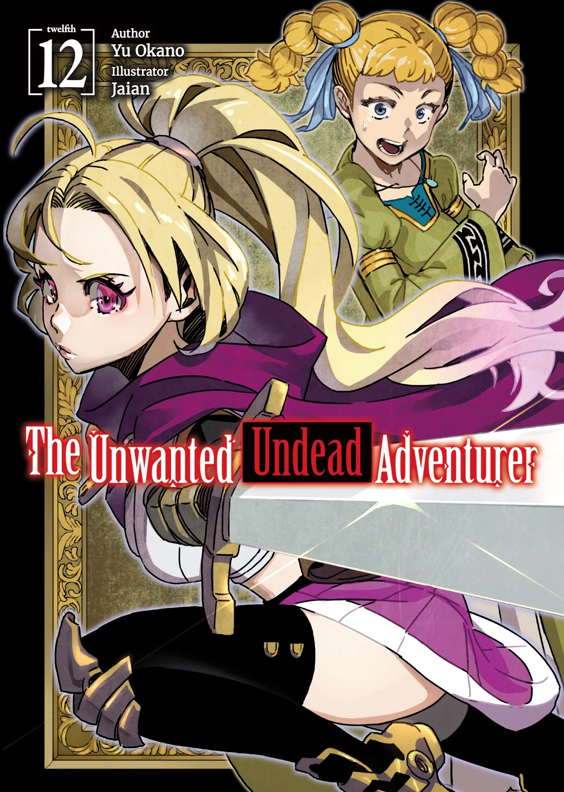
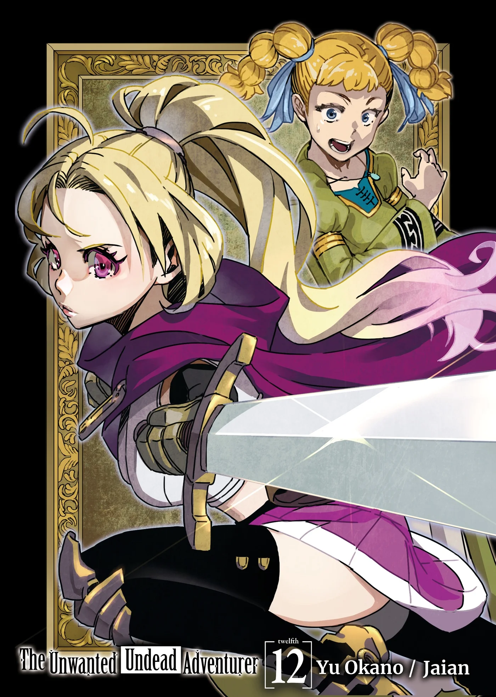
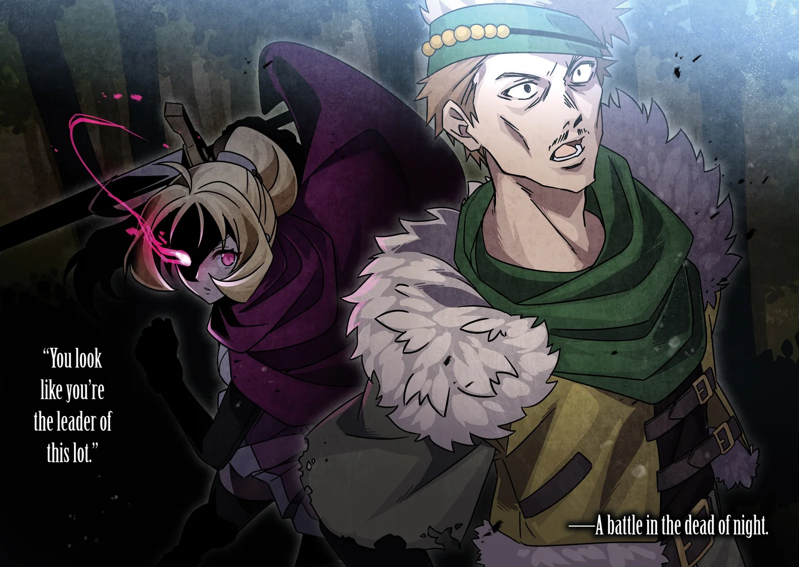
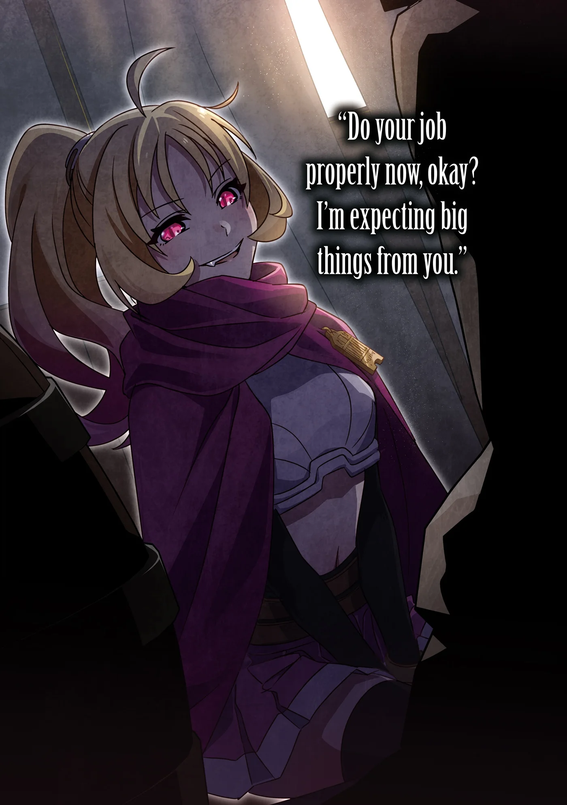
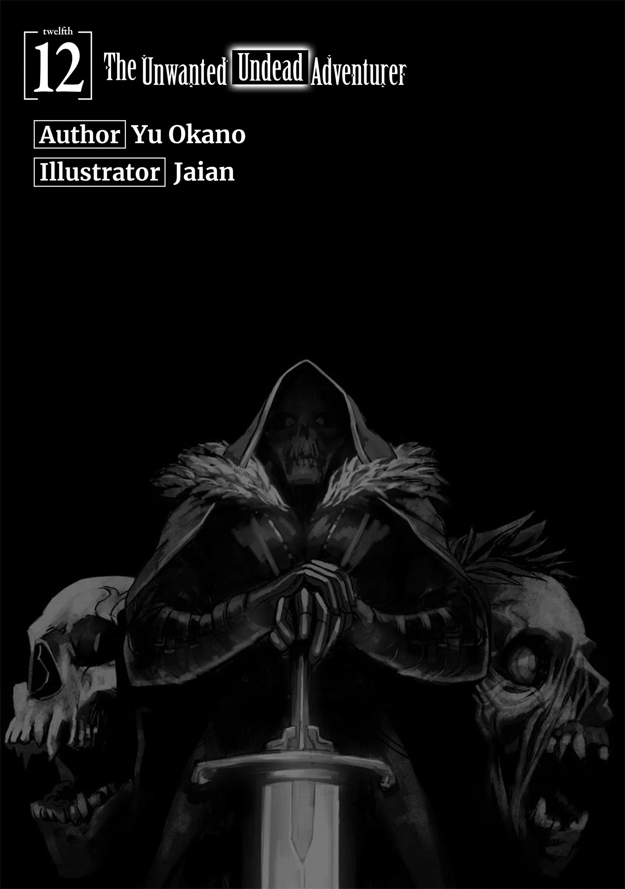
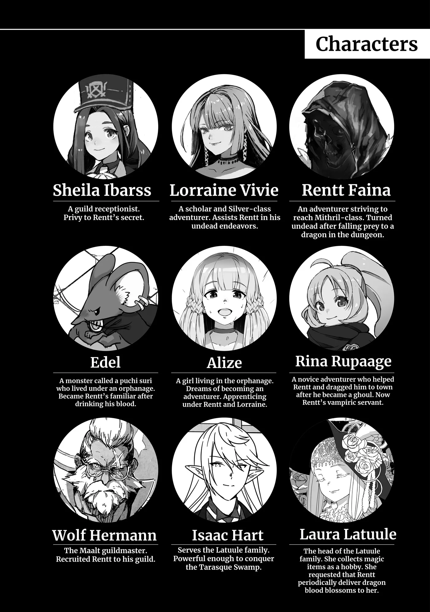
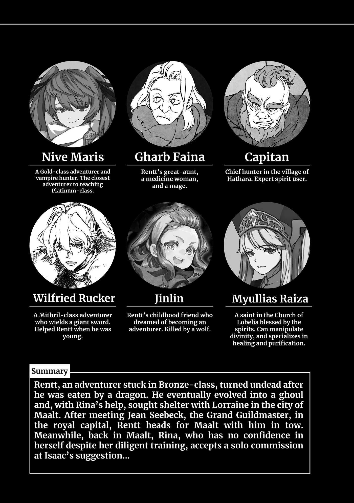
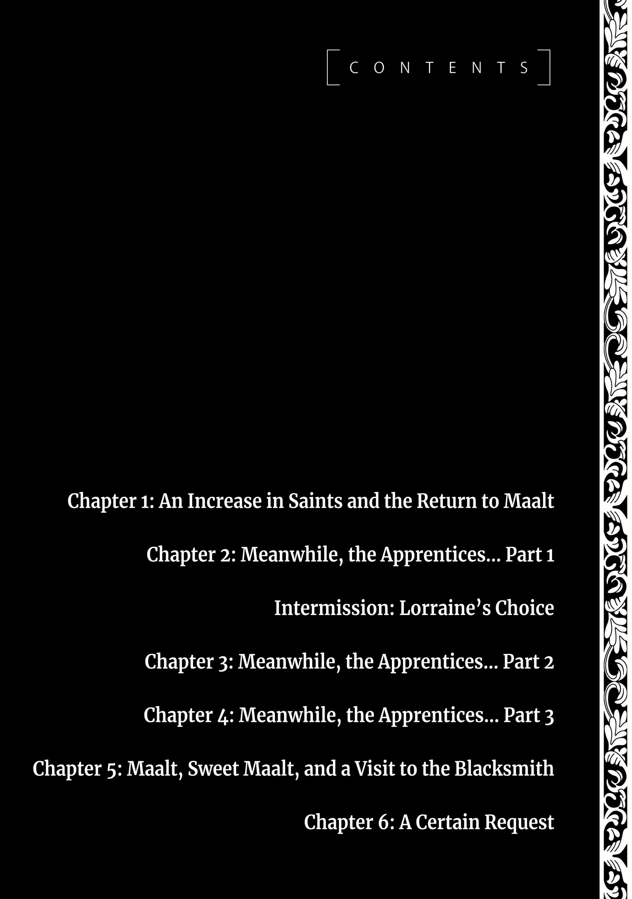

# Chương 272: Tập 12 Chương 1 - Thêm Những Thánh Giả và Trở Về Maalt (1)

Cả Lorraine lẫn tôi đều không mấy ngạc nhiên trước lời tuyên bố của Elza. Dù sao thì Thần Lực gần như là điểm chung duy nhất giữa Lorraine, Elza, Lillian và tôi.

Tuy nhiên, vấn đề là chúng tôi nên phản hồi ra sao. Thực ra đó cũng chẳng hẳn là vấn đề gì to tát—việc sở hữu Thần Lực đâu nhất thiết phải là một bí mật ghê gớm. Chúng tôi cứ thẳng thắn với cô ấy là được.

Dĩ nhiên, những người sử dụng Thần Lực rất hiếm hoi, và khó lòng là kiểu người mà người ta có thể tình cờ chạm mặt thường xuyên khi tản bộ trên đường phố. Dẫu vậy, sự thật là một mạo hiểm giả cấp thấp rẻ mạt như tôi lại thực sự mang trong mình sự ban phước của Thần Lực—cho dù nó có yếu ớt đến cùng cực—đã là minh chứng quá đủ cho thấy một kẻ vô danh tiểu tốt hoàn toàn có khả năng sở hữu thứ năng lực này.

Vậy cớ sao tôi lại cố tình lảng tránh câu hỏi của Elza? Chà, ấy là bởi tôi sợ bản thân sẽ bị lộ tẩy thân phận quái vật.

Tôi không thể phớt lờ nguy cơ rất thực tế về việc mình bị phát giác, dẫu xác suất đó có nhỏ nhoi tới đâu chăng nữa. Lại thêm nguy cơ có người sẽ suy đoán tôi nghe hiểu tiếng Pochi là bởi cả hai chúng tôi đều là quái vật—dù sao thì trước đó Sơ Mel cũng từng đinh ninh nó là một con quái vật. Song vì sự tình dường như không phải vậy, nên việc thành thật có lẽ sẽ chẳng gây ra vấn đề gì.

Tuy nhiên, đứng trên lập trường một mạo hiểm giả, tôi vẫn muốn giấu kín Thần Lực của mình nhiều nhất có thể. Đó là thứ sức mạnh một ngày nào đó có thể trở thành con át chủ bài bí mật của tôi—nhưng mặt khác, ở Maalt cũng chẳng phải không có một lượng người kha khá đã hay biết. Ý tôi là, chính tôi là người đã chủ động kể cho họ ngay từ đầu, bởi hồi đó tôi cứ đinh ninh chút Thần Lực cặn bã của mình sẽ chẳng đời nào vươn tới tầm mức đó được. Song tạm gác sự giả tạo ấy của tôi sang một bên...

"Phải, tôi có Thần Lực," tôi nói. "Cách đây rất lâu, tôi từng tu sửa một ngôi đền bỏ hoang gần quê nhà, và vị thần tinh linh trú ngụ bên trong đã ban phước cho tôi—chắc chỉ là do ngẫu hứng thôi. Cũng chẳng phải điều gì đáng để đem ra khoe khoang cả."

Thần Lực của tôi nay đã phát triển tới mức có thể vận dụng trong thực chiến, song tôi nhận thấy chẳng có lý do gì đặc biệt để phải tiết lộ thông tin ấy ra.

"Thú vị thật đấy," Elza nói. "Lillian và tôi nhận được Thần Lực từ Pochi. Dù tôi đoán hẳn cậu cũng đã mường tượng ra rồi, khi xét đến chuyện tương tự vừa mới xảy đến với Mel."

Cô ấy dường như không lấy làm kinh ngạc trước việc tôi sở hữu Thần Lực—một phản ứng có được là nhờ danh tiếng chung của Thần Lực. Dù sao thì việc sở hữu nó cũng chẳng phải điều gì tồi tệ.

Thế nhưng, việc bị lộ tẩy thân phận quái vật lại là một câu chuyện hoàn toàn khác—cho dù đó sẽ là một câu chuyện rất ngắn ngủi kết thúc bằng việc bị đem ra xử tử chớp nhoáng.

"Tôi quả thực có suy nghĩ theo hướng đó..." tôi nói. "Nhưng cớ sao cô và Lillian lại nhận được nó từ thuở nhỏ, còn Mel thì mãi tới tận vừa nãy? Lẽ nào Thần Lực thực sự là thứ có thể tùy tiện ban phát dễ dàng đến vậy ư?"

Cả Lorraine lẫn tôi cũng nhận được Thần Lực của mình chỉ vì một phút ngẫu hứng, nhưng những mối băn khoăn về chuyện đó cứ để dịp khác hãy tính. Xét thấy dường như Pochi ban phước cho Mel là vì lời thỉnh cầu của Elza, điều đó ám chỉ Elza có khả năng ban phát Thần Lực cho bất kỳ ai cô muốn—và chuyện đó chắc chắn là một vấn đề vô cùng trọng đại. Chí ít thì tôi chưa từng nghe nói đến chuyện nào tương tự xảy ra trước đây cả.

Thế nhưng, phỏng đoán của tôi đã sớm bị bác bỏ.

"Không đâu, Pochi vốn dĩ đã định ban phước cho Mel ngay từ đầu rồi," Elza giải thích.

"Lillian và tôi thực chất chỉ là những người phụ thêm, hoặc đại loại thế. Tuy nhiên, sau khi Pochi ban phước cho chúng tôi và chúng tôi bắt đầu nghe hiểu được nó, nó đã bảo hai đứa phải bảo vệ Mel. Lúc bấy giờ chúng tôi chẳng thể hiểu nổi ý nó là gì, nhưng một khi Lillian và tôi bắt đầu nhận hết lời mời này đến lời mời khác từ các tổ chức tôn giáo khác nhau, ý nghĩa của lời dặn đó liền trở nên sáng tỏ. Chuyện tương tự không xảy đến với cậu sao, Rentt?"

"Không, không hẳn vậy," tôi đáp. "Có lẽ tôi đã tránh được chuyện đó nhờ vào nơi mình sinh sống."

Nói tóm lại, khác với quái vật vốn bị kỳ thị và săn lùng ráo riết, những người sử dụng Thần Lực lại là đối tượng được các tổ chức tôn giáo săn đón nhiệt tình. Hệ quả là bất kỳ ai nắm giữ Thần Lực mà chưa thuộc biên chế nơi nào đều sẽ bị đám chiêu mộ viên bám riết không buông. Trong trường hợp của tôi, Thần Lực yếu ớt đến thảm hại, và dẫu tôi chẳng ngại ngần gì việc nói về nó, chủ đề này cũng chỉ tình cờ được nhắc tới trong một số tình huống nhất định, chẳng hạn như khi có ai đó hỏi tôi đang làm gì lúc tôi thanh tẩy nước. Tin tức về việc tôi có thể vận dụng nó đơn giản là chưa từng thực sự lan truyền rộng rãi.

Dĩ nhiên, còn có một sự thật phũ phàng và đáng buồn không thể phủ nhận—hồi đó vì là một mạo hiểm giả độc hành, nên tôi vốn dĩ chẳng có lấy một người bạn nào để trò chuyện cả...

Song bình thường, nếu để lộ ra việc mình có thể sử dụng Thần Lực, người ta sẽ phải trải qua chính xác những gì Elza và Lillian từng nếm trải.

Một nguyên nhân lớn khác khiến tôi không rơi vào hoàn cảnh đó có lẽ là vì Maalt không hẳn là một trung tâm hoạt động sôi nổi của các giáo phái tôn giáo. Nếu nhìn nhận một cách hào phóng thì họa chăng có thể bảo Giáo Hội Đông Thiên hoạt động đôi chút ở đó, nhưng cũng chỉ đến thế mà thôi. Do vị trí của Maalt nằm nơi biên ải cùng nhiều yếu tố khác, người dân nơi đây quan tâm đến việc nâng cao thực lực bản thân hơn là sùng bái tôn giáo.

Thế nhưng ở chốn vương đô này, mọi sự lại hoàn toàn khác biệt. Việc Giáo Hội Lobelia hoạt động lộ liễu và phô trương rầm rộ là một ví dụ cho thấy sự khác biệt đó, song ngay cả Giáo Hội Đông Thiên nơi đây cũng thúc ép và săn đón gắt gao hơn nhiều so với ở ngoài Maalt.

Nếu để lộ ra tin tức mình là một người sử dụng Thần Lực, người ta gần như sẽ chìm ngập trong vòng vây của những tay chiêu mộ viên hăng hái thái quá.

"Hồi đó quả thực đã có một phen ầm ĩ lớn xoay quanh Lillian và tôi," Elza nói. "Nhưng vì chúng tôi ở tại cô nhi viện này của Giáo Hội Đông Thiên, nên người phụ trách lúc bấy giờ đã bảo bọc chúng tôi... được một thời gian. Về sau, mọi chuyện dần trở nên khó khăn, và người phụ trách đã khuyên chúng tôi nên tự định hình đức tin của mình bằng cách lựa chọn một tổ chức để gia nhập. Kể từ đó, cả Lillian lẫn tôi đều gia nhập Giáo Hội Đông Thiên."

Nếu họ trở thành mạo hiểm giả, họ đã có thể chu du khắp thế giới và bỏ lại sau lưng những rắc rối phiền toái ấy. Nhưng tôi đoán cả Elza lẫn Lillian đều thuộc tuýp người trân trọng những mối dây gắn kết mà mình tạo dựng, chẳng hạn như mối liên hệ với cô nhi viện này. Việc cắt đứt quan hệ rồi dứt áo ra đi có lẽ là điều bất khả đối với họ—và có lẽ người phụ trách cô nhi viện khi ấy cũng đã nhận ra điều đó. Vả lại, vì Pochi đã nhờ họ bảo vệ Mel, nên đằng nào họ cũng chẳng thể rời xa cô nhi viện quá lâu.

Xét thấy điều đó, việc gia nhập hàng ngũ Giáo Hội Đông Thiên hẳn là sự lựa chọn tốt nhất của họ. Giáo lý của giáo hội này vốn ôn hòa và khoan dung, nên xét theo phương diện đó thì đây cũng chẳng phải một quyết định tồi.

Nói vậy không có ý ám chỉ những tổ chức như Giáo Hội Lobelia là xấu xa hay gì—chỉ là họ có rất nhiều thành viên mang nặng tham vọng thăng tiến trên nấc thang danh vọng, hoặc ôm giữ ý thức sứ mệnh vô cùng mãnh liệt về việc phải truyền bá giáo lý tôn giáo của mình.

Điều đó đôi khi cũng có phần hơi đáng sợ...

"Chúng tôi từng nghĩ chuyện tương tự rốt cuộc rồi cũng sẽ xảy đến với Mel," Elza tiếp tục.

"Dù sao thì em ấy vốn dĩ mới là người thụ nhận chính của sự ban phước. Pochi thực ra đã thử thêm vài lần sau khi ban phước cho Lillian và tôi, nhưng chúng tôi đã can ngăn nó vì lý do tôi vừa giải thích: chúng tôi lo ngại những lời mời mọc không ngớt sẽ liên tục gõ cửa tìm đến em ấy. Mel cũng từng bảo một ngày nào đó muốn trở thành người phụ trách cô nhi viện này, nên Lillian và tôi cho rằng tốt nhất là hãy trì hoãn chuyện đó lại một thời gian—chí ít là cho tới khi chúng tôi đủ năng lực để bảo vệ cả em ấy lẫn cô nhi viện. Sau một hồi ngẫm nghĩ, Pochi rốt cuộc cũng đồng ý với chúng tôi."

◆◇◆◇◆

"Thứ lỗi nếu tôi có tò mò quá mức, nhưng tại sao Pochi lại muốn ban phước cho Mel thế?" tôi hỏi. "Việc nó ban phước Thần Lực cho cô và Lillian trước rồi nhờ hai người bảo vệ em ấy dường như ám chỉ có một động cơ cực kỳ quan trọng ẩn sau đó, nhưng mà... chà, tôi đoán Thần Lực vốn dĩ là thứ mang ý nghĩa như vậy thật."

Những trường hợp như Lorraine và tôi, khi có kẻ nhận được Thần Lực mà chẳng vì lý do gì quá đỗi đặc biệt, thực ra không hẳn là hiếm hoi, nhưng nếu hỏi tại sao các vị thần và thần tinh linh lại ban phước cho con người thứ sức mạnh đó, phần lớn sẽ bảo rằng ấy là bởi những người được ban phước nắm giữ một vai trò trọng đại nào đó thay mặt cho thánh thần hoặc thế giới. Nếu tìm đọc các câu chuyện thần thoại và truyền thuyết còn được lưu truyền tới tận ngày nay, người ta có thể bắt gặp không ít tấm gương về những người sử dụng Thần Lực đã lập nên những chiến công hiển hách và khắc ghi tên tuổi vào sử sách. Một số ghi chép thậm chí còn thuật lại chính xác những chỉ dẫn mà thánh thần trực tiếp truyền đạt cho những người sử dụng đó, vạch rõ những nghĩa vụ mà họ phải gánh vác. Dĩ nhiên tất cả đều thuộc về quá khứ xa xăm, và thật khó để khẳng định có bao nhiêu câu chuyện trong số đó là sự thật lịch sử, nhưng việc chúng vẫn còn được lưu truyền đến nay hẳn đồng nghĩa với việc ít nhiều cũng ẩn chứa một phần sự thật bên trong.

Từ tất cả những điều đó, việc suy đoán Mel cũng phải gánh vác một sứ mệnh nào đó dường như là hoàn toàn có cơ sở. Trông có vẻ trường hợp của cô ấy không hề giống với Lorraine và tôi, nơi chúng tôi được ban phước chỉ nhờ vào một việc làm thiện nguyện tình cờ.

Ngay từ đầu, nếu Pochi thực sự là một thần thú, thì—dẫu tôi nói ra điều này có phần hơi khiếm nhã—thay vì ở tại một cô nhi viện tồi tàn như chốn này, nó hoàn toàn có thể tới bất kỳ nhà thờ tùy chọn nào, và mười mươi là họ sẽ phụng dưỡng nó chẳng khác gì bậc vương giả.

Dẫu vậy, nó vẫn luôn kề cận bên cạnh Mel. Tôi nghĩ việc nghi ngờ ắt phải có một lý do nào đó đằng sau chuyện này cũng chẳng phải điều gì quá đỗi xa vời.

Sau một hồi ngẫm nghĩ, Elza nói: "Bản thân tôi e rằng cũng không rõ ngọn ngành chi tiết; có hỏi thì Pochi cũng chẳng chịu trả lời. Hẳn là có một loại hạn chế nào đó áp đặt lên các vị thần, thần tinh linh cùng thần thú, và những tồn tại tương tự như vậy. Dù sao thì người ta vẫn thường bảo thần linh không thể can thiệp vào thế giới loài người vượt quá một mức độ nhỏ nhoi, và đó là lý do họ ban phước cho chúng ta, giáng sấm truyền xuống cho chúng ta, và thúc đẩy chúng ta thành lập các tôn giáo... dẫu tôi có cảm giác sự ích kỷ của con người đã lén lút len lỏi vào vế cuối cùng ấy."

Tôi chẳng rõ liệu một giáo sĩ cấp cao có thực sự nên buông ra những lời nhận xét mang tính hoài nghi mỉa mai như thế hay không, kể cả là nói đùa. Song ngẫm lại, khi xét đến lý do ban đầu khiến Elza gia nhập Giáo Hội Đông Thiên, cô ấy hẳn cũng chẳng phải kẻ một lòng một dạ sùng kính tôn giáo này đến tận đáy lòng—dù tôi cũng không đến mức gọi cô ấy là một kẻ vô thần. Với lại... cô ấy nói cũng có phần đúng.

"Tuy nhiên, vì chuyện này có liên quan tới Mel, nên tôi đã dốc hết sức để tìm hiểu," Elza tiếp tục. "Dù sao thì tôi cũng giữ một phẩm hàm tương đối cao trong giới tăng lữ. Tôi đã tận dụng mọi nguồn lực sẵn có trong tay và lần theo đủ mọi manh mối. Sau khi cân nhắc các kết quả thu được... kết luận của tôi là thế giới có lẽ sắp sửa bước vào một thời kỳ đại biến động."

"Ý cô chính xác là thế nào?" Lorraine chêm vào, người hơi rướn về phía trước. Dường như những lời của Elza đã khiến tính hiếu kỳ của cô trỗi dậy lấn át tất thảy.

"Dường như đang có thêm rất nhiều người nhận được sự ban phước Thần Lực đặc biệt, hệt như Mel vậy. Đại đa số dĩ nhiên đều được các tôn giáo, quốc gia hoặc tổ chức tương ứng giữ kín trong vòng bí mật—song những lời đồn thổi truyền tai nhau cũng đã đủ để những ai thính tai có thể nghe thấy. Những người sử dụng Thần Lực là nhân tố tối quan trọng đối với các tổ chức tôn giáo như chúng tôi, nhưng dẫu họ rất hiếm hoi, số lượng trung bình mà bất kỳ tổ chức nào ghi nhận trong danh sách thường vẫn duy trì ổn định qua nhiều năm. Thế nhưng, dạo gần đây con số đó lại đang gia tăng với tốc độ không thể ngó lơ, và như tôi đã đề cập trước đó, một vài người trong số họ nắm giữ Thần Lực ở mức độ uy lực vượt trội hơn hẳn phần còn lại."

Vậy ra số lượng người sở hữu Thần Lực đang gia tăng ư? Tôi cho rằng Lorraine và tôi cũng nằm trong số liệu thống kê đó. Phải chăng là do tiêu chuẩn lựa chọn người được thần linh ban phước đã hạ thấp xuống? Việc hiện tượng này thực sự diễn ra dường như gợi ý rằng ắt phải có nguyên do nào đó đằng sau—một điều gì đó khiến các vị thần phải cất công đề ra các biện pháp đối phó.

Đó thực sự là một suy nghĩ đáng sợ.

"Khi cô nói những cá nhân đặc biệt đó sở hữu sự ban phước uy lực, thì cụ thể là uy lực đến mức độ nào?" Lorraine hỏi.

"Xem nào..." Elza nói. "Lấy bản thân tôi làm thước đo tham chiếu, nếu muốn thì tôi có khả năng bao phủ toàn bộ một thị trấn trong một nghi lễ. Thông thường, mức độ năng lực cỡ đó sẽ xếp tôi vào hàng ngũ cao nhất trong số những người sử dụng Thần Lực. Thế nhưng, trong số những người mới xuất hiện gần đây... kẻ mạnh nhất trong số họ nghe đâu có thể bao phủ cả một tỉnh quy mô hạng trung—chí ít là hạng trung đối với Vương Quốc Yaaran. Chừng đó đã đủ để các cậu hình dung ra sự chênh lệch về quy mô chưa?"

Một thị trấn so với cả một tỉnh ư? Sở hữu sức mạnh cần thiết để bao trùm nơi trước đã đủ đáng kinh ngạc rồi, vậy mà sự chênh lệch này vẫn quá đỗi một trời một vực. Và từ những gì Elza nói về năng lực của bản thân, liệu điều đó có đồng nghĩa với việc Lillian thời trước cũng từng có khả năng tương tự hay không?

Để so sánh thì Thần Lực của tôi... chà, nếu thực sự dốc hết sức bình sinh, tôi may ra có thể bao phủ một khu vực cỡ bằng một ngôi nhà. Xin đừng bảo chừng đó là chẳng đáng để nhắc tới—dù sao thì nó cũng đã mạnh lên rồi cơ mà. Chỉ là có quá nhiều kẻ quái vật trên thế gian này của chúng ta mà thôi.

Còn khi nhắc tới Lorraine—tạm gác trữ lượng Ma Lực của cô ấy sang một bên—Thần Lực của cô ấy thậm chí còn thiếu thốn hơn cả tôi. Phạm vi của cô ấy có lẽ chỉ giới hạn trong kích thước của một căn phòng đơn lẻ. Dẫu dường như Thần Lực của cô ấy cũng đang tăng lên, điều đó khiến tôi dấy lên mối ngờ vực bất an rằng cô ấy sẽ sớm vượt mặt tôi chẳng mấy chốc... nhưng tôi sẽ tạm gác việc suy nghĩ về điều đó cho tới khi thời điểm ấy thực sự đến.

"Đó... sẽ là sức mạnh ngang tầm một khí tài quân sự," Lorraine nói. "Và nếu đó là Thần Lực dạng hồi phục, thì riêng điều đó thôi cũng đã đủ để làm lý do chính đáng phục vụ cho việc xâm lược một quốc gia khác rồi."

"Quả đúng vậy," Elza tán thành. "Việc hàng vạn binh lính tiến hành một cuộc tấn công trong khi vết thương liên tục được chữa lành và toàn bộ bọn họ đều sống sót trở về sau trận chiến là điều hoàn toàn khả thi. Dĩ nhiên, vẫn còn những mối lo ngại về việc những người sử dụng Thần Lực nói trên có thể duy trì nghi lễ của họ trong bao lâu, và liệu sự gia tăng về quy mô có dẫn đến việc suy giảm hiệu lực hay không... nhưng không thể phủ nhận rằng họ sở hữu sức mạnh đáng kinh ngạc. Những cá nhân như vậy sẽ được bất kỳ quốc gia hay tổ chức nào thèm khát tột bậc—các cậu có đồng tình không?"

Chủ đề này đang bắt đầu khiến tôi thấy ớn lạnh. Nếu nỗ lực rèn luyện, liệu một ngày nào đó tôi có thể sử dụng được thứ sức mạnh như thế chăng?

Phải rồi... tôi thực sự không nghĩ là mình làm được.

Đáng tiếc thay, Thần Lực không phải loại sức mạnh có thể gia tăng chỉ nhờ người ta nỗ lực hết mình. Dù với thân xác quái vật này, tôi hoàn toàn có thể làm được điều đó đối với Khí Lực và Ma Lực.

Chà, sau cùng thì nếu muốn trở nên mạnh mẽ hơn, người ta phải bắt đầu bằng cách nỗ lực với những gì khả thi.

"Và... ý cô là Thần Lực của Mel cũng ở tầm mức đó sao?" Lorraine hỏi.

"Tôi ngờ rằng đúng là như vậy," Elza nói. "Dù ngay sau khi được ban phước nó trông chẳng có gì đặc biệt, nhưng kể từ giờ trở đi nó sẽ dần trở nên uy lực hơn—dĩ nhiên là không thể thiếu đi sự nỗ lực. Em ấy sẽ phải trải qua huấn luyện để học cách kiểm soát và vận dụng nó một cách bài bản. Bằng không, thứ sức mạnh đó sẽ gây nguy hiểm cho chính em ấy."

◆◇◆◇◆

"Tôi đã nắm được bức tranh tổng thể rồi," tôi nói. "Nhưng tại sao cô lại kể cho chúng tôi nghe điều này?"

"Dù lớn hay nhỏ, mỗi cá nhân sở hữu Thần Lực đều có một vai trò nào đó phải gánh vác," Elza nói. "Thế nhưng khi bàn đến việc chúng ta lựa chọn sống ra sao và lựa chọn phấn đấu vì điều gì, con người hoàn toàn tự do."

Can thiệp vào ý chí tự do của nhân loại vốn chẳng phải chuyện đơn giản, ngay cả đối với thần linh. Họ chắc chắn có thể dõi theo chúng ta—nhìn thấy cái chết, số phận, những sợi tơ đan xen, những con đường chúng ta nên bước đi, vai trò của chúng ta, và mọi thứ giữa những điều đó. Thế nhưng việc can thiệp vào những thứ ấy lại không hề dễ dàng. Chuyện đó cũng giống hệt như cách con người chúng ta cảm thấy khó khăn khi gỡ một mớ chỉ rối rắm—những bàn tay quá to lớn đơn giản là không thích hợp để thao túng những sợi chỉ mảnh mai bị buộc chặt lại với nhau.

Đó là lý do chúng ta được tự do... dẫu sao thì cũng là theo lời của một số người ngoài kia. Những người khác lại giữ quan điểm hoàn toàn trái ngược. Còn về việc quan điểm nào là đúng đắn, chà, người ta ắt phải là một vị thần thì mới biết được.

Tôi chờ đợi Elza nói tiếp, và cô ấy đã chiều ý.

"Tôi sẽ dùng sức mạnh của mình để bảo vệ Mel. Cả cô nhi viện này nữa. Và nếu còn dư giả sức lực, thì bảo vệ cả Giáo Hội Đông Thiên. Còn về phần cậu, Rentt... liệu tôi có thể mạo muội nhờ cậu cho chúng tôi mượn sức mạnh của cậu được không? Dĩ nhiên chỉ khi nào cậu rảnh rỗi thôi."

"Ồ. Vậy ra mục đích cô dẫn dắt nãy giờ... về cơ bản chỉ là một cách vòng vo để cố chiêu mộ tôi thôi sao?" Một khi tôi thốt ra suy nghĩ ấy thành lời, mọi sự nhìn lại liền trở nên sáng tỏ.

"Tôi cho là đúng thế thật. Nhưng dẫu không phủ nhận điều đó, tôi cũng không muốn sai bảo hay bắt cậu phải làm bất cứ điều gì cậu không muốn. Tôi hy vọng mọi chuyện rồi sẽ chẳng đi đến đâu... nhưng tôi gần như tin chắc tương lai đang đón đợi chúng ta với những biến cố khó lường. Tôi không phiền nếu chỉ đến lúc thời khắc đó xảy ra, và chỉ khi cậu không vướng bận chuyện gì khác. Tôi chỉ đơn thuần mong muốn có được sự tương trợ của cậu."

"Cô đang nói về thời điểm chúng ta bước vào 'thời kỳ đại biến động' mà cô đã nhắc tới, phải không?"

"Đúng vậy. Dĩ nhiên tôi cũng mong mình chỉ lo lắng hão huyền... nhưng tôi thật sự không thể nào tự thuyết phục bản thân tin vào điều đó được."

Xét về những điều đáng bận tâm, người ta khó lòng tìm thấy thứ gì trừu tượng hơn một "thời kỳ đại biến động", song có vẻ như Elza thực sự tin rằng thời khắc ấy rồi sẽ đến. Tôi dĩ nhiên có thể gạt phắt đi như một màn truyền giáo khác của mấy kẻ hoạt động tôn giáo. Người ta thừa biết cái điệp khúc đó diễn ra thế nào rồi đấy: "Thế giới sắp sửa tận diệt, vậy nên hãy làm những gì có thể ngay từ bây giờ để đảm bảo hạnh phúc ở kiếp sau." Đứng từ một góc độ nào đó, những lời Elza nói cũng chẳng khác mấy so với điều đó.

Tuy nhiên, những thứ cô ấy đang cố bảo vệ—Mel và cô nhi viện này—lại vô cùng cụ thể và hữu hình. Những gì Elza đang làm thực chất khác biệt hoàn toàn với những màn chiêu dụ tôn giáo thông thường, nơi người ta thổi bùng ngọn lửa bất an hòng gây áp lực ép người khác gia nhập.

"Nhưng... tại sao cô lại nhờ tôi?"

"Bởi vì cậu có thể sử dụng Thần Lực, Rentt à. À, và dĩ nhiên đâu chỉ có mỗi cậu. Tôi vẫn luôn mở lời với những người sử dụng Thần Lực khác mà tôi tình cờ gặp gỡ, với tư cách vừa là một đại diện của Giáo Hội Đông Thiên, vừa là cá nhân Elza. Nhưng tôi đặc biệt đưa hai vị tới đây là bởi hai người là người quen của Lillian, và tôi tin rằng mình có thể tin tưởng các cậu. Phải thú thực, tôi chưa từng thẳng thắn đến mức này trong việc chiêu mộ trước đây..."

Tóm lại, cô ấy đang dành nhiều thời gian cho tôi hơn bình thường và cởi mở hơn nhằm tạo dựng một mức độ tin cậy nhất định.

Dĩ nhiên tôi chẳng cần phải cảm thấy mình mắc một món nợ ân nghĩa to lớn nào với cô ấy, nhưng thông tin cô ấy cung cấp chắc chắn rất thú vị. Nếu một thời kỳ đại biến động thực sự xảy đến, đó chắc chắn sẽ là thời cơ tuyệt vời để kiếm sống với tư cách một mạo hiểm giả. Và với tư cách bản thân cũng là một quái vật, việc những người sử dụng Thần Lực hùng mạnh gia tăng là một thông tin vô cùng hữu ích. Bản thân tôi cùng các quyến thuộc ma cà rồng của mình không bị Thần Lực tác động, song điều tương tự lại không đúng đối với Laura cùng người của cô bé, chẳng hạn như Isaac. Biết được điều này lúc này chí ít cũng giúp tôi có thể đánh tiếng trước cho họ đề phòng.

Dẫu tôi có cảm giác dường như họ đã biết tỏng rồi...

Sau khi cân nhắc mọi điều, tôi nghĩ việc để bản thân cảm thấy mắc nợ Elza một chút cũng chẳng sao. Tôi đưa mắt trao đổi ánh nhìn với Lorraine—giữa hai chúng tôi, chừng đó đã đủ xem như một màn hội ý—rồi quay lại nhìn Elza.

"Tôi hiểu rồi," tôi nói. "Tôi không thể hứa chắc mình sẽ có mặt, nhưng nếu cô thấy ổn với điều đó, cứ báo cho tôi biết mỗi khi cần. Như vậy có được không?"

"Dĩ nhiên rồi! Tôi không hề phiền lòng chút nào đâu." Elza cúi đầu. "Tôi biết thừa yêu cầu của mình vô lý đến mức nào. Chỉ là... tôi muốn làm tất cả những gì có thể vì lợi ích của Mel, và cả cô nhi viện này nữa."
