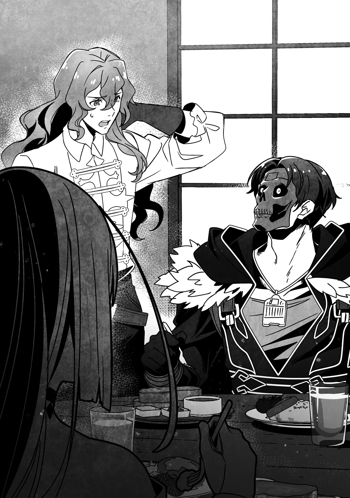

# Chương 273: Tập 12 Chương 1 - Thêm Những Thánh Giả và Trở Về Maalt (2)

Sau khi tiếp tục thảo luận thêm một lúc, chúng tôi rời khỏi cô nhi viện.

Mel có vẻ rất hào hứng khi trò chuyện với Pochi. Cô ấy thậm chí còn làm thế ngay trước mặt lũ trẻ, khăng khăng quả quyết rằng "Pochi biết nói chuyện đấy!", nhưng tất cả những gì cô nhận lại chỉ là ánh mắt của lũ trẻ nhìn cô như thể cô vừa hóa điên. Điều đó hẳn đã làm tổn thương lòng tự trọng của cô, bởi ngay sau đó cô đã nói, "C-Chị sẽ chứng minh cho các em thấy! Pochi, quay ba vòng rồi sủa một tiếng xem nào!"

Thế nhưng, Pochi chỉ liếc nhìn cô một cái đầy thờ ơ rồi thong thả bước ra xa và nằm phịch xuống đánh một giấc.

Tôi còn nhớ mình từng thầm nghĩ ánh mắt của lũ trẻ sau đó thậm chí còn lạnh lùng hơn trước.

Mel liền chạy vội tới bên Pochi rồi lắc mạnh nó một cách quá đà trong khi hét toáng lên, "Tại sao hả Pochi?! Sao mày lại làm thế?! Tao biết mày nghe hiểu tao mà! Sao mày lại lờ tao đi hả?!"

"Gâu..."

Đúng là rắc rối thật đấy.

Đó là tất cả những gì tôi còn loáng thoáng nghe được từ phía sau khi chúng tôi rời khỏi cô nhi viện. Xem ra hoàn toàn có thể yên tâm rằng bí mật của Pochi sẽ không sớm bị lộ ra ngoài đâu.

Sau đó, khi chúng tôi về tới tu viện...

"Ô! Mẹ Elza! Mọi người ơi, Mẹ Elza đã về rồi!"

Một trong những tư tế của Giáo Hội Đông Thiên bắt đầu lớn tiếng hô lên trong khi chỉ tay về hướng chúng tôi.

"Á! K-Không xong rồi! Mình phải tìm chỗ trốn thôi!"

Elza quay đầu nhìn dáo dác sang trái sang phải để quan sát xung quanh, nhưng đáng tiếc thay, mọi chuyện đã quá muộn. Chẳng mấy chốc, chúng tôi đã bị các tư tế của Giáo Hội Đông Thiên vây kín, mọi lối thoát đều bị chặn đứng. Một người trong số họ bước lên, nắm chặt lấy cánh tay Elza và bắt đầu kéo cô đi.

"Nào, thưa Mẹ Bề Trên. Đã đến lúc người phải quay lại với bổn phận của mình rồi."

"K-Khoan đã! Chưa được đâu! Ta vẫn còn việc phải làm mà!"

Thực lòng mà nói thì tôi khá chắc cô ấy đã làm xong xuôi hết mọi chuyện rồi. Trong lúc Lorraine và tôi đứng nhìn tình cảnh ngặt nghèo của cô, một tư tế khác liền chạy lại chỗ chúng tôi.

"Chúng tôi xin gửi lời cảm tạ sâu sắc nhất tới hai vị vì đã đồng hành cùng Mẹ Elza ngày hôm nay. Tôi chắc hẳn đó là một trải nghiệm vô cùng vất vả. Nếu hai vị cần bất cứ điều gì, xin cứ tự nhiên quay lại tu viện để chúng tôi có cơ hội bày tỏ lòng biết ơn—cũng như lời tạ lỗi—cho ngày hôm nay. Giờ thì xin phép hai vị."

Sau khi cúi đầu thật sâu, vị tư tế vội vã chạy trở lại nhập vào mạng lưới người đang vây chặt lấy Elza ở bên trong.

"Cô có nghĩ những nhân vật tai to mặt lớn ở thành phố này đều có cái tính như thế không?" tôi lẩm bẩm, tuy không nhắc thẳng tên một vị thủ lĩnh tổ chức thế giới ngầm nào đó nhưng trong đầu chắc chắn đang nghĩ tới ông ta.

"Những kẻ nắm quyền ở đâu thì cũng thế cả thôi," Lorraine nói. "Tốt hơn là anh đừng có mất công kỳ vọng làm gì."

Đúng là ngoài kia quả là một thế giới nghiệt ngã.

◆◇◆◇◆

Đột nhiên, tôi bừng tỉnh.

Chúng tôi đã trở về quán trọ, sau đó tôi quyết định ngủ nhiều nhất có thể trong khả năng cơ thể cho phép để chuẩn bị cho chuyến hành trình trở về Maalt vào ngày mai.

Khi nhìn ra bên ngoài, tôi thấy trời vẫn còn đang giữa đêm. Ngay cả ở vương đô, điều đó đồng nghĩa với việc không gian vô cùng tăm tối và tĩnh mịch. Chẳng có lấy một bóng người trên đường phố ngoại trừ vài gã say xỉn thỉnh thoảng lảo đảo bước qua. Ánh sáng từ các ma cụ thỉnh thoảng rọi chiếu màn đêm ở chỗ này chỗ kia, nhưng độ sáng của chúng chẳng thấm tháp vào đâu so với bóng tối bủa vây xung quanh.

Màn đêm sâu thẳm, đen đặc... và đối với tôi, nó ấm áp và dịu dàng làm sao.

Tôi hòa mình vào trong đó.

◆◇◆◇◆

Cơ thể Undead cho phép tôi nhìn rõ từ cự ly xa hệt như giữa ban ngày, bất kể trời có tối tăm đến nhường nào. Liệu đó có phải là vì màn đêm vốn là chốn dung thân thuộc về nó? Vì mục đích tồn tại của nó là tìm kiếm một trinh nữ trẻ đang tản bộ, bắt giữ cô ấy rồi hút máu chăng...?

Tôi không rõ nữa.

Bởi lẽ Lorraine vẫn đều đặn cho tôi máu của cô, nên cơn thèm muốn hút máu của tôi cực kỳ yếu ớt—đến mức người ta thậm chí có thể nghĩ rằng tôi không thực sự cần phải ăn thịt hay hút máu con người để sinh tồn.

Nhưng có khi tôi thực sự không cần phải làm vậy thật. Ít nhất là theo nhận định của Nive, tôi không phải là một Ma Cà Rồng. Nhưng nếu vậy thì rốt cuộc tôi là thứ gì cơ chứ?

Cơ thể tôi cảm thấy khoái lạc trước hành vi hút máu người. Đó là đặc điểm miêu tả loại quái vật nào chứ...?

Tôi không biết—và sự thật ấy khiến tôi cảm thấy sợ hãi.

Nghĩ lại thì, tôi đã đi được một chặng đường khá dài rồi.

Tôi từng nghĩ tất cả những gì chờ đón mình chỉ là một cái chết tầm thường nơi chiến địa ở một góc nào đó gần Maalt, nhưng ngoảnh nhìn lại, tôi đã đặt chân tới vương đô và trò chuyện với hoàng tộc, với thủ lĩnh của một tổ chức thế giới ngầm, và cả một Nữ Tu Viện Trưởng của Giáo Hội Đông Thiên—toàn là những nhân vật đứng ở vị thế cao vời vợi so với bản thân tôi trước đây, đến mức tôi thậm chí còn chẳng bao giờ với tới gót chân họ.

Sức mạnh của tôi đã tăng tiến, và giờ đây tôi đang nỗ lực vươn lên Ngân Cấp, điều mà trước kia đối với tôi chẳng qua chỉ là một giấc mơ ngông cuồng viển vông. Nếu tiếp tục vững bước theo đà tiến này, tôi có cảm giác như thể mình có thể vươn tới bất kỳ tầm cao nào bản thân mong muốn.

Thế nhưng, tôi biết đó rất có thể chỉ là sự kiêu ngạo hão huyền của riêng mình. Sau tất cả những con người tôi từng chạm trán, điều duy nhất tôi thấu hiểu được là xét cho cùng, tôi vẫn chẳng qua chỉ là một kẻ yếu ớt mà thôi. Tôi thậm chí còn cảm thấy mình chưa thể đuổi kịp Lorraine, người vẫn luôn kề vai sát cánh bên cạnh tôi.

Và tất cả những điều này là sau khi tôi đã có được cả cơ thể của một con quái vật lẫn những phương thức để trở nên mạnh mẽ hơn. Nói cho cùng, tôi quả thực là một kẻ vô phương cứu chữa từ đầu đến chân. Trong lúc một mình rảo bước trên những con phố vắng lặng của thành phố, tôi đắm chìm trong những dòng suy nghĩ tiêu cực ấy.

Tôi biết việc lo lắng về tương lai là vô nghĩa; tất cả những gì tôi có thể làm là dốc hết sức mình để hoàn thiện bản thân rồi mặc cho mọi chuyện thuận theo tự nhiên. Dẫu vậy, tôi vẫn muốn ngẫm nghĩ về nó cho thật thấu đáo, rũ bỏ cảm giác ấy đi, rồi đối diện với ngày mai trong một tâm trạng tốt hơn—đó chính là lý do vì sao tôi lại một mình lang thang trong thành phố thế này.

"Không phải ngươi đã mất cảnh giác quá mức rồi sao, người bạn?"

Đó cũng là lý do vì sao ngay cả khi giọng nói ấy lọt vào tai, phản ứng của tôi vẫn có phần chậm chạp.

Trước khi kịp thốt lên dù chỉ là một tiếng "Hử?", tôi đã thấy mình bay vút lên không trung. Rồi một cơn đau nhói quặn thắt nơi lồng ngực ập đến, và tôi nhận ra hẳn ai đó đã tung một đòn đánh hất văng tôi đi.

"Ồ, bất ngờ thật đấy. Ngươi là đồng loại của bọn ta sao. Ta cứ ngỡ ngươi có thể làm một bữa ăn ra trò, nhưng xem ra giờ thì không được rồi."

Tôi muốn hỏi xem kẻ tấn công mình đang lảm nhảm điều gì, nhưng chẳng có âm thanh nào thốt ra khỏi miệng được. Ngay khi tôi còn đang tự hỏi tại sao lại như vậy, tôi nhận ra có những tiếng thở khò khè phát ra từ khu vực quanh cổ họng của mình.

"À, thứ lỗi cho ta nhé. Ta nghĩ nếu ngươi la hét thì sẽ phiền toái lắm, nên ta đã tiện tay đục một cái lỗ ở đó rồi."

Khi tôi đưa tay lên sờ cổ họng, chẳng còn gì ở đó nữa. Toàn bộ phần thịt đã bị xé toạc đi. Nhưng có vẻ như đầu và thân mình tôi vẫn còn dính liền với nhau, nên chí ít điều đó cũng tốt... ừm, nếu như người ta thực sự có thể gọi điều đó là "tốt".

Mà thôi, dù sao đi nữa thì rốt cuộc chuyện quái quỷ gì đang diễn ra thế này? Tại sao người này lại đột ngột tấn công tôi? Mà ngay từ đầu kẻ đó là ai cơ chứ?

Sau khi nhìn kỹ hơn, tôi nhận thấy kẻ tấn công mình là một gã đàn ông có vẻ ngoài vô cùng kỳ dị. Gã diện một bộ âu phục quý ông, tay cầm một chiếc gậy chống... và nơi khóe miệng gã còn lủng lẳng một mẩu thịt của tôi.

Tôi nhận ra hẳn gã đã xé toạc cổ tôi bằng cách đó. Đúng là thói quen ăn uống quái đản—thịt của tôi thì đời nào có vị ngon lành gì cho cam.

"Ngươi có vẻ ngạc nhiên đấy, nhưng lại bình tĩnh hơn ta tưởng nhiều. Ngươi tự tin rằng mình sẽ không mất mạng ở đây đến thế cơ à? Ngươi thậm chí còn chẳng nhận ra sự hiện diện của ta trước khi ta giáng cho ngươi một vết thương nặng đến mức này... À, hay là ngươi đang trông chờ 'cha mẹ' của mình tới cứu? Ta e rằng có đợi cũng vô ích thôi. Ta có thể kết thúc chuyện này chỉ trong nháy mắt."

Gã đàn ông lập tức lướt đi trong không trung, dừng lại ngay trước mắt tôi và há to miệng. Cùng với một âm thanh rợn người tựa như dòng nước lũ cuồn cuộn đổ dồn, toàn bộ cơ thể gã biến đổi thành một sắc đen thẳm sâu còn tối hơn cả màn đêm, rồi tan chảy hòa quyện lại tạo thành một chiếc miệng đen ngòm khổng lồ duy nhất.

Điều đó cho tôi một manh mối khá rõ ràng về việc gã đàn ông này là thứ gì, nhưng việc biết được điều đó chẳng hề giúp xoay chuyển tình thế của tôi. Lẽ nào đời tôi đến đây là hết ư? Đây là nơi tôi sẽ bỏ mạng sao? Nỗi hoảng loạn trào dâng cuồn cuộn từ sâu bên trong tôi. Tôi điên cuồng vơ vét bất kỳ biện pháp nào có thể dùng để tẩu thoát, nhưng chẳng có cách nào nảy ra trong đ—khoan đã, không.

Vẫn còn một điều tôi có thể làm.

Tôi chỉ việc dùng đúng chiêu thức của gã để đối phó lại gã mà thôi.

Khoảnh khắc ý nghĩ ấy vừa lóe lên, cơ thể tôi cũng tan chảy vào màn đêm.

Tôi đã thi triển Phân Liệt.

Tôi thoát khỏi khoảng không nơi cái miệng khổng lồ chuẩn bị ngoạm xuống và né được đòn tấn công của gã đàn ông.

"Chiêu Phân Liệt của ngươi lạ lùng thật đấy... dẫu rằng ta cũng chẳng ở vị thế để phê bình người khác. Tuy nhiên..." gã đàn ông giải trừ Phân Liệt của chính mình, rồi chĩa một ngón tay về phía tôi.

"Dehisé."

Đột nhiên, tôi cảm thấy như thể mình đang bị một chiếc ê-tô siết chặt từ mọi hướng cùng một lúc, và cơ thể đang Phân Liệt của tôi bị ép dồn vào trong hướng về một điểm duy nhất.

Tôi cố gắng kháng cự, nhưng sự chênh lệch về sức mạnh giữa hai chúng tôi đơn giản là quá lớn. Nó hệt như một con kiến đang cố chống trả lại một con voi vậy—tôi hoàn toàn bất lực, chẳng thể làm được gì ngoài việc bị nén ép ngày một nhỏ hơn...

"Phân Liệt đúng là hữu dụng thật, nhưng muốn đối phó với nó thì có vô số cách. Chẳng lẽ sự chỉ bảo của cha mẹ ngươi không đủ thấu đáo sao? Chà, mà ta đoán cho dù ngươi có biết đi chăng nữa, thì trước sự cách biệt về năng lực của chúng ta, ngươi vẫn chẳng thể làm nổi điều gì đâu."

Chết tiệt. Gã hoàn toàn có lý—tôi chẳng thể làm nổi một trò trống gì. Liệu tôi còn thứ gì khác để thử không?

Tôi đồ rằng mình có thể thử liều mạng tự phát nổ bằng Thần Ma Khí Dung Hợp Thuật. Dẫu đó là một hạ sách tuyệt vọng, nhưng tôi chẳng thể nghĩ ra được điều gì khác. Nếu đây là cách cuộc đời tôi đi đến hồi kết, thì chí ít tôi cũng muốn thử tung một đòn hấp hối sau cùng. Như thế còn tốt hơn là cứ bất lực nằm chờ chết.

Tôi hạ quyết tâm, và—

"Hử?!"

Đột nhiên, áp lực đang nghiền nát tôi biến mất không còn dấu vết, cùng với toàn bộ bóng dáng kẻ tấn công tôi. Gã đã đi đâu rồi?

Tôi cố gắng tiếp đất an toàn xuống mặt đất, ngay sau đó vội vã quan sát xung quanh, nhưng tôi chẳng thể thấy bất kỳ dấu vết nào của gã.

Thay vào đó, tôi nhìn thấy...

"Ngài Rentt—ngài có sao không? Tôi vô cùng xin lỗi vì đã đến muộn."

Đó là người đánh xe đã chở chúng tôi tới vương đô—nói cách khác, là một Ma Cà Rồng gia nhân của Laura, điều đó đặt anh ta ở nấc thang sức mạnh cao hơn tôi rất nhiều. Tôi từng nghe bảo anh ta là một Hạ Cấp Ma Cà Rồng, nhưng nhìn vào tình hình hiện tại thì chuyện đó chắc chắn là lời nói dối. Hẳn là Isaac đã phái anh ta đi cùng chúng tôi vì lo ngại cho sự an toàn của chúng tôi.

Nhưng chuyện đó lúc này không quan trọng. Chẳng thấm tháp gì khi so với...

"Kẻ lúc nãy là ai vậy?" tôi hỏi.

"Đó là kẻ thù của chủ nhân tôi," người đánh xe đáp. "Tôi đã lần theo dấu vết của hắn kể từ khi cảm nhận được sự hiện diện của hắn, nhưng dường như ngài đã chạm trán hắn trước. Dẫu vậy, ngài có thể yên tâm—có vẻ hắn đã nhận thấy tôi đang tiến đến gần nên đã rời khỏi thành phố rồi."

"Kẻ thù của Laura sao...? Tôi có thể hỏi kẻ đó là ai không?"

"Tất nhiên rồi. Kẻ mà ngài vừa thấy lúc nãy là một người cháu của Vua Ma Cà Rồng Arc Tahadu. Hắn sở hữu sức mạnh vượt xa một Ma Cà Rồng thông thường. Thật may là ngài vẫn bình an vô sự."

Trong khi người đánh xe tỏ ra nhẹ nhõm, những lời anh ta nói lại càng khiến tôi muốn tìm hiểu thêm về bản thân anh ta, bởi anh ta đủ mạnh để đánh đuổi tên Ma Cà Rồng vừa được miêu tả kia. Dẫu vậy, không rõ có nhận ra câu hỏi chưa kịp thốt ra thành lời của tôi hay không, anh ta vẫn tiếp tục nói.

"Có vẻ cuộc chạm trán của ngài chỉ là sự trùng hợp ngẫu nhiên chứ không phải hắn cố tình nhắm vào ngài, vì vậy tôi tin rằng hiện tại ngài không có gì phải bận tâm cả. Tuy nhiên, nếu ngài có tình cờ đụng độ hắn một lần nữa, xin hãy nhanh chóng tháo chạy hoặc báo cho tôi hay những gia thần khác của chủ nhân nếu có thể. Vậy thì, chúc ngài một buổi tối tốt lành. Hẹn gặp lại ngài vào ngày mai."

Sau khi nói lời từ biệt, người đánh xe liền tan biến vào màn đêm. Thực tế là anh ta làm điều đó điêu luyện đến mức tôi thậm chí đã mất dấu sự hiện diện của anh ta ngay tức khắc.

Cùng một ý nghĩ mà tôi từng trăn trở nhiều lần trong đêm nay lại một lần nữa xoay chuyển trong tâm trí tôi.

"Mình... yếu quá..."

Mình phải nỗ lực rèn luyện nhiều hơn nữa.

◆◇◆◇◆

"Hửm? Trông anh có vẻ khang khác đấy," Lorraine nhận xét ngay khi chúng tôi gặp nhau vào sáng hôm sau. Chúng tôi đã lên kế hoạch dùng bữa sáng cùng nhau tại phòng ăn của quán trọ. "Đã có chuyện gì xảy ra sao, Rentt?"

Thực ra thì đúng là có chuyện đã xảy ra. Đêm qua, tôi đã bị một Ma Cà Rồng sở hữu sức mạnh đáng gờm tấn công, hoàn toàn bất lực không thể ngăn hắn xé toạc cổ họng mình, và phải nếm trải hương vị cay đắng từ sự yếu kém của chính bản thân.

Dẫu vậy, nhìn nhận một cách khách quan thì tôi không hề bị thương tích gì. Xét cho cùng, kỹ năng Phân Liệt không để lại bất kỳ vết thương thể xác nào sau khi tôi sử dụng nó. Bất chấp điều đó, Lorraine vẫn nhận ra điểm khác thường chỉ bằng việc quan sát tôi. Đúng như những gì người ta có thể kỳ vọng ở một học giả, cô vô cùng nhạy bén với những biến chuyển diễn ra xung quanh mình.

Sau một thoáng suy nghĩ xem mình nên đáp lại ra sao, tôi quyết định miêu tả mọi chuyện một cách đủ mơ hồ để những kẻ nghe lén không hiểu được—đồng thời giảm bớt những chi tiết máu me để không làm hỏng bữa sáng mà chúng tôi sắp thưởng thức.

"Đêm qua không ngủ được nên tôi ra ngoài đi dạo một chút, rồi bị một tên côn đồ ất ơ nào đó tấn công. Hắn đã cho tôi nếm một vố ra trò."

Tôi đồ rằng chừng đó đại khái cũng đủ rồi—nó giữ cho câu chuyện trở nên bình thường và dễ bị quên lãng. Tôi có thể nhận thấy vài người xung quanh đang lắng tai nghe, nhưng phần lớn trong số họ đều là mạo hiểm giả. Một cuộc đụng độ thường ngày với côn đồ sẽ chẳng thể khiến họ hứng thú đến thế.

Thế nhưng, Lorraine lại có vẻ ngạc nhiên. "Thật sao?" cô hỏi. "Người như anh mà cũng bị ư? Tôi đoán vương đô quả là khá nguy hiểm khi so với Maalt..."

Dĩ nhiên là cô ấy nói đúng rồi. Vào ban đêm, đường phố ở vương đô tiềm ẩn nhiều rủi ro hơn hẳn so với ở Maalt. Ở đây người ta cũng dễ dàng chạm mặt những kẻ mạnh mẽ hơn, bất kể họ mang ý tốt hay ác ý, và tính trung bình thì người dân nơi này mang theo nhiều của cải trong người hơn. Việc số lượng tội phạm vặt để mắt tới túi tiền của người đi đường tại đây đông đảo hơn cũng là lẽ đương nhiên.

"Ô kìa này, hai người đến đây từ Maalt đấy à?" một người đàn ông trung niên ở gần đó rõ ràng đã nghe lén từ nãy bỗng cất tiếng gọi lớn. Đánh giá qua y phục của ông ta, người này có lẽ là một mạo hiểm giả. "Nếu đến từ một nơi khỉ ho cò gáy xa xôi như thế, hèn chi cậu chẳng thể nào trụ nổi ở chốn đại đô thị này!"

Vài người khác đang cắm cúi ăn bữa sáng cũng bật cười trước lời nhận xét của ông ta. Tôi có thể nhận thấy người đàn ông đó cố tình nói những lời khá hạ thấp người khác, nhưng vì ông ta đâu biết sự thật về những gì thực sự xảy ra đêm qua, nên việc nhàn rỗi đánh giá từng người có mặt ở đây xem họ sẽ chống đỡ ra sao trước tên Ma Cà Rồng ấy thực chất lại hóa ra khá buồn cười.

Ý nghĩ đó hẳn đã khiến khóe miệng tôi khẽ nhếch lên thành một thoáng nụ cười mờ nhạt—một cử chỉ mà người đàn ông vừa cười cợt chúng tôi đã không hề bỏ sót. Đúng là mắt tinh thật đấy.

"Này chú em," ông ta vừa đứng dậy vừa bước lại gần. "Vừa rồi cậu cười đểu tôi đấy à?"

Trước khi tình hình kịp tiến triển xa hơn, tiếng bước chân của ai đó đang đi xuống cầu thang quán trọ bỗng vang lên.

"Ồ, Rentt, Lorraine," Augurey lên tiếng khi bước lại bàn của chúng tôi. "Hai người đã dậy rồi đấy à? Dậy sớm thật đấy nhỉ?"

Gã mạo hiểm giả trung niên nhìn Augurey đầy sửng sốt trước khi thái độ của ông ta lập tức thay đổi hoàn toàn. "Cái— Ơ, Augu... ngài Augurey! Ngài quen hai người này sao?"

"Quen chứ. Có chuyện gì xảy ra à? Khoan đã, để tôi đoán xem nào. Ông vừa gây sự với họ đúng không?" Augurey thân thiện vỗ vai người đàn ông. "Tôi khuyên thật lòng nhé: đó quả thực chẳng phải ý kiến hay ho gì đâu. Hai người họ mạnh hơn tôi nhiều đấy."

Người đàn ông nhìn Augurey với vẻ không tin nổi, rồi nhìn sang tôi, rồi lại nhìn sang Lorraine. "N-Nhưng ngài chắc chắn đang nói đùa rồi!" ông ta phản bác. Dường như lời cảnh báo của Augurey vẫn chưa đủ để thuyết phục ông ta. "Cậu này vừa bảo đêm qua bị một tên côn đồ ất ơ ngoài phố đánh cho tơi bời cơ mà! Làm sao có thể...?"

"Gì cơ?!" Augurey thốt lên. "Một tên côn đồ ất ơ ư? Đánh Rentt á? Có khi... có khi từ nay về sau tôi cũng nên tránh ra đường vào ban đêm cho lành." Anh quay sang tôi. "Tên côn đồ đó đánh cậu tơi tả đến mức nào thế?"

"Tôi thậm chí còn chẳng kịp phản kháng lại được đòn nào," tôi nói. "Hoàn toàn không có chút cơ hội nào luôn. Tôi thực sự bất ngờ đấy."

"Thật á...? Tôi không nghĩ vương đô lại bạo lực đến thế đâu. Lẽ ra người ta chẳng thể nào đụng độ kẻ như vậy trên đường phố, ngay cả vào lúc nửa đêm đi chăng nữa... Ý tôi là, các kỵ sĩ vẫn luôn tuần tra để giữ gìn trị an mà."

"Tôi không nghĩ ngay cả một kỵ sĩ bình thường có thể làm được trò trống gì trước gã mà tôi chạm trán đâu."

"Có khi tôi nên chuyển chỗ ở thôi..."

Cuộc trò chuyện của chúng tôi dường như đã làm gã mạo hiểm giả trung niên mất hết cả nhuệ khí. Sau đó, với vẻ tò mò, ông ta đột ngột hỏi Augurey, "Ờm, vậy khi ngài bảo họ mạnh hơn ngài rất nhiều... cụ thể là mạnh đến mức nào cơ ạ?"

"Chà, nếu xét nghiêm ngặt theo cấp bậc thì Rentt chỉ là Đồng Cấp hệt như ông thôi."

"Ồ, vậy thì—"

"Dẫu vậy, cậu ấy đã đủ điều kiện tham gia kỳ thi thăng hạng Ngân Cấp rồi, và tôi tin chắc cậu ấy sẽ đỗ khi thi. Còn nếu bước vào một trận chiến đơn thuần... ừm, tôi sẽ chẳng bao giờ muốn giao đấu với cậu ấy đâu. Bởi tôi đâu có lấy một tia cơ hội thực sự giành chiến thắng."

Cả Augurey lẫn tôi đều hiểu rõ anh không hề nói về mặt kỹ năng. Ý anh muốn nói là: làm sao người ta có thể đánh bại một đối thủ có khả năng tự tái tạo cơ thể vô tận cơ chứ?

Thế nhưng, rõ ràng là người mạo hiểm giả kia lại hiểu từng câu từng chữ của Augurey theo nghĩa đen, đinh ninh rằng điều đó có nghĩa là tôi đơn giản mạnh hơn hẳn. Ông ta lập tức quỳ sụp xuống sàn và dập đầu tạ tội trước mặt tôi.

"T-Tôi vô cùng xin lỗi ngài!" ông ta tạ lỗi. "Là tôi sai rồi ạ!"

"Ờ, đừng bận tâm làm gì," tôi nói. "Tôi không muốn ông phải dằn vặt bản thân vì chuyện này đâu. Nói đúng hơn thì, ừm... chỉ cần hứa với tôi rằng sau này nếu gặp những mạo hiểm giả yếu hơn mình, ông sẽ không làm điều tương tự nữa. Chuyện đó làm tổn thương người ta nhiều hơn người ta tưởng đấy..."

Giờ đây tôi biết mình mạnh hơn người đàn ông này, nên những lời ông ta nói chẳng phải chuyện gì to tát đối với tôi. Tuy nhiên, nếu ông ta nói những lời ấy với bản thân tôi của quãng đời trước đây... tuy tôi sẽ chẳng đến mức nổi trận lôi đình hay làm điều gì tương tự, nhưng nó chắc chắn sẽ cứa sâu vào lòng tôi, và có lẽ tôi sẽ lủi thủi lê bước buồn bã trở về phòng trọ của mình, vừa đi vừa thở ngắn than dài suốt dọc đường.

Lẽ dĩ nhiên, việc mỗi người tự rèn giũa sức đề kháng trước những chuyện như vậy là rất quan trọng—gần giống như việc tự mình chịu phép rửa tội vậy—thế nhưng thế giới này bớt đi những kẻ thích bắt nạt kẻ yếu hơn thì cũng đâu hại gì.

Dù sao thì đó cũng là dòng suy nghĩ đằng sau những gì tôi vừa nói, nhưng xem ra Lorraine lại mang một quan điểm khác.

"Thôi nào, Rentt," cô nói. "Những lúc thế này, anh việc gì phải cho qua chỉ bằng vài lời nhắc nhở như thế."

"Cô nghĩ vậy sao?"

"Phải chứ. Đây mới là cách người ta xử lý những kẻ như ông ta này..."

Trong lúc tôi dõi mắt nhìn cô, tò mò không rõ cô định làm gì, Lorraine bắt đầu nén ma lực trong lòng bàn tay, tạo thành một khối cầu nhỏ rồi dần dần bành trướng ngày một lớn hơn.

Khoan, khoan, khoan đã. Rốt cuộc cô đang định giở trò gì ở đây thế hả, Lorraine?

Dĩ nhiên là quá rõ ràng rằng cô chỉ đang dọa dẫm người đàn ông này một phen—tôi biết tỏng điều đó, nhưng dù sao tôi vẫn thấy có chút thót tim.

Trong khi Augurey và tôi điềm tĩnh quan sát tình hình diễn tiến, gã mạo hiểm giả trung niên ngẩng đầu lên khỏi sàn nhà trong cơn hoảng loạn tột độ—vẻ mặt ông ta thực sự kinh hoàng. Dù người ta không thể nhìn thấy ma lực nếu không sở hữu đôi mắt thích hợp, nhưng nếu nó được nhào nặn và cô đặc đủ đậm đặc mà không chủ ý che giấu, người ta chắc chắn có thể cảm nhận được áp lực—và sự hiểm nguy—ngay trên làn da của mình. Ngay cả người đàn ông đó cũng phải nhận ra khối ma lực Lorraine gom lại trong lòng bàn tay nguy hiểm đến nhường nào.

"T-Tôi xin lỗi, thật đấy ạ!" ông ta van nài. "Làm ơn, xin ít nhất hãy tha mạng cho tôi!"

Khi có vẻ đã hài lòng vì người đàn ông thực sự sợ mất mật, Lorraine điêu luyện tản biến ma lực của mình. "Đùa chút thôi mà," cô vừa mỉm cười vừa chìa một tay ra đỡ ông ta dậy. "Dẫu vậy, một kẻ nóng tính hơn thì thực sự đã thổi bay toàn bộ quán trọ này thành từng mảnh rồi đấy. Nếu đã là mạo hiểm giả, ông nên cẩn thận hơn đi."

Điều đáng sợ là người ta không thể nào biết được bao nhiêu phần trong đó thực sự là trò đùa. Người đàn ông dường như cũng nhận ra điều đó, bởi khi e dè nắm lấy bàn tay của Lorraine, ông ta run rẩy nói, "T-Tôi xin lỗi. T-Tôi sẽ không bao giờ tái phạm nữa đâu. Không bao giờ!"

Đoạn, ông ta trở về chỗ ngồi của mình và cầm lấy chiếc dĩa. Hai tay ông ta vẫn còn đang run lẩy bẩy.

Theo ý kiến của tôi thì Lorraine hơi làm quá tay rồi đấy.
