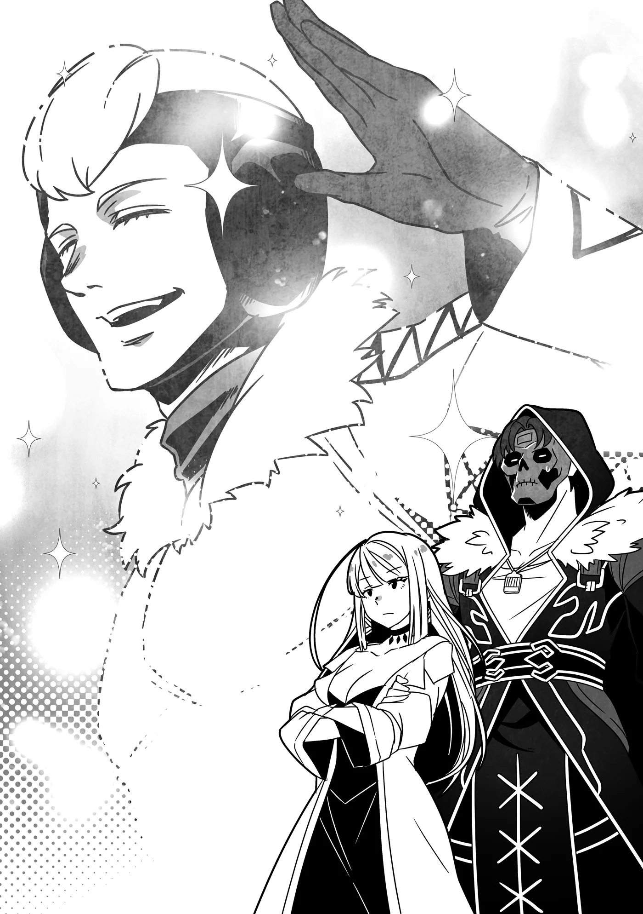

# Chương 274: Tập 12 Chương 1 - Thêm Những Thánh Giả và Trở Về Maalt (3)

"Ha ha... Tôi hiểu rồi. Hóa ra đầu đuôi câu chuyện là thế."

Vẫn còn chút thời gian trước khi lên đường trở về Maalt, nên tranh thủ lúc rảnh rỗi, tôi kể cặn kẽ cho Lorraine và Augurey nghe chuyện thực sự đã xảy ra đêm qua. Đúng như dự đoán, cả hai đều kinh ngạc khi biết kẻ tấn công tôi là Ma Cà Rồng, nhất là Augurey.

Trải qua bao chuyện, Lorraine đã chẳng còn xa lạ gì với Ma Cà Rồng, nhưng với Augurey, Ma Cà Rồng... thân thiện(?) duy nhất anh ấy từng biết xưa nay chỉ có mình tôi, nên anh ấy kinh ngạc cũng phải thôi.

"Nhưng cậu bảo tên Ma Cà Rồng tấn công cậu đã rời thành phố rồi... đúng chứ?" anh ấy hỏi.

"Ừ," tôi đáp. "Ít nhất thì người cứu tôi bảo thế..."

Tôi cố tình nói lấp lửng về thân phận người đó, chỉ bảo là người ấy mạnh đến đáng sợ. Tôi thầm nghĩ kể sự thật cho Augurey nghe chắc cũng chẳng sao, nhưng tôi hiểu mình phải xin phép Laura trước đã, hoặc chí ít là hỏi ý Isaac. Người đánh xe về cơ bản đang mạo hiểm vì chúng tôi cho tới khi cả nhóm rời khỏi thành phố, nên tốt nhất là kín miệng về anh ấy, kể cả trước Augurey.

Còn với Augurey, không hay biết gì sẽ an toàn hơn là ôm vào người cả đống thông tin không thực sự cần thiết. Dẫu vậy, biết đâu một ngày nào đó chúng tôi có thể cho anh ấy biết chuyện.

"Mà này, Vua Ma Cà Rồng cơ à?" Augurey lẩm bẩm. "Tôi từng nghe danh rồi, nhưng không ngờ thuộc hạ của hắn lại xuất hiện ở chính cái chốn này. Ý tôi không phải chê bai gì đâu, nhưng xét mặt bằng các nước thì Yaaran là một nơi khá thôn quê hẻo lánh. Tôi không nghĩ chúng tìm được trò gì vui vẻ ở đây đâu."

Tôi hiểu vì sao Augurey nghĩ thế. Yaaran nằm khá xa trung tâm thế giới, chẳng có mấy tiếng nói trên chính trường, cũng không tự hào có sản vật hay mặt hàng xuất khẩu nào thực sự độc đáo. Bù lại, nơi đây thanh bình và tĩnh lặng... nhưng đó cũng là tất cả những ưu điểm mà tôi có thể nghĩ ra.

Vậy tại sao một thuộc hạ của Vua Ma Cà Rồng lại lang thang ở đây? Chỉ để giết thời gian thôi sao? Nghĩ đến Laura thì... chuyện đó nghe chừng cũng có khả năng lắm. Có lẽ tính khí của Ma Cà Rồng vốn dĩ như vậy. Suy cho cùng, sống đời vĩnh hằng ắt hẳn cũng khá buồn chán. Kẻ tấn công tôi biết đâu chỉ đơn thuần có sở thích đi du ngoạn đó đây.

"Anh có nhìn rõ hắn không?" Lorraine hỏi, lộ rõ vẻ tò mò dưới góc độ học giả.

"Đại khái là có," tôi đáp, nhớ lại chuyện đêm qua. "Hắn, hay ít ra tôi khá chắc là đàn ông, ăn vận như một quý ông với gậy chống và mũ chóp cao. Tôi không thấy mặt hắn. Không phải vì trời tối quá hay gì đâu, cái cớ đó với tôi làm gì có tác dụng. Đúng hơn là... mặt hắn cứ khó nhìn thế nào ấy. Có thể hắn đeo thứ gì đó tạo ra hiệu ứng ấy, hoặc do một loại ma pháp nào đó."

Tôi nhìn trong bóng tối cực kỳ tốt. Chỉ cần một tia sáng le lói yếu ớt nhất, dẫu mờ nhạt như ánh sao, cũng đủ để tôi thấy rõ như ban ngày hồi còn làm con người. Thế nên trời nửa đêm chẳng thể cản trở tôi nhìn mặt người khác. Ấy vậy mà tôi lại không thấy được, chứng tỏ ắt phải có nguyên do nào khác.

"Một món ma cụ hoặc ma pháp làm suy giảm nhận thức..." Lorraine lẩm bẩm. "Tôi đoán thuộc hạ của Vua Ma Cà Rồng sẽ muốn giấu kín danh tính của mình. Chuyện đó thì chịu rồi. Dù sao thì anh thoát khỏi vụ đó mà không thu hút sự chú ý không cần thiết là may lắm rồi đấy, Rentt. Vua Ma Cà Rồng ngang hàng với tứ đại Ma Vương, chắc chắn không phải kẻ mà anh muốn lọt vào tầm mắt đâu. Kết cục chẳng lành đâu."

"Cô nói đúng. Tôi thấy mình vẫn còn may mắn chán."

Dù tên Ma Cà Rồng tấn công dường như nhận ra tôi là Ma Cà Rồng, hay ít nhất là một loại quái vật nào đó, tôi vẫn tránh được tình huống xấu nhất là để hắn phát hiện ra tôi thực chất là một dạng bán Ma Cà Rồng kỳ bí, thậm chí còn dùng được cả Thần Lực.

Vì tôi vẫn còn yếu, một kẻ như hắn muốn bắt cóc tôi là chuyện dễ dàng, và chẳng như trong truyện kể có chàng hoàng tử bảnh bao phi ngựa đến giải cứu kịp lúc, tất cả những gì chờ đón tôi chỉ là kết cục kinh hoàng tại một trong những sào huyệt bí mật của Vua Ma Cà Rồng hay đại loại thế.

Chỉ riêng việc tránh được chuyện đó thôi cũng đủ làm tôi thấy may mắn lắm rồi.

"Nếu được, tôi chẳng bao giờ muốn gặp lại hắn nữa đâu..." tôi lẩm bẩm theo phản xạ.

Lorraine nhìn nét mặt tôi rồi thở dài. "Anh đòi hỏi thế có khi hơi quá rồi đấy. Ở anh cứ có cái gì đó dường như luôn thu hút mấy kiểu người như thế."

"Tôi thật lòng mong họ tha cho tôi đi. Tôi cũng cần được nghỉ xả hơi chút chứ..."

"Đừng hiểu lầm, tôi cũng thấy thế thôi. Nhưng một khi đã lường trước họ sẽ xuất hiện, tốt nhất chúng ta nên chuẩn bị sẵn biện pháp đối phó, chẳng phải sao?"

"Cô có nghĩ ra cách gì không?" Lúc này tôi chưa nảy ra ý gì ngay, nhưng đoán Lorraine có thể có vài ý kiến hay.

"Trước mắt thì rèn luyện thêm Thần Lực của anh xem sao? Dù sao Thần Lực cũng vốn cực kỳ khắc chế Ma Cà Rồng mà. Tôi không rõ trước những kẻ thượng cấp thì chống đỡ được đến đâu, nhưng dù vậy..."

Điều đó quá rõ ràng qua cách Isaac hành xử quanh cái cây tỏa Thần Lực. Dù anh ấy chẳng có vẻ gì là háo hức muốn lại gần, nhưng cái cây cũng đâu làm anh ấy bốc hơi ngay tức khắc hay gì đâu.

Tóm lại, Thần Lực dường như khó lòng đủ mạnh để lấy mạng tên thuộc hạ Vua Ma Cà Rồng kia chỉ bằng một đòn, song không thể phủ nhận là nó có tác dụng. Thần Lực thực sự có thể trở thành con át chủ bài của tôi.

Miễn là tôi không chết trước ma pháp áp lực nghiền nát mà hắn dùng lên tôi trước đó.

Nghĩ lại thì...

"Lorraine, cô có dùng được ma pháp Dehisé không?" tôi hỏi.

"Hửm? Tôi chưa nghe cái tên đó bao giờ. Đó là tên ma pháp mà anh bảo tên Ma Cà Rồng định dùng để nghiền nát anh đấy à?"

Lúc giải thích trước đó tôi chưa nhắc tới tên cụ thể của ma pháp, nên Lorraine mới hỏi lại cho chắc.

Tôi gật đầu. "Ừ. Câu chú chỉ vỏn vẹn đúng cái tên đó thôi, nhưng hắn đã nói thế thật. Cô không biết ma pháp đó à?"

"Có vài ma pháp tạo ra được hiệu ứng tương tự, nhưng tôi không biết cái nào mang tên như vậy. Loại phổ biến nhất là Áp Súc, còn nếu xét ma pháp cổ đại thì có Daḡata. Thông tin này hữu ích đấy Rentt, cảm ơn anh nhé. Nếu ma pháp đó mạnh tới mức làm anh hoàn toàn bất lực, thì sẽ rất hữu dụng nếu tôi tìm ra cách tự mình thi triển. Tôi sẽ phải nghiên cứu về nó... nhưng trước hết, cần xác định xem nó bắt nguồn từ nhánh ngôn ngữ nào đã..."

Lorraine dần chìm vào dòng suy nghĩ riêng, miệng lẩm bẩm một mình về các ý tưởng và giả thuyết.

"Chà... dù sao thì cậu bình an vô sự là tốt rồi, Rentt," Augurey nói. Anh ấy cũng hiểu rõ như tôi rằng một khi Lorraine đã mải mê với chủ đề ma thuật thì có nói gì cô ấy cũng chẳng lọt tai nữa. "Và tôi đoán hôm nay là ngày chúng ta nói lời tạm biệt rồi. Dù vậy chẳng bao lâu nữa cậu lại lên vương đô thôi, đúng không?"

"Tôi chẳng muốn biến chuyện đi đi về về thành thói quen đâu, nhưng đúng là chắc chắn tôi sẽ quay lại," tôi đáp. "Dù sao cũng còn cả vụ của công chúa nữa..."

"Vậy chuyện đó rốt cuộc lại thành rắc rối à? Tôi cũng nghi là thế mà."

"Cũng hơi rắc rối một chút," tôi đồng tình. "Nếu Jean thu xếp êm đẹp chuyện đó giúp chúng tôi thì tốt quá, nhưng tôi có linh cảm mọi chuyện sẽ không đơn giản như vậy."

Còn lý do tại sao—chà, là vì lời sấm truyền của tộc Bán Elf. Dù Jean có là nhân vật tầm cỡ đến đâu, những lời sấm truyền do thần linh ban xuống cũng đâu phải thứ dễ dàng né tránh để khỏi bị cuốn vào.

"Thật tình cả vụ này làm tôi lo đấy..." Augurey bảo. "Nhưng có dịp gặp lại hai người làm tôi vui không gì bằng. Trước lần gặp tới tôi nhất định sẽ nâng cao tay nghề đấy, nghe rõ chưa? Ít nhất tôi cũng muốn đủ mạnh để làm được gì đó nếu chẳng may bị thuộc hạ của Vua Ma Cà Rồng nhảy bổ vào."

"Ừ. Tôi cũng sẽ làm vậy. Nhưng từ giờ cho đến lúc đó, tạm biệt nhé."

Tôi và Augurey bắt tay nhau. Cả hai chúng tôi đều từng trôi nổi ở các cấp bậc đáy suốt một thời gian dài, nhưng dẫu vậy, niềm tin rằng cả hai đều đang ngày một mạnh hơn dâng lên trong lòng tôi.

◆◇◆◇◆

"Cô nghĩ ông ấy sẽ đến chứ?" tôi hỏi.

Lorraine và tôi đang đứng gần cổng vào vương đô, trên trục đại lộ có nhiều xe thồ và xe kéo dùng để ra vào thành phố, hoặc làm điểm dừng chân tạm thời. Những chuyến xe định kỳ đi tới các mê cung cùng đủ mọi địa điểm khác đều xuất phát từ cổng này, và một phần trong tôi chỉ muốn nhảy tót lên một chiếc xem nó sẽ đưa mình tới tận đâu.

Trước đây, những ý nghĩ như thế là điều không tưởng đối với tôi. Đơn giản vì khi ấy tôi không có đủ thực lực. Đại đa số mê cung có thể đi thẳng tới từ vương đô đều vô cùng nguy hiểm. Cất công lặn lội đến tận đây chỉ để thám hiểm một mê cung ngang tầm Mê Cung Nguyệt Ảnh thì chỉ thấy phí công, vả lại, những mê cung nguy hiểm được kể trong các câu chuyện xưa nay mới là nơi tôi luôn khao khát có ngày được thử sức.

Nhưng nếu thử làm vậy hồi còn là con người, nhiều khả năng tôi sẽ bỏ mạng ngay khoảnh khắc vừa đặt chân vào bất kỳ mê cung nào trong số đó, nên tất cả những gì tôi làm được khi ấy chỉ là nuốt nước mắt cay đắng mà từ bỏ.

Tuy nhiên dạo này, tôi tự tin chí ít mình sẽ không chết ngay khi vừa bước chân vào. Ý tôi là, ngay cả khi bị nghiền nát bấy thành tương, tôi vẫn có thể dễ dàng tự tái tạo lại cơ thể.

Bảo thế là ăn gian ư? Chà, thì đúng là vậy. Dù thế, kể cả không có mấy ngón đòn bất công cỡ đó lận lưng, dĩ nhiên tôi vẫn tương đối chắc chắn rằng mình sẽ không bị giết ngay lập tức. Khả năng cao là tôi vẫn tiến sâu được một chặng nhất định trước khi buộc phải bỏ cuộc quay về.

"Chà, dù chúng ta đã nhắn lại giờ giấc và địa điểm hẹn gặp với Hội, nhưng tính ông ấy vốn khá vô tư lự," Lorraine bảo. "Có lẽ tốt nhất là đừng hy vọng quá nhiều mà cứ thong thả chờ đợi thôi."

Còn "ông ấy" là ai, thì dĩ nhiên chúng tôi đang nói tới người mà cả nhóm đến đón để đưa cùng về Maalt: Tổng Hội Trưởng của Vương Quốc Yaaran, Jean Seebeck.

Nếu muốn nói cụ thể hơn, tôi cũng xin nói thêm rằng ông ấy còn là thủ lĩnh của một tổ chức ngầm cắm rễ sâu rộng khắp cả thành phố. Tóm lại, ông ấy nắm quyền kiểm soát cả ngoài sáng lẫn trong tối—chắc chắn không phải kiểu người mà ai muốn biến thành kẻ thù.

Tôi nói câu đó có lẽ hơi đạo đức giả, bởi chúng tôi từng biến ông ấy thành kẻ thù một lần rồi, nhưng chuyện đó đã khép lại êm xuôi. Do mớ rắc rối phức tạp ban đầu đã tạo ra tình thế ấy, ông ấy thực sự đã không truy đuổi chúng tôi bằng toàn bộ thủ đoạn có trong tay.

Nếu ông ấy làm thật, thì ngay cả với cơ thể này của mình, tôi cũng không chắc chuyện gì sẽ xảy ra với bản thân nữa.

Sau khi chúng tôi đứng đợi một lúc, bắt đầu thấy sốt ruột...

"Có vẻ như ngài ấy đã tới rồi," chàng thanh niên đánh xe của chúng tôi lên tiếng.

Tuy bình thường người ta sẽ nghĩ mạo hiểm giả như Lorraine và tôi phải nhận ra trước mới phải, nhưng chàng trai trẻ này lại chính là người hôm qua đã cứu mạng tôi khỏi con quái vật Ma Cà Rồng kia. Trong ba người chúng tôi có mặt tại đây, anh ấy chắc chắn là người mạnh nhất.

Bộ phận phái cử nhân sự tạm thời của Gia tộc Latuule quả thực là một kho nhân tài xuất chúng.

Thậm chí, họ có lẽ còn xếp trên cả Jean trong danh sách những đối tượng người ta không nên gây thù chuốc oán...

"Xin lỗi nhé! Xin lỗi vì ta tới muộn," người vừa được nhắc tới vừa bước lại gần vừa xin lỗi. Ông ấy mặc trang phục giản dị, và nếu cứ giữ im lặng rồi cúi mắt nhìn xuống đất, tôi cá là gần như chẳng ai nhận ra thân phận thực sự của ông ấy.

Tuy nhiên, điều đó không có nghĩa là bộ đồ ông ấy mặc kém chất lượng chút nào. Trái lại là đằng khác: mọi thứ trông đều được may đo vô cùng tinh xảo. Từ những dấu vết Ma Lực mờ nhạt cảm nhận được, tôi nhận ra cả bộ trang phục đó cũng đều là ma cụ—và nếu một quái vật như tôi còn chỉ vừa vặn nhận ra chút ít, thì điều đó có nghĩa là người bình thường sẽ hoàn toàn không phát hiện được gì cả.

Dĩ nhiên Lorraine thì có thể, nhờ đôi ma nhãn của cô ấy. Quả đúng như vậy...

"Ông ăn vận như thể sắp sửa ra trận vậy..." cô ấy nói.

"Bị cô nhìn thấu rồi sao?" Jean mỉm cười đáp. "Chà, ta chắc chắn không có ý định tham gia cuộc chiến nào đâu, nhưng cẩn tắc vô ưu vẫn hơn. Ta đã bảo với các cậu hồi ở đấu trường rồi đấy, có rất nhiều âm mưu xoay quanh mê cung của Maalt—cũng như Tòa Tháp và Học Viện. Ai mà biết hiểm nguy sẽ ập tới lúc nào, hay dưới hình thức gì chứ?"

Jean Seebeck là người giám sát toàn bộ Hội Mạo Hiểm Giả trên khắp Yaaran. Hẳn là có vô số kẻ đang nhăm nhe muốn lấy đầu ông ấy. Nếu muốn tránh bị vạ lây trên đường đi cùng ông ấy, chúng tôi sẽ phải hết sức cẩn trọng từng bước một.

"Tôi cho là ông nói đúng..." Lorraine bảo. "Mà nhắc mới nhớ, sao ông lại đến muộn thế? Sáng nay lúc chúng tôi báo địa điểm và giờ giấc cho Hội, họ bảo sẽ đảm bảo ông có mặt đúng giờ cơ mà."

Tuy đã bàn qua chi tiết khái quát về chuyến khởi hành từ hồi ở đấu trường, sáng nay chúng tôi vẫn ghé qua Hội để dặn dò cụ thể hơn cho chắc chắn. Có điều nói đúng ra thì đó chỉ là việc phụ. Mục đích chính của chúng tôi khi tới Hội là chuyển lời nhắn về tên Ma Cà Rồng đã tấn công tôi đêm qua cho một nhân vật đặc biệt, người mà thành thật mà nói tôi thực sự chẳng muốn liên lạc chút nào.

Nói cách khác, lời nhắn đó là gửi cho Nive.

Vì không thể gặp mặt trực tiếp, nên đó thực sự chỉ là một lời nhắn, đại ý vỏn vẹn là: "Một Ma Cà Rồng cực mạnh đã xuất hiện ở vương đô nhưng chẳng hiểu sao lại đột ngột bỏ chạy, nên tôi nghĩ hắn không còn ở trong thành phố nữa đâu."

Phần việc còn lại—tức là đưa lời nhắn đến tận tay Nive—hoàn toàn trông cậy vào mạng lưới liên lạc của Hội.

Chẳng rõ cô ấy có mò tới vương đô rồi xới tung cả nơi này lên hay không, hay sẽ phớt lờ lời nhắn vì tên Ma Cà Rồng đã biến mất, nhưng mà...

Không, tôi đoán chắc cô ấy chẳng đời nào chịu ngó lơ đâu nhỉ?

Nive không phải mẫu người chịu bỏ qua chuyện gì chừng nào chưa tận mắt tận tai điều tra ngọn ngành. Tôi khá chắc chắn rằng sớm muộn gì cô ấy cũng sẽ xuất hiện ở đây.

Tôi hết lòng mong thời điểm đó sẽ không trùng với lần tới tôi ghé lại nơi này... nhưng kinh nghiệm quá khứ chứng minh rằng cái số tôi đen đủi đến mức chuyện đó rất dễ xảy ra lắm. Chắc hy vọng làm gì cho mất công.

"Hửm? Chà, ta có khối việc phải giải quyết trước đã..." Jean trả lời lảng tránh—rồi đột ngột ngoái nhìn lại phía sau.

"Tổng Hội Trưởng! Ngài đang ở đâu rồi?!" một giọng nói gào lên từ cùng hướng đó. "Chắc chắn ngài không định đi một mình mà không có ai hộ tống đấy chứ?!"

Jean kéo mũ trùm che kín đầu. "Được rồi, chúng ta mau lên đường thôi. Để họ tìm thấy ta là phiền phức lắm đấy."

"Họ đang tìm ngài đấy à...?" tôi hỏi. "Trên xe vẫn còn đủ chỗ cho người khác mà. Chúng ta nên lại bảo với họ—"

Tôi toan bước tới, nhưng Jean nhanh như cắt túm lấy cánh tay tôi. "Đồ ngốc!" ông ấy gắt khẽ.

"Có đám tùy tùng kè kè bám sát sau gáy suốt chuyến đi sẽ làm hỏng mất kế hoạch du ngoạn bấy lâu mong đợi của ta! Nào, đi thôi!"

Ngài là con nít đấy à? đó là câu tôi muốn thốt ra, nhưng có nói chắc cũng chẳng lọt tai ông ấy nổi. Thay vào đó, Lorraine, người đánh xe và tôi chỉ biết nhìn nhau với vẻ cam chịu như nhau, rồi nhanh chóng bắt tay vào chuẩn bị cho cỗ xe khởi hành.

Dù chúng tôi có lén lút lên đường, ở cổng thành lúc nào cũng có khâu kiểm tra. Một nhân vật nổi danh như Jean chắc chắn sẽ bị nhận ra ở đó, nên trước mắt chúng tôi cứ thế khởi hành cũng chẳng sao.

Dù sao thì tôi cũng đã nghĩ như thế...

"Tạm biệt nhé, mấy đứa nhân viên bé nhỏ của ta," Jean lẩm bẩm, cười khúc khích một mình khi hé nhìn qua khe rèm cửa sổ xe. "Ta đi tận hưởng kỳ nghỉ ngắn tuyệt vời ở Maalt đây!"

Nếu bảo rằng nhìn thấy cảnh đó của ông ấy mà tôi không thấy bất an, thì chắc là tôi đang nói dối.

