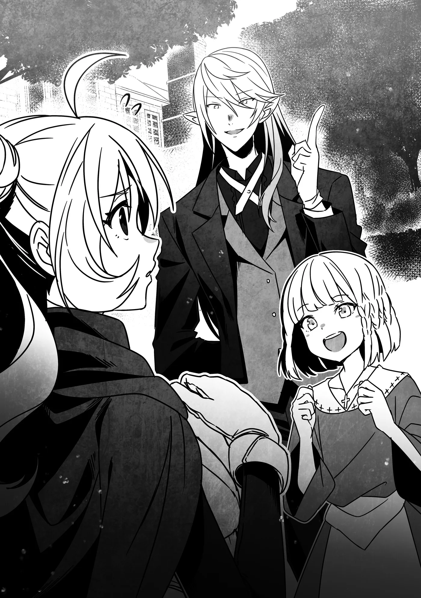

# Chương 275: Tập 12 Chương 2 - Trong Khi Đó, Các Đệ Tử... Phần 1 (1)

Ngoại ô Maalt có một tòa dinh thự tráng lệ nằm giữa khuôn viên rộng lớn. Nơi đây thuộc quyền sở hữu của Gia tộc Latuule, và hiện tại, trong khu vườn đang có ba bóng người. Nhìn cách hai người dốc sức vận động trong khi người thứ ba đứng gần đó quan sát, ai cũng dễ dàng nhận ra họ đang trải qua một buổi luyện tập nào đó.

Về phần những người này là ai... người giám sát là Isaac, một gia nhân của Gia tộc Latuule, còn hai người kia là Rina và Alize.

"Hôm nay tới đây là được rồi. Hai người nghỉ ngơi đi."

Nghe Isaac nói, hai cô gái liền ngã phịch xuống đất, thở dốc dữ dội.

"Không... thở nổi..."

"Em... kiệt sức rồi..."

Nhìn bộ dạng của cả hai, ai cũng thấy rõ họ đã thực sự kiệt sức. Thế nhưng, khi Isaac nhìn hai cô gái rồi vuốt cằm, anh lại bảo: "Nhưng chúng ta chỉ mới bắt đầu thôi mà..."

Mặt Rina và Alize lập tức tái mét.

"Đùa chút thôi," Isaac bật cười. "Sự kiên trì của cô rất đáng khen ngợi đối với một tân binh đấy, Rina—còn Alize, tôi thật sự ấn tượng trước ý chí của em ở lứa tuổi này. Nói thật lòng thì tôi từng nghĩ hai người sẽ kiệt sức nhanh hơn nhiều. Cứ đà này, tôi tin chắc một ngày nào đó hai người sẽ trở thành những mạo hiểm giả xuất sắc."

Hai cô gái thở phào nhẹ nhõm.

Ban đầu, Isaac chủ yếu chỉ dạy ma pháp cho họ, nhưng theo thời gian, các bài học dần mở rộng sang cả võ thuật.

Tuy có nhiều cách thi triển ma pháp khác nhau, cách phổ biến nhất vẫn là vận hành Ma Lực bên trong cơ thể để duy trì câu chú, và đó cũng là điều Rina cùng Alize đang học. Những cách khác bao gồm mượn Ma Lực từ môi trường xung quanh hoặc rút Ma Lực tích trữ trong đồ vật—nhưng rốt cuộc, phương pháp căn bản nhất vẫn là dùng chính Ma Lực của bản thân.

Thế nhưng, Ma Lực của mỗi người là có hạn; thi triển quá nhiều ma pháp sẽ dẫn tới cạn kiệt. Dù Ma Lực sẽ tự hồi phục theo thời gian, người ta thường phải mất vài tiếng đồng hồ lượng Ma Lực mới trở lại bình thường.

Bởi vậy, việc cạn kiệt Ma Lực khiến Rina và Alize có khá nhiều thời gian rảnh, nên họ quyết định tận dụng khoảng thời gian ấy để học cách chiến đấu. Ban đầu, cả hai chỉ lặp lại các bài tập và thế đánh cơ bản học được từ Rentt, nhưng khi nhìn thấy, Isaac đã bắt đầu đưa ra những lời chỉ dẫn.

Rina và Alize đều là kiểu người sẵn lòng tiếp thu sự chỉ bảo của người khác, vả lại qua các buổi học ma pháp họ cũng biết thực lực của Isaac xuất chúng đến mức nào, nên cả hai rất vui vẻ đón nhận sự hướng dẫn của anh.

Về sau, đoán rằng họ có thể bắt đầu chán việc vung kiếm lặp đi lặp lại, Isaac đã thêm vào chế độ luyện tập nhiều bài rèn luyện khác. Dạo gần đây, mỗi buổi tập của họ đều kết thúc bằng một trận đấu tập trực tiếp với chính Isaac. Nhìn chung, năng lực của Rina và Alize đã tiến bộ đáng kể kể từ ngày Rentt và Lorraine rời Maalt.

Có điều, bản thân Rina và Alize lại không nhận ra mình đã tiến bộ nhiều đến thế. Nguyên nhân là vì trong các trận đấu tập với Isaac, lần nào họ cũng bị đánh bại trong khoảng thời gian y hệt nhau. Dĩ nhiên, nếu chuyện đó làm họ nản lòng thì rất dở, nên trong lúc huấn luyện, anh luôn chú ý lồng vào những lời khen đúng lúc.

Thế nhưng, những lời khích lệ như thế cũng chỉ có giới hạn, và rõ ràng giới hạn ấy đã chạm trần.

"Rốt cuộc mình có mạnh lên chút nào không nhỉ...?"

Tiếng lẩm bẩm của Rina vô cùng nhỏ, chỉ là lời tự nhủ thốt ra khẽ đến mức gần như chẳng ai nghe thấy—thế nhưng các giác quan sắc bén mà thân phận Ma Cà Rồng mang lại đã giúp Isaac bắt trọn từng từ. Thậm chí thính lực của anh nhạy bén đến mức chỉ cần muốn, một cây kim rơi ở bất cứ đâu trong toàn bộ dinh thự anh cũng có thể nghe thấy. Lời thì thầm của Rina với anh chẳng tốn chút công sức nào.

Dĩ nhiên Isaac không thể ngó lơ chuyện này, nên anh cất tiếng: "Rina."

"Ơ, có chuyện gì thế anh?"

"Tôi chỉ đề xuất thế này thôi, sao cô không thử nhận một ủy thác làm một mình xem? Thỉnh thoảng làm như vậy có thể giúp xua tan sự đơn điệu của việc cứ cắm đầu luyện tập suốt đấy."

Dạo gần đây, tâm trí Rina dồn hết vào việc chăm sóc Alize kể từ khi được Rentt và Lorraine giao phó. Cô hầu như chẳng nhận ủy thác nào, mà nếu có nhận cũng chỉ toàn là mấy việc vặt như dọn dẹp quanh thị trấn Maalt. Cô tránh né mọi công việc phải vào mê cung hay rời khỏi thị trấn. Không phải vì cô ghét bỏ những công việc ấy, mà đúng hơn là vì Rina quá đỗi vui sướng khi lần đầu tiên có được một người đệ tử của riêng mình—dù chỉ là trên danh nghĩa—khiến cô gần như quấn quýt không rời Alize và ngày nào cũng muốn ở bên chỉ dẫn cho cô bé.

Thành thử, phản ứng của Rina là...

"Nhưng mà..."

Những lời tiếp theo của cô hẳn sẽ là 'Tôi không thể rời thị trấn vì phải chăm sóc Alize'—hoặc nhiều khả năng hơn là 'Tôi muốn chăm sóc Alize'—nhưng cô bé được nhắc tới đã chen ngang trước.

"Chị cứ đi đi, chị Rina! Đừng lo cho em! Chẳng phải dạo này chị đang kẹt tiền sao?"

"Hả? Chị có nói thế à?"

Thực tế là dạo này Rina đang thiếu tiền thật. So với trước đây, các loại ủy thác cô có thể nhận đã đa dạng hơn nhiều, kỹ năng nhận diện thảo dược của cô cũng tiến bộ đến mức chẳng cần phải lặn lội đi xa ra ngoài thị trấn mới tìm hái được thứ mình cần. Nhờ vậy, cô đã không còn phải sống trong cảnh kiếm bữa nào xào bữa nấy như ngày trước.

Thế nhưng, tài chính của Rina vẫn chưa dư dả tới mức có thể tiêu xài xa xỉ mà không thấy bồn chồn trong lòng, và nếu thỉnh thoảng không nhận một nhiệm vụ tiêu diệt quái vật đàng hoàng với thù lao hậu hĩnh, cô sẽ sớm rỗng túi. Hiện tại, túi tiền của cô đã cạn gần đến đáy. Rina không nhớ mình từng nói chuyện này với Alize lúc nào, nhưng chắc hẳn cô đã vô tình lẩm bẩm một mình trước mặt cô bé.

Rốt cuộc, nếu bị dồn vào đường cùng thì Rina chẳng ngại việc phải cắm trại ngoài trời. Với cơ thể hiện tại, màn đêm thực chất lại mang lại cảm giác dễ chịu, và nếu có ai tấn công, cô hoàn toàn có thể dùng Phân Liệt để tẩu thoát. Tuy nhiên, nếu làm vậy, Thợ Săn Ma Cà Rồng có thể đánh hơi thấy và lần mò tới nơi. Cô không thể tùy tiện sử dụng các năng lực Ma Cà Rồng trong thị trấn như thế được. Dù nghe Rentt và Isaac nói rằng ngay cả khi bị phát hiện thì cô dường như cũng không bị coi là một Ma Cà Rồng thực thụ, cô vẫn chẳng dại gì mà chuốc lấy rủi ro không cần thiết. Thành thử, cắm trại ngoài trời... không phải là lựa chọn tốt nhất. Có lẽ đã thực sự đến lúc cô nên ra ngoài nhận một công việc săn quái rồi.

Nghĩ vậy, Rina quyết định nghe theo lời Alize.

"Ừm... được rồi. Nếu em đã nói vậy, Alize à. Nhưng lúc chị đi vắng, em phải chăm chỉ luyện tập đàng hoàng đấy nhé? Không được ăn bớt bài đâu đấy."

Alize gật đầu. "Vâng! Chắc chắn rồi!"

"Về chuyện đó thì không có vấn đề gì đâu," Isaac tiếp lời. "Cô đừng lo—chừng nào Alize còn ở đây, tôi sẽ để mắt trông nom cô bé. Vậy hôm nay cô về trước chứ, Rina? Nếu ngày mai định nhận ủy thác, tôi đoán cô sẽ có vài thứ cần chuẩn bị đấy."

"Vâng, chắc tôi nên về chuẩn bị thật," Rina đồng tình. "Còn Alize...?"

"Em luyện thêm một lát nữa rồi về."

"Thế à? Vậy cố lên nhé. Nhờ anh chăm sóc cho em ấy nhé, anh Isaac."

"Tôi sẽ cố hết sức trong khả năng của mình."

◆◇◆◇◆

"Xong rồi," Isaac lẩm bẩm sau khi Rina rời đi. "Chắc chuyện này sẽ giúp cô ấy lấy lại được chút tự tin."

"Em cũng lờ mờ nhận ra rồi, nhưng dạo này chị ấy thực sự mất tự tin đến thế sao anh?" Alize hỏi.

"Đúng vậy. Rất có thể là vì cô ấy cảm thấy mình chẳng tiến bộ được bao nhiêu. Bình thường tôi cũng sẽ lo cho cả em nữa đấy, Alize, nhưng có vẻ em không có nỗi băn khoăn ấy."

"Đó là vì ngày nào em cũng làm việc vặt ở cô nhi viện. Mọi khi việc đó tốn sức lắm, nhưng dạo gần đây em chẳng thấy mệt chút nào nữa. Em đoán là nhờ thế mà thể lực của mình đã tăng lên."

"Hóa ra là vậy. Tôi đoán Rina rơi vào tình trạng này là vì không có một cột mốc như thế để đo lường sự tiến bộ của mình. Bài tập của cô ấy khắc nghiệt hơn em nhiều, nên tôi tin là cứ về đến phòng trọ là cô ấy lăn ra ngủ ngay."

"Anh... thỉnh thoảng nhẫn tâm thật đấy, anh Isaac."

"Ha ha. Lúc nào tôi chẳng nhẫn tâm."

"Hở? Thật sao? Nhưng những lúc trò chuyện thế này anh tốt tính lắm mà. Lại còn ngầu nữa chứ! Em cá là nếu muốn, anh tìm vợ chẳng khó khăn gì đâu."

"Là một gia nhân của Gia tộc Latuule, tôi còn bận bịu với bao bổn phận của mình... nhưng chuyện đó nói đến đây thôi. Chúng ta quay lại luyện tập nào. Tiện thể vì em vừa bảo tôi nhẫn tâm, hôm nay tôi sẽ thúc ép em gắt hơn bình thường một chút nhé?"

Alize rên rỉ một tiếng, rồi miễn cưỡng đáp: "Vâng... em sẽ cố hết sức ạ."

◆◇◆◇◆

"Ủy thác sao...?"

Dù Isaac đã gợi ý nên nhận việc, Rina vẫn cảm thấy ngần ngại. Không phải vì cô sợ công việc hay gì. Trái lại, với ngần ấy bài tập đã trải qua dạo gần đây, cô thực sự rất muốn nhận cả đống ủy thác để tìm lại cảm giác làm một mạo hiểm giả đúng nghĩa.

Dẫu vậy, cô vẫn chần chừ là vì đinh ninh rằng năng lực của mình chưa thực sự tiến bộ. Mọi chuyện sẽ khác nếu có hai đồng đội cùng nhóm là Raiz và Laura bên cạnh, nhưng họ vẫn đang trong thời gian tĩnh dưỡng. Những vết thương do Ma Cà Rồng gây ra tổn hại cả thể xác lẫn tinh thần, nên họ cần thêm thời gian mới có thể bình phục hoàn toàn. Tuy vậy, cứ ru rú trong phòng mãi cũng chẳng tốt lành gì, nên cứ cách vài ngày, họ lại hẹn gặp nhau và cùng nhận một ủy thác đơn giản. Nhưng cũng chỉ dừng lại ở mức đó mà thôi.

Nếu muốn nhận một ủy thác đàng hoàng, Rina sẽ phải tự đi một mình, hoặc lập đội với những người khác ngoài Raiz và Laura.

Khi đến Hội Mạo Hiểm Giả, cô đứng trước bảng ủy thác. Với tư cách một mạo hiểm giả, những công việc duy nhất cô có thể nhận chỉ ở cấp bậc thấp nhất, dành cho những người Thiết Cấp như cô. Nếu đi cùng Raiz và Laura, tổ đội của họ có thể nhận cả những ủy thác Đồng Cấp, bởi hai người kia đã vượt qua kỳ thi thăng hạng Đồng Cấp—thực ra là thi cùng Rentt.

Thế nhưng, nếu chỉ có một mình Rina...

Thì danh tiếng và công trạng của cô vẫn chưa đủ để nhận ủy thác ở cấp bậc đó. Trước hết cô cần phải nỗ lực tích lũy thêm đã.

Trong suy nghĩ của Rina, vì từng tham gia các ủy thác Đồng Cấp—dù là đi cùng tổ đội—cô cứ ngỡ hội sẽ cho phép mình thử sức với kỳ thi thăng hạng, nhưng họ lại quản lý rất khắt khe chuyện này. Có điều, ở vương đô đăng ký thi thăng hạng Đồng Cấp lại khá dễ dàng, nên có lẽ đây chỉ là quy định riêng của Maalt.

Nếu chỉ là quy định ở Maalt thì cô luôn có lựa chọn lên vương đô dự thi, nhưng chuyện đó lại dẫn đến câu hỏi liệu cô có thực sự thi đỗ hay không, và cô hoàn toàn mông lung về điểm này. Mà có lẽ nói 'mông lung' vẫn còn là quá nhẹ; sự thật là vào lúc này, do chẳng có chút tự tin nào vào năng lực bản thân, cô đi đến kết luận rằng nhiều khả năng mình sẽ trượt.

Rốt cuộc, lựa chọn duy nhất của cô thực sự chỉ là tiếp tục nỗ lực từng bước một cách chậm rãi mà chắc chắn.

"Cô nên tự tin vào bản thân hơn, Rina."

Isaac đã nói câu đó trong buổi tập. Thế nhưng, Rina lại nghĩ rằng so với bản thân trước kia, cô đã có được đôi chút tự tin vào năng lực của mình rồi. Chỉ là những người xung quanh cô ai nấy đều quá tài giỏi và phi thường.

Rentt Faina, không chỉ tinh thông chiến đấu và thám hiểm, mà dường như chuyện gì anh cũng làm được.

Lorraine Vivie, một người xuất chúng trên cả hai phương diện: ma pháp sư lẫn học giả.

Isaac, dù luôn miệng khẳng định mình chỉ là một gia nhân bình thường của Gia tộc Latuule, nhưng kỹ năng chiến đấu lại cao cường đến mức có thể dễ dàng đánh bại cả Rentt lẫn Lorraine gộp lại.

Laura Latuule, người mà ngay cả trong lúc ngủ, khí thế toát ra vẫn mang một vẻ uy nghiêm khôn lường.

Alize, dù còn nhỏ tuổi nhưng tốc độ nắm vững ma pháp lại nhanh hơn nhiều so với Rina hồi mới bắt đầu.

Dù có so mình với ai, Rina cũng thấy bản thân thua kém toàn diện. Cô không nghĩ có ai trách được khi mình nghĩ như thế—dù cô cũng nhận ra góc nhìn của mình có phần hơi bi quan quá mức, nên luôn cố gắng không để nó làm mình quá chán nản. Dẫu vậy, mỗi khi nghe bảo rằng mình nên tự tin hơn, cô vẫn thấy có chút cấn cá trong lòng. Cô không nghĩ mình xứng đáng với điều đó.

"Cô đang phân vân chưa biết nên nhận ủy thác nào sao?"

Khi quay lại xem ai vừa lên tiếng, Rina bắt gặp một người phụ nữ quen thuộc: Sheila Ibarss, nhân viên của hội mạo hiểm giả Maalt và cũng là người biết bí mật của Rentt. Rina cũng từng nghe nói Hội Trưởng Wolf biết chuyện đó, nhưng cô vẫn chưa bàn về vấn đề ấy với ai trong số họ. Đơn giản là chưa có cơ hội, vả lại những chuyện như thế cần phải có đúng nơi đúng lúc.

Thế nhưng, Rina khá chắc rằng Sheila cũng biết "tình cảnh" của chính cô. Nhìn vẻ ngoài thì có vẻ Sheila bước tới đây là vì lo lắng cho cô.

"A, chị Sheila—ừm, không, không phải tôi không chọn được đâu..."

"Hử? Vậy sao? Nhưng tôi thấy cô đứng ngây ra nhìn bảng ủy thác khá lâu rồi đấy."

"Chỉ là tôi đang có chút tâm sự thôi... Cơ mà cũng chẳng có gì to tát đâu. Ý tôi là, chị cũng biết anh Rentt và chị Lorraine tài giỏi đến mức nào rồi mà, đúng không? Tự nhiên tôi lại nghĩ về vị trí của mình khi so với họ, rồi thì..."

Sheila gật đầu thấu hiểu. "Dạo gần đây hai người họ thực sự xuất sắc một cách đáng kinh ngạc, đúng không nào? Nhưng nhắc mới nhớ—họ vẫn đang chỉ dạy cho cô, phải không?"

Mối quan hệ giữa Rina với hai người họ có lẽ được định hình rõ nhất qua thân phận đặc biệt là quyến thuộc Ma Cà Rồng của Rentt, nhưng chắc chắn cô cũng là đệ tử của anh, còn anh là người chỉ dẫn cho cô. Từ cách hỏi có phần ngập ngừng của Sheila, dường như vế sau không để lại ấn tượng quá sâu sắc với cô ấy, nhưng cũng chẳng phải là cô ấy đã quên hẳn. Ngay cả khi có lỡ quên thì cũng là chuyện hết sức bình thường: nhân viên hội mỗi ngày đều nghe hàng trăm mẩu thông tin vụn vặt như thế. Có lẽ Sheila thuộc tuýp người thực sự nhớ được tất cả những điều ấy.

Rina nhận ra vẻ khâm phục của mình hẳn đã lộ rõ trên mặt, bởi Sheila khẽ nghiêng đầu sang một bên.

"Trên mặt tôi dính gì sao?" cô hỏi.

"Không... Tôi chỉ nghĩ rằng nếu nói về những người phi thường thì chị chắc chắn cũng là một trong số đó."

Sheila mở to mắt rồi vội vàng lắc đầu lia lịa. "Ôi, không, hoàn toàn không đâu! Tôi thực sự rất bình thường, nên xin cô đừng xếp tôi chung hàng với những người như họ! Thậm chí, cô Rina này, tôi còn thấy cô mới là người—a! Nhưng dĩ nhiên tôi không có ý xấu đâu nhé!"

Nói "ý xấu", hẳn cô ấy muốn ám chỉ mình không hề có định kiến tiêu cực về Ma Cà Rồng. Rina hiểu rõ điều này qua cách Sheila hầu như chẳng hề thay đổi thái độ với Rentt dù biết rõ thân phận thật của anh. Dù vậy, một phần cũng là vì cô ấy đã quen biết anh từ trước—chứ khó lòng có chuyện Sheila lại có thiện cảm đặc biệt với những con Ma Cà Rồng lạ hoắc đang rình rập ngoài thế giới kia.

Nghĩ lại thì... liệu Laura và Isaac có thuộc vào dạng Ma Cà Rồng rình rập đó không nhỉ? Liệu Sheila có biết về họ không?

Rina thầm quyết tâm sẽ hỏi kỹ Rentt về chuyện này khi có cơ hội lần tới.

"Không đâu, tôi mới là người bình thường... tôi nghĩ vậy," cô nói. "Gần đây một người quen đã có lòng huấn luyện cho tôi, nhưng tôi lại không cảm thấy mình mạnh lên chút nào. Điều đó làm tôi tự hỏi liệu mình đã thực sự nỗ lực hết sức hay chưa... và đó thực ra là lý do tôi đến đây hôm nay. Người đó gợi ý tôi nên tới nhận một ủy thác."

Sau khi nghe Rina trút bỏ nỗi băn khoăn và bực dọc của mình, Sheila gật đầu quả quyết. "Tôi hiểu rồi... thảo nào cô lại đứng đây với vẻ mặt thất thần như thế. Được rồi. Nếu không phiền, cô đợi ở đây một lát nhé? Tôi sẽ quay lại ngay."

Nói rồi, cô chạy vội đi đâu đó.
