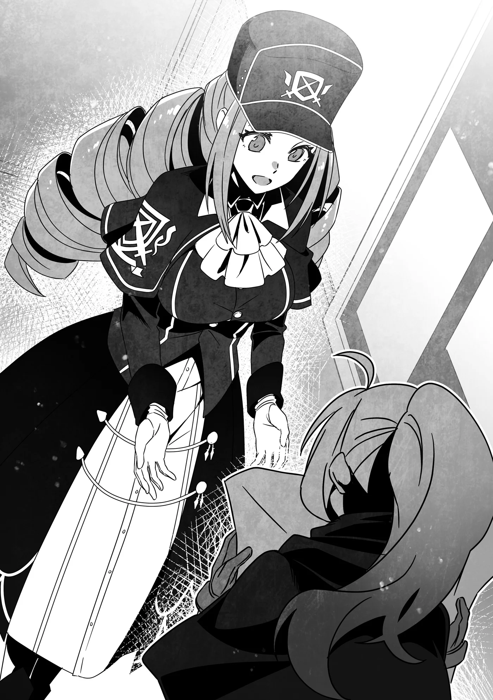

# Chương 276: Tập 12 Chương 2 - Trong Khi Đó, Các Đệ Tử... Phần 1 (2)

Chẳng mấy chốc sau...

"Xin lỗi vì để cô phải đợi nhé," Sheila vừa quay lại vừa nói.

"Không sao đâu, tôi chờ được mà," Rina đáp. "Chị vừa đi đâu thế?" Nghĩ rằng Sheila hẳn chẳng có việc gì riêng với mình, cô tò mò không biết nhân viên Hội vừa rời đi làm gì.

"Dĩ nhiên là đi lọc ủy thác để tìm một nhiệm vụ phù hợp nhất với cô rồi. Không biết cô đã biết chưa, nhưng không phải ủy thác nào cũng được dán lên bảng đâu. Có những ủy thác chưa được kiểm duyệt xong, lại có những cái đặt ra yêu cầu cụ thể về mạo hiểm giả mà thân chủ cần."

Hóa ra chị ấy đi tìm việc cho mình. Lời giải thích của Sheila không hoàn toàn xa lạ với Rina; cô từng nghe phong phanh về những chuyện tương tự. "Kiểm duyệt" ở đây là các thủ tục của Hội nhằm xác định xem có thể tiếp nhận ủy thác hay không, mức thù lao thân chủ đưa ra đã thỏa đáng chưa, độ khó được phân loại có phù hợp không, cùng nhiều yếu tố khác.

Còn yêu cầu cụ thể về người nhận việc thường liên quan đến các tiêu chí như độ tuổi, giới tính, hay ứng viên phải là kiếm sĩ, ma pháp sư, hoặc một chức nghiệp nào đó—cùng nhiều điều kiện khác nữa. Có những yêu cầu rất chi tiết.

Vì không phải ai cũng có thể nhận các ủy thác dạng này, phần lớn trường hợp đều do nhân viên Hội trực tiếp chọn lọc mạo hiểm giả phù hợp rồi trao đổi với họ—ít nhất thì đó là những gì Rina từng được nghe.

Dù vậy, với tư cách là một mạo hiểm giả mới vào nghề, Rina chưa từng bận tâm đến những chuyện như thế. Thường chỉ mạo hiểm giả từ Đồng Cấp trở lên mới được nhân viên Hội nhắm tới cho các công việc đó, nên trước giờ cô chẳng mấy để ý.

Thế nhưng, có vẻ như lúc này Sheila lại muốn giới thiệu một ủy thác như vậy cho Rina.

"Liệu có ổn không chị...?" Rina hỏi. "Tôi mới chỉ là Thiết Cấp thôi mà..."

"Mọi người hay hiểu lầm như vậy, nhưng không phải ủy thác nào chưa dán lên bảng cũng yêu cầu cấp bậc đâu," Sheila giải thích. "Hội không hề có quy định cấm Thiết Cấp nhận chúng. Chỉ là những việc dễ nảy sinh tranh chấp nếu giao cho Thiết Cấp thì sẽ được chuyển cho Đồng Cấp—và nếu ở cấp đó cũng gặp rắc rối tương tự thì lại giao cho Ngân Cấp, cứ thế tiếp tục. Chúng... ừm, quả thực không phải những việc dễ xử lý."

Nghe vậy, Rina lại càng thêm lo lắng. Ngay cả những ủy thác thông thường mà cô nhận cũng đã đủ chật vật để hoàn thành rồi... liệu cô có kham nổi một công việc như thế không?

"Chắc... chẳng có việc nào tôi đủ tiêu chuẩn đâu nhỉ?" Chỉ cần Sheila xác nhận là không có, Rina sẽ chỉ việc quay lại bảng ủy thác và chọn lấy một nhiệm vụ vừa sức. Dù mình chọn cái nào đi nữa thì chắc chắn cũng dễ hơn mấy việc chưa dán bảng kia. Đáng lẽ chị Sheila nên nói thẳng ra ngay từ đầu cho xong chuyện, Rina thầm nghĩ.

Thế nhưng, mọi suy đoán của Rina đều sụp đổ khi Sheila thản nhiên nói: "Thực ra là có đấy, thế nên tôi mới quay lại đây." Cô dừng lại một nhịp. "Sao trông cô ủ rũ thế...? Tôi biết mình vừa nói nghe hơi đáng sợ, nhưng không cần phải lo lắng quá đâu. Nếu là cô thì mọi chuyện sẽ ổn cả thôi."

Vừa động viên cô gái còn đang do dự, Sheila vừa đưa cho cô những tờ giấy ghi chi tiết các ủy thác mà mình đã chọn lọc. Có tới hai tờ, khiến Rina nghiêng đầu khó hiểu.

"Hai cái lận sao chị...?" cô hỏi.

"Tôi nghĩ có lựa chọn thì vẫn tốt hơn. Với lại chỉ có hai cái nên cũng không khó quyết định lắm, đúng không nào?"

"Cảm ơn chị..."

Rina suýt bật khóc trước sự chu đáo của Sheila, nhưng cô kịp trấn tĩnh lại—khóc nhè thì thảm hại quá—rồi chăm chú xem xét và so sánh hai tờ giấy.

Dẫu sao thì Rina cũng kiếm sống bằng nghề mạo hiểm giả, đồng nghĩa với việc vào những lúc thế này, cô luôn cân nhắc các lựa chọn một cách nghiêm túc.

Một công việc là làm người khuân vác cho một mạo hiểm giả Đồng Cấp đang cần người mang vác đồ đạc giúp trong chuyến thám hiểm Mê Cung Nguyệt Ảnh. Vì thân chủ là Đồng Cấp nên nếu được, họ muốn tìm một mạo hiểm giả cùng cấp. Dù sao thì mục tiêu của họ là thăm dò sơ bộ Mê Cung Nguyệt Ảnh, và họ sẽ rất biết ơn nếu có người hỗ trợ.

Dù công việc nghe có vẻ đầy hứa hẹn, nó lại kéo dài trong ba ngày và họ sẽ phải cắm trại bên trong Mê Cung Nguyệt Ảnh. Đó tuyệt đối chẳng phải yêu cầu dễ dàng gì, có lẽ vì thế mà nó chưa được dán lên bảng.

Trong thâm tâm, Rina gần như gạt phăng công việc này. Dù không ngại nhận ủy thác kéo dài ba ngày, cô không tự tin rằng mình có thể xoay xở suốt quãng thời gian dài đến vậy trong mê cung. Dĩ nhiên có những khu vực an toàn nơi quái vật không xuất hiện, và đó sẽ là nơi họ cắm trại, nhưng thế vẫn chưa ổn. Cô cần phải tích lũy thêm kinh nghiệm trong mê cung trước khi dám thử sức với một công việc như thế...

Sau khi loại bỏ lựa chọn đó, cô xem xét ủy thác thứ hai: yêu cầu thuê hộ vệ của một thương nhân. Thân chủ là một phụ nữ trẻ, và cô ấy đã ghi rõ mong muốn thuê một nữ mạo hiểm giả.

Kế hoạch được nữ thương nhân mô tả chi tiết trong ủy thác là ghé qua vài ngôi làng quanh Maalt để bán các nhu yếu phẩm thường nhật. Sau đó, cô ấy sẽ dùng số tiền kiếm được để thu mua đặc sản địa phương rồi mang về Maalt bán tại khu chợ. Thời gian dự kiến cho ủy thác này cũng là ba ngày, và dựa theo lộ trình ghi trên giấy thì họ sẽ không đi qua bất kỳ khu vực nào có quái vật đặc biệt mạnh.

Dĩ nhiên điều đó không loại trừ khả năng xảy ra những chuyện bất trắc ngoài dự tính, chẳng hạn một con quái vật hùng mạnh vốn không nên ở đó lại đột ngột xuất hiện trong khu vực. Tuy nhiên, nếu những nỗi lo như thế đủ để ngăn một mạo hiểm giả nhận việc thì sẽ chẳng ai dám làm nghề này nữa. Mong muốn một mức độ an toàn nhất định là một chuyện, nhưng tham lam đòi hỏi nhiều hơn thì đừng mong trụ nổi trong nghề mạo hiểm giả. Suy cho cùng, đối mặt với hiểm nguy đúng nghĩa là một phần công việc của họ. Tránh né nguy hiểm khi có thể là điều đương nhiên, nhưng không có nghĩa là người ta có thể trốn tránh nó hoàn toàn.

Các điều kiện của công việc cũng có vẻ rất hứa hẹn: chỗ ở trong suốt chuyến đi đều do thân chủ chi trả, thù lao lại khá hậu hĩnh.

"Cô đã quyết định chọn cái nào chưa?" Sheila hỏi.

Rina gật đầu, đưa lại các tờ giấy và chỉ vào ủy thác thứ hai. "Tôi định nhận việc này."

"Được rồi. Ừm, tôi cũng đồng ý đây có lẽ là lựa chọn tốt hơn. Với lại vì thân chủ là nữ muốn tìm nữ mạo hiểm giả, nên cô nhận việc này cũng là đang giúp Hội một tay đấy..."

Người ta thường bảo nghề mạo hiểm giả không phân biệt giới tính, nhưng thực tế số lượng mạo hiểm giả nam vẫn nhiều hơn nữ—xét theo khía cạnh nào đó thì điều này âu cũng là lẽ tự nhiên.

Rốt cuộc thì mọi chuyện vẫn bắt nguồn từ sức mạnh thể chất thuần túy. Dù có không ít nữ mạo hiểm giả mạnh hơn hẳn nam giới nhờ vận dụng Ma Lực hoặc Khí Lực để cường hóa bản thân, nhưng trước khi tính đến những yếu tố đó, sự thật là cái nghề này vốn chẳng mấy hấp dẫn với phần lớn phụ nữ. Khi nói đến kiếm thuật, đại đa số những người gõ cửa các võ đường và học viện đều là nam giới. Với ma pháp thì không hẳn như vậy, nhưng bản thân ma pháp sư lại hiếm hơn nhiều, vì thế họ chỉ chiếm một tỷ lệ nhỏ trong toàn thể giới mạo hiểm giả.

Chính vì thế, các nữ mạo hiểm giả luôn rất đáng giá—đặc biệt là những người có năng lực vượt trội. Nếu bị hỏi liệu bản thân có nằm trong số những nhân vật quý giá ấy không, Rina chắc chắn sẽ lắc đầu phủ nhận, nhưng cô cũng rất mừng vì mình có thể giúp ích khi được cần đến.

Một lát sau, Sheila mang tờ ủy thác về quầy tiếp tân và hoàn tất các thủ tục cần thiết để Rina tiếp nhận nhiệm vụ.

"Xong rồi đó," Sheila nói. "Công việc này giờ là của cô. Vì thời gian khởi hành do mạo hiểm giả quyết định, cô nên đến gặp thân chủ ngay trong hôm nay để báo rằng mình đã nhận ủy thác, cũng như trao đổi về các khâu chuẩn bị."

"Tôi hiểu rồi!" Rina tươi tỉnh đáp. "Tôi sẽ đi ngay đây!"

Sheila dõi mắt nhìn theo bóng cô rời khỏi Hội. "Thân chủ này hơi khó tính một chút..." cô lẩm bẩm một mình. "Nhưng chắc là sẽ ổn thôi. Có lẽ vậy..."

Những lời đầy điềm gở ấy chẳng thể lọt tới tai Rina.

◆◇◆◇◆

"Mong là không phải lại gặp một kẻ kỳ quặc nữa..." Dorothea lẩm bẩm.

Dorothea Merrow, một thương nhân, đang nằm trên giường trong căn phòng cô thuê tại một quán trọ, chăm chú nhìn vết ố trên trần nhà trông na ná khuôn mặt người. Còn về ý tứ của từ "kỳ quặc", cô đang ám chỉ gã mạo hiểm giả nam mà mình từng thuê làm hộ vệ cách đây một tháng tại Hội Mạo Hiểm Giả ở Zahak, một thị trấn tỉnh lỵ nằm ở phía tây Maalt.

Cũng như mọi thương nhân khác, công việc của Dorothea gắn liền mật thiết với những cá nhân được gọi là mạo hiểm giả. Dân buôn bán kiếm sống bằng cách rong ruổi từ thành phố này sang thành phố khác, từ làng này qua làng nọ, bán nhu yếu phẩm thường nhật, gom mua đặc sản địa phương rồi bán lại kiếm lời. Vì thế, yếu tố sống còn nhất trong công việc của họ chính là sự an toàn trên các tuyến đường di chuyển.

Dĩ nhiên kết quả buôn bán cũng rất quan trọng, nhưng một thương nhân mất mạng thì rõ ràng chẳng còn cơ hội mà hưởng thụ thành quả lao động của mình.

Dù ngoài kia có những kẻ liều mạng dám đánh cược tính mạng mỗi lần lên đường vì viễn cảnh giàu sang tột bậc, nhưng ít nhất Dorothea không phải tuýp người như thế. Cô không dám khẳng định mình sẽ không bao giờ nghĩ tới một canh bạc như vậy—cô biết đời người ắt phải có lúc đánh cược một phen—nhưng dù tốt hay xấu, hiện tại cô chưa gặp phải cơ hội nào ép mình phải đưa ra quyết định đó, và dường như trong tương lai gần cũng chẳng có cơ hội nào tìm đến.

Lúc này, kế hoạch của cô là chậm rãi nhưng vững chắc tích lũy lợi nhuận, dành dụm một khoản vốn kha khá rồi dần dà mở một cửa tiệm của riêng mình ở một thành phố quy mô tương đối. Mọi chuyện khác cô đều có thể tính sau.

Mục tiêu đó chính là động lực thúc đẩy cô tách ra làm ăn độc lập khỏi cha mình—người cũng theo nghề buôn bán—từ hai năm trước. Cô đã dốc bao tâm huyết cho mục tiêu ấy—nhưng chẳng điều nào trong số đó ngăn được chuyện cô gặp phải rắc rối mới đây.

Gã mạo hiểm giả nam mà cô thuê một tháng trước đã coi thường cô, người thuê hắn, chỉ vì cô là phụ nữ, rồi vin vào đó để đòi tăng tiền thù lao. Trong hoàn cảnh bình thường, đó hoàn toàn là lý do chính đáng để hủy bỏ ủy thác ngay lập tức. Ngặt nỗi, hắn chỉ mở miệng nói chuyện đó khi chuyến hành trình đã đi được một nửa, đồng nghĩa với việc hủy hợp đồng ngay lúc ấy sẽ trực tiếp đẩy tính mạng của Dorothea vào vòng nguy hiểm. Vì thế, cô chẳng còn cách nào khác ngoài việc cắn răng chấp nhận các điều kiện của hắn.

Sau khi hoàn thành công việc, Dorothea đã nộp đơn khiếu nại lên Hội, nhưng vì cô đã chính thức đồng ý với các điều khoản của hắn, còn hắn thì làm đúng mọi thủ tục, nên Hội đành bó tay, không thể xử phạt hắn dưới bất kỳ hình thức nào. Ai nấy đều ấm ức, trừ chính gã mạo hiểm giả.

Nghĩ lại thì trước lúc lên đường, gã đàn ông đó đã tỏ ra tỉ mỉ và chi tiết một cách bất thường về các điều khoản chính xác của ủy thác. Té ra, sau khi bàn bạc về những trường hợp có thể khiến thù lao tăng lên rồi đưa vào văn bản cùng cô, hắn đã mang nó đến Hội và báo trước về "thỏa thuận" giữa hai người trước ngày khởi hành, rồi bóp méo lời nói khi không có mặt cô để phản bác.

Về sau, Dorothea nghĩ lựa chọn tiếp theo của mình là tìm gặp trực tiếp gã đó để ba mặt một lời—nhưng trước khi cô kịp nhận ra mình cần phải làm vậy, hắn đã cao chạy xa bay khỏi thị trấn và chẳng còn thấy tăm hơi đâu nữa.

Kết luận duy nhất mà Dorothea có thể rút ra là hắn đã lên kế hoạch cho tất cả chuyện này ngay từ đầu. Xét theo một góc độ nào đó, gã mạo hiểm giả đã hoàn thành xuất sắc mưu đồ mà hắn đặt ra.

Khỏi phải nói cũng biết toàn bộ sự việc khiến người ta bực bội đến mức nào. Thế nhưng không còn đường lui nào khác, tất cả những gì Dorothea có thể làm là tự coi đó như một vận rủi rồi bước tiếp.

Dĩ nhiên, trong hai năm làm thương nhân độc lập, cô đã từng nếm trải những thử thách tương tự. Thậm chí là rất nhiều lần—và chính vì thế, cô ngỡ mình đã đủ cẩn trọng để đề phòng những mánh khóe như vậy. Tiếc thay, kết quả lần này cho thấy cô vẫn chưa đủ cẩn thận.

Dorothea nhớ lại lời người cha từng căn dặn khi cô bảo muốn ra ngoài làm ăn độc lập, lẩm bẩm nhắc lại từng chữ.

"Phụ nữ làm nghề buôn bán gian nan lắm..."

Giờ đây, Dorothea đã hiểu ý thực sự của cha khi nói ra câu đó—ông hoàn toàn không có ý ngăn cản cô. Nhưng lúc bấy giờ cô lại nghĩ như vậy, rốt cuộc dẫn đến một cuộc cãi vã. Cuối cùng, cô rời nhà trong mối quan hệ rạn nứt với cha, và từ đó đến nay chưa từng quay trở về.

Không phải cô không muốn gặp ông. Sự thật là cô thấy mình chẳng còn mặt mũi nào đối diện với cha sau những gì đã làm. Khi cha cô thốt ra câu ấy, ông chỉ đang muốn nói rằng các nữ thương nhân thường xuyên gặp rắc rối—chẳng hạn như bị ép tăng tiền thù lao bảo hộ—nhiều hơn các thương nhân nam rất nhiều.

Dorothea cũng khá thân thiết với một số nam thương nhân cùng trang lứa, và mỗi khi tâm sự với họ về những rắc rối của mình, họ cũng kể lại những chuyện xui xẻo của bản thân. Thế nhưng cô gặp phải chúng thường xuyên hơn họ nhiều, và số tiền cô bị lừa gạt cũng đắt đỏ hơn gấp bội.

Rốt cuộc thì người ta chỉ đơn giản là coi thường cô vì cô là phụ nữ. Đó là kết luận cô buộc phải rút ra, và cũng là điều cô hoàn toàn tin chắc. Mặc dù vậy, cô chẳng hề có ý định từ bỏ con đường thương nhân—trái lại, nghịch cảnh chỉ càng tiếp thêm động lực cho cô.

Cô muốn đạt được mục tiêu bất chấp—không, chính là nhờ những gì mình đã phải trải qua, và mỗi lần vấp phải một chướng ngại tương tự, ý chí trong cô lại càng thêm sắt đá. Vả lại, chỉ vì từng trải qua giai đoạn gian khó không có nghĩa là cô không thể rút ra bài học cho mình.

Dẫu vậy, điều đó không có nghĩa là cô có hứng thú thuê một mạo hiểm giả nam cho ngay công việc tiếp theo, đó là lý do cô yêu cầu một người phụ nữ đồng hành cùng mình. Dorothea biết số lượng nữ mạo hiểm giả ít hơn hẳn so với nam giới, đồng nghĩa với việc cô không thể biến chuyện này thành thói quen thường xuyên được. Nếu muốn duy trì suôn sẻ lịch trình buôn bán, cô không thể đưa ra những yêu cầu quá quắt.

Thế nhưng sau tất cả mọi chuyện, riêng với chuyến đi lần này, cô ưu tiên sự an tâm của bản thân hơn cả.

Dù vậy, cũng chẳng có gì bảo đảm rằng các nữ mạo hiểm giả sẽ không giở trò với cô. Nỗi lo của một thương nhân dường như là vô tận. Vì thế, tất cả những gì Dorothea có thể làm là cầu mong sẽ gặp được một người đàng hoàng—đó chính là lý do cô lẩm bẩm một mình trong phòng.

Đúng lúc đó, có tiếng gõ cửa vang lên.

"Mời vào," Dorothea cất tiếng, đồng thời ngồi dậy, nhích ra mép giường.

Cánh cửa mở ra, để lộ một nhân viên của quán trọ. "Có khách tìm cô, thưa cô. Cô ấy bảo mình là mạo hiểm giả đã nhận ủy thác của cô..."

Vậy là cô ấy đã tới.

Lần này, Dorothea quyết tâm phải thương lượng thật cặn kẽ để không bị lừa gạt thêm lần nữa. Chuẩn bị tinh thần cho trận chiến sắp tới, cô đứng dậy và bước xuống sảnh tầng một của quán trọ, nơi vừa là phòng ăn vừa là khu vực nghỉ ngơi.

Bắt đầu thôi nào.
