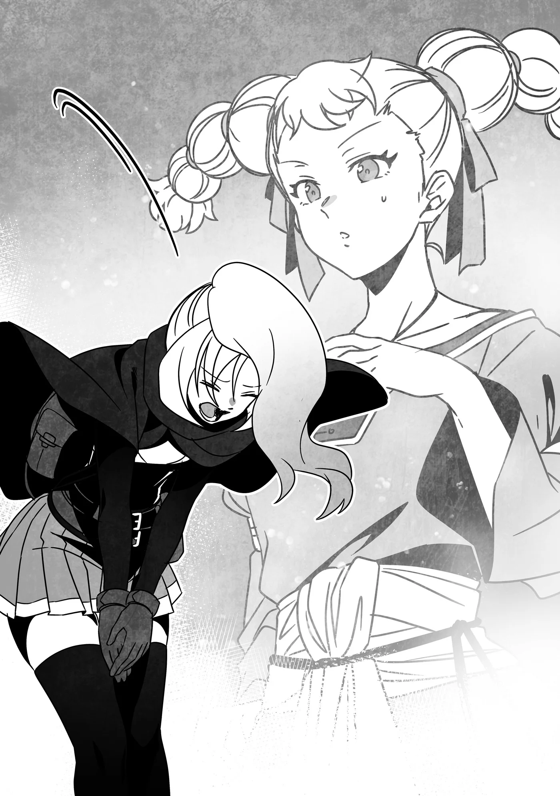

# Chương 277: Tập 12 Chương 2 - Trong Khi Đó, Các Đệ Tử... Phần 1 (3)

Dorothea bước xuống sảnh với cảm giác như thể sắp sửa phải đối mặt với một con quái vật hung tợn, nhưng cảnh tượng chờ đón khi đến nơi lại khiến cô hết sức ngỡ ngàng. Nguyên do là bởi cả gian sảnh vốn được kê la liệt bàn ghế ấy lúc này lại chỉ có độc một bóng người.

Bóng người đơn độc ấy chắc chắn là kẻ đã nhận ủy thác của Dorothea. Có điều, ừm thì...

Dù nhìn kiểu gì đi nữa, cô gái đó rõ ràng còn trẻ hơn cả bản thân Dorothea.

Vừa trông thấy Dorothea, cô gái dường như đã đoán ra đây chính là thân chủ của mình, liền đứng dậy khỏi ghế và bước lại gần.

"Ừm, xin thứ lỗi, cô có phải là Dorothea Merrow không?" cô gái mỉm cười hỏi.

Dorothea ráng bắt những bánh răng đang đông cứng trong đầu chạy lại. "Đ-Đúng vậy, là tôi... Có phải cô... đã nhận công việc tôi đăng không?"

"Đúng thế! Tôi là Rina Rupaage, mạo hiểm giả Thiết Cấp. Rất vui được gặp cô—và được làm việc cùng cô!"

◆◇◆◇◆

Một mạo hiểm giả Thiết Cấp.

Phản ứng đầu tiên của Dorothea là ngạc nhiên. Ủy thác cô đăng lên là công việc hộ vệ cho đoàn buôn của mình, điều bắt buộc phải đòi hỏi một trình độ thực lực nhất định.

Cụ thể hơn trong trường hợp này, "thực lực" thực chất đồng nghĩa với "sức mạnh". Xét theo lộ trình Dorothea dự định đi, cô cần người hộ vệ ít nhất phải là một mạo hiểm giả Đồng Cấp, và cô đã đảm bảo nêu rõ điều đó với Hội khi nộp ủy thác.

Nhưng nghĩ lại thì nguyên văn lời cô khi ấy chỉ là đại loại "yếu hơn thì tôi sẽ thấy bất an". Nhân viên Hội cũng đã nói họ sẽ cân nhắc yêu cầu của cô và có sự điều chỉnh thích hợp khi cần thiết. Họ còn giải thích thêm rằng vì Dorothea muốn ưu tiên một nữ mạo hiểm giả, nên có khả năng sẽ không có sẵn cấp bậc như cô mong muốn.

Dorothea không mặn mà gì với chuyện đó, song cô vẫn chấp nhận các điều khoản. Tóm lại, do xung quanh không có nữ mạo hiểm giả Đồng Cấp nào phù hợp, nên cô gái này mới nhận công việc. Nói thật lòng thì Dorothea chẳng hề bận tâm chuyện đó—nhưng cô nghĩ công việc này e rằng sẽ quá sức với một Thiết Cấp đơn độc.

Dẫu vậy, dù đôi lúc làm việc có phần tùy hứng và dễ dãi, Hội sẽ không bao giờ cử một người hoàn toàn không có khả năng hoàn thành công việc đã nhận. Nghĩ tới điều đó, Dorothea tự hỏi liệu cô gái này có thực sự khá cừ hay không. Cấp bậc vốn không phải lúc nào cũng phản ánh hoàn toàn chính xác thực lực của một mạo hiểm giả, và có không ít cá nhân đủ năng lực nhưng cấp bậc chưa theo kịp. Xét cho cùng, nếu không chủ động cất công ra ngoài lập thành tích rồi tham gia kỳ thi thăng hạng, thì cấp bậc của họ cũng chẳng thể nào tăng lên được.

Có lẽ cô gái này chính là một người như thế. Cơ mà, trông cô ấy thực sự chỉ như một thiếu nữ bình thường...

Liệu mình có nên từ chối cô ấy không nhỉ...?

Sự hoài nghi của Dorothea hẳn đã lộ rõ trong ánh mắt, bởi cô gái lập tức lên tiếng ngay.

"Ừm, tôi xin lỗi..." cô gái nói, giọng có chút tự ti. "Chắc cô sẽ không thấy an tâm khi đi cùng tôi đúng không? Tôi hiểu mà."

Không hiểu sao, sự thiếu tự tin của cô gái—của Rina—lại khiến Dorothea có phần bực bội. Dù vậy, người làm cô bực không phải bản thân Rina. Là một người đã quá quen với việc bị coi thường và bị nghi ngờ năng lực như cơm bữa, Dorothea nhìn thấy chính hình bóng mình nơi Rina.

Rồi Dorothea chợt nhận ra: Khi đối mặt với khách hàng và đối tác làm ăn, mình cũng cư xử y như thế này. Đó là lý do họ coi thường mình.

Dù đáng lẽ mấy chuyện đó chẳng hề quan trọng—điều quan trọng không phải giới tính hay tuổi tác, mà là người ta có thể làm được những gì.

Và cấp bậc mạo hiểm giả cũng tương tự như vậy.

"Không, không phải vậy đâu," bị thôi thúc bởi suy nghĩ đó, Dorothea lên tiếng. "Tôi chỉ thấy bất ngờ thôi. Cô trẻ hơn và trông mảnh mai hơn nhiều so với tôi tưởng. Dù nói mình không bất an thì là nói dối... nhưng Hội cử cô đến là vì họ tin cô có thể đáp ứng được các điều khoản trong ủy thác của tôi, đúng chứ? Nếu vậy thì không sao cả."

Một chút bực bội trong lòng Dorothea thoáng lộ qua giọng điệu, khiến lời nói bớt phần lịch thiệp và cộc lốc hơn so với dự định của cô. Thế nhưng Rina chỉ mỉm cười đáp lại.

"Mảnh mai á? Tôi sao?" Rina hỏi lại. "Cô biết không, dạo gần đây dù ăn bao nhiêu tôi cũng chẳng lên nổi tí cơ bắp nào cả... Mà tôi lại rất muốn có cơ bắp, nên đã ráng ăn thật nhiều đấy chứ..."

Dorothea phải cố kìm lại để không buột miệng thốt lên: "Cô để tâm đến mỗi chỗ đó thôi đấy à?!" Thay vào đó, cô bảo: "Cô làm tôi ghen tị đấy chứ... Tôi thì cứ ăn cái gì là vào người cái nấy."

Cô nói vậy hoàn toàn nghiêm túc. Có lẽ vì đặc thù công việc khiến giờ giấc ăn uống thất thường, Dorothea chẳng cần ăn bao nhiêu cũng dễ tăng cân. Đối với một thương nhân thì đây là điều tốt, bởi nó đồng nghĩa với việc họ có thể di chuyển lâu hơn với lượng tiếp tế ít ỏi, nhưng xét dưới góc độ một người phụ nữ... ừm thì, Dorothea thực sự ghen tị với khả năng muốn ăn gì thì ăn, ăn bao nhiêu tùy thích mà chẳng hề tăng cân của Rina.

"Cô nghĩ thế thật sao...?" Rina hỏi. "Tôi thì chỉ mong những gì mình ăn vào đúng chỗ mình muốn thôi. Dù tôi có cố gắng thế nào đi nữa... tình hình trông vẫn ảm đạm lắm..."

Nghe cô ấy nhắc mới để ý, Dorothea không thể phủ nhận vóc dáng của Rina đúng là có phần hơi gầy gò. Dẫu vậy, cô ấy vẫn còn trẻ. Ai biết được tương lai sẽ thế nào chứ? Dorothea định bảo cô ấy từ bỏ lúc này thì còn quá sớm, nhưng Rina đã nhanh nhảu lên tiếng trước.

"A, hình như chúng ta đi hơi xa chủ đề chính rồi nhỉ? Tôi đến đây là để bàn chi tiết về chuyến đi sắp tới. Giờ cô có rảnh không, Dorothea?"

"Đ-Được chứ..." Dorothea đáp. Bị cuốn theo nhịp của Rina, cô gật đầu rồi cả hai cùng ngồi xuống một chiếc bàn.

Dorothea không tài nào nắm bắt được con người của Rina. Ban đầu, cô ngỡ cô gái này thiếu tự tin, nhưng giờ đây có vẻ như cô ấy có quyết tâm làm mọi việc theo nhịp độ của riêng mình. Dẫu vậy, trực giác vẫn mách bảo cô một điều.

Đi cùng cô ấy có vẻ sẽ vui đây.

◆◇◆◇◆

"...Và đó là kế hoạch sơ bộ về lộ trình chúng ta sẽ đi. Còn về thời điểm khởi hành, tôi muốn lên đường càng sớm càng tốt. Nếu cô thấy ổn thì sớm nhất là ngày mai."

Sau khi trình bày xong kế hoạch đã vạch ra cho chuyến đi, Dorothea ngóng đợi câu trả lời từ Rina. Trầm ngâm suy nghĩ chốc lát, cô gái liền đáp lời.

"Tôi không phiền chuyện khởi hành vào ngày mai đâu... nhưng tôi khuyên chúng ta nên đi đường vòng để tránh khu vực quanh Núi Tute. Ngoài ra, tôi nghĩ đi Đại Lộ Radha sẽ tốt hơn là đi Đại Lộ Farga. Còn lại thì lộ trình trông khá ổn rồi." Cô ấy thậm chí còn tiện thể đề xuất thêm vài thay đổi về tuyến đường.

Trong thoáng chốc, Dorothea suýt nữa mất bình tĩnh khi tự hỏi một kẻ tay mơ thì biết gì về các tuyến đường buôn bán chứ. Một phần trong cô ngờ rằng Rina đang đưa ra những đề xuất thừa thãi cốt để làm màu rằng mình là một mạo hiểm giả thực thụ.

Thế nhưng, khi nhìn kỹ lại nét mặt của cô gái, cô chẳng hề thấy chút dấu vết nào của sự hăng hái nông nổi đó. Vẻ mặt của Rina toát lên sự điềm tĩnh trọn vẹn.

Cảnh tượng ấy làm dịu đi dòng máu đang bốc lên đầu Dorothea, và cô quyết định trước tiên cứ hỏi Rina lý do đằng sau những đề xuất đó.

"Tôi có thể hỏi lý do tại sao không? Cả hai tuyến đường đó đều là lựa chọn ngắn nhất để đến nơi tôi muốn, và tôi từng đi lại nhiều lần rồi. Nếu làm theo gợi ý của cô thì chuyến đi sẽ mất thêm đứt nửa ngày đường đấy."

Dorothea không hề nói quá để bác bỏ ý kiến của một kẻ nghiệp dư—đó là sự thật rành rành. Chưa kể chuyến đi càng kéo dài thì nguy cơ bị quái vật hay thổ phỉ tấn công càng cao. Rút ngắn hành trình hết mức có thể vốn là nguyên tắc căn bản.

Tuy nhiên, câu trả lời của Rina lại khiến Dorothea bất ngờ. "Chuyện đó chỉ đúng cho đến ngày hôm qua thôi," Rina nói. "Giờ thì không còn như vậy nữa đâu. Đã có tin báo rằng lũ Harpy đã kéo đến làm tổ trên Núi Tute. Năm nào chúng cũng làm thế, nhưng lần này chúng tới sớm hơn một tháng—nhiều khả năng là do thời tiết ấm áp dạo gần đây. Tôi e là nếu đi đường đó thì cô sẽ chỉ thành mồi cho lũ chim non của chúng thôi, nên tốt nhất là hãy chọn lộ trình khác. Còn về Đại Lộ Farga, cô biết cây cầu bắc qua đường đó rồi đúng không? Nghe đâu nó đã bị sập, nên ai đi dọc theo đại lộ cũng sẽ buộc phải quay đầu đi đường vòng thôi. Ý tôi là, trong trường hợp đó thì tôi sẽ được trả thêm tiền, nên nếu cô vẫn muốn đi đường ấy thì chắc tôi cũng chẳng cản đâu..."

◆◇◆◇◆

Dorothea thực sự ngỡ ngàng trước lời giải thích của Rina. Còn về lý do cô cảm thấy như vậy...

"Không phải tôi nghi ngờ cô... nhưng chuyện đó có thật không đấy? Tôi ngỡ mình đã bỏ ra không ít công sức để nắm bắt thông tin về lộ trình của mình, vậy mà tôi chẳng nghe thấy điều gì tương tự cả."

Dù Dorothea chỉ là một thương nhân lữ hành nhỏ lẻ, kiểu người nhan nhản ở khắp mọi nơi, nhưng cô là thành viên chính thức của Hội Thương Nhân. Nhờ đó, cô cũng có quyền tiếp cận mạng lưới thông tin của họ. Hơn thế nữa, cô luôn chủ động trao đổi với các thương nhân khác xung quanh về bất kỳ biến động nào trong khu vực. Vậy mà dù đã cất công đến mức đó, cô vẫn chưa từng nghe thấy bất kỳ tin tức nào như những gì Rina vừa nói.

Rina gật đầu. "Chắc là vì tin tức vẫn chưa thực sự lan rộng thôi. Ý tôi là, tôi cũng chỉ tình cờ biết được nhờ trò chuyện với những người sống gần các khu vực đó."

"'Các khu vực đó' sao?"

"Đúng vậy. Những người đến từ các ngôi làng gần Núi Tute và Đại Lộ Farga ấy."

"Làm sao cô...? Đừng nói là cô đã cất công lặn lội đến tận những nơi đó rồi đấy nhé?"

"Ôi không, dĩ nhiên là không rồi. Chỉ là, Maalt là thị trấn lớn nhất trong vùng mà, đúng chứ? Người dân từ các làng nhỏ thỉnh thoảng vẫn đến đây mua nhu yếu phẩm; nhất là những ngôi làng mà thương nhân như cô ít khi ghé qua. Mỗi lần ra chợ tôi đều gặp khá nhiều người trong số họ, và đến giờ thì chúng tôi gần như đã thành người quen thỉnh thoảng lại trò chuyện với nhau."

"Ra vậy..."

Quả thực, chỉ những ai định cư tại chính thị trấn này mới có thể dùng phương thức thu thập thông tin như vậy. Dù Dorothea chắc chắn cũng có thể bắt chuyện với những người đó nếu ra chợ, nhưng cô sẽ chẳng biết ai sống ở đâu và lời nói của họ đáng tin cậy đến mức nào. Rốt cuộc thì cô cũng chỉ nhận lại những thông tin với độ tin cậy đáng ngờ.

Thế nhưng, vì Rina thực sự sống tại Maalt và thường xuyên trò chuyện với những người quen này, cô ấy có thể gạn đục khơi trong giữa tin chuẩn và tin vịt. Dĩ nhiên cách này không thể đảm bảo chính xác tuyệt đối, nhưng nghĩ lại thì thông tin do Hội Thương Nhân cung cấp cũng đâu có hoàn hảo.

Như để kiểm chứng điều đó, Dorothea liền hỏi: "Chúng ta có thể tin tưởng những tin báo đó chứ?"

Rina đáp: "Tôi không dám khẳng định chúng chính xác trăm phần trăm, nhưng tôi tin là đáng tin cậy. Dĩ nhiên, như tôi đã nói ban nãy, cô quyết định thế nào thì tôi cũng sẽ theo, nên là..."

Vậy là quyết định cuối cùng vẫn thuộc về Dorothea. Rất có thể tất cả những gì Rina muốn làm chỉ là chia sẻ những hiểu biết mà cô ấy cho là cần thiết.

Ừm. Mình nên làm gì đây?

Nếu là các thương nhân bình thường, phần lớn trong số họ có lẽ sẽ chọn đặt niềm tin vào những gì thu thập được từ Hội Thương Nhân và tiếp tục theo đúng kế hoạch ban đầu. Xét cho cùng, mạng lưới thông tin của Hội đã được kiểm chứng qua thời gian, và dẫu đôi khi có sơ suất, nhìn chung về cơ bản nó vẫn đáng tin cậy.

So với điều đó, hiểu biết của mạo hiểm giả về tình hình thực tế lại có phần đáng ngờ—dù chuyện đó thực chất phải tùy thuộc vào từng trường hợp cụ thể. Đôi khi tin vào lời mạo hiểm giả đã mang lại cho giới thương nhân những cơ hội hiếm có cùng những món hời kếch xù. Nhưng cũng có những lúc, nó lại dẫn họ đến kết cục hoàn toàn trái ngược.

Nói ngắn gọn thì đây là canh bạc được ăn cả ngã về không.

Dorothea biết riêng bản thân mình thì càng không kham nổi những canh bạc kiểu này. Tuy nhiên, ít nhất thì... không như gã mạo hiểm giả cô thuê một tháng trước, Rina trông không có vẻ gì là kẻ gian dối. Trên thực tế, nếu Rina chỉ muốn tăng tiền thù lao hộ vệ, tất cả những gì cô ấy cần làm chỉ là im lặng và tiếp tục theo kế hoạch của Dorothea. Cả hai sẽ buộc phải quay đầu và đi đường vòng, khiến chuyến đi kéo dài thêm nhiều ngày, và cô ấy hoàn toàn có thể lấy đó làm lý do để đòi trả thêm tiền. Dorothea thậm chí sẽ chẳng trách móc cô ấy vì điều đó—trái lại, cô còn đồng ý tăng tiền thù lao nữa cơ. Xét cho cùng thì chuyện đó hoàn toàn sòng phẳng.

Thế nhưng Rina đã không làm vậy.

Chẳng phải điều đó đồng nghĩa với việc mình có thể tin tưởng cô ấy sao?

Dĩ nhiên điều đó không có nghĩa là Dorothea có thể hoàn toàn phó thác bản thân cho Rina, nhưng ít nhất cô cũng có thể đặt niềm tin vào thông tin cô ấy đã cung cấp... đúng chứ?

"Được rồi..." Dorothea nói. "Tôi sẽ tin cô. Chúng ta đổi lộ trình thôi. Chúng ta sẽ đi đường vòng tránh Núi Tute và đi Đại Lộ Radha."

Nụ cười của Rina chân thành không chút gợn. "Ôi, tuyệt quá! Tôi cũng không chắc liệu một mình mình có đủ mạnh để bảo vệ cô tuyệt đối an toàn trước cả bầy Harpy hay không nữa..."

Đó thực sự là một viễn cảnh đáng sợ—khiến trong đầu Dorothea nảy ra một câu hỏi. "Tôi chỉ hỏi thử thôi nhé, nhưng... cô sẽ làm gì nếu tôi chọn đi gần Núi Tute và bị lũ Harpy tấn công?"

"Dĩ nhiên là tôi sẽ chiến đấu hết sức mình rồi. Ừm, vốn dĩ người ta có thể đi ngang qua lũ Harpy mà chẳng gặp rắc rối gì miễn là không làm ầm ĩ quá mức... cơ mà vấn đề thực sự chỉ nằm ở số lượng thôi. Khi lũ Harpy kéo đến định cư làm tổ, chúng tụ tập thành đàn cả trăm con, nên một mình tôi đối phó với chúng cũng có giới hạn. Nhưng có lẽ tôi vẫn xoay xở mang được di vật của cô về trao lại cho Hội Thương Nhân đấy."

"Ý cô là... trong tình huống như thế thì tôi sẽ chết sao?"

"Chắc là vừa thấy một bầy Harpy khổng lồ thì chúng ta đã chọn quay đầu rồi, nên tôi không nghĩ sự thể sẽ đến mức đó đâu. Nhưng nếu cô cứ khăng khăng đòi xông bừa qua thì tôi không dám bảo khả năng đó là thấp đâu..."

Đúng là chẳng ai biết trước được cạm bẫy có thể rình rập ở đâu...

Dĩ nhiên Dorothea biết chuyện đó chẳng liên quan gì đến Rina—trên thực tế, có vẻ như cô ấy sẽ dốc toàn lực để bảo vệ cô. Bất luận thế nào, Dorothea tin chắc rằng nếu chạm trán một bầy Harpy, cô cũng sẽ quay đầu đúng như lời Rina nói, nên sự việc dù sao cũng chẳng bao giờ đi đến bước đường đó.

Thế nhưng ngoài kia vẫn có những thương nhân sẵn sàng liều mạng xông qua, đó là lý do Rina mới nói như vậy. Nữ mạo hiểm giả trẻ tuổi biết rằng với những thân chủ kiểu đó thì thực sự chẳng thể làm gì hơn.

Dẫu vậy, khi nghe một thiếu nữ trông hiền lành đến mức không nỡ đập chết một con ruồi thản nhiên nhắc tới khả năng mình mất mạng, Dorothea cảm giác như vừa thoáng thấy được điều làm nên một mạo hiểm giả thực thụ ở Rina—một người luôn chiến đấu khi bóng ma cái chết cận kề.

Đoạn, một thắc mắc bất chợt nảy ra trong đầu Dorothea. "Nghĩ lại thì, khi cô bảo sẽ mang di vật của tôi về... có phải cô đang ngụ ý rằng bản thân tự tin sẽ không chết không?" Hiểu theo nghĩa đen lời nói của Rina thì dường như đúng là cô ấy muốn nói như vậy.

"Chắc là vậy đấy..." Rina đáp. "Đúng thế, tôi không nghĩ mình sẽ chết đâu."

Giọng điệu thản nhiên của cô ấy hẳn ngụ ý rằng cô ấy tin tưởng vào thực lực của bản thân. Nếu cô ấy có thể tự tin trước quái vật đến mức đó, thì dẫu chỉ là một mạo hiểm giả Thiết Cấp đi chăng nữa...

Ừm thì, có khi rốt cuộc Hội đã cử đến cho Dorothea một ứng viên hoàn hảo đáp ứng đúng nhu cầu của cô rồi cũng nên.

"Tôi hiểu rồi," cô nói. "Tôi rất mừng vì chúng ta có thể trò chuyện thế này. Tôi có cảm giác mình khá may mắn khi người nhận ủy thác lại là cô đấy."

"Ý cô là...?"

"Đúng vậy, cô đã chính thức được thuê rồi. Trông cậy cả vào cô nhé."

"Tất nhiên rồi! Tôi sẽ cố gắng hết sức mình!"
