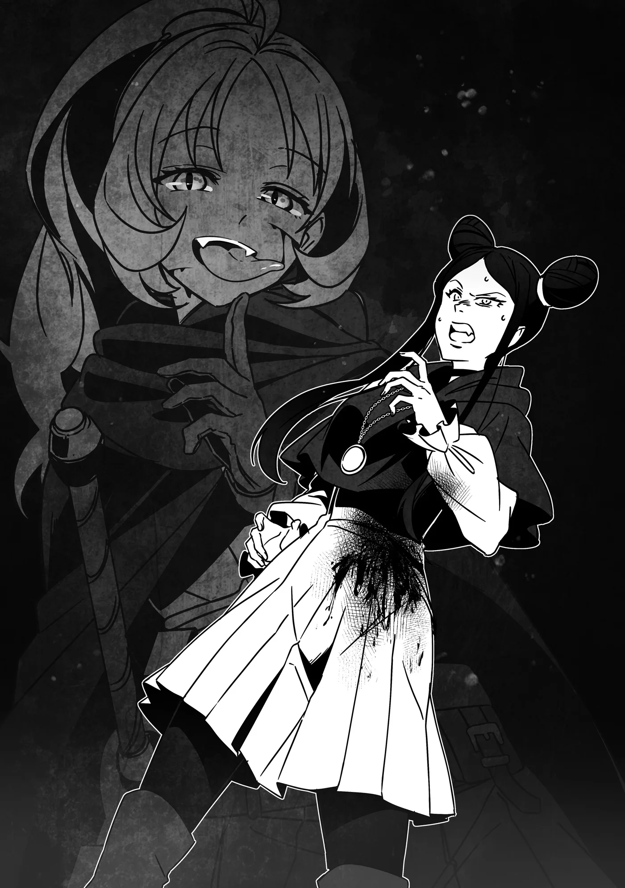

# Chương 284: Tập 12 Chương 4 - Trong Khi Đó, Các Đệ Tử... Phần 3 (2)

"Ủa, chẳng phải Dorothea đây sao... Xin chào. Lâu rồi không gặp nhỉ."

Tại khoảng đất trống nơi cỏ afto sinh trưởng, một người đàn ông quen mặt với Dorothea cất lời chào cô bằng điệu bộ khoa trương. Dáng dấp và phong thái tao nhã toát lên xuất thân quyền quý của anh ta, còn ánh mắt sắc sảo cho thấy anh ta vốn quen với việc xử lý mọi chuyện hết sức tháo vát.

"Dieg...?" Dorothea hỏi. "Đừng bảo anh chính là kẻ bấy lâu nay nhắm vào tôi đấy nhé..."

Đứng cạnh Dieg là Guster, tên cướp từng bị Rina đánh bại—kẻ lẽ ra phải đang nằm trong ngục giam của đội lính gác mà họ đã bàn giao. Hiện tại, Guster đang bắt một đứa trẻ làm con tin, kề dao vào cổ đứa bé—đó là lý do người thợ săn Zein vẫn chưa dám manh động. Tình thế hoàn toàn rơi vào bế tắc.

Trước tình cảnh này, kẻ thuê mướn bí ẩn của Guster là ai liền sáng tỏ ngay tức khắc. Dù Dorothea chưa từng mảy may nghĩ tới khả năng đó là Dieg, nhưng ngẫm lại thì mọi chuyện đều trùng khớp. Anh ta có thừa động cơ để làm vậy.

Anh ta muốn đoạt quyền thừa kế Thương hội Merrow.

Nếu khiến Dorothea chịu một chấn thương vừa đủ, cô sẽ buộc phải từ bỏ cuộc đời thương nhân lữ hành để quay về nhà, rồi sau đó bị ép kết hôn. Và ứng viên sáng giá nhất cho vị trí hôn phu không ai khác chính là Dieg. Suy cho cùng, anh ta là một thương nhân tài năng và được cha của Dorothea hết mực coi trọng—đó cũng chính là lý do hai năm trước từng có những bàn tính về chuyện hôn sự giữa hai người.

Rốt cuộc, Dorothea đã bỏ trốn khỏi Mystera, và câu chuyện ngỡ như đã chấm dứt tại đó... hoặc ít ra cô từng nghĩ vậy.

Rõ ràng là với Dieg, mọi chuyện vẫn chưa hề kết thúc.

"'Nhắm vào' ư?" Dieg nói. "Cách diễn đạt nghe tổn thương thật đấy. Tất cả những gì tôi muốn chỉ là cô quay về nhà... và đồng ý gả cho tôi thôi mà. Ôi, đừng lo—tôi sẽ không ép cô làm bất cứ điều gì khó chịu đâu. Chúng ta chỉ việc cùng nhau phát triển Thương hội Merrow. Chẳng phải nghe tuyệt lắm sao? Có thể nhìn bề ngoài không thấy, nhưng tôi đánh giá cô rất cao đấy. Chẳng người bình thường nào lại vứt bỏ cuộc sống của một người thừa kế không thiếu thốn thứ gì để đổi lấy một khởi đầu hoàn toàn mới làm thương nhân lữ hành cả. Với ý chí mạnh mẽ như của cô, cô có thể làm được bất cứ điều gì mình dốc lòng theo đuổi... đó là lý do cô nên bắt tay với tôi."

"Nếu có ý định làm thế thì tôi đã làm từ hai năm trước rồi. Vả lại, ai đời lại đi đồng ý trước một lời đe dọa trắng trợn như thế chứ?"

"Hừm. Tôi hiểu rồi. Vậy có lẽ tôi nên cho cô thấy quyết tâm của mình lớn đến mức nào. Guster, hãy cho Dorothea một chút thời gian suy nghĩ. Cứ mỗi phút trôi qua, hãy cắt đứt một ngón tay của đứa bé đó."

Guster gầm gừ một tiếng đáp lời. Sắc mặt gã trông có vẻ không khỏe.

"Cái— Dừng lại!" Dorothea hét lên. "Đừng làm thế! Anh bị làm sao vậy hả?! Anh trước giờ đâu phải kiểu người sẽ làm chuyện như thế!"

"Thế cô thì biết cái gì về t— Hự..." Dieg ôm chặt lấy đầu, ngắt quãng tràng giận dữ của chính mình. "Không, cô... nói đúng sao? Mình đang làm cái gì...?"

Đúng lúc đó, nhận thấy sự chú ý của mọi người bị phân tán, người thợ săn Zein liền đặt tên lên cung và kéo căng dây, nhắm thẳng vào Guster.

Thế nhưng, tên cướp lại nhanh tay hơn. Gã rút con dao găm từ thắt lưng và phóng thẳng về phía Zein.

◆◇◆◇◆

Thấy Rina không đáp lời mà chỉ tra kiếm vào bao, nụ cười của người phụ nữ càng thêm rộng mở.

"Có vẻ cô hiểu rằng mình sắp bỏ mạng tại đây rồi nhỉ. Cứ yên tâm đi—tôi cam đoan với cô rằng Dorothea sẽ không phải chịu chung số phận đâu. Dù sao thì cô ta vẫn cần phải sống mà. Mặc dù... tôi cho là nếu trong quá trình đó chúng tôi phải làm cô ta bị thương một chút thì cũng đành chịu thôi!"

Người phụ nữ chốt lại lời nói bằng cách phóng ra một lưỡi đao gió từ bàn tay: ma pháp vô ngôn, một kỹ năng đòi hỏi độ khó đáng kể. Và dù bản thân phép thuật đó thuộc loại yếu, nó vẫn sở hữu đủ uy lực để lấy mạng một người.

Vì luồng ma pháp không quá lớn, Rina tránh được bằng cách nhảy sang một bên.

"Ồ, cô quả đúng là cừ như tôi nghĩ đấy," người phụ nữ cất lời khen ngợi Rina. "Nhưng để xem cô trụ được như thế bao lâu nữa?!"

Hết chiêu này đến chiêu khác, người phụ nữ liên tục tung ma pháp về phía Rina. Phần lớn ma pháp sư thường phải nghỉ một quãng ngắn giữa các lần thi triển liên tiếp để tránh kiệt sức, nhưng xem chừng cô ta không hề vướng phải nhược điểm đó. Chắc chắn một phần lý do là vì những phép thuật cô ta sử dụng không đòi hỏi quá nhiều thể lực và Ma Lực.

Dẫu vậy, mức độ nguy hiểm chết người của chúng là không thể bàn cãi.

Người phụ nữ đan dệt các đòn ma pháp đầy khéo léo, dần dần cắt đứt đường thoái lui của Rina. Những cú né trong gang tấc biến thành những vết cứa và vết cào xước—rồi cuối cùng, một lưỡi đao gió chém toạc một vết thương dài trên chân Rina.

"Á!" Rina thốt lên rồi ngã khuỵu xuống đất. Người phụ nữ không bỏ lỡ thời cơ, lập tức áp sát. Cô ta rút con dao găm bên hông và giơ cao trên người Rina.

"Vĩnh biệt nhé," cô ta nói. "Vừa rồi cũng vui đấy chứ."

Thế nhưng, trước khi cô ta kịp hạ lưỡi dao xuống, Rina đã nhanh như chớp tuốt kiếm khỏi bao và đâm thẳng vào người cô ta.

"Hự! Cô—!"

Người phụ nữ rõ ràng kinh ngạc khi thấy Rina dám phản công dù biết đối phương đang nắm giữ con tin. Không kịp né tránh, mũi kiếm cắm sâu vào bụng người phụ nữ, giáng một vết thương chí mạng thấy rõ. Nét mặt cô ta méo mó vì đau đớn, trừng mắt nhìn Rina đầy căm hận.

Dù vết thương mang tính chí mạng, cô ta vẫn chưa chết. Rina siết chặt chuôi kiếm, sẵn sàng khoét sâu thêm vết thương, thì...

"Đừng có đắc ý!" người phụ nữ gào lên, tung một cú đá sấm sét trúng Rina khiến cô bay ngược ra sau vài mét trên không trung.

Cú đá chứa đựng sức mạnh thể chất lớn đến mức khó tin rằng nó xuất phát từ một nữ ma pháp sư. Dẫu vậy, Rina vẫn có thể tiếp đất an toàn bằng hai chân thay vì lăn lộn trên mặt đất. Cô thoáng thấy biết ơn những buổi huấn luyện từng trải qua cùng Isaac và những người hầu khác của Gia tộc Latuule. Nếu không nhờ đó, có lẽ cô đã đập mạnh vào thân cây và ngã gục ngay tại chỗ.

Khi Rina nhìn lại, cô thấy người phụ nữ—với một vết chém lớn trên bụng—đang thở dốc, gương mặt vặn vẹo vì cơn thịnh nộ.

"Cô chọc điên tôi rồi đấy!" cô ta gào lên. "Đến nước này thì tôi sẽ chẳng ngần ngại giết chết cô tiểu thư thừa kế đó đâu đấy!"

Vì các đồng bọn của người phụ nữ—Dieg, thân chủ của cô ta, và Guster—lúc này đang ở cùng Dorothea và những người khác, nên rõ ràng cô ta đang đe dọa sẽ giết chết họ ngay trước mắt Rina, bất kể họ có là con tin hay không.

Dẫu vậy, vẻ mặt Rina vẫn thản nhiên trước lời đe dọa. Thay vào đó, cô chỉ buông một câu hỏi.

"Tôi chỉ hỏi để phòng hờ thôi, nhưng mà..."

"Cái gì?!"

Rina nghiêng đầu sang một bên vẻ tò mò, một điệu bộ rất đỗi dễ thương đối với một thiếu nữ. "Cô không biết đúng không?"

"Cái gì cơ?" người phụ nữ bối rối hỏi lại.

"Ồ, tốt rồi," Rina nói mà không buồn giải thích. "Làm tôi cứ hơi lo. Được rồi, giờ tới lượt tôi..."

Cô lao vút về phía trước, tay cầm chắc kiếm khi áp sát người phụ nữ. Một nhát chém gọn gàng trúng đích, chém lìa đầu người phụ nữ khỏi vai... cho tới khi cái xác không đầu chộp lấy chiếc đầu bị chém rớt rồi nhảy lùi lại một khoảng xa.

Sau đó, cái xác đặt chiếc đầu trở lại vị trí cũ—ngay lập tức, vết thương ở cổ liền lại một cách lành lặn.

Trong lúc Rina dõi theo mà không hề lơ là cảnh giác, người phụ nữ nở một nụ cười đắc thắng.

"Giờ cô hiểu rồi chứ?" cô ta hỏi. "Tôi không phải con người. Cho dù cô có giết tôi bao nhiêu lần đi nữa thì cũng vô ích thôi. Cô chẳng có lấy một cơ hội chiến thắng đâu."

"Cô nghĩ thế thật sao...? Tôi hiểu rồi."

Rina khẽ gật đầu, rồi lại lao vào tấn công. Đầu, tay, chân—Rina chém đứt các chi trên cơ thể người phụ nữ không biết bao nhiêu lần, và người phụ nữ cũng tái tạo lại vết thương bấy nhiêu lần.

Với một người không hiểu rõ ngọn ngành, khả năng tái tạo của người phụ nữ trông như thể không có giới hạn. Có lẽ hy vọng của họ sẽ bị dập tắt trước sự vô vọng tột cùng ấy, và họ sẽ bỏ cuộc giữa chừng.

Thế nhưng, Rina lại quá hiểu rõ điều đó. Cô làm sao có thể không biết cho được.

Cuối cùng, hồi kết cũng đã đến.

"H-Hả? Tại sao? Sao nó không lành lại?! H-Hồi phục đi, chết tiệt! Hồi phục mau!" Người phụ nữ trừng trừng nhìn cánh tay trái của mình, sắc mặt nhanh chóng tái mét.

Nó không thể gắn liền lại vào cơ thể cô ta nữa.

Dù không biết người phụ nữ từng sống một cuộc đời thế nào, nhưng Rina đoán rằng cô ta chưa từng trải qua chuyện gì tương tự như tình cảnh hiện tại.

Hầu hết mọi người, khi nhận ra đối thủ là một quái vật không chết ngay cả khi bị chém bay đầu, sẽ chọn cách bỏ cuộc hoặc tháo chạy. Mặt khác, kẻ sở hữu năng lực như thế này có thể tận dụng thời khắc đối phương đang đắm chìm trong men say chiến thắng để tập kích từ phía sau, hoặc thậm chí giả chết để thoát thân. Tựu trung lại, những lợi thế như vậy đồng nghĩa với việc họ luôn nắm chắc phần thắng trong tay.

Thế nhưng lần này, người phụ nữ lại xui xẻo đụng độ phải Rina.

"Sao thế?" Rina mỉm cười hỏi.

"C-Cơ thể tôi! Nó không lành lại!" Gương mặt người phụ nữ tràn ngập vẻ tuyệt vọng. "Tại sao chứ?! Ch-Chuyện này chưa từng xảy ra bao giờ cả!"

"Chắc điều đó có nghĩa là cô chưa bao giờ thực sự trải qua một trận chiến thế này nhỉ?"

"C-Cái gì...? Cô nói thế là...?"

"Đơn giản thôi. Khả năng tái tạo của chúng ta đâu phải là vô hạn. Càng chịu nhiều vết thương chí mạng thì lượng dự trữ của chúng ta càng bị bào mòn. Và một khi đã cạn kiệt thì chịu thôi: không thể hồi phục được nữa. Dù vậy, nó sẽ hồi lại sau khi có thời gian nghỉ ngơi."

Trong lúc nói, những vết thương trên người Rina cũng đang tự lành lại. Vết chém dài trên chân cô lúc trước giờ đã chẳng còn lại chút dấu vết nào.

Vẻ bàng hoàng nhận ra cuối cùng cũng hiện rõ trên khuôn mặt người phụ nữ. "Cô... cô cũng là Ma Cà Rồng sao...?"

"Nói thật lòng nhé? Tôi cũng chẳng biết trả lời cô thế nào đâu. Mà thôi... chuyện đó đối với cô bây giờ cũng chẳng còn quan trọng nữa rồi."

"Hả?" Đầu người phụ nữ lại bay khỏi cổ, vẻ mặt vẫn còn ngơ ngác. Một thoáng sau, cô ta bắt đầu thét lên. "Không! Không! Tôi không muốn chết! Tôi không muốn chết đâu! Tôi...! Tôi...!"

Rõ ràng là cô ta đã nhận thức được thực tế rằng chiếc đầu của mình không còn khả năng tự gắn liền lại vào cơ thể nữa.

Rina dùng kiếm găm chặt cái xác không đầu xuống đất, rồi đỡ lấy chiếc đầu của người phụ nữ và đặt xuống. "Vậy, điều gì đã khiến cô thao túng Dieg và làm ra tất cả những chuyện này?" cô hỏi.

Ma Cà Rồng sở hữu năng lực uốn nắn người khác theo ý muốn của mình. Ngoài phương pháp mà Rina từng áp dụng lên Guster, họ còn có khả năng sử dụng năng lực mị hoặc để tẩy não mục tiêu.

Và đó chính xác là điều cô nghi ngờ người phụ nữ này đã làm với Dieg.

◆◇◆◇◆

"Tôi... đã nói với cô rồi mà," người phụ nữ lên tiếng. "Tôi muốn đưa Dieg lên làm chủ thương hội."

Nhìn nét mặt cô ta là đủ rõ cô ta vẫn còn giấu giếm điều gì đó. Đó không phải là lời chê bai khả năng diễn xuất của cô ta—chẳng qua là rất khó để giữ được bình tĩnh khi cái xác không đầu của mình bị găm chặt dưới đất và thứ duy nhất cử động được chỉ là khuôn mặt. Hoảng loạn trong một tình cảnh như thế là điều khó tránh khỏi.

Như để chứng minh cho điều đó...

"Dù tôi không nghĩ cô đang nói dối, nhưng đó là phương tiện chứ đâu phải mục đích, đúng không?"

Đối diện với sự truy vấn dồn dập của Rina, người phụ nữ dường như đã chịu thua.

"Được rồi!" cô ta bực bội nói. "Nhưng cô cũng biết rồi còn gì? Cô cũng là Ma Cà Rồng mà! Cô biết sinh tồn khó khăn đến mức nào đối với chúng ta rồi đấy! Tôi buộc phải làm những gì mình đã làm thôi!"

Đối với một Ma Cà Rồng, việc mang bộ mặt con người và duy trì cuộc sống thanh thản trong xã hội loài người như Rina, Rentt, Isaac cùng những người khác vốn chẳng phải là chuyện dễ dàng gì. Thông thường, Ma Cà Rồng sẽ nhanh chóng bị phát hiện và tiêu diệt ngay tại chỗ.

Việc người ta dồn nhiều nỗ lực có chủ ý vào việc tận diệt Ma Cà Rồng hơn hẳn so với quái vật thông thường là minh chứng cho thấy chúng nguy hiểm đến mức nào. Suy cho cùng, nếu cứ để mặc thì chúng sẽ thong dong dạo bước giữa xã hội với vẻ ngoài chẳng khác gì người khác cho đến khi cắm nanh vào cổ người ta và biến họ thành đồng loại, không ngừng nhân rộng số lượng của chúng. Đã thế, nguồn thức ăn chính của chúng lại là con người, và chúng có thể sống trường sinh bất tử. Bất cứ ai cho rằng cứ mặc kệ những sinh vật như vậy là ổn thì hoàn toàn có thể bị coi là kẻ mất trí.

Tuy nhiên, nhìn từ góc độ ngược lại, điều đó khiến Ma Cà Rồng vô cùng khó sống ở bất cứ nơi đâu. Nghĩa là ngay cả khi không tấn công con người và sống một cuộc đời kín đáo nhờ sự giúp đỡ của người hiến máu, những Thợ Săn Ma Cà Rồng vẫn sẽ tìm tới gõ cửa nhà họ.

Rất có thể trên đời này chẳng có Ma Cà Rồng nào là không phát ngấy với toàn bộ tình cảnh đó.

Và đối với người phụ nữ không đầu trước mắt, vẫn còn một vấn đề nổi cộm khác—thứ mà Rina chuẩn bị vạch rõ.

"Cô là Ma Cà Rồng hoang đúng không?"

"Một... 'kẻ hoang' ư?"

Người phụ nữ tỏ vẻ xa lạ với thuật ngữ này—và điều đó tự nó đã làm sáng tỏ câu trả lời.

Cô ta đúng là một Ma Cà Rồng hoang, điều mà Rina gần như đã tin chắc kể từ khi người phụ nữ cho thấy cô ta không thể cảm nhận được sự kiểm soát của Rina lên Guster.

Còn về manh mối giúp cô nhận ra, đó là việc quyến thuộc của một Ma Cà Rồng đều mang dấu ấn độc nhất của Ma Cà Rồng đó—thứ mà chỉ những thành viên cùng chủng loài mới có thể nhận biết. Trong trường hợp của các Ma Cà Rồng danh tiếng, dấu ấn này đại diện cho họ và cho huyết tộc hoặc gia tộc phụng sự dưới trướng họ. Isaac đã dạy Rina cách khắc dấu ấn của Gia tộc Latuule—tức huyết tộc do Laura dẫn dắt—và cho phép cô sử dụng nó.

Rina từng hỏi liệu làm chuyện như vậy trong lúc Laura đang ngủ say có ổn không, nhưng Isaac đã cam đoan rằng chủ nhân đã giao phó quyền hạn đó cho anh. Anh cũng nói rằng mình khá chắc Laura sẽ không từ chối cho phép Rentt hay Rina sử dụng dấu ấn ấy.

Dẫu vậy, việc khắc dấu ấn đòi hỏi một lượng thời gian luyện tập kha khá, thứ mà Rentt chưa từng trải qua. Nhưng Rina thì đã học được nó cùng với các nội dung huấn luyện khác của mình.

Và cô đã khắc nó lên người Guster—dù người phụ nữ hiện đang mất đầu kia chẳng hề nhận ra.

Isaac từng giải thích cho Rina về khả năng xảy ra một chuyện như vậy: cụ thể là khả năng tồn tại của những Ma Cà Rồng "hoang".

"Trong giới Ma Cà Rồng, kẻ hoang là người trong chúng ta không thuộc về bất kỳ huyết tộc, gia tộc, dòng họ hay hội nhóm tương tự nào," Rina giải thích. "Một số Ma Cà Rồng tùy hứng tạo ra hậu duệ, nhưng rồi lại bỏ mặc chúng tự sinh tự diệt thay vì hoàn thành trách nhiệm của kẻ tạo tác. Hầu hết những hậu duệ đó chẳng sống được bao lâu. Họ mù tịt về mọi thứ mà một Ma Cà Rồng cần phải học, và điều duy nhất họ có thể làm là mò mẫm trong bóng tối để tự mình tìm hiểu."

"Được rồi. Vậy là tôi không có gia đình Ma Cà Rồng hay thứ gì tương tự như thế," người phụ nữ nói. Cô ta bĩu môi, vẻ mặt có thoáng nét đượm buồn. "Nhưng thì sao chứ? Ý cô là gì?"

"Đó là lý do cô thao túng Dieg đúng không?" Rina hỏi. "Cô muốn đưa anh ta lên làm chủ thương hội, rồi dùng điều đó làm vỏ bọc để sống dưới sự che chở của anh ta."

Tựu trung lại, tình hình cũng không hẳn là quá phức tạp. Người phụ nữ khuấy đảo mọi rắc rối này chỉ vì cô ta muốn tìm kiếm cho mình một chốn dung thân. Thậm chí đối tượng không nhất thiết phải là Dieg; miễn sao họ có đủ thế lực để làm vỏ bọc và che chở cho cô ta, thì bất cứ ai cũng đáp ứng tốt nhu cầu đó. Chuyện cô ta chọn Dieg có lẽ chỉ là tình cờ—và có khi bản thân anh ta cũng dễ bị cô ta khống chế nữa.

"Đúng thế đấy," người phụ nữ ủ rũ thừa nhận. "Có gì sai trái cơ chứ? Đó là cách duy nhất để tôi sinh tồn. Tôi phát ngấy cảnh phải sống chui sống lủi rồi. Dù tôi có đi tới đâu, dù tôi có kín đáo và cẩn thận đến mức nào, thì cuối cùng..."

Rõ ràng là người phụ nữ đã phải trải qua những thử thách nghiệt ngã của riêng mình. Dẫu vậy, đó không phải là cái cớ cho những việc cô ta đã làm—ngay cả khi rất có thể sự thật là cô ta chẳng còn con đường nào khác.

Không phải lần đầu tiên, Rina cảm thấy phải đối mặt với thực tế về việc sinh tồn như một quái vật trong thế giới loài người khó khăn đến nhường nào. Đó hoàn toàn không phải một nhận thức mới mẻ gì đối với cô, nhưng có lẽ lúc này cô đã thấu hiểu điều đó sâu sắc hơn trước. Suy cho cùng, Rina đã đủ may mắn khi nhận được sự bảo hộ ngay từ thuở ban đầu. Thế nhưng nếu mọi chuyện chỉ cần chệch hướng một chút, cô hoàn toàn có thể rơi vào kết cục hệt như người phụ nữ này—và Rentt cũng vậy.

Tất cả chỉ là vấn đề may rủi mà thôi.

Rina nhận thấy trong lòng mình dấy lên đôi chút trắc ẩn. Vấn đề duy nhất lúc này là phải làm gì tiếp theo.

"Được rồi," cô nói. "Giờ tôi hiểu tình cảnh của cô rồi. Tôi cũng không còn điều gì muốn hỏi nữa. Vậy nên..."

Rina bỏ lửng câu nói, nhưng hẳn trí tưởng tượng của người phụ nữ đã tự điền vào những lời tiếp theo. "K-Khoan đã!" cô ta giàn giụa nước mắt hét lên. Trông cô ta vô cùng kinh hãi. "Đừng giết tôi! Tôi không muốn chết... Tôi không muốn chết đâu!"

Dù một phần trong Rina thắc mắc—có lẽ hơi không phải phép trong tình cảnh này—rằng rốt cuộc làm thế nào một chiếc đầu lìa khỏi cổ lại có thể gào thét được, nhưng phần còn lại trong cô đang đắn đo xem nên làm gì. Lựa chọn dễ dàng nhất chỉ đơn giản là giết chết cô ta, nhưng làm thế sẽ không để lại bất kỳ bằng chứng nào cho thấy từng có Ma Cà Rồng ở đây, bởi chúng sẽ tan biến thành hư không khi chết đi.

Liệu cô có nên tha mạng và thu phục cô ta dưới sự kiểm soát của mình...?

Suy nghĩ của Rina mới chỉ tiến triển đến đó thì bất chợt một sự hiện diện xuất hiện phía sau lưng cô.

"Liệu cô có cần giúp đỡ không?"
