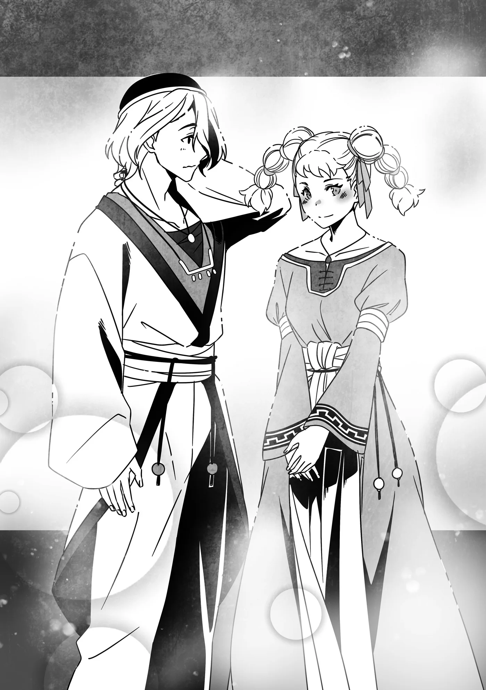

# Chương 286: Tập 12 Chương 4 - Trong Khi Đó, Các Đệ Tử... Phần 3 (4)

Khi đã về tới làng, cũng là lúc họ phải quyết định hướng đi tiếp theo.

Nói là vậy, nhưng đây vốn đã là điểm dừng chân cuối cùng trong chuyến hành trình của Dorothea. Kế hoạch ban đầu của cô là thong thả quay về, ghé vào các thị trấn tiền đồn và những nơi tương tự để bán số hàng hóa đã thu mua từ các ngôi làng dọc đường, và chẳng có lý do gì để thay đổi quá nhiều so với dự tính đó. Sự xuất hiện của Amapola chỉ khiến họ phải đổi hướng tới một thị trấn tỉnh lỵ khá lớn gần đó vốn không nằm trong lịch trình của Dorothea, chỉ có vậy thôi.

Họ vốn có thể cứ thế quay thẳng về Maalt, nhưng đi lối này lại nhanh hơn—với lại, thị trấn tỉnh lỵ đó vốn đã là đích đến ban đầu của Isaac. Thế nên, anh cùng đồng hành với họ trong chuyến đi, và điều này dường như chẳng hề khiến Dorothea phiền lòng. Thực tế, vì Rina không ngớt lời khen ngợi thực lực của Isaac, cô còn xem đây như thể có thêm một hộ vệ. Dorothea thậm chí còn đề nghị trả thù lao cho Isaac, nhưng anh từ chối và bảo rằng việc cô cho anh đi nhờ xe miễn phí đã là quá đủ rồi. Cô ngờ rằng anh vốn chẳng hề thiếu thốn tiền bạc ngay từ đầu.

Họ đến nơi khá sớm, rồi nhanh chóng bàn giao Amapola và Guster cho lính gác kèm theo lời giải thích đầu đuôi sự tình. Rina nhận thấy đám lính gác bắt đầu có những động thái hơi kỳ lạ sau khi Isaac trao cho họ một ánh mắt đầy ẩn ý... nhưng cô tự nhủ tốt nhất không nên tò mò chuyện này. Đằng nào cô cũng đoán được phần nào những gì anh đã làm.

Một phiên xử diễn ra chóng vánh ngay trong ngày hôm đó. Amapola bị giải đi xử tử, và sang ngày hôm sau hũ tro cốt của cô ta được giao lại làm bằng chứng. Còn về phần Guster, gã bị kết án lao động khổ sai ở các hầm mỏ.

Bình thường, những vụ việc kiểu này chẳng bao giờ được xử lý nhanh đến thế... nhưng không khó để đoán ra Isaac đã nhúng tay vào.

Dorothea và Dieg, những người đều bị giữ lại một ngày để lấy lời khai, đã sững sờ khi biết buổi hành quyết đã diễn ra xong xuôi. Dù vậy, việc xét xử tiến hành nhanh đến thế cũng không phải là chuyện bất khả thi, nên họ chỉ nghĩ đơn giản là do Amapola là Ma Cà Rồng. Suy cho cùng, nếu Ma Cà Rồng không bị xử lý nhanh gọn, chúng thường sẽ nhanh chóng tẩu thoát và gia tăng số lượng.

"Vậy đây... là Amapola sao..." Dieg lẩm bẩm, chăm chú nhìn chiếc hũ tro cốt.

"Mà này, rốt cuộc anh quen cô ta thế nào vậy?" Dorothea hỏi.

"À thì, ký ức của tôi khá mơ hồ... nhưng tôi nhớ là mình tình cờ gặp cô ta trong một con hẻm nhỏ lúc cô ta đang chạy trốn thứ gì đó. Trông cô ta có vẻ khốn đốn, nên tôi mời cô ta về nhà dùng bữa."

"Sao cơ, tính tán tỉnh cô ta đấy à?"

"Không! Đâu có... Chà, nghe thì đúng là giống thật nhỉ? Dù sao thì mọi chuyện sau đó tôi đều nhớ rất lờ mờ."

"Hẳn là cô ta đã khống chế anh từ lúc đó rồi. Dù sao thì cũng may là mọi chuyện khép lại mà không ai trong chúng ta bị thương."

"Về thể xác thì không, nhưng... chắc chắn tôi sẽ bị đuổi khỏi gia tộc mất. Từ giờ trở đi tôi biết sống sao đây?"

"Chưa chắc anh đã bị đuổi khỏi nhà đâu. Cứ để dành suy nghĩ đó sau khi giải thích rõ tình hình với cha anh đã. Còn nếu có bị tống ra khỏi nhà thật... thì đến lúc đó hẵng tính."

"Cô lạc quan thật đấy nhỉ? Chắc tôi phải học hỏi cô nhiều..."

Trong lúc hai người họ mải mê trò chuyện, Isaac tiến lại nói với Rina đang đứng ở rìa nhóm. "Nào, đến lúc tôi phải lên đường rồi," anh nói. "Nhờ cô chuyển lời hỏi thăm của tôi đến mọi người nhé? Chúc cô hoàn thành suôn sẻ phần còn lại của ủy thác."

Sau một thoáng ngẫm nghĩ, Rina hỏi: "Rốt cuộc thì chuyện của Amapola thế nào rồi anh?"

"Cô ta đã bị 'xử tử' rồi, dĩ nhiên là thế."

Tông giọng của Isaac khiến người ta nhận ra ngay là anh đang nói dối—hẳn anh đã tìm cách bí mật đưa cô ta đi và dàn xếp mọi chuyện để trông như thể cô ta thực sự đã chết. Hẳn anh cho rằng làm vậy là an toàn nhất, phòng khi Thợ Săn Ma Cà Rồng lần ra dấu vết của Amapola. Ngay cả Nive cũng sẽ phải bỏ cuộc nếu con mồi của cô đã bị xử tử và thiêu thành tro, phần lớn số tro ấy lại còn được chôn xuống đất.

Nghĩ lại thì, Rina cũng chẳng lấy làm lạ nếu Nive đào đống tro lên, ngửi thử rồi phán rằng mùi này không giống một Ma Cà Rồng thực thụ. Dẫu vậy, cô tin chắc Isaac đã tính đến sự cuồng nhiệt thái quá đó. Cô không nghĩ có điều gì đáng phải bận tâm.

Chẳng bao lâu sau, Isaac rời đi. Ngay sau đó, khi Dorothea cuối cùng cũng nhận ra anh không còn ở trong nhóm nữa, cô liền hỏi Rina xem anh đã đi đâu.

"Anh ấy có việc gấp phải xử lý nên đi trước rồi," Rina giải thích. "Anh ấy dặn tôi gửi lời xin lỗi và lời chào tới cô."

Cả Dorothea lẫn Dieg đều nhanh chóng chấp nhận lời giải thích đó, có lẽ vì họ nhận ra mình vừa mải nói chuyện đến mức nào. Họ xin lỗi vì đã không để ý, rồi cứ thế cả nhóm lên đường quay về Maalt.

Chuyến hành trình của họ diễn ra êm đềm và yên ả, chẳng gặp phải bất kỳ rắc rối nào. Dieg không còn bày ra âm mưu đen tối nào nữa, và Amapola cũng chẳng còn ở quanh đây. Trên thực tế, chuyến đi suôn sẻ đến mức dường như lại khiến Dorothea cảm thấy có phần không quen.

"Tôi... quả thực đã trải qua bao nhiêu chuyện nhỉ...?"

Hóa ra, đây lại là chuyến đi yên bình nhất trong suốt hai năm làm thương nhân lữ hành của cô. Dẫu vậy, cô dường như không cho rằng những gian truân mình từng trải qua là vô nghĩa. Theo lời cô thì: "Dù sao đi nữa, đó cũng là một trải nghiệm bổ ích."

Khi họ về tới Maalt, có hai nhân vật bất ngờ đang đợi họ tại Hội.

"Cha?!" cả Dorothea lẫn Dieg đồng thanh thốt lên.

Thực vậy, đó chính là cha của họ—những người đứng đầu Thương hội Merrow và Thương hội Esol. Ánh mắt của Dorothea và Dieg lộ rõ vẻ thắc mắc vì sao hai người lại có mặt ở đây.

"Dieg," cha anh cất lời. "Cha nhận thấy con đang dính líu vào một vài chuyện khá mờ ám, nên cha đến để ngăn con lại. Vì chuyện này dường như khiến con bé Dorothea gặp nguy hiểm, cha đã báo cho Rudo, và ông ấy cũng quyết định đi cùng." Rudo là cha của Dorothea, còn cha của Dieg tên là Jude.

Mặt Dieg tái mét khi nghe những lời của cha, nhưng anh vẫn bắt đầu giải thích tình hình cho hai người họ. Sau khi anh kể xong, cả hai đều lộ rõ vẻ kinh ngạc.

"Thằng bé từ trước đến nay chưa từng nói dối quá trớn như vậy," một hồi sau, Jude mới lên tiếng nói với Rudo.

"Nên tôi có phần tin lời thằng bé. Dẫu vậy, tôi vẫn phải gửi tới ông lời xin lỗi sâu sắc nhất vì chuyện nó đã đẩy con gái ông vào vòng nguy hiểm. Tôi nhất định sẽ trừng phạt—"

Rudo lắc đầu ngắt lời. "Không, không cần phải làm thế đâu. Tôi không nghĩ có ai kháng cự nổi sự khống chế của Ma Cà Rồng, huống hồ những thương nhân bình thường như chúng ta. Chuyện trừng phạt không cần bận tâm làm gì. Vả lại xét theo một khía cạnh nào đó... có vẻ như con gái tôi đã trưởng thành hơn nhờ vào những hành động của cậu Dieg đấy." Ông quay sang con gái mình mỉm cười. "Dorothea. Con đã cứng cỏi hơn rất nhiều so với lần cuối hai cha con mình gặp nhau đấy."

"Đó là lời cha nói với đứa con gái hai năm trời không gặp đấy à?" Dorothea thốt lên vẻ không thể tin nổi. "Mà... con cũng chẳng để bụng đâu." Cô quay sang cha của Dieg. "Bác Jude, cháu không mong con trai bác bị trừng phạt đâu ạ. Dù anh ấy có thể là nguyên nhân gây ra bao gian nan cho cháu suốt hai năm qua, nhưng tất cả những điều đó đã giúp cháu nhận ra con đường của một thương nhân lữ hành khó khăn đến nhường nào."

Jude có vẻ ngập ngừng. "Nhưng... cháu có chắc về chuyện đó không?"

"Ừm, thưa cha," Dieg lên tiếng. Trông anh như thể đang lấy hết can đảm để nói.

"Sao con...?"

"Về hình phạt của con... xin cha hãy khai trừ con khỏi thương hội."

"Cái gì? Nhưng tại sao chứ? Cả Rudo lẫn Dorothea đều nói đã tha thứ cho con rồi. Dĩ nhiên nếu không gánh chịu hậu quả nào thì thật đáng hổ thẹn, nhưng chúng ta đều biết lúc đó con không tự chủ được bản thân. Đâu cần phải làm đến mức khai trừ con."

"Không, cần thiết đấy cha. Tất cả chuyện này đều là hậu quả từ sự ngây thơ và những hành động bất cẩn của chính con. Vì thế... xin cha—với lại, con vừa nghĩ ra một chuyện khác."

"Ồ? Chuyện gì thế?"

"Giống như Dorothea, con muốn bắt đầu lại từ con số không với tư cách một thương nhân, chỉ dựa vào thực lực của chính mình. Để xem con có thể tiến xa đến đâu." Dieg liếc nhìn cô gái vừa được nhắc tới.

Mắt Dorothea mở to. "Dieg... anh chắc chứ?"

"Tôi chắc mà. Vả lại, nếu tôi còn ở lại Thương hội Esol, sớm muộn gì cũng có kẻ lấy sự việc lần này làm cớ để gièm pha chúng ta. Việc tôi bị khai trừ sẽ là điều tốt nhất cho thương hội. May thay, tôi có một người anh trai vô cùng tài giỏi. Không có tôi thì mọi người vẫn sẽ ổn thôi."

"Tôi hiểu rồi... Nếu vậy thì chắc là ổn thôi. Này Dieg—hay là anh đi cùng tôi đi?"

"Tôi—sao cơ?"

"Tôi biết anh bảo muốn bắt đầu lại từ con số không, nhưng làm thương nhân lữ hành chẳng dễ dàng gì đâu. Đi cùng tôi và học những điều cơ bản từ tiền bối thì thấy thế nào hả?"

"Không—à thì, cô nói cũng có lý, nhưng... cô chắc chứ? Sau ngần ấy nguy hiểm mà tôi đã đẩy cô vào..."

"Anh bị kẻ khác ép làm tất cả những chuyện đó mà. Vả lại, hai năm trước tôi đã nghĩ cùng anh buôn bán nghe có vẻ vui... và giờ tôi vẫn thấy thế."

"Nếu cô đã nói vậy, Dorothea, thì... tôi xin khiêm tốn nhận lời." Dieg quay sang Rudo và Jude. "Có vẻ như con đường của con đã được định đoạt rồi, thưa cha. Chủ Thương Hội Rudo, xin thứ lỗi cho sự mạn phép của cháu, nhưng liệu cháu có thể xin phép bác về việc này được không ạ?"

Nét mặt Rudo thoáng qua muôn vàn cảm xúc. Chấp thuận cho đứa con gái duy nhất của mình lên đường rong ruổi đơn độc cùng một người đàn ông hẳn chẳng phải là một quyết định dễ dàng. Dẫu vậy, người đàn ông đang được nói tới từng suýt được hứa hôn với con bé, và giữa hai người họ toát lên một bầu không khí khiến người ta cảm thấy mọi chuyện rồi sẽ ổn thỏa.

"Ta... nghĩ là ổn thôi," cuối cùng Rudo cũng lên tiếng. "Có vẻ như tương lai hai năm trước chúng ta từng mơ ước đang trên đà trở thành hiện thực rồi đấy, Jude."

"Đúng là số phận run rủi khéo trêu người thật," vị chủ thương hội còn lại gật gù đồng tình rồi quay sang con trai mình. "Được rồi, Dieg, nếu con đã quyết định như vậy thì cha chúc phúc cho con. Nào, chúng ta sẽ quay về Mystera để thu xếp mọi chuyện cho thỏa đáng."

Sau khi bàn bạc thêm đôi chút, mọi việc đã được dàn xếp xong xuôi. Dorothea chấp thuận cho Rina báo cáo hoàn thành ủy thác lên Hội, và nữ mạo hiểm giả trẻ tuổi nhanh chóng làm điều đó.

"Cảm ơn cô. Không có cô thì tôi chẳng biết phải xoay xở ra sao nữa," Dorothea nói với cô. "Thực lòng đấy. Cứ nghĩ tới những gì có thể đã xảy ra với mình là tôi lại rùng mình. Tương lai chắc tôi sẽ còn ghé lại Maalt, nên khi đó tôi muốn tiếp tục thuê cô. Đến lúc ấy, nhờ cô giúp đỡ nhé."

"Tôi cũng vậy," Rina đáp. "Bao nhiêu chuyện đã xảy ra, nhưng rất vui, và tôi đã học được từ cô rất nhiều điều về nghề thương nhân lữ hành. Tôi không nghĩ lần tới sẽ vất vả như chuyến ủy thác này đâu, nên nhất định tôi sẽ giảm giá cho cô!"

Với lời nói đùa cuối cùng đó, hai cô gái chia tay nhau.

◆◇◆◇◆

Giờ đây khi đã giải quyết hòm hòm mọi việc cần thiết, Rina bắt tay vào nhiệm vụ cuối cùng của mình: tới báo cáo tại dinh thự Latuule.

"Chào mừng cô trở về, cô Rina. Tôi mạn phép đoán rằng cô đã dàn xếp đâu vào đấy rồi chứ?"

Như mọi khi, người đón cô ngay lối vào không ai khác chính là Isaac. Cô rất muốn biết rốt cuộc anh làm cách nào để đến đây được, bởi cô cùng những người khác đã rời đi trước sau khi chia tay anh, nhưng anh lại thuộc tuýp người khiến việc bận tâm suy nghĩ những câu hỏi như thế chỉ tổ phí thì giờ. Vì vậy, Rina gạt phăng ý nghĩ đó đi.

"Vâng!" Rina nói. "Gần như mọi chuyện đều được giải quyết êm đẹp và không còn vướng bận gì nữa. Tất cả là nhờ có anh đấy, anh Isaac."

Dorothea và Dieg đã cùng nhau bắt đầu con đường thương nhân lữ hành với sự chúc phúc của cha mẹ cả hai bên—xét theo góc nhìn của Rina thì đây quả thực là một cái kết vô cùng êm đẹp. Và vì Dorothea sẽ không còn phải đối mặt với những hiểm nguy hay gian nan quá mức trên các chặng đường sau này, cô cũng chẳng còn điều gì phải lo lắng về mặt đó nữa.

Dĩ nhiên nói thế không có nghĩa là nữ thương nhân trẻ tuổi sẽ hoàn toàn chẳng gặp bất kỳ khó khăn nào, nhưng đó là điều khó tránh khỏi với nghề nghiệp của cô và tốt hơn nhiều so với việc có kẻ luôn rắp tâm ám hại mình. Rina thực lòng cầu chúc Dorothea và Dieg một ngày nào đó sẽ thành lập được thương hội của riêng mình và gặt hái thành công.

"Ồ không, đâu có gì," Isaac cười trừ. "Đó là nhờ vào những nỗ lực của chính cô đấy chứ, cô Rina. Hơn nữa, giờ đây khi đã tự mình hoàn thành một ủy thác, rốt cuộc cô cũng hiểu ra rồi phải không? Ý tôi là, hiểu được cô đã trưởng thành đến nhường nào."

Từ lời của Isaac, Rina nhận ra anh vốn đã nhìn thấu nỗi tự ti về thực lực mà dạo gần đây cô luôn canh cánh trong lòng. "Vâng, tôi hiểu rồi," cô nói. "Xin lỗi vì đã làm anh phải bận tâm. Chỉ là những người xung quanh tôi đều quá đỗi phi thường, khiến tôi có cảm giác bản thân chẳng là gì khi so với họ."

"Tôi cho rằng cô đang đánh giá bản thân quá thấp đấy, dẫu tôi hiểu một người hoàn toàn có thể rút ra kết luận như thế khi ở cạnh Rentt và Lorraine. Tuy nhiên, cô cũng phải nhận thức được rằng khoảng cách kinh nghiệm giữa họ và cô là rất lớn. Rentt đã có hơn mười năm khổ luyện hơn hẳn cô, còn Lorraine là một chuyên gia từng được thụ hưởng nền giáo dục dành riêng cho những cá nhân có thiên phú ma thuật. Chẳng có gì đáng ngạc nhiên khi cô chưa thể sánh vai cùng họ trong một khoảng thời gian ngắn ngủi đến vậy."

"Nghe anh phân tích rõ ràng như vậy, tôi thấy đúng thật... Chắc tại tôi chưa từng nghĩ theo hướng đó. Có lẽ sự sốt ruột đã lấn át tâm trí tôi. Trong chuyến đi này, tôi nhận ra mình đã mạnh hơn trước kia rất nhiều, và tôi cảm thấy giờ đây mình có thể nhìn nhận mọi việc thấu đáo hơn một chút rồi. Tôi vẫn còn phải hoàn thiện nhiều điều... nhưng tôi nghĩ mình cũng đã có những bước tiến rõ rệt."

"Tôi có nên hiểu điều đó đồng nghĩa với việc cô rất mừng vì đã nhận chuyến đi này không?"

"Chắc chắn rồi—và trên hết thảy, tôi đã được gặp Dorothea. Tôi nghĩ từ giờ mình sẽ thỉnh thoảng nhận thêm các ủy thác độc hành—chí ít là cho đến khi Raiz và Laura bình phục hẳn để có thể làm lại những công việc mạo hiểm thông thường."

Dù hai đồng đội trong tổ đội của Rina vẫn chưa lành hẳn vết thương, nhưng tình trạng của họ đã tiến triển tốt đến mức có lẽ sẽ sớm hoạt động trở lại. Ngày họ có thể cùng nhau nhận ủy thác với tư cách một tổ đội ba người đầy đủ không còn xa nữa. Rina muốn mình phải hoàn toàn tự tin vào bản thân trước khi thời điểm đó đến.

"Hãy cẩn thận đừng làm việc quá sức đấy," Isaac dặn dò. "Nhưng đó nghe chừng là một kế hoạch hay."

"Tôi sẽ cẩn thận mà," Rina gật đầu đồng tình. "À, nhắc mới nhớ, Amapola thế nào rồi anh?"

"À! Phải rồi. Ra đây đi, Amapola."

Một bóng đen mờ ảo thành hình bên cạnh Isaac, nhanh chóng biến đổi thành dáng người. Chỉ sau vài giây, Amapola đã đứng sờ sờ ở đó.

"Ngài cho gọi tôi ạ, ngài Isaac?"

Thay cho chiếc áo chùng mà Rina từng thấy cô ta mặc lần trước, giờ đây cô ta khoác lên mình bộ trang phục hầu gái giống như phần lớn các nữ gia nhân khác của Gia tộc Latuule. Rõ ràng là cô ta đã thực sự được nhận vào làm việc. Hơn nữa...

"Vừa rồi là Phân Liệt phải không?" Rina hỏi. "Cô đã biết dùng chiêu đó rồi cơ à?"

Sự ngạc nhiên của Rina là điều dễ hiểu—Amapola vốn không có khả năng đó khi họ giao chiến cách đây chưa lâu. Nếu cô ta có thể Phân Liệt, trận chiến hẳn đã trở nên khó khăn hơn bội phần. Việc cô ta không thể dùng kỹ năng đó từng là bằng chứng cho thấy cô ta là một Ma Cà Rồng hoang. Vậy mà giờ đây, cô ta lại thi triển nó chẳng chút khó khăn.

"Cô ta đã sống cuộc đời Ma Cà Rồng suốt một thời gian dài," Isaac giải thích. "Về cơ bản thì cô ta đã nắm vững nền tảng rồi. Sau vài lần thử nghiệm và uốn nắn, cô ta đã cho thấy mình tiếp thu rất nhanh. Nếu chúng tôi tiếp tục huấn luyện, tôi dám chắc thực lực của cô ta sẽ tiến bộ vượt bậc đấy. Lẽ dĩ nhiên, đó là bổn phận của một gia nhân phục vụ Gia tộc Latuule."

Dù Isaac chẳng tiếc lời khen ngợi, nhưng sắc mặt Amapola trông có vẻ hơi xanh xao ốm yếu.

Khóa huấn luyện của cô ta hẳn phải khắc nghiệt lắm đây, Rina thầm nghĩ. "Cố lên nhé, Amapola," cô động viên.

Người phụ nữ gật đầu, vẻ mặt trông vẫn còn khó ở. "Tôi sẽ cố..."

"Nghĩ lại thì," Rina cất lời, một ý nghĩ bất chợt nảy ra trong đầu cô. "Tại sao lúc trước cô lại nhắm vào Dieg thế? Ý tôi là, tôi biết cô muốn khống chế một người có tầm ảnh hưởng để đảm bảo một chốn dung thân an toàn, nhưng chắc chắn việc thao túng Dorothea phải dễ dàng hơn chứ?"

"Cô... có thể thốt ra những lời đáng sợ thật đấy, dù nhìn bề ngoài trông cô chẳng nỡ làm tổn thương một con ruồi." Giọng Amapola đầy vẻ kinh ngạc, nhưng nét mặt cô ta nhanh chóng chuyển sang vẻ chấp nhận—hẳn cô ta vừa nhớ lại việc Rina đã dần cho mình một trận nhừ tử đến mức nào. "Thuật mị hoặc của chúng tôi phát huy hiệu quả cao trên những kẻ có bóng tối trong lòng, nhưng lại yếu trước những người không có. Vì có một người anh trai tài giỏi, Dieg luôn mang trong mình mặc cảm tự ti. Bằng cách khuếch đại cảm xúc đó, việc nắm quyền kiểm soát anh ta là chuyện hết sức đơn giản. Trong khi đó, Dorothea lại hầu như chẳng có những cảm xúc kiểu ấy trong lòng."

Nghe cũng có lý đấy chứ, Rina thầm nghĩ. Khi mới gặp Dorothea, nữ thương nhân lữ hành từng khá cảnh giác, nhưng càng trò chuyện nhiều, sự đề phòng ấy càng tan biến để lộ ra một cô gái lạc quan và thẳng thắn bên trong. Việc những người như thế rất khó bị khống chế là điều mới mẻ đối với cô... dẫu vậy cô vẫn nghĩ Isaac thừa sức làm được.

Có lẽ chính ở những chuyện như thế, khoảng cách thực lực giữa các Ma Cà Rồng mới lộ rõ nhất.

"Đó là lý do duy nhất thôi sao?" Rina hỏi.

Amapola ngẫm nghĩ câu hỏi trong giây lát. "À thì... tôi đoán trong sâu thẳm tôi cũng có một phần nhỏ muốn cổ vũ cho Dieg. Anh ta đã cho tôi thức ăn và chốn nương náu khi tôi đang chạy trốn khỏi một Thợ Săn Ma Cà Rồng, nên tôi muốn giúp anh ta đạt được nguyện vọng của mình. Nhưng nghĩ lại thì, tôi nhận ra mình đã đi quá xa... chưa kể tới những phương pháp mà tôi đã dùng. Sự tuyệt vọng thường có xu hướng làm hỏng mọi kế hoạch và dự định..."

Đôi mắt người phụ nữ nhìn xa xăm khi cất lời. Hẳn cô ta đã cảm thấy vô cùng quẫn bách trước sự tuyệt vọng mà mình vừa nhắc tới.

"Từ giờ trở đi cô sẽ sống ở đây sao?" Rina hỏi.

"Vâng, với tư cách một gia nhân của Gia tộc Latuule. Dù vậy tôi vẫn chưa được diện kiến nữ chủ nhân..."

"Thì cô ấy đang ngủ mà. Tôi chắc là sớm muộn gì cô ấy cũng sẽ thức dậy thôi... phải không anh?" Rina hướng câu hỏi cuối sang phía Isaac.

Người đàn ông gật đầu. "Đương nhiên rồi. Tuy nhiên, chỉ riêng Tiểu thư Laura mới biết được liệu đó sẽ là ngày mai, một tháng nữa, mười năm hay một trăm năm."

Về phần mình, Rina thấy khoảng thời gian đó có hơi quá dài—nhưng nghĩ lại thì, có lẽ loài Ma Cà Rồng vốn là như vậy.
