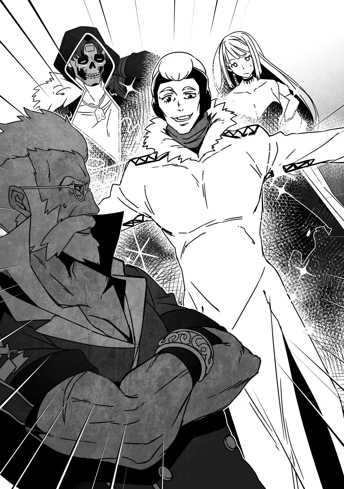

# Chương 288: Tập 12 Chương 5 - Maalt, Maalt Thân Thương, và Chuyến Thăm Thợ Rèn (2)

"Trước tiên cứ qua quầy tiếp tân đã," tôi nói. "Sau đó..."

"Sau đó nhờ họ báo cho Wolf biết bọn mình đã tới", tôi vừa toan nói câu đó thì Jean đã sải bước thẳng về phía văn phòng Hội Trưởng, bỏ mặc hai đứa tôi lại phía sau. Dáng vẻ của ông ấy toát lên cái cảm giác rằng có bảo gì thì ông ấy cũng chẳng buồn bận tâm lắng nghe ai.

"X-Xin lỗi! Xin thứ lỗi!" Sheila rõ ràng đang trong ca trực hôm nay, nhưng dẫu ban đầu toan cản ông ấy lại, cô bỗng sững sờ khi nhìn rõ mặt đối phương rồi lẩm bẩm: "Hả...? K-Không thể nào... Ngài là...?"

Jean khựng lại một thoáng rồi bật cười thích thú. "Thứ lỗi vì ta tự tiện xông vào. Đừng lo—cô sẽ không phải chịu chút trách nhiệm nào đâu." Ông ấy lại tiếp tục rảo bước và thoắt cái đã khuất bóng lên tầng trên.

Sheila, nãy giờ vẫn đứng chôn chân nhìn theo bóng lưng ông ấy, vẫn chưa nhúc nhích. Lorraine và tôi vội rảo bước lại chỗ cô.

"Sheila, cô có sao không?"

"Chia buồn cùng cô nhé, Sheila..."

Lời của bọn tôi dường như đã kéo cô hoàn hồn trở lại. "Người..." cô run rẩy thốt lên. "N-N-N-Người đàn ông đó... có đúng là người mà tôi đang nghĩ không?"

Tôi gật đầu. "Jean Seebeck, Tổng Hội Trưởng của Vương Quốc Yaaran đấy. Bọn tôi đưa ông ấy từ vương đô về đây."

"Tôi biết ngay mà..."

Dù trông có vẻ ủ rũ, Sheila dường như cũng trút được gánh nặng—có lẽ vì cô vừa nãy cảm thấy bản thân có lỗi khi để Jean tự tiện xông qua mà chưa xác nhận danh tính. Nói đi cũng phải nói lại, phong thái của ông ấy quá đỗi áp đảo, vả lại cô dường như cũng đã nhận ra gương mặt ấy.

"Trước đây cô từng gặp ông ấy rồi à, Sheila?" Lorraine hỏi.

"Cũng có thể coi là vậy..." nữ tiếp tân của Hội xác nhận. "Nhân viên Hội bình thường như tôi thỉnh thoảng cũng phải tới vương đô để tập huấn hoặc dự hội thảo. Tôi chỉ mới được nhìn thấy ngài ấy từ đằng xa đôi ba lần... nhưng chỉ một lần thôi là đủ để nhớ rồi. Khí chất của ngài ấy... quả thực không tài nào quên nổi."

"Cô nói chuẩn đấy..."

Ngay cả khi chỉ đứng yên một chỗ, Jean Seebeck cũng tỏa ra một luồng sinh lực hay nhuệ khí cuồn cuộn như từng đợt sóng. Có điều, Lorraine và tôi đều thừa hiểu đó chẳng qua chỉ là vỏ bọc bên ngoài của ông ấy; bọn tôi biết thừa ông ấy có thể ẩn mình không ai hay biết bất cứ lúc nào mình muốn. Bằng không, làm sao ông ấy có thể lãnh đạo một tổ chức ngầm ở vương đô cơ chứ.

Tuy vậy, trong những hoàn cảnh thế này, việc phô bày thân phận thật lại tiện lợi hơn nhiều. Nó giúp mọi cánh cửa đều rộng mở và khiến người ta dễ dàng nhận ra ông ấy... chẳng hạn như Sheila lúc nãy.

"Dù sao thì ông ấy cũng là quan chức cấp cao của Hội, nên việc để ông ấy đi qua chắc không có vấn đề gì đâu," tôi nói. "Lorraine và tôi lên theo ông ấy nhé? Bọn tôi cần phải báo cáo với Wolf."

"Tất nhiên rồi," Sheila nói. "Ý tôi là, lúc này tôi chẳng muốn bén mảng tới văn phòng chút nào đâu, vậy nên... xin hai người cứ tự nhiên."

Mấy lời cuối nghe có vẻ hơi giục giã, đùn đẩy. Tôi không tài nào hình dung nổi cuộc gặp giữa Wolf và Jean sẽ ra sao, nhưng hiển nhiên đây chẳng phải chuyện mà một nhân viên Hội bình thường muốn dính dáng vào.

Tôi thầm nghĩ không dính vào đúng là khôn ngoan thật, và hẳn Lorraine cũng chung suy nghĩ ấy. Ngặt nỗi bọn tôi còn phải báo cáo, bằng không ủy thác sẽ chưa thể tính là hoàn thành...

Thở dài một tiếng, hai đứa tôi vội đuổi theo Jean.

◆◇◆◇◆

"Wolf! Lâu lắm rồi không gặp!"

Đến lúc Lorraine và tôi bắt kịp, Jean đã đẩy toang cánh cửa văn phòng Hội Trưởng, tươi cười sải bước vào trong đầy vẻ huyên náo.

"Có vẻ bọn mình tới muộn mất rồi..." tôi lẩm bẩm.

"Chà... dù sao thì hai người họ cũng đâu định lao vào sống chết với nhau, đúng không?" Lorraine bình thản chỉ ra. "Chắc sẽ ổn thôi mà. Chuyện này chắc cũng chẳng khác mấy việc giám đốc một công ty bất thình lình ghé thăm người quản lý chi nhánh dưới quyền."

Cách ví von đó khá hợp lý, và nếu đúng là vậy thì chẳng có vấn đề gì phải bận tâm. Ngặt nỗi, cách so sánh ấy chưa tính đến chuyện Jean dường như là một kẻ chuyên gây rắc rối bẩm sinh.

Nếu bảo tôi không hề mong màn xuất hiện và báo cáo này diễn ra êm thấm hơn thì đúng là nói dối. Khổ nỗi, chuyện đã rồi.

Lorraine và tôi bước vào văn phòng sau Jean, đập vào mắt chúng tôi là cảnh tượng Wolf một tay ôm trán, nét mặt méo mó đầy khổ sở. Hiếm khi nào thấy ông ấy có biểu cảm như vậy—bình thường ông luôn uy nghiêm, bệ vệ—thành thử lòng tôi dấy lên chút áy náy vì tai họa mà hai đứa tôi vừa trút xuống đầu ông ấy.

Wolf liếc mắt về phía chúng tôi. Không hẳn là trong mắt ông có vẻ quở trách, nhưng tôi vẫn phải thú nhận rằng mình đã lảng mắt sang chỗ khác và giả vờ như không thấy gì. Tôi thậm chí còn huýt sáo một tiếng, dẫu chỉ là huýt sáo thầm trong bụng.

Lorraine có lẽ còn thì thầm thêm một câu: "Anh chẳng lừa được ai đâu", nhưng đó không phải chuyện tôi bận tâm.

"Tổng Hội Trưởng Seebeck..." Wolf cất tiếng, nghe chừng như phải gắng gượng lắm mới rặn ra từng chữ. "Quả thực tôi không ngờ ngài lại tới... nhanh đến mức này..."

Jean nhoẻn cười thật tươi. "Ta nhìn thấu tỏng mưu mẹo của cậu rồi, anh bạn à. Cậu cử hai đứa nhóc này tới đón ta cốt để sau này còn có cớ chống chế rằng mình cũng đã cố gắng, có đúng không? Ta dám cá cậu đinh ninh đám nhân viên của ta sẽ từ chối, và nhờ thế cậu có thể dây dưa thêm một dạo nữa. Nhưng tiếc cho cậu quá—ta đã có mặt ở đây rồi!"

"Ngài... đúng là đã tới thật rồi. Tôi cứ nghĩ Rentt và Lorraine đều là những gương mặt lạ lẫm ở vương đô, nên hai người họ khó lòng xin gặp trực tiếp được ngài chứ..."

Nghe qua câu chuyện, hóa ra dù Wolf thuê bọn tôi làm nhiệm vụ này, ông ấy lại bụng bảo dạ mong bọn tôi quay về báo rằng mình đã bị khước từ. Xét thấy đây giống một lời nhắn nội bộ hơn là một ủy thác nghiêm chỉnh của Hội—về cơ bản ông ấy chỉ bảo "đưa ông ta về đây"—nên dù có thất bại cũng chẳng khiến bọn tôi bị giáng cấp hay chịu bất kỳ hậu quả tiêu cực nào.

Ngờ đâu, chúng tôi lại đụng phải hàng loạt biến cố bất ngờ và bị cuốn sâu vào một mớ rắc rối rối ren... rốt cuộc lại thành công hộ tống được Jean về tận chốn này. Tôi cũng chẳng thể trách Wolf vì đã không lường trước được điều đó.

Tôi thầm tự hỏi liệu Wolf có biết chuyện Jean là thủ lĩnh của một tổ chức ngầm hay không. Chẳng thể chắc chắn được, nên có lẽ tốt nhất tạm thời cứ coi như ông ấy không biết và lựa lời mà nói cho phải phép.

"Bọn tôi có thể coi ủy thác này đã hoàn thành rồi chứ?" Tôi lên tiếng, tạm cắt ngang cuộc trò chuyện giữa hai người họ.

"Ừ..." Wolf nói. "Xong rồi đấy. Cơ mà thật tình tôi ấn tượng vì hai người xoay xở được đấy. Rốt cuộc làm cách nào mà hai cậu gặp được ông ấy vậy?"

"Chuyện dài dòng lắm... Thật lòng thì tôi nghĩ chỉ cần mở lời hỏi là đã xong việc rồi. Khi bọn tôi nói với nhân viên Hội rằng đây là thỉnh cầu từ phía ông, họ gần như đã tiếp đón bọn tôi như khách quý."

"Cái gì...?" Wolf ngơ ngác vẻ bối rối.

"Ta đoán kiểu gì cậu cũng sẽ sớm phái người tới để sau này còn chống chế rằng mình đã 'cố' mời ta đến Maalt," Jean giải thích. "Nên ta đã hạ lệnh nghiêm ngặt rằng bất kỳ lời nhắn nào từ cậu đều phải chuyển thẳng tới ta—không có ngoại lệ."

Wolf thở dài thườn thượt khi nhận ra mình đã bị đối phương đọc vị vanh vách.

"Ông chẳng thay đổi chút nào cả," ông nói. "Thôi thì đành vậy. Dù sao ông cũng đã đến đây rồi. Chào mừng tới Maalt."

◆◇◆◇◆

"Nâng ly nào! Vì các mạo hiểm giả, vì chúng ta—những người ở Hội luôn làm điểm tựa cho các bạn—và vì vị Hội Trưởng tuyệt vời nhất mà tất cả chúng ta có được: Wolf Hermann! Uống đi nào, mọi người! Cạn ly!"

Tiếng hô "Cạn ly!" trầm hùng đồng thanh vang dội khắp quán rượu từ các mạo hiểm giả tề tựu nơi đây. Nếu bảo toàn bộ mạo hiểm giả của Maalt đều có mặt thì hơi quá lời một chút, nhưng sự thực cũng chẳng cách là bao. Hầu như mọi mạo hiểm giả không vướng bận ủy thác bên ngoài đều hiện diện vì một lý do duy nhất: chào đón sự xuất hiện của Jean Seebeck, Tổng Hội Trưởng của Vương Quốc Yaaran.

"Lúc tôi bảo muốn mở tiệc chào mừng thì tự đi mà tổ chức, tôi đâu có ngờ ông ấy làm thật..." Wolf lẩm bẩm. Ông ngồi cùng bàn với Lorraine và tôi, vẻ mặt đầy cam chịu khi nhìn Jean dẫn đầu màn nâng ly của cả quán rượu. "Cái lão khó lường ấy chẳng bao giờ chịu thay đổi cả."

"Thế thì ngay từ đầu sao ông lại nhờ bọn tôi lên tận vương đô đón ông ấy làm gì?" Tôi càu nhàu, giọng không giấu nổi chút hậm hực. "À, phải rồi. Cốt để ông có cớ nói rằng mình đã cố gắng, đúng chứ?"

"Cho tôi xin lỗi vụ đó nhé," Wolf nói, khẽ cúi đầu tạ lỗi. "Tôi không phủ nhận chuyện mình đã chờ hai người liên lạc về báo rằng ông ấy từ chối. Một phần đúng là vì ông ấy phiền phức thật, nhưng phần lớn là bởi tôi đinh ninh ông ấy sẽ khước từ, vì bình thường lúc nào ông ấy cũng bù đầu với công việc. Mười lần thì có đến chín lần ông ấy sẽ từ chối một lời mời nghiêm chỉnh. Nếu biết ông ấy nghiêm túc muốn đến thế này, tôi đã làm theo đúng trình tự thủ tục rồi."

Dẫu Wolf nói như thể Jean là một gánh phiền toái, nhưng nghe không thật cho lắm. Tôi có cảm giác ông không chỉ coi Jean là cấp trên, mà còn là người mình mang ơn sâu nặng. Tôi tin chắc trong lòng ông cũng có phần mừng rỡ khi được gặp lại Jean sau ngần ấy thời gian.

"Đúng thật, hẳn ông ấy phải gánh vác biết bao trọng trách..." Lorraine trầm ngâm. "Lúc bọn tôi rời vương đô, ông ấy còn phải cắt đuôi đám nhân viên Hội để lén lút trốn đi cơ mà. Không biết ở bên đó mọi người có ổn không nữa..."

Nhìn vẻ mặt của Wolf, có vẻ ông vừa nhận ra điều gì đó. "Hai người... biết về 'công việc' của ông ấy rồi à?" ông hạ giọng hỏi.

Tôi đoán ông đang ám chỉ tổ chức ngầm của Jean. Lorraine và tôi cùng gật đầu.

"Vài thuộc hạ của ông ấy đã được phái tới chỗ bọn tôi," tôi nói. "Đó quả là một trải nghiệm... độc nhất vô nhị. Kéo theo hệ quả là sau đó bọn tôi phải trải qua mấy phen bầm dập ra trò."

"Có điều bọn tôi cũng có được vài cuộc gặp gỡ khá thú vị," Lorraine nói thêm.

Nét mặt Wolf hiện rõ vẻ vỡ lẽ. "Ra là vậy... đó là lý do hai cậu gặp được ông ấy. Tôi thật sự ấn tượng khi hai người còn có thể sống sót trở về đấy."

"Mọi chuyện cũng chưa đến mức tệ nhất có thể," tôi thừa nhận. "Dù bảo tôi giơ tay xin làm lại lần nữa thì xin kiếu. Dường như bên họ lúc đó đang có chút lục đục nội bộ, nên họ chưa dốc toàn lực nhắm vào bọn tôi."

Tổ chức của Jean lúc nhắm vào bọn tôi đang vướng vào một cuộc tranh giành quyền lực nội bộ, dẫn đến việc nắm bắt thông tin sai lệch và nhiệm vụ bị đổ bể. Nếu họ phối hợp bài bản để lấy mạng chúng tôi, tôi e rằng cả hai khó lòng bảo toàn tính mạng mà trở về Maalt. Tóm lại: bọn tôi đã gặp may.

"Nghe chừng rối rắm thật đấy..." Wolf ngập ngừng ngẫm nghĩ một thoáng.

"Chắc để sau này tôi hỏi Jean cho ra ngô ra khoai vậy. Cơ mà nói thật, tôi vẫn chẳng thể tin nổi ông ấy lại trốn đám nhân viên ở vương đô để mò tới tận đây. Tôi như nghe thấy mồn một những lời than phiền mình sẽ phải hứng chịu trong chuyến ghé thăm trụ sở chính lần tới rồi đấy. Mới nghĩ thôi mà bụng dạ đã thấy đau thắt lại rồi..."

"Ông hoàn toàn có thể trút hết mọi tội vạ lên đầu ông ấy mà," Lorraine gợi ý. "Thực ra, sao ông không chủ động ra tay trước luôn đi? Ông có thể bắt giữ rồi áp giải ông ấy về lại vương đô, hoặc chí ít là báo cáo hành tung của ông ấy để hưởng công tìm kiếm."

"Làm vậy thì mình sẽ sạch tội..." Wolf lẩm bẩm, gật gù tự nhủ.

"Ai trong Hội cũng rõ ông ấy là kẻ bất kham đến mức nào, nhất là đám nhân viên ở vương đô. Hẳn họ sẽ đội ơn lắm chỉ cần nhận được tin báo về tung tích của ông ấy thôi. Hừm... Chắc tôi sẽ làm thế thật." Ông ngước nhìn Lorraine và tôi. "Nhân tiện, có tin này hai người hẳn sẽ muốn nghe đấy. Ngay sau khi hai cậu rời khỏi Maalt ít lâu, có một chuyện khá thú vị đã xảy ra."

"Ồ? Chuyện gì thế?" tôi hỏi.

"Tất nhiên hai người đã biết về mê cung mới hình thành dưới lòng đất nơi này rồi..."

"Đúng vậy."

"Chà, hóa ra lại có thêm một mê cung nữa vừa được phát hiện, nằm dọc theo Đại Lộ Ete gần ngôi làng Mors."

"Thật sao?!" Lorraine thốt lên. "Ông có chắc là họ không báo cáo nhầm không đấy?!"

Giọng cô lộ rõ vẻ kinh ngạc, và tôi còn nghe thấy cả sự hoài nghi trong đó, âu cũng là điều dễ hiểu. Mê cung vốn cực kỳ hiếm hoi nên việc phát hiện ra chúng tuyệt nhiên không phải chuyện xảy ra như cơm bữa, và thông thường người ta chỉ nhìn nhầm một hang động bình thường mà thôi. Một cái hang nếu đủ lớn thì quái vật sẽ chọn làm tổ, và một vài hạng người cũng hay giấu chiến lợi phẩm vào trong đó. Kết quả cuối cùng là người ta thường rất khó phân biệt nó với một mê cung thực sự.

"Nghe đâu người phát hiện ra nó—một mạo hiểm giả Đồng Cấp đang làm nhiệm vụ săn Goblin ở Mors—đã tận mắt chứng kiến mê cung trong lúc nó đang mở rộng quy mô," Wolf giải thích. "Hiện tượng đó cũng hiếm hoi ngang ngửa việc hình thành một mê cung hoàn toàn mới, nhưng đôi khi người ta vẫn bắt gặp ở những mê cung có quy mô nhỏ hơn. Mạo hiểm giả đó trước đây từng nhìn thấy mê cung khác rồi, nên người ấy quả quyết chắc nịch về phát hiện của mình. Người đó thậm chí còn thám hiểm các tầng nông một lát và đem về một món ma cụ làm bằng chứng—thứ đã được xác nhận là phế phẩm mê cung. Thế nên dù tôi chưa dám khẳng định chắc nịch một trăm phần trăm nơi đó là mê cung... nhưng khả năng cao là đúng rồi đấy."

"Phế phẩm mê cung" là một phân loại ma cụ có nguồn gốc từ mê cung nhưng không rõ công năng sử dụng. Chúng hẳn cũng có công dụng nào đó, nhưng đến nay vẫn vượt quá trí tuệ và sức sáng tạo của con người để giải mã, thành thử người ta chỉ coi chúng như những món đồ kỳ lạ để sưu tầm. Hầu như mê cung nào cũng có loại vật phẩm này, nên xét theo một góc độ nào đó, chúng đóng vai trò như bằng chứng xác thực một địa điểm thực sự là mê cung.

Luôn có khả năng mạo hiểm giả Đồng Cấp kia đã lấy phế phẩm mê cung từ nơi khác mang về để giả vờ như một phát hiện mới, nhưng nếu cứ săm soi từng mối ngờ vực vu vơ thì sẽ chẳng đi đến đâu cả. Tạm thời thì...

"Hội đang cho điều tra xác minh rồi đúng không?" tôi hỏi.

Wolf gật đầu. "Những người vắng mặt hôm nay đều đang ra ngoài để xác thực báo cáo rồi. Chắc chẳng mấy chốc sẽ có tin báo về thôi."

"Tôi nóng lòng muốn biết quá..." Lorraine lẩm bẩm. Nghe giọng có vẻ cô đang tự nói với chính mình hơn là nói với hai đứa tôi. "Một mê cung mới xuất hiện gần đây, ngay sau khi một cái khác vừa hình thành ở Maalt sao? Biết đâu giả thuyết đó lại đúng..."

"Giả thuyết gì cơ?" Wolf hỏi.

"Ừm. Nói cho chính xác thì đó không hẳn là một giả thuyết, mà chỉ là điều sư phụ cũ của tôi đôi khi hay tự lẩm bẩm một mình thôi. Đại ý là ông ấy ngờ rằng các mê cung có thể thúc đẩy sự ra đời của những mê cung khác ở lân cận."
