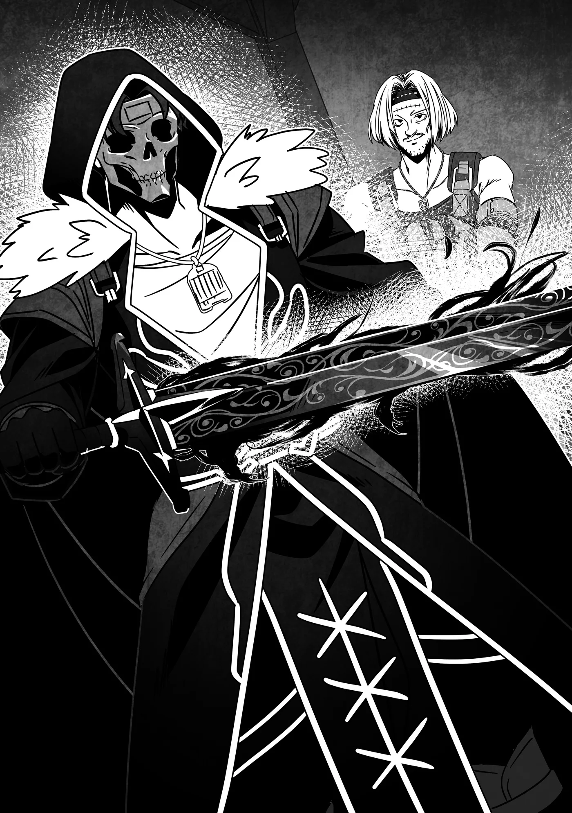

# Chương 291: Tập 12 Chương 5 - Maalt, Maalt Thân Thương, và Chuyến Thăm Thợ Rèn (5)

Ra đến sân trong, tôi tháo lớp vải bọc nhận từ chỗ Clope. Điểm thú vị nhất khi đặt làm trang bị riêng chính là khoảnh khắc lần đầu được tận mắt nhìn thấy thành phẩm. Dù đã thử qua đủ loại bản mẫu và lường trước được phần nào hình dáng của nó, lòng tôi vẫn không khỏi háo hức. Tôi vén lớp vải cuối cùng lên, để lộ toàn bộ thanh kiếm, và...

"Ồ! Thú thật là tôi không ngờ nó lại thành ra thế này..."

"Không ngờ là phải rồi," Clope nói giọng đắc ý. "Mà nói thật, chính tôi cũng chẳng ngờ nó lại ra nông nỗi này đâu. Chắc là do phần gỗ đã được truyền Thần Lực của cậu đấy. Trước đây tôi từng thấy vài món vũ khí làm từ Thánh Thụ, trông cũng từa tựa thế này."

Anh ấy đang nói tới những đường hoa văn độc đáo trên lưỡi kiếm. Cầm lấy chuôi kiếm, tôi thấy hoa văn ấy chạy dọc suốt chiều dài thân kiếm, những đường vân thô ráp gợi nhớ đến các vòng năm tuổi của thân cây. Có điều, nói cho thật chính xác thì bản thân dạng hoa văn đó cũng không hẳn là quá hiếm gặp.

Clope dường như cũng nghĩ giống tôi. "Không dùng Thánh Thụ thì người ta vẫn tạo ra được hoa văn kiểu đó," anh ấy bảo. "Khác biệt ở đây là độ cứng cáp của nó cơ. Tôi có rèn một con dao nhỏ để thử chất liệu, nó bền gấp năm lần dao thường, mà độ dẻo dai thì chẳng hề suy suyển chút nào."

Tôi vung nhẹ thử một đường, ngạc nhiên nhận ra lưỡi kiếm uốn cong như một cành cây. Cảm giác chẳng giống như đang cầm một thanh kiếm kim loại nguyên khối chút nào, mà cứ như một thanh kiếm roi chuỗi đoạn, dù là loại hơi cứng một chút. Dẫu vậy, nó chẳng hề cho cảm giác là sẽ gãy gập chút nào.

"Thú vị thật đấy..." tôi nhận xét. "Có điều chắc sẽ mất kha khá thời gian để làm quen đây."

"Chuyện đó thì chỉ có cách bỏ công luyện tập thôi," Clope nói. "Nhưng nếu cậu thực sự không quen dùng kiếm dẻo như thế, tôi có thể rèn lại."

"Không cần đâu... Để tôi dùng thử vài lần xem sao đã. Nếu thấy mãi chẳng đâu vào đâu thì tôi sẽ nhờ anh rèn lại sau, nhưng tôi có cảm giác là sẽ ổn thôi."

"Nghe vậy thì tốt rồi."

"Cơ mà... màu sắc của nó trông hơi... ừm..."

"Trông như đồ tà ác chứ gì?"

"Đúng vậy..."

Hoa văn trên lưỡi kiếm thì đẹp thật đấy, nhưng màu sắc của nó ngoài chữ "tà ác" ra thì chẳng còn từ nào khác để tả. Có phải do nó được rèn từ máu của tôi không nhỉ...? Lưỡi kiếm ánh lên sắc đỏ ở nhiều chỗ, trông tà dị đến mức người ta tưởng như nghe thấy nó đang gào thét: "Máu nữa đi! Thêm máu nữa đi!"

"Thế thì có sao đâu chứ?" Clope bảo. "Hợp với cậu lắm mà."

"Chuyện đó... là khen hay chê vậy...?" tôi hỏi.

Với chiếc mặt nạ đầu lâu cùng món vũ khí này, trông tôi giống một tên cướp hay sát thủ hơn là mạo hiểm giả. Tôi cũng chẳng thể phủ nhận là nó hợp với mình thật, nhưng việc này lại là chuyện hoàn toàn khác so với việc diện mạo đó có xứng đáng là một mạo hiểm giả hay không...

Trong lúc tôi còn đang ngẫm nghĩ, Clope lên tiếng: "Mà thôi, vẻ ngoài ra sao chẳng quan trọng. Cốt yếu là lúc dùng thấy thế nào kìa. Để tôi xem độ bén của nó ra sao đã."

Clope khiêng ra mấy khúc gỗ và những hình nhân làm bằng đủ loại chất liệu khác nhau, từ gỗ, kim loại cho tới rơm rạ. Xong xuôi, anh ấy bố trí chúng quanh sân trong. Tôi đoán việc chuẩn bị nhiều chất liệu khác nhau là để giúp tôi cảm nhận vũ khí tốt hơn, bởi một thanh kiếm dẻo như thế này vốn là của hiếm.

"Được rồi, thử thôi nào..." tôi nói.

Tôi bắt đầu chém qua từng hình nhân một. Ban đầu, tôi không truyền Ma Lực vào kiếm mà chỉ dựa vào lực tay thuần túy cùng kỹ thuật để nắm bắt cảm giác đường kiếm.

Clope hoàn toàn có lý do để tự tin vào tác phẩm của mình; tôi nhận ra ngay đây là một thanh kiếm thượng hạng, chém ngọt đến khó tin. Tôi chém đứt đôi cả những hình nhân mặc giáp kim loại, còn với rơm và gỗ thì chẳng cần phải bàn tới nữa.

Tôi kiểm tra lưỡi kiếm xem có vết mẻ nào không, nhưng chẳng thấy lấy một tì vết. Khi xem xét bộ giáp kim loại, tôi thấy những chỗ bị chém hơi lởm chởm, khớp với lực cản mà tôi cảm nhận được ban nãy. Có lẽ chính sức mạnh từ cơ thể quái vật đã giúp tôi dùng lực đè bẹp rồi chém ngọt qua lớp giáp.

Dù vậy, thế cũng đã quá tốt rồi. Từ trước tới giờ tôi chưa từng cầm thanh kiếm nào chém bén đến mức này.

"Thế nào?" Clope hỏi.

Tôi gật đầu. "Tôi ưng lắm. Độ dẻo không gây vướng víu nhiều như tôi tưởng. Thậm chí tôi thấy nó còn giúp tăng lực chém bén hơn nữa cơ."

"Nghe vậy mừng quá. Mà này, không ngờ chưa cần truyền chút năng lượng nào vào mà thanh kiếm đã bén đến mức đó... Có khi hai người lại là một cặp trời sinh đấy nhỉ?"

Bản thân Clope cũng là kiếm sĩ không tồi, nhưng xem ra lúc anh ấy thử nghiệm thì đường kiếm không được trơn tru như tôi. Tôi thấy chuyện anh ấy bảo tôi và thanh kiếm hợp nhau cũng có lý; thanh kiếm vốn được rèn từ một phần máu của tôi, nên xét theo nghĩa đó thì nó đúng là món vũ khí dành riêng cho tôi rồi. Có lẽ chính vì vậy mà dù không cần rót Ma Lực vào, nó vẫn chém ngọt đến thế.

Trên đời cũng từng có những vũ khí gắn kết riêng với chủ nhân như thế. Dạng đơn giản và dễ hiểu nhất chính là những thanh thánh kiếm hay thánh thương biết chọn người dùng, ban phát sức mạnh to lớn khi chủ nhân cầm chúng lên. Có khi thanh kiếm này cũng hoạt động theo cơ chế tương tự.

"Anh... không nghĩ nó là một thanh ma kiếm đấy chứ?" tôi hỏi.

"Ai mà biết được...?" Clope nhún vai. "Nhưng với tư cách một thợ rèn, nếu rèn ra được món vũ khí tầm cỡ đó thì đúng là diễm phúc lớn lao rồi."

Thánh kiếm và ma kiếm thường được tìm thấy trong mê cung hơn là do người ta đúc rèn, mà dẫu có được rèn ra đi chăng nữa thì cũng chỉ bởi những thợ rèn lừng danh khắp đại lục. Clope chắc chắn rất có tài, nhưng liệu anh ấy đã đủ trình độ để làm nên kỳ tích ấy hay chưa thì vẫn còn là một dấu hỏi lớn.

"Anh không nhận ra điểm khác biệt sao?" tôi hỏi.

"Có món thì nhận ra được, nhưng phần lớn lại chẳng phân biệt nổi đâu. Thế nên thi thoảng người ta mới tình cờ bắt gặp chúng ở mấy sạp hàng rong ngoài phố đấy thôi. Cậu từng nghe mấy chuyện kiểu đó rồi, đúng không?"

Thực ra tôi từng nghe rồi. Phiên bản tôi nghe kể về một mạo hiểm giả may mắn mua được thanh kiếm với giá rẻ như cho tại một quầy hàng rong, về sau mới vỡ lẽ đó là ma kiếm. Món vũ khí đó giúp anh ta đánh bại những con quái vật ngày càng mạnh mẽ, rồi cuối cùng leo lên tận Kim Cấp, hoặc Bạch Kim Cấp tùy theo lời người kể.

Tôi còn nghe một câu chuyện khác về một kẻ cũng trải qua tình cảnh tương tự, chỉ khác là món đồ anh ta nhặt được lại là chiếc mặt nạ nguyền rủa kỳ quái, chuyện đó chẳng may mắn chút nào. Cơ mà... tôi đồ rằng cũng chưa đến mức quá xui xẻo, vì ít ra anh ta vẫn còn sống nhăn răng...

"Tôi đoán nếu muốn biết chắc chắn thì phải đến đền Thần Giám Định rồi," tôi trầm ngâm nói thành tiếng.

"Cách đó thì chuẩn rồi," Clope tán thành. "Nhưng vẫn còn cách khác mà."

"Chẳng hạn như?"

"Một thợ rèn có tiếng tăm chẳng hạn, người ta nhìn là biết ngay... Dù sao thì chuyện đó cứ để tôi nghĩ cách sau. Cậu cứ thử nghiệm tiếp đi đã."

◆◇◆◇◆

Tiếp theo, tôi quyết định thử truyền Khí Lực vào thanh kiếm. Trong ba nguồn năng lượng mà tôi có, Khí Lực là thứ tôi luôn dựa vào nhiều nhất ngay từ thời còn là con người. Hồi ấy, chính nhờ Khí Lực mà tôi mới đủ mạnh để cuối cùng tiêu diệt được Khô Lâu và Slime.

Nghĩ lại thì tôi đã tiến một chặng đường dài thật rồi. Dạo này tôi có thể chém ngọt những con quái vật như thế chỉ bằng sức mạnh thể chất thuần túy. Dù chưa thể làm vậy với các chủng loài thượng cấp hay cá thể biến dị độc nhất, nhưng ít nhất gặp chúng tôi cũng chẳng đến mức mất mạng ngay tắp lự. Bản thân chuyện đó thôi cũng đã là khác biệt rất lớn rồi.

Con Ma Cà Rồng tôi chạm trán ở vương đô thì không tính...

"Này, đứng thần người ra đấy làm gì thế?" Clope gọi với sang.

"À, xin lỗi anh. Tôi chỉ đang mải suy nghĩ chút thôi."

"Ừ, chẳng vội gì đâu. Tôi dựng xong thêm mấy hình nhân rồi này, cậu thử xem sao."

Tôi tập trung tinh thần trở lại rồi bắt đầu truyền Khí Lực vào kiếm. Ngay khi tôi vừa vận lực...

"Trông chẳng khác gì cả..." tôi lẩm bẩm.

Trên đời có không ít món vũ khí đổi sắc đổi dạng mỗi khi được truyền Khí Lực hay Ma Lực vào. Ý nghĩ đó quả thật rất kích thích trí tò mò, nên tôi cũng mong thanh kiếm của mình làm được điều tương tự, nhưng có vẻ như niềm hy vọng dẫu chẳng mấy lớn lao ấy của tôi vừa tan thành mây khói.

Dẫu sao thì những loại vũ khí kiểu đó thường dễ để lộ năng lực của chúng, khiến người dùng gặp bất lợi trong thực chiến. Việc thanh kiếm của tôi giữ nguyên diện mạo có khi lại tốt hơn cho những trận chiến tôi có thể gặp phải sau này.

Trước mắt, tôi vung thử một nhát chém đơn giản.

"Hử. Ra là vậy. Biến đổi theo kiểu này à..."

"Có gì khác sao?" Clope hỏi.

"Phải đấy," tôi đáp. "Cảm giác như độ dẻo đã... giảm đi đôi chút."

"Thật à? Tự tôi nhìn thì chẳng thấy khác gì cả."

"Tôi mới truyền một lượng Khí Lực nhỏ thôi, nên phải tự vung kiếm mới nhận ra được. Nếu tôi truyền thêm một chút nữa..."

Suy đoán của tôi đã hoàn toàn chính xác: tôi càng truyền nhiều Khí Lực vào vũ khí, nó lại càng bớt dẻo đi. Tóm lại, Khí Lực đồng nghĩa với độ cứng.

Tôi không rõ đó là điều tốt hay xấu. Có lẽ nó sẽ giúp tăng độ bén cho kiếm, nhưng tôi lại lo làm vậy sẽ khiến lưỡi kiếm dễ gãy hoặc mẻ hơn. Lỡ làm gãy mất thì Clope sẽ khóc ròng mất. Tôi đắn đo không biết có nên tiếp tục thử nghiệm hay không.

"Này, nếu dùng bình thường mà nó đã gãy thì chứng tỏ tôi rèn ra đồ phế phẩm," Clope nói giọng thẳng thắn. "Cứ làm tới đi, xem nó ra sao."

Nghe thế cũng phải. Clope đâu có rèn thanh kiếm này để làm vật trưng bày, nên nếu chỉ bấy nhiêu thôi mà đã gãy thì anh ấy cũng chẳng có cớ gì để nổi giận với tôi.

Tôi gật đầu rồi bắt đầu chém. Đúng như dự đoán, tôi chém xuyên qua gỗ và rơm rạ không chút khó khăn. Dù thanh kiếm đã cứng hơn nhiều, tôi không nghĩ chừng đó đủ để làm mẻ hay trầy xước lưỡi kiếm. Kiểm tra lại vết chém, tôi thấy chúng phẳng phiu và ngọt hơn hẳn lúc trước, dẫu rằng tôi đã sớm đoán trước được điều đó.

"Giờ thì... kim loại thì sao đây?" tôi gằn giọng khi chém thẳng qua hình nhân mặc giáp.

Trọng lượng thanh kiếm không đổi nên vung vẫn rất vừa tay. Có điều phản lực giờ đã khác do độ dẻo giảm đi, thành thử tôi sẽ phải bỏ nhiều công sức để làm quen với điều đó.

Tôi từng hơi e dè khi thử kiếm trên hình nhân mặc giáp, nhưng thanh vũ khí chém qua mà chẳng gặp chút lực cản nào. Và rồi...

"Mọi thứ vẫn ổn cả," Clope xác nhận sau khi chạy lại xem xét lưỡi kiếm của tôi. "Không một vết xước."

Tôi thở phào nhẹ nhõm. Cũng giống như hình nhân gỗ và rơm, vết chém xuyên qua giáp kim loại phẳng ngọt hơn hẳn so với lúc chưa dùng Khí Lực, thanh kiếm lại chẳng hề có dấu hiệu hư hại nào, quả là tuyệt vời. Nếu chém bén được đến mức này, nó sẽ rất hữu dụng để đâm xuyên tới hạch tâm của những quái vật dạng vô định hình như Slime.

Săn Slime vẫn là nguồn thu nhập phụ khá khẩm đối với tôi...

"Giờ chắc tới lượt Ma Lực rồi."

Trong lúc Clope nhanh thoăn thoắt dựng lượt hình nhân tiếp theo, tôi bắt đầu truyền Ma Lực qua thanh kiếm, để rồi chợt cảm thấy một điều kỳ lạ.

"Đây là...?"

Cảm giác như tôi có thể nhận biết được thứ gì đó dưới lòng đất, tựa hồ chính mặt đất là phần nối dài từ tứ chi của mình vậy. Để thử nghiệm, tôi thử điều khiển luồng cảm giác mơ hồ ấy, và...

Ục.

Một khoảnh đất trong sân trồi lên như một gò đồi nhỏ theo ý muốn của tôi.

Tôi thử lại hiện tượng ấy vài lần và lần nào cũng nhận được kết quả tương tự; rõ ràng việc truyền Ma Lực qua kiếm giúp tôi có khả năng thao túng mặt đất, hay nói chính xác hơn là đất cát. Trông có vẻ khá hữu ích cho việc cày cấy ruộng đồng...

Chà, phân bón thì tôi chẳng thiếu, nên nếu giải nghệ đời mạo hiểm giả để đi làm nông dân, khéo tôi lại được tôn làm thần nông nghiệp cũng nên. Giữa lúc tôi còn đang mải theo đuổi dòng suy nghĩ ngớ ngẩn đó, Clope chuẩn bị xong xuôi liền bước lại gần.

"Đó có lẽ là hiệu ứng từ chỗ Ma Thiết chúng ta dùng, vì nó ngấm đẫm Ma Lực của Rồng Đất mà," anh ấy nói khi nhìn tôi nghịch đất. "Thỉnh thoảng người ta cũng thấy chuyện tương tự khi rèn được vũ khí tốt từ nguyên liệu của các quái vật gắn liền với đất đá. Bản thân năng lực này thì không hiếm. Vấn đề là: uy lực của nó mạnh tới mức nào?"

Tôi cũng biết về những loại vũ khí này; đó là những vũ khí mang thuộc tính nguyên tố có thể phun lửa hoặc băng rồi tự bao bọc mình trong đó. Về bản chất thì nó chẳng khác nào một ma pháp sư thi triển ma pháp, chỉ khác là người dùng chỉ việc truyền Ma Lực qua vũ khí.

Đúng như Clope đã nói, chúng không hẳn là quá hiếm. Người ta có thể tìm mua những món vũ khí như vậy trên thị trường, dĩ nhiên là với điều kiện sẵn lòng bỏ ra cả một gia tài kếch xù. Mà ngay cả thế, cũng khó lòng khẳng định nhiều món trong số đó có tương xứng với giá tiền hay không. Thành thử tôi chẳng có nhiều kinh nghiệm sử dụng chúng.

"Uy lực mạnh tới mức nào hả?" tôi nói. "Vậy chắc tôi phải truyền thêm Ma Lực vào để kiểm tra xem sao rồi."

Ban nãy tôi mới chỉ dùng một lượng Ma Lực nhỏ để thử nghiệm. Nếu tăng lượng Ma Lực đó lên, có thể hiệu ứng sẽ được khuếch đại rõ rệt hơn.

Khi bắt tay vào thử nghiệm, phán đoán của tôi đã hoàn toàn chính xác: lượng đất cát tôi có thể điều khiển tăng dần theo lượng Ma Lực phóng ra, thậm chí tôi còn tạo được cả những viên đạn đá từ hư không. Khả năng biến hóa rất đỗi tự do, đồng nghĩa với việc mang lại vô số phương án tác chiến trong giao tranh.

Dù vậy, tốc độ tiêu hao Ma Lực lại hơi đáng ngại. Tôi sẽ phải dành thêm nhiều thời gian luyện tập với thanh kiếm để thuần thục mọi cách thức ứng dụng khác nhau của nó.

Tôi bắt đầu thấy lo rằng mình sẽ chẳng bao giờ làm chủ được nó cho ra hồn mất.
