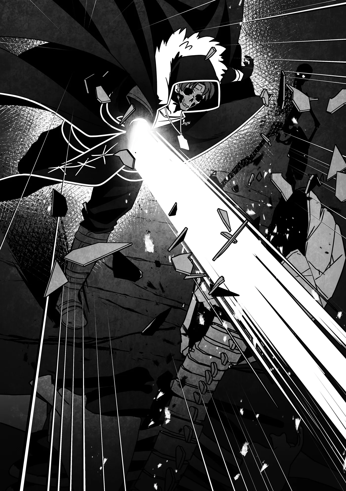

# Chương 297: Tập 12 Chương 6 - Một Ủy Thác Nọ (4)

"Ááá!"

Nghe tiếng thét từ phía sau lưng vọng lại, có vẻ như con Khô Lâu thứ ba đã không may chạm mặt dân làng trước khi tôi kịp tìm ra nó.

Vì họ đứng cách khá xa và tôi cũng đã dặn chớ có bước vào làng nếu không thực sự cần thiết, tôi cứ ngỡ họ sẽ an toàn, nhưng rõ ràng là tôi vẫn chưa đủ cẩn trọng.

Dẫu vậy, khi quay đầu lại nhìn, trông tình thế của họ vẫn chưa đến mức quá nguy ngập. Dù đã bị phát hiện, dân làng vẫn giữ được một khoảng cách khá xa với con Khô Lâu. Họ vẫn còn đủ thời gian để lóng ngóng tra tên vào cung và chuẩn bị bắn.

Trong lúc họ đang luống cuống, tôi lao vội về phía đó rồi chen vào chắn giữa một người dân làng và con quái vật. Trông như thể nó lang thang từ trong rừng tới chứ không phải chui từ trong làng ra, tôi đoán được là vì hướng duy nhất không có người chắn chính là phía sau lưng nó, vả lại hàng rào cọc gỗ thô sơ cao cỡ người dựng quanh làng cũng chẳng hề bị phá hỏng cọc nào.

Nghi vấn của tôi về việc lũ Khô Lâu có một nguồn sinh ra ở gần đây coi như đã được xác thực. Dù ngọn nguồn bắt đầu từ đâu, nó chắc chắn nằm ở ngoài làng chứ không phải bên trong.

Tự nhủ sau khi giải quyết xong xuôi sẽ lần theo hướng con Khô Lâu mò tới để điều tra, tôi truyền Thần Lực vào kiếm rồi vung một nhát.

Lần này do tấn công trực diện từ phía trước, con Khô Lâu định chống trả bằng cách chậm chạp giơ con dao găm rỉ sét lên, nhưng đời nào tốc độ của tôi lại thua một con Khô Lâu bình thường cho được. Nhát chém ngang của tôi cắt ngọt qua cánh tay nó vừa giơ lên cùng xương quai xanh, chém bay đầu con quái vật. Đúng như dự đoán, những phần xương tiếp xúc với lưỡi kiếm truyền Thần Lực lập tức vỡ vụn thành tro bụi, rồi hiệu ứng ấy nhanh chóng lan ra khắp toàn thân nó.

Lại một lần nữa, thứ duy nhất còn sót lại chỉ là viên Ma Tinh rơi bộp xuống đất. Nhặt nó lên xong, tôi quay sang nhóm dân làng.

"Xin lỗi vì tôi đến muộn," tôi nói.

Dân làng ngơ ngác nhìn tôi trân trân, trên tay chỉ vừa mới tra xong mũi tên vào dây cung.

"K-Không đâu, chúng tôi cũng sơ suất quá," Jiris nói. "Lần sau chúng tôi nhất định sẽ cẩn thận hơn..."

"Mọi người không cần phải gắng gượng làm những chuyện quá sức đâu," tôi nói. "Ưu tiên hàng đầu của mọi người nên là để mắt quan sát xung quanh. Kể cả không hạ được kẻ địch, chỉ cần còn giữ được mạng thì lúc nào cũng còn cơ hội lần sau. Chứ nếu chết... thì coi như hết."

Điều đó không hẳn đúng với tôi, bởi tôi từng chết mà vẫn có cơ hội lần sau đấy thôi, nhưng phải xui xẻo đến tột cùng thì người ta mới gặp phải cái chuyện như tôi. Hoặc có khi lại là may mắn chăng? Thật khó để khẳng định rốt cuộc là cái nào, nhưng dù sao đi nữa, trừ những ngoại lệ hết sức đặc biệt, cái chết luôn là dấu chấm hết.

Dĩ nhiên, đôi lúc người ta buộc phải liều mạng vào những thời khắc then chốt. Nhưng hiện tại hoàn toàn không phải lúc để những người dân làng này làm thế. Đúng là giành lại ngôi làng rất quan trọng, nhưng phần việc đó đã có tôi lo. Bổn phận của họ là tự bảo vệ tính mạng mình; việc hỗ trợ tôi chỉ là chuyện thứ yếu.

Nếu được làm hoàn toàn theo ý mình, tôi đã từ chối phắt sự giúp đỡ của họ cho xong, nhưng cảm xúc con người lại khiến mọi chuyện phức tạp hơn thế. Tôi không muốn xem nhẹ mong muốn được góp sức của họ. Dẫu vậy, điều đó không có nghĩa là tôi sẽ để họ làm những chuyện liều lĩnh dại dột.

Lời nhắc nhở nhẹ nhàng của tôi ngay sau khi họ vừa trải qua một phen ngàn cân treo sợi tóc hẳn đã phát huy tác dụng, bởi bờ vai Jiris rũ xuống.

"Chúng tôi xin ghi nhớ lời cậu..." ông ấy nói. "Thật lòng xin lỗi cậu nhiều..."

◆◇◆◇◆

Sau khi chắc chắn dân làng đã lấy lại bình tĩnh, tôi lại cất bước đi tìm con Khô Lâu tiếp theo, nhưng...

"Xem chừng mình buộc phải xông thẳng vào đó rồi..."

Ở trung tâm ngôi làng có một khoảng đất trống rộng rãi, có lẽ là nơi dùng cho các dịp lễ hội và hội họp. Tôi cùng dân làng hiện đang nấp sau một ngôi nhà gần đó, ngó ra năm con Khô Lâu đang chiếm cứ bãi đất trống. Ba con trong số đó là Khô Lâu thường, tức số được nhắc tới trong thông tin ban đầu của chúng tôi, còn hai con kia là những con Khô Lâu Binh mà tôi phát hiện ra sáng nay.

Y như lúc trước, hai con Khô Lâu Binh lần lượt cầm một cây cung và một ngọn giáo, cẩn trọng đảo mắt quan sát xung quanh. Lũ Khô Lâu thường vây quanh chúng theo đội hình bảo vệ và cũng cảnh giác không kém, dẫu thực tế cử động có phần chậm chạp hơn.

Chẳng khó để hiểu tại sao chúng lại dàn đội hình như vậy: lý do là vì ba con Khô Lâu tôi đã âm thầm trừ khử. Tôi không nghĩ đống xương vùi nông hay đám tro tàn còn sót lại là thứ đánh động chúng, bởi tôi đã che giấu khá kỹ, nhưng xem ra chúng vẫn nhận ra điều bất thường.

Có lẽ chúng phán đoán tương tự như cách một đội tuần tra của con người hoạt động. Nếu đã phân chia lộ trình từ trước, chúng sẽ ước lượng được khi nào những kẻ đi tuần phải trở về—thế nhưng lại chẳng thấy tăm hơi đâu. Đã vậy chuyện đó không chỉ diễn ra một lần mà lặp lại nhiều lần. Kết luận hiển nhiên là có sự can thiệp từ bên ngoài.

Mức độ thông minh giữa các cá thể Khô Lâu Binh có sự chênh lệch rất lớn. Dù con nào cũng sở hữu năng lực chiến đấu nhất định cùng đủ trí khôn để phát lệnh, nhưng việc chúng có khả năng đưa ra những quyết định mang tính chiến lược như sắp đặt lộ trình tuần tra hay không lại tùy thuộc vào từng con.

Có vẻ hai con Khô Lâu Binh chúng tôi đụng phải hôm nay thuộc diện khôn ngoan hơn. Điều đó thường đồng nghĩa với việc lực chiến đơn đả độc đấu của chúng cũng cao hơn. Lại thêm một gạch ghi vào bảng "chứng minh Rentt thực sự bị vận đen đeo bám". Loại Khô Lâu Binh yếu hơn vốn phổ biến hơn nhiều mới phải...

Dù vậy, cằn nhằn cũng chẳng giải quyết được gì. Huống hồ đối đầu với kẻ địch mạnh hơn sẽ là trải nghiệm tốt. Vì cơ thể tôi có thể hấp thu sức mạnh của đối thủ, chúng càng mạnh thì tôi càng thu được nhiều tiến bộ.

Vấn đề nan giải dĩ nhiên là nhóm dân làng... Tôi phải hạ con Khô Lâu Binh cầm cung càng nhanh càng tốt. Dù con cầm giáo lẫn lũ Khô Lâu cầm kiếm đều có thể phóng vũ khí, nhưng ngay cả Khô Lâu thường cũng đủ khôn để hiểu rằng nếu vứt bỏ vũ khí thì khả năng chiến đấu sẽ sụt giảm nghiêm trọng, nên có lẽ chúng sẽ không chọn cách đó.

Chắc chắn con cầm cung là mối nguy hiểm lớn nhất đối với dân làng. Vấn đề là phải xử lý nó thế nào. Đúng chuẩn chiến thuật sách giáo khoa, xạ thủ đứng ở vị trí bọc hậu, mà vì chúng lại đứng giữa bãi đất trống trải nên rất khó để vòng ra sau lưng tiếp cận.

Tôi đã thoáng nghĩ hay là cứ phó mặc cho may rủi, nhưng làm vậy rủi ro quá lớn—không phải cho tôi, mà là cho nhóm dân làng.

Có điều xét tình thế này, phó mặc may rủi có vẻ là lựa chọn duy nhất... nếu chỉ nhìn thoáng qua. Cơ sự đã đến nước này, tôi nghĩ đã đến lúc thử một cách mình chưa quen tay lắm nhưng tin là sẽ thành công.

Thật ra khi truyền Thần Lực vào thanh kiếm lúc trước, tôi đã cảm nhận được một phản hồi khá lạ kỳ—chính nó đã gợi cho tôi một ý tưởng. Để kiểm chứng, tôi truyền Thần Lực qua kiếm lần nữa... và cảm giác ấy lại ùa về. Tôi khá tin chắc mình có thể làm được việc này.

Có điều làm vậy chắc chắn sẽ tiêu hao cực kỳ nhiều, nên đây sẽ là một đòn đánh được ăn cả ngã về không. Nhưng thế cũng chẳng sao—nếu thất bại, tôi chỉ việc quay lại phương án cơ bản là vung kiếm dọn sạch lũ Khô Lâu với tốc độ nhanh nhất có thể.

Tôi ra hiệu cho dân làng sau lưng biết mình chuẩn bị lao vào. Thấy họ gật đầu, tôi bước ra khỏi chỗ ẩn nấp và xông thẳng về phía bầy Khô Lâu.

◆◇◆◇◆

Sự cảnh giác của chúng không phải chỉ để trưng cho đẹp—lũ Khô Lâu lập tức phát hiện ra tôi và quay lại, lăm lăm vũ khí. Riêng con Khô Lâu Binh cầm cung thì thoăn thoắt tra tên rồi bắn ngay về phía tôi. Nó bắn khá cừ... nhưng ma pháp của Lorraine còn nhanh hơn nhiều.

Gần đây, thỉnh thoảng tôi vẫn nhờ cô ấy bắn hỏa cầu Fotiá Volídas ở cự ly gần để tôi tập né tránh hoặc gạt đòn. So với chuyện đó thì mũi tên này chẳng bõ bèn gì.

Căn chuẩn thời cơ, tôi vung kiếm khi mũi tên vừa bay tới sát mặt, gạt phăng và bẻ gãy đôi nó giữa chừng. Giờ tôi đã đạt tới trình độ có thể gạt được ma pháp ở mức độ nhất định. Một mũi tên thông thường... tuy chưa hẳn là trò trẻ con, nhưng tôi hoàn toàn thừa sức xử lý nhẹ nhàng.

Tôi áp sát bầy Khô Lâu trước khi con Khô Lâu Binh cầm cung kịp tra mũi tên tiếp theo. Lũ quái vật toan vung kiếm chém xuống, nhưng trước khi đòn đánh kịp tới, tôi đã truyền Thần Lực vào vũ khí của mình rồi đâm một cú thật mạnh về phía con Khô Lâu ngay trước mặt.

Cú đâm trúng đích chuẩn xác, lưỡi kiếm lún sâu vào cổ nó dễ dàng đến mức ngỡ như bị hút vào. Đầu của con Khô Lâu bay văng lên không trung.

Bình thường thì tôi sẽ thu kiếm về để chuyển đòn tiếp theo. Thế nhưng lần này, tôi lại đẩy mũi kiếm đâm tới xa hơn nữa—hướng thẳng về phía con Khô Lâu Binh cầm cung. Tôi muốn giải quyết cả hai đối thủ chỉ bằng một chiêu duy nhất.

Có điều chiều dài thanh kiếm của tôi không đủ để với tới khoảng cách đó. Con Khô Lâu Binh dường như nhận ra điều này, bởi nó vẫn bình thản tiếp tục tra mũi tên tiếp theo vào dây. Điểm đáng sợ ở lũ Khô Lâu là chúng chẳng bao giờ biết hoảng loạn hay sợ hãi, ngay cả khi tình hình trở nên vô cùng nguy ngập.

Điều đáng sợ nhất giữa một trận hỗn chiến là mất bình tĩnh đến mức không thể cử động như bình thường, nhưng chuyện đó không bao giờ xảy ra với Khô Lâu. Đôi lúc tay nghề vụng về hoặc luồng Ma Lực duy trì liên kết ở các khớp xương bị rối loạn có thể làm chúng đánh rơi vũ khí hay ngã nhoài, khiến người ta tưởng chúng đang hoảng loạn... nhưng về bản chất, chúng vốn không hề có năng lực cảm nhận những cảm xúc ấy.

Cơ mà đó cũng chỉ là giả thuyết của giới mạo hiểm giả. Biết đâu sâu thẳm bên trong chúng lại đang khiếp hãi thật thì sao. Dù sao thì hồi còn là Khô Lâu, tôi vẫn có cảm xúc bình thường. Hoàn toàn có khả năng những cá thể giống như tôi cũng sẽ như vậy.

Dẫu vậy, tôi khá chắc con Khô Lâu Binh trước mắt không thuộc diện cá biệt đó.

Con quái vật vừa tra xong tên, nhưng chỉ tích tắc trước khi nó kịp buông tay bắn, mũi kiếm của tôi, thứ vốn dĩ chẳng đời nào với tới đối thủ, đã đâm xuyên qua hộp sọ của nó.

◆◇◆◇◆

Trong mắt người ngoài nhìn vào, cảnh tượng ấy ắt hẳn vô cùng kỳ lạ. Bởi lẽ phần kiếm đâm xuyên qua con Khô Lâu Binh hoàn toàn không phải lưỡi kiếm vật lý. Dẫu vậy, cú đâm vẫn là một đòn chí mạng xuyên thủng hộp sọ con quái vật, khiến toàn bộ cơ thể nó tan rã thành tro bụi.

Lời giải thích rất đỗi đơn giản: tôi đã tạo ra một lưỡi kiếm bằng Thần Lực.

Đây chính là phương pháp tôi muốn thử nghiệm: dùng Thần Lực để kéo dài tầm với của thanh kiếm. Hồi thử vũ khí ở tiệm của Clope, tôi thậm chí còn chưa hề nghĩ tới khả năng này; tôi chỉ mới vừa nảy ra ý định cách đây ít lâu. Nhưng ngay khoảnh khắc bắt tay vào thử, tôi biết chắc nó sẽ thành công.

Vì thường thấy Lorraine làm điều tương tự bằng Ma Lực, chuyện tôi tự hỏi liệu mình có làm được như vậy với Thần Lực hay không cũng chẳng phải suy diễn gì quá xa vời. Đó thực sự không phải ý tưởng viển vông: hồi ở Hathara, tôi thậm chí từng thấy Capitan, người thầy dạy Khí Thuật của tôi, đạt được hiệu quả tương tự bằng Khí Lực.

Còn với Thần Lực, mọi chuyện đơn giản chỉ là thử xem có dùng được hay không—và quả nhiên là được thật.

Tôi vẫn chưa đạt tới trình độ làm được điều đó với Khí Lực, vì tôi chưa thể điều khiển hình dạng nguồn năng lượng ấy một cách tự do; nhưng giờ đã làm được với cả Ma Lực lẫn Thần Lực, có lẽ việc nắm bắt được mẹo và hoàn tất trọn bộ ba nguồn năng lượng chỉ còn là vấn đề thời gian.

Việc đó chắc chắn sẽ cực kỳ gian nan—bởi Khí Lực lấy sinh mệnh lực bên trong cơ thể con người làm nền tảng, chỉ riêng chuyện tách nó ra khỏi thể xác thôi đã đủ trầy trật rồi. Nhưng tôi thấy bỏ công sức vào đó là hoàn toàn bõ. Sớm muộn gì tôi cũng phải thu xếp thời gian để luyện tập mới được.

Những lúc thế này, có khi đích thân lặn lội về Hathara hỏi xin chỉ dẫn của Capitan lại là ý hay. Chú ấy làm được chuyện đó thật, nên hẳn sẽ giúp ích được rất nhiều cho tôi.

Dẫu những suy nghĩ ấy đang lướt qua trong đầu, thân thủ tôi vẫn không hề ngơi nghỉ. Sau khi xác nhận đã hạ gọn một con Khô Lâu và một con Khô Lâu Binh, tôi quyết định lùi lại đôi chút... nhưng trong lúc lùi, tôi vẫn tiện tay vung kiếm chém một con Khô Lâu còn nằm trong tầm với.

Dùng Thần Lực rất ngốn sức, và tiếc là tôi đã gần cạn sạch, nên tôi đổi sang dùng Khí Lực cho nhát chém này. Dẫu vậy, chừng đó vẫn quá đủ để đối phó với một con Khô Lâu thông thường. Xét cho cùng, hồi còn là người, việc vận Khí Lực thậm chí còn mang lại cho tôi đủ sức mạnh để đập vỡ vụn sọ một con Khô Lâu.

Dùng những ngón nghề cũ như vậy cũng hay. Chúng đem lại sự vững tâm nhất định.

Tiện thể thì lần này tôi không chém vào đầu mà chém trúng ngực nó. Chẳng hề gì, bởi đó là nơi giấu viên Ma Tinh của con Khô Lâu này, nằm nép vào như một trái tim. Ma Tinh của Khô Lâu đâu phải lúc nào cũng nằm ở trên đầu.

Tôi nhớ Lorraine từng bảo rằng quái vật dạng thú thường có Ma Tinh nằm ở những vị trí cố định do chúng có da thịt, và nội tạng của chúng cũng nằm ở những chỗ nhất định. Tuy nhiên, giới hạn đó không áp dụng cho Khô Lâu—vì chúng vốn dĩ chẳng có nội tạng, cô ấy từng phỏng đoán Ma Tinh của chúng có thể nằm ở bất cứ khoảng trống nào trên cơ thể.

Dẫu vậy, đúng là đa phần trường hợp Ma Tinh của chúng đều nằm ở đầu. Biết đâu ngay cả quái vật cũng có bản năng—hay một cảm thức chung nào đó—rằng bộ phận quan trọng nhất phải được đặt ở nơi cứng cáp nhất trên cơ thể.

Nhưng tất nhiên, mọi thứ cũng chỉ là phỏng đoán mà thôi.

Khi con Khô Lâu trước mặt rã vụn, tôi lùi lại để tạo thêm khoảng cách, thế nhưng con Khô Lâu cuối cùng và con Khô Lâu Binh cầm giáo đã lao lên áp sát. Chưa nói tới con Khô Lâu thường, tốc độ của con Khô Lâu Binh quả thực không tồi chút nào.

Thế nhưng, như để cản đường chúng, hai mũi tên, thứ vũ khí vốn chẳng có sức sát thương lớn gì, từ bên sườn bay vụt tới. Dù trúng đích vào đầu con Khô Lâu, chúng chỉ va vào phát ra tiếng keng rồi bật nảy ra ngoài, ngỡ như đập trúng một tấm khiên kim loại.

Dẫu vậy, không phải là chúng chẳng gây chút thương tổn nào: trên xương đã có những vết sứt mẻ. Jiris không hề khoác lác khi bảo làng họ có những tay thợ săn giỏi.

Con Khô Lâu dường như nhận ra mình vừa bị tổn hại. Chiếc đầu nó quay ngoắt kêu lách cách về hướng mũi tên vừa phóng tới—nơi nhóm dân làng đang đứng giương sẵn cung tên. Nó trừng hai hốc mắt trống hoác đáng sợ về phía họ rồi đổi hướng, chuẩn bị lao thẳng tới.

Chẳng khó để nhận ra nó định ra tay xử lý dân làng trước. Nói thật thì đây chẳng phải quyết định sáng suốt gì về mặt chiến thuật—họ vốn dĩ không có sức tấn công đáng kể. Với tư cách kẻ có thể tiễn Khô Lâu chầu trời chỉ bằng một đòn, tôi mới là mối nguy lớn hơn nhiều.

Ngược lại, con Khô Lâu Binh chẳng cần trúng tên cũng thừa hiểu dân làng là mối đe dọa chẳng đáng kể so với tôi. Nó dán chặt mắt vào tôi không rời một giây, thậm chí còn ra dấu bảo con Khô Lâu quay lại.

Thế nhưng năng lực phán đoán của con Khô Lâu lại quá kém cỏi. Nó phớt lờ mệnh lệnh và quay lưng lại phía tôi.

Dĩ nhiên tôi chẳng dại gì bỏ qua một sơ hở lớn đến thế. Tôi lập tức lao vút tới, bổ kiếm xuống tấm lưng không chút phòng bị của con Khô Lâu, chém nó làm đôi. Động tác của con quái vật khựng lại như thể chẳng hiểu chuyện gì vừa xảy ra. Cuối cùng, nó giật giật đầu về phía tôi—nhưng đó là tất cả những gì nó làm được trước khi cơ thể đổ sụp thành một đống xương vụn.

Trong lúc đó, con Khô Lâu Binh đã xông tới áp sát tôi. Nó đã cố đến tận phút chót để chi viện cho con Khô Lâu, nhưng sau khi con quái vật cấp thấp bị hạ gục chỉ bằng một đòn, con Khô Lâu Binh liền quay ngoắt lại, lùi ra xa để giữ khoảng cách.

Tôi không nghĩ con Khô Lâu Binh cố giúp đồng loại vì tình cảm hay tinh thần đồng đội gì; chắc nó chỉ muốn tránh cho lực lượng bị hao hụt. Nhưng vì toan tính ấy bất thành, giờ đây trận chiến đã biến thành màn đối đầu một mất một còn, và đó là lý do nó lùi lại.

Con Khô Lâu Binh tỏ ra vô cùng điềm tĩnh. Tôi tự hỏi liệu thời còn sống nó có phải một chiến binh có chút thực lực hay không. Có nhiều lý do giải thích cho sự ra đời của Khô Lâu, nhưng trường hợp phổ biến là bộ xương của một sinh vật từng sở hữu lượng Ma Lực trên mức bình thường khi còn sống bằng cách nào đó đã có được sinh mệnh mới dưới dạng Undead. Đó là lý do tại sao việc bỏ mặc xác mạo hiểm giả mà không chôn cất lại nguy hiểm, tại sao Hội phải ghi chép sổ sách sinh tử một cách chuẩn xác, cũng như thu hồi thẻ mạo hiểm giả của người đã khuất và thưởng cho ai tìm thấy chúng.

Một ví dụ điển hình là khi người có thực lực đáng kể chết đi trong nỗi oán hận khôn nguôi hay sự tiếc nuối khôn cùng. Chuyện những người như thế biến thành Undead mang sức mạnh đáng sợ không phải là hiếm gặp.

Đôi lúc tôi cũng thoáng nghĩ hay mình thuộc loại đó, nhưng những kẻ tái sinh thành Undead vốn chẳng giữ lại chút ký ức nào về quãng đời trước đây mà trở thành những cá thể hoàn toàn mới.

Rốt cuộc tôi thực sự là thứ gì chứ? Dù có suy ngẫm bao nhiêu đi nữa, câu trả lời ấy vẫn mãi lẩn tránh tôi. Tất cả những gì tôi có thể làm là tiếp tục chiến đấu với lũ quái vật trước mắt, và một ngày nào đó trở lại làm người...

Nếu con Khô Lâu Binh trước mắt cũng có ý thức như tôi, biết đâu tôi đã thỉnh giáo nó vài lời khuyên rồi. Nhưng dù có phải vậy hay không, nó vẫn là một con quái vật săn hại con người.

Không một chút nương tay, tôi dùng Khí Lực cường hóa sức mạnh rồi lao thẳng về phía con Khô Lâu Binh—con quái vật cuối cùng trong ngôi làng này. Tôi dồn hết sức lực còn lại chém tới một nhát; không kịp phản ứng trước nhát chém của tôi, con quái vật chỉ đành bất lực nhìn đầu mình lìa khỏi cổ.
