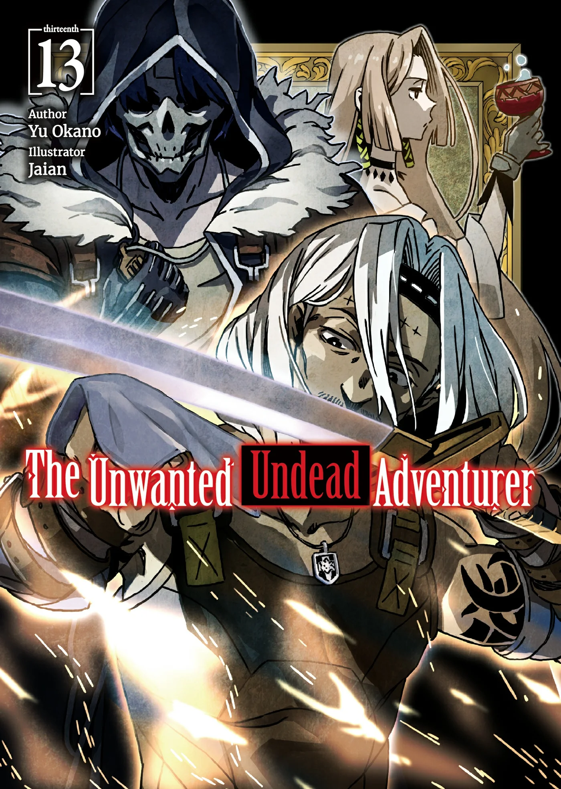
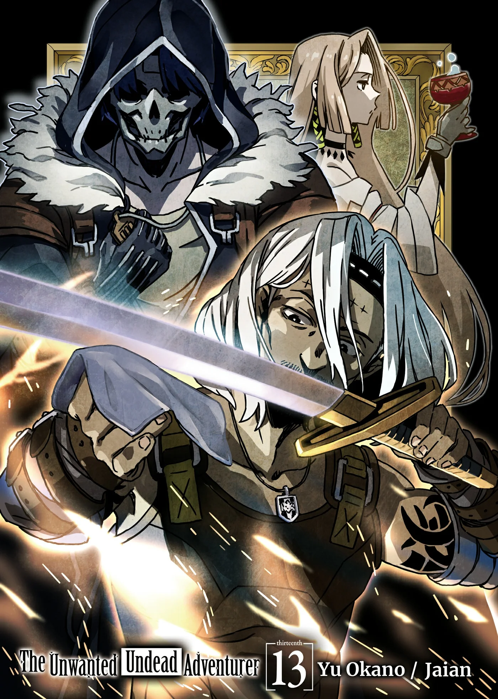
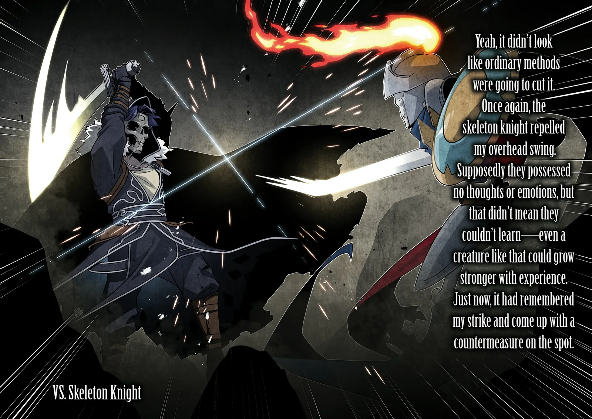
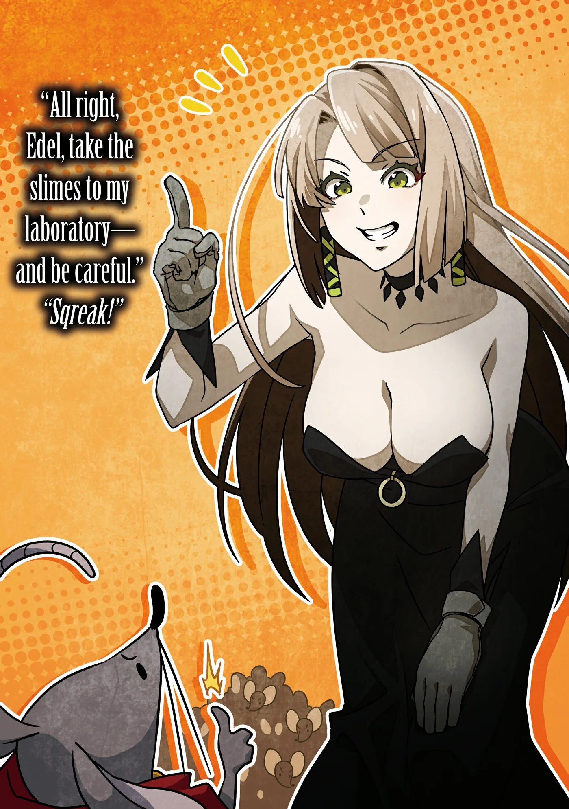
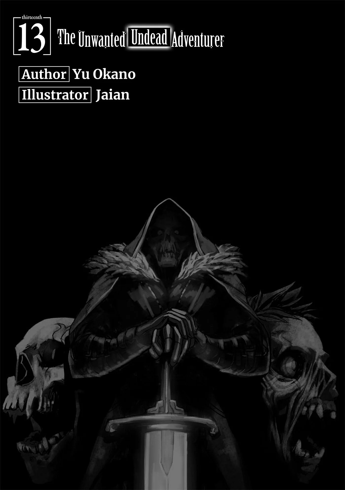
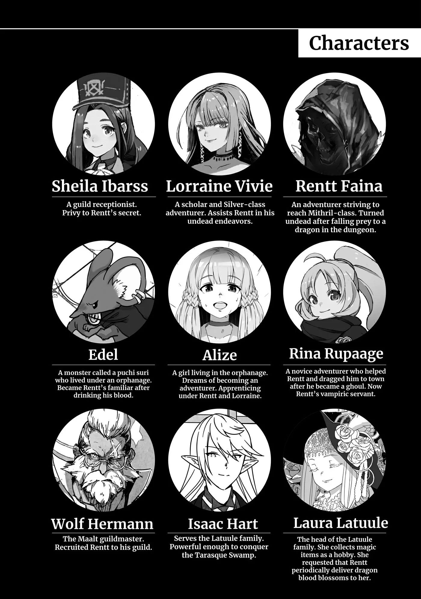
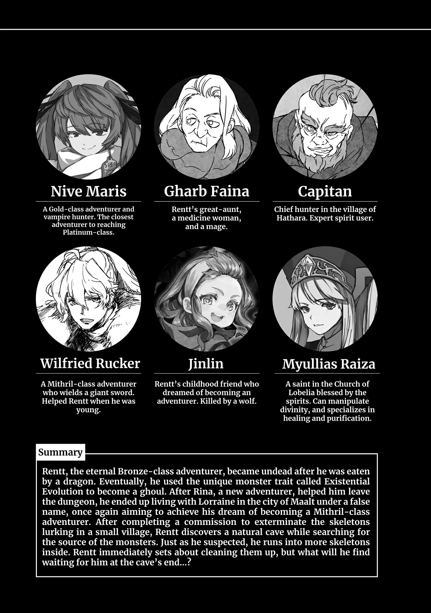
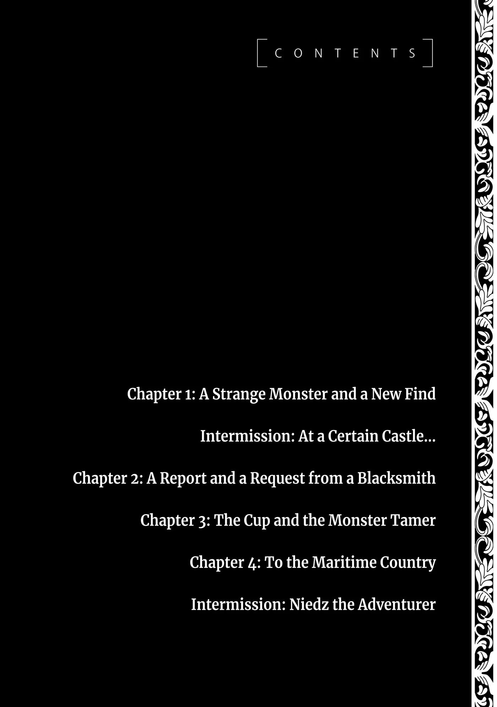

# Chương 301: Tập 13 Chương 1 - Quái Vật Kỳ Lạ và Phát Hiện Mới (1)

"Không khí nhộn nhịp hơn hẳn rồi..."

Sau khi tiêu diệt sạch lũ Khô Lâu trong làng, tôi đã thức trọn một đêm để canh gác, bảo đảm không còn con nào có thể lọt vào nữa. Trong lúc đó, Rivul cùng Trưởng thôn Jiris đi rảo khắp các làng mạc và thị trấn lân cận để báo cho những người đi sơ tán biết rằng lũ Khô Lâu đã được dẹp yên.

Trời rạng rồi đến giữa trưa, họ mới quay trở về. Tôi ngạc nhiên khi thấy hai người không đi một mình: những cư dân ban đầu của làng cũng lục tục theo sau, mắt ngấn lệ sụt sùi. Lẽ dĩ nhiên là chưa phải toàn bộ dân làng—mới chỉ có cánh thanh niên trai tráng và vợ của họ—nhưng dự tính là người già và trẻ nhỏ sẽ lần lượt quay về sau khi ngôi làng dần hồi phục.

Jiris nhận xét rằng có lẽ một số người sơ tán sẽ không trở lại, thay vào đó chọn định cư luôn tại các thị trấn hoặc ngôi làng nơi họ tị nạn. Dẫu vậy, phần lớn mọi người vẫn sẽ quay về, đủ thấy họ gắn bó sâu nặng với quê hương đến dường nào.

Hiện tại, tôi đang phụ giúp họ khôi phục lại ngôi làng. Nói là vậy chứ lúc này cũng chỉ toàn những công việc lặt vặt đơn giản: sửa lại hàng rào bao quanh, thu dọn đống đổ nát từ các công trình hư hại, rồi phân loại xem thứ gì còn dùng được, đại loại thế. Xem chừng chúng tôi sẽ hoàn thành đủ việc để ít nhất bảo đảm những ai trở về hôm nay đều có một mái nhà che đầu vào đêm nay.

"Tất cả là nhờ anh đấy, anh Rentt," Rivul nói trong lúc vác một tấm ván gỗ bước vào quảng trường trung tâm làng. Chắc hẳn nó từng là một phần tường của ngôi nhà nào đó.

"Tôi chỉ làm đúng phận sự của mình thôi," tôi đáp. "Vả lại công cuộc tái thiết thực sự bây giờ mới bắt đầu. Sẽ chẳng dễ dàng gì đâu... nhưng thấy chừng này người quay về hôm nay thì tôi nghĩ mọi chuyện rồi sẽ ổn thôi."

Tính đến nay đã có khoảng hai mươi người quay về. Con số đó chiếm một phần tư trong tổng số tầm tám mươi dân làng trước đây, và ngày mai sẽ còn thêm người nữa. Hiển nhiên là chẳng thể mơ mộng chuyện tất cả đều trở về chỉ sau một hai ngày—việc tròn một phần tư dân số đã có mặt ở đây đã đủ đáng ngạc nhiên rồi. Nếu có ai bảo ngôi làng này sẽ hồi sinh trọn vẹn, tôi hoàn toàn tin là thật.

"May mà hầu hết nhà cửa không bị hư hại nặng nề, ruộng đồng cũng còn nguyên vẹn," Rivul bảo. "Chúng tôi sẽ xoay xở được thôi. Có phải làng tránh được cảnh tàn phá nặng nề hơn là nhờ chỉ toàn gặp Khô Lâu không anh?"

"Tôi cũng đoán thế," tôi đồng tình. "Nếu chủ yếu là quái vật chủng sói thì ruộng đồng nhà các cậu đã bị xới tung lên rồi, còn nếu là Goblin hay Slime thì nhà cửa chắc cũng chẳng còn nguyên vẹn."

Mấy loài quái vật tôi vừa kể là những dạng phổ biến nhất thường tấn công làng mạc loài người. Quái vật chủng sói muôn hình vạn trạng đủ kích cỡ, nhưng nhìn chung động cơ của chúng đều là săn tìm thức ăn, và để đạt được mục đích đó, chúng sẽ cày xới hoa màu hoặc thậm chí ăn thịt cả dân làng. Quái vật chủng Goblin cũng hành xử tương tự: cướp phá kho lương thực và dỡ tung nhà cửa để tìm vật liệu dựng nơi ở cho mình. Nếu chiếm trọn được một ngôi làng, chúng thường sẽ vét sạch chẳng chừa lại thứ gì ngoài đống tàn tích trơ trọi.

Quái vật chủng Slime thì không cướp bóc theo kiểu đó, nhưng vì có thể hòa tan và nuốt chửng mọi thứ trên đời, chúng có thể ngấu nghiến cả một ngôi làng—từ ruộng đồng, nhà cửa cho đến mọi thứ—rồi biến nơi đó thành một bãi đất hoang tàn.

Tất cả những loài quái vật ấy đều có thể coi là thiên địch của loài người. Chính vì thế mà suốt chiều dài lịch sử, con người luôn phải học cách chống lại chúng.

Người ta có thể nghĩ Rồng hay Chimera là những loài quái vật nguy hiểm hơn, nhưng các sinh vật to lớn cỡ đó hiếm khi rời khỏi lãnh địa của chúng. Nhìn lại qua bao thời đại, chính những giống tép riu như Goblin mới là kẻ luôn xung đột với loài người để tranh giành nơi sinh sống.

Nhờ vậy mà loài người mới tồn tại được cho tới tận ngày nay. Chứ nếu ngày nào Rồng với Chimera cũng kéo tới tấn công, chúng ta hẳn đã tuyệt chủng từ lâu rồi.

Dĩ nhiên vào thời nay, con người đã có phương thức để đánh trả. Nhưng tổ tiên chúng tôi thuở xưa thì đâu được như vậy. Lý do duy nhất giúp giống loài chúng tôi chật vật sinh tồn dẫu thể chất yếu ớt chính là nhờ trí khôn nhỉnh hơn đôi chút so với muôn thú trên thế gian này.

Con người đúng là những sinh vật yếu ớt từ trong bản chất mà...

"Vâng, nghe cũng có lý," Rivul nói. "Tôi từng nghe kể về những điều quái vật khác có thể gây ra cho một ngôi làng rồi. Coi bộ làng tôi vẫn còn may mắn chán."

"Xét về mặt đó thì đúng là may thật..." tôi đáp. "Nhưng nếu xét về thời điểm thì các cậu cũng xui xẻo không kém, nhất là khi nghĩ tới đống rắc rối cậu phải trải qua lúc cố thuê mạo hiểm giả ở Maalt."

"Đâu có! Cuối cùng anh vẫn nhận lời đấy thôi? Tôi thấy vậy là quá may mắn rồi, nhất là khi giờ đây anh còn chẳng quản công giúp đỡ dù chuyện này đâu nằm trong bổn phận của anh."

Rivul đang nhắc đến chuyện tôi phụ giúp sửa sang lại ngôi làng. Cậu ấy nói không sai—chẳng có điều nào trong số đó nằm trong thỏa thuận ủy thác, nên lúc này tôi hoàn toàn có quyền ngồi rung đùi nghỉ ngơi tại nhà trưởng thôn. Nhưng bảo tôi làm vậy thật thì tôi chịu thôi.

"Không đâu, tôi xem chuyện này cũng là một phần công việc," tôi bảo.

"Sao cơ anh?"

"Đúng là tôi đã dọn sạch lũ Khô Lâu rồi, nhưng tôi đoan chắc mọi chuyện chưa dừng lại ở đây đâu. Rất có khả năng sẽ có thêm những con khác tìm tới. Chúng ta cần củng cố lại phòng tuyến của làng để chuẩn bị đối phó."

"Tôi... tôi cũng nghĩ anh nói phải. Lúc chúng ta tới đây, số lượng Khô Lâu đã đông hơn hẳn so với lúc tôi rời làng đi đăng ủy thác. Chắc chắn chúng từ bên ngoài tràn vào."

"Đấy, thấy chưa. Điều đó có nghĩa là ở ngoài kia có một ngọn nguồn sản sinh ra chúng, và chúng ta cần phải triệt hạ nó. Nhưng tôi chỉ có một mình, vả lại tôi chẳng đành lòng nhìn ngôi làng lại bị xâm chiếm trong lúc mình ra ngoài tìm kiếm, nên tôi muốn làm hết sức để ngăn chặn điều đó xảy ra."

"Anh thực sự chịu làm ngần ấy việc vì chúng tôi sao...?"

"Dĩ nhiên rồi. Chứ cậu nghĩ tôi tiêu diệt lũ quái vật này vì cái gì? Là để mọi người có thể sống ở đây chứ đâu. Bỏ công làm ngần ấy việc sẽ chẳng còn ý nghĩa gì nếu ngày mai chúng lại kéo tới... nên chúng ta hãy cố hết sức để chuyện đó không tái diễn."

"Rõ rồi anh!"

◆◇◆◇◆

"Tôi có đủ thứ đồ ở đây đấy, mọi người cần gì cứ bảo nhé," tôi nói. "À mà... dĩ nhiên là vẫn phải trả tiền đấy."

Bày la liệt trên quảng trường làng là đủ loại thực phẩm và nhu yếu phẩm linh tinh. Đó đều là đồ đạc rút ra từ trong túi ma thuật của tôi, gom hết lại cũng phải chất đầy mấy cỗ xe hàng.

Trong túi còn có cơ man những món đồ lặt vặt mà tôi lúc nào cũng thủ sẵn, kiểu đồ đạc từng khiến Lorraine phải thốt lên: "Sao anh lại nhét cái thứ này vào trong đó làm gì không biết...? Mà nói trước là không phải tôi chê không dùng đâu nhé. Nó vừa khéo hợp với tình huống này đấy."

Tôi đã quên mất lý do ban đầu mình nhét một số thứ này vào túi, nhưng làm mạo hiểm giả đồng nghĩa với việc những món đồ không ngờ tới đôi khi lại phát huy tác dụng vào những lúc chẳng ai ngờ. Người khác có thể gọi tôi là kẻ nghiện tích trữ đồ đạc, nhưng tôi chẳng thấy thói quen nho nhỏ này có vấn đề gì cả.

Dĩ nhiên giữ mọi thứ ngăn nắp là điều quan trọng, và khéo sao tôi lại là người cực kỳ gọn gàng trong khoản này. Dù sao thì tôi cũng từng phụ trách việc dọn dẹp nhà cửa cho Lorraine suốt một thời gian dài. Tuy dạo này cô ấy đã trưởng thành đủ để tự mình làm lấy, nhưng chỉ cần vướng vào một dự án nghiên cứu mới thu hút quá nhiều sự chú ý là đồ đạc lại bắt đầu chất đống bừa bãi ngay.

Tất cả những điều đó thực ra khiến tôi tự hỏi liệu mức độ tập trung hay khả năng tự chủ mà một người có thể dùng trong một ngày có bị giới hạn ở một mức cố định hay không, chẳng khác nào Ma Lực hay Khí Lực vậy.

Dù thế nào đi nữa, tôi cũng chẳng rảnh rỗi lôi hết đồ trong túi ma thuật ra bày giữa quảng trường làng mà không có lý do. Nhận thấy ngôi làng bị hư hại đủ bề theo trăm phương nghìn kế, tôi nghĩ mớ đồ sưu tập của mình có lẽ sẽ đóng góp được phần nào vào công cuộc sửa sang.

Tất nhiên tôi không hề có ý định phát miễn phí toàn bộ. Bản thân tôi cũng cần phải kiếm sống... hoặc giả tôi sẽ nói thế nếu như chỗ đồ bày ra đây không phải toàn mớ đồ linh tinh chưa từng đụng tới. Phần lớn là vì tôi biết dân làng sẽ nhất quyết từ chối nhận nếu tôi chẳng đòi hỏi chút tiền đền đáp nào. Việc mua phải những món đồ lạ hoắc với giá rẻ mạt có thể khiến người ta sinh nghi và thấy không bõ công rước rắc rối vào người. Với mấy món đồ kiểu này, cứ giao dịch sòng phẳng rõ ràng lại dễ bề xử lý hơn.

Tôi cho rằng bản chất của mấy món đồ linh tinh là vậy đấy. Chúng gần như vô giá trị và tôi sẵn lòng tặng không cho người khác, nhưng chẳng ai lại thèm những thứ như thế cả. Lý do duy nhất khiến chúng không hoàn toàn trở thành rác rưởi là vì đồ bỏ đi của người này đôi khi lại là kho báu của kẻ khác. Với bất kỳ món đồ nào, ngoài kia luôn có thể tìm ra một kẻ lập dị có nhu cầu... chẳng hạn như tôi đây.

"Tôi không ngờ mạo hiểm giả lại nhét được nhiều thứ đến thế vào túi ma thuật..." Rivul vừa kinh ngạc vừa trầm trồ trong lúc lục lọi đống đồ lặt vặt của tôi. "Số lượng với chủng loại của anh còn phong phú hơn cả các thương nhân lữ hành nữa."

Cậu ấy đang dồn sự chú ý vào đống bát đĩa cốc chén: đĩa, cốc, nĩa và những thứ tương tự. Thực ra đa số dân làng cũng đang chăm chú vào chỗ đó, âu cũng là điều dễ hiểu—đây chính là những món đồ bị lũ Khô Lâu đập vỡ nhiều nhất. Đúng như dự đoán, dân làng chẳng có đồ thủy tinh nào đâu, nhưng họ có rất nhiều đồ gốm sứ, và tất cả những thứ đó là thứ đầu tiên tiêu tán một khi lũ quái vật bắt đầu nổi cơn tàn phá.

Dẫu vậy thiệt hại không phải là mất trắng—dù sao phần lớn bát đĩa của họ đều làm bằng gỗ—nhưng dù ở một thị trấn lớn hay một ngôi làng nhỏ như nơi này, người ta vẫn luôn muốn có những bộ đồ ăn sang trọng hơn để mang ra dùng vào dịp lễ lạt chúc tụng. Trong những dịp như thế, việc dùng đồ gốm tráng men màu là điều phổ biến.

Trớ trêu thay, giới quý tộc và các gia tộc thương nhân lớn ở chốn thành thị lại chuộng dùng đồ ăn bằng gỗ chạm khắc tinh xảo, và họ rất trân quý những món đồ đó. Việc cung cầu mỗi nơi mỗi khác chính là nền tảng cốt lõi nuôi sống nghề buôn của các thương nhân lữ hành.

"Chuyện này nói nhỏ giữa hai chúng ta thôi nhé, túi ma thuật của tôi lớn hơn những cái người ta thường thấy nhiều," tôi giải thích. "Mấy chiếc bình thường chỉ chứa được chừng ba bốn chiếc ba lô da, vậy mà giá đã lên tới hàng trăm đồng vàng rồi đấy."

Đó chính xác là loại túi ma thuật tôi từng dùng thời còn là con người. Còn chiếc túi hiện tại của tôi có lẽ phải định giá bằng đồng bạch kim chứ chẳng phải đồng vàng đâu... Nếu không nhờ có Nive, chắc cả đời tôi cũng chẳng bao giờ mua nổi một chiếc như thế này.

Nếu hỏi tôi hồi đó thì tôi cũng băn khoăn không biết liệu món đồ có thực sự đáng đồng tiền bát gạo hay không. Nhưng giờ đây, tôi có thể khẳng định chắc nịch rằng câu trả lời là "có". Đồng bạch kim vốn vượt xa tầm với của một mạo hiểm giả Đồng Cấp như tôi, song tôi chẳng hề tiếc nuối về quyết định mua sắm của mình. Tôi xem chiếc túi này như một khoản đầu tư cho tương lai. Vả lại tôi cũng thấy tích trữ đồng bạch kim chẳng để làm gì. Mục tiêu của tôi là trở thành mạo hiểm giả Mithril Cấp chứ đâu phải làm giàu. Nếu cần thiết, tôi sẵn sàng dốc cạn từng đồng xu mình có để đạt được mục tiêu đó.

"Hàng trăm đồng vàng cơ á?!" Rivul thốt lên. "Tôi từng nghe nói mạo hiểm giả kiếm được nhiều tiền lắm, nhưng không ngờ anh lại giàu đến thế..."

"Này này, đừng hiểu lầm nhé. Tôi phải chắt bóp bao nhiêu năm trời mới dành dụm được đấy," tôi vội xua tay.

"Dù đúng là mạo hiểm giả kiếm được nhiều hơn người lao động bình thường thật, nhưng vấn đề là chúng tôi phải liên tục liều mạng thì mới kiếm được ngần ấy."

Rivul nuốt nước bọt. Những gì tôi nói là sự thật trần trụi—mạo hiểm giả chính là kiểu người thấy việc chấp nhận hiểm nguy như thế là hoàn toàn bõ công.

Thế nhưng đó đâu phải lối suy nghĩ bình thường. Với người bình thường, bao nhiêu tiền bạc trên thế gian cũng chẳng đáng để đổi lấy tính mạng. Trong mắt họ, những ai chọn dấn thân làm mạo hiểm giả đều có vài ba sợi dây thần kinh lỏng lẻo.

Thực ra nếu có ai hỏi đầu óc tôi lỏng lẻo đến mức nào, tôi cũng phải mất một hồi lâu mới trả lời được. Khác với đa phần mạo hiểm giả hay khoe khoang trong quán rượu về chiến tích và số lần cận kề cái chết, tôi đây thực sự đã chết một lần rồi—hoặc nhiều hơn thế, tùy theo cách tính. Tôi hẳn đã không rơi vào bộ dạng này nếu mấy con ốc trong đầu mình không bị xộc xệch ít nhiều.

"Tôi ngưỡng mộ mạo hiểm giả không sao kể xiết," Rivul bảo.

"Đặc biệt là những người như anh, anh Rentt. Anh hoàn toàn có thể ra ngoài kia kiếm được ngần ấy tiền, vậy mà anh vẫn chọn nhận ủy thác của tôi."

"Công việc lúc có lúc không ấy mà. Đâu phải lúc nào tôi cũng rủng rỉnh tiền bạc chẳng phải lo nghĩ gì đâu."

"Chắc là vậy rồi. Ôi! Nhưng chẳng phải đây là...?"

Rivul vừa nói chuyện vừa xem đồ, và có vẻ cậu ấy đã thấy thứ gì đó thu hút sự chú ý của mình. Cậu ấy không lục lọi chỗ bát đĩa, mà đang nhìn vào những món đồ tôi thu được từ lũ quái vật.

Còn món đồ cụ thể lọt vào mắt xanh của cậu ấy lại là ngọn giáo từng được một trong những con Khô Lâu Binh sử dụng.

◆◇◆◇◆

"Có chuyện gì thế?" tôi hỏi khi thấy Rivul nhặt ngọn giáo lên.

Việc cậu ấy cầm một món vũ khí lên tự nó chẳng có gì là lạ. Trưởng thôn từng khen cậu ấy là thợ săn lành nghề, nên lẽ tự nhiên là cậu ấy sẽ hứng thú với vũ khí hơn người thường.

Điều kỳ lạ là tại sao cậu ấy lại nhắm ngay vào ngọn giáo. Dãy vũ khí ở đây chỉ gồm vài con dao—mấy con dao sản xuất hàng loạt giá rẻ cùng vài con dao làm bếp—và chiến lợi phẩm thu được từ việc tiêu diệt lũ Khô Lâu ngày hôm qua, trong đó có cả mấy cây cung của chúng. Xét về chất lượng thì mấy cây cung đó cũng không tệ và hẳn bán được giá khá hời. Với tài bắn cung của mình, Rivul thừa sức nhận ra điều đó, nên tôi cứ đinh ninh cậu ấy sẽ bị thu hút về phía chúng đầu tiên. Thế nhưng cậu ấy lại cầm ngọn giáo lên, khiến tôi không khỏi tò mò.

Sau khi săm soi kỹ món vũ khí, Rivul đã giải tỏa nỗi thắc mắc trong lòng tôi. "Tôi... tôi từng thấy ngọn giáo này rồi. Không, nói thế vẫn chưa đúng. Tôi biết ngọn giáo này. Nó... nó từng là của cha tôi."

À. Ra là thế.

Có nhiều cách khác nhau để Khô Lâu hình thành, nhưng con đường khiến người ta rợn tóc gáy nhất là khi vì lý do này hay lý do khác, chúng lại trỗi dậy từ hài cốt của một người đã khuất.

Nói cho công bằng thì không riêng gì Khô Lâu: đó là nguồn gốc khả dĩ của loài Undead nói chung. Trường hợp của những Undead cấp cao hơn như Ma Cà Rồng thì khác, nhưng chuyện những sinh vật dưới đáy như Khô Lâu và Zombie sinh ra từ xác chết lại rất đỗi phổ biến. Đó là lý do tại sao các tổ chức tôn giáo luôn quản lý nghĩa địa cực kỳ nghiêm ngặt, và những ngôi làng nhỏ như nơi này phải giảm thiểu rủi ro bằng cách tổ chức các lễ hội theo mùa để cầu xin linh hồn người chết siêu thoát.

Có điều nhờ có quyền trượng của Vương Quốc Yaaran, tình hình ở đây lại hơi khác một chút. Nguy cơ Undead trỗi dậy vốn dĩ đã thấp, và hệ quả là các tổ chức tôn giáo có ít tầm ảnh hưởng hơn.

Dù sao đi nữa, vì đó là một nguồn gốc khả dĩ của Undead, nên chuyện vài con cầm trên tay thứ vũ khí chúng từng sử dụng khi còn sống cũng chẳng có gì lạ. Tóm lại, một con Khô Lâu Binh cầm vũ khí của cha Rivul đồng nghĩa với việc...

"Con Khô Lâu Binh đó là..."

"Chắc đúng là cha tôi rồi... Tôi dám chắc ông chưa từng ngờ rằng sau khi chết đi, mình lại biến thành kẻ tàn phá chính ngôi làng của mình. Tôi... tôi chẳng biết lấy gì đền đáp công ơn của anh, anh Rentt. Thực lòng đấy."

Đến nước này thì tôi đã đếm không xuể số lần cậu ấy nói lời cảm ơn tôi rồi.

"Cậu thực sự không cần phải cảm ơn tôi mãi thế đâu," tôi bảo. "Gác chuyện đó sang một bên... tôi có thể hỏi cha cậu qua đời khi nào không?"

Tôi hỏi đâu phải vì vô tâm. Ừ thì có lẽ cũng có một chút, nhưng tuyệt đối không đến mức thích xới lại vết thương lòng của người khác. Tôi đặt câu hỏi đó vì bản thân cần phải biết—nó có thể giúp tìm ra thêm manh mối về nguồn gốc của lũ Khô Lâu.

"Khoảng ba năm trước," Rivul kể. "Ông phát hiện một con Goblin lảng vảng quanh vùng nên đã tập hợp dân làng đi tiêu diệt trước khi nó kịp gọi đồng bọn tới. Thực ra một nhóm dân làng hoàn toàn đủ sức hạ một con Goblin đơn độc. Đã vậy, cha tôi lại là một thợ săn cừ khôi—giỏi hơn tôi nhiều. Ông cũng biết dùng cả kiếm lẫn giáo nhờ từng làm lính thành phố thời trai trẻ. Chính ông là người đã dạy tôi cách dùng cung đấy."

Hóa ra cha của Rivul từng làm vệ binh thành phố suốt những năm tháng tuổi mười tám đôi mươi, sau đó lập gia đình rồi trở về quê nhà để phụng dưỡng cha mẹ. Đó là chuyện thường thấy, ngay cả trong giới mạo hiểm giả. Trên thực tế, đại đa số những người từ miền quê lên thành phố tìm kiếm danh vọng và tiền tài rốt cuộc đều đi theo con đường như thế.

Dù sao thì cũng chỉ một phần rất nhỏ có thể thành công. Những người còn lại sớm nhận ra giới hạn cùng vị thế của mình trên đời, rồi quay trở về nơi họ có thể tìm thấy một hạnh phúc giản dị cho riêng mình.

Cha của Rivul hẳn cũng có câu chuyện tương tự. Nhưng trở về quê hương, truyền dạy cho con trai những ngón nghề mình thuần thục, rồi dõi theo con trưởng thành nên người? Đó tuyệt nhiên chẳng phải một cuộc đời tồi tệ chút nào. Khi một người để lại được người kế thừa, họ có thể thấy an lòng. Hạnh phúc vốn dĩ bắt nguồn từ những điều như thế.

"Nghe qua thì cha cậu là một người tuyệt vời đấy."

"Anh Rentt... Vâng. Với tôi, ông là người cha tuyệt vời nhất trần đời. Nhưng sau cùng thì vẫn có những chuyện ngay cả ông cũng bất lực. Nhất là khi đụng độ với quái vật..."

"Ý cậu là..."

"Vâng. Chính con Goblin đó đã cướp đi mạng sống của ông. Khổ nỗi đâu chỉ có một con—có hơn mười con lận. Theo lời những người dân làng khác may mắn thoát chết kể lại, ông đã một mình ở lại bọc hậu để bảo đảm cho mọi người chạy thoát. Nhờ có ông, tất cả họ đều trở về được, dẫu mang thương tích đầy mình. Tôi không đếm xuể số lần họ xin lỗi tôi nữa. Thỉnh thoảng bây giờ họ vẫn còn xin lỗi."

Chẳng trách—nói thẳng thừng ra là bảo họ bỏ mặc cha của Rivul chết cũng không sai. Cảm giác tội lỗi hẳn đã đè nặng lên tâm can họ. Dẫu vậy, đó có khi lại là kết cục tốt hơn; bởi trong hoàn cảnh ấy, hoàn toàn có khả năng họ quay sang chỉ trích cha của Rivul để tự biện minh cho hành động của mình.

Chuyện đó không xảy ra có lẽ bắt nguồn từ nhân cách của hai cha con Rivul, cũng như bản tính lương thiện vốn có của dân làng. Suy cho cùng, khi tôi chiến đấu với lũ Khô Lâu, họ đã thề sẽ yểm trợ tôi, thậm chí còn sẵn sàng lấy thân mình làm khiên chắn vì tôi.

Biết đâu những người dân làng từng được cha của Rivul cứu mạng chính là những người đã túc trực canh chừng ngôi làng từ phía sau ngọn đồi.

"Dù sao chuyện cũng qua rồi," Rivul nói. "Tôi chẳng hề oán hận họ chút nào. Nếu ở vào vị trí của họ, tôi không nghĩ mình có thể làm khác đi được. Dù cái chết của ông khiến tôi đau buồn, nhưng tôi cũng thấy tự hào vì cha mình là một người vĩ đại cho tới tận giây phút cuối cùng."

"Bản thân cậu cũng là một người tuyệt vời đấy. Nếu đổi lại là tôi, tôi nghĩ mình sẽ ôm hận trong lòng mất."

"Anh thì không đâu, anh Rentt. Tôi nhìn là biết mà."

"Cậu đánh giá tôi cao quá rồi... Nhưng quay lại chủ đề chính nhé: việc vũ khí của cha cậu xuất hiện ở đây đồng nghĩa với việc ông đã biến thành Khô Lâu Binh. Và điều đó có nghĩa là rất có khả năng lũ Khô Lâu đang kéo tới từ chính nơi cha cậu qua đời. Còn về việc chôn cất ông..."

"Chúng tôi không thể mai táng cho ông được. Lũ Goblin sau đó đã bị một mạo hiểm giả chúng tôi thuê xử lý, nhưng vì nơi đó cách làng một quãng khá xa nên mối nguy hiểm từ quái vật quá lớn để có thể thực hiện chuyến đi. Tôi cũng chẳng thể thuyết phục người mạo hiểm giả đó giúp đỡ..."

"Thật sao? Mạo hiểm giả ở Maalt thường chẳng nề hà giúp đỡ những chuyện như thế đâu."

"Mạo hiểm giả chúng tôi nhờ chỉ là một kẻ lang thang thôi. Tôi không có ý nói xấu họ đâu, nhưng người đó chẳng bận tâm đến việc gì khác ngoài chuyện tiêu diệt quái vật..."
