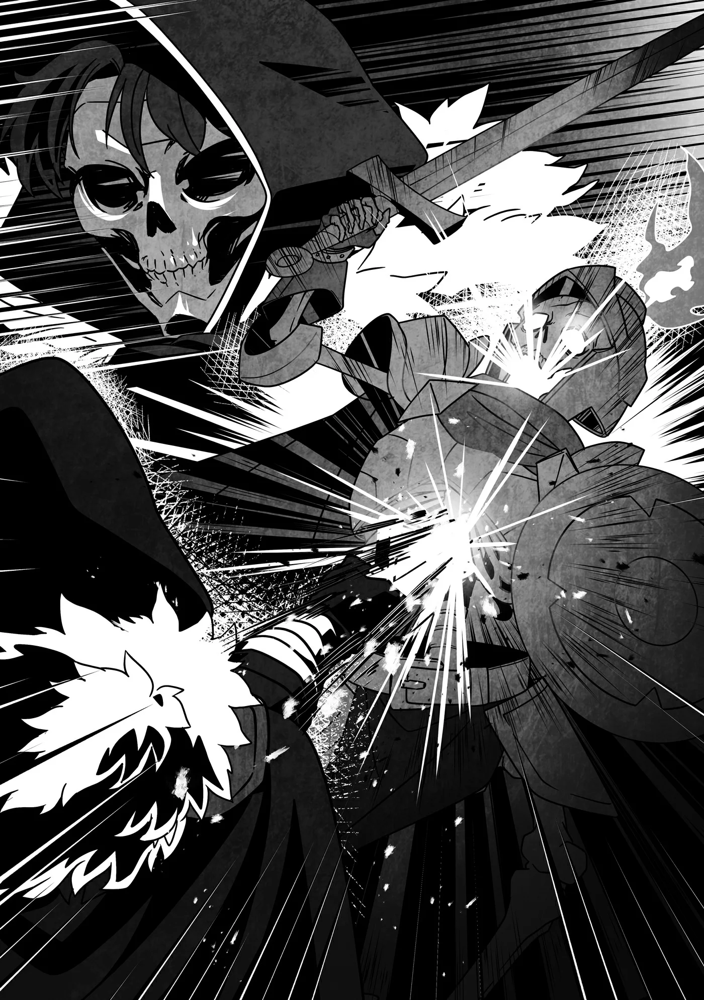

# Chương 304: Tập 13 Chương 1 - Quái Vật Kỳ Lạ và Phát Hiện Mới (4)

"Có vẻ đây là chỗ sâu nhất của cái hang này rồi."

Chúng tôi đã mất bao lâu để tới được đây? Tôi không rõ lắm, nhưng chắc hẳn cũng ngót nghét một khoảng thời gian kha khá. Chốc chốc chúng tôi lại đụng phải lũ Khô Lâu thông thường dọc đường đi, và điều đó càng khiến bước chân chẳng thể nhanh hơn được. Sự hiện diện của chúng, cộng thêm con Hạ Cấp Khô Lâu Pháp Sư và Khô Lâu Binh đụng độ lúc nãy, là bằng chứng rõ ràng cho thấy cái hang này chính là nơi phát sinh toàn bộ lũ Khô Lâu. Giờ khi đã đặt chân tới nơi sâu nhất, tôi càng tin chắc vào điều đó.

"Đây... là nơi tất cả bọn chúng sinh ra sao anh?" Rivul hỏi. Cậu ấy đứng cách sau lưng tôi một quãng ngắn đúng như lời tôi dặn. Chẳng ai biết thứ gì đang chực chờ ở đây, nên cẩn tắc vô ưu vẫn hơn.

"Chắc chắn là vậy rồi," tôi nói. "Không biết cậu có cảm nhận được không, Rivul, nhưng không khí ở đây nồng nặc chướng khí đấy."

Từ "chướng khí" có nhiều nét nghĩa, nhưng trong trường hợp này, ý tôi muốn nói tới lượng Ma Lực bị ứ đọng. Ai cũng biết rằng nếu Ma Lực cứ tiếp tục ngưng tụ và dồn ứ lại một chỗ, nó sẽ trở thành nguồn sinh sôi quái vật. Giới mạo hiểm giả chúng tôi thường xuyên chạm trán hiện tượng này, nên đây luôn là mối nghi ngờ đầu tiên trong những vụ việc tương tự. Và có vẻ mối hoài nghi của tôi đã hoàn toàn chính xác.

"Chướng khí..." Rivul lẩm bẩm. "Tôi biết ngay nơi này mang lại cảm giác khó chịu mà. Cơ mà trước giờ tôi chỉ nghĩ là do không gian ngột ngạt thôi."

"Phải có khả năng cảm nhận Ma Lực mới nhận ra được," tôi giải thích. "Dù sao trong người cậu cũng có một chút Ma Lực, nên nếu được rèn luyện, có khi cậu sẽ nắm bắt được bí quyết đấy."

"Tôi còn chẳng biết mình có Ma Lực nữa... Hóa ra cảm giác khó chịu ban nãy không đơn thuần chỉ là do ngột ngạt."

"Chắc là vậy," tôi đồng tình. "Dù sao đi nữa, chỉ cần tôi giải trừ hết chướng khí thì làng cậu sẽ không phải lo lũ Khô—"

Bất thình lình, một lượng Ma Lực cực lớn bắt đầu tụ lại ở ngay giữa khoảng đất trống.

"Chuyện gì thế này?!" Dường như ngay cả Rivul cũng nhận ra sự biến chuyển đó.

"Lùi lại, Rivul!" tôi hô lớn. "Quái vật đang thành hình rồi!"

Dù cách thức quái vật hình thành từ chướng khí khá giống với cách chúng được tạo ra trong mê cung, nhưng đây thực chất là hai hiện tượng tách biệt. Nói cho cùng, trong mê cung, một con quái vật có thể thực sự bất thình lình xuất hiện từ hư không. Dẫu vậy, cả hai trường hợp đều là cảnh tượng mà thường chỉ có mạo hiểm giả mới được chứng kiến, nên xét theo một khía cạnh nào đó, Rivul đang có cơ hội xem một màn trình diễn hiếm hoi—dù khó mà nói được việc tận mắt thấy quái vật thành hình có phải điều đáng để vui mừng hay không.

Rivul gật đầu trước mệnh lệnh của tôi rồi lùi tít ra sau. Chắc cậu ấy sẽ ổn thôi. Cái hang này hầu như chỉ có một lối đi độc đạo, nên khả năng có con Khô Lâu nào lẻn ra từ phía sau lưng chúng tôi là rất thấp. Tôi cũng đã dặn kỹ để Rivul chú ý canh chừng phía sau, nên nếu có con nào xuất hiện thật thì chí ít cậu ấy cũng câu kéo được chút thời gian.

Gác chuyện đó sang một bên, tôi tự hỏi con quái vật sắp xuất hiện sẽ là thứ gì. Nếu chỉ là một con Khô Lâu thông thường thì hụt hẫng thật—nhưng vì đối phó với nó rất dễ, nên đó là trường hợp hiếm hoi mà tôi thấy mừng nếu bị hụt hẫng. Cơ mà...

"Xem chừng vận may không mỉm cười với mình rồi..." tôi lẩm bẩm khi nhìn thấy thứ mà luồng Ma Lực ngưng tụ vừa tạo ra.

Con quái vật lồm cồm bò ra từ đám chướng khí tụ lại cùng những tiếng lách cách chẳng phải một con Khô Lâu bình thường—nó khoác trên mình một bộ giáp, tay lăm lăm khiên và kiếm.

Đứng sừng sững trước mặt chúng tôi là một con Khô Lâu Kỵ Sĩ.

◆◇◆◇◆

Keng!

Lưỡi kiếm của tôi bật nảy khỏi tấm khiên của con Khô Lâu Kỵ Sĩ. Tôi lùi lại một bước, né đường kiếm lóe lên vun vút và nới rộng khoảng cách với đối thủ.

Chết tiệt. Thế mà vẫn chưa ăn thua à?

Quái vật thường sơ hở nhất ngay sau khi vừa thành hình, nên tôi đã thử tung ra một đòn phủ đầu. Nhưng xem ra chẳng ăn thua. Tôi cũng không lấy làm ngạc nhiên; Khô Lâu Kỵ Sĩ vượt trội hơn hẳn mấy con Khô Lâu Binh tầm thường.

Có khi hồi đó mình nên tiến hóa thành một con như thế này cũng nên. Không biết lúc đó mình sẽ sở hữu sức mạnh ra sao, và nó sẽ khác biệt thế nào so với sức mạnh hiện giờ của mình nhỉ...

Đùa chút thôi—mục tiêu của tôi là trở lại làm con người cơ mà. Nhảy từ một bọc xương này sang một bọc xương khác khỏe hơn thì giải quyết được tích sự gì đâu. Rốt cuộc tôi vẫn chỉ là một bộ xương khô khiến người ta khiếp vía mỗi khi bước chân vào thị trấn.

Quay lại với vấn đề trước mắt—tôi nên xử lý chuyện này thế nào đây? Trong số các loài quái vật, Khô Lâu Kỵ Sĩ có công thủ rất toàn diện, và những con cầm khiên lại càng phiền toái hơn cả.

Tương tự Khô Lâu Binh, vũ khí và giáp trụ của Khô Lâu Kỵ Sĩ cũng rất đa dạng. Cơ thể—à nhầm, bộ xương của chúng—thường mang theo bất cứ thứ gì chúng từng dùng khi còn sống. Dĩ nhiên, chúng cũng có thể thay đổi trang bị bằng cách nhặt nhạnh bất cứ thứ gì vương vãi xung quanh.

Vì con Khô Lâu Kỵ Sĩ này thành hình cùng đầy đủ vũ khí và giáp trụ, tôi đoán ban đầu nó vốn là thi thể của một ai đó từng bỏ mạng ngay trong chính cái hang này.

Còn lý do tại sao lại là cái hang này thì cũng chẳng có gì lạ: trong quá khứ từng có rất nhiều quái vật biến nơi đây thành tổ ấm, chẳng hạn như đàn Goblin mà Rivul từng kể. Biết đâu trước đó từng có thứ gì đó còn mạnh hơn cả chúng ngụ tại đây, và một ai đó đến để tiêu diệt nó đã rơi vào bước đường cùng.

Người đó sau đó biến thành một con Khô Lâu, và sức mạnh thời còn sống đã biến kẻ này thành một cá thể đặc biệt hùng mạnh vẫn giữ nguyên kỹ năng dùng khiên. Khỏi phải nói cũng biết con quái vật này sẽ là một đối thủ khó xơi.

Với lũ Khô Lâu thông thường, những khúc xương chống đỡ cơ thể chúng đều lộ cả ra ngoài nên rất dễ nhắm đánh, nhưng một khi chúng khoác lên mình bộ giáp và dùng khiên chống đỡ các đòn tấn công thì câu chuyện lại hoàn toàn khác.

Dẫu vậy, điều đó cũng chẳng thay đổi được việc tôi phải làm. Vì đây đã là tận cùng của cái hang, tôi từng tính dốc hết Thần Lực ra để dùng sức mạnh áp đảo giải quyết dứt điểm rắc rối này...

Cơ mà thôi—tốt hơn hết là nên giữ lại làm lực lượng dự phòng. Chuyến ủy thác này chỉ thực sự kết thúc khi chúng tôi trở về an toàn, và chẳng ai biết được điều bất trắc gì có thể ập đến trên đường quay lại làng. Chúng tôi vẫn chưa rơi vào thế bí, nên trước mắt tôi cứ chiến đấu như bình thường đã.

Tôi thề là tôi không hề bủn xỉn đâu đấy nhé.

◆◇◆◇◆

Hiện tại, tôi đang nắm trong tay ba quân bài: Ma Lực, Khí Lực và Ma Khí Dung Hợp Thuật. Mấy món quen thuộc ấy mà.

Tôi còn một quân át chủ bài giấu trong tay áo là Thần Lực, thứ tôi sẵn sàng rút ra không chút do dự nếu thấy cần thiết, nhưng tôi vẫn muốn hạ gục con Khô Lâu Kỵ Sĩ mà không phải dùng đến nó. Tôi quyết định giữ lại lá bài đó và tấn công bằng ba quân bài kia.

Khi kế hoạch tổng thể đã thành hình trong đầu, tôi bắt đầu bằng việc truyền Ma Lực vào thanh kiếm—và dĩ nhiên là cả cường hóa cơ thể nữa. Đoạn, tôi lao vút về phía trước.

Tôi thu hẹp khoảng cách nhanh hơn lần thử trước. Con Khô Lâu Kỵ Sĩ, có lẽ vì đã cảnh giác hơn, liền lùi một chân về sau để trụ vững rồi nâng khiên lên chống đỡ, che chắn tối đa phần cơ thể của mình.

Ừ, xem chừng những chiêu thức thông thường chẳng ăn thua ở đây rồi.

Một lần nữa, cú chém bổ đầu của tôi lại bị con Khô Lâu Kỵ Sĩ chặn đứng. Kế đó, nó tiến lên như thể đã đoán trước được rằng tôi sắp sửa nới rộng khoảng cách lần nữa.

Dẫu đòn đánh của tôi nhanh hơn, nhưng nó vẫn chỉ là sự lặp lại của đòn đầu tiên. Tuy người ta vẫn bảo Khô Lâu Kỵ Sĩ không hề có suy nghĩ hay cảm xúc, nhưng điều đó không có nghĩa là chúng không thể học hỏi—ngay cả một sinh vật như thế cũng có thể mạnh lên nhờ kinh nghiệm. Vừa rồi, nó đã ghi nhớ đòn chém của tôi và nghĩ ra đối sách ngay tại trận.

Dĩ nhiên, đâu phải chỉ mỗi mình nó biết học hỏi và tiến bộ.

Tôi đã nắm khá rõ thực lực của con Khô Lâu Kỵ Sĩ từ nhát chém đầu tiên, và tôi cũng chẳng ngốc đến mức đặt cược tất cả vào đòn đánh thứ hai. Vậy tại sao tôi lại lặp lại y hệt đòn tấn công ban nãy?

Là vì tôi muốn giới hạn phạm vi chuyển động của con Khô Lâu Kỵ Sĩ.

Thông thường, cùng một đòn tấn công sẽ gợi ra cùng một kiểu phản xạ. Điều này không chỉ đúng với sinh vật sống mà còn áp dụng cho cả lũ quái vật Undead như Khô Lâu. Rất khó để kiểm soát hoàn hảo phản xạ của chính mình. Việc khổ luyện võ nghệ cho phép người ta sửa đổi thói quen thông qua những bài tập vô tận và dần khắc phục những khiếm khuyết đó, nhưng lũ Khô Lâu thì làm gì có chế độ luyện tập hằng ngày.

Dĩ nhiên, việc sở hữu thân thể chỉ toàn xương xẩu cho phép chúng thực hiện những cử động mà người bình thường không tài nào làm nổi, nên việc đoán biết phản ứng của chúng sẽ ra sao chẳng phải chuyện dễ dàng gì, kể cả khi bạn biết trước đòn sắp tới. Chẳng hạn, lũ Khô Lâu có thể xoay tròn cổ và cánh tay hay ngửa gập eo ra sau tới mức trông như bị gãy làm đôi—nói cách khác, toàn là những trò tôi vẫn làm mỗi khi không có ai nhìn.

Thế nhưng, số Khô Lâu tôi từng giao chiến có gom lại dùng cho cả đời cũng chẳng hết—chưa kể bản thân tôi cũng từng làm một con Khô Lâu trong suốt một thời gian dài. Tôi hiểu rõ năng lực và từng đường đi nước bước của chúng như lòng bàn tay.

Chính vì vậy, tôi biết tỏng rằng sau khi con Khô Lâu Kỵ Sĩ dùng khiên chặn đòn của tôi, nó sẽ áp sát lại gần hơn để tung ra một cú đâm... và nó sẽ di chuyển nhanh hơn hẳn lúc trước.

Dù cơ thể chẳng có gì ngoài xương xẩu, các quy luật vật lý vẫn phát huy tác dụng. Để gia tăng tốc độ, tôi biết con Khô Lâu Kỵ Sĩ sẽ phải đạp mạnh chân xuống đất khi tiến lên nhằm lấy đà. Bằng không, nó sẽ chẳng bao giờ đuổi kịp tôi, dù tôi chỉ đang bước lùi.

Khô Lâu Kỵ Sĩ khoác lên mình bộ giáp là bởi nó mạnh hơn nhiều so với lũ Khô Lâu thông thường. Điều đó đồng nghĩa với việc nó sẽ phải dồn một lực cực lớn vào bước chân để đẩy cơ thể lao về phía trước.

Nhưng một cái bẫy đang chực chờ nó.

Và tôi không hề nói theo nghĩa bóng—mà là một cái hố bẫy theo đúng nghĩa đen.

Ngay đúng khoảnh khắc con Khô Lâu Kỵ Sĩ đặt chân xuống, tôi liền dùng thanh kiếm đã truyền Ma Lực khoét sâu khoảng đất mà nó sắp dẫm lên.

Tôi vẫn chưa thực sự quen với kỹ thuật này nên chưa chắc chắn phải truyền bao nhiêu Ma Lực, nhưng tôi cũng đủ thành thạo để tạo ra một cái hố cục bộ sâu tới tận cẳng chân nó. Mặt đất trong hang chỉ toàn đất bùn và trầm tích, càng khiến mọi chuyện dễ dàng hơn.

Quả nhiên, con Khô Lâu Kỵ Sĩ dẫm hụt chân vào hố bẫy, loạng choạng mất thăng bằng cùng những tiếng lách cách rộn ràng. Dù vậy tôi cũng phải khen ngợi nó—nó không hề bị mất thăng bằng quá nặng. Ngay khi cảm nhận được độ sâu của cái hố, nó liền đổi thế đứng và điều chỉnh lại lực dồn vào chân, rồi lập tức dùng chân còn lại làm điểm tựa để bật người thoát ra.

Thế nhưng, chỉ một khoảnh khắc ngắn ngủi ấy cũng là quá đủ cơ hội cho tôi.

Dù trước đó vừa bước lùi, nhưng đây vốn là mục đích tôi nhắm tới ngay từ đầu, nên tôi lập tức chuyển thế sang tấn công. Vận dụng Ma Lực, tôi làm cứng lớp đất dưới chân để tạo điểm bật đà vững chãi rồi lao thẳng về phía con Khô Lâu Kỵ Sĩ.

Dù trông như bị tình huống này làm cho bất ngờ, con Khô Lâu vẫn kịp giơ khiên lên đón đỡ đòn tấn công của tôi. Biết chắc nó không cầm khiên đủ vững, tôi liền truyền cả Ma Lực lẫn Khí Lực vào thanh kiếm.

Việc tiếp dẫn năng lượng vào vũ khí bằng Ma Khí Dung Hợp Thuật vẫn còn khá khó khăn, nhưng duy trì trạng thái đó thì đã dễ dàng hơn trước rất nhiều. Tôi vung một đường chém quét ngang lưỡi kiếm nhắm thẳng vào tấm khiên của con Khô Lâu Kỵ Sĩ—và ngay khoảnh khắc va chạm, một vụ nổ bùng lên thổi bay tấm khiên, cuốn phăng luôn cả cánh tay xương xẩu của nó.

Cảm giác của tôi về việc nó cầm khiên không chắc đã hoàn toàn chính xác, và giờ thì con Khô Lâu Kỵ Sĩ đã mất đi một lớp phòng hộ. Dù vậy, nó vẫn còn bộ giáp—và cả thanh kiếm nữa.

Lúc này, tôi đứng trước hai lựa chọn: thừa thắng xông lên dồn dập tấn công hoặc lùi về khoảng cách an toàn—nhưng tôi đã sớm đưa ra quyết định. Nếu lùi lại, nó sẽ lại nghĩ ra một đối sách mới nào đó. Con Khô Lâu Kỵ Sĩ này chắc chắn có đủ khả năng học hỏi để làm điều đó.

Đã vậy thì tôi càng phải tăng cường công thế, áp sát vào cự ly gần hơn nữa. Tôi nhận ra lựa chọn của mình hoàn toàn đúng đắn khi nhìn thấy một kẽ hở trên bộ giáp của con Khô Lâu Kỵ Sĩ, vừa đủ lớn để đâm lưỡi kiếm vào. Lấp ló qua khe hở chính là viên Ma Tinh đóng vai trò làm hạch tâm của con Khô Lâu. Một cú đâm đơn thuần sẽ không thể tạo thành vết thương chí mạng, nhưng nếu tôi đánh trúng thứ đó thì...

Không chút do dự, tôi đâm thẳng thanh kiếm vào khe hở, nhắm thẳng tới viên Ma Tinh. Tôi vẫn đang tiếp tục truyền Ma Lực và Khí Lực, nên ngay khoảnh khắc mũi kiếm chạm vào, một vụ nổ phát ra từ bên trong bộ giáp của con Khô Lâu Kỵ Sĩ.

Toàn bộ bộ giáp đã giam chặt năng lượng bên trong, khiến nó chỉ có thể va đập dội ngược liên hồi. Một lượng nhỏ năng lượng tìm được đường thoát ra ngoài, nhưng lại là qua khoảng trống ở cổ—một diễn biến quá đỗi thuận lợi cho tôi.

Năng lượng từ vụ nổ xé toạc con Khô Lâu Kỵ Sĩ thành từng mảnh vụn ngay bên trong bộ giáp. Ở bên ngoài, hộp sọ và cột sống của nó nứt toác rồi vỡ vụn ở nhiều chỗ. Cuối cùng, viên Ma Tinh của nó bắn vọt ra như một viên đạn pháo, đập mạnh vào vách hang rồi lăn lông lốc trên nền đất trước khi dừng lại.

Tôi biết mình đã giành chiến thắng, nhưng cảm giác đó chỉ thực sự ùa đến khi Rivul hò reo chạy lại gần.

"Anh Rentt! Anh làm được rồi!"

