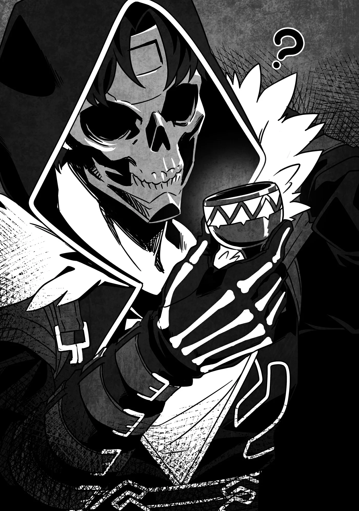

# Chương 305: Tập 13 Chương 1 - Quái Vật Kỳ Lạ và Phát Hiện Mới (5)

"Giờ thì sẽ không còn con Khô Lâu nào tấn công làng chúng tôi nữa, đúng không anh?"

Rivul trông có vẻ hơi bất an. Cũng chẳng có gì ngạc nhiên khi đây là mối bận tâm hàng đầu đối với làng của cậu ấy. Nỗi bất an đó hẳn bắt nguồn từ chuyện cậu ấy không rành về tập tính quái vật cũng như cách chúng sinh ra, nên chưa đủ hiểu biết để chắc chắn liệu lũ Khô Lâu đã thực sự bị dẹp yên hay chưa.

Chuyện đó cũng khó trách; ngay cả phần lớn mạo hiểm giả cũng chỉ nắm được những nét đại cương về mấy thứ này. Thế giới vẫn còn vô vàn điều chưa biết về quái vật, và những hiểu biết ít ỏi mà chúng tôi có được thực chất chỉ là một mớ giả thuyết thay đổi như cơm bữa, chứ chưa hẳn là sự thật xác thực.

Ngay cả khi có những thiên tài như Lorraine ngày đêm nghiên cứu nghiêm túc—khoan, liệu tôi có thực sự gọi đó là nghiêm túc được không khi một bên cô ấy bày sẵn trà bánh rồi thỉnh thoảng lại chợp mắt một giấc? Không, ừ thì, chắc như thế vẫn tính là nghiêm túc—thì hiểu biết của chúng tôi về quái vật vẫn còn đầy rẫy những bí ẩn.

Nhiều mạo hiểm giả coi thường mọi hình thức học hỏi kiến thức và chẳng bao giờ buồn bận tâm ghi nhớ chi tiết về mấy chuyện đó. Việc các mạo hiểm giả ở Maalt có trình độ hiểu biết tương đối tốt thực chất là nhờ Wolf luôn coi trọng tri thức. Ngay cả những tân binh trẻ tuổi cũng không hề lơ là ở khía cạnh này, bởi tôi cũng đã truyền dạy cho họ rất nhiều điều. Dẫu vậy, xét trên bình diện chung của giới mạo hiểm giả, họ chỉ là ngoại lệ chứ không phải lẽ thường.

Bỏ qua mấy chuyện đó thì với tình hình hiện tại, tôi nắm đủ thông tin để giải thích cho Rivul hiểu.

"Chướng khí tích tụ ở đây vẫn còn. Vẫn chưa an toàn đâu."

"Ý anh là...?"

"Nếu chúng ta cứ mặc kệ nó, sẽ lại có thêm Khô Lâu xuất hiện."

"Nhưng chuyện đó...!" Nét mặt của Rivul lộ rõ vẻ tuyệt vọng.

Có điều, tôi đâu có ý định để mặc tình hình như thế. "Đừng hoảng, Rivul," tôi trấn an cậu ấy. "Tôi bảo là 'vẫn chưa' mà, đúng chứ? Chuyện này cứ để tôi xử lý."

"Ồ... Phải rồi. Tôi xin lỗi vì đã hoảng lên như vậy. Nhưng anh định xử lý thế nào cơ...?"

Một người bình thường hẳn sẽ chẳng có manh mối nào về cách xua tan chướng khí, nhưng thực chất quy trình này cũng không quá đỗi phức tạp. Tôi lục lọi trong túi ma thuật rồi lôi ra một món đồ nhất định.

"Đó là... một chiếc bình sao? Đựng gì trong đó thế anh?" Rivul chăm chú quan sát chiếc bình được chế tác tinh xảo.

"Nước Thánh," tôi giải thích. "Các tổ chức tôn giáo ở Maalt sẽ đưa nó cho cậu để đổi lấy tiền quyên góp."

Nói thật thì bảo là mua đứt cho rồi thì đúng hơn, nhưng các giáo hội cứ thích gọi cái kiểu giao dịch ấy là "quyên góp". Rõ ràng là một trò kinh doanh mánh khóe—dù đời nào họ bắt quả tang được việc tôi dám nói toẹt ra đó là "mánh khóe" trước mặt họ.

Dẫu vậy, tôi cho rằng dùng từ "quyên góp" cũng không hẳn là sai hoàn toàn. Một số cá nhân có nhiều đóng góp hoặc lập công phụng sự giáo hội có thể được giảm bớt số tiền quyên góp, nên đây không phải là mức giá cố định. Dĩ nhiên, điều đó cũng đồng nghĩa với việc các giáo hội có thể đòi những khoản tiền cắt cổ từ những kẻ mà họ không vừa mắt.

Trong trường hợp của tôi, ai cũng sẽ nghĩ rằng thân phận quái vật sẽ khiến tôi chẳng đời nào rớ tới được giọt Nước Thánh nào bất kể tôi có làm từ thiện hào phóng đến đâu, nhưng tôi lại nắm trong tay một đòn bẩy đầy sức nặng với Giáo Hội Lobelia nhờ mối quan hệ với một người quen tên là Nive. Nhờ mối dây liên kết đó, tôi có thể mua dự trữ Nước Thánh từ chỗ họ với giá rẻ bèo.

Bản thân Giáo Hội Lobelia chẳng có điểm nào khiến tôi ưa nổi, nhưng Nước Thánh của họ lại có chất lượng tuyệt hảo, thành ra tôi vẫn thường bấm bụng mua của họ.

Ngoài ra, Sơ Lillian của Giáo Hội Đông Thiên đã lấy lại được sức mạnh của một Thánh Giả, nên phẩm cấp Nước Thánh từ chi nhánh của họ tại Maalt có lẽ sẽ sớm được cải thiện trong thời gian tới. Suốt một thời gian tôi vẫn thỉnh thoảng mua của họ, có điều hiệu lực của nó hơi yếu, thế nên tôi rất mong chờ vào sự thay đổi này.

Một khi Nước Thánh của họ tốt hơn, nếu tôi được hưởng chút ưu đãi giá người quen thì tốt biết mấy, nhưng tôi cũng chẳng định gượng ép chuyện đó làm gì.

Ngay cả với Giáo Hội Lobelia, tôi chỉ được giảm giá vì họ không muốn làm phật lòng tôi mà thôi. Tôi thực sự rất tò mò không biết Nive nắm thóp được bí mật đen tối gì của họ, nhưng muốn tìm hiểu thì đồng nghĩa với việc tôi phải gặp lại cô ấy, mà đó lại là điều tôi ngán nhất trên đời. Nói thật thì tôi thà mù tịt về chuyện đó cho đến hết phần đời còn lại thì hơn.

Rivul dễ dàng chấp nhận lời giải thích của tôi về chiếc bình. "Ồ, Nước Thánh," cậu ấy nói. "Thỉnh thoảng các thương nhân lữ hành cũng mang nó tới thị trấn. Cứ mỗi năm một lần vào ngày hội thu hoạch, chúng tôi lại rảy nó xung quanh làng."

"Để xua đuổi quái vật chứ gì?"

"Vâng. Có điều, theo tôi hiểu thì đó cũng chỉ là biện pháp tạm thời thôi..."

"Đúng vậy," tôi tán thành. "Nó phát huy tác dụng rất tốt, nhưng rồi cũng sẽ bốc hơi hết thôi. Loại nào có hiệu lực đặc biệt mạnh thì có thể duy trì được vài tháng, nhưng dùng như vậy thì thâm hụt túi tiền nhanh lắm."

Thu nhập của một ngôi làng nhỏ không thể kham nổi việc sử dụng Nước Thánh thường xuyên làm thuốc xua đuổi quái vật. Cái tục lệ mỗi năm một lần của họ nghe như xuất phát từ một truyền thống lâu đời mà họ vẫn gắn bó như một phần nghi thức trong các lễ hội thu hoạch hay những dịp tương tự.

Ngày nay, người ta có thể dùng nhiều thứ khác nhau làm thuốc xua đuổi quái vật, nhưng theo lời Lorraine thì trong quá khứ, Nước Thánh là lựa chọn duy nhất. Nói ngắn gọn thì Thần Lực là tất cả những gì con người thời đó có thể nương tựa để bảo vệ bản thân trước lũ quái vật.

Đương nhiên Ma Lực và Khí Lực vào thời đó cũng đã tồn tại, nhưng mấu chốt nằm ở bản chất vốn có của Thần Lực. Ma Lực và Khí Lực là những nguồn lực tiềm ẩn mà những ai sở hữu có thể cảm nhận và trui rèn để nâng cao năng lực thực chiến, nhưng Thần Lực thì khác. Nó được các vị thần hoặc tinh linh ban tặng như một ân phước, và người ta có thể sử dụng ngay thời khắc nhận được nó.

Lẽ dĩ nhiên Thần Lực cũng có thể nâng cao nhờ nỗ lực, nhưng tôi dám chắc rằng trong quá khứ xa xôi, khả năng thuần túy để chống lại quái vật mà không cần tới lý thuyết, logic hay công sức tập luyện như vậy quan trọng hơn thời nay gấp bội phần.

Xét cho cùng, đó cũng là lý do vì sao những người sở hữu Thần Lực được các tổ chức tôn giáo tôn sùng làm Thánh Giả.

"Nhưng mà, anh Rentt, rốt cuộc anh định dùng số Nước Thánh đó như thế nào?"

"Nước Thánh có hiệu quả cực cao trong việc xua tan chướng khí. Đúng là nó không duy trì được lâu—đòi hỏi nó giữ an toàn cho cả làng quanh năm suốt tháng thì hơi quá sức—nhưng lại cực kỳ thích hợp để xử lý một lượng chướng khí tích tụ dày đặc đủ để sinh ra Khô Lâu."

Thực ra thì tôi cũng có thể dùng Thần Lực của mình thay cho Nước Thánh, nhưng vì Thần Lực hữu ích hơn trong chiến đấu nên tôi muốn để dành. Nếu Nước Thánh cũng lo xong xuôi việc này thì chẳng còn gì bằng.

Dẫu vậy, nét mặt Rivul vẫn thoáng chút ngờ vực.

"Cứ nhìn đi," tôi bảo. "Hừm. Rảy vào đâu bây giờ nhỉ...? Con Khô Lâu Kỵ Sĩ sinh ra ở tầm... chỗ này, đúng không?"

Rivul gật đầu. "Vâng, tôi nghĩ là quanh chỗ đó đấy."

"Vậy thì thế này là được rồi."

Tôi bắt đầu rảy Nước Thánh.

◆◇◆◇◆

Chẳng cần nói cũng biết, tôi phải tính toán cẩn thận lượng Nước Thánh mình dùng. Dù sao nó cũng không hề rẻ—nhất là đồ lấy từ Giáo Hội Lobelia.

Nói thì nói vậy, nó cũng không phải thứ đắt đỏ nhất trên đời, và nhờ ưu đãi của Nive mà tôi mua được rẻ hơn giá thị trường. Nhưng nếu cứ vung tay quá trán thì tiền công của ủy thác này sẽ bay sạch, thậm chí còn khiến tôi lỗ vốn so với trước khi nhận việc.

Trái lại, nếu quá bủn xỉn Nước Thánh thì sẽ không đạt được hiệu quả mong muốn lên lượng chướng khí còn vương lại, kéo theo nguy cơ lũ Khô Lâu sẽ lại sinh ra về sau. Tôi phải căn chỉnh thật cẩn thận để dùng một lượng vừa đủ...

Để đảm bảo điều đó, tôi cần xác định xem chướng khí tích tụ dày đặc nhất ở đâu. May mắn thay—hay nói đúng hơn là trong cái rủi có cái may?—tôi đã kịp nhìn thấy vị trí đó lúc con Khô Lâu Kỵ Sĩ thành hình.

Chính xác khu vực đó là nơi chướng khí tụ lại, nên nếu tôi tập trung thanh tẩy vào chỗ ấy thì sẽ đạt hiệu quả cao nhất. Nếu ban nãy không tận mắt chứng kiến con Khô Lâu Kỵ Sĩ sinh ra, tôi sẽ phải tốn công điều tra bằng cách đi vòng quanh và săm soi kỹ lưỡng từng ngóc ngách trong hang.

Dĩ nhiên, một người sở hữu ma nhãn như Lorraine thì có thể định vị chính xác nguồn phát chướng khí ngay tắp lự. Có điều những người như vậy rất hiếm, và kẻ biết phát huy tối đa tiềm năng ma nhãn của mình lại càng hiếm hơn. Điều đó càng làm nổi bật sự hữu dụng của Lorraine.

Dù thế nào đi nữa, lúc này tôi chẳng thể bận tâm đến chuyện đó được, tôi còn cả đống chướng khí cần thanh tẩy. Tôi mở nút bình Nước Thánh rồi bắt đầu rảy từng lượng nhỏ ra xung quanh.

Cảm giác khó chịu đè nặng trong tôi do lượng chướng khí tích tụ dần dần tan biến. Ngay cả Rivul, người gần như chẳng có chút Ma Lực nào, dường như cũng nhận ra sự biến chuyển này.

"Không biết có phải do tôi tưởng tượng không, nhưng dường như không khí quanh đây... nhẹ nhõm hơn rồi thì phải?"

"Đó là vì chướng khí đang tan biến đấy," tôi giải thích. "Được rồi, thế là xong bước đầu. Giờ chỉ cần làm thêm một lượt trừ tà ngắn nữa..."

Lần này, thay vì rảy Nước Thánh ra bốn phương tám hướng, tôi nhỏ vài giọt lên thanh kiếm của mình rồi vừa đi vòng quanh hang vừa vung nhẹ. Cách này sẽ gạt bỏ mọi tàn dư chướng khí còn vương vất. Dù lượng chướng khí sót lại không đủ để sinh ra quái vật, nhưng cứ để mặc thì theo thời gian nó sẽ lại tích tụ dần, nên bước này là cần thiết để đảm bảo công việc được xử lý triệt để.

Nếu cứ tiếp tục rảy Nước Thánh khắp nơi thì lãng phí không cần thiết, đó là lý do tôi dùng tới thanh kiếm của mình.

Sau một hồi làm như vậy, bầu không khí xung quanh đã được thanh tẩy hoàn toàn. Thậm chí tôi còn có cảm giác luồng không khí ẩm ướt đặc trưng của hang động cũng tan biến theo—dù đó chắc chắn chỉ là do tôi tự tưởng tượng ra mà thôi.

Thế là xong xuôi.

"Sẽ không còn con Khô Lâu nào tới quấy rầy các cậu nữa đâu," tôi nói rồi ngừng lại một nhịp. "Có lẽ vậy."

Nét mặt Rivul lộ rõ vẻ nhẹ nhõm. "Thật sao anh?!"

"Thật đấy. Có điều, tôi ngờ rằng cái hang này là nơi chướng khí rất dễ tích tụ, nên tôi khuyên làng cậu cứ mỗi năm nên thuê mạo hiểm giả tới rảy Nước Thánh xung quanh một lần. Dùng loại rẻ tiền là được rồi."

"Tôi hiểu rồi... Về tới làng tôi sẽ báo lại với Trưởng thôn," Rivul nói, rồi bỗng loạng choạng ngã chúi về phía trước kèm theo một tiếng kêu. "Á!"

"Ối kìa. Cậu làm cái gì đấy? Đừng bảo là cậu đang nhảy cẫng lên vì mừng rỡ nhé."

"Không, ừm... tôi vấp phải thứ gì đó."

"Thế à? Để tôi xem nào..."

Quan sát kỹ hơn, tôi nhận thấy Rivul nói đúng: có một vật gì đó nhô lên khỏi mặt đất gần chân cậu ấy. Hẳn là chân cậu ấy đã vướng phải nó.

Tò mò, tôi đào nó lên. "Đây là... một chiếc cốc à?"

"Trông giống thật," Rivul đồng tình. "Thứ đó làm gì ở một nơi như thế này nhỉ?"

Chiếc cốc khá nhỏ và ánh lên một sắc mờ xỉn. Trông nó chẳng có vẻ gì là hàng cao cấp.

"Tôi đoán nó có thể thuộc về mạo hiểm giả hay chiến binh nào đó từng tới đây trước đây—thậm chí có khi là của chính con Khô Lâu Kỵ Sĩ tôi vừa giao chiến. Vị trí của nó ở đây hoàn toàn trùng khớp."

"Ồ, ra vậy. Nghe cũng có lý đấy. Có điều trông nó chẳng có vẻ gì là đáng giá cả."

"Biết đâu được đấy—đem đánh bóng lên có khi nó lại sáng loáng ấy chứ. Dù sao thì tôi cũng sẽ mang nó về Maalt để thẩm định. Nếu hóa ra là đồ đáng tiền thì tôi có thể bán kiếm chút đỉnh."

"Nghe anh nói vậy làm tôi nhớ ra anh thực sự là một mạo hiểm giả, anh Rentt à. Nói thật thì cảm giác đó khá mới mẻ đấy. Ban nãy trông anh có vẻ chẳng mấy bận tâm đến tiền bạc."

"Này nhé, đừng nói thế chứ. Tôi cũng mê tiền như bao người khác thôi. Tôi thích nhất là nhặt được những kho báu như thế này đấy."

"Nhìn cái mã của nó thế kia thì tôi chẳng gọi đó là kho báu được đâu..."

Rivul nhìn chiếc cốc như thể nó chẳng qua chỉ là một món đồ dùng ăn uống cáu bẩn—mà khả năng cao đúng là như vậy thật, nên tôi cũng chẳng thể trách cậu ấy được.

"Thôi, dù sao thì việc của chúng ta ở đây cũng xong rồi," tôi nói. "Quay về làng thôi."

"Vâng, về thôi anh. Tôi muốn báo tin vui này cho mọi người càng sớm càng tốt. Chắc chắn khi chúng ta về tới nơi, họ sẽ chuẩn bị sẵn món gì đó ngon lành cho xem. Làng vẫn chưa tái thiết xong, nhưng việc săn bắn thì vẫn tiến triển rất thuận lợi."

"Tôi mong chờ đấy."

Chúng tôi vừa trò chuyện vừa rảo bước về phía lối ra của hang. Rồi bất chợt, một suy nghĩ lóe lên trong đầu tôi.

"Con Khô Lâu Kỵ Sĩ đó mạnh bất thường..."

Khô Lâu Kỵ Sĩ có sự chênh lệch rất lớn về mặt sức mạnh. Đương nhiên ngay cả con yếu nhất cũng vượt xa Khô Lâu thông thường, nhưng con tôi vừa chạm trán tuyệt đối không phải dạng tép riu.

Dẫu vậy, tôi đã giữ vững cảnh giác và hạ gục được nó, nên tôi cho rằng cuối cùng thì mọi chuyện vẫn diễn ra êm đẹp.

"Có chuyện gì thế anh Rentt?" Rivul tò mò hỏi khi thấy tôi đột ngột dừng bước.

Tôi vội vàng cất bước trở lại. "Không, chẳng có gì đâu. Tôi chỉ đang nghĩ mình may mắn thế nào khi hạ được con Khô Lâu Kỵ Sĩ đó thôi."

Cứ thế, tôi và Rivul cùng nhau quay trở về làng.

◆◇◆◇◆

Sau khi Rentt và Rivul rời đi, hai bóng người bỗng xuất hiện ở nơi sâu nhất của hang động.

"Tốn bao công sức mà cuối cùng lại kết thúc thế này à?" một kẻ lên tiếng, giọng đầy vẻ mỉa mai. "Chẳng thu lại được tích sự gì?"

Giọng của kẻ kia nghẹn ứ căm hận. "Ai mà ngờ lại có mạo hiểm giả xuất hiện vào đúng lúc này cơ chứ. Ngay từ đầu, chẳng phải tôi đã bảo cậu hạn chế tối đa tiếp xúc với bên ngoài, đừng có quấy rầy dân làng rồi sao?"

"Và tôi đã làm chuẩn chỉnh y như thế rồi đấy, cảm ơn nhiều nhé. Đóng giả làm thương nhân lữ hành phiền phức muốn chết, nhưng tôi đã hoàn thành mọi việc cậu yêu cầu rồi. Chuyện này đâu phải lỗi của tôi, nên cậu tha cho tôi được chưa?"

Một thoáng im lặng. "Cậu nói đúng. Xin lỗi."

"Thế mới được chứ. Biết nhận lỗi là một trong những điểm tốt của cậu đấy. Xem này, cậu chỉ xui xẻo thôi. Cậu cũng thấy trận chiến đó diễn ra thế nào rồi. Hiếm khi nào có mạo hiểm giả thực lực cỡ đó xuất hiện ở cái chốn khỉ ho cò gáy này. Mà nếu có bị hỏng việc ở đâu đó thì chỗ này cũng chẳng sao. Dù gì nó cũng chỉ là một điểm dự phòng thôi mà."

"Phải, nhưng đây lại là nơi tôi thu được kết quả tốt nhất... Tôi đã thúc đẩy tiến hóa lên được tận Khô Lâu Kỵ Sĩ. Thế mà giờ lại làm mất chiếc cốc."

"Đó là 'Tiến Hóa Bản Thể' sao? Trông cứ như quái vật sinh ra bình thường vậy."

"Cậu nói cái gì thế? Chẳng phải cậu đã thấy phôi gốc chuyển hóa thành chướng khí rồi tụ lại thành hình Khô Lâu Kỵ Sĩ sao? Trông nó giống như sinh ra tự nhiên vì chiếc cốc đã can thiệp thúc đẩy cả quá trình đó, nhưng mà—"

"Hừ, dẹp mấy thứ phức tạp đó đi. Tôi hiểu nôm na là cậu đã làm xong việc cần làm rồi, đúng chứ?"

"Đại khái là vậy. Tiếc là nó chưa thể đạt tới giai đoạn cuối cùng, nhưng kết quả hiện tại cũng đủ dùng rồi. Mất chiếc cốc đúng là xót thật, nhưng bọn họ có đem đi thẩm định cũng chẳng moi được gì đâu. Xong việc ở đây rồi. Đi thôi."

"Biết rồi, biết rồi. Tiếp theo đi đâu? Welfia à?"

"Ở đó có sẵn nguồn nguyên liệu phong phú đang chờ thu hoạch. Chắc chắn sẽ thúc đẩy nghiên cứu của tôi tiến xa."

"Cậu thì lúc nào cũng nghiên cứu này nọ. Sao cũng được. Tôi nhận lệnh phải đi theo cậu, nên đành chịu thôi."

"Vậy thì bớt cằn nhằn đi."

"Biết rồi, biết rồi."

Hai bóng người biến mất, không để lại bất kỳ dấu vết nào.
