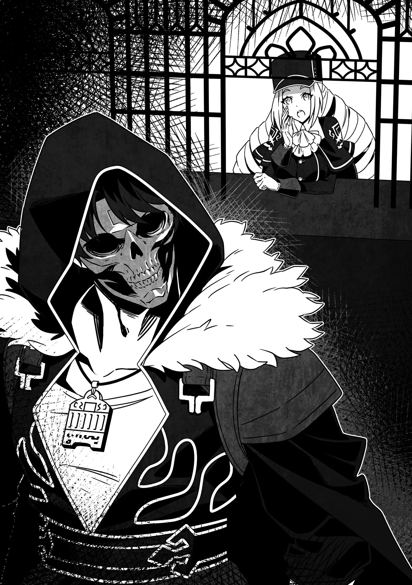

# Chương 307: Tập 13 Chương 2 - Báo Cáo và Một Ủy Thác từ Thợ Rèn (1)

"Tôi muốn báo cáo hoàn thành ủy thác," tôi nói. "Bây giờ cô có tiện không?"

Sau khi trở về Maalt, tôi đứng đối diện với Sheila tại quầy tiếp tân của Hội Mạo Hiểm Giả.

"Dĩ nhiên rồi," cô ấy đáp. "Để tôi xem nào, ủy thác anh nhận là... À, ủy thác từ Làng Crask. Anh đã về tới đây rồi, chắc là mọi chuyện đều êm xuôi chứ?"

"Chuyện là... thế này..."

Ủy thác thì chắc chắn đã hoàn thành—điều đó không phải bàn cãi. Có điều đã xảy ra kha khá chuyện khác thường, nên tốt nhất là tôi cứ giải thích ngọn ngành thì hơn.

"Có chuyện gì xảy ra sao anh?" Sheila hỏi. Quãng thời gian làm việc tại Hội xem chừng đã rèn cho cô ấy sự nhạy bén đủ để nhận ra chút khác lạ trong giọng điệu của tôi, dẫu cô ấy trông cũng chẳng có vẻ gì là lo lắng quá mức.

"Thì ủy thác ở Làng Crask vốn là tiêu diệt tầm năm con Khô Lâu xuất hiện quanh làng. Phần việc đó thì diễn ra khá suôn sẻ."

"Còn có chuyện gì phát sinh nữa sao?"

"Đúng vậy. Đúng là có năm con Khô Lâu lảng vảng thật, nhưng sau đó tôi phát hiện thêm những con khác nữa. Lần mò điều tra một hồi, tôi nhận ra chúng không phải quái vật đi lạc ngẫu nhiên, mà thực chất gần Làng Crask có một ngọn nguồn sản sinh ra Khô Lâu."

"Nhiều mạo hiểm giả sẽ yêu cầu hủy ủy thác ngay khi phát hiện ra điều đó—nhưng tôi đoán là anh không làm vậy đúng không, anh Rentt?"

Sheila bảo là "nhiều", nhưng theo tôi ước tính thì con số đó phải hơn phân nửa—chủ yếu là các tổ đội Đồng Cấp, những người mà bất cứ thứ gì vượt quá năm con Khô Lâu đều có thể trở thành mối đe dọa thực sự.

Khi chạm trán một điểm sinh quái đang hoạt động, người nào đủ mạnh để có cơ hội dẹp bỏ nó—thậm chí một nhóm mạo hiểm giả Thượng Đồng Cấp là đã làm được—thường sẽ không hủy ủy thác. Không phải họ liều lĩnh hay tự cao tự đại, mà bởi những ổ sinh quái vật là hiện tượng nguy hiểm cần phải dọn dẹp càng sớm càng tốt. Nếu cứ để mặc vài ba tháng, tệ nhất là người ta có thể đột ngột phải đối mặt với hàng trăm con Khô Lâu. Dĩ nhiên chuyện đó hiếm khi xảy ra, nhưng không phải là không thể.

Thành ra khoảng một nửa số mạo hiểm giả sẽ chọn tiếp tục thực hiện ủy thác—dù dĩ nhiên là họ hoàn toàn có thể thương lượng lại tiền công và các điều khoản kèm theo.

"Phải, tôi đã làm tiếp," tôi giải thích. "Và đúng như tôi đoán, tôi đã tìm thấy một ổ sinh Khô Lâu. Cơ mà tôi đã thanh tẩy nó bằng Nước Thánh rồi, nên chỗ đó sẽ không còn là mối lo nữa."

"Tôi hiểu rồi. Còn về khoản tiền thù lao tăng thêm thì sao...?"

"Tôi có bàn chuyện đó với Trưởng thôn rồi. Thấy ngôi làng bị tàn phá nặng nề quá nên tôi đã từ chối nhận thêm tiền. Dù vậy, tôi được lo cơm ăn chốn ở miễn phí, lại còn được dân làng tặng cho kha khá nguyên liệu và cây cỏ quý hiếm, nên tính ra... cũng chẳng thiệt thòi chút nào."

"Thế sao? Chà, xét theo những gì đã xảy ra, nếu anh không nhận được thêm bất kỳ khoản thù lao hay bồi dưỡng nào thì Hội có thể sẽ phải đứng ra can thiệp—nhưng nếu anh Rentt đã thấy thỏa đáng thì chắc cũng chẳng có vấn đề gì. Tiện đây, anh nhận được loại cây quý nào thế?"

Lúc ăn uống nghe Rivul nhắc tới tôi cũng ngạc nhiên lắm, nhưng hóa ra thảo dược lutedd lại mọc ở quanh vùng phụ cận của làng. Thảo dược lutedd cực kỳ quý hiếm và có thể bán được giá rất cao ở vương đô, bởi chúng đóng vai trò thiết yếu trong cơ chế vận hành động lực của các loại máy móc nhỏ.

Thật lòng mà nói, nếu tôi đem bán chúng qua các kênh đàng hoàng, số tiền kiếm được sẽ vượt xa tiền thù lao của ủy thác ở Làng Crask. Vì dân làng đã cho tôi một lượng thảo dược tương đối khá, nên tôi nắm chắc phần lời lớn—và đó cũng là lý do tại sao ban nãy tôi lại nói lấp lửng với Sheila.

Thế nhưng ánh mắt cô ấy lại gửi gắm một thông điệp quá đỗi rõ ràng: tôi thừa biết chữ "quý" của anh thực ra là "cực kỳ quý hiếm" rồi, mau khai thật ra xem nào. Hai chúng tôi quen biết nhau đã lâu, và Sheila quá hiểu tôi là kiểu người thế nào...

Mà thật ra đây cũng chẳng phải bí mật to tát gì cho cam. Tôi đã nói cho nhóm Rivul biết cái giá mà thảo dược lutedd có thể mang lại. Nếu biết cách quản lý tốt, đám thảo dược đó sẽ trở thành nguồn thu béo bở cho ngôi làng của họ. Trong bản báo cáo ban nãy tôi định nói cho qua chuyện vì nghĩ tốt hơn hết nên giữ kín cho tới khi dân làng kiểm soát tốt việc khai thác... nhưng một khi chuyện đã đến nước này, tìm kiếm sự hợp tác có khi lại hay hơn là cứ cố giấu giếm.

"Quanh làng có vài chỗ mọc thảo dược lutedd," tôi giải thích. "Họ cho tôi mấy bó liền, nên về phần thù lao thì cô khỏi phải lo."

"Thảo dược lutedd ư?! Cứ hễ dính tới anh Rentt là chẳng bao giờ có chuyện cỏn con cả nhỉ? Thảo dược lutedd cực kỳ khó trồng và nhìn chung chẳng thể nào gieo trồng số lượng lớn bên ngoài môi trường tự nhiên của chúng. Thật ra chính anh là người đã dạy tôi điều đó đấy."

"Tôi cũng bất ngờ lắm chứ. Ở chốn biên ải này thú vị chính là ở chỗ đó—hơi tí là lại tình cờ phát hiện ra những thứ như vậy. Tôi đã giải thích giá trị của chúng cho dân làng rồi, cả vài cách trồng trọt mà tôi biết nữa, nên chắc chẳng bao lâu nữa thứ này sẽ được mang tới bán ở Maalt thôi. Tôi nghe bảo có một thương nhân lữ hành thường xuyên ghé qua Làng Crask, nên..."

Theo lời Rivul, họ thường xuyên đón một thương nhân lữ hành ghé qua gom đặc sản của Làng Crask mang về Maalt bán, nên thảo dược lutedd nhiều khả năng cũng sẽ đi theo con đường đó. Tôi đã giải thích cặn kẽ giá trị của chúng cho Trưởng thôn để họ không bị ép giá. Ngôi làng của họ đang đứng trước một tương lai đầy hứa hẹn.

Sheila nghiêng đầu thắc mắc. "Thương nhân lữ hành tới Làng Crask sao? Lạ thật đấy. Trong hồ sơ đúng là từng có người thường xuyên đi tuyến đường đó, nhưng chuyện đã hơn mười năm trước rồi. Theo tôi biết thì Làng Crask chỉ có những thương nhân tình cờ đi ngang qua ghé vào thôi, chứ làm gì có ai đi định kỳ. Tôi sẽ kiểm tra lại với Hội Thương Nhân xem sao, nhưng mà..."

"Hử? Nhưng họ bảo đúng là có mà... Họ còn nói người thương nhân đó định giá khá công bằng, dẫu chẳng thấy yêu cầu mua món gì cụ thể."

"Vậy sao? Thế thì có khi là do hồ sơ ghi chép bị sót. Dù vậy, tôi sẽ tìm hiểu kỹ lại xem. Giờ thì, quay lại chuyện ổ sinh Khô Lâu..."

◆◇◆◇◆

"Phải rồi, về chuyện đó," tôi nói. "Chỗ đấy đã sinh ra một con Khô Lâu Kỵ Sĩ."

"Cái gì cơ?! Anh có sao không?!" Đôi mắt Sheila mở to đầy kinh ngạc, nhưng khi kịp ngẫm lại, cô ấy dần lấy lại vẻ bình tĩnh, lẩm bẩm một mình. "À thì, dĩ nhiên là anh không sao rồi, vì anh đang đứng đây nói chuyện mà, cơ mà..." Cô ấy nhìn tôi, ánh mắt như muốn nài nỉ tôi giải thích rõ hơn.

"Ừm, tôi vẫn lành lặn như cô thấy đấy thôi. Nếu là tôi của trước kia mà đơn thương độc mã chiến đấu với nó thì chắc mất mạng trong chớp mắt rồi, nhưng xem ra dạo này tôi cũng tiến bộ nhiều. Tôi đã hạ gục nó."

"Thật sao?" Sheila bán tín bán nghi cũng là lẽ tự nhiên; cô ấy biết rõ thực lực trước kia của tôi thế nào mà.

Tôi lấy chiến lợi phẩm từ trong túi ma thuật ra. "Đây này, Ma Tinh của con Khô Lâu Kỵ Sĩ đấy. Cơ mà tôi thấy nó to hơn loại thông thường một chút..."

Tôi đặt viên Ma Tinh lên mặt quầy tiếp tân. Nó to, có sắc đỏ, và phẩm chất rõ ràng vượt trội so với Ma Tinh của lũ quái vật tép riu.

"Đúng thật—viên này hơi to hơn bình thường. Tôi biết Ma Tinh có thể khác nhau tùy thuộc vào từng cá thể quái vật, nhưng tôi chưa từng thấy viên nào to cỡ này. Có điều biết đâu đó chỉ là do tôi còn thiếu kinh nghiệm thôi."

"Cô cũng thấy vậy sao? Biết ngay mà. Tôi từng thấy nhiều viên kích cỡ trung bình rồi, còn viên này trông khang khác. Nếu vậy thì chắc nó đúng là một cá thể mạnh hơn hẳn rồi."

Ít nhất thì tôi cũng có thể gạt bỏ khả năng đó là một con Khô Lâu Kỵ Sĩ yếu ớt. Nếu nó yếu mà tôi còn chật vật đến thế, thì đó là dấu hiệu cho thấy kỳ thi thăng hạng Ngân Cấp sẽ rất nguy hiểm đối với tôi, và có lẽ tôi nên bỏ qua đợt thi lần này.

"Ừm. Nó chắc chắn to hơn mức trung bình, nên con Khô Lâu Kỵ Sĩ đó ít nhất cũng phải ngang ngửa với một mạo hiểm giả Hạ Ngân Cấp," Sheila nói. "Tất nhiên thẩm định không phải chuyên môn của tôi, nên tôi không dám khẳng định chắc chắn."

"Không đâu, chỉ cần biết chừng đó là đủ rồi. Suýt chút nữa thì tôi mất hết tự tin vào bản thân đấy."

"Lại thế nữa rồi? Sao vậy anh?"

"Con Khô Lâu Kỵ Sĩ đó khá mạnh. Dẫu không đến mức phải dốc toàn lực, nhưng nếu không đánh nghiêm túc thì tôi chắc chắn chẳng thể thắng nổi. May mà có một cậu dân làng đi cùng dẫn đường, nhờ thế tôi mới luôn đề cao cảnh giác và kết thúc trận chiến mà không hề sứt mẻ gì, chứ nếu cứ giữ thái độ tà tà như mọi khi thì khéo tình hình đã trở nên tồi tệ rồi."

"Nó thực sự mạnh đến thế sao? Undead ở Vương Quốc Yaaran thường có xu hướng yếu hơn so với các nước khác—dù tôi cũng chẳng rõ lý do tại sao—nên những cá thể như vậy ở vùng này hiếm lắm. Không biết là do có hiện tượng dị thường hay vì lý do nào khác nữa... Tôi sẽ phải điều tra cẩn thận chuyện này mới được. Lại còn có cả vụ thảo dược lutedd nữa, nên có lẽ tập hợp một đội chuyên gia rồi phái đoàn khảo sát tới đó sẽ là giải pháp hay. Cảm ơn anh vì những thông tin này nhé, anh Rentt."

"Không có gì đâu. Cô làm được vậy thì tốt quá—về sau tôi cũng đỡ phải bận tâm nhiều."

Dù đã thanh tẩy ngọn nguồn sản sinh ra Khô Lâu, vẫn có những khía cạnh trong ủy thác lần này mang lại cảm giác bất thường, dẫu tôi chẳng thể nói rõ là điểm nào. Tôi đã làm xong việc và trở về Maalt, nhưng bản thân không dám chắc liệu có còn chuyện gì khác phát sinh nữa hay không, thế nên có người điều tra ngọn ngành thì tốt quá.

Sheila hẳn đã nắm bắt được dòng suy nghĩ của tôi, bởi cô ấy liếc tôi bằng ánh mắt thấu hiểu. "Đó là lý do anh sẵn lòng kể cho tôi nghe về thảo dược lutedd đúng không? Ở bên anh Rentt đúng là chẳng thể lơ là mất cảnh giác được chút nào."

"Chuyện cũng đâu có gì to tát lắm đâu, phải không? Đôi bên cùng có lợi mà."

"Thì anh nói cũng không sai. Nhưng tôi cứ có cảm giác như mình bị anh xoay như chong chóng ấy."

"Thôi nào. Tôi làm gì đủ bản lĩnh làm chuyện đó."

"Tôi chẳng biết có nên tin anh không nữa... nhưng như anh vừa bảo đấy, đôi bên cùng có lợi, nên tôi thấy thế cũng ổn. Báo cáo của anh hết rồi chứ?"

"Ừ. Thù lao các thứ tôi cũng nhận đủ rồi, nên giờ tôi xin phép về trước đây. Chào cô Sheila nhé."

"Hẹn gặp lại anh, anh Rentt. Lần tới—Ối, tôi suýt thì quên mất. Anh Rentt!"

Ngay trước khi tôi kịp rời đi, Sheila vội vàng gọi với theo. Tôi quay người lại. "Còn chuyện gì nữa sao cô?"

"Không phải chuyện của Hội đâu. Có điều Clope có gửi lại lời nhắn nhờ tôi chuyển cho anh đấy."

"Clope ư? Người thợ rèn ấy hả?"

"Vâng, anh ấy ghé qua ngay sau khi anh vừa khởi hành đi làm ủy thác ở Làng Crask, chắc hai người vừa khéo đi lướt qua nhau."

"Chắc tại tôi rồi. Anh ấy nhắn gì thế?"

"Anh ấy muốn anh ghé qua tiệm rèn khi nào về tới nơi. Nghe đâu anh ấy có một việc muốn giao cho anh thông qua Hội."

"Ồ, thảo nào anh ấy lại để lại lời nhắn chỗ cô. Cơ mà không biết anh ấy muốn nhờ chuyện gì nhỉ. Anh ấy hoàn toàn có thể báo thẳng cho tôi mà."

Dù phần lớn mạo hiểm giả đều nhận ủy thác qua hệ thống của Hội, nhưng chẳng có luật nào cấm thuê họ trực tiếp cả.

Xét về mặt đạo đức thì chuyện đó cũng chẳng có gì sai trái. Việc ấy diễn ra như cơm bữa, và mỗi khi Clope cần nguyên liệu, anh ấy thường chỉ việc thuê thẳng tôi.

Cái lợi của ủy thác trực tiếp là vừa tiết kiệm chi phí cho thân chủ lại vừa mang lại nhiều tiền hơn cho mạo hiểm giả. Trước kia Clope thường xuyên nhờ cậy tôi vì thương tình, bởi hồi đó thu nhập của tôi chẳng đáng là bao. Có điều dạo này thì chuyện ấy cũng không thực sự cần thiết nữa rồi.

Dẫu vậy, một điểm khác đáng lưu tâm là các ủy thác không thông qua Hội sẽ không được tính điểm tích lũy để thăng hạng. Nhưng vào thời điểm đó, các ủy thác của Clope lại có lợi hơn cho tôi, bởi tích cóp những ủy thác cỏn con ở Hội cũng chẳng kiếm nổi bao nhiêu điểm, và ngay từ đầu có khi tôi cũng chẳng đời nào gom đủ điểm để leo lên Ngân Cấp.

Giờ đây thì khác, tôi đã giành được quyền tham dự kỳ thi thăng hạng Ngân Cấp—và xét về mặt thu nhập, tôi kiếm đủ sống ngay cả khi trừ đi phí trung gian của Hội. Dạo này nhận ủy thác của Hội sẽ có lợi hơn cho tôi, để tích lũy số điểm vẫn được tính ngay cả sau khi tôi đã trở thành Ngân Cấp. Đó hẳn là lý do tại sao Clope muốn thuê tôi thông qua Hội.

Dù vậy, tôi vẫn cảm thấy có điều gì đó bất thường ở đây. Tôi không thể chỉ rõ đó là gì, nhưng bản thân chưa bao giờ xem nhẹ trực giác của mình. Cứ tới đó rồi sẽ rõ thôi.

"Tôi hiểu rồi," tôi nói. "Lát nữa tôi sẽ ghé qua tiệm của anh ấy. Nếu không còn chuyện gì nữa thì chào cô nhé, cô Sheila."

"Hẹn gặp lại anh, anh Rentt."

Cứ thế, tôi rời khỏi Hội Mạo Hiểm Giả.

◆◇◆◇◆

"Tôi về r— Ồ."

"Hử? Ồ, về rồi đấy à, Rentt."

Bước qua ngưỡng cửa nhà Lorraine, tôi thực chất chẳng trông mong có ai đáp lời, nhưng xem chừng cô ấy chỉ vừa khéo đi ngang qua.

"Đúng lúc lắm," tôi nói. "Này, tôi có mang quà lưu niệm về cho cô đây."

"Thế à? Lại không phải món đặc sản thôn quê kỳ quặc nào đấy nữa chứ? Dạo gần đây tôi cũng thấy mình cởi mở hơn với mấy món kiểu đó rồi..."

"Không đâu, nhìn thử đi này." Tôi lấy chiếc cốc nhặt được ở ổ sinh Khô Lâu gần Làng Crask từ trong túi ma thuật ra rồi đưa cho cô ấy.

Lorraine tò mò xem xét chiếc cốc. "Một... chiếc cốc ư? Chọn quà tặng mà món đồ tàn tạ thế này thì hơi kỳ đấy."

Hai vai tôi xẹp xuống. "Này, mắt tôi đâu có mù. Nếu nó chỉ là một chiếc cốc cũ kỹ bẩn thỉu thì tôi đã chẳng buồn mang về cho cô làm gì."

"Biết rồi, biết rồi mà." Lorraine mỉm cười. "Tôi chỉ đùa chút thôi. Thế sao anh lại mang thứ này về cho tôi?"

"Tôi sắp kể đến đoạn đó đây. Ngồi xuống đi đã—chuyện này kể ra cũng hơi dài đấy."

"Thế à? Vậy anh để đồ đạc xuống đi. Tôi sẽ đi pha chút trà."
