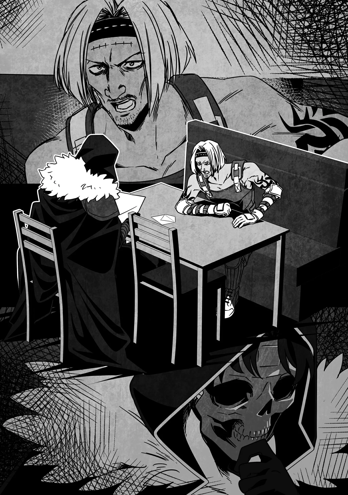

# Chương 309: Tập 13 Chương 2 - Báo Cáo và Một Ủy Thác từ Thợ Rèn (3)

"Anh vượt trội hơn những người khác, thế mà cuối cùng vẫn nghĩ mình không hợp với nghề rèn sao?" tôi hỏi.

Clope gật đầu. "Có điều nói một cách chính xác thì còn một người nữa cũng vượt trội hơn tất cả cùng với tôi: Hazara Feyvro, một thợ học việc vào xưởng rèn cùng đợt với tôi. Hai đứa tôi đã không ngừng trui rèn tay nghề qua lại với nhau."

"Vậy à? Ra anh và người tên Hazara đó là đối thủ của nhau sao?"

Bất kể theo đuổi lĩnh vực gì, người ta cũng cần những đối tượng như vậy—có họ ở cạnh bên sẽ thúc đẩy bản thân tiến bộ vượt bậc. Khao khát vượt qua đối thủ chính là ngọn lửa thôi thúc người ta không ngừng nỗ lực.

"Đúng thế. Vừa là đối thủ... lại vừa là bạn thân chí cốt. Bọn tôi ganh đua xem ai học được kỹ thuật mới nhanh hơn, chỉ ra những thiếu sót của nhau, thử nghiệm những món đồ chế tác mới mẻ thú vị... Hồi đó vui lắm. Ngày nào tôi cũng thấy mình tiến bộ."

Bất kể dấn thân vào con đường nào, khoảng thời gian nhìn thấy mọi tiềm năng rộng mở trước mắt luôn khiến người ta phấn khích tột cùng. Với tôi cũng từng như vậy khi mới bắt đầu học kiếm thuật và ma pháp—một cảm giác gần như toàn năng. Dĩ nhiên trong trường hợp của tôi, cảm giác đó chẳng kéo dài được bao lâu, bởi tài năng của tôi đã sớm chạm trần. Nhưng chắc hẳn Clope đã giữ được cảm giác ấy suốt một thời gian dài. Có điều nếu đã vậy, tại sao anh ấy lại...?

"Có một người như vậy ở cạnh bên, sao anh lại rời khỏi Welfia chứ?"

"Lúc đó thì chẳng có lý do nào cả. Nhưng rồi một ngày nọ, thợ rèn trưởng cho gọi Hazara và tôi đến. Khi ấy tay nghề của bọn tôi đã gần như đủ sức để ra riêng, thế nên hai đứa hào hứng lắm. Bọn tôi cứ ngỡ cuối cùng ông ấy cũng công nhận bọn tôi là thợ rèn thực thụ."

Trong mắt Clope lóe lên một tia sáng, như thể anh ấy đang hồi tưởng lại khoảnh khắc ấy và khiến trái tim rộn ràng phấn khởi. Có điều, tia sáng ấy nhanh chóng lụi tàn, thay vào đó là một vẻ u ám. Tôi có thể đoán được lý do vì sao.

"Nhưng thực tế không phải vậy, đúng không?" tôi nói.

"Đúng là không hẳn. Thay vào đó, ông ấy bảo với Hazara và tôi rằng cuộc thi rèn Welfia sắp sửa diễn ra, và bọn tôi phải tham gia tranh tài. Ông ấy nói rằng người chiến thắng một ngày nào đó sẽ thừa kế xưởng rèn."

"Chuyện đó..."

"Tôi sững sờ luôn. Vốn dĩ thợ rèn trưởng vẫn chưa đến tuổi nghỉ hưu đâu. Đương nhiên ông ấy biết rõ điều đó, nên mới nói về chuyện ấy như một tương lai còn xa vời—dẫu vậy, ông ấy vẫn muốn xem xem ai trong hai đứa tôi giỏi hơn, ai phù hợp hơn để kế tục vị trí của mình. Bọn tôi từ chối vì nghĩ mình chưa xứng đáng—quanh ông ấy còn bao nhiêu thợ học việc khác cơ mà. Nhưng ông ấy bảo rằng tất cả bọn họ đều đã đồng thuận rồi. Rằng hai đứa tôi đã vượt trội hơn hẳn phần còn lại—thậm chí vượt cả chính ông ấy. Nghe đến thế thì làm sao bọn tôi từ chối được chứ? Vả lại..."

"Sao nữa?"

"Hơn cả viễn cảnh trở thành thợ rèn trưởng, Hazara và tôi đều sướng rơn trước cơ hội được tranh tài tại cuộc thi rèn."

"Tuy tôi không thuộc làu các quy định, nhưng việc đăng ký dự thi đâu có khó khăn đến thế, phải không?"

Các cuộc thi rèn nằm ngoài phạm vi chuyên môn của tôi, nên tôi không biết tường tận, song cách thức vận hành chung của chúng là kiến thức phổ thông. Đại khái thì thợ rèn có dưới mười năm kinh nghiệm sẽ tranh tài ở bảng đấu riêng tách biệt với những người có thâm niên hơn, rồi sau đó được chia tiếp thành nhiều hạng mục tùy thuộc vào món đồ được yêu cầu chế tác.

"Không, cậu nói đúng đấy—chuyện đó không khó," Clope giải thích. "Cuộc thi được phân chia theo kinh nghiệm, nhưng chỉ cần là thợ rèn thì về cơ bản cứ nộp đơn là được. Tuy nhiên, thợ học việc ở một xưởng rèn như Hazara và tôi thì cần phải có sự cho phép của thợ rèn trưởng, mà ông ấy chưa từng gật đầu lần nào—dù chỉ một lần. Cũng có một vài đồng môn cùng thời với chúng tôi được phép, nhưng..."

"Hừm... Có khi nào ông ấy không muốn làm hư những thợ học việc tài năng bằng cách cho tham gia thi thố sớm không? Hẳn ông ấy biết các anh sẽ đạt thứ hạng cao, nên không muốn các anh sinh thói tự cao tự đại làm cản trở sự trưởng thành."

"Tôi cũng đoán vậy. Phần lớn những người khác được ông ấy cho phép đều thuộc tuýp người cần cù, nghiêm túc. Chưa bàn đến tay nghề, họ là kiểu người dù thắng hay bại cũng có thể gật đầu chấp nhận kết quả rồi tiếp tục kiên trì nỗ lực như mọi khi. Còn tôi thì... Chà, phán đoán của thợ rèn trưởng chuẩn xác thật."

"Đã xảy ra chuyện gì sao?"

"Ừ. Cũng chẳng có gì phức tạp. Bọn tôi cùng tham gia cuộc thi. Hazara thắng, tôi thua. Chỉ có thế thôi."

"Chuyện đó hẳn là..."

Nói một cách nhẹ nhàng nhất thì chuyện đó hẳn phải cay đắng lắm. Một người đối thủ vừa tài năng vừa chăm chỉ chẳng kém gì mình lại tiến một bước vượt hẳn ra ngoài tầm với. Tôi chưa từng có một đối thủ như vậy, nhưng tôi có thể hình dung ra cảm giác đó. Thế nhưng câu trả lời của Clope lại khiến tôi bất ngờ.

"Tôi không thấy cay đắng. Thật ra, chiến thắng của Hazara áp đảo đến mức chỉ khiến tôi nhận ra mình sẽ chẳng bao giờ có thể trở thành một thợ rèn giỏi như cậu ấy."

"Tại sao chứ...? Tay nghề giữa hai anh đâu có chênh lệch đến mức đó, phải không?"

"Tôi cũng từng nghĩ vậy, nhưng khoảnh khắc đó khiến tôi nhận ra bọn tôi vốn dĩ khác biệt về bản chất. Trước cuộc thi, hai đứa tôi đều nỗ lực theo cách riêng của mình. Bọn tôi tránh bén mảng tới khu vực làm việc của nhau và không tiết lộ cho nhau chút nào về việc mình sẽ rèn món gì hay làm cách nào, bởi vì bọn tôi là đối thủ. Bọn tôi muốn định đoạt mọi chuyện vào đúng ngày diễn ra cuộc thi."

Tôi có thể hiểu được cảm xúc của Clope khi ấy. Khoảng thời gian đó hẳn vừa đáng sợ, nhưng cũng thật hào hứng.

"Và rồi...?"

"Như tôi đã nói đấy, mọi sự ngã ngũ. Tôi thua trắng, rõ rành rành chẳng còn gì để bàn cãi. Hazara đã rèn ra một thanh ma kiếm. Một thằng nhóc vào nghề rèn chưa đầy chục năm mà rèn ra được một thanh ma kiếm. Thắng bại đã định đoạt ngay tại chỗ. Đúng là tôi về nhì, nhưng thứ tôi rèn ra chỉ là một lưỡi kiếm thông thường. Đương nhiên tôi đã dốc trọn từng chút hiểu biết và kỹ năng mình có vào lúc ấy, cơ mà ma kiếm ư? Đó là lúc tôi nhận ra Hazara là một thiên tài. Suốt bao lâu nay, tôi cứ ngỡ hai đứa cùng nhau tiến bộ, nhưng rồi tôi bắt đầu tự hỏi liệu có phải chính mình đang ngáng chân đối thủ hay không. Làm chậm bước tiến của Hazara. Tôi nghĩ có lẽ đó là lý do vì sao, ngay khi hai đứa tách ra tự rèn luyện một mình, một khoảng cách mênh mông như thế đã mở ra giữa đôi bên."

◆◇◆◇◆

"Đôi khi, tài năng của một người bộc phát bất thình lình mà chẳng báo trước," tôi nói. "Có thể với Hazara cũng như vậy. Nhưng điều đó đâu có nghĩa là anh không thể đuổi kịp cậu ấy, Clope."

Chí ít thì họ dường như có thực lực ngang ngửa nhau cho tới tận thời điểm diễn ra cuộc thi rèn. Ngay cả khi Hazara đã tạo ra một bước đột phá nào đó để bứt phá vươn lên, điều ấy cũng không có nghĩa là điều tương tự không thể xảy đến với Clope.

"Bây giờ tôi hiểu điều đó rồi," Clope nói. "Cho dù có chết trước khi cơ hội ấy tới, thì việc tin rằng nó sẽ đến và nỗ lực hết mình mới là thứ mở ra khả năng ấy. Bỏ cuộc là coi như chấm dứt tất cả. Một khi đã xem nghề rèn là lẽ sống của đời mình, nghĩa là tôi phải tiếp tục tiến lên, dẫu cho có nếm trải toàn thất bại đi chăng nữa."

"Vậy thì..."

"Nhưng đó là chuyện của bây giờ. Hồi ấy tôi đâu nghĩ được như thế. Thất bại khiến tôi chán nản và tuyệt vọng. Sau cuộc thi, tôi chẳng thể nào tập trung vào việc rèn giũa, làm cho sư phụ tôi, các đồng môn khác—thậm chí cả Hazara—phải bận lòng lo lắng. Rốt cuộc, tôi đã bỏ trốn khỏi Welfia. Tôi không nghĩ mình còn có thể làm thợ rèn ở thành phố đó được nữa."

"Thế nên anh mới trở thành thợ rèn lang bạt sao?"

"Ừ. Dù ban đầu tôi không tài nào chịu nổi việc cầm búa đập đe, nên cứ nhảy từ việc vặt này sang việc vặt khác. Cơ mà cái cốt thợ rèn đã ngấm tận xương tủy rồi. Tôi bắt đầu thấy thèm nghề, và chẳng biết từ lúc nào tôi lại lao đầu vào nó. Tôi mượn những lò rèn trống và phụ sửa nồi niêu cùng dao làm bếp, dành dụm được chút tiền là lại chuyển sang thị trấn kế tiếp. Tôi sống như thế một thời gian, nhưng chẳng thể dừng chân ở nơi nào. Hễ ổn định là tôi lại chìm vào những suy nghĩ vẩn vơ—chỉ có đi đây đi đó mới giúp tôi nguôi ngoai."

Hóa ra dù đã rời bỏ Welfia, những vết thương trong lòng anh ấy vẫn chẳng thể lành lại dễ dàng.

"Nhưng rồi anh vẫn dừng chân ở Maalt và làm thợ rèn đó thôi?"

"Ừm. Được vậy là nhờ có Luka đấy."

"Thanh mai trúc mã của anh, đúng không?"

"Phải, dẫu cô ấy chẳng nhớ gì cả."

"Cô ấy không nhớ sao?"

"Tôi từng kể cho cậu nghe chuyện hai đứa tôi lấy nhau rồi nhỉ? Cái lúc bọn tôi gặp nhau khi tôi còn là thợ rèn lang bạt ấy?"

"Phải, tôi nhớ mang máng câu chuyện đó."

"Ừ thì, chuyện đó là thật. Cô ấy xuất thân từ một gia đình thương nhân giàu có. Tôi được xưởng rèn trực thuộc thương đoàn nhà cô ấy thuê về phụ rèn đồ làm bếp đem bán, nhờ thế mà hai đứa quen biết nhau. Sau đó... biết bao chuyện xảy ra, và cô ấy gần như ép tôi cưới cho bằng được. Cuối cùng tôi bị cô ấy lấn lướt hoàn toàn, và thế là thành ra như bây giờ."

"Tôi cảm giác anh đã lược bớt cả đống đoạn rồi đấy... Nhưng tôi tin. Có vẻ như phải tốn chừng ấy công sức mới thuyết phục được một kẻ như anh chịu lấy vợ."

"Này này—ý cậu bảo tôi là đồ cứng đầu đấy hả?"

"Đâu phải thế—chỉ là nếu nghe anh bảo mình chẳng mảy may hứng thú gì với phụ nữ, và nghề rèn là tình yêu duy nhất trên đời thì tôi cũng chẳng ngạc nhiên chút nào đâu."

"Cậu nói... cũng không hẳn là sai. Cơ mà hồi ấy có những trở ngại lớn hơn ngáng đường bọn tôi."

"Chẳng hạn như?"

"Tôi khi đó chỉ là một tên thợ rèn lang bạt, còn gia đình cô ấy là thương nhân giàu có. Họ làm sao có thể gả con gái cho một kẻ như tôi được, mà bản thân tôi lúc ấy cũng chẳng có đủ điều kiện để gánh vác trách nhiệm lớn cỡ đó hay lo cho cô ấy một cuộc sống tươm tất."

Anh ấy nhắc tới thì tôi mới thấy chí lý. Trông Clope không giống kiểu người sẽ bận tâm tới những chuyện như vậy, nhưng hóa ra ngay cả anh ấy cũng đủ thấu tình đạt lý để cân nhắc thấu đáo điều đó.

"Nhưng cuối cùng hai người vẫn cưới nhau đó thôi?"

"Ừ. Chỉ là... tôi chẳng nỡ lòng nào từ chối cô ấy."

"Anh dễ mềm lòng thật đấy nhỉ?"

"Mềm lòng cái nỗi gì! Chỉ là cứ hễ dính tới Luka... tôi chưa bao giờ nói không được. Có lẽ là vì tôi vẫn còn nhớ quãng thời gian hai đứa còn bé xíu. Dù bộ dạng tôi bây giờ trông thế này, nhưng hồi nhỏ tôi là một đứa trẻ ốm yếu lắm."

"Thế thì bất ngờ thật đấy." Clope có vóc dáng vạm vỡ và trông rắn rỏi đủ để cáng đáng công việc thợ rèn ở bất kỳ môi trường nào.

"Đó là hồi tôi còn rất nhỏ. Vì thể trạng yếu nên tôi từng phải lên vùng cao nguyên sống chừng nửa năm, nơi có không khí trong lành hơn."

"Anh sinh ra trong gia đình giàu có hay sao?"

"Được thế thì đã tốt quá. Không, đâu phải dinh thự hay gì to tát đâu. Tôi tới một phòng khám đồng thời cũng là nhà thờ—tựa như một viện trị liệu chuyên tiếp nhận những đứa trẻ ốm yếu. Chi phí đắt đỏ thì có đắt thật, nhưng không đến mức gia đình bình dân không kham nổi."

Tôi từng nghe nói về những nơi như vậy. Đó thường là những cơ sở kết hợp cả trường học, trại trẻ mồ côi lẫn phòng khám bệnh. Chúng hay nằm ở vùng hẻo lánh xa đô thị, nơi có không khí trong lành, Ma Lực trong tự nhiên ổn định và quái vật hiếm khi xuất hiện. Các tu viện hoặc nhà thờ thường được dựng ngay bên cạnh để giúp giảm bớt chi phí ăn ở—dù đổi lại, người lưu trú cũng được vận động sinh hoạt theo nếp nhà đạo. Về bản chất, đó là hoạt động truyền giáo.

"Dù sao thì trong khoảng thời gian ở đó, tôi đã gặp Luka," Clope kể tiếp. "Có điều cô ấy chẳng đau ốm gì đâu—chỉ là ở lại một ngôi nhà nghỉ dưỡng để tránh cái nóng mùa hè ở quê nhà thôi."

"Vậy ra cô ấy đúng là xuất thân từ gia đình giàu có thật..."

"Đại khái là vậy. Nhưng những nơi như thế thường chẳng có mấy đứa trẻ chạy chơi bên ngoài khuôn viên viện trị liệu. Chắc đó là lý do cô ấy thường xuyên ghé qua. Thoạt đầu, cô ấy chỉ đi theo khi cha mình cùng những người trong nhà tới khu nhà thờ để cầu nguyện hoặc quyên góp, nhưng rồi cô ấy bắt đầu tự mình tới nhiều hơn. Cô ấy thậm chí còn suốt ngày xía mũi vào chuyện của tôi, và rồi, chà..."

"Đối với một đứa trẻ ốm yếu thì chuyện đó hẳn là quá sức chịu đựng rồi."

"Ờ thì. Tôi cũng đâu có mắc bệnh hiểm nghèo gì—chỉ là thể trạng hơi yếu một chút thôi. Hồi sống ở thành phố tôi hay phải nằm liệt giường, nhưng khi lên viện trị liệu thì tôi lại tràn đầy năng lượng. Tôi đoán Luka nhận ra điều đó, nên cô ấy mới nhắm vào tôi. Chắc cô ấy nghĩ rằng dù lôi kéo những đứa khác chạy nhảy quá đà thì nguy hiểm, nhưng với tôi thì chẳng sao."

"Có vẻ trực giác của cô ấy nhạy bén thật đấy..."

"Đến giờ cô ấy vẫn giữ được cái bản năng động vật chuẩn xác đến kỳ lạ ấy đấy chứ. Dù sao thì chẳng mấy chốc tôi đã bị cô ấy xoay như chong chóng... Đúng là những chuỗi ngày đáng nhớ."

"Nhưng cô ấy lại không nhớ gì sao?"

"Ừ. Khi gặp lại tôi nhận ra cô ấy ngay, nhưng tôi cứ im lặng không nói gì—tôi đâu muốn tự dưng chọc vào tổ ong vò vẽ làm gì, đúng không? Thế mà như cậu thấy đấy, rốt cuộc tôi vẫn không thoát khỏi tay cô ấy..."

◆◇◆◇◆

"Xét về phần mình, tôi rất biết ơn cô ấy," tôi nói.

Clope nghiêng đầu. "Sao lại thế?"

"Nếu cô ấy không làm như vậy, anh đã chẳng bao giờ dừng chân ở Maalt để mở tiệm rèn, đúng chứ? Không có anh thì tôi chẳng biết phải xoay xở thế nào."

Thời tôi còn là con người, tôi cứ ghé vào những tiệm rèn khác là xong xuôi. Kỹ năng của tôi chẳng có gì đáng để khoe khoang, nên về mặt vũ khí, tôi chỉ cần những món đồ đại trà thông thường.

Nhưng bây giờ thì sao? Tôi cần một thứ vũ khí phù hợp với hoàn cảnh đặc thù của mình, được tạo nên qua quá trình thử nghiệm và tinh chỉnh không ngừng. Vả lại với thân phận hiện tại của tôi, liệu ngay từ đầu tôi có thể tìm được một thợ rèn nào sẵn lòng chấp nhận và chế tác vũ khí cho mình không chứ?

Xét theo nghĩa đó, tôi phải cảm ơn Luka. Và dĩ nhiên là cả Clope nữa.

Tôi không nói ra thành lời, nhưng Clope dường như vẫn hiểu được, bởi anh ấy gật đầu. "Chắc là vậy rồi. Nhưng nhìn từ góc độ đó thì tôi cũng phải cảm ơn Luka. Nếu không định cư ở Maalt, tôi đã chẳng bao giờ gặp được một kẻ thú vị như cậu."

"Nghe như thể hai chúng ta cùng chung một thuyền vậy nhỉ."

"Chắc là thế rồi."

Hai chúng tôi cùng bật cười.

"Dù sao đi nữa, bao chuyện đã xảy ra, nhưng đó là lý do tôi trở thành thợ rèn ở thị trấn này," Clope tiếp tục. "À mà thật ra—tôi vẫn chưa kể cho cậu nghe lý do bọn tôi chọn Maalt, đúng không?"

"Nói mới nhớ, anh chưa kể thật. Sao anh lại chọn nơi này? Chắc chắn một thành phố lớn hơn sẽ là lựa chọn tốt hơn chứ." Nơi đó chắc chắn sẽ tiện lợi hơn về nhiều mặt.

"Cũng đúng..." Clope thừa nhận. "Nhưng khi tính xem nên định cư ở đâu sau khi cưới, tôi nhất quyết không muốn ở gần Welfia, vả lại tôi nghĩ nếu mở tiệm ở bất kỳ thị trấn hay thành phố lớn nào thì thế nào cũng đụng phải người quen. Rốt cuộc tôi chọn Maalt vì đây là thị trấn biên ải, và điều đó mang lại rất nhiều lợi thế. Chưa kể dòng quái vật liên miên không dứt đồng nghĩa với nhu cầu vũ khí luôn ổn định, nên tôi biết mình có thể buôn bán phát đạt."

Đó là một lý do hết sức thực tế—nhưng tôi cho rằng người ta buộc phải tính toán như vậy khi muốn cắm rễ và xây dựng một mái ấm. Khi còn độc thân và ngay cả cái chết của mình cũng chẳng làm phiền đến ai, người ta có thể làm bất cứ điều gì mình thích, nhưng một khi đã lập gia đình, người ta phải nghĩ tới tương lai.

Đó là lý do tôi ngưỡng mộ những cặp đôi như Clope và Luka, nhưng cũng cảm thấy thật khó tin rằng sẽ có ngày mình có được những gì họ đang có. Nếu một ngày nào đó tôi kết hôn... với ai đó, tôi sẽ bị giằng xé bởi cảm giác tội lỗi khi nơm nớp lo sợ một ngày nào đó mình sẽ đột ngột chết đi và bỏ lại họ một mình.

Chính vào lúc ấy, một ý nghĩ chợt lóe lên trong đầu tôi—với cơ thể hiện tại của tôi, muốn chết đi cũng chẳng dễ gì. Ngay cả khi dính phải một đòn chí mạng đủ sức kết liễu hầu hết mọi người ngay tức khắc, tôi vẫn có thể hồi phục đến một mức độ nhất định. Cứ thế mà xét, biết đâu việc xây dựng một mái ấm thực sự là khả thi...?

Thôi đi, chắc là không đâu. Trước hết, cơ thể tôi là Undead. Ai mà thèm một người chồng có cơ thể thậm chí còn chẳng phải con người chứ?

Đúng như tôi nghĩ, điều đầu tiên tôi phải làm là lấy lại nhân tính của mình. Tiến Hóa Bản Thể có lẽ là chìa khóa cho điều đó, nhưng dạo gần đây mọi chuyện theo hướng ấy chẳng mấy suôn sẻ. Tôi đang nỗ lực hết mình để trở nên mạnh hơn, song mọi chuyện đòi hỏi nhiều hơn thế rất nhiều. Tôi cần phải tiêu diệt quái vật và hấp thu sức mạnh của chúng, rồi bên cạnh đó tôi còn cần một thứ "động lực kích phát" nào đó. Tôi từng không cần quá nhiều thứ đó để đi từ Khô Lâu lên Ngạ Quỷ, nhưng tôi có cảm giác các điều kiện đòi hỏi sẽ ngày càng khắt khe hơn. Thịt người, máu Ma Cà Rồng... tiếp theo tôi sẽ cần thứ gì nữa đây? Tôi chịu chết chẳng rõ.

Mặt khác, có lẽ những thứ đó chỉ cần thiết cho những bước nhảy vọt lớn trong tiến trình, bằng không tôi vẫn có thể làm được mà không cần tới chúng—chỉ là sẽ chậm hơn mà thôi.

Việc quái vật trải qua Tiến Hóa Bản Thể vốn dĩ hiếm thấy, và việc quái vật bậc cao tiến hóa lại càng hiếm hoi hơn nữa—thế mà tôi lại tạo ra vài bước nhảy vọt trong một khoảng thời gian ngắn ngủi. Kết luận hiển nhiên là tôi đã thỏa mãn một số điều kiện giúp tôi trải qua Tiến Hóa Bản Thể dễ dàng hơn nhiều so với quái vật thông thường, và rất có thể một trong những điều kiện ấy là tôi đã nuốt thịt người cùng máu Ma Cà Rồng.

Dù thế nào đi nữa, tất cả những gì tôi có thể làm là tiếp tục mò mẫm tiến bước. Tôi vẫn chưa chạm trần giới hạn. Tôi sẽ tìm kiếm Tiến Hóa Bản Thể, và một ngày nào đó... tôi sẽ lấy lại nhân tính của mình.

Giờ thì quay lại cuộc trò chuyện với Clope...

"Vậy là sau bao nỗi thăng trầm, anh đã định cư ở Maalt," tôi nói. "Thế sao sau ngần ấy thời gian, bây giờ anh lại phải tham gia cuộc thi rèn?"

"Tôi... nhận được một lá thư. Đây."

Clope đưa cho tôi một lá thư viết trên giấy thô ráp, và tôi bắt đầu đọc.

◆◇◆◇◆

Lâu rồi không gặp, Clope. Cậu còn nhớ ta chứ?

Mà ta đang nói cái gì thế này? Làm sao cậu có thể quên được người thầy đã rèn giũa những kỹ năng thợ rèn cơ bản nhất cho cậu chứ. Dù sao thì ta cũng hy vọng cậu không quên, đó là lý do ta viết lá thư này.

Giờ ngẫm lại, đã bao nhiêu năm trôi qua kể từ ngày cậu rời khỏi xưởng rèn của ta rồi nhỉ? Ta vẫn nhớ như in cái ngày đầu tiên cậu xuất hiện, một thằng nhóc mũi thò lò với ánh mắt lấp lánh... cũng như dáng vẻ của cậu khi dần trưởng thành và trở thành một thợ rèn thực thụ. Chính vì thế, khi cậu dứt áo ra đi...

À mà nhìn ta xem, già rồi nên lại đa sầu đa cảm. Ta không viết lá thư này để hoài niệm chuyện xưa cũ. Vậy nên ta sẽ đi thẳng vào vấn đề chính.

Cậu sẽ đến Welfia và tham gia cuộc thi rèn sắp tới chứ? Chính là cuộc thi mà cậu từng tranh tài năm xưa đấy.

Ta biết cậu vẫn đang làm thợ rèn—và còn là một tay rèn cừ khôi nữa. Ta muốn được tận mắt chứng kiến tay nghề của cậu. Như ta đã nói lúc nãy, ta đã già rồi. Ngày ta giải nghệ cũng chẳng còn xa nữa, nhưng trước khi gác búa, ta muốn được nhìn thấy ngón nghề rèn của cậu thêm một lần. Cậu có thể chiều theo tâm nguyện của lão già này được không?

À, ta cũng nên nói thêm rằng Hazara cũng sẽ tham gia. Dạo này Hazara đang là phó thợ rèn trưởng của xưởng rèn, dẫu rằng từ lâu tay nghề của ta đã chẳng bằng cậu ấy nữa rồi. Cuộc thi này cũng sẽ là bài kiểm tra cuối cùng của ta để xem liệu ta có thể phó thác xưởng rèn cho người bạn đối thủ năm xưa của cậu hay không.

Ta xin lỗi vì đã khơi lại những ký ức cũ, nhưng giờ cả hai cậu đều đã là những người đàn ông trưởng thành rồi. Liệu ta có sai không khi nghĩ rằng hai cậu có thể cùng tề tựu lại và gột rửa những nỗi niềm hối tiếc của ta?

Xin cậu đấy.

Nhưng mà, chà... nếu cậu không muốn thì đành chịu vậy thôi.

Ta đặt rất nhiều kỳ vọng vào cậu.

Thầy của cậu,

Barzel Staro

◆◇◆◇◆

"Vậy nên..."

"Theo cách tôi nhìn nhận, ông ấy đang bảo tôi hãy đối diện và hòa giải với quá khứ của mình. Đó là cách ông ấy thể hiện sự quan tâm. Tôi không thể không đi, đúng không?"

