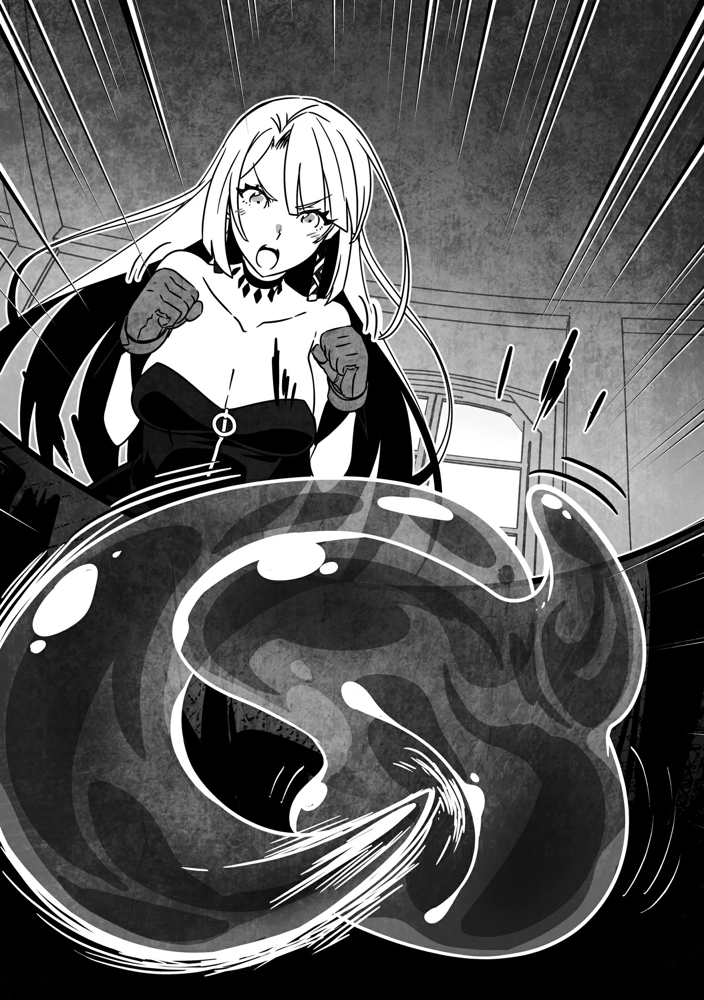
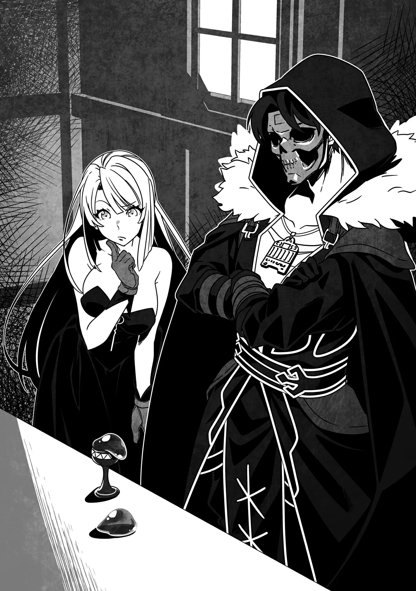

# Chương 311: Tập 13 Chương 3 - Chiếc Cốc và Người Thuần Hóa Quái Vật (2)

"Cố lên!" Lorraine cổ vũ. "Tới luôn đi! Làm được mà!"

"Không, đâu phải thế!" tôi la lên. "Thế chứ! Đúng rồi! Tới luôn!"

Tôi cũng đang hào hứng hò reo cổ vũ. Cổ vũ cái gì cơ chứ? Câu trả lời vô cùng đơn giản: Lorraine và tôi đang dán mắt vào giữa bàn làm việc, nơi chiếc cốc đã được cố định vững chắc. Bên trong chiếc cốc là hai con Slime tí hon đang quấn chặt lấy nhau mà quần thảo kịch liệt. Cả hai đều ra sức nuốt chửng đối phương.

Không như Goblin hay Orc vốn dĩ còn có chút đồng cảm nhất định với đồng loại, Slime lại là loài quái vật hoàn toàn vô cảm và chẳng mảy may ngần ngại tấn công chính đồng loại của mình. Vì thế, chỉ cần nhét chúng vào một không gian chật hẹp như chiếc cốc này, chúng sẽ lập tức lao vào cắn xé nhau ngay.

Những con Slime kích thước bình thường sẽ chiến đấu bằng cách nuốt chửng rồi làm tan rã mục tiêu, hoặc dùng những chiêu thức khác như Acid Blitz—kỹ năng bắn ra luồng dung dịch chứa hàm lượng axit đậm đặc. Thế nhưng xem chừng lũ Slime bé tí hin này còn quá yếu để thi triển những đòn thế như vậy. Suốt từ nãy tới giờ, tất cả những gì chúng làm chỉ là cố hết sức nuốt trọn lấy nhau.

Xem hai đứa nó mãi cũng chán, thế là Lorraine và tôi bắt đầu đặt cược xem con nào sẽ giành chiến thắng.

Trên đời vốn có những đấu trường nơi người ta có thể tới xem lũ quái vật đấu đá lẫn nhau rồi đặt cược kết quả, nhưng tôi chưa từng đặt chân tới nơi nào có một sàn đấu như vậy. Cơ mà đến khi tự mình trải nghiệm, việc ngắm hai con Slime tí hon này đọ sức hóa ra lại khá vui.

Bởi quái vật chẳng bao giờ nghe theo mệnh lệnh của con người (dĩ nhiên ngoại trừ người thuần hóa quái vật), nên khi chúng đánh nhau, kết quả luôn là thứ không tài nào lường trước được. Hành động của chúng càng khó đoán định thì xem lại càng kích thích. Những trận so tài võ nghệ giữa con người với nhau thường có một nhịp điệu chung mà người ta có thể dự đoán được phần nào. Điều đó cũng có cái hay riêng, nhưng những màn đọ sức giữa bầy quái vật lại mang một sức hút theo kiểu hoàn toàn khác.

Mở một võ đài chọi quái vật ở Maalt có khi lại là một mối làm ăn kiếm bộn tiền cũng nên. Ở đây đã có các trường đua Puchi Suri rồi, nhưng tôi khá chắc là chưa hề có tụ điểm nào chuyên về giao đấu thế này.

Cơ mà nghĩ lại thì người ta sẽ phải gom đủ quái vật để cho chúng lao vào tỉ thí. Tôi không nghĩ có ai hào hứng xem một trận huyết chiến phiên bản thu nhỏ giữa lũ Puchi Suri, còn săn bắt những con to lớn hơn thì xem chừng lại quá tốn công tốn sức...

Thế là tôi đành hy vọng sau này sẽ có ai đó đứng ra mở một sới đấu như vậy, còn lúc này cứ tạm hài lòng với màn chọi Slime trước mắt cái đã.

"Xem chừng sắp phân thắng bại rồi đấy," Lorraine nhận xét, mắt chăm chú dõi theo trận chiến diễn ra trong chiếc cốc.

Cô ấy nói đúng; cả hai con Slime tí hon trông đều đã kiệt sức thấy rõ. Cảm giác như con nào cạn kiệt ý chí trước—mà Slime rốt cuộc có thứ gọi là ý chí không nhỉ?—thì con đó sẽ thua cuộc.

Lorraine cổ vũ cho con có ánh đỏ nhàn nhạt, còn tôi thì ủng hộ con hơi ngả màu xanh lam. Màu sắc của chúng chẳng liên quan gì đến thuộc tính ma pháp; theo những gì tôi cảm nhận được thì gợn sóng Ma Lực của cả hai đều thuộc dạng trung tính. Có lẽ màu sắc khác nhau chỉ là do thứ mà chúng đã ăn vào mà thôi.

Cuối cùng trận đấu cũng bước vào hồi cao trào. Trong một thoáng ngắn ngủi, con Slime lam khựng lại bất động, tạo cơ hội cho con Slime đỏ bung rộng thân thể nuốt trọn lấy nó.

"Hay lắm!" Lorraine reo lên.

"Thật luôn đấy à...?" tôi rên rỉ.

Con Slime đỏ từ từ tiêu hóa con Slime lam, hấp thụ nó cho tới khi chẳng còn sót lại chút dấu vết nào và hạch tâm tí hon của nó tan rã, giải phóng ra một luồng Ma Lực tĩnh bộc phát.

Sắc mặt Lorraine trở nên nghiêm túc. "Đây mới là khoảnh khắc quyết định này, Rentt," cô ấy nói.

Trong chớp mắt, luồng Ma Lực tĩnh ngỡ như sắp sửa tan biến vào không gian xung quanh—thế nhưng trước khi điều đó kịp xảy ra, một luồng khí tức kỳ lạ liền tỏa ra từ chiếc cốc. Luồng Ma Lực lập tức đổi hướng và bắt đầu tụ lại vào một điểm duy nhất: con Slime đỏ. Nói một cách cụ thể hơn thì nó đang tụ về hạch tâm của con quái vật.

Lorraine và tôi chăm chú quan sát, không để sót bất kỳ chi tiết nào.

◆◇◆◇◆

"Và đây là kết quả..." Lorraine lẩm bẩm. Trông cô ấy không hẳn là ngạc nhiên mà giống như vô cùng thỏa mãn hơn.

Trái lại, tôi vẫn thấy bán tín bán nghi. "Trông nó đâu có thay đổi gì mấy..."

Con Slime chiến thắng vẫn đang nằm trong chiếc cốc. Trước đó nó chỉ trạc ngón tay út của tôi, nhưng giờ đã to bằng ngón tay cái, bởi lẽ nó vừa hấp thụ Ma Lực từ kẻ bại trận và gia tăng quy mô tồn tại của bản thân. Từng đó thì tôi vẫn có thể nhận ra được.

Thế nhưng điều đó chẳng có gì là bất thường cả. Hầu hết các loài quái vật đều có khả năng hấp thụ sức mạnh của những kẻ bị chúng đánh bại. Người ta không thể biết chắc nguồn sức mạnh đó sẽ đi đâu, nhưng nhìn chung nó sẽ nâng cao năng lực cơ bản của chúng theo một cách nào đó.

Bản thân tôi cũng từng trải qua chính hiện tượng đó. Việc tiêu diệt quái vật đã giúp nâng cao lượng dự trữ Ma Lực và Khí Lực, khiến cơ thể tôi bền bỉ hơn, đồng thời gia tăng các năng lực thể chất. Dĩ nhiên trường hợp cụ thể của tôi có thể là ngoại lệ xét theo hoàn cảnh dị thường của bản thân, nhưng điều đó vẫn chứng thực rằng quái vật hoàn toàn có thể trải qua một quá trình như thế.

Chính vì thế, trận chiến giữa hai con Slime và việc kẻ thắng tiêu hóa kẻ thua sau đó chẳng có vẻ gì là đáng kinh ngạc, ít nhất là dưới con mắt của tôi.

"Nhìn thoáng qua thì khó nhận ra, nhưng lượng Ma Lực đã được hấp thụ vô cùng hiệu quả. Tôi nhìn thấy rõ bằng ma nhãn của mình," Lorraine giải thích. "Tôi biết rõ bình thường lũ quái vật lấy đi bao nhiêu sức mạnh từ nhau sau khi giao chiến. So với mức đó thì con Slime này đã hấp thụ một lượng nhiều bất thường. Dĩ nhiên nhìn bằng mắt thường thì không thể chuẩn bằng việc đo đạc chính xác được."

Nói rồi cô ấy chỉ cho tôi xem chỉ số trên thiết bị đo đạc đã bố trí sẵn trên bàn làm việc trước khi trận chọi Slime bắt đầu. Dụng cụ này không phải do chính tay cô ấy chế tạo. Tôi chưa từng thấy thứ gì tương tự ở các tiệm bán ma cụ trước đây, nhưng nghe đâu cô ấy đã đặt mua từ bên Đế Quốc—ở bên đó, đây là thiết bị thông dụng tại Tòa Tháp và Học Viện.

Nói tóm lại, đây là công cụ dành riêng cho giới nghiên cứu và các cơ sở học thuật, chứ không phải thứ mà một thường dân như tôi có thể chạm tay vào—cả về mặt quan hệ lẫn phương diện tiền bạc. Thế nhưng nó lại là vật dụng không thể thiếu khi cần đo đạc kết quả thực nghiệm, vậy nên hiển nhiên Lorraine sở hữu khá nhiều loại công cụ như thế này.

Bình thường thì một kẻ ngoại đạo như tôi sẽ chẳng thể nào đọc hiểu nổi kết quả hiển thị trên thiết bị đo đó dù có đặt ngay trước mặt. Cơ mà tôi quen biết Lorraine đã lâu và từng phụ giúp cô ấy làm thí nghiệm không chỉ một hai lần. Tôi thường xuyên giúp cô ấy lắp ráp thiết bị hoặc đo đạc kết quả đến mức lúc này đã trở thành một trợ tá tương đối thạo việc. Cô ấy từng chỉ tôi cách đọc các chỉ số, nên tôi chẳng gặp khó khăn gì trong việc nắm bắt những gì mình đang thấy.

"Cô nói đúng thật—hiệu suất trông có vẻ rất ấn tượng đấy," tôi đồng tình. "So với tỷ lệ thông thường thì nó..."

Lorraine đã đưa cho tôi xem kết quả của một đợt thử nghiệm không dùng chiếc cốc, và tỷ lệ chuyển hóa Ma Lực khi ấy chưa bằng một phần ba so với khi ở bên trong cốc. Điều đó đồng nghĩa với việc chỉ cần có chiếc cốc này trong tay, một con quái vật có thể gia tăng sức mạnh với tốc độ gấp hơn ba lần bình thường. Thật là một ý nghĩ đáng sợ. Giá mà hồi còn là Khô Lâu tôi có được thứ này, thì tôi chỉ cần nếm trải một phần ba những gian khổ mà mình từng phải chịu đựng.

"Dĩ nhiên là chúng ta không thể chỉ dựa vào kết quả của một lần thử nghiệm duy nhất, nhưng rõ ràng chiếc cốc này là một vật phẩm đầy quyền năng," Lorraine nói. "Cứ tiếp tục thí nghiệm thôi."

Sử dụng bầy Slime mà Edel cùng đám thuộc hạ của nó mang về, chúng tôi lặp đi lặp lại quy trình cho lũ Slime cắn xé nhau (và đặt cược vào chúng), cẩn thận ghi chép lại kết quả sau mỗi lượt. Kết luận mà chúng tôi rút ra được là chiếc cốc quả thực đã làm tăng lượng Ma Lực hấp thụ lên xấp xỉ ba lần.

Chúng tôi đã sắp xếp sao cho khi lũ Slime lớn dần lên, chúng sẽ tiếp tục giao chiến với những con khác có kích thước tương đương... nhưng rốt cuộc chuyện đó lại nảy sinh vấn đề.

"Tôi thấy chúng không vừa nữa rồi," Lorraine nhận xét. "Giờ chiếc cốc trông chẳng khác nào một bồn tắm Slime thu nhỏ."

Một con Slime duy nhất lúc này đã nằm vừa khít bên trong chiếc cốc, thân mình núng nính lắc lư. Dù ban đầu nó chỉ bé bằng ngón tay út của tôi, nhưng sau bao nhiêu trận chiến liên tiếp, giờ đây nó đã to tướng như một quả trứng gà.

Edel cùng đám thuộc hạ đã mang về chừng hai mươi con Slime, nhưng giờ chỉ còn lại đúng hai con: một con đang nằm trong cốc, và một con kích thước tương tự đặt trên bàn làm việc. Cả hai đều đạt tới kích cỡ đó sau khi hấp thụ Ma Lực từ đồng loại của mình.

"Đã tới nước này rồi thì cứ cho hai đứa nó đấu một trận để chốt lại một con duy nhất xem chừng là hợp lý nhất," tôi nói. Làm thế thì cũng dễ nhốt giữ nó hơn.

"Có điều chúng đâu thể đánh nhau trong chiếc cốc được nữa," Lorraine đáp. "Thay vào đó chúng ta phải nghĩ cách để con nào đó cầm giữ chiếc cốc trong lúc chúng lao vào nhau. Nhưng làm sao khiến chúng chịu nghe lời cơ chứ?"

"Nếu vấn đề là ở chỗ đó thì..."

Việc thảy lũ Slime vào trong cốc rồi để mặc chúng lao vào cắn xé nhau là một chuyện, nhưng bảo chúng cầm giữ chiếc cốc lại là chuyện hoàn toàn khác. Về lý thuyết thì vẫn làm được, bởi Slime có khả năng làm cứng một số bộ phận nhất định trên cơ thể dạng thạch dẻo của mình, ngặt nỗi chúng đâu có biết lắng nghe.

Một ý nghĩ bất chợt lóe lên trong đầu tôi. "Hay là tôi thu nhận một con làm quyến thuộc của mình nhé?" tôi lẩm bẩm.

Lorraine lắc đầu. "Làm vậy sẽ khiến nó bị nhiễm Ma Lực của anh đấy. Điều đó có thể cưỡng ép nó Tiến Hóa Bản Thể và thậm chí biến đổi chủng loài cũng nên, thành thử..."

Cô ấy nói đúng—kết khế ước máu với một sinh vật là như vậy đấy. Nó có thể biến người sống thành Ngạ Quỷ hoặc Thi Quỷ, hoặc khiến những sinh vật như Edel mạnh lên trông thấy. Rất có khả năng điều tương tự cũng sẽ xảy ra với con Slime nếu nó hấp thụ một phần Ma Lực của tôi, làm sai lệch kết quả thí nghiệm. Thế là ý tưởng của tôi bị gạt đi.

"Vậy thì... chúng ta tính sao đây?" tôi hỏi.

Lorraine trầm ngâm suy nghĩ một lát. "Đúng như tôi dự liệu," rốt cuộc cô ấy lên tiếng. "Lựa chọn tốt nhất để khiến quái vật nghe lời là đi hỏi một chuyên gia."

Nói cách khác, chính là cha nuôi của tôi.

◆◇◆◇◆

Cha nuôi của tôi, Ingo Faina, vừa là Trưởng Làng Hathara vừa là một người thuần hóa quái vật đủ khả năng chỉ huy những loài quái vật hùng mạnh như Lindblum. Ông ấy thậm chí từng cưỡi trên lưng một con chở chúng tôi từ Hathara về khi tên Ma Cà Rồng Shumini tấn công Maalt.

Tất nhiên sau đó cha đã trở về làng, vậy nên nếu muốn gặp ông ấy, chúng tôi sẽ phải làm một chuyến đi xa. Vấn đề là Hathara nằm cách Maalt một quãng đường khá dài. Đi một cỗ xe ngựa tử tế cũng phải mất chừng một tuần lễ, mà đó mới chỉ là một chiều. Bình thường thì chuyện đó cũng chẳng to tát gì, nhưng lúc này tôi đang phải chuẩn bị cho kỳ thi thăng hạng Ngân Cấp nên thời gian vô cùng quý báu. Chỉ còn chưa đầy một tháng nữa là tới kỳ thi—tôi không thể nào phung phí tới hai tuần chỉ để đi lại trên đường.

"Nhưng chúng ta có cách giải quyết vấn đề đó rồi còn gì, đúng không?" Lorraine nói. Trong tay cô ấy đang cầm một viên đá màu xanh lam trông rất đỗi bình thường. Thoạt nhìn nó chẳng khác gì thứ có thể nhặt bừa dưới đất, nhưng thực chất đó lại là một món ma cụ mà bà lão làm thuốc Gharb cùng thợ săn Capitan đã trao cho chúng tôi trong chuyến về thăm Hathara lần trước. Viên đá này có thể tạo ra một ma pháp trận dịch chuyển vĩnh viễn tại vị trí được chỉ định.

Ở thời buổi hiện nay, chẳng một ai đủ sức chế tạo ra những món ma cụ mang uy lực cỡ đó, thành thử chúng tôi buộc phải giữ kín bí mật. Nếu đem viên đá này ra bán đấu giá, chắc chắn nó sẽ thu về một con số thiên văn trên trời.

Thế nhưng cả Lorraine lẫn tôi đều không phải những kẻ đặc biệt hám tiền. Khả năng dịch chuyển của viên đá mang lại sức hấp dẫn lớn hơn nhiều đối với chúng tôi, và đó là thứ mà chúng tôi chẳng mấy đắn đo khi sử dụng. Chỉ là chúng tôi vẫn chưa quyết định được nên đặt ma pháp trận ở đâu mà thôi.

Vả lại, chẳng mấy đắn đo không có nghĩa là hoàn toàn không có. Bất cứ khi nào người ta sử dụng một vật phẩm có thể đem lại cả một gia tài kếch xù nếu đem bán, những mối băn khoăn trăn trở ắt hẳn sẽ tự nhiên nảy sinh trong đầu. Dẫu vậy, xét theo hoàn cảnh hiện tại, chúng tôi thực sự chẳng còn lựa chọn nào khác.

Hơn nữa, điểm đến của nó đã được ấn định sẵn, do chính Capitan thiết lập thông tới thành phố ngầm của Hiền Vương Felt tại Đế Quốc Rermutt. Ở nơi đó cũng có sẵn một loạt ma pháp trận dịch chuyển khác dẫn tới những địa điểm như Hathara hay vương đô của Vương Quốc Yaaran. Có vài trận pháp vẫn chưa được khảo sát hết, nhưng từ trước tới nay chưa hề có cái nào thông tới Maalt. Thế nhưng nếu chúng tôi lập một cái ở đây, điều đó đồng nghĩa với việc ngay từ trước cửa nhà mình, chúng tôi đã có thể dễ dàng đi tới biết bao thành phố khác. Xét việc nó tiện lợi cỡ đó thì cũng chẳng có lý do gì phải đắn đo lưỡng lự mãi trước quyết định này.

Bản thân tôi vẫn thấy hơi tiếc của đôi chút, nhưng điều đó chỉ chứng tỏ tôi vốn là kẻ bủn xỉn ăn sâu vào máu thịt mà thôi...

Trái lại, Lorraine là mẫu người một khi đã quyết định là sẽ dứt khoát làm tới cùng.

"Làm thôi," cô ấy nói rồi ném viên đá xanh xuống sàn nhà.

Nhân tiện thì, chúng tôi đang làm việc này dưới tầng hầm của một căn nhà khác mà Lorraine sở hữu, nằm ở vùng ngoại ô Maalt. Nhìn từ bên ngoài, căn nhà trông bình thường hết mức có thể, thế nhưng không gian dưới lòng đất của nó lại rộng rãi đến bất ngờ. Bản thân chuyện đó cũng không quá kỳ lạ, bởi lẽ Lorraine mua lại căn nhà cùng mảnh đất này vốn để tiến hành những thí nghiệm nguy hiểm, nhưng khi tôi trầm trồ khen ngợi làm sao cô ấy tìm được một nơi tiện lợi đến thế, cô ấy liền cho tôi hay rằng chính mình đã đích thân thuê người mở rộng tầng hầm.

Thế mới hợp lý. Nghĩ lại tôi thấy mình hơi ngớ ngẩn khi ngỡ rằng một nơi như thế này cứ thế bày sẵn ra đó chờ cô ấy mua—chẳng một người dân nào sống quanh vùng này lại có nhu cầu dùng một căn hầm vừa rộng thênh thang vừa kiên cố đến mức ấy cả.

Dẫu vậy, việc Lorraine sở hữu một nơi như thế này quả là điều may mắn. Trước đó chúng tôi đã rất khó khăn trong việc chọn vị trí đặt ma pháp trận dịch chuyển—suy nghĩ đầu tiên của hai đứa là tận dụng chính căn nhà của cô ấy trong thị trấn, bởi nơi đó cũng có tầng hầm giúp che mắt những kẻ tò mò, ngặt nỗi chỉ cần một sơ suất nhỏ xảy ra thôi là quái vật có thể đột ngột xuất hiện ngay giữa lòng Maalt.

Khả năng đó không cao, bởi lẽ việc kích hoạt các ma pháp trận dịch chuyển đòi hỏi phải có máu của người Làng Hathara, nhưng cũng không hẳn là hoàn toàn bất khả thi. Lấy ví dụ, một con quái vật sau khi tấn công ai đó thuộc Làng Hathara có thể vô tình dẫm lên trận pháp trong lúc toàn thân còn dính đầy máu chẳng hạn.

Chúng tôi cũng không thể loại trừ khả năng chính ma pháp trận dịch chuyển sẽ gặp trục trặc và gây ra một vụ nổ kinh hoàng. Những miêu tả về việc ma pháp trận bị lỗi khiến Ma Lực xung quanh bạo tẩu gây nên tai nạn phổ biến đến mức xuất hiện nhan nhản ngay cả trong sách tranh thiếu nhi. Dù bản thân hai đứa chưa từng gặp phải sự cố nào như thế, nhưng chúng tôi cũng chẳng dám khẳng định nó sẽ không bao giờ xảy ra.

Xét tất cả những điều đó, chúng tôi không muốn bố trí trận pháp tại nhà của Lorraine ở trung tâm thị trấn. Hai đứa tính rằng việc thiết lập nó ở vùng ngoại ô thay vào đó sẽ hạn chế được thiệt hại liên đới lỡ như xảy ra sự cố ngoài ý muốn. Vùng này có nhiều khoảng đất trống vắng vẻ chẳng có mấy thứ xung quanh, và chúng tôi có thể giăng vài kết giới cùng ma cụ phòng hộ để bảo đảm an toàn. Đứng từ góc độ bảo mật thì nơi đây cũng hết sức tuyệt vời—chẳng mấy ai bén mảng tới chốn này, vậy nên hễ có bất kỳ ai xuất hiện, chúng tôi có thể lập tức xếp đối phương vào diện đáng ngờ ngay.

Tựu trung lại, đó chính là tất cả lý do khiến chúng tôi quyết định đặt ma pháp trận dịch chuyển tại nơi này.

Viên đá xanh nện xuống sàn đá phát ra một tiếng rắc rồi vỡ tan tành. Lorraine không dùng quá nhiều lực khi ném, nhưng việc những mảnh vụn tự động biến mất chính là bằng chứng cho thấy đây chẳng phải hòn đá bình thường.

Bất thình lình, một ma pháp trận bắt đầu tự khắc họa lan tỏa từ tâm điểm nơi viên đá vừa vỡ vụn.

"Dù có chứng kiến bao nhiêu lần đi nữa thì cảnh tượng đó vẫn thật khó tin..." Lorraine lẩm bẩm. Rồi giọng điệu của cô ấy thoáng chút tự giễu. "Ấy thế mà ngay cả khi được quan sát ma pháp dịch chuyển ở cự ly gần cỡ này, tôi vẫn chưa tài nào giải mã nổi nó."

Nghe đâu nếu có thể phân tích cặn kẽ ma pháp trận cùng cách thức chuẩn xác mà nó được vẽ ra, điều đó sẽ đồng nghĩa với sự hồi sinh của ma pháp dịch chuyển trong thời đại ngày nay. Thế nhưng chỉ nhìn ra hoa văn thôi thì chưa đủ—người ta còn phải hiểu vô số kỹ thuật chưa từng được biết tới, khởi đầu từ thứ tự từng nét vẽ cho đến phương thức truyền dẫn Ma Lực. Đó tuyệt nhiên không phải thứ mà người ta cứ nhìn vào là nắm bắt được ngay.

Thực tế là ngay cả Lorraine cũng chưa thể phân tích tường tận thứ ma pháp này chứng tỏ ngày hồi sinh của ma pháp dịch chuyển vẫn còn nằm ở một tương lai xa vời lắm.

"Được rồi, xong xuôi rồi đấy," Lorraine nói. "Chúng ta tạt qua Hathara chào hỏi một tiếng nào, Rentt."

Tôi gật đầu. "Đi thôi."
