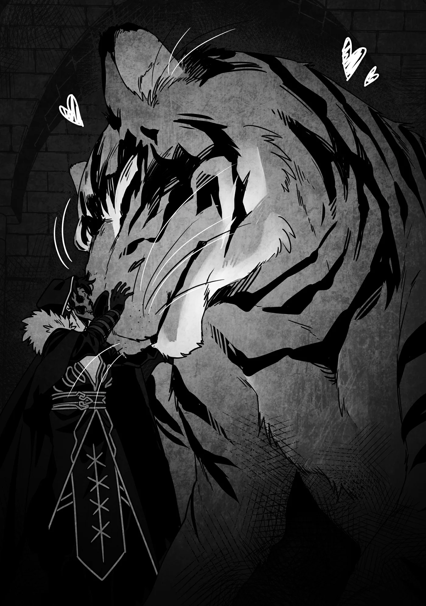

# Chương 312: Tập 13 Chương 3 - Chiếc Cốc và Người Thuần Hóa Quái Vật (3)

Chúng tôi bước lên ma pháp trận và lập tức được dịch chuyển tới thành phố ngầm của Hiền Vương Felt. Đợi một lát, một con hổ khổng lồ đánh hơi thấy mùi của chúng tôi liền tiến lại gần.

Đây là một con quái vật hùng mạnh có tên là Shahor Melechnamer. Ngoài vóc dáng đồ sộ đầy áp bức, cơ thể nó còn tỏa ra lượng Ma Lực đậm đặc, cùng đôi mắt sắc lạnh ánh lên vẻ thông tuệ dẫu khác xa với trí khôn của con người. Chỉ đứng trước mặt nó thôi cũng đủ khiến tôi ớn lạnh sống lưng.

Trong một trận đối đầu trực diện, tôi đời nào đánh bại được nó, mà cơ hội của Lorraine cũng chẳng khá hơn là bao. Họa chăng nếu có dư dả thời gian để giăng bẫy khắp nơi và rình rập tấn công từ chỗ khuất, cô ấy mới mong có cửa thắng—nhưng ngay cả trong giả định hết sức ưu ái ấy, tỉ lệ thành công cũng chỉ một phần trăm. Con quái vật này mạnh đến mức ấy đấy.

Thế nhưng, tôi và Lorraine lại chẳng có lý do gì để sợ nó. Chúng tôi biết nó chẳng có chút ác ý nào với mình—trái lại, con thú bắt đầu dụi cái đầu to tướng vào người tôi, trong cổ họng phát ra tiếng gừ gừ trầm đục.

Nhìn cảnh này, khó mà coi nó là thứ gì khác ngoài một con mèo quá khổ. Ai mà sợ cho nổi chứ?

"Dù có nhìn bao nhiêu lần đi nữa thì cảnh này trông vẫn lạ lùng thật đấy..." Lorraine lẩm bẩm khi thấy con hổ dụi vào người tôi.

"Bình thường loài quái vật này đâu có thân thiện với con người," tôi đồng tình. "Không biết thời cổ đại người ta thuần hóa nó kiểu gì nhỉ."

Theo lời bà Gharb, con Shahor Melechnamer này cảm nhận được mối liên kết với dòng máu của tôi. Nói cách khác, từ thuở xa xưa, người ta đã tìm ra cách huấn luyện quái vật để chúng gắn bó với những gia tộc nhất định.

Tôi không rõ chuyện đó xảy ra từ bao giờ, nhưng liệu điều này có nghĩa là một con Shahor Melechnamer có thể sống thọ hơn một hay hai thiên niên kỷ không? Hay bằng cách nào đó, huyết mạch của loài quái vật này đã được an bài để phản ứng với dòng máu của tôi—nói đúng hơn là máu của người dân Hathara—qua mọi thế hệ? Tôi tự thấy mình khó lòng tìm ra được câu trả lời.

Lorraine dường như cũng đang nghĩ theo hướng tương tự. "Người ta có thể viết cả một luận văn dài để giải đáp chuyện đó đấy," cô ấy nói. "Mà nhân tiện thì, riêng sự tồn tại của con Shahor Melechnamer này cũng đủ viết thành một bài rồi. Cơ mà để lộ phương pháp thuần hóa nó xem chừng không phải ý hay..."

"Bài luận đó chắc chắn sẽ bán chạy như tôm tươi," tôi tán thành. Tôi hiểu rất rõ ý cô ấy khi bảo đó là ý tồi. "Biết bao kẻ nguy hiểm sẽ làm đủ mọi cách để lôi kéo nó về phe mình cho xem."

"Dẫu vậy, có ai lại muốn gây sự với kẻ sai khiến được cả Shahor Melechnamer cơ chứ?"

Lập luận đó quả thực rất xác đáng. "Cô nói đúng—nhưng vẫn sẽ có những kẻ nghĩ rằng nếu chỉ có một mình con quái vật thì bọn chúng xoay xở được. Thậm chí có khi chúng còn dẫn theo cả mạo hiểm giả Mithril Cấp đề phòng nổ ra giao tranh nữa ấy chứ."

"Mới nghĩ tới thôi đã thấy mệt mỏi rồi... Tốt nhất cứ giữ kín chuyện về con Shahor Melechnamer đi. Không có nó ở đây thì chúng ta gặp rắc rối to đấy."

"Đúng là như vậy."

Chúng tôi nán lại đợi con Shahor Melechnamer đâu chỉ vì muốn cho nó ăn chút đồ ngon như thú cưng. Đúng là hai đứa có ném cho nó mấy miếng thịt Orc mang theo, và nó đớp gọn ngay giữa không trung rất điêu luyện, nhưng đó chỉ là chút lòng tốt mà thôi.

Lý do chúng tôi chờ là vì muốn cưỡi nó rời khỏi thành phố ngầm. Hai đứa biết ma pháp trận dịch chuyển về Hathara cũng nằm ở đây, và tôi có thể định vị nó bằng Bản Đồ Akasha, nhưng quy mô rộng lớn bạt ngàn của nơi này sẽ biến chuyến đi thành một chặng đường dài dằng dặc. Không chỉ vậy, thành phố ngầm của Hiền Vương Felt thực chất lại nằm ở tầng thứ sáu mươi của Mê Cung Côn Trùng Cổ thuộc Đế Quốc Rermutt. Chẳng cần nói cũng biết, quái vật quanh đây tuyệt đối không phải dạng vừa. Nếu tôi và Lorraine tự ý lang thang ở một nơi như thế này, chắc chắn sẽ lành ít dữ nhiều.

Tuy nhiên, nếu cưỡi trên lưng Shahor Melechnamer, lũ quái vật khác sẽ chẳng dám bén mảng tấn công chúng tôi. Quái vật ở tầng sáu mươi quả thực rất đáng sợ, nhưng Shahor Melechnamer lại vượt trội hơn tất thảy bọn chúng. Tôi không thể vui mừng hơn khi nó đứng về phe mình.

"Được rồi, đi thôi nào," Lorraine nói rồi trèo lên lưng hổ.

Tôi ngồi ở phía trước, còn cô ấy vòng tay ôm lấy eo tôi. Dĩ nhiên là Shahor Melechnamer chẳng hề được trang bị yên cương, nên nếu không ngồi theo tư thế này thì rất khó giữ thăng bằng. Vị trí ngồi phía trước giúp tôi có nhiều điểm để bám vào, cộng thêm sức mạnh thể chất có được từ cơ thể quái vật giúp tôi tin chắc cả hai sẽ không sao.

"Được rồi," tôi vừa nói vừa vỗ đầu Shahor Melechnamer. "Cảm ơn mày nhé. Đi được rồi đấy."

Cất tiếng gầm trầm đục, nó bắt đầu cất bước, lao nhanh qua thành phố ngầm. Tôi dẫn lối cho nó theo chỉ dẫn bà Gharb từng dặn, và nó ngoan ngoãn nghe theo không chút phản kháng.

Một ý nghĩ chợt lóe lên trong đầu tôi. "Thế này có tính là thuần hóa quái vật không nhỉ?" tôi hỏi.

"Tất nhiên rồi," Lorraine đáp. "Có điều những người thuần hóa quái vật thường tạo lập mối liên kết chủ tớ một - một. Còn con Shahor Melechnamer này lại nghe lời bất kỳ ai đến từ Hathara, đúng chứ? Điều đó cho thấy phương pháp được dùng để thuần hóa nó về cơ bản là hoàn toàn khác biệt... dẫu tôi cũng chẳng rõ cụ thể ra sao."

"Vậy cô nghĩ cha tôi cũng dùng phương pháp đặc biệt với con Lindblum sao?"

"Với tôi thì nhìn qua có vẻ giống việc một người thuần hóa quái vật thông thường hay làm, nhưng người ta vẫn bảo những quái vật bậc cao như Lindblum vốn chẳng thể thuần hóa nổi. Việc ông ấy dùng một cách thức khác biệt xem ra là giả định hoàn toàn tự nhiên thôi."

"Không biết là cách gì nhỉ. Mà nói đi cũng phải nói lại, trước giờ những người thuần hóa quái vật thông thường làm thế nào vậy?"

"Họ giữ kín chuyện đó như bí mật nhà nghề, nên chi tiết cụ thể không rõ ràng lắm. Nhưng theo tôi hiểu thì nó phụ thuộc vào từng người thuần hóa. Không phải ai cũng áp dụng cùng một phương pháp."

"Ý cô là sao?"

"Chẳng hạn—mà đây mới chỉ là điều cơ bản nhất trong số những điều cơ bản thôi nhé—vài người bảo rằng quái vật cũng giống như thú vật bình thường, nên việc huấn luyện chúng chẳng khác nào dạy thú cưng làm trò xiếc. Những người khác lại nhìn nhận hoàn toàn trái ngược. Tôi không nắm rõ chi tiết, nhưng nghe đâu họ dùng Ma Lực để thiết lập mối liên kết giữa bản thân với quái vật, hoặc đại loại thế. Dù sao thì, ý tôi là những lời đồn thổi đều ủng hộ quan điểm rằng phương pháp của người thuần hóa quái vật sẽ khác nhau tùy theo từng cá nhân."

◆◇◆◇◆

Đây là khoảng cách ngắn nhất giữa hai lần tôi về thăm Hathara trong suốt một thập kỷ qua. Từng ấy năm trôi qua mà nơi này chẳng mảy may thay đổi: một ngôi làng nhỏ thanh bình, nơi người dân sống đời yên ả.

Thông thường, mỗi năm tôi chỉ ghé về một lần—thậm chí đôi khi còn thưa hơn thế—nên hẳn mọi người sẽ thấy lạ lùng khi tôi quay lại chỉ sau chưa đầy vài tháng. Ấy thế mà, chẳng ai bàn tán gì về chuyện đó cả, họ chỉ tươi cười chào đón tôi trở về. Quê hương đúng là luôn như vậy.

"Đây là lần thứ hai tôi tới đây, nhưng nơi này vẫn đáng yêu chẳng kém gì lần trước," Lorraine niềm nở nói. Sau khi bước qua ma pháp trận dịch chuyển của Hathara, chúng tôi đi bộ một mạch từ pháo đài cổ trong rừng mà không hề nghỉ chân—nếu đi thong thả thì mất tầm nửa ngày—vậy mà hơi thở của cô ấy vẫn hết sức đều đặn. Đó là minh chứng cho thể lực dồi dào khác thường của giới mạo hiểm giả, bất kể là nam hay nữ. Lorraine cũng đã dùng ma pháp cường hóa thể chất để giảm bớt gánh nặng, nhưng ngay cả khi không có nó thì cô ấy vẫn thừa sức xoay xở. Không cuốc bộ nổi nửa ngày đường thì làm sao mà trụ lại được với nghề mạo hiểm giả cơ chứ.

"Cô nói chuẩn đấy," tôi đáp. "Có điều tôi muốn lập một ma pháp trận dịch chuyển gần làng hơn. Như thế đi lại sẽ đỡ vất vả hơn nhiều."

Thực ra tôi nói nửa đùa nửa thật, nhưng trong thâm tâm vẫn biết đó chỉ là suy nghĩ viển vông. Có hai lý do xác đáng khiến chuyện đó không bao giờ thành hiện thực—và Lorraine đã lập tức chỉ ra ngay.

"Thì chúng ta chỉ còn đủ dụng cụ để tạo thêm một cặp trận pháp nữa thôi mà. Tôi không dám bảo làm vậy là lãng phí, nhưng chuyến đi kéo dài cả tuần trời giờ đã được rút ngắn xuống còn nửa ngày rồi. Còn nhiều nơi xứng đáng để đặt ma pháp trận dịch chuyển tiếp theo hơn. Vả lại, tôi cũng khá e ngại việc bố trí một cái quá gần làng. Bất kỳ ai ở Hathara cũng dùng được nó, thành thử..."

"Phải rồi. Chỉ cần sơ sẩy một bước là họ sẽ thấy mình lọt thỏm giữa Thành Phố Mê Cung Của Hiền Vương Felt ngay. Người bình thường gặp cảnh đó chắc chắn sẽ hoang mang tột độ, nhất là khi trong làng chỉ có mỗi bà Gharb, Capitan và cha tôi biết về nơi ấy."

"Cơ bản là vậy. Dù sao thì, nếu anh chỉ muốn tìm phương thức di chuyển nhanh hơn, có lẽ cũng đáng để cân nhắc thêm vài ý tưởng khác đấy."

"Ý tưởng khác sao?"

"Ừm. Chẳng hạn như tận dụng con Lindblum của cha anh."

"Thế thì chuyến đi sẽ nhanh hơn nhiều đấy. Cơ mà... đâu cần phải chơi lớn đến mức ấy. Một con Phi Long bình thường là đủ rồi."

Nếu dùng ma pháp trận dịch chuyển từ Maalt tới pháo đài, rồi cưỡi một con Phi Long về Hathara, chúng tôi có thể rút ngắn thời gian di chuyển xuống chỉ còn một tiếng. Đúng là rất đáng để tìm hiểu.

Việc cưỡi Shahor Melechnamer cũng giúp tôi nhận ra có một con thú cưỡi tiện lợi biết bao. Những người thuần hóa quái vật rèn luyện ngón nghề của mình cốt để sai khiến quái vật chiến đấu thay hoặc sát cánh cùng họ, còn tôi lại hứng thú học nghề này để kiếm một phương tiện đi lại mới hơn.

Ingo là cha nuôi của tôi, đúng vậy, nhưng ông ấy vẫn là cha tôi. Trong thâm tâm, tôi tự hỏi biết đâu ông ấy sẽ chịu truyền dạy nếu tôi khéo léo mở lời nhờ vả.

"Ồ, tới nơi rồi," Lorraine cắt ngang cuộc trò chuyện rồi dừng bước.

Phía trước chính là ngôi nhà của gia đình tôi. Thật hoài niệ—à thì, cũng chẳng hoài niệm lắm đâu, xét việc chúng tôi chỉ vừa mới ở đây cách đây không lâu. Mẹ nuôi tôi, Gilda Faina, đang đứng trước cửa, dùng vai đẩy cánh cửa mở ra vì hai tay đang ôm một chồng củi lớn. Tôi vội chạy lại giữ cửa giúp mẹ.

"Ôi, cháu tốt bụng qu— Rentt đấy ư?! Cả Lorraine nữa này!"

Rõ ràng lúc đầu mẹ tưởng tôi là người khác. Mẹ nhìn tôi với vẻ mặt đầy kinh ngạc, rồi nỗi bất ngờ ấy lại dâng lên một lần nữa khi mẹ thoáng thấy Lorraine đứng cách đó một quãng ngắn. Tôi cũng chẳng trách mẹ được—Hathara hẻo lánh đến mức người ta đâu thể cứ thích là tạt qua chơi bất cứ lúc nào. Tôi dám chắc mẹ chẳng thể ngờ hai đứa lại quay về sớm đến thế.

Dẫu vậy, Gilda chẳng hề tỏ ra phiền lòng chút nào—trái lại, bà ấy nở nụ cười niềm nở chào đón chúng tôi. "Mẹ mừng khi thấy con trở về. Lần trước con đi vội vàng quá làm mẹ cứ lo mãi. Mỗi lần mẹ gặng hỏi, ông ấy chỉ khăng khăng bảo con 'vẫn ổn', thành thử..."

Người mẹ nhắc tới chắc chắn là cha nuôi của tôi, Ingo. Sau khi ông ấy đưa chúng tôi về Maalt, đôi bên chẳng hề liên lạc gì với nhau. Tôi vốn định khi mọi chuyện êm xuôi sẽ quay lại báo cho mọi người biết mình vẫn bình an vô sự, ngặt nỗi dạo gần đây bận rộn quá nên tôi chưa tìm được dịp. Vì lẽ đó, nghe chừng Ingo đã phải rất chật vật mới giải thích qua loa cho Gilda được.

Tôi thấy khá có lỗi về chuyện đó. Ingo vốn không phải mẫu người giỏi giải thích hay viện cớ. Người ta hẳn sẽ nghĩ ông ấy thạo khoản này lắm vì dẫu sao cũng là trưởng làng, ngặt nỗi ở một chốn thôn quê như Hathara thì làm gì có mấy dịp phải đứng lên bục phát biểu—mà ngay cả những khi cần, bên cạnh ông ấy cũng luôn có bà Gharb và Capitan đỡ lời giúp.

Công việc của cha nuôi tôi phần lớn chỉ là giữ cho ngôi làng đoàn kết và vận hành êm đẹp. Tôi chẳng thể trách ông ấy câm như hến trước những màn tra hỏi của vợ mình.

"Cha nói bọn con vẫn ổn là thật đấy mẹ," tôi nói. "Hôm nay mọi việc đã đâu vào đấy nên bọn con mới về nói chuyện với cha. Sắp tới con cũng sẽ tham gia kỳ thi thăng hạng Ngân Cấp, nên con muốn nhờ bà Gharb và Capitan rèn giũa lại những kỹ năng cơ bản giúp mình. Con hơi lo là bản thân vẫn chưa sẵn sàng."

"Ngân Cấp ư?!" Gilda tròn xoe mắt. "Tuyệt quá, Rentt à! Con bị kẹt ở Đồng Cấp lâu đến thế cơ mà!"

Giọng mẹ vui mừng cho tôi đến nỗi tôi chẳng nỡ nói cho mẹ biết thứ hạng của mình chỉ tăng lên là nhờ bản thân đã biến thành quái vật. Tôi quyết định đánh trống lảng. "Thực ra... mạo hiểm giả đột ngột bứt phá khỏi vỏ bọc của mình cũng không phải chuyện hiếm đâu mẹ."

"Thật sao?" Bất ngờ, Gilda ghé sát lại gần thì thầm vào tai tôi, mắt liếc về phía Lorraine. "Không phải con có được bước tiến đó là nhờ công của Lorraine đấy chứ?"

"Ý mẹ là sao cơ...?"

"Thôi nào—con biết tỏng rồi còn gì. Ôi! Đừng nói là hai đứa về đây để thông báo chuyện đính hôn đấy nhé?"

"Đâu có! Gì cơ chứ?! Thôi, chúng ta cứ vào nhà trước đã mẹ." Tôi vừa thở dài vừa đẩy mẹ vào trong. Cứ để mẹ nói tiếp thì chắc mẹ sẽ phấn khích quá đà mà buột miệng thốt ra mấy lời kỳ quặc mất thôi.

Đúng lúc đó, Lorraine bước lại gần. "Có chuyện gì thế?" cô ấy hỏi.

"Chỉ là... tôi đang nghĩ các bà mẹ ở đâu cũng giống nhau cả thôi."

"Hử? Ý anh là sao?"

"Không có gì đâu. Cứ vào nhà trước đã."

"Được thôi..."

◆◇◆◇◆

"Rentt... và cả tiểu thư Lorraine nữa sao? Gió nào đưa hai đứa về đây thế?"

Vừa bước vào nhà, chúng tôi đã thấy cha nuôi tôi, Ingo, đang miệt mài đánh vật với một chồng tài liệu. Nhìn kỹ hơn mới nhận ra đó là các bản kê khai sổ sách thu chi và thuế má của ngôi làng. Ingo luôn làm tròn trách nhiệm của một trưởng làng một cách nghiêm túc, dẫu rằng ông ấy hoàn toàn bất lực trước bà vợ của mình.

"Sau biến cố lần trước bọn con chưa kịp liên lạc lại, tính ra cũng được một thời gian rồi. Hôm nay bọn con về để nói chuyện với cha."

Ngoài ra còn có chuyện muốn nhờ cha chỉ dạy cách trở thành người thuần hóa quái vật nữa, nhưng tôi và Lorraine sẽ đưa ra lời thỉnh cầu đó sau.

"Ta hiểu rồi. Hai đứa về đây ta mừng lắm... nhưng hai đứa không bận bịu gì sao? Đâu nhất thiết phải lặn lội đường sá xa xôi về tận chốn khỉ ho cò gáy này làm gì."

Dù Ingo nói vậy, nhưng ông ấy thừa biết chúng tôi đã về đây bằng cách nào—chẳng qua chỉ đang diễn kịch trước mặt Gilda mà thôi. Hoặc có lẽ ông ấy cũng đang ngầm nhắc nhở hai đứa không nên quá lạm dụng các ma pháp trận dịch chuyển.

Tuy nhiên, xét riêng ở Hathara, tôi biết chắc chẳng ai để lộ bí mật ra ngoài đâu. Tình làng nghĩa xóm gắn kết của người dân thôn quê bền chặt hơn nhiều so với những gì người thành thị mường tượng, nhất là ở một nơi hẻo lánh như Hathara. Không đồng lòng giúp đỡ lẫn nhau thì chẳng thể nào sinh tồn nổi ở chốn này. Đó cũng là lý do hiếm khi có ai bị tẩy chay khỏi cộng đồng. Maalt cũng là vùng nông thôn, nhưng đó là một thị trấn quy mô khá lớn với dòng người và hàng hóa ra vào tấp nập. Nơi ấy khác Hathara một trời một vực.

"Nếu chỉ để thăm hỏi thì có lẽ con cũng chưa về vội, nhưng lần này còn có việc khác nữa cha," tôi giải thích. "Sắp tới con sẽ tham gia kỳ thi thăng hạng Ngân Cấp, nên con về đây để rèn luyện lại bản thân từ những điều cơ bản nhất."

"Ồ? Chúc mừng con nhé! Cơ mà ta đoán là con vẫn chưa biết kết quả đâu nhỉ..."

"Thôi nào cha, nói trước bước không qua đấy. Dù sao thì, vẫn còn lý do thứ ba nữa. Lorraine?"

"Thật vui được gặp lại bác, Trưởng Làng Ingo," Lorraine nói. "Cháu là Lorraine Vivie."

"Cháu khách sáo quá—à, nhưng không cần phải câu nệ với ta thế đâu. Cháu là... của Rentt... nói thế nào cho phải nhỉ? Cháu là người rất quan trọng với nó mà."

"Bác nói vậy cháu mừng lắm. Nhân tiện, chuyện này có lẽ hơi muộn một chút, nhưng... mong bác cứ đối xử với cháu tự nhiên như với Rentt."

"Ồ? Được chứ, nếu cháu không phiền. Ta gọi cháu là Lorraine nhé?"

"Tất nhiên rồi bác."

Tôi cứ ngỡ Gilda sẽ lườm Ingo một cái cháy mặt, bởi lẽ hai người họ vốn là cặp vợ chồng rất khăng khít—nói đúng hơn là mẹ mê mệt cha tôi. Một ánh nhìn như muốn nói: "Sao ông dám suồng sã với người phụ nữ khác như thế hả!" Thế nhưng khi ngoái nhìn sang, tôi lại thấy mẹ đang mỉm cười, tâm trạng rõ ràng rất vui vẻ. Mẹ chẳng hề bực bội lấy một mảy may.

Chuyện này hiếm thấy thật đấy. Hồi tôi còn sống ở Hathara, mẹ sẽ nổi đóa lên ngay mỗi khi cha nói chuyện nhiều hơn mức tối thiểu với những nữ thương nhân lữ hành hay các nữ vũ công.

Hơn thế nữa, Gilda không hề nhìn Lorraine, mà lại đang nhìn chằm chằm vào tôi. Tại sao chứ?

Dù có vắt óc suy nghĩ bao nhiêu đi nữa, tôi cũng chẳng tìm ra được lời giải. Thôi thì, miễn là mẹ không nổi giận, tôi đoán mọi chuyện vẫn ổn thỏa...

"Vậy Lorraine này," Ingo nói. "Rentt bảo hai đứa có chuyện muốn bàn với ta sao?"

"Về chuyện đó thì..." Lorraine liếc nhìn Gilda.

Gilda mà tôi biết hẳn cũng sẽ bực mình khi thấy ánh nhìn ấy, nhưng thay vào đó, mẹ lại bảo: "Ôi, mẹ xin lỗi nhé. Mẹ phải ra ngoài một lát đây. Mẹ quên khuấy mất là hôm nọ đã hứa đem cho Reggie chút mứt mẹ mới làm rồi!"

Sau lời giải thích cặn kẽ đến mức thừa thãi cho hành động của mình, mẹ liền bỏ mấy lọ mứt vào một chiếc giỏ trong bếp rồi vội vã rời khỏi nhà.

Tôi không sao gạt bỏ được mối hoài nghi trong lòng. Nãy giờ mẹ cứ chu đáo một cách kỳ lạ. Rốt cuộc mẹ nghĩ mối quan hệ giữa tôi và Lorraine là gì cơ chứ? Ban nãy tôi đã nói rõ mười mươi với mẹ rằng chuyện này chẳng liên quan gì tới hôn nhân rồi mà. Rốt cuộc mẹ có nghe tôi nói không thế?

Haizz, thôi kệ đi. Tôi có cảm giác dù mình cố giải thích thì mẹ cũng chẳng thèm lọt tai đâu...

Khi cánh cửa đã khép lại sau lưng Gilda và tiếng bước chân của mẹ xa dần rồi dứt hẳn, Lorraine mới tiếp tục câu chuyện.

"Cháu thành thật xin lỗi vì đã làm vợ bác phải lánh đi..."

"Không, không sao đâu. Bà ấy chỉ mừng vì sắp có thêm một đứa con gái thôi."

"Không đâu bác, cháu đâu dám... Cháu e là bác gái chẳng mừng nổi khi có đứa con gái lớn tuổi ngần này đâu."

Lorraine mới hai mươi tư tuổi, nhưng xét bối cảnh thôn quê hẻo lánh như Hathara thì lời cô ấy nói cũng chẳng có gì là lạ. Ở những vùng đất như thế này, hầu hết mọi người đều lập gia đình trước khi bước sang tuổi hai mươi. Dù sao thì, vì thành phố ở quá xa và hiểm nguy luôn rình rập khắp nơi, tuổi thọ của con người cũng ngắn hơn. Trẻ nhỏ qua đời sớm cũng phổ biến hơn so với nơi phố thị. Chuyện người dân ở đây coi trọng việc kết hôn sớm và sinh nhiều con âu cũng là lẽ tự nhiên.

Dạo gần đây, độ tuổi kết hôn trung bình ở các thành phố đang có xu hướng tăng lên, đặc biệt là tại quê hương của Lorraine, Đế Quốc. Đất nước của họ luôn đi đầu về công nghệ, nơi cả nam lẫn nữ đều mang tư tưởng tinh hoa. Nghe đồn phần lớn người bên đó đều coi trọng sự nghiệp hơn chuyện lập gia đình.

Sống như vậy cũng chẳng có gì xấu, nhưng nếu là tôi thì tôi muốn vẹn cả đôi đường hơn. Khổ nỗi nói thì dễ chứ làm mới khó.

"Cháu đâu đã tính là 'lớn tuổi,'" Ingo nói. "Dù sao thì dân Làng Hathara cũng có xu hướng kết hôn muộn hơn những làng khác mà."

"Vậy sao bác?"

"Phải. Theo lời bà Gharb thì làng mình theo nếp đó từ lâu rồi. Ta đoán là nhờ quanh đây luôn có những pháp sư và dược sư xuất chúng như bà ấy. Trẻ con trong làng hiếm khi qua đời yểu, nên so với những nơi khác, chúng ta càng tin tưởng hơn vào việc chờ đợi một người bạn đời phù hợp."

"Ra là vậy. Thảo nào Rentt chẳng hề vội vàng gì. Cháu cứ ngỡ chuyện đó chỉ do quan điểm hôn nhân của riêng anh ấy, giờ mới biết anh ấy thừa hưởng từ đâu."

Năm nay tôi hai mươi lăm tuổi. Nếu Lorraine bị coi là đã qua cái thời xuân sắc nhất, thì tôi cũng cùng hội cùng thuyền với cô ấy rồi.

"Thú thật ta nghĩ Rentt còn lắm tật xấu hơn thế nhiều. Dẫu vậy, thấy bên cạnh nó có một người như cháu, ta cũng an tâm phần nào. Thôi thì, ta không có ý nhắc lại đâu, nhưng chuyện hai đứa muốn bàn với ta là gì thế, Lorraine?"

Tôi rất muốn cãi lại mấy lời bóng gió của Ingo, ngặt nỗi hai người họ đã vội chuyển chủ đề cứ như thể ông ấy chưa từng nói câu nào vậy.

"Vâng, về chuyện đó," Lorraine nói. "Cháu muốn hỏi liệu bác có sẵn lòng chỉ dạy ngón nghề của bác cho cháu không."
