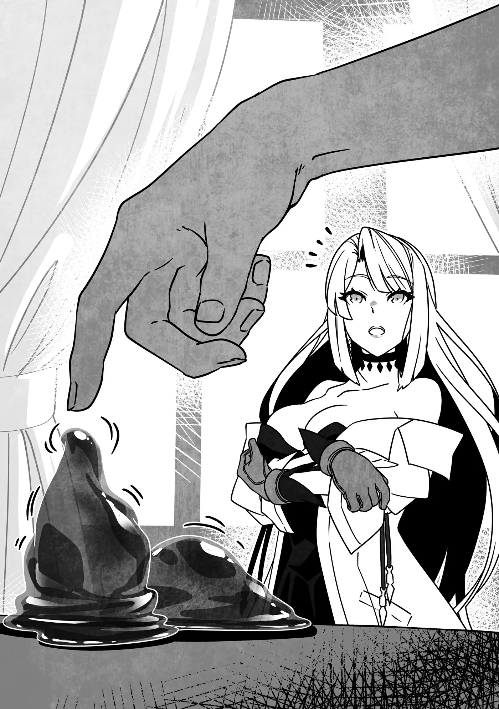

# Chương 313: Tập 13 Chương 3 - Chiếc Cốc và Người Thuần Hóa Quái Vật (4)

"Ngón nghề của ta sao?" Ingo nghiêng đầu.

Lorraine lấy ra từ túi ma thuật những chiếc hộp tương tự như loại lũ Puchi Suri từng mang theo, dù kích cỡ có nhỉnh hơn đôi chút. Chúng chẳng hề rỗng không, cơ mà chuyện đó thì chẳng cần tôi nói ra ai cũng biết rồi. Cô ấy mở nắp, và hai khối nhầy nhụa gì đó lập tức trườn ra mặt bàn nhà tôi.

"Slime ư...? Trông chúng nhỏ hơn nhiều so với bình thường nhỉ."

Chút ngạc nhiên thoáng hiện trên gương mặt Ingo, nhưng ngoài điều đó ra thì phản ứng của ông vẫn rất bình thản. Âu cũng phải thôi, một người thuần hóa quái vật thì sao có thể bận tâm trước đối tượng trong ngón nghề của mình được chứ. Vả lại, lũ Slime này nhỏ đến mức cha hẳn cũng nhận ra chúng khó lòng gây nguy hiểm cho con người.

Còn nếu đổi lại là một dân làng bình thường hay thị dân Maalt, chắc chắn họ sẽ vừa kinh ngạc vừa sợ khiếp vía cho xem.

"Vâng. Chúng tới từ cống ngầm dưới lòng Maalt đấy bác," Lorraine xác nhận.

Có một mê cung nằm sâu dưới lòng Maalt, được xây dựng từ những vật liệu cổ xưa mà ngày nay không còn ai sử dụng nữa. May mắn thay, nó không gây thiệt hại quá lớn cho hệ thống dẫn nước của thị trấn. Dù có nảy sinh vài trục trặc—những biến động khổng lồ dưới lòng đất ắt sẽ kéo theo rắc rối—nhưng công tác sửa chữa đã được tiến hành và mọi thứ hiện đã hoạt động trơn tru trở lại.

Một phần là nhờ tay nghề thợ thuyền ở Maalt rất cừ, nhưng tôi ngờ rằng Gia tộc Latuule cũng đã âm thầm giật dây sau bức màn. Dù chưa tận tai nghe họ nói điều gì, ai nấy đều thấy rõ họ đang cần mẫn duy trì sự ổn định cho thị trấn.

Cơ mà quay lại chuyện chính thôi nào...

Ingo gật đầu, tiếp nhận lời giải thích của Lorraine. "À, ra là một giống Slime nhỏ lọt qua hàng phòng ngự của thị trấn sao—dù khó mà khẳng định chắc chắn liệu đây có thực sự là phân loài tí hon hay không, bởi kích cỡ của Slime phát triển rất khác biệt so với các quái vật khác. Nghe đồn nếu cứ để mặc cho chúng tự do phát triển đủ lâu, chúng có thể phình to bằng cả ngọn núi đấy. Dĩ nhiên là ta chưa từng tận mắt thấy bao giờ. Quanh vùng này chúng có thể lớn ngang Đại Slime, nhưng mấy giống nhỏ cỡ này thì hiếm thấy thật."

"Bác am hiểu về quái vật ghê. Quả không hổ danh ạ."

"Chính cha là người đã dạy tôi về Slime mà," tôi nói. "Dĩ nhiên là cả các loài quái vật khác nữa. Có điều, tôi cũng chỉ học những kiến thức gia truyền trong nhà thôi, nên nếu so với nghiên cứu của các học giả thành thị thì hẳn có nhiều điểm sai lệch lắm."

"Những điều đó quả thực khác xa với nhận thức thông thường về Slime," Lorraine nói. "Chẳng hạn như tôi chưa bao giờ nghe nói tới một con Slime to bằng cả ngọn núi cả."

Bản thân tôi cũng chưa từng nghe tới bao giờ—con lớn nhất tôi từng thấy mới chỉ là Đại Slime. Tôi cũng biết thêm vài chủng loài khác, nhưng phần lớn đều vượt quá khả năng chiến đấu của mình, và tôi cũng chẳng liều lĩnh tới mức đi lùng sục chúng để thử sức.

"Giờ thì chẳng còn thấy chúng nữa đâu," Ingo nói. "Nói đúng hơn thì chúng không thể lớn đến mức đó trừ phi hội tụ hoàn cảnh vô cùng đặc biệt. Cha ta từng kể rằng vào thời cổ đại, chúng từng được tạo ra bằng phương pháp nhân tạo. Việc chúng xuất hiện trong tự nhiên gần như là bất khả thi."

"Nhưng... bằng cách nào chứ?"

"Ta tin là cháu đã đoán ra rồi đấy, Lorraine. Tiến Hóa Bản Thể do bàn tay con người thúc đẩy. Chủng loài Slime đúng là phát triển theo kích cỡ, nhưng khi đạt đến ngưỡng nhất định, chúng vẫn sẽ trải qua Tiến Hóa Bản Thể. Ngay cả những phân loài nhỏ hơn cũng có thể lớn dần lên cho tới khi trở thành một trong những biến thể độc nhất vô nhị của chủng tộc mình. Đó chính là cách Tiến Hóa Bản Thể vận hành ở loài Slime."

"Bác... đã dùng đến Tiến Hóa Bản Thể sao?"

"Bản thân ta thì chưa từng làm đâu. Đó là chuyện của người xưa rồi. Những gì ta nắm được chỉ là mảnh vụn tri thức truyền lại từ thuở ấy mà thôi. Ta chẳng thể bảo cháu cách làm cho một con Slime lớn chừng đó được. Nhưng điều ta có thể nói là con Lindblum mà hai đứa cưỡi vốn xuất thân từ một phân loài Phi Long nhỏ bé. Ta đã thuần hóa nó, kết nối sợi dây liên kết rồi kích phát Tiến Hóa Bản Thể để huấn luyện nó thành dáng vẻ như ngày hôm nay."

"Nhưng chuyện đó là bất khả thi!" Lorraine thốt lên. "Ai cũng biết quái vật một khi đã bị thuần hóa thì sẽ mất đi khả năng Tiến Hóa Bản Thể mà!"

"Thực ra chuyện đó còn tùy thuộc vào phương pháp nữa," Ingo điềm đạm đáp. "Cháu đã tận mắt thấy con Lindblum rồi đấy thôi. Ta tin là cháu tự nhận ra được. Với lại sau ngần ấy chuyện, ta đâu có lý do gì để nói dối cháu chứ."

Cha có thể không nói dối, nhưng chắc chắn trước đây ông chưa từng hé răng về chuyện này bao giờ. Tại sao lúc này cha lại giải thích cặn kẽ cho chúng tôi đến thế?

"Lý do đến tận bây giờ cha mới nói chuyện này cho bọn con..." tôi mở lời. "Có phải vì đây là điều không nên để lọt ra ngoài không cha?"

"Phải, đó cũng là một phần nguyên do. Dù sao thì đây cũng là bí mật chỉ truyền lại cho huyết mạch của trưởng làng—à xin lỗi, ý ta là vị vua cổ đại. Nhưng khi thấy lũ Slime mà Lorraine mang tới, ta nghĩ tốt hơn hết mình nên giải thích rõ ràng. Vả lại ngón nghề mà cô bé muốn ta chỉ dạy cũng chính là thuần hóa quái vật, chẳng phải vậy sao? Như thế thì tiện cả đôi đường rồi."

Giọng điệu của cha tôi nghe có vẻ nhẹ tênh, nhưng ông chẳng hề bông đùa chút nào. Hẳn cha đã nhìn thấu tâm can hai đứa chúng tôi từ trước rồi.

"Đúng là như vậy, nhưng liệu có ổn không bác?" Lorraine hỏi. "Nghe từ miệng cháu thì hơi kỳ quặc thật, bởi chính cháu là người mở lời nhờ vả bác chuyện này, nhưng..."

Lorraine quả là biết nghĩ cho người khác, nhưng cô ấy nói đúng; chúng tôi đến đây vốn đã chuẩn bị tinh thần bị từ chối. Hẳn cô ấy rất đỗi ngạc nhiên khi thấy Ingo chủ động giải thích cặn kẽ ngay cả trước khi cô ấy kịp trình bày.

"Bảo là ý hay thì cũng chẳng hẳn," Ingo nói. "Nhưng bọn ta đã tin tưởng giao ma pháp trận dịch chuyển cho cháu rồi. Cháu đã biết một bí mật của làng, thì biết thêm hai ba chuyện nữa cũng có sao đâu chứ? Cháu thậm chí có thể công bố rộng rãi ra ngoài nữa cơ, Lorraine à—ta biết là một học giả thì hẳn cháu rất muốn làm thế—miễn là cháu đừng tiết lộ nó bắt nguồn từ Hathara là được. Huống chi, lũ Slime cháu mang tới... Chúng đâu phải lớn đến cỡ này theo lẽ tự nhiên, đúng không?"

◆◇◆◇◆

"Bác nhìn ra được sao?" Lorraine lộ vẻ ngạc nhiên. Nhưng chỉ một chút thôi—trong thâm tâm hẳn cô ấy cũng đã lường trước điều này.

Qua những lời Ingo vừa giãi bày, chúng tôi thấy rõ hiểu biết sâu rộng của ông về quái vật, cũng như việc vốn hiểu biết ấy khác biệt ra sao so với những gì người đời thường công nhận. Chẳng trách ông lại lập tức nhận ra điểm bất thường ở lũ Slime chúng tôi mang tới.

"Dĩ nhiên là ta nhìn ra rồi... ta rất muốn nói thế đấy, nhưng chỉ dùng mắt thường thì không phải lúc nào cũng nhận biết được liệu một con quái vật có bị ép lớn bằng phương pháp đặc biệt hay không."

"Vậy làm sao bác biết lũ Slime này bị như thế ạ?" Lorraine hỏi.

"Ta cảm giác như chúng bị ép lớn—tương tự như cách người ta dùng phân thuốc kích cho hoa màu lớn nhanh vậy. Tốc độ tăng trưởng nhanh không hẳn là điều xấu đối với quái vật, nhưng cháu nên để lũ Slime này nghỉ ngơi một thời gian nếu còn định thúc đẩy chúng tiến hóa xa hơn."

"Cháu kinh ngạc vì bác có thể nhận ra từng ấy điều đấy! Nhưng tại sao sự phát triển của lũ Slime này lại không tốt cơ chứ? Nếu lớn nhanh không phải là điều xấu đối với quái vật, vậy thì..."

"Chuyện đó đâu chỉ áp dụng riêng cho quái vật. Cháu cũng biết động vật bình thường phát triển nhanh hơn con người nhiều mà, đúng chứ? Chúng ta sinh ra chẳng thể tự làm được gì. Phải mất cả năm trời thì con người mới có thể tự mình chập chững di chuyển đàng hoàng. Nhưng muông thú thì chỉ sau vài giờ, thậm chí vài phút lọt lòng mẹ là đã đứng vững trên đôi chân của mình rồi, bởi thế giới của chúng vô cùng khắc nghiệt. Tự di chuyển được là điều kiện tối thiểu chúng phải làm được nếu muốn thoát khỏi lưỡi hái tử thần. Còn khi nói về quái vật... chà, ta tin là cháu đã tự hiểu được phần còn lại rồi."

"Chúng phải có khả năng tự chiến đấu, bằng không sẽ mất mạng..." Lorraine lẩm bẩm. "Bác nói phải. Chúng có khả năng hấp thụ sức mạnh của những quái vật khác mà chúng hạ sát. Kéo theo hệ quả là, điều đó lại biến chúng thành miếng mồi ngon lành hơn cho những con quái vật khác."

Trên thực tế, chuyện quái vật săn lùng đồng loại còn phổ biến hơn nhiều so với việc chúng đuổi theo con người hay muông thú. Chúng hợp đàn tấn công con người khi đụng độ chúng tôi, nhưng vào những khoảng thời gian còn lại, chúng thường lao vào cắn xé lẫn nhau bằng nanh vuốt. Và bằng cách giết chết những quái vật khác, chúng sẽ hấp thụ Ma Lực của đối phương.

Dĩ nhiên vẫn có những ngoại lệ, và chẳng thiếu ví dụ về việc các loài quái vật cùng nhau chung sống. Chuyện này cũng có thể biến chuyển tùy thuộc vào hoàn cảnh đặc thù, chẳng hạn như bên trong các mê cung, nên đây không phải là quy luật cứng nhắc. Nhưng nhìn chung, đó vẫn là xu hướng phổ biến.

Tất cả những điều đó đồng nghĩa với việc quái vật có lý do chính đáng để đòi hỏi sức mạnh giúp chúng sớm tự lập, và càng nhanh càng tốt. Đối với tôi, chuyện đó quả thực rất có lý.

Ingo gật đầu với Lorraine. "Chính xác là như vậy. Đó là lý do việc quái vật tăng trưởng nhanh chóng không hẳn là xấu. Tuy nhiên—và điều này đúng với cả con người—lớn quá nhanh sẽ tạo nên gánh nặng quá tải cho cơ thể chúng. Xét lượng Ma Lực dự trữ dồi dào của cháu thì ta tin cháu đã hiểu rõ rồi, Lorraine à, nhưng việc Ma Lực tăng đột ngột luôn kéo theo khá nhiều rắc rối, đúng không?"

"Có vẻ bác cũng rất am hiểu về ma thuật nhỉ. Đúng là vậy ạ. Trong trường hợp của cháu, ban đầu lượng Ma Lực dự trữ cũng chẳng hơn gì một ma pháp sư bình thường, nhưng chúng bỗng chốc nhân lên gấp bội chỉ trong vỏn vẹn một năm khi cháu lên ba, gây ra cho cháu biết bao đau đớn về thể xác. Tất cả những gì cháu còn nhớ về năm tháng đó chỉ là cảnh tượng quằn quại trong đủ mọi nỗi thống khổ khôn cùng."

"Ta xin chia buồn nhé. Nhưng vậy là cháu hiểu điều ta đang nói rồi đấy. Ngay cả quái vật cũng là sinh vật sống. Sự phát triển của chúng đều có tiến trình tự nhiên. Đi lệch khỏi quy luật đó có thể dẫn tới những dị tật hoặc tổn thương. Hiện tại lũ Slime này đang phải chịu gánh nặng quá tải rất lớn."

Tôi chợt nảy sinh trí tò mò—nhưng tuyệt đối không phải vì lo lắng cho lũ Slime đâu nhé. "Nếu cứ tiếp tục bắt chúng lớn lên thì chuyện gì sẽ xảy ra hả cha?"

Ingo ngẫm nghĩ một thoáng. "Có vài khả năng," ông nói. "Dễ xảy ra nhất là sự phát triển của chúng chạm tới giới hạn. Chúng ta gọi tiềm năng phát triển vốn có của quái vật là 'vật chứa'. Tương truyền nếu vật chứa đó bị phá vỡ, quái vật sẽ vĩnh viễn không bao giờ có thể lớn thêm được nữa. Đây là lý do vì sao quái vật lại mất đi khả năng Tiến Hóa Bản Thể khi bị thuần hóa bởi những người thuần hóa quái vật thông thường."

"Vật chứa ư..."

"Phải. Ta có thể khiến một con Phi Long tiến hóa thành Lindblum là bởi ta biết phương pháp thuần hóa quái vật mà không làm tổn hại đến vật chứa của chúng."

"Và đó là phương pháp bác sẵn lòng truyền dạy cho cháu sao?" Lorraine hỏi.

Ingo gật đầu. "Ý định của ta đúng là như thế. Đây chẳng phải thứ có thể học được trong ngày một ngày hai... nhưng cháu là một ma pháp sư tài ba. Chỉ cần ta truyền dạy lý thuyết, ta tin sớm muộn gì cháu cũng có thể đem ra thực hành thôi."

"Ý bác là phương pháp này đòi hỏi phải vận dụng Ma Lực sao?"

"Phương pháp ta biết đúng là như vậy. Nó đòi hỏi kỹ thuật điều khiển Ma Lực tương đối phức tạp, nên người thường phải mất nhiều năm ròng mới tiến bộ được. Nhưng nếu cháu đã nắm vững khả năng đó rồi, cháu chỉ cần biết cách thực hiện mà thôi."

Lorraine thở phào nhẹ nhõm khi nghe thấy điều đó, và thú thật là tôi cũng vậy. Cả hai đứa từng nơm nớp lo cha sẽ bảo phương pháp này đòi hỏi mười năm rèn luyện gian khổ, hoặc điều gì đó nhọc nhằn tương tự. Dĩ nhiên nếu thế thì chúng tôi luôn có thể bỏ cuộc rồi tìm kiếm cách khác, nhưng việc lựa chọn đầu tiên phát huy hiệu quả thế này thì còn gì bằng.

"Cháu mừng đến mức chẳng biết nói gì hơn," Lorraine nói. "Vậy thì, trăm sự nhờ bác ạ. Cháu rất muốn được học."

Ingo gật đầu đáp lời. "Ta cũng rất hân hạnh được chỉ dạy cho cháu. À cơ mà trước tiên, cháu có thể kể cho ta nghe làm cách nào cháu kích thích lũ Slime này lớn lên được không? Bản thân ta cũng biết vài cách, nhưng trường hợp này trông khác lạ quá. Ta thấy khá là tò mò đấy..."

"Theo góc nhìn của cháu thì việc bác biết nhiều phương pháp đã đủ làm cháu sốc rồi... nhưng chuyện đó để khi khác bàn tiếp vậy. Cháu đã thúc lũ Slime này lớn lên... bằng thứ này." Lorraine lấy chiếc cốc ra khỏi túi ma thuật rồi đưa cho Ingo xem.

"Cái gì thế này...?"

"Dạ là một chiếc cốc ạ."

"Chừng đó thì ta nhìn cũng thấy."

"Đ-Đúng vậy ạ. Chuyện này kể ra thì dài dòng lắm..."

◆◇◆◇◆

"Ra là thế," Ingo lẩm bẩm một mình. Ông đã cầm chiếc cốc lên và chăm chú xem xét. "Khô Lâu... Làng Crask... Hừm..."

Tôi đã kể cho cha nghe về công việc săn Khô Lâu mà mình nhận làm cũng như diễn biến bất ngờ sau đó, cùng món đồ ma thuật kỳ lạ tôi tìm thấy ở nơi ấy.

"Bác có nhận ra được điều gì về nó không ạ?" Lorraine hỏi.

"Làm cháu thất vọng rồi, nhưng ta không nhận ra," Ingo nói. "Dù vậy, ta từng nghe nói từ xa xưa đã từng tồn tại những ma cụ có thể thúc đẩy quái vật phát triển..."

Lorraine rướn người tới trước vì phấn khích. "Thật vậy sao bác?!"

"Ta chỉ nói là mình từng nghe kể thôi. Quanh đây chẳng có món nào như thế đâu, và ta cũng đâu biết cách chế tạo chúng."

Đôi vai Lorraine chùng xuống. "Vậy ạ... Nhưng nghe bác nhắc tới thôi cháu cũng mừng rồi. Việc chúng từng tồn tại đồng nghĩa với việc vẫn có khả năng kỹ thuật chế tạo ra chúng còn lưu truyền đâu đó. Còn về bản thân những món đồ ấy, nếu chịu khó tìm kiếm thì biết đâu chúng ta sẽ tìm được nhiều hơn thế này ở ngoài kia."

"Quả đúng như vậy," Ingo gật gù tán thành, lẩm bẩm trong miệng. "Có điều, chuyện này làm ta nhớ tới..." Đôi mắt ông chợt mở to như thể vừa ngộ ra điều gì, nhưng rồi ông lại vội lắc đầu.

Phản ứng của cha khơi gợi trí tò mò của tôi—tôi vốn chẳng quen nhìn thấy ông có biểu cảm như vậy.

"Có chuyện gì thế cha?" tôi hỏi.

"Chuyện là... Không, chẳng có gì đâu."

"Kìa cha, cha làm con thấy rợn người đấy. Nghĩ ra điều gì thì cha cứ nói đi chứ."

"Ta... chắc con nói phải. Đây chỉ là suy nghĩ thoáng qua thôi đấy nhé, cơ mà... chiếc cốc này có thể thúc đẩy quái vật phát triển, và khi hai đứa cho lũ Slime chọi nhau bên trong, kẻ chiến thắng đã hấp thụ Ma Lực của kẻ bại trận, đúng không? Với hiệu suất cao vượt trội mà bình thường người ta chẳng bao giờ thấy được."

"Khái quát lại thì đúng là như vậy ạ—dẫu hai đứa con vẫn cần kiểm tra xem quái vật bắt buộc phải ở trong cốc hay chỉ cần cầm nó là được, cũng như phạm vi hiệu quả và liệu nó còn công dụng nào khác nữa hay không."

"Không, mấy chuyện đó lúc này chưa quan trọng. Ta chỉ chợt nhận ra nó làm ta liên tưởng tới một thứ."

"Thế ạ? Tới thứ gì cơ cha?"

"Một mê cung."

◆◇◆◇◆

Dẫu cả Lorraine lẫn tôi đều có đôi chút ngạc nhiên, điều đó lại hoàn toàn hợp lý. Thoạt nghe, người ta có thể cho rằng lời Ingo nói thật phi lý, nhưng xét trên những gì chúng tôi từng tận mắt chứng kiến... chà, hai đứa có thể tự tin khẳng định rằng cha nói đúng. Giữa chúng quả thực có điểm tương đồng.

Quái vật dễ trải qua Tiến Hóa Bản Thể trong mê cung hơn—dễ dàng hơn nhiều so với thế giới bên ngoài. Đây chưa hẳn là một chân lý đã được chứng minh, nhưng kinh nghiệm cùng các nghiên cứu của những mạo hiểm giả và học giả hàng đầu đều chỉ ra điều đó gần như là một sự thật hiển nhiên.

Nhưng vì sao lại như vậy chứ? Điều gì đã khiến mê cung trở nên khác biệt so với thế giới bên ngoài?

Có rất nhiều giả thuyết khác nhau, chẳng hạn như Ma Lực trong không gian mê cung đậm đặc hơn, hay khu vực khép kín ngăn không cho Ma Lực thoát ra ngoài. Tuy nhiên, có một giả thuyết đặc biệt dường như lại rất khớp với những gì Ingo vừa nói.

"Có người từng cho rằng... mê cung thực chất chỉ là một món đồ ma thuật khổng lồ," tôi lên tiếng.

"Phải," Lorraine đồng tình. "Và nếu đúng là như vậy, thì chuyện mê cung mang lại hiệu quả tương tự như chiếc cốc này âu cũng chẳng có gì đáng ngạc nhiên. Tôi vẫn còn nhớ lời giải thích về mê cung mà Laura từng nói khi chúng ta cùng cô bé khám phá mê cung dưới lòng Maalt—cô bé bảo rằng mê cung có nhiều chủng loại khác nhau. Theo lời Laura, mê cung dưới lòng Maalt là một ví dụ điển hình của loại mê cung được tạo nên từ Ma Tinh hoặc các đồ ma thuật. Cho nên... tôi đoán gọi thành quả của quá trình ấy bản thân nó là một món đồ ma thuật thì cũng chẳng sai."

"Nghĩa là mê cung nhân tạo được tạo nên bằng ma thuật có khả năng thúc đẩy quái vật phát triển sao?"

"Chúng ta không thể khẳng định chắc chắn rằng những mê cung tự nhiên, nếu chúng thực sự tồn tại—điều mà chỉ khi hỏi Laura thì ta mới biết rõ—lại không có khả năng tương tự. Những gì chúng ta biết là chiếc cốc này có điểm tương đồng với một mê cung. Có lẽ nó là... một mê cung thu nhỏ, hoặc thứ gì đó đại loại vậy."

"Nghe điên rồ thật đấy—nói gì thì nói, bên trong nó đâu có cả một mạng lưới mê cung đường đi lối lại như thế chứ."

"Chà, chúng ta chỉ đang bàn về sự tương đồng trong công năng thôi... nhưng điều đó gợi mở khả năng cả hai được tạo ra từ cùng một loại kỹ thuật. Tri thức tạo nên chiếc cốc này biết đâu lại là nền móng để từ đó phát triển thành tri thức về cách tạo ra các mê cung. Chẳng phải chuyện đó rất thú vị sao?"

"Tôi chịu thôi... Tôi có cảm giác mọi chuyện chẳng đơn giản đến thế đâu."

Trước hết là sự khác biệt về quy mô. Đâu phải cứ biết xếp mấy khối gỗ đồ chơi là người ta có thể dựng nên một tòa lâu đài. Khá lắm thì chuyện này cũng chỉ gợi ý về khả năng tồn tại mối liên hệ mà thôi.

"Xem ra mấy lời suy ngẫm vu vơ của ta lại hữu ích ra phết nhỉ," Ingo mỉm cười nói.

"Vâng, đó là nguồn cảm hứng tuyệt vời đấy bác," Lorraine đáp. "Cháu nghĩ mình sẽ hướng các thí nghiệm tương lai với chiếc cốc này theo lối đi đó. Dĩ nhiên là cháu sẽ không tiếp cận với định kiến áp đặt từ trước đâu—đối với những chuyện như thế này, việc phát hiện ra giữa chúng chẳng hề có chút liên hệ nào vốn là chuyện thường tình mà."

Đôi khi, người ta dồn hết tâm sức để tiến lên phía trước, để rồi sau cùng mới vỡ lẽ mình đang đi theo hướng ngược lại. Điều đó không chỉ xảy ra trong nghiên cứu học thuật, mà còn đúng với mọi khía cạnh ở đời.

Người ta phải luôn rộng mở tâm trí trước những khả năng mới và cẩn trọng từng bước tiến lên—và nếu làm được như vậy, đôi khi người ta sẽ may mắn khám phá ra một góc nhìn mới mẻ mà trước đây mình từng bỏ sót.

Việc chiếc cốc sở hữu năng lực tương tự như một mê cung quả là điều hiển nhiên khi ngẫm lại, nhưng chính sự chênh lệch về quy mô đã khiến chúng tôi hoàn toàn bỏ qua điều đó. Có lẽ chính vì vậy mà dù đã tiến hành bao nhiêu thí nghiệm, người nhận ra mối liên hệ ấy lại không phải là tôi hay Lorraine, mà lại chính là Ingo cùng góc nhìn mới mẻ của ông.
