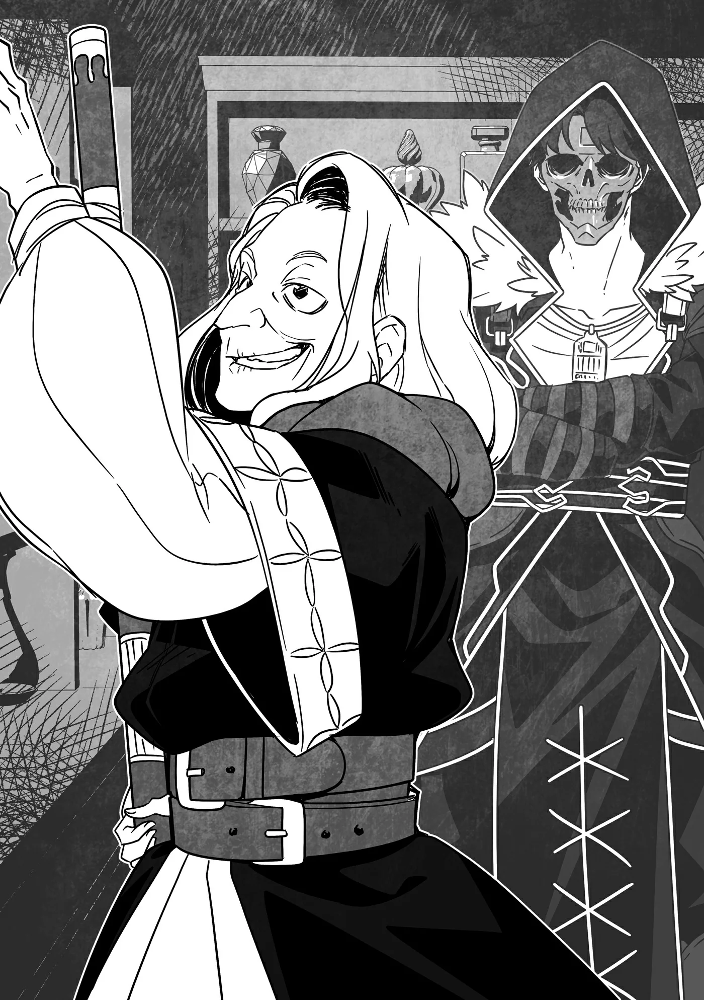

# Chương 314: Tập 13 Chương 3 - Chiếc Cốc và Người Thuần Hóa Quái Vật (5)

"Giờ thì quay lại lý do hai đứa đến đây: học cách trở thành người thuần hóa quái vật."

Lorraine và tôi gật đầu.

"Trước đó ta cũng có nhắc rồi, Lorraine điều khiển Ma Lực rất cừ," Ingo tiếp tục. "Nên sau khi nắm vững căn bản, cháu cứ chuyển thẳng sang thực hành thì sẽ tốt hơn—trừ phi cháu có ý kiến gì khác, dĩ nhiên rồi."

"Không, cháu hoàn toàn không có ý kiến gì đâu bác," Lorraine đáp. "Nếu bác thấy thế là tốt nhất thì cháu xin nghe theo. Trong lĩnh vực này cháu hoàn toàn là kẻ nghiệp dư mà."

"Tốt lắm. Còn con thì sao hả Rentt? Bà Gharb bảo ta con cũng khá giỏi khoản điều khiển Ma Lực đấy chứ. Chịu khó bỏ chút công sức thì chắc con cũng học được nghề thuần hóa quái vật thôi."

"Hả? Con á? Chuyện đó thì..."

Tôi về lại Hathara vốn là để nhờ bà Gharb và Capitan rèn giũa lại, nhưng nếu học thêm cả cách thuần hóa quái vật thì sao nhỉ? Liệu chuyện đó có giúp ích gì cho tôi sau này không?

Chỉ còn chưa đầy một tháng nữa là tới kỳ thi thăng hạng Ngân Cấp, nên tôi thừa hiểu nếu nổi lòng tham mà ôm đồm quá nhiều thứ thì mình sẽ chẳng còn đủ thời gian. Dẫu vậy, suốt từ hồi còn nhớ được đến giờ, tôi đã quen phải học đủ mọi kỹ năng mới để bươn chải kiếm sống. Bản tính ấy đã ngấm sâu vào máu thịt tôi, và giờ đây chính nó lại thôi thúc tôi đừng bỏ lỡ cơ hội mới mẻ này.

Tôi quyết định nói thật. "Như ban nãy con có nói, con về đây chủ yếu để nhờ bà Gharb và Capitan đánh giá lại kỹ năng chiến đấu chuẩn bị cho kỳ thi thăng hạng Ngân Cấp sắp tới," tôi nói. "Con không chắc mình có thể dành ra bao nhiêu thời gian để học thuần hóa quái vật nữa, nên là..."

"Cũng phải," Ingo nói. "Con cứ bàn chuyện đó với hai người họ xem sao. Ta cũng chỉ dạy cho con mấy điều căn bản thôi nên chắc chẳng mất nhiều thời gian đâu—cơ mà ta đoán nhanh hay chậm còn tùy xem con có khiếu hay không nữa. Cứ nói chuyện với bà Gharb và Capitan rồi hãy quyết định."

◆◇◆◇◆

"Thế nên cháu mới tìm tới chỗ ta."

Bà Gharb là một bà lão vừa làm dược sư của Làng Hathara, lại vừa là một ma pháp sư đáng gờm. Tôi ghé qua nhà bà ấy—nơi kiêm luôn tiệm thuốc—mà chẳng báo trước tiếng nào, nhưng bà ấy không hề tỏ ra ngạc nhiên. Dù sao thì bà Gharb cũng biết về các ma pháp trận dịch chuyển mà. Dẫu vậy, bà ấy vẫn hỏi lý do tôi tới đây, nên tôi đã tóm tắt sơ qua đầu đuôi câu chuyện.

Nhân tiện thì hôm nay tôi đi một mình; Lorraine đã bắt đầu học thuần hóa quái vật với cha tôi rồi. Tôi đợi cho tới khi đưa ra quyết định dứt khoát cũng chẳng sao, nhưng tôi biết cô ấy khó lòng cưỡng lại cơ hội tiếp thu điều gì mới mẻ, nên tôi bảo cô ấy cứ bắt đầu trước mà không cần chờ tôi. Vả lại, nếu cô ấy đi trước một bước, sau này có thể giúp tôi bằng cách chỉ lại mấy ngón nghề cô ấy học được. Theo những gì tôi nhớ từ hồi còn nhỏ, dạy dỗ không phải sở trường của cha tôi, nên khéo tôi học lại bài giảng đã được Lorraine hệ thống hóa bài bản có khi lại nhanh hơn.

"Vâng," tôi đáp. "Bà và Capitan là những người thầy đầu tiên của cháu. Lorraine có thể dạy cháu về ma thuật thì đúng rồi, nhưng cháu muốn được rèn lại từ những bước căn bản nhất. Nghề thuốc từ bà, còn kiếm thuật và kỹ năng chiến đấu từ Capitan."

Người ta có thể nghĩ tôi chẳng việc gì phải rèn lại nghề thuốc làm chi, nhưng nghĩ thế là lầm to. Dù ngày trước bà Gharb từng nhồi vào đầu tôi cả đống kiến thức, nhưng suốt thời gian làm mạo hiểm giả ở Maalt, tôi đâu có mấy dịp vận dụng hết toàn bộ những gì mình từng học. Kéo theo đó, những phần kiến thức lâu ngày không đụng tới đã bắt đầu mờ nhạt dần trong trí nhớ của tôi.

Một mạo hiểm giả Đồng Cấp ngày ngày chém quái kiếm sống thì làm gì có mấy cơ hội phô diễn hiểu biết về thảo dược, nhưng việc nhận diện và sử dụng các loài thực vật hữu ích là một kỹ năng rất có giá trị—và là thứ tôi muốn duy trì.

Còn về kiếm thuật thì khỏi phải bàn rồi, vả lại Capitan cũng là một bậc thầy trong việc vận dụng Khí Lực. Bản thân tôi cũng dùng được đôi chút, nhưng còn lâu mới theo kịp trình độ của chú ấy. Chẳng có cách nào khác: tôi cần phải được rèn giũa lại từ đầu.

Ánh mắt bà Gharb hơi sắc lại khi nghe tôi giải thích. "Cháu quên mất mấy đơn thuốc với cách điều chế ta từng dạy rồi chứ gì?"

Chết dở. Quả này chắc chắn bà ấy sẽ mắng cho một trận nên thân. Nhưng mà giấu giếm vào lúc này cũng chẳng ích gì. "Một chút thôi ạ..." tôi đành thú nhận.

Bà Gharb thở dài, ánh mắt nhìn tôi cũng dịu đi phần nào. "Thật là... Mà kể ra cũng chẳng có gì lạ, dù sao ta dạy cháu cũng hơn mười năm rồi, vả lại cháu đâu phải dược sư chuyên nghiệp. Mớ kiến thức đó có khi cháu chỉ dùng vài phần phục vụ cho công việc mạo hiểm giả, số còn lại bị mai một đi âu cũng là lẽ thường tình."

"Cháu cảm ơn bà đã thông cảm."

"Có điều thời gian không có nhiều. Nghĩa là nên tập trung vào những thứ cháu đã quên mà lại có ích cho kỳ thi sắp tới."

"Tất nhiên rồi ạ. Nhưng cháu cũng muốn học lại cả những phần còn lại nữa, nên sau này cháu có thể nhờ bà chỉ dạy thêm được không?"

"Được chứ, ta chẳng phiền đâu... À! Ta suýt nữa thì quên. Trữ lượng Ma Lực của cháu đã tăng lên đáng kể rồi đúng không? Giờ ta có thể dạy cháu về ma dược được rồi đấy."

Đề nghị của bà ấy làm tôi bất ngờ. Khi bán thuốc cho dân làng, bà Gharb chẳng bao giờ cất công giải thích xem đó là thuốc thông thường hay ma dược, dù bà ấy làm cả hai loại và theo thông lệ người ta thường phải giải thích cặn kẽ hơn nhiều, bởi giá cả khác nhau tùy vào từng loại thuốc và mỗi người lại có phản ứng khác nhau trước cùng một thứ thuốc.

Tuy nhiên, chuyện đó chưa từng là vấn đề đối với bà Gharb, bởi lẽ thuốc điều chế ra chỉ bán cho người trong Làng Hathara, mà bà ấy thì nhẵn mặt tất thảy bọn họ. Bà ấy cũng nắm rõ thể trạng từng người tới mức chỉ cần nghe họ kể triệu chứng là đã bốc xong một thang thuốc. Dù danh nghĩa là một dược sư, nhưng về bản chất bà ấy làm công việc của một thầy thuốc kiêm thầy trị liệu.

Dù sao đi nữa, tôi rất biết ơn lời đề nghị của bà ấy. Lorraine cũng là một chuyên gia về ma dược, nhưng cô ấy được đào tạo ở Đế Quốc, đồng nghĩa với việc phương pháp của cô ấy khác xa so với những gì bà Gharb từng dạy tôi, và vì công việc của cô ấy còn đòi hỏi cả kiến thức thuật giả kim, nên nếu học từ cô ấy thì tiến độ của tôi chắc phải tính bằng năm.

Tất cả những điều đó khiến mỗi lần Lorraine điều chế ma dược, tôi cùng lắm chỉ phụ giúp được mấy việc lặt vặt. Dĩ nhiên, nếu mười năm trước tôi có nhiều Ma Lực như bây giờ thì tôi đã có thể dành thời gian học từ cô ấy, nhưng lượng Ma Lực của tôi tăng vọt cũng chỉ là chuyện mới xảy ra gần đây. Tôi đã ưu tiên học ma thuật, còn việc điều chế thuốc thì để lại cho cô ấy.

Nhưng nếu bà Gharb đã bảo sẽ dạy tôi... Chà, thế thì sẽ chẳng đòi hỏi kiến thức thuật giả kim như phương pháp của Lorraine; nó sẽ chỉ là phần mở rộng từ kỹ năng dược sư của tôi mà thôi.

Có điều vẫn còn một yếu tố khiến tôi băn khoăn.

"Liệu kiến thức với lượng Ma Lực của cháu hiện giờ đã đủ để học ngay chưa ạ?" tôi hỏi.

"Tàm tạm rồi," bà Gharb đáp. "Nhưng đừng có hiểu lầm. Ta sẽ không dạy hết tất thảy những gì ta biết về điều chế ma dược cho cháu đâu—chỉ những điều căn bản thôi. Mà dẫu vậy, biết cách tự chế lấy một hai lọ thuốc hồi phục cũng tạo nên khác biệt lớn vào những lúc ngặt nghèo đấy chứ, đúng không?"

Thuốc hồi phục có cả dạng thông thường lẫn dạng ma thuật, nhưng đúng như người ta vẫn nghĩ, loại sau mang lại hiệu quả cao hơn. Thuốc ma thuật cũng có những ưu điểm khác—chẳng hạn như thời gian điều chế nhanh hơn. Dù vậy, chúng không hẳn vượt trội về mọi mặt. Thuốc thông thường nếu được điều chế thật sự tỉ mỉ thì hiệu nghiệm có khi còn tốt hơn, thế nên nắm được cả hai cách hiển nhiên là lựa chọn tối ưu nhất.

"Bà nói phải," tôi đồng tình. "Cháu cảm ơn bà. Cơ mà nếu năm xưa cháu đủ giỏi giang thì giờ chúng ta đâu cần phải bàn chuyện này."

"Muộn còn hơn không. Những người điều chế được ma dược hiếm hoi chẳng kém gì các ma pháp sư, nhưng giờ cháu đã đủ giỏi để bắt đầu học rồi. Cháu nên biết ơn vì điều đó đi."

"Vâng... bà nói đúng."

Mặt trái của việc sức mạnh thăng tiến là tôi đã biến thành một con quái vật, nhưng than vãn chuyện đã rồi cũng chẳng ích gì. Đằng nào thì sau này tôi cũng sẽ tìm cách trở lại làm con người, nếu làm được. Tạm gác chuyện đó sang một bên, ngoài việc rèn lại nghề thuốc thì tôi còn một điều nữa muốn hỏi bà Gharb.

"À phải rồi. Bà có biết Capitan đang ở đâu không ạ? Cháu có qua lán săn của chú ấy nhưng không thấy đâu cả."

Thực ra tôi đã định tới gặp Capitan trước khi sang chỗ bà Gharb, bởi tôi nghĩ mình nên ưu tiên rèn kiếm thuật và Khí Lực hơn. Thế nhưng chú ấy lại vắng nhà, thành ra tôi mới ghé qua đây. Capitan thường ở nhà riêng hoặc ở lán săn nơi cánh thợ săn hay tụ tập, vậy mà cả hai chỗ tôi đều chẳng thấy chú ấy đâu. Những thợ săn khác cũng không biết chú ấy đi đâu, nên tôi nghĩ bụng qua hỏi bà Gharb xem sao.

"Nhắc mới nhớ, Capitan đi ra bờ biển rồi. Ta có nhờ cậu ấy đi lấy vài thứ nguyên liệu làm thuốc cho ta."

Bà ấy nói ra điều đó thản nhiên tới mức người ta có thể tưởng đây là chuyện thường ngày ở huyện, nhưng tôi dám chắc bất kỳ dân làng Hathara nào nghe thấy cũng sẽ phải giật mình ngoái lại.

"Ra bờ biển á?" tôi nhắc lại. "Chỗ đó cách đây bao nhiêu cây số cơ chứ?"

Đúng như người ta có thể đoán: quanh Làng Hathara chẳng hề có biển—thậm chí đi ròng rã suốt một tuần đường cũng chưa chắc tới.

Bà Gharb mỉm cười. "Biết rõ sự tình rồi mà cháu còn tính toán chuyện khoảng cách làm gì? Chẳng phải chính cháu cũng vừa rút ngắn cả tuần đường đi đó sao?"

À, phải rồi. Hóa ra Capitan đã đi bằng cách đó.

"Ồ. Chú ấy dùng ma pháp trận dịch chuyển..."

◆◇◆◇◆

"Đúng thế đấy," bà Gharb xác nhận. "Nếu cháu muốn gặp cậu ấy thì phải đích thân đi một chuyến thôi, Rentt."

"Sao lại thế?" tôi hỏi. "Chú ấy cũng sắp về rồi còn gì?"

"Thì đúng, nhưng cháu đang gấp gáp về thời gian mà, phải không? Có khi một tháng nữa cậu ấy mới về, mà cũng có khi không. Khó nói lắm."

"Hả...?"

"Cháu về không đúng lúc chút nào. Thứ nguyên liệu ta nhờ lấy hơi phiền phức để kiếm, mà đôi khi còn chẳng có sẵn nữa kia. Biết trước cháu về thì ta đã khoan hẵng nhờ cậu ấy đi lấy rồi."

"Là nguyên liệu gì thế bà?"

"Một loài thực vật biển có tên là hải linh thảo. Cháu hầu như chẳng bao giờ thấy nó được bày bán ở Yaaran đâu. Cơ mà nó lại là thuốc đặc trị bệnh gỉ ma lực, nên là..."

"Đó là bệnh gì vậy?"

"Đó là chứng bệnh khiến cho Ma Lực bị đông kết ở bề mặt bên ngoài, tạo thành một lớp màng như gỉ sét trên cơ thể. Chắc ở Vương Quốc Yaaran chẳng mấy khi gặp đâu; nó hơi giống một loại bệnh đặc hữu, chủ yếu giới hạn ở những khu vực gần các khu mỏ bên trong Đế Quốc."

"Nhưng bà lại cần thuốc chữa, nghĩa là... trong làng có người mắc bệnh sao?"

"À không. Một người bạn của ta bên Đế Quốc mắc phải. Lại còn là ca bệnh khá nặng nữa, nên người ta mới nhờ xem ta có giúp được gì không."

"Sao lại phải tìm đến bà? Chẳng lẽ dược sư bên Đế Quốc không tự điều chế thuốc chữa được sao?"

"Thực ra, bệnh gỉ ma lực chủ yếu được chữa trị bằng Thần Lực. Nhưng dùng Thần Lực chữa được hay không lại tùy thuộc vào năng lực của người sử dụng, điều này hẳn cháu cũng hiểu rõ. Bệnh tình của người bạn ta đã vượt quá khả năng cứu chữa của Thánh Giả ở địa phương đó rồi."

"Nếu đã như vậy thì cháu đâu thể chạy đi kéo Capitan về cho được."

"Cũng may đây không phải chứng bệnh có thể gây chết người ngay tức khắc hay gì. Có điều nó cản trở cử động nên sinh hoạt hằng ngày phiền toái lắm. Chắc chắn đó là thứ bệnh mà người ta muốn chữa càng sớm càng tốt."

"Cháu hiểu rồi ạ," tôi lẩm bẩm, thoáng chút thất vọng. "Cháu sẽ không tính đến chuyện nhờ Capitan nữa."

Bà Gharb ngẫm nghĩ một thoáng rồi ngước lên nhìn tôi. "Thực ra thì..."

"Sao hả bà?"

"Ta chợt nảy ra ý này—cháu có nghĩ mình có thể tới chỗ Capitan phụ tìm hải linh thảo không?"

"Chuyện đó... bà có chắc cháu tới đó không làm vướng chân chú ấy chứ? Cháu còn chẳng biết hình dạng nó ra sao, huống hồ là cách thu hái."

"Đúng là thế, nhưng cháu là tay thu hái thảo dược kỳ cựu rồi còn gì? Hai người cùng tìm thì hiển nhiên nhanh hơn một mình Capitan rồi. Còn về hình dáng, ta có thể đưa cho cháu bức vẽ minh họa để đối chiếu, rồi cháu nhờ cậu ấy kiểm tra lại sau. Vả lại, cháu về đây để rèn luyện cơ mà, đúng không? Quái vật ngoài đó cũng khá mạnh đấy, nên ta nghĩ chúng sẽ là đối thủ thích hợp cho cháu. Cứ vừa tìm thảo dược vừa nhờ Capitan chỉ dạy cách vận dụng Khí Lực. Một công đôi việc."

"Cháu không chắc thành ngữ đó dùng ở đây có chuẩn không nữa..."

"Chuẩn quá đi chứ còn gì. Nghe này, cháu cứ tới đó xem tình hình thế nào, nếu Capitan thấy cháu vướng chân thì quay về đây. Trong lúc đó, ta sẽ soạn sẵn vài bài học hữu ích cho việc chuẩn bị thi cử của cháu. Ta chẳng dạy được gì cho cháu về Khí Lực đâu, nên cháu đành chịu khó học thứ khác vậy..."

"Thế là tốt lắm rồi ạ—bà cứ dạy cho cháu khóa cấp tốc về ma dược đi. Chứ cháu mà ham học quá nhiều thứ cùng lúc thì khéo chẳng thứ nào ra hồn mất."

"Thế à? Vậy cứ thế đi nhé. Chúc cháu lên đường bình an, Rentt."

"Vâng ạ."

◆◇◆◇◆

"Vậy ngày mai anh sẽ tới chỗ Capitan à?" Lorraine hỏi lại để xác nhận. "Một mình sao?"

Cả nhóm chúng tôi đang quây quần bên bàn ăn trong nhà, cùng nhau dùng bữa tối. Mẹ Gilda ra ngoài chia phần đồ ăn cho những người khác trong làng, nên giờ chỉ còn tôi, Lorraine và Ingo. Điều đó đồng nghĩa với việc chúng tôi có thể thoải mái bàn về các ma pháp trận dịch chuyển—dù một khi mẹ quay về, chúng tôi sẽ chuyển sang chủ đề khác an toàn hơn.

"Ừ," tôi đáp. "Nên tôi sẽ không học mấy bài thuần hóa quái vật được rồi. Từng này việc đã đủ bù đầu rồi, ráng ôm thêm nữa thì tham lam quá."

"Cũng đúng," Lorraine nói. "Đằng nào sau này khi nắm vững rồi tôi cũng có thể chỉ lại cho anh mà. Tôi đoán lúc này việc thuần thục Khí Lực là ưu tiên cấp bách hơn đối với anh."

Thuật thuần hóa quái vật xoay quanh việc huấn luyện các sinh vật khác tuân theo mệnh lệnh của mình, nên nó không trực tiếp gia tăng năng lực chiến đấu của bản thân. Xét việc mục tiêu trước mắt của tôi là vượt qua kỳ thi thăng hạng Ngân Cấp, thì nâng cao khả năng vận dụng Khí Lực hiển nhiên là lựa chọn sáng suốt hơn.

"Cơ mà hiện tại Capitan đang ở đâu thế?" Lorraine hỏi. "'Bờ biển' thì có thể là nhiều nơi lắm đấy."

"Vì cậu ấy dùng ma pháp trận dịch chuyển, nên nhiều khả năng là đang ở Cộng Hòa Hàng Hải Ariana ở phía nam," Ingo lên tiếng. "Một trong các ma pháp trận dẫn tới rất gần nơi đó."

"Ariana... Thương nhân ở đó có sức ảnh hưởng rất lớn. Gần đây ở Maalt tôi cũng thấy thương nhân của họ xuất hiện nhiều hơn. Trước đây đâu có đông đến thế."

"À phải rồi," tôi nói. "Đợt trước cô đứng ra giảng hòa khi một người trong số họ cãi vã với bạn của Rina đúng không, Lorraine?"

"Tôi không nghĩ nên gọi chuyện đó là giảng hòa đâu..."

"Biết đâu đấy—tôi nghĩ nếu cô không can thiệp thì khéo đã thành chuyện ầm ĩ rồi. Tạm gác chuyện đó sang một bên, nếu tôi nhớ không lầm thì người thương nhân đó không hẳn là trường hợp điển hình. Đơn cử như việc người đó còn mang theo cả Nguyền Cụ nữa."

"Tôi thì không chắc đâu. Ariana là nơi người ra kẻ vào tấp nập, và tôi nghe nói việc kiểm tra mấy thứ đồ kiểu đó ở đấy khá lỏng lẻo. Tôi không nghĩ việc đem nguyền phẩm ra vào đất nước đó lại khó khăn đến thế—nghĩa là chỉ cần chịu khó một chút thì người ta hoàn toàn có thể kiếm được chúng."

"Nghe có vẻ là một nơi đáng sợ ghê..." tôi lẩm bẩm.

"Dù các cháu có thấy sợ hay không, thì đúng là Ariana khá lỏng lẻo trong khâu kiểm soát đấy," Ingo nói. "Bản thân ta từng tới đó rồi, khi bước vào một thị trấn người ta thậm chí còn chẳng buồn hỏi giấy tờ tùy thân nữa kia."

"Chuyện đó không ảnh hưởng tiêu cực tới an ninh trật tự sao bác?" Lorraine hỏi.

"Ta thấy trị an cũng không đến mức bất ổn cho lắm," Ingo nói. "Mọi vụ náo loạn đều nhanh chóng bị đội cận vệ tư nhân của một thương nhân có thế lực nào đó dẹp yên. Dù tốt hay xấu, điều đó càng khắc sâu một thực tế rằng đất nước ấy do giới thương nhân điều hành, và tốt nhất là chớ dại đắc tội với bọn họ. Con nên cẩn thận đấy, Rentt—con thuộc cái tạng người lúc nào cũng dính vào rắc rối mà."

"Thôi nào cha. Con sẽ ổn thôi mà." Ít nhất thì tôi có thể bảo đảm rằng mình chưa từng cố ý chuốc lấy rắc rối bao giờ. Chắc vậy.

"Nghe chẳng có chút sức thuyết phục nào cả," Lorraine nhận xét. "Dù vậy, tôi đoán nếu có chuyện gì xảy ra thì anh vẫn có thể dùng ma pháp trận dịch chuyển để tẩu thoát. Cứ phải mở to mắt mà quan sát đấy, nhớ chưa?"
