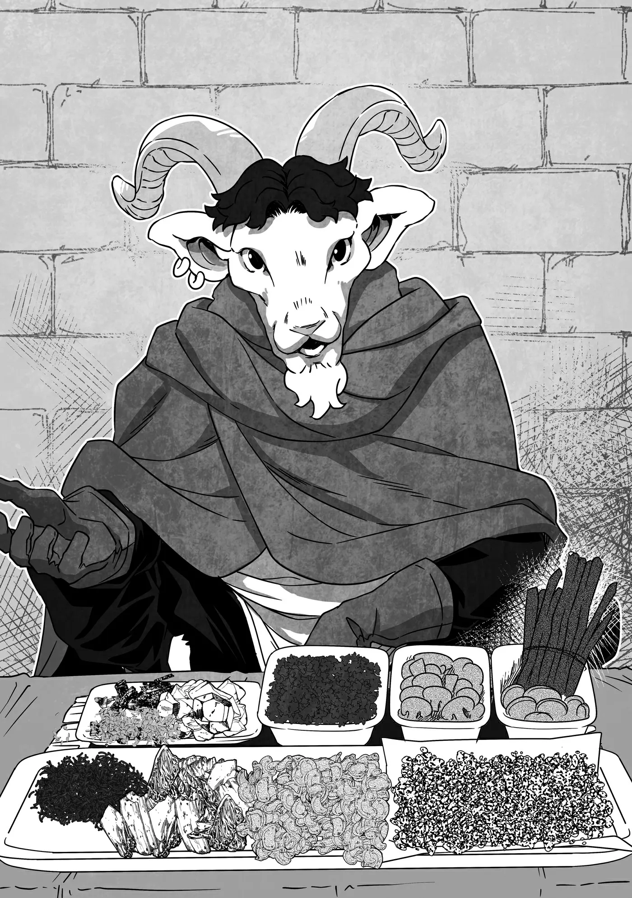

# Chương 316: Tập 13 Chương 4 - Đến Quốc Gia Hàng Hải (2)

Vừa sải bước qua cánh cổng thành Lucaris, tôi đã bị choáng ngợp.

Lượng người ở đây đông đến mức khiến dân số Maalt chẳng thấm vào đâu nếu đem ra so sánh. Dẫu vậy, tôi cũng đã lường trước điều này, bởi Maalt vốn dĩ chỉ là một thị trấn nhỏ nơi biên viễn. Điều tôi thật sự không ngờ tới chính là sự đa dạng chủng tộc đến kinh ngạc nơi đây—cứ như thể tôi vừa bước chân sang một thế giới khác vậy.

Ngay cả vương đô của Yaaran cũng chẳng sở hữu sự đa dạng đến mức này. Tôi vẫn luôn biết quê mình có phần hẻo lánh và tụt hậu, nhưng cảnh tượng trước mắt mới thực sự khắc sâu điều đó vào tâm trí tôi.

Hơn nữa, những dãy nhà ở đây trông cũng vô cùng cuốn hút. Tuy kiểu kiến trúc bằng gạch đá phổ biến giống bên Yaaran xuất hiện đầy rẫy, nhưng những tòa nhà rực rỡ sắc màu mà tôi chưa từng thấy ở quê nhà cũng nhiều chẳng kém. Mà không biết có phải do tôi tưởng tượng hay không, nhưng phần lớn những người ra vào các tòa nhà đó dường như đều thuộc các chủng tộc khác ngoài con người? Toàn bộ những nét kiến trúc này bắt nguồn từ quê hương họ, hay chỉ là nét đặc thù riêng biệt của Ariana?

"Chết thật. Không thể cứ để mình mải mê nhìn ngó mãi thế này được. Xem nào... quán trọ ở đâu được nhỉ...?"

Dù chỉ đi dạo quanh Lucaris thôi cũng đủ mở ra bao phát hiện mới mẻ và thú vị, nhưng dẫu có tính lát nữa sẽ lượn quanh thành phố để tìm Capitan đi chăng nữa, trước hết tôi vẫn cần phải tìm cho mình một chỗ trọ đã.

Nếu có thể, tôi muốn tìm thấy Capitan trước khi ngày hôm nay khép lại, ngặt nỗi việc lùng ra một người giữa thành phố rộng lớn cỡ này quả thực chẳng dễ dàng gì. Bà Gharb có chỉ cho tôi vài nơi chú ấy có thể lui tới, nhưng rủi mà chú ấy nổi hứng ghé bừa vào một quán rượu nằm sâu trong con hẻm nào đó thì cơ hội lần ra dấu vết coi như bằng không. Chắc hẳn Capitan phải có kha khá chỗ quen ở đây, và có lẽ chú ấy cũng chẳng buồn kể hết từng nơi một cho bà Gharb nghe.

"Xin lỗi, tôi muốn mua một bó thảo dược đằng kia."

Trong lúc rảo bước trên những con phố chính để tìm quán trọ, tôi bắt gặp khá nhiều sạp hàng rong. Ngó nghiêng những gian hàng như thế này vốn là một thú vui của tôi mỗi khi dạo quanh Maalt, và tôi cũng chẳng kiềm lòng được mà làm điều tương tự ở Lucaris. Nhưng tôi xin thề là mình không chỉ đơn thuần la cà theo sở thích đâu đấy...

"Ồ? Mắt nhìn tốt đấy, người anh em," người đàn ông thú nhân vừa đưa bó cây vừa nói. "Đây là hàng thượng hạng nhất trong chỗ của tôi đấy."

Người này mang những đặc điểm của loài dê, nên có lẽ gọi là "thú nhân dê" thì sẽ chính xác hơn. Bộ lông của anh ta có màu đen, còn phía sau đầu mọc ra một cặp sừng. Tôi nhớ chủng tộc của anh ta vốn xuất thân từ những vùng đồi núi, nên hiếm khi người ta bắt gặp một người trong số họ ở thành phố.

Về phần số thảo dược, tôi mua chúng là vì đây là loại cây tôi gần như chẳng bao giờ thấy ở các đồng cỏ hay trong rừng.

"Tôi là dược sư, hoặc ít nhất cũng gần như vậy," tôi giải thích. "Xét về khoản chọn lựa cây cỏ thì anh cứ coi tôi là dân sành sỏi cũng được."

"Thật sao? Thế thì có khi anh cũng hứng thú với mấy món này đấy." Người đàn ông thú nhân dê mở một chiếc giỏ trong chồng đồ phía sau lưng, rồi bày vài loại cây khác nhau lên tấm chiếu của mình.

"Phải trèo lên những ngọn núi cực kỳ cao mới hái được hết đống cây này... Tôi lấy trọn gói chỗ đó nhé."

"Chà, anh hào phóng thật đấy! Chắc chứ?" Người thú nhân dê chỉ vào những cây thảo dược hiếm nhất trong số vừa bày ra. "Mấy cây này giá không rẻ đâu."

Tôi gật đầu. "Tôi trả nổi mà—vả lại nếu bỏ lỡ dịp này thì chắc còn lâu lắm tôi mới lại bắt gặp chúng. Trừ phi anh cũng hay thu hái được chúng đều đặn."

"Mấy loại kia thì đúng thế, nhưng riêng mấy cây này thì phải may mắn lắm mới tìm được. Cả thảy... ba đồng vàng, anh thấy thế nào?"

"Thật sao?"

"Đắt quá... hả anh?"

"Ngược lại ấy chứ—giá hời quá chừng. Tôi chốt nhé. Của anh đây." Tôi đưa tiền cho anh ta.

"Ồ-Ồ. Tôi cứ ngỡ anh sẽ mặc cả đòi bớt giá chứ..."

"Khách của anh lúc nào cũng làm thế à?"

"Hầu như là vậy... Đám thú nhân bọn tôi đi đến đâu cũng lạc lõng giữa xứ người. Thành thử khó mà ngẩng cao đầu hay cãi lại được. Dẫu sao thì đây vẫn là một trong những nơi sống ổn nhất mà tôi từng ở." Nét mặt người thú nhân dê thoáng vẻ đượm buồn.

Con người thường nhìn nhận các chủng tộc khác bằng ánh mắt định kiến, và thú nhân cũng không phải ngoại lệ. Có đủ loại lý do dẫn tới điều đó, nhưng nguyên nhân lớn nhất đơn giản là loài người thường có xu hướng co cụm cục bộ và bài ngoại.

Dĩ nhiên là bản thân tôi không hề có lối suy nghĩ ấy. Có lẽ thói định kiến đó phổ biến hơn ở chốn đô thành—chứ quanh vùng Maalt thì chẳng ai thực sự bận tâm xem người khác thuộc chủng tộc nào. Điều này càng khiến tôi thêm yêu mến những vùng quê thôn dã.

"Cộng Hòa Ariana sống có tốt không?" tôi hỏi. "À, cơ mà ý tôi là nói riêng về thành phố Lucaris này ấy."

"Tốt chứ. Thành phố này cũng có những vấn đề riêng, nhưng thú nhân dê như tôi vẫn có thể sống ổn ở đây. Trước kia tôi từng sống ở Đế Quốc, bên đó tệ hại vô cùng; còn ở đây, chuyện tệ nhất tôi phải chịu cũng chỉ là bị nạt nộ đôi chút và ai nấy đều cố ép giá xuống thôi."

Từ những gì anh ta chia sẻ thì hẳn cũng đủ thấy, thú nhân có xu hướng sống lang bạt nhiều hơn con người và chẳng mấy khi ở yên một chỗ lâu dài. Nếu không thích một vùng đất nào đó, họ sẽ nhanh chóng bỏ lại nó sau lưng. Có lẽ điều ấy cũng góp phần khiến con người nhìn nhận họ với ánh mắt định kiến.

Cơ mà, Đế Quốc sao? Tôi hiểu được điều đó. Dù không phải ai cũng như vậy, nhưng quê hương của Lorraine mang tư tưởng coi con người là thượng đẳng rất nặng nề. Đó là bởi giáo lý của Giáo Hội Lobelia chủ trương như thế, mà họ thì hiện diện ở khắp mọi ngóc ngách bên ấy. Đó cũng là lý do tôi không muốn tín ngưỡng của họ lan rộng ở Maalt—tôn giáo chính của Yaaran là Giáo Hội Đông Thiên thì hoàn toàn không có thứ tư tưởng đó.

Về phần Ariana, tôi nghĩ chẳng có tôn giáo nào thực sự có chỗ đứng vững chắc ở đây, và đó có lẽ là lý do người dân đối xử với thú nhân chẳng khác gì bất kỳ người ngoại quốc nào khác—tức là với thái độ cởi mở. Đây vốn là quốc gia có nhiều hoạt động ngoại thương, nhập cư và di cư.

"Nghe vậy tôi cũng mừng," tôi nói. "Với cái vẻ ngoài này của tôi, mỗi khi đến những nơi không mấy hiếu khách, tôi cứ hay lo sẽ có kẻ muốn kiếm chuyện gây sự."

"Phải rồi, cái mặt nạ đó mới thoáng nhìn qua thì ai cũng phải khiếp vía. Anh mới đến đây gần đây à?"

"Thực ra là vừa ban nãy thôi. À phải rồi—tôi có chuyện này muốn hỏi."

"Chuyện gì thế?"

"Anh có biết quán trọ nào tốt không? Tôi đang tìm một nơi yên tĩnh, đồ ăn ngon một chút. Giá có hơi đắt đỏ một tí cũng chẳng sao."

Đây cũng là một lý do khác khiến tôi dạo quanh các sạp hàng rong. Tôi cũng có thể hỏi thăm ở quán rượu, nhưng ở đó thì dễ bị cuốn vào ẩu đả hơn, còn bộ dạng này của tôi mà tùy tiện chặn người đi đường thì sẽ dọa người ta chết khiếp mất. Thành thử, tôi đoán tiếp cận một người bán hàng rong là lựa chọn tối ưu nhất.

Thêm vào đó, vì người bán hàng này có vẻ hay đi lại giữa thành phố và vùng núi, hẳn anh ta thường xuyên trọ lại ở các quán trọ nên biết rõ nơi nào tốt nơi nào dở.

Đúng như tôi kỳ vọng, người đàn ông thú nhân dê quả thực biết một quán trọ tươm tất, nên sau khi được anh ta chỉ đường, tôi cảm ơn rồi tiếp tục cất bước.

◆◇◆◇◆

"Giờ thì, mình nên làm gì trước đây..."

Tôi ngồi trên giường trong phòng trọ, tính toán nước đi tiếp theo. Nếu muốn tìm Capitan, điều đầu tiên tôi phải làm sẽ là...

Đúng rồi. Tiến hành tìm kiếm dựa trên những gì bà Gharb đã dặn.

Rủi mà không tìm thấy Capitan, tôi sẽ phải đi quanh thu thập thêm thông tin. Đây là một kế hoạch có phần chắp vá, nhưng tôi cũng chẳng có nhiều lựa chọn khác.

À, nhưng tốt nhất là tôi nên ghé qua Hội Mạo Hiểm Giả trước đã. Capitan đăng ký với tư cách mạo hiểm giả Đồng Cấp, nên có khả năng chú ấy đã nhận một ủy thác thu thập trong lúc đi tìm hải linh thảo.

Trong trường hợp đó, chú ấy hẳn đã ghé qua Hội ít nhất một lần, và rồi sẽ phải quay lại để nộp kết quả ủy thác. Nếu nhờ họ chuyển lời nhắn, thì dù bản thân tôi không tự tìm ra chú ấy, có lẽ tôi vẫn có thể liên lạc được với chú ấy sau một hai ngày.

Cứ túc trực chờ ở Hội là phương án chắc ăn nhất, nhưng nếu Capitan tính gom đủ mọi món đồ được yêu cầu rồi mới đem giao một thể, thì có khi vài ngày liền chú ấy cũng chẳng buồn xuất hiện.

Rốt cuộc, lựa chọn tốt nhất của tôi thực sự vẫn chỉ là tự mình ra ngoài tìm kiếm...

Dù sao đi nữa, giờ tôi cũng đã có kế hoạch. Sau khi nhắn với chủ quán trọ rằng mình sẽ ra ngoài một lát, tôi hướng thẳng về phía Hội Mạo Hiểm Giả.

◆◇◆◇◆

Hội Mạo Hiểm Giả ở Lucaris vừa bề thế hơn nhiều so với ở Maalt lại vừa sặc sỡ hơn hẳn. Nếu nhìn nhận một cách rộng lượng, người ta có thể khen tòa nhà của Hội ở Maalt mang vẻ nghiêm cẩn và thực dụng, nhưng sự thật là nó hoàn toàn đặt công năng lên trên tính thẩm mỹ.

Trái lại, tòa nhà Hội ở Lucaris thì khác hẳn. Trên tường có những bức bích họa tuyệt đẹp, còn từng cây cột, mái hiên hay mái che đều treo đầy những món đồ trang trí lộng lẫy. Từ những hoa văn và nét chạm khắc cầu kỳ, ngay cả một kẻ mù tịt về mỹ thuật như tôi cũng nhìn ra được sức sáng tạo nghệ thuật được dồn vào tất cả những thứ đó.

Trong lòng tôi có chút lo lắng cho độ bền của chúng—chẳng lẽ một Hội toàn những kẻ thô lỗ lại không đập phá hết những thứ đó sao?—nhưng biết đâu mạo hiểm giả ở Lucaris lại thuộc tuýp người có chừng mực. Hoặc giả, ai nấy đều có gu thưởng thức nghệ thuật. Điều đó cũng không hẳn là bất khả thi, xét việc đây là một thành phố lớn.

Nhưng chuyện đó cũng chẳng quan trọng. Tôi bước vào bên trong Hội, vừa đi vừa chiêm ngưỡng những nét nghệ thuật xung quanh. Đúng như tôi dự đoán, nội thất bên trong mang đậm dấu ấn của sự bài trí tinh tế. Tất cả đều toát lên vẻ hoa lệ của chốn đô hội.

Trong khi các quầy tiếp tân ở Maalt xếp thành một hàng dài dằng dặc tạo ấn tượng ban đầu khá đơn điệu, thì mỗi tiếp tân viên ở đây lại có một bàn làm việc riêng biệt với khoảng cách tương đối rộng rãi. Mạo hiểm giả thường hay bị những kẻ tọc mạch nghe lén sau khi bàn giao hàng hóa ủy thác, nhưng thiết kế này sẽ ngăn chặn được chuyện đó.

Đây là một sự đổi mới đáng hoan nghênh so với Maalt, nơi mà Hội chẳng thèm bận tâm đến những chi tiết tinh tế kiểu ấy...

Trong lúc gã nhà quê trong tôi đang lặng lẽ đắm mình vào bầu không khí đô hội, tôi đưa mắt nhìn quanh. Tôi có thể cảm thấy ai đó đang dõi theo mình. Nhưng là ai cơ chứ?

Sau vài khoảnh khắc đảo mắt ngó nghiêng hết cỡ như một con cú mèo, tôi nhận ra toàn bộ cánh đàn ông trong sảnh—nhìn qua thì hẳn là mạo hiểm giả—đều đang trừng trừng nhìn tôi.

Tôi đã làm gì để phải chịu cảnh này chứ? Chẳng lẽ tôi vừa phạm phải điều thất thố gì sao? Nghĩ mãi chẳng ra điều gì... cho tới khi tôi nhớ lại bộ dạng hiện tại của mình.

Do cái mặt nạ này, phải không?

Nghĩ lại thì cũng dễ hiểu thôi. Một ngày nọ, một gã lạ hoắc đeo mặt nạ đầu lâu khoác áo choàng đen tuyền lù lù bước vào Hội của mình. Ý nghĩ đầu tiên nảy ra trong đầu người ta chắc hẳn sẽ là: "Thằng quái nào đây?"

Dẫu vậy, xem chừng chẳng có ai định bước tới kiếm chuyện—họ chỉ đang dán chặt mắt dè chừng gã người lạ mà thôi. Có lẽ tôi cứ lờ họ đi là được.

Nếu họ thực sự tới gây sự, tôi sẽ buộc phải tìm cách giải quyết, nhưng tôi chẳng phải loại người nóng máu đến mức phát cáu chỉ vì vài ánh mắt hình viên đạn đang chĩa vào mình. Nói thật thì, người ta thậm chí còn có thể bảo là tôi cần thêm chút máu nóng ấy chứ—xét cho cùng, lúc nào tôi chẳng thèm uống thêm máu.

Cơ mà, nếu buông một câu đùa như thế trước mặt họ, khéo họ rút phắt vũ khí ra ngay tại trận mất...

Tôi chọn lấy một trong các quầy tiếp tân rồi bước về phía cô gái tiếp tân trẻ tuổi. "Xin lỗi, tôi làm phiền một lát được không?" tôi cất tiếng hỏi.

"Dĩ nhiên rồi. Tôi có thể giúp gì cho anh? Anh đến đây để đăng ủy thác sao? Hay là nhận ủy thác?"

Dù những cái lườm nguýt từ các mạo hiểm giả khác có làm tôi hơi cụt hứng đôi chút, vẻ ngoài của tôi cũng chẳng đến nỗi hoàn toàn vô dụng. Hồi tôi còn là con người, mỗi khi bước vào những Hội Mạo Hiểm Giả chưa quen mặt mình, người ta luôn đinh ninh tôi là khách hàng đến đăng ủy thác. Nhưng từ lúc mang bộ dạng này, họ dường như luôn biết tỏng tôi là mạo hiểm giả đến để nhận việc.

Thôi thì, thứ lỗi cho tôi vì hồi ấy trông chẳng khác gì thường dân nhé. Tôi vốn là một mạo hiểm giả kỳ cựu cơ đấy...

Dẫu vậy, có lẽ lỗi thuộc về định kiến cá nhân của các nhân viên Hội. Quy trình chuẩn mực vốn dĩ là phải lần lượt hỏi cả hai khả năng, y như những gì cô tiếp tân này vừa làm.

"Không phải cả hai," tôi đáp. "Tôi đang tìm một mạo hiểm giả khác có lẽ đang ở trong thành phố, nên tôi muốn gửi lại một lời nhắn cho người đó tại đây."

"Tôi hiểu rồi. Thứ lỗi cho tôi, nhưng bản thân anh cũng là mạo hiểm giả chứ?"

"Đúng vậy. Đồng Cấp." Tôi đưa thẻ mạo hiểm giả của mình ra.

Sau khi kiểm tra, cô tiếp tân nói: "Vâng, mọi thứ đều hợp lệ. Tôi thấy anh đến từ Vương Quốc Yaaran. Một hành trình khá xa đấy nhỉ."

Nếu có thắc mắc vì sao cô ấy lại hỏi tôi có phải mạo hiểm giả hay không, thì đó là vì việc chuyển lời nhắn từ một mạo hiểm giả khác là dịch vụ hoàn toàn miễn phí. Trái lại, nếu tôi là thường dân, tôi sẽ mất vài đồng xu đồng cho một lời nhắn nội bộ—tức là chỉ giới hạn trong phạm vi thành phố. Nếu không quy định như vậy thì ai ai cũng sẽ biến Hội thành cái bảng tin miễn phí mất thôi.

"Đúng vậy, đây là lần đầu tôi tới Ariana. Cơ mà nơi này tuyệt thật đấy. Lucaris là một thành phố rộng lớn—lại còn đẹp nữa—còn tòa Hội ở đây thì quả thực rất khang trang."

Tôi vẫn chưa thể nhận xét gì về phẩm chất của các mạo hiểm giả nơi đây. À thì, ngoại trừ cái chuyện họ trông giống hạng người khó ưa có thể kiếm cớ gây sự với một kẻ lạ mặt vừa bước vào... nhưng tôi đâu cần phải bận tâm nói toẹt điều đó ra làm gì.

Cô tiếp tân có vẻ hài lòng trước lời khen của tôi. "Cảm ơn lời khen của anh. Lucaris có rất nhiều cảnh đẹp để tham quan, nên dù chỉ tản bộ thôi cũng thấy thú vị rồi."

"Tôi sẽ thử xem sao," tôi đáp. "Nhân tiện, tên của người mạo hiểm giả tôi muốn để lại lời nhắn là 'Capitan'. Chú ấy có ghé qua đây không?"

Đó là một cái tên tương đối lạ, nên tôi đoán chỉ bấy nhiêu thôi cũng đủ để khoanh vùng người cần tìm, ngặt nỗi phản ứng của cô tiếp tân lại khiến tôi giật thót mình.

"Capitan ấy sao?! Anh quen chú ấy ư?!"

◆◇◆◇◆

Tôi chớp mắt. "Quen chứ. Tôi đoán là cô cũng biết chú ấy?"

Cô tiếp tân gật đầu lia lịa. "Dĩ nhiên rồi! Chú ấy không sống ở đây, nhưng thi thoảng lại xuất hiện và quét sạch toàn bộ các ủy thác tồn đọng bấy lâu chỉ trong một lượt, kể cả những ủy thác hóc búa mà ai nấy đều né tránh. Một tay chú ấy đã kéo tỷ lệ hoàn thành ủy thác của chi nhánh chúng tôi tăng vọt trong thời gian gần đây đấy!"

Trông cô ấy vui vẻ đến mức bản thân tôi cũng thấy nở mày nở mặt đôi chút. Thật dễ chịu khi được nghe người khác ca ngợi người thầy cũ của mình.

"Vậy sao? Thế tức là hiện tại chú ấy đang đi làm ủy thác rồi à?"

Vốn dĩ có khả năng lần này Capitan tới thành phố chỉ cốt để thực hiện yêu cầu tìm hải linh thảo của bà Gharb, nhưng lời kể của cô tiếp tân khiến khả năng ấy xem ra khó xảy ra hơn.

"Vâng. Như thường lệ, chú ấy gom lấy vài ủy thác đang đóng bụi rồi lên đường. Dù vậy, tất cả chúng đều cùng ở một địa điểm. Tôi nghĩ chú ấy vốn đã nhắm sẵn một điểm đến trong đầu rồi."

Tóm lại, hẳn là chú ấy chỉ nhận những việc ở cùng địa điểm có hải linh thảo, và chắc là không có ý định đi đâu khác. Điều đó cũng hợp lý thôi; bà Gharb đang muốn có số thảo dược ấy càng sớm càng tốt mà.

"Tôi hỏi điểm đến đó là ở đâu được không?" Bản thân tôi cũng đã mường tượng ra rồi, vì bà Gharb từng nói cho tôi biết Capitan sẽ tìm thảo dược ở đâu, nhưng tôi vẫn muốn kiểm tra lại cho chắc.

"Đó là Mê Cung Các Con Gái Của Hải Thần. Chú ấy rời đi từ sáng nay, nên tôi không nghĩ chú ấy sẽ quay về trước lúc mặt trời lặn đâu."

Mê Cung Các Con Gái Của Hải Thần nằm gần Lucaris, và đó đúng là địa điểm mà bà Gharb đã bảo với tôi—mọi chuyện đến đó thì đều ổn thỏa cả. Chỉ có duy nhất một vấn đề...

"Nếu tôi nhớ không nhầm... thì nơi đó nằm dưới đáy biển, phải không?"

"Ồ! Là người phương xa tới mà anh nắm rõ thông tin ghê. Vâng, đúng thế đấy. Lối vào nằm dưới mặt nước, ở ngoài khơi. Thuyền phà chỉ chạy mỗi ngày hai chuyến vào buổi sáng và buổi chiều tối—mặc dù những khi biển động thì việc rời khỏi mê cung là bất khả thi. Dù sao đi nữa, chú ấy cũng sẽ không quay về trước chiều tối đâu."

Đúng như những gì tôi lo sợ. Mê cung tồn tại ở gần như mọi địa hình mà người ta có thể tưởng tượng ra, nhưng ngay cả trong số đó, Mê Cung Các Con Gái Của Hải Thần vẫn là một trong những nơi khó tiếp cận hơn cả. Dù vậy, đó vẫn chưa phải là nơi tệ nhất—từng có một mê cung đã được xác nhận là có lối vào nằm ngay miệng núi lửa.

Người ta hẳn sẽ thắc mắc làm thế quái nào mà ai đó có thể vào bên trong được, nhưng chớ có đánh giá thấp trí khôn của con người. Nghe đâu có một phương pháp thâm nhập đáng tin cậy mà khá nhiều người vẫn thường xuyên sử dụng.

Dĩ nhiên là bản thân tôi chưa từng đến đó bao giờ, nhưng rồi sẽ có ngày tôi phải tới, xét việc mục tiêu của tôi là nhắm tới Mithril Cấp. Tôi sẵn sàng làm bất cứ điều gì để trở nên mạnh mẽ hơn... dẫu trong thâm tâm có đôi phần phản đối cái ý nghĩ phải nhảy thẳng vào miệng núi lửa.

Dẫu sao thì, xét tới mức độ phiền toái mà các mê cung có thể mang lại, Mê Cung Các Con Gái Của Hải Thần nếu đem ra so sánh thì xem chừng cũng chẳng đến nỗi quá tệ. Khỏi phải nói cũng biết các nguyên liệu tìm thấy trong đó khó kiếm đến mức nào, và hải linh thảo chính là một ví dụ điển hình. Môi trường tự nhiên của chúng là những vùng sâu dưới đáy biển—không phải nơi con người có thể tùy tiện dạo bước tới. Thông thường, lựa chọn duy nhất là nhờ cậy một ngư nhân thu hái giúp, nhưng loại thảo dược này lại mọc ở độ sâu mà chỉ một số ngư nhân nhất định mới lặn tới được. Trong tình cảnh đó, phương án khả dĩ tiếp theo để tìm thảo dược chính là lặn lội vào mê cung để săn lùng chúng.

Mỗi mê cung đều có chủng loại nguyên liệu và vật phẩm có thể tìm thấy rất khác nhau. Mê cung ở Maalt sở hữu một hệ vật phẩm đặc thù riêng, và những nơi khác cũng không phải ngoại lệ. Vì Mê Cung Các Con Gái Của Hải Thần nằm dưới nước, nên nhiều nguyên liệu thu hoạch được ở đó đều mang đặc tính thủy sinh—đó là lý do vì sao Capitan lại tới đó để tìm kiếm hải linh thảo.

Cơ mà, chú ấy sẽ không quay về trước chiều tối sao?

"Nếu tôi ra bến cảng vào lúc hoàng hôn thì có gặp được chú ấy không?" tôi hỏi.

"Chắc là được, trừ phi hai người bị lỡ nhau thôi," cô tiếp tân xác nhận.

"Cơ mà ngày nào Capitan cũng ghé qua đây để bàn giao đồ thu hoạch được, nên đến đây chờ thì ăn chắc hơn, à ừm..." Cô ấy nhìn tôi với vẻ dò hỏi.

"Rentt."

"Rentt," cô ấy nhắc lại. "Tôi sẽ báo cho chú ấy biết là anh đã ghé qua, nên chắc chú ấy sẽ nán lại đợi anh thôi."

"Thế sao? Cảm ơn cô nhé. Cơ mà phòng khi chúng tôi vẫn bị lỡ nhau, đây là quán trọ tôi đang ở. Cô có thể nhắn chú ấy ghé qua đó được không?"

"Dĩ nhiên rồi."

Thu xếp xong xuôi chuyện đó, trừ phi có tình huống ngoại lệ nào xảy ra, tôi gần như chắc chắn sẽ gặp được Capitan vào hôm nay hoặc ngày mai. Giờ thì, tôi nên dành quãng thời gian còn lại trong ngày để làm gì đây?

Dạo một vòng quanh thành phố nghe chừng cũng hay đấy. Tôi rời khỏi Hội Mạo Hiểm Giả, háo hức chuẩn bị đi ngắm cảnh một chuyến.
