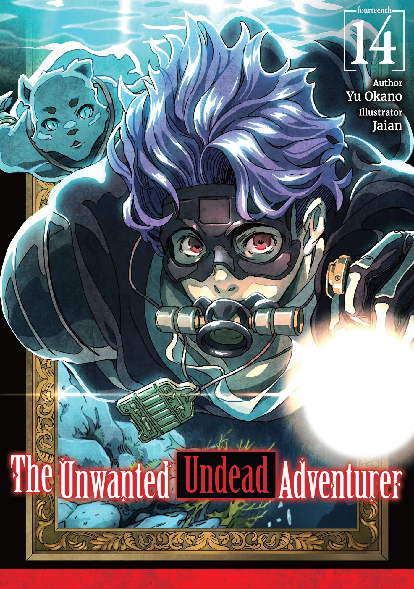
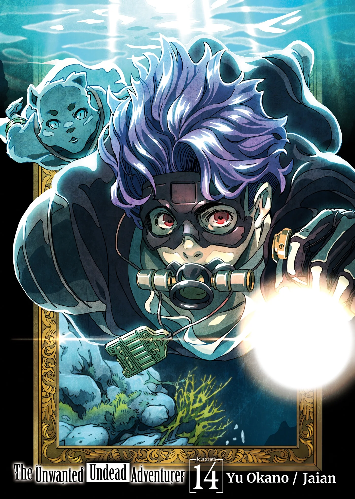
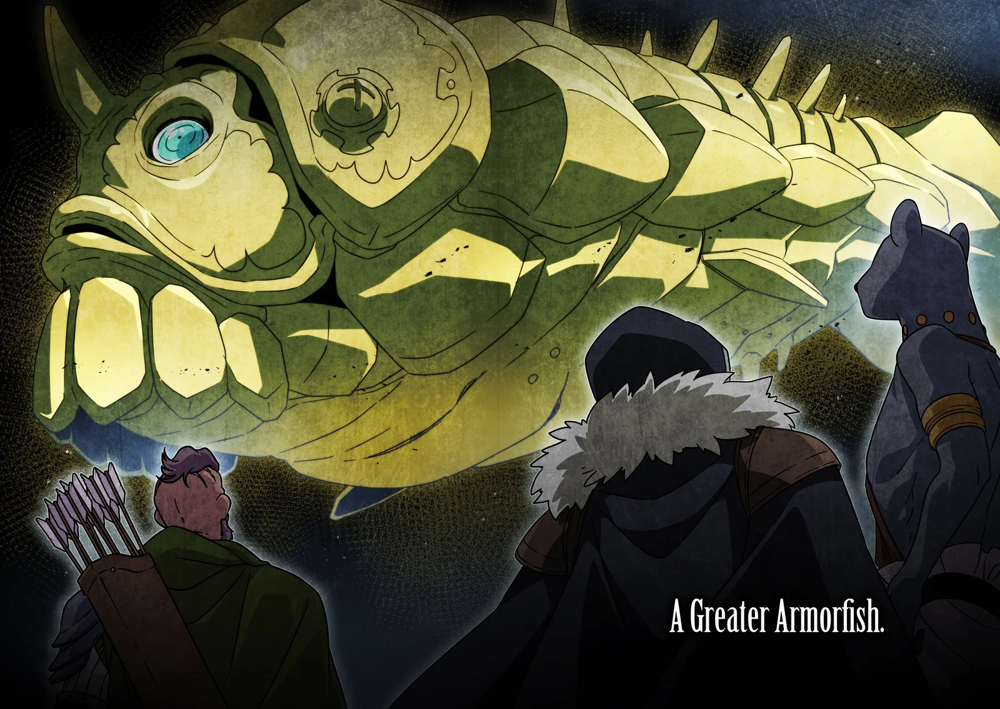
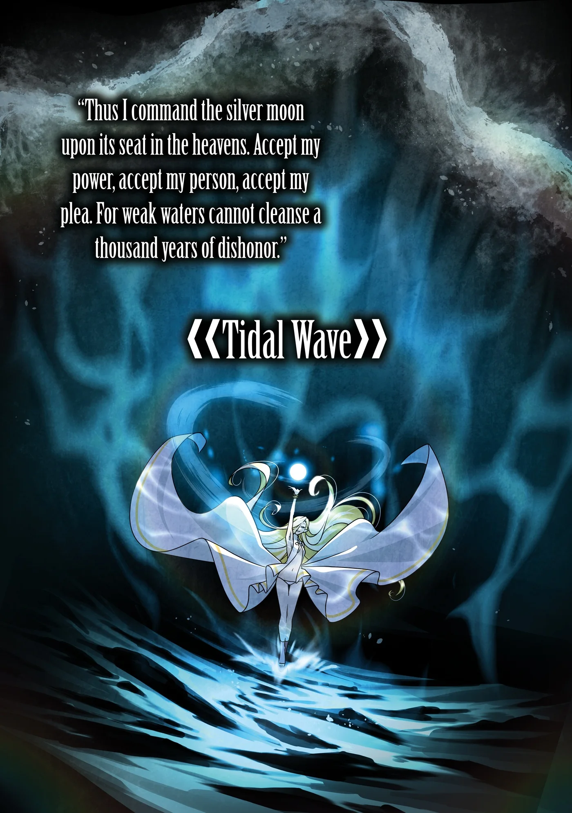
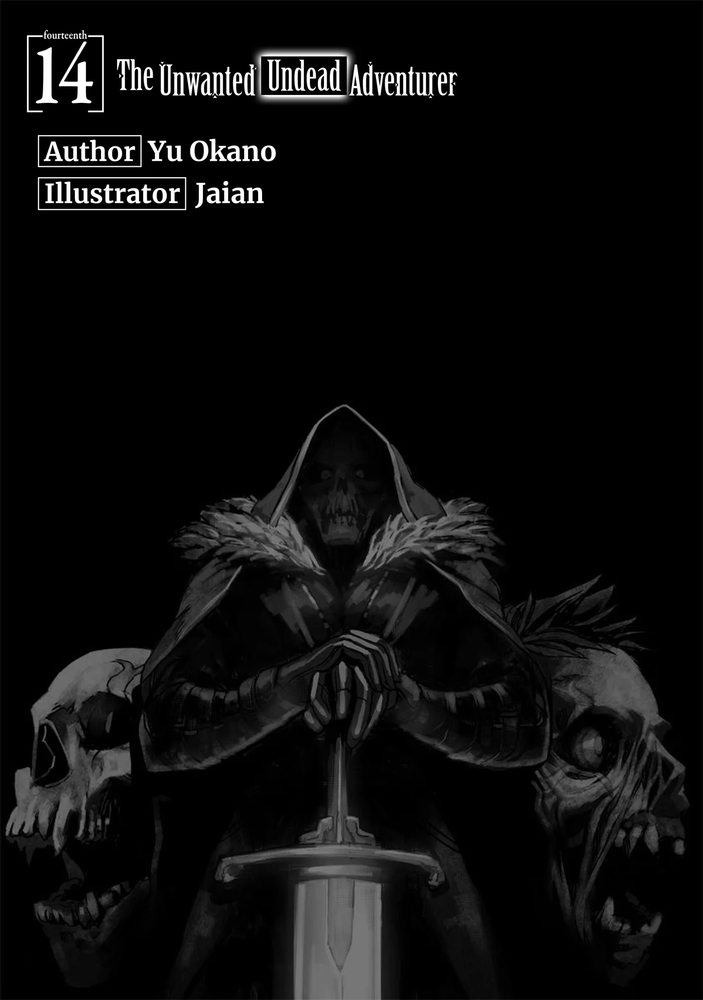
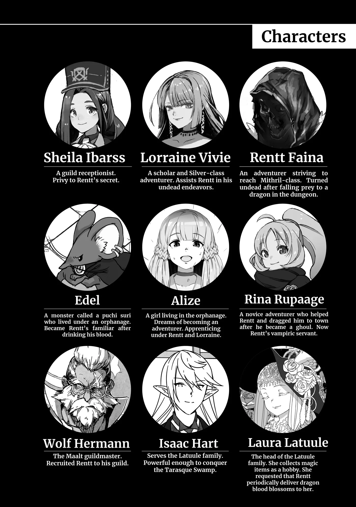
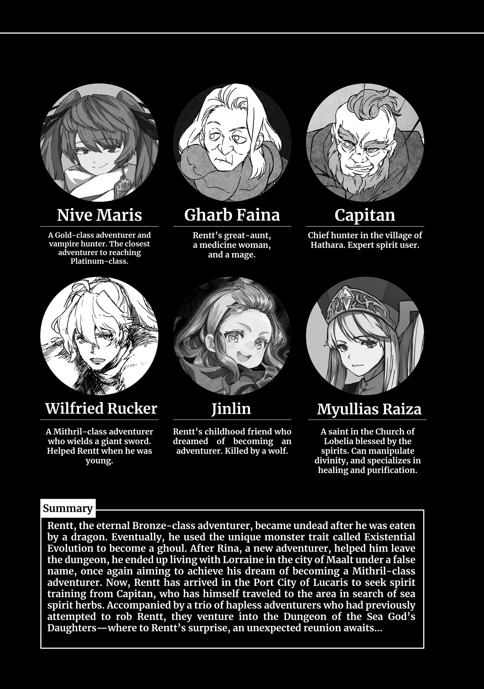
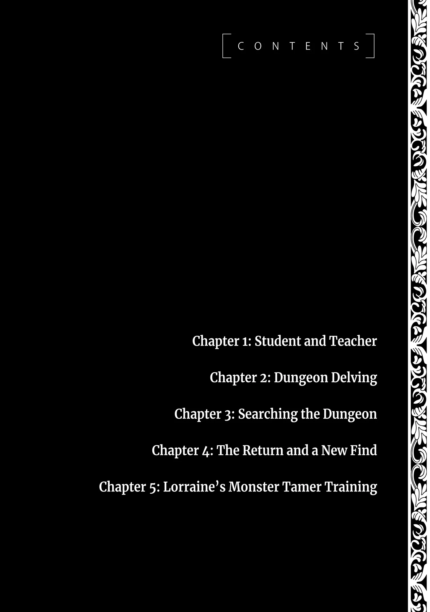

# Chương 320: Tập 14 Chương 1 - Thầy và Trò (1)

"Thấy thế nào rồi?" tôi hỏi.

Người đàn ông với lớp râu lởm chởm dưới cằm cẩn thận tự kiểm tra một lượt khắp người mình. "Tôi thấy đỡ hơn rồi," hồi lâu sau cậu ta mới lên tiếng. "Chẳng rõ vì sao lại thế. Cơ mà... cảm ơn anh."

Nghe vậy tôi mới thở phào nhẹ nhõm. Thang nước ngâm thảo dược tôi vừa cho cậu ta uống vốn chỉ là thử nghiệm, nên tôi cứ nơm nớp lo sẽ xảy ra chuyện gì bất trắc. Công thức đó tôi học được từ sư phụ dạy nghề thảo dược của mình là bà Gharb, vốn là bài thuốc quen thuộc đã được kiểm chứng qua bao đời ở Hathara—hoặc chí ít, suýt soát là vậy. Bởi chính tay tôi đã tự ý gia giảm đôi chút.

Thực ra, dù bà Gharb từng dạy tôi rất nhiều về thảo dược học và cách bào chế các loại nước ngâm tự nhiên, những bài học của bà chưa bao giờ đả động đến thuật điều chế ma dược. Một phần vì hồi đó tôi chẳng hề hay biết bà có khả năng ấy, nhưng phần lớn là do lượng Ma Lực của tôi lúc bấy giờ ít ỏi đến đáng thương.

Đó hoàn toàn không phải vì bà Gharb toan tính hay lạnh lùng gì với tôi—ngược lại là đằng khác. Đơn giản là việc gì phải dạy cho người ta một ngón nghề mà họ vốn chẳng đủ sức thực hành, đúng chứ? Còn riêng về khoản thảo dược học, bà là một người thầy tận tâm hơn bất kỳ ai, luôn rèn giũa cho tôi từng li từng tí một.

Ngoảnh đầu nhìn lại, tôi thấy công ơn dạy dỗ ấy có ý nghĩa lớn lao đến mức nào đối với sự trưởng thành của mình. Trữ lượng Ma Lực và Khí Lực của tôi ngày ấy quả thực bé tí hin, và tôi chỉ có thể chật vật mưu sinh qua những năm tháng đầu của đời mạo hiểm giả là nhờ vào vốn liếng của một dược sư.

Quay trở lại chuyện tôi đã thay đổi những gì trong thang nước ngâm kia, nói ngắn gọn là tôi đã tăng cường dược tính của nó lên mạnh hơn. Thông thường, việc này thuộc phạm trù của thuật giả kim hơn là thảo dược học, bởi nó đòi hỏi phải truyền Ma Lực vào hỗn hợp thuốc. Điều đó đồng nghĩa với việc thành phẩm tạo ra sẽ là một bình ma dược thực thụ.

Lorraine là một chuyên gia trong lĩnh vực này, và tôi tin chắc bà Gharb cũng vậy. Còn tôi thì chưa từng học các nguyên lý điều chế ma dược, cũng chẳng nắm được công thức nào. Dẫu thế, mười năm ròng quan sát Lorraine làm việc đâu phải là uổng phí—chí ít tôi cũng hiểu được đại khái các bước tiến hành.

Về cơ bản, bằng cách truyền Ma Lực vào hỗn hợp, người ta có thể gia tăng hiệu quả của nó. Tất nhiên, nói thì bao giờ cũng dễ hơn làm. Quá trình đó tiềm ẩn đầy rẫy rủi ro—chẳng hạn như việc tác dụng phụ rất dễ trở nên nghiêm trọng hơn—thế nên ban đầu tôi dự tính cứ đi từng bước chậm mà chắc, học hỏi đàng hoàng từ bà Gharb trước khi tự mình mày mò điều chế ma dược.

Đó là dự tính trước khi tôi nhận ra Ma Lực không phải nguồn năng lượng duy nhất mà mình sở hữu. Giờ đây tôi còn có cả Thần Lực. Điều đó khiến tôi tự đặt câu hỏi: nếu có thể tạo ra ma dược bằng cách truyền Ma Lực vào hỗn hợp thảo dược, thì chẳng phải tôi cũng có thể tạo ra thánh dược bằng cách truyền Thần Lực vào chúng sao?

Ờ thì, cái tên dành cho loại thuốc đó chỉ là do tôi tiện miệng nghĩ ra tại chỗ thôi. Những loại thuốc ngâm Thần Lực vốn không thực sự lưu hành trên thị trường, nên chẳng có danh xưng chính thức nào cho chúng cả. Dẫu vậy, tôi không nghĩ là chúng hoàn toàn không tồn tại—chắc chắn trước tôi đã từng có người nảy ra ý tưởng này, nên đâu đó ngoài kia hẳn cũng có thôi.

Điển hình như Nước Thánh chẳng hạn. Dù không dám khẳng định chắc chắn, nhưng tôi ngờ rằng nó cũng được tạo ra bằng phương pháp tương tự như ma dược.

Dù sao đi nữa, có rất nhiều bằng chứng gián tiếp cho thấy nếu tôi sử dụng Thần Lực tương tự như Ma Lực, tôi có thể tạo ra những loại thuốc có công hiệu mạnh hơn. Vả lại với đặc tính của Thần Lực, tôi đoán khả năng chúng gây ra tác dụng phụ có hại là khá thấp. Chỉ có một vướng mắc duy nhất: tôi cần một đối tượng thử nghiệm. Rốt cuộc thì tôi đâu thể túm bừa một người bình thường ngoài phố để thử thuốc được.

Tôi đã chứng minh được tính khả thi của ý tưởng này sau khi điều chế vài thang thuốc và truyền Thần Lực vào chúng, nên chắc chắn là làm được. Tôi thậm chí đã thử nghiệm trên động vật và quái vật bị thương với kết quả rất khả quan. Nhưng thuốc sẽ phát huy tác dụng ra sao trên cơ thể con người thì tôi vẫn chưa rõ.

À thì, cho tới tận lúc này. Nhờ một sự trùng hợp hết sức tiện lợi, gã này cùng đồng bọn lại vừa hay định nhảy xổ vào cướp của tôi. Tôi nghĩ bụng, một khi cậu ta đã toan tính hại mạng mình, thì cậu ta cũng mất luôn quyền phàn nàn về bất cứ điều gì tôi làm với cậu ta sau đó rồi.

Nghĩ thế có khiến tôi nghe giống kẻ phản diện quá không nhỉ?

Để tôi tự bào chữa cho mình một câu, tôi đã kiểm chứng mức độ an toàn của phương thuốc... ở một mức độ hợp lý rồi. Ít nhất tôi cũng khá chắc cậu ta sẽ không mất mạng. Dù sao thì đó cũng là lý do tôi quyết định tiến hành thử nghiệm—và nhìn vào kết quả trước mắt, xem chừng nó đã thành công mỹ mãn.

Theo tính toán của tôi, đòn đánh tôi giáng vào vật thí nghiệm này hẳn phải gây ra chút nội thương, nhưng sau khi uống cạn bát thuốc ngâm của tôi thì trông cậu ta lại khỏe khoắn, tráng kiện trở lại. Thay vào đó tôi cũng có thể dùng Thần Lực thuần túy để chữa trị cho cậu ta, nhưng cố chữa vết thương sâu cỡ đó sẽ khiến tôi hao tổn sức lực khá nhiều. May mà tôi có sẵn phương án thay thế trong tay.

Cơ mà nếu thuốc ngâm không có tác dụng, tôi vẫn sẽ dùng Thần Lực thôi. Thề đấy.

"Anh tốt tính quá mức rồi đấy nhỉ?" người đàn ông nói, chẳng hề hay biết những suy nghĩ trong đầu tôi. "Tôi đã tấn công anh. Chuyện đó rành rành ra rồi. Vậy nên... cớ sao lại chữa thương cho tôi?"

Tôi không dám chắc mình có đủ tư cách được gọi là "tốt tính" hay không, khi mà tôi vừa dùng cậu ta làm vật thí nghiệm mà cậu ta chẳng hề hay biết, nhưng nếu cậu ta đã không nhận ra mình vừa làm chuột bạch thì tôi cũng chẳng việc gì phải nói toạc ra làm gì. "Nếu thấy các cậu thật sự là lũ bại hoại hết thuốc chữa, tôi đã giải các cậu tới chỗ lính canh rồi," tôi giải thích. "Nhưng tôi không có cảm giác đó. Hai người bạn tỉnh lại trước của cậu trông cũng đâu đến nỗi xấu xa. Thế nên chữa vài vết thương cỏn con thì có sao đâu, đúng chứ?"

Về mặt lý thuyết thì tôi đâu có nói dối. Về mặt lý thuyết thôi nhé. Hai tên đàn em—hoặc đại loại thế—của người đàn ông này quả thực đã tỉnh lại từ trước. Họ giải thích rằng mình bám theo chỉ vì muốn can ngăn bạn mình, và trông chừng họ nói thật lòng.

Xét theo những gì đã diễn ra, tôi có thể hiểu vì sao họ lại cảm thấy mình không thể rút lui, ngay cả khi thâm tâm rất muốn. Họ thậm chí còn quả quyết rằng mình sẽ cản người bạn này lại nếu tình hình xấu đi đến mức cậu ta định giáng một đòn chí mạng vào tôi.

Tất nhiên điều đó không thể bào chữa cho hành vi của họ, nhưng vì bản thân tôi chẳng hề hấn gì lại còn dự tính sẽ sai bảo họ—cùng người bạn này—làm việc cho mình, nên tôi quyết định tha cho họ một lần.

Người đàn ông cười khẩy. "Không đến nỗi xấu xa ư? Tôi thì chẳng dám chắc thế đâu. Tôi đã định cướp tiền của anh đấy, nhớ không hả?"

Tôi nhún vai. "Phải, nhưng không sao."

"Cái gì cơ?"

"Ý tôi chỉ là chuyện gì cũng có thể trở nên hữu dụng nếu đặt đúng vào hoàn cảnh thôi."

Cậu ta nhìn tôi đầy vẻ hoài nghi. "Thế rốt cuộc là có ý gì?"

"Thế cậu nghĩ chuyện gì sẽ xảy đến với mình?" tôi hỏi.

Người đàn ông ngẫm nghĩ một lúc. "Anh sẽ biến tôi thành nô lệ của anh, hoặc đem bán tôi cho kẻ khác làm việc đó," cậu ta nói, từng chữ thốt ra một cách chật vật như thể chẳng hề muốn nhắc đến. "Đó là lý do anh chữa thương cho tôi, đúng không? Để tôi bán được giá hơn chứ gì?"

"Chà, bi quan ghê nhỉ," tôi nhận xét. Bất chợt, một ý nghĩ lóe lên trong đầu tôi.

"Nghĩa là chuyện nô lệ ở Ariana này là hợp pháp sao?"

"Hợp pháp đấy," Diego xác nhận. "Có khá nhiều điều luật và quy định liên quan đến phân loại cũng như việc sử dụng nô lệ, nhưng về cơ bản thì vẫn hợp pháp."

"Ra là vậy. Xem ra đó cũng là một phương án khả dĩ sau này, nhưng không. Kế hoạch của tôi thì khác."

Người đàn ông vừa làm vật thí nghiệm cho tôi nghiêng đầu. "Là gì chứ?"

"Đơn giản thôi. Cậu—à thì, cậu cùng hai người bạn của cậu—sẽ đi thám hiểm mê cung với tôi."

Mắt cậu ta trợn tròn kinh ngạc.

◆◇◆◇◆

Sự kinh ngạc ban đầu của người đàn ông dần chuyển thành nét mặt tự giễu. "Mê cung sao..." cậu ta lẩm bẩm.

Tôi hiểu ngay cảm giác trong lòng cậu ta lúc này. Dù sao thì cho đến tận gần đây, tôi cũng từng sống một cuộc đời chẳng khác gì cậu ta là bao. Ngay lúc này, hẳn cậu ta đang nghĩ đằng nào mình cũng chẳng tích sự gì.

Dĩ nhiên không phải theo nghĩa đen hoàn toàn. Cậu ta dẫu sao vẫn là một mạo hiểm giả, nên việc xoay xở ở các tầng nông của hầu hết mê cung ngoài kia vẫn ổn thỏa thôi—nhưng ý cậu ta đâu phải thế.

"Dù sao thì mạng của tôi giờ cũng nằm trong tay anh rồi," cậu ta nói tiếp. "Xem ra tôi nên chấp nhận số phận và chịu trận thôi. Làm một cái bia thịt thì chắc tôi vẫn cáng đáng được. Cơ mà anh chắc chứ? Ở những tầng mê cung mà người như anh hay hoạt động, loại người như bọn này khá lắm cũng chỉ làm mồi nhử câu kéo được vài giây ngắn ngủi thôi."

Xem chừng suy đoán của tôi đã đúng; cậu ta nghĩ tôi sẽ dùng họ làm tốt thí để giữ mạng cho bản thân. "Lại bi quan nữa rồi," tôi lắc đầu bảo. "Có điều tôi cũng hiểu vì sao cậu lại nghĩ thế."

"Anh chẳng hiểu gì hết."

"Cho tới tận gần đây, tôi cũng từng giống như... À, mà thôi."

Tôi kịp khựng lại. Tôi hoàn toàn có thể nói cho cậu ta biết cách đây không lâu mình cũng từng y như cậu ta, nhưng tôi biết nói ra lúc này cũng chỉ như đàn gảy tai trâu. Tôi còn nhớ ngày trước mình từng nghe biết bao lời động viên cùng khuyên nhủ từ mọi người xung quanh, nhưng chẳng lọt vào tai được chữ nào.

Không, thay vì những lời an ủi sáo rỗng, tôi cần đưa ra cho cậu ta điều gì đó thực tế hơn—chẳng hạn như giải thích rõ ràng tôi sẽ bảo cậu ta làm những việc gì.

"Tôi sẽ không dùng cậu làm bia thịt đâu," tôi nói. "Đằng nào chuyện đó cũng vô nghĩa, đúng như cậu vừa bảo thôi."

"Đau đấy. Dù biết chính miệng tôi nói ra trước, nhưng nghe từ miệng người khác thì chẳng dễ chịu chút nào."

Phải rồi, bị người ta bảo rằng những nỗ lực của mình là vô nghĩa thì cay đắng lắm chứ. Chuyện đó thực sự chẳng khác nào bị bảo rằng cả sự tồn tại của bản thân là thứ vô giá trị. Sự thật đôi khi mất lòng như thế đấy.

"Nhưng việc cậu cần làm chỉ là trở nên hữu dụng thôi," tôi lẩm bẩm. "Quan trọng nhất vẫn là bước đi đầu tiên..."

"Hả?" Người đàn ông nhìn tôi đầy vẻ hoài nghi. "Thế nghĩa là—"

Lời cậu ta bị ngắt ngang bởi tiếng chuông reo—chuông cửa nhà Diego. À thì, đúng hơn là tiệm của Diego. Tiếng chuông đủ lớn để vọng vào tận khu sinh hoạt của anh ấy nơi chúng tôi đang ngồi; chắc chắn đây là chủ ý của chủ nhà, để anh ấy biết khi nào có khách bước vào tiệm.

Nghe tiếng bước chân rành rọt, rõ ràng những người tới không hề có ý lén lút—và quả nhiên, hai người đàn ông xuất hiện sau đó. Một người tương đối cao gầy với vẻ mặt trầm lặng, người còn lại thì lùn hơn, mập mạp và trông có vẻ tươi tỉnh. Người trước tên là Gahedd, người sau là Lukas, và họ là bạn của Niedz, vật thí nghiệm đang ủ rũ của tôi.

Sở dĩ tôi biết điều này là vì sau khi tỉnh dậy lúc trước, họ đã giải thích mọi chuyện cho tôi và Diego nghe. Sau đó chúng tôi sai họ đi mua sắm vài thứ, đó là lý do tận bây giờ họ mới quay lại. Vừa bước vào, họ liền bắt tay vào việc lấy đồ đã mua—mà mua nhiều ra phết—từ trong chiếc túi ma thuật ra rồi xếp gọn vào góc phòng. Động tác của họ thuần thục đến mức ngỡ như họ đã làm việc này cả trăm lần rồi vậy.

Nhân tiện, tôi chính là người đã cho họ mượn chiếc túi ma thuật đó. Gahedd và Lukas chẳng có nổi một chiếc, và Niedz cũng vậy. Đó là chuyện thường tình đối với các mạo hiểm giả Đồng Cấp. Lý do duy nhất khiến tôi có được một chiếc hồi còn ở vào hoàn cảnh của họ là nhờ tích cóp kiên trì, một chút may mắn và tài mặc cả của bản thân.

Dĩ nhiên, chiếc túi tôi cho họ mượn là chiếc túi ma thuật cũ của tôi—chứ không phải cái tôi đã mua với giá vài nghìn đồng bạch kim. Nó vẫn đủ giá trị để ai đó có thể nảy lòng tham muốn ôm đồ bỏ trốn, nhưng nếu thế thì tôi chỉ việc báo với lính canh là xong xuôi tất cả.

Thành thực mà nói, tôi cũng muốn tránh đưa nó cho họ nếu có thể, nhưng trong trường hợp này tính thực tế phải được đặt lên trên sự cẩn trọng, bởi số đồ họ phải đi mua nhiều hơn hẳn những gì hai người có thể mang vác thông thường. Thuốc men, lương thực, thậm chí cả vũ khí đều nằm trong danh sách cần mua.

Sau cùng, yếu tố quyết định đơn giản là sâu thẳm bên trong họ có vẻ là những người thật thà—dù tôi nghĩ việc mình giữ Niedz lại như một dạng con tin cũng góp phần không nhỏ. Nếu họ quan tâm đến cậu ta đủ để cố ngăn bạn mình phạm tội, thì họ hẳn sẽ không nhẫn tâm bỏ mặc cậu ta lại mà cao chạy xa bay.

Nhìn việc họ ngoan ngoãn quay về mà không gây ra điều tiếng gì, xem chừng phán đoán của tôi đã hoàn toàn chính xác.

"Đại ca Rentt!" Lukas cười toe toét đến tận mang tai. "Bọn tôi mua đủ mọi thứ anh dặn rồi đây!"

Đường nét trên mặt người đàn ông này gợi nhớ đến một con Goblin đặc biệt mập mạp, nhưng theo một cách kỳ lạ là lại khá đáng mến. Điều đáng ngạc nhiên là tôi phát hiện ra cậu ta có vốn hiểu biết khá tốt, dù đôi chỗ còn chắp vá, về các loại thảo dược và dược liệu. Sau khi kiểm tra tầm hiểu biết của cậu ta, tôi đã giao cho cậu ta nhiệm vụ đi mua vài loại cây cần phải có con mắt tinh tường mới chọn được.

"Làm tốt lắm," tôi nói. "Ừ, trông như đủ cả rồi đấy. Có điều chậu này đây—xem chừng cậu đã chọn phải cây có chất lượng hơi kém một chút rồi." Tôi chỉ vào một trong những chậu thảo dược.

"Hở? Sao cơ ạ? Nhưng..." Lukas có vẻ luống cuống. "Anh nhìn xem! Nó tươi lắm mà! Nhìn lá căng mọng và mơn mởn thế kia là biết ngay!"

"Loại cây này chỉ mọc ở vùng đất giàu Ma Lực thôi," tôi giải thích, vừa véo một chút đất rồi xoa đều giữa các đầu ngón tay. "Và nó cần phải nằm trong đất giàu Ma Lực để duy trì dược tính, đó là lý do khi thu hoạch người ta phải bứng cả phần đất xung quanh nó đi kèm. Đó là một công việc rất tỉ mỉ. Lẽ tự nhiên là người ta sẽ muốn dùng chính loại đất đó khi cho vào chậu—nhưng chỗ đất này chỉ là loại bình thường thôi, thấy chứ? Đúng là nó có chút Ma Lực thật, nhưng đó là vì... Nào, nhìn cho kỹ đi." Tôi lục tìm trong đám đất rồi lấy ra vài mảnh đá vụn li ti, đặt chúng lên lòng bàn tay cho Lukas xem.

"Đó là... Ma Tinh sao?"

"Đúng rồi đấy. Loại cây này sẽ tàn héo rất nhanh khi trồng trong đất thường, nhưng nếu nghiền vụn Ma Tinh rồi trộn vào, người ta có thể giữ cho lá trông căng mọng và tươi tắn được tầm hai ngày. Nhưng trên thực tế, cái cây đang ở trong tình trạng suy kiệt, chỉ đang cố gắng trong vô vọng để hấp thụ chút Ma Lực ít ỏi còn sót lại—bởi thế trông nó mới tươi tốt như vậy. Cơ mà về cơ bản nó đã cạn kiệt dưỡng chất rồi, nên dù hôm nay trông như thế này, rất có thể đến ngày mai là nó đã chết khô."

"Không thể nào..." Lukas thẫn thờ kinh ngạc.

Tôi vỗ vai cậu ta. "Đừng để bụng làm gì. Đây là kiểu chuyện phải có bề dày kinh nghiệm mới nhận ra được. Lần tới, cứ nhìn cho kỹ phần đất. Bằng mắt thường cậu có thể không phân biệt được đất có giàu Ma Lực hay không, nhưng để ý mấy mảnh vụn Ma Tinh thì chắc chắn không quá khó đâu."

Vẻ ủ rũ trong mắt Lukas nhanh chóng biến thành ánh lấp lánh đầy hào hứng. "V-Vâng, đại ca!" cậu ta nói, gật đầu lia lịa. "Lần sau tôi nhất định sẽ làm thế!"

Niedz có vẻ ngỡ ngàng khi thấy bạn mình hào hứng đến vậy. "Lukas..."

Lukas quay lại, ngạc nhiên. "Ồ, Niedz! Cậu tỉnh rồi à!" cậu ta reo lên rồi bước lại gần. "Cậu làm tôi lo sốt vó đấy. Tôi với Gahedd hồi phục khá nhanh, nhưng trông cậu lúc nãy cứ như ngủ say li bì vậy."

Gahedd lấy nốt món đồ mua sắm cuối cùng ra khỏi chiếc túi ma thuật rồi thong thả bước lại nhập hội với hai người bạn. "Anh Rentt và anh Diego bảo cậu sẽ sớm tỉnh thôi, nhưng bọn tôi vẫn không khỏi lo lắng," cậu ta nói thêm. "Cơ mà trông cậu hoạt bát hơn bao giờ hết đấy chứ. Thấy thế là mừng rồi."

"Thể xác tôi thì khỏe re rồi, chắc chắn là vậy," Niedz cười cay đắng. "Nhưng tụi mình vừa tự rước vào một mớ rắc rối to chuyện rồi đấy, các cậu ạ. Theo những gì tôi hiểu thì bọn mình sắp sửa phải đi thám hiểm mê cung. Nực cười ghê chưa? Dù loại người như bọn mình có làm một bộ ba bia thịt khéo còn chẳng nên thân."
