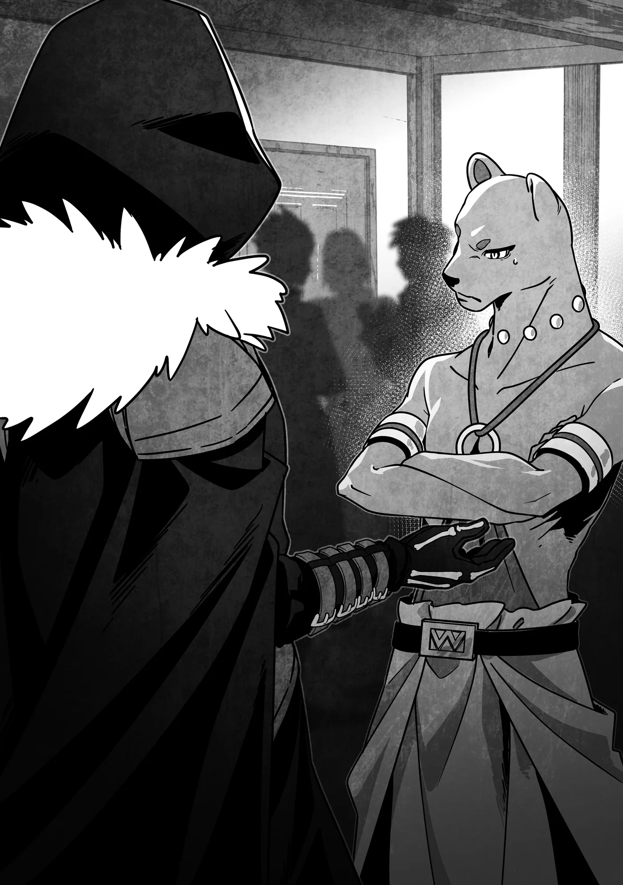

# Chương 321: Tập 14 Chương 1 - Thầy và Trò (2)

Hẳn Niedz đinh ninh hai người bạn sẽ cười phụ họa với mình. Dù sao họ cũng từng cùng nhau nếm trải bao nỗi gian truân của kiếp mạo hiểm giả dưới đáy xã hội, và thừa hiểu thám hiểm mê cung có thể là một chuyến đi một chiều thẳng xuống mồ. Cảnh những mạo hiểm giả cấp thấp đem sự bất lực của chính mình ra cười cợt làm đề tài chuyện trò vốn đã quá đỗi quen thuộc với tôi.

Chính vì thế, câu trả lời của Gahedd hẳn đã khiến Niedz không khỏi ngỡ ngàng.

"Ồ, chuyện đó hả? Xem chừng cậu vẫn chưa nghe trọn vẹn câu chuyện rồi. Tôi hiểu vì sao cậu lại nghĩ thế, nhưng cứ yên tâm đi—tôi nghĩ tụi mình sẽ ổn cả thôi."

Niedz dường như nhận ra Gahedd—và có lẽ cả Lukas nữa—đã nghe tôi thỏa thuận từ trước. Dẫu vậy, cậu ta trông có vẻ khó hiểu, như thể đang thắc mắc tại sao hai người bạn của mình lại không nhìn tôi bằng ánh mắt nghi ngại hơn. Hẳn cậu ta biết rõ cả ba người họ chẳng phải kiểu người dễ dàng tin tưởng ai. Công bằng mà nói thì họ cũng không hẳn là kiểu người nhìn ai cũng thấy đầy hoài nghi—nhưng Niedz ắt hẳn vẫn không hiểu nổi vì sao Gahedd và Lukas lại tỏ ra dửng dưng đến thế.

"Yên tâm á?" Niedz lặp lại, vẻ mặt đầy bối rối. "Làm sao mà yên tâm được chứ? Cậu không nghe bảo tụi mình sắp phải vào mê cung à? Quanh đây làm gì có mê cung nào dành cho hạng người như bọn mình. Đã thế Rentt còn nói là 'thám hiểm', nghĩa là bọn mình sẽ phải xuống khá sâu đấy... tới lúc đó thì còn đường nào mà chạy nữa."

Xem chừng tính toán của Niedz là thấy tình hình biến chuyển xấu thì lập tức tháo chạy. Có điều kế đó chỉ hiệu quả nếu kẻ đuổi theo cậu ta di chuyển chậm hơn mà thôi. Đành rằng người ta có thể dùng mẹo lừa lũ quái vật thông thường trong mê cung để tẩu thoát, nhưng chênh lệch sức mạnh quá lớn sẽ biến mọi toan tính khác thành vô nghĩa.

Tôi không trách Niedz vì đã đinh ninh rằng tôi sẽ lôi họ xuống những tầng vượt xa đẳng cấp của mình. Phần lớn các trường hợp ép mạo hiểm giả yếu thế hơn đi cùng vào mê cung đều diễn ra như vậy. Việc dùng bạn đồng hành làm bia thịt ở Maalt khá hiếm thấy, vì hầu như ai nấy đều xem đó là hành vi đê tiện và tin tức sẽ lan truyền rất nhanh, nhưng tôi không dám chắc là chưa từng có chuyện đó xảy ra.

Ở một thành phố như Lucaris, nơi cả dân số lẫn lượng mạo hiểm giả đều vượt trội gấp bội so với Maalt, những chuyện tương tự ắt hẳn xảy ra khá thường xuyên, dẫu chúng không bao giờ được công khai chấp nhận. Thành thử, xét trên khía cạnh đó thì việc Niedz lo lắng cũng là điều dễ hiểu. Cậu ta đâu thể nào biết trước rằng tôi tuyệt đối không làm trò đó.

May thay, Gahedd vội vàng giải thích ngay. "Lúc mới tỉnh dậy và nghe chuyện tôi cũng nghĩ y như cậu vậy," cậu ta nói. "Nhưng Rentt đã rất kiên nhẫn khẳng định đó không phải dự tính của anh ấy. Nghe thì cứ như chuyện viển vông, nhưng anh ấy thật lòng muốn chỉ dạy cho tụi mình đấy."

Niedz khựng lại. "Cái gì? Chỉ dạy á?"

"Phải. Anh ấy bảo chưa biết tụi mình có đủ tài năng để làm nên trò trống gì không, nhưng ít nhất cũng có thể dạy cho tụi mình đủ ngón nghề để sống qua ngày mà không gặp trắc trở gì."

"Nhưng... bằng cách nào?" Vẻ mặt Niedz lộ rõ vài phần tự ti, như thể cậu ta đang thắc mắc làm sao tôi có thể rèn giũa họ khi mà bao nỗ lực của chính họ trước giờ đều chẳng đi đến đâu.

"Vừa rồi cậu cũng thấy rồi còn gì?" Gahedd chỉ ra. "Anh ấy đang dạy cho Lukas mấy kiến thức nền tảng trong công việc thu thập đấy thôi."

"Kiến thức nền tảng? Nền tảng gì cơ chứ? Chúng là cây cỏ mà—chỉ việc hái về thôi chứ có gì đâu...?"

"Thì đúng là vậy... nhưng tôi biết ngay cả cậu khi hái cũng ráng làm cho cẩn thận, đúng không? Kiểu kiến thức chuyên sâu như thế chính là thứ anh ấy sắp dạy cho tụi mình đấy."

Niedz im lặng một lúc. "Cẩn thận à?" hồi lâu sau cậu ta mới lên tiếng. "Ý là hái sao cho không làm hỏng cây, đại loại vậy hả?"

"Ừ, chính nó đấy."

"Nhưng bình thường tôi vẫn làm thế rồi mà."

Gahedd nhún vai. "Thế vẫn chưa ăn thua đâu. Cậu cũng nghe lúc nãy anh ấy nói rồi đấy thôi? Về chuyện cái cây trông thì tươi tốt, nhưng nếu không bứng cả bầu đất theo thì nó sẽ héo rũ? Tôi cũng đâu có ngờ là phải để ý xem trong đất có lẫn Ma Tinh hay không. Nhưng nếu tụi mình học thêm được những điều như thế, chắc chắn sau này sẽ có lúc dùng đến, đúng không?"

"Ừ thì, tôi... tôi hiểu ý cậu rồi. Cơ mà..." Niedz ngập ngừng.

"Thế thì có ích gì chứ? Làm sao mấy thứ đó giúp tụi mình kiếm đủ sống được?"

"Thì Rentt bảo chuyện đó có thể tốn chút thời gian, nhưng nếu kiên trì nỗ lực thì sẽ kiếm được nhiều tiền thưởng hơn và nhận được các ủy thác chỉ định trực tiếp. Đặc biệt là ở một thành phố lớn như Lucaris—anh ấy có nhắc rằng ở đây hẳn có không ít khách hàng sành sỏi biết nhìn nhận phẩm chất."

"Thật không đấy?"

"Tôi hỏi anh Diego rồi, đúng là có chuyện đó thật. Thi thoảng họ vẫn tìm tới. Nghe đâu họ chẳng mấy trông mong vào phần lớn mạo hiểm giả vì ai nấy đều thu hái qua loa cẩu thả, nên họ luôn chỉ định trực tiếp những người mà họ biết chắc là sẽ mang về hàng họ có chất lượng cao."

"Chà. Trước giờ tôi chưa từng nghe nói tới chuyện đó bao giờ."

"Thì mấy mạo hiểm giả đó được biệt đãi mà lại. Đâu đời nào họ chịu bép xép cho thiên hạ biết bí quyết kiếm tiền của mình chứ. Ờ, trừ phi người đó là Rentt, cơ mà anh ấy đâu phải người vùng này, thế nên anh ấy mới bảo việc truyền lại ngón nghề cho tụi mình cũng chẳng làm anh ấy thiệt thòi chút nào."

Tôi từng giải thích với Gahedd và Lukas rằng nếu tôi là một mạo hiểm giả Đồng Cấp sinh sống ở Lucaris và kiếm sống bằng công việc thu hái, việc chỉ bảo họ chẳng khác nào tự tạo thêm đối thủ cạnh tranh chén cơm manh áo của chính mình. Nhưng vì tôi không thuộc diện đó và cũng chẳng có ý định định cư lâu dài ở đây, nên chuyện này chẳng hề hấn gì.

Sự thực là dù thế nào tôi cũng chẳng nề hà việc chỉ dạy cho họ, nhưng người đời thường chẳng bao giờ tin khi thấy một kẻ chìa tay giúp đỡ dù phải chịu thiệt về mình. Tôi thừa hiểu giải thích theo cách này là con đường ngắn nhất để thuyết phục họ.

Dù đi đến đâu chăng nữa, phần lớn mạo hiểm giả đều hoàn toàn đối lập với hai chữ tỉ mỉ. Có khi tôi dành cả đời truyền lại những gì mình biết cho người khác thì ngần ấy kiến thức vẫn chẳng thể phổ biến đến mức tạo ra sự cạnh tranh thực sự trên thị trường. Mà giả như có đi nữa, sự cạnh tranh đó có lẽ cũng chỉ giới hạn trong một thành phố duy nhất, và dù thế thì lượng nguyên liệu chất lượng cao tăng lên cũng không thực sự khiến giá cả sụt giảm bao nhiêu—số dư thừa rốt cuộc chỉ được chuyển đi xuất khẩu sang nơi khác mà thôi. Tựu trung lại, tôi chẳng mất mát gì khi chia sẻ hiểu biết của mình.

"Mà đâu chỉ có thế..." Gahedd lại tiếp tục.

Trong lúc cậu ta tiếp tục giải thích cho bạn mình, tôi liếc nhìn ra ngoài cửa sổ và nhận thấy mặt trời đang dần lặn xuống. Đã đến lúc tôi phải tới Hội Mạo Hiểm Giả rồi.

Để mặc ba người bạn tiếp tục chuyện trò, tôi quay sang Diego. "Tôi có hẹn gặp một người ở Hội địa phương," tôi giải thích. "Ngày mai tôi quay lại đây được chứ?"

Anh ấy gật đầu. "Được chứ, tôi không phiền đâu. Chẳng lẽ sau ngần ấy chuyện anh lại nỡ bỏ mặc mấy cậu này giữa đường giữa chợ, đúng không?" Anh ấy kết thúc câu nói bằng một tiếng cười khẽ.

Diego sẽ cho bộ ba này ngủ lại nhà mình qua đêm. "Nhưng anh chắc chứ?" tôi hỏi. "Nếu anh thấy bất tiện khi để họ ở lại đây, tôi nghĩ họ vẫn có thể tự xoay xở qua một đêm được mà."

"Không sao đâu. Hôm nay họ đâu có nhận ủy thác nào, nên tôi đồ rằng họ chẳng có xu nào dính túi để thuê phòng trọ đâu. Cơ mà này, sau vụ này anh định rèn giũa họ mà, đúng không? Có khi tới lúc họ kiếm đủ tiền để tự đứng trên đôi chân mình, tôi sẽ bắt đầu tính tiền ăn ở đấy."

Nghe thế thì khiếp thật đấy. "Thế anh tính thu bao nhiêu?" tôi băn khoăn.

"Tự dưng tôi thấy tội nghiệp cho họ quá. Thôi thì, nếu anh chỉ tính theo giá thông thường thì chắc cũng không sao. Tôi đành phải rèn cho họ đến mức chẳng thèm chớp mắt khi trả mức giá cỡ đó mới được."

Diego tặc lưỡi thán phục một tiếng. "Thế thì túi tiền của tôi lại càng rủng rỉnh hơn rồi. Chúc anh may mắn nhé."

◆◇◆◇◆

Ánh hoàng hôn đỏ rực đặc trưng càng lúc càng lớn dần khi tôi—Capitan—bơi ngoi lên mặt nước. Vào thời điểm này trong ngày thì ánh sáng ấy không quá chói chang, nhưng lại tương phản rõ rệt với vực sâu tăm tối bên dưới tôi.

Nói thế không có nghĩa là bên dưới hoàn toàn chẳng thấy gì—nếu căng mắt ra nhìn, người ta vẫn có thể lờ mờ nhận ra một kiến trúc mang hình thù kỳ dị ẩn hiện trong làn nước: Mê Cung Các Con Gái Của Hải Thần. Trong số tất cả các mê cung quanh vùng Lucaris, tầng sâu của nơi này được tương truyền là chốn khó lòng chinh phục nhất.

Đó cũng là nơi tôi vừa bỏ cả buổi chiều để thám hiểm nhưng chẳng thu được kết quả gì. Ờ thì, nói vậy có phần hơi quá—thực ra tôi cũng đạt được vài bước tiến. Dẫu thế, tôi vẫn chưa tìm ra thứ mình cất công tới đây tìm kiếm.

Dĩ nhiên tôi đâu dễ dàng bỏ cuộc sớm như vậy, nhưng đợt tìm kiếm hôm nay cho thấy rõ triển vọng sắp tới xem chừng chẳng mấy sáng sủa. Sau nhiều lần ghé thăm, về cơ bản tôi đã sục sạo từng ngóc ngách ở các tầng nông, vậy nên kể từ ngày mai, tôi sẽ phải lặn xuống sâu hơn nữa.

Mặt nước giờ đã ở ngay trên đầu tôi. Khoảnh khắc tôi trồi lên khỏi mặt nước, nhô đầu vào bầu không khí buổi chập tối, tôi lập tức thấy mình không thở được. Thừa biết nếu cứ để nguyên thì bản thân sẽ nhanh chóng chết ngạt, tôi nhanh chóng—nhưng hết sức bình tĩnh—rút món Nguyền Cụ mà người Lucaris gọi là ống thở ra khỏi miệng.

Vì là Nguyền Cụ nên phải mất một lúc tác dụng của nó mới tan biến, điều đó càng khiến nỗi bất an trong lòng tôi chẳng hề thuyên giảm. Dẫu vậy, sau chừng mười giây, phổi tôi đã lấy lại chức năng bình thường, cho phép tôi hít đẫy lồng ngực bầu không khí trong lành dường như vô tận xung quanh.

Tôi thở hắt ra, thả lỏng người. "Đã hoàng hôn rồi cơ à? Con thuyền đó đâu rồi nhỉ..."

Vừa đạp nước nổi trên mặt biển, tôi vừa đảo mắt nhìn quanh một lượt. Để tới được Mê Cung Các Con Gái Của Hải Thần, người ta cần một con thuyền cùng một thủy thủ để lèo lái nó. Tôi cũng chẳng phải ngoại lệ đối với quy tắc này, nên đã thuê một tay đi biển lành nghề cùng con thuyền cỡ vừa của ông ấy. Thuyền nhỏ cũng thực hiện chuyến đi ngon ơ, nhưng lại khó phát hiện hơn sau khi người ta ngoi lên mặt nước. Để thực sự yên tâm thì thuyền càng lớn càng tốt.

Có thể tôi đã quá đỗi cẩn trọng, bởi sự thành thạo Khí Lực cho phép tôi dò tìm sinh mệnh trong bán kính chừng một cây số, nhưng xét lượng Khí Lực tôi phải tiêu tốn bên trong mê cung, rất có thể tôi sẽ kết thúc một ngày tìm kiếm trong tình trạng kiệt quệ hoàn toàn. Nếu chuyện đó xảy ra, tôi không muốn đánh cược mạng sống của mình vào việc liệu mắt thường có định vị nổi một con thuyền con giữa muôn trùng sóng nước hay không.

Một lát sau, tôi bắt gặp bóng dáng phương tiện đón mình. "Kia rồi. Này! Đằng này!" Dùng một chiếc gương cầm tay, tôi phản chiếu ánh hoàng hôn để phát tín hiệu cho con thuyền. Chẳng mấy chốc, nó bắt đầu tiến lại gần.

Thực ra tôi cũng trông thấy chiếc phà chính thức của mê cung, nhưng tôi không định dùng nó. Giá cả rẻ hơn cùng lịch trình cố định biến nó thành lựa chọn thích hợp cho những ai muốn chinh phục Mê Cung Các Con Gái Của Hải Thần, nhưng đi kèm với đó là nguy cơ bị bỏ lại nếu người ta ngoi lên trễ giờ—điều mà tôi đã chứng thực sau khi hỏi thăm những người quanh bến cảng.

Bản thân Hội Mạo Hiểm Giả cũng khuyến khích đi phà, nhưng tôi quyết định thuê riêng một con thuyền cho tiện công việc của mình. Chi phí đắt đỏ đúng là hơi xót tiền, nhưng sự linh hoạt mang lại thì hoàn toàn xứng đáng. Đi phà thì dù có ngoi lên cách xa đến mấy người ta cũng buộc phải tự bơi lại chỗ nó, còn trên chiếc thuyền thuê riêng này chỉ có mình tôi là hành khách ngoài người lái thuyền, nên thuyền có thể chủ động chạy tới đón tôi.

Khi con thuyền tới nơi, người thủy thủ quăng cho tôi một sợi dây thừng, và tôi dùng nó để đu mình trèo lên thuyền.

"Lại bình an vô sự trở về nhỉ?" người thủy thủ, một người đàn ông có tên là Mazlak, lên tiếng.

"Thế là tốt rồi. Cơ mà trông anh chẳng vui vẻ gì mấy."

"Chẳng có lý do gì để vui cả—vẫn chưa tìm được thứ tôi cần. Lại thế nữa rồi. Đừng trách sao mặt tôi cứ ủ rũ."

"Cơ mà trông anh đâu có về tay không..."

"Ừm. Ma Tinh từ quái vật, vài món đồ ma thuật lặt vặt, nguyền phẩm—tìm được khối thứ đấy chứ. Tốt nhất là tôi nên tới Hội bán hết mớ này đi. Ít ra cũng đủ tiền trả công cho ông."

Ông ấy nhìn tôi bằng ánh mắt kỳ quặc. "Tiền thuê tôi đâu có đắt đến mức đó."

"Chỗ còn lại thì vào quán rượu tiêu tiếp. Ông đi cùng chứ hả?"

"Anh chắc chứ?"

"Chứ sao. Cứ uống cho đã đời đi—miễn sao ngày mai ông đừng say mèm tới mức không làm việc được là được. Ngoài chuyến phà kia ra thì chỉ có thuyền của ông là chịu nhận chở tôi thôi, mà tôi nghe đâu ngày mai phà không chạy thì phải."

"Này, anh trả tiền cho tôi làm việc mà. Tôi rất vui lòng nhận tiền của anh, nhưng anh đâu cần phải chiều chuộng thêm bằng cách—" Mazlak đột ngột ngắt lời, nét mặt thoắt biến thành vẻ hoảng hốt.

Tôi quay đầu nhìn theo hướng mắt ông ấy và trông thấy một vài bóng đen dưới làn nước, đang lướt nhanh về phía chúng tôi.

"Lũ kỵ sĩ cưỡi Kelpie!" Mazlak hét lên. "Tụi mình phải chuồn khỏi đây thôi!" Ông ấy túm lấy dây cương—vốn được nối với thứ gì đó bên dưới làn nước—rồi giật mạnh để thúc thuyền chuyển động. Con thuyền nhanh chóng lướt đi trên mặt biển, hướng thẳng về phía Lucaris... ngược với hướng gió đang thổi lúc bấy giờ.

Đây chính là điều khiến tôi ngạc nhiên nhất khi lần đầu tiên tiếp xúc với những con thuyền ở Lucaris. Thuyền bè của thành phố này—đặc biệt là những chiếc cỡ nhỏ—không di chuyển bằng sức gió hay ma thuật, mà được kéo bởi các sinh vật sống, chẳng khác nào những cỗ xe trên cạn. Đó là lý do tại sao những con thuyền lớn cỡ thuyền của Mazlak thường chỉ cần đúng một thủy thủ lèo lái—và tùy thuộc vào tay nghề của người thủy thủ đó, loại thuyền này có thể đi tới bất cứ nơi đâu người ta mong muốn.

Ngay cả ở Lucaris, Mazlak cũng đã tạo dựng được tên tuổi như một trong những tay thủy thủ cừ khôi nhất vùng, và ông ấy đã chứng minh thực lực của mình bằng cách đưa chúng tôi thoát khỏi những tình huống hiểm nghèo như thế này nhiều lần không đếm xuể.

"Lũ kỵ sĩ cưỡi Kelpie à..." tôi trầm ngâm. "Ông có nghĩ chúng là..."

Kỵ sĩ cưỡi Kelpie, đúng như tên gọi gợi ý, là thuật ngữ chung chỉ những con quái vật cưỡi trên lưng một loài quái vật khác có hình dáng giống ngựa, dù là loại có thể thở được dưới nước. Ở khoảng cách này tôi không thể nhìn rõ chúng, nhưng tôi khá chắc những kẻ cưỡi chúng trong trường hợp này là Hải Kỵ Sĩ. Dù mang vóc dáng giống con người, bóng đen của chúng cho thấy rõ chúng sở hữu phần đầu thuôn nhọn rất đặc trưng, trông chẳng khác nào loài mực.

Mazlak gật đầu. "Phải. Lũ tay sai của Ma Vương đấy. Chẳng hiểu kẻ đứng tít trên đỉnh chuỗi thức ăn như thế muốn nhắm vào Lucaris để làm gì, nhất là khi trước giờ tụi tôi đâu có gặp rắc rối gì. Cơ mà nghe đâu Ma Vương ở khắp nơi đang bắt đầu rục rịch quấy phá, nên có khi chuyện này chỉ là một phần trong số đó thôi."

"Xét theo điều đó thì chuyện này xem chừng có quy mô khá nhỏ đấy," tôi nhận xét. "Tôi chẳng phải chuyên gia gì, nhưng không phải Ma Vương thường sở hữu những đạo quân đủ lớn để tàn phá cả một đất nước sao?"

"Chắc anh nói đúng. Có khi đây chỉ là màn phô trương sức mạnh hay gì đó thôi? Một gã thủy thủ quèn như tôi thì sao dám mong hiểu thấu tâm tư của Ma Vương chứ. Có điều thứ tôi biết chắc là..."

"Là gì cơ?"

"Tôi biết chắc mình chẳng bao giờ muốn bị một con nào bắt được đâu."

"Về điểm đó thì tôi cũng xin nâng ly tán thành. Mau quay về Lucaris thôi, rồi tụi mình cùng làm vài ly."

Mazlak gật đầu rồi tăng tốc thuyền. Chẳng bao lâu sau, chúng tôi đã cập bến an toàn chẳng hề sứt mẻ sợi tóc nào. Lẽ dĩ nhiên điều đó phải nhờ vào tay nghề của Mazlak, nhưng cũng một phần bởi lũ Hải Kỵ Sĩ đã bỏ dở cuộc truy đuổi giữa chừng. Chuyện đó khiến tôi không khỏi băn khoăn về mục đích thực sự của chúng, nhưng tôi chẳng có cách nào tìm hiểu được. Từ giờ trở đi tôi chỉ còn cách tránh xa vùng biển đó ra mà thôi.

Dù sao thì cẩn tắc vô ưu vẫn hơn.
