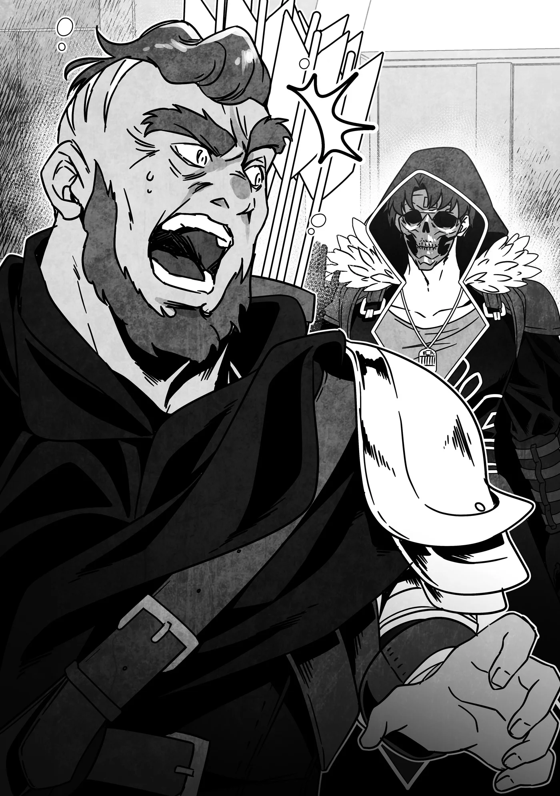

# Chương 322: Tập 14 Chương 1 - Thầy và Trò (3)

Khác hẳn với lần đầu tiên tôi ghé qua Hội Mạo Hiểm Giả Lucaris sau khi đặt chân tới thành phố này, lần này bước vào, tôi thấy nơi đây đang tấp nập mạo hiểm giả. Phần lớn trong số họ vừa trở về sau một ngày làm việc để bàn giao ủy thác, điều này cũng chẳng có gì đáng ngạc nhiên—ở bất cứ Hội nào thì lệ thường cũng đều như thế cả.

Bầu không khí ở đây cũng khá giống với Maalt, ngoại trừ việc cách ăn mặc của các mạo hiểm giả toát lên vẻ tao nhã hơn. Tôi thầm nghĩ đó hẳn là sự khác biệt giữa dân thành thị và dân vùng biên ải. Hồi ghé Hội ở Vistelya, vương đô của Yaaran, tôi cũng từng nhận ra điều tương tự, nhưng ở chốn này thì sự khác biệt ấy lại càng rõ rệt hơn nữa.

Trong khi các mạo hiểm giả ở Maalt rất dễ bị nhìn nhầm thành phường du côn thảo khấu, thì mạo hiểm giả ở Lucaris thậm chí còn trang trí cả vũ khí lẫn giáp trụ của mình—dĩ nhiên là chẳng có chi tiết nào làm vướng víu hay giảm hiệu năng chiến đấu, nhưng chắc chắn là đủ để tạo nên ấn tượng rất hợp thời.

Mà âu cũng phải, Lucaris vốn là một thành phố cảng sầm uất thuộc một quốc gia có ngành thương mại cực kỳ phát triển. Một quốc gia thôn quê như Vương Quốc Yaaran khó lòng bì kịp những xu hướng mới nhất theo cái cách mà Cộng Hòa Hàng Hải Ariana làm được.

Dù sao thì điều tôi muốn nói là bản thân trông quá nổi bật. Dẫu vậy, chuyện đó hẳn chẳng phải do xu hướng thời trang khác biệt giữa hai nước—chỉ đơn thuần là vì diện mạo của tôi mà thôi. Mặt nạ và áo chùng tự thân chúng vốn chẳng hiếm hoi gì, nhưng mặt nạ của tôi lại có hình đầu lâu, còn chiếc áo chùng thì bất cứ ai nhìn vào cũng thấy ngay là hàng thượng hạng. Sự kết hợp ấy che kín mít cả người tôi từ đầu đến chân, có lẽ khiến người ta có cảm giác tôi là kẻ nguy hiểm và khó lường.

Chính vì thế, trong lúc ngồi chờ ở sảnh giải khát cạnh khu vực chính của Hội, nhấm nháp món súp vừa gọi—món tôi đã lén hòa thêm một chút máu của Lorraine vào—và quan sát quầy tiếp tân nơi các mạo hiểm giả đang bàn giao ủy thác, tôi nhận thấy mình đang hứng chịu không ít những ánh nhìn đầy nghi ngại.

Phần lớn bọn họ có vẻ chỉ đơn thuần xem tôi là một kẻ lang bạt, một mạo hiểm giả mới tới thành phố, hoặc giả là một tân binh. Vài người tiến lại bắt chuyện, dẫu diện mạo của tôi trông hết sức đáng ngờ, nhưng mười năm lăn lộn làm mạo hiểm giả của tôi đâu phải để vứt đi. Tự nhận mình là lão làng thì nghe hơi đao to búa lớn, nhưng chí ít tôi cũng chẳng phải tay mơ mới vào nghề—tôi thừa biết cách tán gẫu sao cho tự nhiên với một mạo hiểm giả khác. Nhờ vậy, những ai đã nói chuyện với tôi dường như đều nhanh chóng nhận ra rằng dù vẻ ngoài có ra sao thì tôi cũng chỉ là một gã bình thường mà thôi.

Thực ra, chỉ có duy nhất một lần tiếp xúc có thể coi là khác thường.

"Hử? Gia vị gì cậu đang dùng thế kia? Trông ngon mắt đấy, nhưng quanh vùng này tôi chưa thấy bao giờ."

Đúng là xứ sở của giao thương—đến cả mạo hiểm giả cũng rất thích những điều mới mẻ. Vài người tôi trò chuyện lúc trước đã giải thích cho tôi biết điều đó.

Người mạo hiểm giả này cùng các bạn đồng hành dường như đinh ninh rằng lọ máu của Lorraine tôi đặt cạnh phần ăn là một loại gia vị lạ nào đó. Nói công bằng thì thoạt nhìn rất dễ tưởng nhầm nó là một thứ dầu ớt lỏng—đến khi nhận ra sắc đỏ của nó sẫm màu hơn nhiều thì chuyện người ta tò mò cũng là lẽ tự nhiên.

Tôi nở nụ cười đầy nham hiểm với người vừa hỏi. "Ồ, món này hả? Máu cừu đấy," tôi giải thích. "Khổ nỗi chẳng kiếm đâu ra máu người mà."

Dĩ nhiên là tôi chỉ nói đùa. Tôi thầm nghĩ nếu có thể khiến họ dè chừng bằng chút khiếu hài hước đen tối, biết đâu chừng họ sẽ chủ động tránh xa tôi trong tương lai. Không phải vì tôi khó gần đâu nhé; tôi thừa biết cách hòa nhập và nắm bắt bầu không khí xung quanh mà. Thật đấy.

Thế nhưng, từ phản ứng của các mạo hiểm giả, xem chừng bầu không khí ở Lucaris lại nói một thứ ngôn ngữ hoàn toàn khác—thứ mà tôi chưa mấy quen thuộc.

"Máu cừu cơ à?" một người bảo. "Tôi từng thấy người ta làm đông lại rồi nhồi xúc xích, chứ chưa thấy ai uống sống bao giờ. Món đặc sản quê cậu hay sao thế?"

"Máu người à..." một người khác trầm ngâm. "Ồ, hay là cậu bị dính lời nguyền? Thế thì giải thích được vì sao cậu phải uống rồi. Tôi hiểu cảm giác của cậu mà, người anh em. Hôm nọ tôi tìm thấy một món Nguyền Cụ trong mê cung, cứ nghĩ là nhặt ở tầng nông thì lời nguyền đâu đến nỗi tệ, đúng không? Nhưng đến lúc dùng thử—nhìn này—kẽ ngón tay tôi mọc màng ra luôn. Trước đó còn kinh hơn nhiều—người bán đồ nguyền bảo tôi phải mất ba ngày nữa mới trở lại bình thường. Cả hai tụi mình đều khổ như nhau cả, nhỉ?"

Tôi không khỏi ngạc nhiên khi thấy họ hoàn toàn sẵn lòng tin ngay lời tôi nói. Tôi cho rằng việc sống ở một quốc gia giao thương phát triển—nơi Nguyền Cụ lưu hành phổ biến—đã khiến người ta cởi mở hơn nhiều so với việc sống ở một thị trấn biên ải hẻo lánh như Maalt. Nếu chẳng ai bận lòng chuyện tôi nhấm nháp máu giữa thanh thiên bạch nhật, thì biết đâu cuộc sống ở đây lại khá dễ chịu cho một gã như tôi.

Cơ mà nghĩ lại, cũng có khi chỉ riêng giới mạo hiểm giả mới, ừm... thích mạo hiểm đến thế.

Trong lúc tôi còn đang ngẫm nghĩ về sự khác biệt văn hóa đầy bất ngờ ấy, tôi chợt thấy một gương mặt quen thuộc bước vào lối cửa Hội. "Xin lỗi nhé," tôi đứng dậy và nói với người mạo hiểm giả trước mặt. "Xem chừng người tôi đang đợi vừa tới rồi."

"Không sao đâu," anh ta mỉm cười và vẫy tay đáp lại. "Hẹn gặp lại sau nhé."

Hử. Có khi nhóm của Niedz mới thực sự là trường hợp hiếm hoi ở thành phố này. Hay là do tôi vừa tình cờ đụng phải một nhóm người đặc biệt thân thiện nhỉ?

Thôi kệ, chuyện đó để sau hãy tính. Trước hết thì...

"Capitan," tôi cất tiếng gọi.

"Hử?" Chú ấy quay lại, nét mặt lập tức chuyển sang vẻ bàng hoàng.

"Oái! Rentt đấy à?! Cháu làm cái quái gì ở Lucaris thế này?!"

Dù tôi biết trình độ Khí Lực cao cường sẽ giúp Capitan cảm nhận được có người đang tiến lại từ phía sau, nhưng đâu phải vì thế mà chú ấy biết chính xác người đó là ai. Trong hoàn cảnh bình thường thì có lẽ chú ấy cũng đoán được phần nào, nhưng đây ắt hẳn là nơi chú ấy ít ngờ tới nhất rằng tôi sẽ xuất hiện. Xét cho cùng, khoảng cách từ Maalt đến Lucaris còn xa hơn cả về Hathara. Chẳng phải là một chuyến đi dạo chơi cuối tuần dễ dàng gì.

Cơ mà nếu xét phương thức di chuyển mà tôi và Capitan có thể sử dụng, thì trên lý thuyết đúng là có thể coi như một chuyến đi ngắn thật. Dĩ nhiên là chỉ dành riêng cho hai chú cháu tôi thôi.

"Có nhiều lý do lắm, nhưng chủ yếu là cháu muốn Capitan rèn luyện lại cho cháu từ những điều cơ bản nhất," tôi giải thích.

Capitan nghiêng đầu. "Huấn luyện cháu á?"

Tôi kể cho chú ấy nghe đầu đuôi câu chuyện vì sao mình lại có mặt ở đây. Nghe xong, chú ấy gật đầu.

"Đang trên đường lên Ngân Cấp cơ à?" chú ấy nói. "Mừng là con đường mạo hiểm giả của cháu đang tiến triển thuận lợi. Nhìn cháu bây giờ, chú cứ ngỡ chuyện cháu từng rầu rĩ vì mãi chẳng thoát nổi Đồng Cấp đã là từ rất lâu rồi."

"Nhưng cháu thấy hơi xấu hổ vì mình chẳng đạt được đến bước này bằng thực lực bản thân," tôi thú nhận. "Chẳng qua là nhờ một chuỗi những sự trùng hợp may mắn liên tiếp mà thôi."

"Một người có thể ngày nào cũng gặp may mà vẫn chẳng đi tới đâu nếu bản thân kẻ đó vốn dĩ là đồ bỏ đi. Cháu có được vị trí như ngày hôm nay là nhờ vào tất cả những nỗ lực bền bỉ và thành quả mà cháu đã tích lũy suốt bao năm qua. Tự phụ thì không tốt, nhưng khiêm tốn quá mức cũng chẳng nên. Cháu phải biết tự đánh giá bản thân một cách khách quan."

Tôi vốn không quen được khen ngợi thẳng thắn đến thế, nên những lời ấy của chú ấy khiến tôi bất ngờ, xuyên qua lớp phòng thủ của tôi và giáng xuống như một đòn nặng trịch. "Đúng vậy..." tôi nói. "Capitan nói đúng thật. Cảm ơn Capitan."

◆◇◆◇◆

"Cơ mà, dù chú không ngại rèn luyện cho cháu, nhưng hiện tại chú đang có việc cần phải làm," Capitan nói. "Cháu phải đợi chú xong việc cái đã."

Tôi gật đầu. "Chuyện đó cháu có nghe bà Gharb nói rồi. Capitan đang tìm hải linh thảo đúng không? Ở Mê Cung Các Con Gái Của Hải Thần ấy?"

"Cháu biết cả nơi thu hoạch quen thuộc của chú cơ à?" chú ấy ngạc nhiên hỏi. "Chú đâu nhớ là mình từng kể chuyện đó với bà lão bao giờ."

Hồi mới ghé Hội Mạo Hiểm Giả Lucaris lần đầu, cô tiếp tân đã giải thích cho tôi cách phổ biến nhất để kiếm hải linh thảo—chỉ việc nhờ ngư nhân thu thập giúp. Khi nhờ Capitan đi tìm một ít, bà Gharb hẳn đinh ninh rằng chú ấy cũng sẽ làm theo cách đó. Tôi cũng từng nghe nói nhờ cậy ngư nhân không đơn giản như bề ngoài, nên tôi đoán các sư phụ của mình có mối quan hệ quen biết về khoản này.

"Cô tiếp tân ở Hội kể hết cho cháu nghe rồi," tôi giải thích. "Cô ấy nhận ra tên Capitan ngay lập tức—nghe chừng Capitan có danh tiếng khá tốt với bên Hội đấy. May là Mê Cung Các Con Gái Của Hải Thần dường như cũng nổi tiếng quanh vùng này, nên cô ấy nắm khá rõ những sản vật và đồ thu hoạch quen thuộc ở đó. Nhưng đó cũng là toàn bộ thông tin cháu thu thập được thôi—cháu mới đến đây hôm nay mà. Cháu chỉ nghĩ việc tìm Capitan rồi hỏi thẳng là cách tốt nhất để đỡ tốn tiền."

"Cháu đúng là thành thục mấy ngón nghề mạo hiểm giả ghê nhỉ? Trông đáng tin cậy hẳn ra đấy. Chú nhớ hồi trước mình phải mất mấy ngày trời mới biết được là có thể thu hoạch loài thảo dược đó từ Mê Cung Các Con Gái Của Hải Thần..."

Xin nói rõ là tôi không hề nghĩ những lời chú ấy nói là đang tự hạ thấp kỹ năng hay năng lực của bản thân. Vốn dĩ làm mạo hiểm giả đâu phải nghề chính của Capitan, trong khi việc thu thập tin tức qua từng mẩu chuyện phiếm vụn vặt lại là chuyện thường ngày của tôi. Nhiều mẩu tin tôi lượm lặt được thoạt nghe có vẻ chẳng mấy quan trọng vào thời điểm đó, nhưng thỉnh thoảng chúng lại ùa về trong tâm trí vào đúng dịp và chứng minh được sự hữu dụng của mình.

Tôi tin chắc nếu Capitan dồn tâm huyết vào sự nghiệp mạo hiểm giả, chú ấy sẽ nhanh chóng tích lũy được biệt tài thám thính để đánh hơi tin tức về những thứ như địa điểm thu hoạch chỉ trong chớp mắt. Nhưng suy cho cùng, chú ấy vẫn là một người thợ săn của Làng Hathara, và điều đó sẽ chẳng sớm thay đổi đâu.

"Chỉ là chuyện luyện tập thôi mà," tôi nhún vai. "Chẳng khác nào học cách đi xuyên qua rừng vậy. Dù có biết hết mọi mánh khóe, người ta vẫn phải ra ngoài thực hành mỗi ngày suốt một thời gian thì mới thực sự nhuần nhuyễn được."

"Khoảng cách về kinh nghiệm hả? Cái này thì chú chịu, không cãi được. Chú quả thực ít khi rời khỏi Hathara nên chẳng thể mài giũa sắc bén kỹ năng ở mảng đó được."

"Dù vậy mà Capitan vẫn lên được Đồng Cấp thì đã quá phi thường rồi. Theo cách nhìn của cháu, đó thuần túy là do tài năng, và cháu chẳng biết liệu mình có bao giờ sánh kịp không nữa..."

"Này, Đồng Cấp bao hàm phạm vi thực lực rộng lắm đấy. Vả lại, mấy cái trò quỷ quái họ giở ra trong kỳ thi của Hội từng khiến chú đau đầu nhức óc. Về cơ bản chú chỉ dùng sức mạnh thuần túy để càn quét qua thôi, nhưng chú cá là cháu đã thể hiện khéo léo hơn nhiều, đúng chứ?"

Có lẽ chẳng cần phải nói, nhưng vì Capitan sở hữu tấm thẻ mạo hiểm giả Đồng Cấp, nên chú ấy chắc chắn đã phải vượt qua kỳ thi thăng hạng Đồng Cấp. Thế nên dẫu nội dung thực tế của bài thi mỗi người mỗi khác, cả hai chúng tôi đều có thể đồng cảm với nhau về thói quen thích gài bẫy thí sinh của bên Hội.

Tất nhiên, mục đích của kỳ thi là để xem thí sinh có đủ tư cách trở thành người ở Đồng Cấp hay không, vậy nên một kẻ sở hữu thực lực vượt xa đẳng cấp đó hoàn toàn có thể càn quét qua chỉ bằng kỹ năng thuần túy. Capitan là bậc thầy về Khí Lực, và nếu phải cá cược trong một trận chiến giữa chú ấy với bất kỳ mạo hiểm giả Đồng Cấp bình thường nào ngoài kia, tôi dám đặt trọn cửa vào chú ấy, thế nên khó lòng tưởng tượng nổi chú ấy lại gặp quá nhiều trắc trở. Trái lại, về phần tôi...

"Nếu có thể dùng sức mạnh thuần túy để càn qua một kỳ thi như thế thì đúng là minh chứng hùng hồn cho thực lực của Capitan rồi," tôi nói. "Cháu thì chắc chắn chịu chết không làm nổi đâu."

"Cá nhân chú thì thấy việc đối phó theo đúng bài bản mới đáng nể hơn," Capitan đáp lại. "Coi như mỗi người sinh ra đều có sở trường riêng đi. Mà nhân tiện chú nói luôn, chú không nghĩ cháu sẽ gặp khó khăn gì với kỳ thi thăng hạng Ngân Cấp đâu—ít nhất là với trình độ hiện tại của cháu."

Xem chừng chú ấy vẫn đánh giá tôi quá cao. "Được Capitan nghĩ vậy cháu cũng mừng, nhưng thành thực mà nói thì cháu chưa thấy sẵn sàng," tôi bảo. "Cháu muốn tận dụng mỗi ngày từ giờ cho tới kỳ thi để cải thiện những gì có thể—đặc biệt là Khí Lực, bởi cháu vẫn đang dở dang quá trình rèn luyện môn này. Việc vội vàng học thêm một giải pháp chữa cháy tạm thời cho kỹ năng khác về lâu dài sẽ chỉ làm hại cháu—nhưng với Khí Lực, cháu sẽ nâng cao được thứ mà mình đã dành nhiều năm vun đắp từng chút một."

"Có lý. Xem ra chú phải nhanh chóng tìm cho xong mớ hải linh thảo đó mới được. Giá mà quanh đây có ngư nhân thì tốt biết mấy..."

Ồ, hóa ra chú ấy từng có ý định đi nhờ ngư nhân. "Ý Capitan là chẳng tìm thấy một người nào sao?" tôi gặng hỏi.

"Phải. Thường thì—ít ra là lần trước chú đến Lucaris—trong thành phố vẫn có không ít người bọn họ qua lại, nhưng lần này thì chẳng gặp may như thế."

Đây là lần đầu tôi đến Lucaris nên chẳng rõ điều gì là bình thường, điều gì không, nhưng ở đây có nhiều thú nhân hơn hẳn những thành phố khác tôi từng đi qua. Dẫu vậy, nếu thực sự có ngư nhân quanh đây thì chắc chắn là đến giờ tôi vẫn chưa nhìn thấy một ai.

"Có chuyện gì xảy ra thế?" tôi hỏi. "Họ chuyển đi hết rồi hay sao?"

Trong khi con người có xu hướng định cư bám rễ ở một nơi rất mạnh mẽ, thì việc các chủng tộc khác sống đời du mục lại phổ biến hơn. Dĩ nhiên cũng có một số loài gắn bó với quê hương xứ sở còn chặt chẽ hơn cả con người, nhưng loài ngư nhân nhìn chung vẫn được cho là mang sẵn dòng máu thích phiêu lưu xê dịch. Toàn bộ cộng đồng ngư nhân ở Lucaris hoàn toàn có thể chỉ vì một thoáng bốc đồng mà quyết định chuyển đi nơi khác.

"Không, chẳng phải như thế đâu," Capitan nói rồi thoáng khựng lại. "À thì, thật ra cũng có chút giống thế. Vốn dĩ ngay từ đầu số lượng bọn họ ở Lucaris cũng chẳng có bao nhiêu. Họ có một khu định cư riêng ngoài khơi dưới đáy biển, và khá thường xuyên bơi lên mặt nước để giao thương. Đúng là cũng có vài người chuyển hẳn tới đây định cư lâu dài để làm việc, nhưng hiện tại, gần như toàn bộ bọn họ đều đã quay trở về thị trấn dưới nước—và bám trụ luôn ở đó."

"Đã xảy ra chuyện gì sao?" tôi hỏi. Nếu cả một cộng đồng tộc người bỗng dưng đồng loạt rời đi thì ắt phải có nguyên do. Lucaris thoạt nhìn bên ngoài thì thanh bình, nhưng biết đâu mọi sự lại chẳng êm đềm như vẻ bề ngoài.

"Ừ," Capitan nói. "Cháu biết về các Ma Vương rồi đúng không?"

"Dĩ nhiên rồi—đỉnh cao tối thượng của loài quái vật. Trên toàn thế giới chỉ có vỏn vẹn bốn vị mà thôi."

Ma Vương, cũng giống như Rồng, được tương truyền là những thực thể sở hữu sức mạnh vô song, nhưng định nghĩa về danh xưng này lại có phần mơ hồ. Có không ít quái vật hùng mạnh không được xếp vào danh xưng ấy—chẳng hạn như Quân Chủ Ma Cà Rồng.

Tôi từng hỏi Lorraine vì sao lại như vậy, nhưng ngay cả cô ấy cũng chẳng thể giải thích cho tôi hay. Dường như danh xưng "Ma Vương" đã được sử dụng từ thời cổ đại, và sắc thái ý nghĩa ban đầu của nó nay đã bị người thời nay làm mai một. Điều đó khiến tôi không khỏi tự hỏi rốt cuộc thứ gì đã làm nên sự đặc biệt của các Ma Vương đến thế.

Nhưng thôi tạm gác chuyện lan man sang một bên—Capitan đang nói tiếp.
