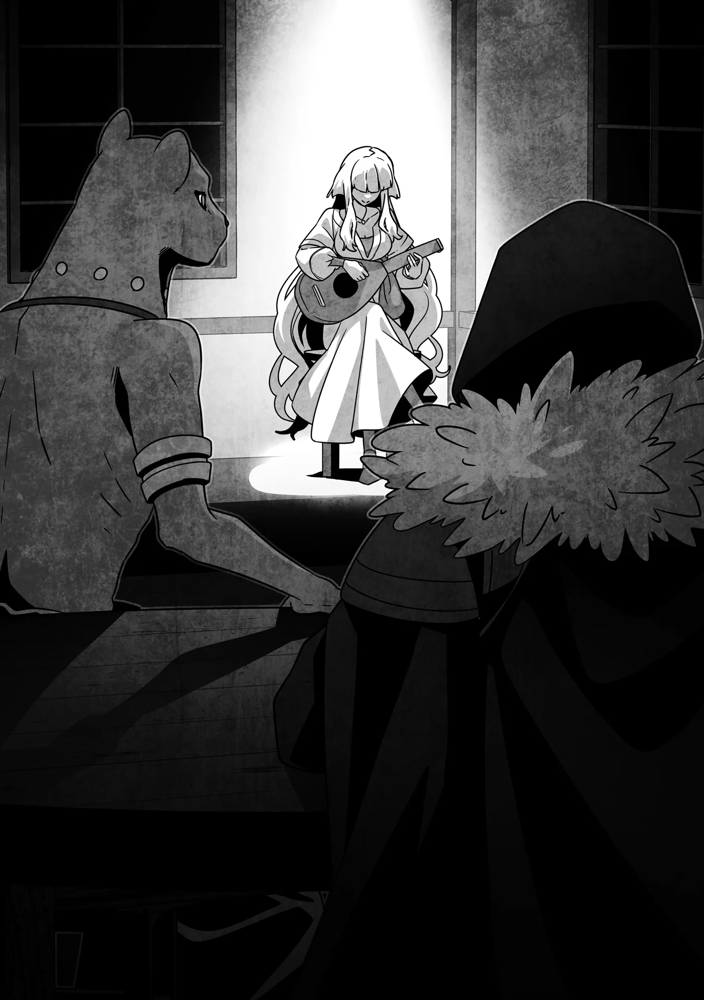

# Chương 325: Tập 14 Chương 2 - Thám Hiểm Mê Cung (1)

"Bài hát hay đấy chứ," tôi nói khi ngồi xuống bàn.

Diego ngạc nhiên liếc nhìn tôi. "Chẳng phải anh nên ở bên kia với họ sao?" anh ấy hỏi, mắt hướng về phía Capitan cùng những người khác đang uống rượu vui vẻ.

Chúng tôi đã bàn bạc xong xuôi về chuyến thám hiểm mê cung, nên khoảng thời gian còn lại của buổi tối ai nấy đều được thoải mái thư giãn theo ý thích. Dù vậy, tôi biết Capitan sẽ khéo léo thăm dò nhóm Niedz để hiểu rõ hơn về con người họ. Suy cho cùng, khi huấn luyện một ai đó, việc nắm bắt tính cách của họ cũng quan trọng chẳng kém gì việc biết rõ thực lực.

Những người không thích nhắc chuyện quá khứ như tôi và Diego thì dẫu có uống bao nhiêu rượu đi nữa cũng sẽ tránh né chủ đề ấy—trừ phi có lý do thực sự chính đáng. Còn nhóm Niedz thì đơn giản hơn nhiều. Càng say, họ sẽ càng bộc bạch nhiều điều với Capitan.

Kết cục của cuộc trò chuyện đó gần như đã được định đoạt từ trước. Capitan vốn thừa kinh nghiệm đối phó với những kẻ cộc cằn, hành động trước khi kịp nghĩ, bởi lẽ ở Hathara—nơi chú ấy làm trưởng nhóm thợ săn—mọi người đều nể trọng chú ấy nhất. Chẳng mấy chốc nhóm Niedz sẽ nằm gọn trong lòng bàn tay chú ấy mà răm rắp nghe theo, nên tôi đâu cần phải nán lại bên đó làm gì.

"Họ sẽ ổn cả thôi," tôi bảo Diego. "Thỉnh thoảng vừa uống rượu vừa tận hưởng chút yên tĩnh thế này cũng hay mà. Với lại nghe thi nhân hát rong cũng là trải nghiệm mới mẻ với tôi. Mấy quán rượu nơi tôi sống hiếm khi có ai biểu diễn thế này lắm."

Diego nhún vai. "Họ cũng chỉ tìm tới những nơi túi tiền dày nhất thôi, dẫu tôi biết có vài kẻ lập dị thích đi lưu diễn ở mấy vùng hẻo lánh... Hừm. Có khi nên gọi họ là người tận tâm thì đúng hơn là lập dị."

Anh ấy đang muốn nhắc tới bổn phận nguyên thủy của những thi nhân và lý do vì sao các vị thần lại khuyến khích việc làm của họ. Giza, vị thần của các thi nhân, mong muốn vạn vật trên cõi đời đều được đưa vào những khúc ca, bởi điều đó sẽ giúp thông tin được lan truyền rộng khắp thế gian cho muôn người cùng chia sẻ. Đó là lý do vì sao các thi nhân lại bôn ba khắp mọi miền đất nước, thu thập những câu chuyện rồi phổ thành nhạc. Tương truyền từ thuở xa xưa, chính Giza cũng từng bước đi trên con đường như thế.

Có điều ngày nay, các thi nhân chẳng còn mặn mà mấy với những truyền thống xa xưa ấy. Chuyện này hẳn ai cũng rõ, đi lưu diễn ở những vùng quê hẻo lánh thì kiếm chẳng được bao nhiêu tiền. Dù mỗi lần đến đó họ luôn được chào đón nồng nhiệt—bởi những nơi ấy hiếm khi có thú tiêu khiển—nhưng chẳng phải ngẫu nhiên mà người ta thường thấy họ hát tại các quán rượu ở những thành phố lớn, nơi họ có thể tận hưởng mọi tiện nghi đời sống.

Nếu bị gặng hỏi, tôi sẽ xếp các thi nhân vào tuýp người có xu hướng nuông chiều bản thân hơn đại đa số. Suy cho cùng, vị thần của họ cũng đồng thời là thần lạc thú. Dẫu vậy, về mặt lý thuyết, họ vẫn có thể phụng sự vị thần bảo hộ của mình khá tốt ở những thành phố lớn, nơi thông tin và các câu chuyện lưu chuyển thường xuyên hơn. Huống hồ, ngay cả một thi nhân cũng có thể bắt đầu cảm thấy cắn rứt nếu cả ngày chỉ biết chìm đắm trong những trò tiêu khiển vô bổ.

Dù sao đi nữa, thỉnh thoảng người ta vẫn bắt gặp những thi nhân nghiêm túc hơn, sẵn sàng dấn thân vào những chuyến hành trình gian khổ nơi biên viễn xa xôi để thu thập chuyện kể từ những góc khuất cùng trời cuối đất. Đó chính là những người mà Diego vừa nhắc tới.

"Anh nghĩ cô ấy thuộc tuýp người nào?" tôi khẽ hỏi.

"Khúc hát cô ấy đang biểu diễn là một bài ca cổ của thành phố này," anh ấy đáp. "Nên có lẽ thuộc tuýp kém sùng đạo hơn..."

Tôi lắng tai nghe kỹ ca từ trong giây lát. "Câu chuyện về một mối tình ngang trái à?"

"Phải. Giữa một nàng tiên biển xinh đẹp và một chàng trai vùng cảng. Quanh đây có đầy những câu chuyện như thế."

Tôi lắng nghe theo, nhận thấy lời Diego tả chẳng sai chút nào. Bản thân nữ thi nhân ấy cũng khá xinh đẹp với mái tóc vàng dài óng ả, vây quanh cô ấy là đám đàn ông đông đảo đang mải miết ngắm nhìn nhan sắc người hát chẳng kém gì thưởng thức tiếng đàn. Tình cảnh ấy hẳn sẽ khiến một người phụ nữ bình thường phải bối rối, nếu không muốn nói là sợ hãi, nhưng với cái nghề thi nhân này thì có lẽ đó chỉ là chuyện cơm bữa thường ngày. Giọng hát của cô ấy vẫn điềm tĩnh và trong trẻo, không chút dao động.

Tôi tựa lưng thư thả lắng nghe khúc hát cho tới khi dứt bài, và trước khi bài tiếp theo vang lên, tôi quay sang Diego. "Nói mới nhớ," tôi mở lời.

"Sao thế?"

"Anh có định vào mê cung cùng chúng tôi không?"

Nét mặt anh ấy lộ rõ vẻ vỡ lẽ. "À, ra đó là lý do anh bước sang đây. Vậy thì xin lỗi vì tôi đã bỏ đi trước khi mọi người bàn bạc xong nhé."

"Không sao đâu—đằng nào tôi cũng thích ngồi bên này hơn. Nói để anh biết, Mazlak bảo lát nữa sẽ xin lỗi anh đấy."

"Ông ấy đâu cần phải làm vậy. Đâu phải lỗi của ông ấy khi tôi cứ mãi bận lòng vì chuyện quá khứ."

Tôi nhún vai. "Ai mà chẳng có những chuyện như thế. Có gì phải xấu hổ đâu."

Diego ngập ngừng một lúc, dường như không chắc mình có nên gợi chuyện hay không. "Kể cả anh sao?" cuối cùng anh ấy cũng hỏi.

Tôi là người khơi chuyện trước, nên trả lời anh ấy mới là phải đạo. Vả lại nếu muốn đôi bên cởi mở với nhau, việc kể cho anh ấy nghe về bản thân mình cũng là minh chứng cho sự chân thành của tôi.

Tôi gật đầu. "Phải. Đó cũng chính là lý do ban đầu tôi trở thành mạo hiểm giả," tôi nói. "Ngày trước, tôi có quen một cô bé. Tôi và cô bé là bạn thân thiết nhất của nhau. Nhưng rồi một ngày nọ, chúng tôi bị quái vật tấn công—cô bé, bà của cô bé, cùng cha mẹ ruột của tôi đều... Chà. Tôi chẳng hiểu vì sao chỉ có mỗi mình tôi sống sót. Thú thật, đến giờ tôi vẫn không biết đó có phải điều may mắn hay không. Đôi khi, tôi vẫn tự hỏi liệu mọi chuyện có nhẹ nhõm hơn không nếu lúc ấy tôi cứ thế... chết đi cùng họ."

Dẫu đã tóm lược thật ngắn gọn, đó vẫn là một câu chuyện nặng nề—chẳng phải thứ có thể tùy tiện trút lên người khác. Nhưng khi tôi liếc nhìn Diego, ngỡ rằng sẽ thấy nét khó xử...

"Vậy sao? Hẳn là chẳng dễ dàng gì," anh ấy chân thành nói. "Nhưng giờ anh vẫn đang ở đây mà. Đó là điều đáng để biết ơn rồi, chẳng phải sao?" Giọng anh ấy chợt chuyển sang bông đùa. "Vả lại, không có anh thì ai sẽ vơ vét hết chuyến Nguyền Cụ này đến chuyến Nguyền Cụ khác từ mê cung về cho tôi đây?"

Tôi bật cười. Anh ấy thật tốt bụng khi chủ động xua tan bầu không khí nặng nề. "Hì. Chắc anh nói đúng rồi."

"Nhưng gác chuyện của tôi sang một bên, nếu nhóm Niedz không tình cờ đụng độ anh, có lẽ chẳng bao lâu nữa họ sẽ bỏ mạng rồi bị lãng quên ở một nơi hoang dã nào đó thôi. Tôi đã thấy rất nhiều kẻ như họ cố bám trụ làm mạo hiểm giả, để rồi cuối cùng đều chật vật ngụp lặn vô vọng. Người ta có thể tìm cách giúp đỡ họ, nhưng chuyện đó chẳng bao giờ dễ dàng cả. Vậy mà anh vẫn đang làm đấy thôi, phải không Rentt? Cố gắng rèn giũa để họ trở thành những mạo hiểm giả thực thụ?"

"Dự tính là vậy. Tôi không dám chắc kết quả sẽ ra sao, nhưng chí ít tôi tự tin có thể nâng đỡ họ đến mức không đến nỗi sớm bỏ mạng giữa chốn đồng không mông quạnh."

"Nếu vậy, tôi muốn tận mắt chứng kiến cách anh làm. Có thể tôi sẽ mất một thời gian mới học hỏi được, nhưng tôi muốn làm điều tương tự cho những kẻ như Niedz mỗi khi bắt gặp họ trong tương lai."

"Ý anh là..."

"Phải. Tôi sẽ vào Mê Cung Các Con Gái Của Hải Thần cùng anh. Tôi vẫn còn tiệm phải trông coi nên không thể đi mỗi ngày, nhưng nếu anh không chê thì tôi rất sẵn lòng tham gia."

◆◇◆◇◆

"Trông mặt họ tái mét hơn cả tờ giấy..." Diego nhận xét.

Sáng hôm sau, tôi đã có mặt tại tiệm của Diego ở khu dân cư. Vì hôm nay cả nhóm sẽ xuống thám hiểm mê cung nên cần phải chuẩn bị chu đáo. Tôi đã chuẩn bị xong xuôi đồ đạc của mình tại chỗ trọ, nhưng vẫn ghé qua để giúp Niedz, Lukas và Gahedd chuẩn bị phần của họ.

Bộ ba đã bàn bạc chuyện này với Diego từ hôm qua và quyết định sẽ ở nhờ tại tiệm của anh ấy một thời gian. Đương nhiên họ vẫn phải trả tiền trọ—dẫu rẻ hơn so với việc thuê phòng ở quán trọ. Đổi lại, họ cũng sẽ phụ giúp Diego việc trông tiệm. Có vẻ người bán đồ nguyền đang cố hết sức để hỗ trợ bộ ba mạo hiểm giả theo cách riêng của mình.

Dù sao đi nữa, khi tôi nói đến việc chuẩn bị, ý tôi không phải là thứ gì đó quá đao to búa lớn, bởi hôm qua chúng tôi đã thu gom đủ mọi công cụ và thuốc men cần thiết rồi. Tuy nhét hết vào chiếc túi ma thuật của tôi thì mang vác rất nhẹ nhàng, nhưng mục đích cuối cùng của chúng tôi là giúp nhóm Niedz có thể tự lập, vậy nên tôi đã bảo họ tự chọn lấy những thứ mình cần rồi xếp vào balo hoặc túi đeo hông. Tự mình sắp xếp trang bị mỗi ngày là kỹ năng không thể thiếu đối với một mạo hiểm giả.

Cách tối ưu nhất là tự sắm lấy một chiếc túi ma thuật của riêng mình rồi nhét vào đó càng nhiều phương án dự phòng càng tốt, ngặt nỗi món đồ ấy lại có mức giá trên trời. Bản thân tôi ngày trước cũng phải tích cóp suốt mấy năm trời mới mua nổi một chiếc túi ma thuật loại nhỏ, và nếu không nhờ sự hào phóng kỳ quặc của một Thợ Săn Ma Cà Rồng nọ, chắc giờ tôi vẫn còn dùng chiếc túi đó thay vì loại cao cấp đang mang bên mình. Mấy món lộc trời cho như thế đâu phải muốn là có được.

Xét theo khía cạnh đó, người ta có thể bảo tôi may mắn đến lạ kỳ, nhưng tôi lại nghĩ chuyện ấy đã được bù trừ sòng phẳng bằng việc tôi bị Rồng nuốt chửng và bị một Thợ Săn Ma Cà Rồng bám đuôi ráo riết.

Tôi nhún vai. "Cũng chẳng trách họ được," tôi nói. "Tôi tin họ từng xuống thám hiểm mê cung rồi, nhưng Mê Cung Các Con Gái Của Hải Thần lại là một câu chuyện hoàn toàn khác. Bản thân tôi có thể chứng thực việc bước chân vào một mê cung xa lạ căng thẳng đến mức nào."

Diego gật đầu. "Tôi đoán danh tiếng của mê cung đó cũng chẳng giúp họ đỡ run hơn," anh ấy nói. "Quanh Lucaris có vài mê cung khác, nhưng tương truyền mê cung này chính là lý do thành phố được dựng nên tại chốn này ngay từ thuở đầu."

"Thế sao? Vì sao lại vậy? Nguồn tài nguyên khai thác từ đó thực sự giá trị đến thế ư?" Tôi biết hải linh thảo có thể bán được kha khá tiền đồng, nhưng chúng chưa đến mức là mỏ vàng đủ để thôi thúc người ta dựng nên cả một thành phố.

"Không, chẳng phải vì tài nguyên đâu. Thuở xưa, những người đặt nền móng dựng nên Lucaris từng đi qua đây sau khi trốn chạy khỏi một cuộc đại chiến ở phương đông," Diego giải thích. "Đó là lúc họ nghe thấy những giọng nói vọng lại từ biển cả, theo hướng của mê cung. Những giọng nói ấy mách bảo rằng nếu họ dựng một thị trấn cảng ở đây và dũng cảm thâm nhập vào tầng sâu của mê cung, họ sẽ trở nên phồn vinh."

"Tôi thấy mình từng nghe khá nhiều truyền thuyết na ná như thế rồi thì phải..."

"Chuyện đó thì không cãi được," Diego thừa nhận. "Nhưng thực tế là thành phố này đang sừng sững ở đây, và Mê Cung Các Con Gái Của Hải Thần đang hiện hữu ngoài kia. Còn về nguồn gốc cái tên, tất cả là nhờ những giọng nói ấy nghe êm ái vô cùng. Những người khai hoang nghe thấy giọng nói đinh ninh rằng đó chính là những người con gái của Hải Thần đã chọn mê cung làm chốn cư ngụ."

"Nghe cũng có lý đấy," tôi nói. "Thảo nào lại là số nhiều."

"Đấy, truyền thuyết về sự hình thành của Lucaris là thế đấy. Nhờ vậy mà phần lớn người dân đều coi mê cung ấy gần như một chốn thiêng liêng—đến mức chúng tôi có hẳn một lễ hội thường niên dâng lên Hải Thần, nơi mọi người cầu nguyện hướng về mê cung. Có điều phải nửa năm nữa mới tới kỳ lễ hội tiếp theo. Dù sao thì ý tôi là người dân nơi đây tin rằng sự phồn vinh của thành phố bắt nguồn từ Mê Cung Các Con Gái Của Hải Thần, thế nên nó luôn chiếm một vị trí đặc biệt trong tâm khảm họ."

"Có điều tôi không nghĩ nhóm Niedz lại sùng đạo đến thế," tôi nhận xét.

"Đúng là vậy. Nhưng nghĩ kỹ thì... tận đáy lòng, tuýp người như họ thường vẫn tin vào một điều gì đó, chẳng phải sao?"

"Thế còn anh? Anh có tin không?"

"Tôi ấy à... Cứ coi như tôi không phải kẻ sùng đạo cho lắm đi."

"Chẳng phải anh từng phụng sự ở đền thờ Thần Giám Định sao?"

"Tôi nghĩ Thần Giám Định thậm chí còn hài lòng với quan điểm của tôi ấy chứ. Giáo lý ở đó cho rằng, vì thế giới vật chất chứa đựng giá trị to lớn, nên chúng tôi được khuyến khích đánh giá vạn vật bằng chính nhận định của mình, thay vì dành trọn thời gian cho việc chuyên tâm cầu nguyện hay mấy thứ tương tự."

Ngẫm lại thì điều đó cũng vô cùng hữu lý. Hành vi giám định bắt nguồn từ những thứ hữu hình thay vì những điều vô hình—như thần linh hay những đấng siêu nhiên đại loại thế. Có vẻ Thần Giám Định quan tâm nhiều hơn đến việc các tín đồ đánh giá những gì hiện diện ngay trước mắt họ. Xét việc điều đó cũng bao gồm cả một vị thần nếu ngẫu nhiên có vị nào giáng lâm, thì đây thậm chí còn chẳng phải giáo lý mâu thuẫn đối với một tôn giáo. Dù vậy, nó vẫn khiến Thần Giám Định trở nên khá độc đáo so với các đấng thần linh khác.

"Giá mà ba người kia cũng thực tế được như anh," tôi nhận xét.

"Có khi như thế sắc mặt họ mới đỡ tái mét được. Anh thấy tôi có nên qua động viên họ một chút không?"

Diego gật đầu. "Có lẽ vậy là tốt đấy."

Tôi bước lại gần và đặt tay lên vai Niedz. "Niedz."

Cậu ta giật thót mình rồi quay lại. "Ồ," cậu ta nói. "Hóa ra là anh."

"Trong tiệm có mỗi mấy người chúng ta. Không phải tôi thì còn ai vào đây nữa?" Tôi lắc đầu. "Trông cậu có vẻ căng thẳng nhỉ."

"T-Tôi chẳng hiểu anh đang nói gì cả."

"Căng thẳng đến mức giáp lỏng lẻo hết cả ra kìa. Nào, siết chặt lại đi. Cả cậu nữa đấy, Gahedd, Lukas."

Bộ ba vội vàng kiểm tra lại áo giáp của mình. Họ mua số trang bị này bằng tiền tôi đưa, và tuy toàn là đồ cũ, nhưng chất lượng vẫn khá tươm tất trong giới hạn ngân sách của tôi. Chắc chắn đây là một sự nâng cấp rõ rệt so với mớ đồ họ mặc trước đây.

Công bằng mà nói thì cái chuẩn ấy vốn dĩ quá thấp. Mấy bộ giáp cũ của họ tồi tàn đến mức tôi phải tự hỏi làm sao họ vẫn còn sống sót được tới giờ, và khi tôi hỏi thì họ bảo lần gần nhất đem giáp đi bảo dưỡng đã là hơn một năm trước. Chuyện đó cũng chẳng đến nỗi tệ nếu họ tự bảo dưỡng lấy, nhưng tôi chẳng nghĩ họ làm được vậy đâu. Chí ít thì điều đó dường như không hẳn do lười biếng, mà phần nhiều là vì họ căn bản không biết cách bảo dưỡng đúng bài. Biết cách chăm chút cho áo giáp của mình là điều cơ bản nhất trong những điều cơ bản, ấy thế mà số lượng mạo hiểm giả không làm nổi việc này lại đông đến bất ngờ.

◆◇◆◇◆

Trên thế gian này luôn có những bậc thiên tài—tuýp người chẳng cần ai chỉ bảo nhiều cũng tạo nên những thành quả vượt xa mọi kỳ vọng. Tuýp người mà nếu có hứng thú, họ sẽ thăng tiến vùn vụt trên các thứ bậc mạo hiểm giả.

Những người còn lại hoặc là mất đi ý chí bước tiếp rồi chuyển sang nghề khác, hoặc đơn thuần buông xuôi để quán tính đưa đẩy qua ngày đoạn tháng, dù thừa biết bản thân đang mòn mỏi dần mà chẳng có lấy nửa bước tiến bộ.

Bằng không, họ sẽ mất mạng.

Kết cục đó xét theo một góc độ nào đó có thể coi là một sự giải thoát, nhưng bản tính con người là luôn tìm cách tránh để tuổi thọ của mình bị cắt ngắn. Đó là lý do vì sao những kẻ khôn ngoan, một khi nhận thấy bản thân đang chạm tới giới hạn thực lực, sẽ giơ tay đầu hàng và bảo rằng chẳng đáng để bỏ công sức nữa. Thế nhưng những mạo hiểm giả làm vậy sẽ vĩnh viễn ngừng trưởng thành.

Sự trưởng thành của một người phụ thuộc vào việc họ có đủ dũng khí để thực sự đối diện với giới hạn của bản thân hay không, và sau đó là liệu họ có đủ năng lực để vượt qua giới hạn đó hay không. Oái oăm thay, đơn độc đối mặt với thử thách như vậy thường chỉ mang lại cho người ta tấm vé một chiều sang thế giới bên kia. Người ta cần một ai đó có thể giữ mình lại ngay trước mép vực thẳm—một người thầy.

Cho tới tận bây giờ, Niedz, Lukas và Gahedd chưa từng có một người như thế bên cạnh. Đó là lý do vì sao họ bị đẩy vào con đường mòn mỏi qua ngày. Nhưng giờ đây, mọi chuyện đã khác.

Dẫu vậy, nếu để họ quá sợ hãi đến mức chẳng tiếp thu nổi bài học nào của tôi thì cũng không ổn.

"Thôi nào, đến giờ đi rồi," tôi nói. "Capitan và Mazlak đang đợi chúng ta ở bến cảng. Chuẩn bị tinh thần đi."

"Ừm, Đại ca Rentt ơi?" Lukas hỏi.

"Sao thế?"

"Bọn... Bọn tôi hôm nay thực sự phải vào Mê Cung Các Con Gái Của Hải Thần sao?"

Tôi gật đầu. "Đúng vậy."

"N-Nhưng bọn tôi chỉ đến đó để phụ giúp anh tìm hải linh thảo thôi đúng không?" cậu ta hỏi đầy hy vọng. "Chỉ có vậy thôi chứ?"

"Về cơ bản là thế, nhưng tôi sẽ bắt các cậu làm nhiều hơn thế nữa. Ý tôi là, đó là mê cung mà. Sẽ có quái vật chúng ta phải chiến đấu, và còn những nguyên liệu khác ngoài hải linh thảo cần phải thu thập nữa."

"R-Rốt cuộc bọn tôi vẫn phải đánh nhau sao..."

À. Hóa ra họ cứ mơ hồ tưởng rằng mình sẽ không phải động tay động chân đánh đấm gì sao? Chuyện này chắc cũng có một phần lỗi của tôi. Tôi đã bảo sẽ huấn luyện họ, nhưng thường thì người ta đâu nghĩ việc huấn luyện lại là ném họ thẳng vào thực chiến. Đó chính là ý tôi khi bảo sẽ rèn luyện thể lực và giúp họ tích lũy thêm chút kinh nghiệm, nhưng xem chừng họ chẳng hiểu ra ý tứ đó.

"Đương nhiên là phải đánh rồi," tôi nói. "Tôi đã hứa sẽ huấn luyện các cậu mà. Các cậu nghĩ tôi định huấn luyện ở đâu chứ?"

Lần này đến lượt Gahedd lên tiếng. "Bọn tôi cứ nghĩ anh sẽ huấn luyện bọn tôi bên ngoài mê cung trước một chút, còn vào mê cung thì chỉ thuần túy phụ giúp tìm hải linh thảo..."

"Thế thì chỉ tổ tốn thời gian. Vả lại đây là cơ hội để các cậu trải nghiệm thực chiến, đâu có lý do gì để lãng phí cơ chứ. Các cậu vẫn là mạo hiểm giả cơ mà, phải không? Tôi tin các cậu biết cách chiến đấu."

Bản thân tôi từng nếm thử các đòn tấn công của họ rồi. Hai ba con quái vật—hay thậm chí mười, hai mươi con—chắc chẳng phải vấn đề to tát gì với họ đâu, hoặc chí ít tôi nghĩ vậy. Cả ba đưa mắt nhìn nhau trước khi Niedz buông tiếng thở dài ngao ngán.

"Nếu là bất kỳ nơi nào khác ngoài Mê Cung Các Con Gái Của Hải Thần thì bọn tôi chịu liền," cậu ta nói. "Nhưng mà..."

"Nơi đó thực sự đáng sợ đến thế sao?" tôi hỏi.

"Bọn tôi chưa từng tới đó bao giờ, bởi muốn đến gần cũng phải có Nguyền Cụ. Nhưng tôi nghe đồn quái vật ở đó mạnh kinh khủng."

"Nhưng chúng ta chỉ quanh quẩn ở các tầng nông thôi mà," tôi chỉ ra. "Ở đó đâu có quái vật mạnh. Mê cung nào hầu như cũng vậy—và mê cung này cũng chẳng phải ngoại lệ."

"Người ta bảo thế thật, nhưng mà..."

Người khác có thể sẽ chê trách họ là lũ nhát gan, nhưng tôi cho rằng điều này chỉ càng chứng minh danh tiếng đặc biệt của mê cung này trong lòng người dân Lucaris mà thôi. Dẫu vậy, tôi chẳng đời nào chịu hủy chuyến đi dẫu họ có nói gì đi chăng nữa.

"Nghe này—chúng ta sẽ đi," tôi dứt khoát nói. "Không có chuyện thoái thác đâu. Các cậu mang đủ trang bị rồi chứ? Nào, đi thôi." Tôi vỗ mạnh vào lưng cậu ta, giục cậu ta tiến bước ra khỏi tiệm. Lukas và Gahedd vội vã bám theo sau.

Vẫn có khả năng họ sẽ đơn giản là bỏ trốn, nhưng tôi không nghĩ khả năng đó cao lắm. Tôi đã dặn trước rằng sẽ tố cáo chuyện họ tấn công tôi lên Hội nếu họ dám có bất kỳ hành động đáng ngờ nào, và dù tốt hay xấu thì tư cách thành viên của Hội chính là phao cứu sinh của họ. Nếu bị khai trừ, thì cũng giống như hầu hết những mạo hiểm giả Đồng Cấp thất bại khác, rất có thể họ sẽ buộc phải quay lại con đường phạm pháp để sinh tồn.

Dĩ nhiên, nếu tôi đơn giản là giấu nhẹm sự thật về vụ tấn công, họ vẫn có thể dễ dàng tìm kiếm việc làm như những người dân bình thường rồi cứ thế sống hết đời. Nhưng tôi biết nếu mình quá nhân nhượng với họ, rất có thể trong tương lai họ lại dại dột làm điều gì đó thiếu suy nghĩ một lần nữa. Tốt hơn hết là nghiêm khắc uốn nắn một chút để xây dựng cho họ nền tảng vững vàng, đảm bảo rằng họ có thể kiếm sống đàng hoàng bằng nghề mạo hiểm giả.

"Anh có vẻ hơi mạnh tay với họ đấy," Diego nhận xét.

"Không làm thế thì họ sẽ rúc mãi trong tiệm của anh mất," tôi nói.

"Thế thì không ổn chút nào," anh ấy đồng tình. "Vậy chúng ta cũng nên lên đường thôi. Ra bến cảng đúng không?"

"Phải. Họ bảo sẽ chuẩn bị thuyền đợi sẵn chúng ta ở đó."

Cứ thế, tôi và Diego rời khỏi tiệm, rảo bước hướng về phía bến cảng.
