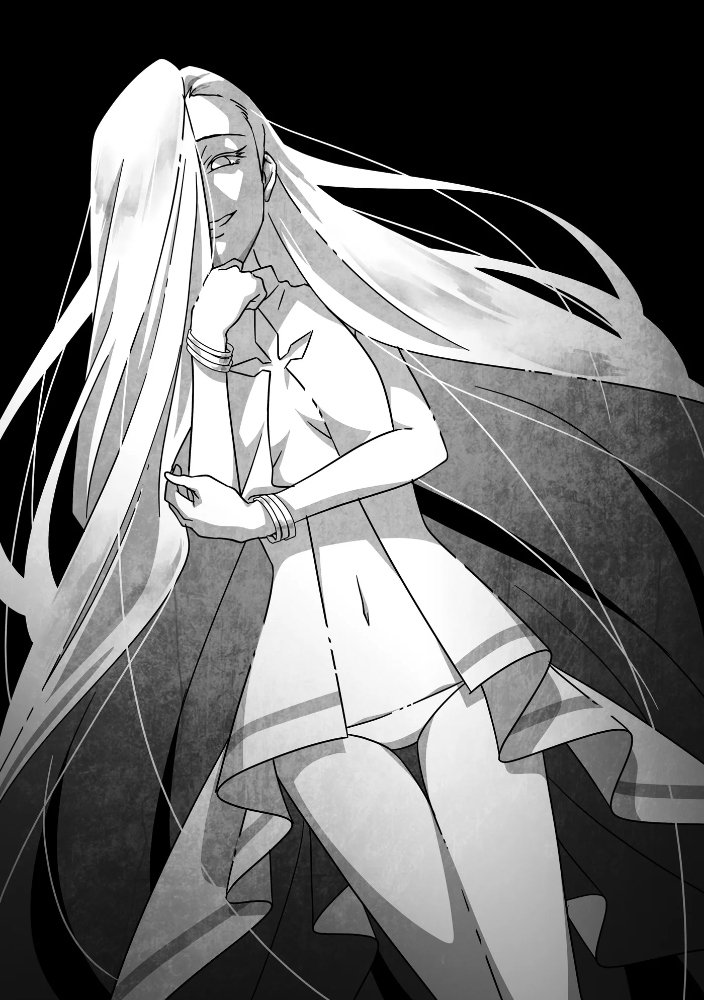

# Chương 328: Tập 14 Chương 2 - Thám Hiểm Mê Cung (4)

Tôi đã... quay trở lại rồi ư?

Cơn đau buốt nơi thái dương chầm chậm lắng xuống, tôi từ từ mở mắt. Xung quanh tối om, nhưng tôi vẫn có thể nhìn thấy mọi vật.

Khoan đã. Tối ư? Tôi nhớ rõ ràng mình vừa bơi theo những người khác hướng về phía vầng sáng cơ mà. Dù chẳng rõ đó là gì, nhưng luồng sáng ấy chắc chắn đã ở đó. Nhìn quanh chẳng thấy chút nguồn sáng nào, xem chừng tôi đã trôi dạt tới một nơi hoàn toàn khác—nhất là khi Capitan và những người còn lại đều chẳng thấy tăm hơi đâu.

Lý do duy nhất giúp tôi nhìn được trong bóng tối là nhờ đôi mắt Undead. Nơi này tối đến mức một người bình thường cùng lắm cũng chỉ lờ mờ nhận ra hình khối đại khái mà thôi.

Làm sao tôi lại lưu lạc đến chốn này được chứ?

"Đúng là số phận trớ trêu thật đấy, không ngờ chúng ta lại tương phùng," một giọng nói bỗng vang lên từ phía sau lưng tôi.

Điều đáng sợ là tôi chẳng hề cảm nhận được bất kỳ ai ở đằng sau. Cứ như thể chủ nhân của giọng nói kia hoàn toàn không có chút hơi thở hay hiện diện nào vậy. Ngập ngừng đôi chút, tôi quay đầu lại và nhìn thấy...

"Xin chào, Thi Quỷ tiên sinh," người phụ nữ vừa đánh giá tôi như một món đồ hiếm lạ vừa cất tiếng. "Hửm. Không, gọi thế không còn đúng nữa rồi nhỉ? Quả là chuyện hiếm thấy thật đấy. Xem ra rốt cuộc ngươi vẫn không trở thành Ma Cà Rồng, dù vẫn thuộc cùng một dòng tộc nói chung. Xét theo hoàn cảnh của ngươi thì thế cũng hợp lý thôi. Kiềm chế được cơn khát máu của mình, ngươi làm khá ấn tượng đấy."

Những lời ấy chẳng đợi tôi đáp lại—cô ta buông ra cứ như đang tự mình lẩm bẩm suy nghĩ thành tiếng. Hẳn tôi đã xem cô ta như một kẻ lang thang mê cung nào đó—dẫu có hơi lập dị—nếu không phải vì tôi từng gặp người phụ nữ này trước đây.

Thậm chí thay vì chỉ là người quen thông thường, đây còn là người tôi mang ơn rất nhiều. Suy cho cùng, cô ta chính là chủ nhân ban đầu của chiếc áo chùng tôi đang mặc, cũng như Bản Đồ Akasha, trước khi trao cả hai món đồ ấy cho tôi.

"Cô là người ở..." Tôi ngập ngừng bỏ lửng câu. "Sao cô lại ở trong Mê Cung Các Con Gái Của Hải Thần?"

Người phụ nữ sở hữu mái tóc trắng, đôi mắt màu xanh lam nhạt, và dù cử chỉ toát lên vẻ dịu dàng, quanh người cô ta vẫn tỏa ra một áp lực đáng sợ đến rợn người. Nhưng lần gần nhất tôi nhìn thấy cô ta là ở một khu vực chưa khai phá của Mê Cung Nguyệt Ảnh, và hồi đó cô ta đã suýt nữa lấy mạng tôi—thực sự muốn giết. Thế nhưng vì những lý do đến giờ tôi vẫn chưa tài nào hiểu nổi, cô ta lại quyết định tha mạng, thậm chí còn tặng cho tôi những ma cụ đầy uy lực mà mình sở hữu trước khi tiễn tôi rời đi.

Cuộc gặp gỡ lần trước vẫn khiến tôi ngỡ như một giấc mơ nửa tỉnh nửa mê, nhưng chiếc áo chùng và tấm bản đồ là bằng chứng sờ sờ cho thấy chuyện đó thực sự đã xảy ra. Tôi chưa bao giờ nghĩ mình sẽ tái ngộ cô ta. Dẫu vậy, câu hỏi đầu tiên nảy ra trong đầu tôi lại khá đơn giản: Trong bao nhiêu nơi chốn, cớ sao cô ta lại xuất hiện ở chính nơi này?

"Tuy trông ta có vẻ nhàn rỗi, nhưng sự thật hoàn toàn trái ngược," cô ta nói. "Ta có rất nhiều việc cần lưu tâm ở muôn nơi, nên cuộc hội ngộ ở đây thuần túy chỉ là trùng hợp. Hoặc chí ít ta sẽ nói thế nếu chuyện này không gượng gạo đến vậy. Hẳn phải có lý do nào đó khiến chúng ta chạm mặt nhau một lần nữa. Dẫu vậy, ta thừa nhận ban đầu mình chẳng hề có ý định tiếp xúc với ngươi. Mấy món quà trước đây ta tặng chỉ thuần túy là lời tạ lỗi—nhìn chung, ta vẫn muốn thấy ngươi tự thân nỗ lực tiến bước trên hành trình của mình hơn."

Xem chừng cô ta đặt kỳ vọng vào tôi. Tôi chẳng rõ chính xác đó là gì, nhưng ít nhất cô ta có vẻ không mang ác ý gì với tôi cả. Điều đó không có nghĩa là tôi có thể hoàn toàn tin tưởng cô ta, nhưng tôi đoán niềm tin của một kẻ nhỏ bé mờ nhạt như tôi cũng chẳng có mấy trọng lượng với một người sở hữu sức mạnh tầm cỡ ấy.

Lần trước gặp gỡ, tôi vẫn còn là một Thi Quỷ. Theo tôi tự đánh giá thì từ dạo ấy đến giờ mình đã mạnh lên không ít, nhưng tôi không nghĩ điều đó giúp tăng chút cơ hội nào trên lý thuyết khi đối đầu với cô ta. Cũng may là cô ta không chĩa luồng khí tức nguy hiểm kia về phía tôi, bởi tôi ngờ rằng cô ta hoàn toàn có thể xóa sổ sự tồn tại của tôi chỉ bằng một cái búng ngón tay... Hay thậm chí chẳng cần nhúc nhích lấy một ly.

Dù sao thì trực giác cũng mách bảo tôi như thế. Ở cạnh cô ta mang lại cảm giác hệt như hồi tôi đụng độ con rồng trong Mê Cung Nguyệt Ảnh—nỗi sợ nguyên thủy, hòa lẫn với cảm giác buông xuôi cam chịu trước một đối thủ mà tôi không bao giờ có hy vọng đánh bại nổi.

Nói ngắn gọn, tôi hoàn toàn bất lực. Nhưng xét ở một góc độ khác, điều đó lại đồng nghĩa với việc tôi có thể nói năng hơi bỗ bã một chút. Dù sao thì tôi cũng ở khoảng cách quá xa phía dưới cô ta, đến mức chắc cô ta cũng chẳng thèm bận tâm đâu.

"Tôi rất cảm kích những gì cô đã làm cho mình," tôi nói. "Nhưng nếu đã vậy thì sao giờ chúng ta lại nói chuyện ở đây? Tôi cũng bận lắm đấy chứ—tôi đang định thám hiểm mê cung này cùng vài người bạn đồng hành của mình."

"Ồ, ta biết chứ. Nếu không nhận ra mê cung suýt nữa thì nuốt chửng ngươi thì ta cũng chẳng ra tay làm gì. Cứ mặc kệ thì ngươi đã trở thành một phần của nó, vĩnh viễn không thể rời khỏi đây rồi."

"Cái gì cơ...?"

"Xem ra ngươi chẳng hiểu mấy về bản chất thực sự của mê cung—dẫu rằng ta đoán chuyện đó cũng dễ hiểu thôi. Số người còn nắm giữ tri thức ấy giờ đếm trên đầu ngón tay cũng xuể."

"Ý cô bảo cô là một trong số họ sao?"

"Có thể coi là vậy. Chính nhờ tri thức đó mà ta mới nhận định ngươi đang gặp nguy hiểm. Ngươi vừa thấy điều gì đó, đúng không?"

"Vâng... Một người đàn ông và một người phụ nữ đang trò chuyện."

"Đó là một trong những ký ức của mê cung—hoặc có lẽ ngươi có thể gọi chúng là những bản ghi. Bản thân ta cũng không rành lắm về đoạn ký ức cụ thể này, nên chẳng dám khẳng định. Dù sao thì một mảnh vỡ của những gì từng xảy ra nơi đây trong quá khứ đã chảy vào tâm trí ngươi. Những thứ như vậy thường được lưu trữ trong Lõi Mê Cung, và— À. Ngươi có biết Lõi Mê Cung là gì không?"

"Thì, ít nhiều tôi cũng biết..."

"Thế thì nhanh rồi. Lõi Mê Cung giống như nguồn mạch của một đài phun nước, kết nối với toàn bộ mê cung và mọi thứ bên trong. Bao gồm cả đám quái vật cư ngụ trong đó. Khi một con quái vật từ thế giới bên ngoài xâm nhập vào, Lõi Mê Cung sẽ mở rộng sợi dây liên kết tới nó—và ngươi vừa suýt nữa trở thành con mồi của chính mối liên kết ấy. Đó cũng là thứ cho phép ngươi nhìn thấy một trong những ký ức lưu trữ bên trong Lõi Mê Cung."

"Nói cách khác... cô vừa cứu mạng tôi sao?"

"Nói thẳng ra là vậy. Dẫu thế, ngươi vẫn đang kết nối với mê cung, nên ta khuyên ngươi đừng ở lại quá lâu. Nếu muốn thám hiểm những tầng sâu bên dưới mà không bị nuốt chửng, ngươi phải đảm bảo mỗi ngày rời khỏi đây một lần. Bằng không, chuyện tương tự sẽ lại tái diễn. Kể cả không bị nuốt chửng, ngươi vẫn có thể nhìn thấy thêm nhiều ảo ảnh nữa đấy."

"Khoan đã. Tức là hoàn toàn không có cách nào né tránh chuyện đó sao? Không một cách nào ư?" Tôi còn phải tiếp tục thám hiểm cùng những người khác, nhưng nếu làm vậy đồng nghĩa với việc bị hút vào mê cung...

"Hãy giữ vững một ý chí kiên định," người phụ nữ gợi ý. "Dù có thể bị kéo vào những ký ức của mê cung, ngươi vẫn có thể dứt mình ra nếu đủ quyết tâm."

"Cô... chắc chứ?" Ngay lúc đang nghĩ chuyện đó nghe chừng chẳng đến mức quá khó khăn, một ý nghĩ bỗng lóe lên trong đầu tôi. "Khoan đã—nếu mê cung luôn tìm cách hấp thụ quái vật từ bên ngoài bước vào, vậy sao chẳng có chuyện gì xảy ra với tôi ở Mê Cung Nguyệt Ảnh? Hay Mê Cung Tân Nguyệt? Hay bất kỳ mê cung nào khác mà tôi từng đặt chân tới?"

"Đó là bởi vì mê cung này... À, xem ra ta hết thời gian rồi. Ta phải rời khỏi đây thôi, kẻo lại lỡ mất cơ hội giải quyết công việc của mình. Tiện đây nói luôn, có khả năng những kẻ ở gần ngươi cũng nhìn thấy ảo ảnh tương tự đấy. Có khi ngươi sẽ phải giải thích đôi điều với họ đấy. Sau cùng, nếu phải cho ngươi một lời khuyên..."

"Lời khuyên gì cơ ạ?"

"Nơi này có một địa điểm mà lối vào chỉ duy nhất ngươi mới có thể phát hiện ra. Giờ thì ta phải đi thật rồi. Tạm biệt nhé." Người phụ nữ khẽ vẫy tay lịch thiệp khi không gian xung quanh tôi bắt đầu biến dạng và vặn xoắn.

"Khoan đã!"

Vẫn còn bao điều tôi muốn hỏi cô ta—nhưng đã quá muộn. Tâm điểm tầm nhìn của tôi xoay tít, ép chặt lại thành một xoáy nước, rồi vạn vật bắt đầu chìm vào bóng tối. Cuối cùng, cả thân thể tôi lại một lần nữa bị hất tung vào một khoảng hư không vô định.

◆◇◆◇◆

Ùm!

Đột nhiên, tôi cảm nhận được cảm giác chìm nghỉm vào một khối chất lỏng. Bình thường thì chuyện đó ắt hẳn sẽ khiến người ta hoảng loạn, nhưng trong tình cảnh này, tôi lại cảm thấy nhẹ nhõm. Có vẻ như rốt cuộc tôi cũng đã quay trở lại.

Dù sao thì chỉ có con người còn sống mới hoảng sợ dưới nước, bởi họ cần phải thở. Bị nỗi sợ cái chết thúc đẩy, họ sẽ giãy giụa bằng mọi giá để thoát khỏi hoàn cảnh hiểm nghèo.

Với tôi thì mọi chuyện lại khác. Vì trên thực tế không cần không khí, tôi hoàn toàn có thể ngồi thiền cả ngày dưới nước nếu thích. Đó là lý do thay vì hoảng loạn, tôi có thể bình tĩnh đánh giá vị trí hiện tại của mình.

Đảo mắt nhìn quanh, tôi nhận ra mình đã quay về đúng nơi xuất phát ban đầu, thật nhẹ cả người. Tôi chẳng biết mình sẽ phải xoay xở thế nào nếu lại bị ném tới một nơi xa lạ khác.

Dẫu vậy, xem chừng một khoảng thời gian kha khá đã trôi qua—Capitan và những người khác chắc hẳn đang rất lo lắng. Nhưng trong khi một tổ đội bình thường có lẽ đã bỏ cuộc và đinh ninh rằng tôi đã chết, Capitan lại thừa hiểu chừng đó chuyện còn lâu mới khiến tôi đi tong được. Chú ấy sẽ đợi—ít nhất là trong một khoảng thời gian.

Dù thế nào thì tôi cũng cần phải ngoi lên khỏi mặt nước. Đoán rằng vệt sáng le lói rọi vào làn nước chính là phương hướng phía trên, tôi bắt đầu bơi về phía đó. Quãng đường chẳng còn bao xa, và tôi chầm chậm nhưng vững vàng ngoi lên.

Và rồi, một thứ gì đó bỗng từ phía trên thò sâu xuống nước. Trong một thoáng ngắn ngủi, tôi ngỡ đó là quái vật hay thứ gì đại loại thế, nhưng tôi nhanh chóng nhận ra đó là bàn tay của một người—thực ra là bàn tay mà tôi vô cùng quen thuộc.

Đưa tay nắm lấy bàn tay quen thuộc ấy, tôi được kéo mạnh mẽ lên khỏi mặt nước cùng một tiếng tõm rõ to. Toàn thân tôi ướt sũng, nhưng tôi biết tình trạng này sẽ chẳng kéo dài lâu—chiếc áo chùng mà người phụ nữ kia trao tặng cho tôi vốn dĩ luôn ráo nước rất nhanh.

Người ta có thể ngỡ rằng chiếc mặt nạ của tôi sẽ bị rỉ sét vì nó được làm từ thứ chất liệu na ná kim loại, nhưng dẫu có ngâm trong nước bao nhiêu đi nữa, nó vẫn giữ nguyên vẻ đầu lâu gớm ghiếc, lành lặn không tì vết như thuở ban đầu. Thật đáng tiếc, bởi nếu rỉ sét đôi chút thì có khi nó sẽ mục đi đủ để tôi đập vỡ. Tôi chỉ có thể phỏng đoán rằng bất kể cơ chế nào khiến tôi không tài nào tháo nó ra thì cũng khiến nó không thể bị tổn hại.

"Rentt! Cháu không sao chứ!" Tiếng Capitan vang lên, kéo tôi ra khỏi mớ suy nghĩ vẩn vơ để trở về với thực tại. Bàn tay vừa kéo tôi lên khỏi mặt nước chính là của chú ấy.

"Vâng, may mà cháu vẫn ổn," tôi nói. "Xin lỗi vì cháu bị lạc mọi người. Chắc Capitan và mọi người phải chờ lâu rồi nhỉ?"

"Cũng không lâu lắm—chưa đầy hai mươi phút đâu. Có điều cháu đột nhiên bốc hơi mất hút làm bọn chú một phen khiếp vía đấy. Bọn chú đã ráng lặn tìm cháu dưới nước nhưng chẳng thấy đâu. Thậm chí chú còn bắt đầu ngờ rằng cháu bắt gặp lối đi nào khác rồi vì lý do gì đó mà quyết định rẽ vào cơ."

"Hai mươi phút thôi sao?" Tôi khựng lại. "Cháu cứ ngỡ lâu hơn thế nhiều." Đó xấp xỉ khoảng thời gian tôi trò chuyện với người phụ nữ kia. Còn ảo ảnh mà tôi vừa trải nghiệm—theo lời cô ta là một trong những ký ức của mê cung—thì kéo dài hơn thế nhiều.

"Sao thế?" Capitan tò mò hỏi. "Có chuyện gì xảy ra à?"

"Chỉ là... nhiều chuyện lắm. Capitan không thấy điều gì kỳ lạ sao?" Người phụ nữ kia từng nhắc tới khả năng những người khác cũng nhìn thấy ảo ảnh ấy.

Capitan mở to mắt. "Không, chú thì không."

Cách chú ấy nói nghe như thể...

"Vậy là có người khác nhìn thấy sao?" tôi hỏi.

"Diego," chú ấy xác nhận. "Cậu ta ngất xỉu lúc nãy—không lâu lắm. Cậu ta bảo mình thấy một ảo ảnh kỳ lạ. Cậu ta xua tay bảo chắc đầu óc lú lẫn tưởng tượng ra thôi, nhưng nghe cháu nói thế này thì chú đoán không phải vậy rồi, nhỉ?"

Vậy là Diego cũng nhìn thấy sao? Ngẫm lại thì cũng hợp lý. Có vẻ như Capitan cùng bộ ba kia hoàn toàn chẳng thấy ảo ảnh nào cả. Tôi không phải chuyên gia trong mấy chuyện này nên chỉ có thể nghĩ ra vài giả thuyết giải thích nguyên do, nhưng phỏng đoán an toàn nhất có lẽ là vì những người xuất hiện trong ảo ảnh chính là cha mẹ của Diego.

Mê cung này có một lịch sử lâu đời—nó đã tồn tại từ trước khi Lucaris hình thành. Số người từng dấn thân thám hiểm nơi đây qua bao thế hệ hẳn nhiều không đếm xuể, và lượng ký ức mà nó tích tụ được cũng tương tự như vậy. Cơ chế vận hành bên trong của mê cung vượt quá tầm hiểu biết của tôi, nhưng dường như hoàn toàn tự nhiên khi kết luận rằng Diego chính là lý do khiến tôi nhìn thấy đoạn ký ức cụ thể ấy.

Tôi cũng muốn gặp lại người phụ nữ kia để hỏi cho ra nhẽ, nhưng tôi biết đó chỉ là mong ước viển vông. Cô ta chắc chắn không phải kiểu người mà người ta có thể tình cờ bắt gặp mỗi ngày. Dẫu vậy, nếu có thêm cơ hội nào khác, tôi sẽ có cả một danh sách câu hỏi dài dằng dặc dành cho cô ta.

Gác chuyện đó sang một bên, việc đầu tiên tôi cần làm lúc này là...

"Cháu muốn hỏi anh ấy về chuyện đó," tôi nói. "Mọi người đâu cả rồi?" Xung quanh chỉ có mỗi Capitan—tôi chẳng thấy bóng dáng Diego, Niedz hay những người còn lại đâu.

"Họ đang đi do thám khu vực phía trước," Capitan đáp. "Chỗ này thường là khu an toàn, nhưng chẳng có gì đảm bảo là sẽ không có thứ gì mò tới. Vì chúng ta không có cả ngày rảnh rỗi nên chú nghĩ tốt nhất là để Niedz và đám bạn cậu ta làm quen dần với mê cung."

"Liệu họ có ổn không?"

"Có Diego đi cùng nên chắc ổn thôi. Dù sao thì quái vật xuất hiện quanh đây cũng không mạnh lắm—chỉ toàn cỡ Hạ Cấp Sahagin với mấy thứ đại loại thế. Tầm năm con thì chắc cũng đủ làm Niedz, Lukas và Gahedd gặp rắc rối, nhưng một mình Diego có thể cân được mười con, vả lại chúng chẳng bao giờ kéo tới đông đến mức đó đâu."

Xem chừng Capitan đánh giá Diego khá cao. Nói công bằng thì tôi cũng vậy—cách anh ấy di chuyển trong lần đầu chúng tôi chạm trán đã đủ để mách bảo tôi rằng người thú nhân này sở hữu kỹ năng trời phú vô cùng đáng nể. Rõ ràng là anh ấy chưa lật hết mọi con bài tẩy của mình, nhưng tối thiểu thì tôi biết anh ấy thừa sức tự lo liệu cho bản thân.

Về phần Capitan, chú ấy chẳng cần phải tận mắt thấy Diego chiến đấu mới rút ra được kết luận đó—chỉ cần nhìn cách người đàn ông ấy cử động là chú đã nắm bắt được rồi. Sư phụ có khác. Khả năng phán đoán của tôi còn kém xa mức ấy, nên những nhận định chớp nhoáng của tôi về thực lực người khác không phải lúc nào cũng chuẩn xác đến thế.

"Vâng," tôi nói. "Liệu họ sắp quay lại chưa? Hay chúng ta nên đuổi theo họ?"

"Họ sắp quay lại rồi đấy. Chú dặn họ đừng đi quá xa, bởi chú biết thế nào cháu cũng sẽ quay trở về."

Biết bao chuyện bất trắc có thể đã xảy ra với tôi, nhưng xem ra Capitan vẫn lựa chọn đặt niềm tin rằng dù thế nào tôi cũng sẽ vượt qua được. Tôi thật may mắn khi có chú ấy làm người thầy của mình. "Cháu xin lỗi," tôi nói.

"Có gì đâu mà phải xin lỗi. Cơ mà đã xảy ra chuyện gì thế? Diego đâu có bị biến mất, nên chắc chắn phải có nhiều điều uẩn khúc hơn là mỗi chuyện thấy ảo ảnh chứ. Mà rốt cuộc cháu đã đi đâu vậy?"

"Thú thật thì chính cháu cũng chẳng rõ tường tận nữa. Nhưng mà—"

Tôi liền tóm tắt cho Capitan nghe những gì vừa xảy ra với mình—kể cả cuộc trò chuyện với người phụ nữ kia. Tôi chẳng có mấy điều cần phải giấu giếm chú ấy... À thì, nói đúng ra là trên thực tế chẳng có lấy một chuyện nào mà tôi không thể chia sẻ cùng chú ấy cả.

"Lạ thật đấy..." Capitan trầm ngâm khi tôi kể xong. "Người phụ nữ sở hữu sức mạnh kinh hồn bạt vía đó—cháu bảo cô ta không phải kẻ thù à? Hừm. Có điều chú không chắc cứ ngồi nghiền ngẫm chuyện này thì có thể tìm ra câu trả lời cho chúng ta đâu."

Cách diễn đạt có phần thẳng tuột, nhưng tôi chẳng thể nào phản bác. "Vâng, chắc Capitan nói đúng rồi."

"Trong rừng sâu cũng vậy thôi. Thỉnh thoảng cháu sẽ chạm trán một con quái vật thực sự đáng sợ tít tận rừng thẳm, nhưng chúng thường chẳng buồn đoái hoài tới những con người bé nhỏ như chúng ta đâu. Người phụ nữ cháu vừa kể có lẽ cũng tương tự như thế. Còn nếu lỡ chúng bỗng dưng tỏ ra hứng thú với cháu thì sao? Chẳng làm được gì nhiều ngoài việc ráng sức chống cự, dẫu thừa biết chuyện đó là vô vọng. Nghe thế có đúng với cô ta không?"

"Gần như chuẩn xác luôn," tôi đồng tình. Capitan không hề buông lời sáo rỗng vu vơ—chú ấy đang đúc kết từ chính kinh nghiệm cả đời làm thợ săn của mình. Đôi khi, thực sự tồn tại những thế lực vượt quá khả năng chống cự của con người. "Vậy thì cháu xin tạm gác chuyện đó sang một bên. Mê cung vẫn là ưu tiên hàng đầu."

Capitan gật đầu. "Ừ. Chúng ta nói chuyện nãy giờ cũng lâu rồi, chắc Diego và những người khác sắp quay lại..."

Bất thình lình, một cơn ớn lạnh chạy dọc sống lưng tôi. Tôi đưa mắt nhìn Capitan, nhận ra chú ấy cũng vừa cảm nhận được điều tương tự.

"Cháu có cảm nhận được không?!"

"Cái gì thế này?!"

Bất kể thứ gì vừa gieo rắc nỗi kinh hoàng tột độ ấy vào lòng chúng tôi, tôi linh cảm thấy nó nằm ở tít tận trên cao. Ngay khoảnh khắc tiếp theo, một luồng dao động Ma Lực khổng lồ tràn ngập khắp mê cung, và toàn bộ công trình bắt đầu rung chuyển dữ dội.
