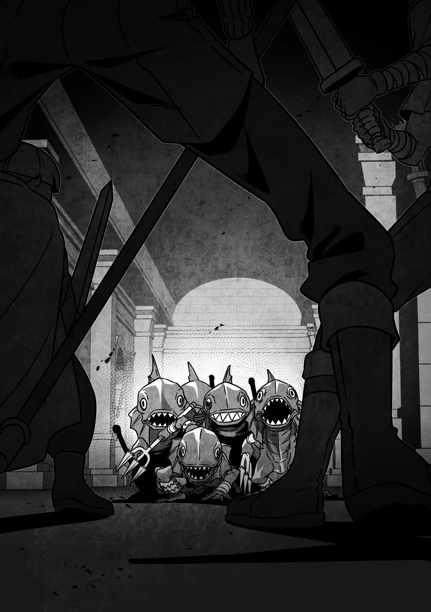

# Chương 331: Tập 14 Chương 3 - Tìm Kiếm Trong Mê Cung (2)

Tôi—Lukas Zeiyu, một mạo hiểm giả Đồng Cấp—khá chắc là mình vừa khám phá ra một kiểu địa ngục hoàn toàn mới.

Hỏi tại sao ư? Câu trả lời đơn giản lắm. Từ trước tới giờ, đối thủ nặng ký nhất mà Niedz, Gahedd và tôi từng đụng độ trong một trận chiến chỉ là một, hai con Goblin bình thường—mà đó là khi cả ba chúng tôi cùng xúm vào đánh đấy. Thế mà chẳng hiểu sao, giờ đây bọn tôi lại thấy mình đang ở trong Mê Cung Các Con Gái Của Hải Thần, nơi mà ngay cả những mạo hiểm giả kỳ cựu của Lucaris cũng phải e dè chẳng dám bước chân vào.

Nếu chỉ có bấy nhiêu thôi thì chắc cũng chưa đến nỗi tệ—ngặt nỗi chuyện đâu chỉ dừng lại ở đó.

Chẳng là, những người đưa chúng tôi tới đây làm người khuân vác—chính là Đại ca Rentt, Đại ca Capitan và Đại ca Diego—đều mạnh chẳng kém gì các mạo hiểm giả kỳ cựu của Lucaris. Thậm chí nói thật lòng thì có khi còn mạnh hơn nữa cơ. Nếu việc của chúng tôi chỉ đơn giản là bám gót theo sau họ, thì bọn tôi đã chẳng gặp mấy nguy hiểm rồi.

Tiếc thay, sự đời lại chẳng êm đẹp như thế.

Lúc này đây, tôi đang phải mặt đối mặt với năm con Hạ Cấp Sahagin tay lăm lăm những ngọn lao ngắn, miệng phát ra những tiếng kêu lách chách đầy đe dọa nhắm vào bọn tôi—tức là tôi, Niedz Labra và Gahedd Odan. Cả ba chúng tôi đều là mạo hiểm giả Đồng Cấp và đã làm bạn đồng hành lâu đến mức có muốn dứt nhau ra cũng chẳng nổi. Niedz và Gahedd là những người bạn thân thiết nhất của tôi, và tôi cũng chẳng nhớ nổi mình đã cùng họ lập đội nhận bao nhiêu ủy thác rồi nữa.

Có điều nếu bàn về thực lực, tôi không thể bảo họ đáng tin cậy cho được. Suy cho cùng thì họ cũng chỉ mạnh ngang ngửa tôi mà thôi. Dẫu rằng phong độ có lúc trồi lúc sụt, nhưng tôi có thể khẳng định chắc nịch rằng việc cố sức giao chiến với bất cứ thứ gì mạnh hơn hai con Goblin đều là chuyện quá sức đối với bọn tôi.

Nhưng tất cả những điều đó cũng chẳng thể thay đổi được sự thật là bọn tôi đang phải trừng mắt đối đầu với năm con Hạ Cấp Sahagin.

Lẽ dĩ nhiên, Rentt, Capitan và Diego đang đứng ngay sau lưng bọn tôi, nên ai cũng sẽ nghĩ thể nào rốt cuộc mọi chuyện cũng êm xuôi. Ngặt nỗi, đây mới là điều họ vừa dặn bọn tôi ban nãy:

"Chừng nào các cậu chưa thực sự rơi vào đường cùng, bọn tôi sẽ chỉ đứng nhìn thôi."

"Nên đừng hòng mong bọn tôi ra tay giúp đỡ."

Có chạy ngược lại chỗ họ mà mếu máo rằng bọn tôi đã tới giới hạn thì cũng chẳng giải quyết được gì—quyền quyết định có can thiệp hay không hoàn toàn nằm ở họ. Tôi biết tỏng điều đó vì ngay khoảnh khắc năm con Sahagin này thình lình xuất hiện, tôi đã vừa mếu máo vừa lao về phía họ, để rồi câu trả lời duy nhất nhận lại chỉ là những ánh nhìn lạnh tanh. Xem chừng chẳng còn con đường nào khác ngoài việc phải chiến đấu thôi.

Thế nhưng giữa lúc tôi còn đang mải nghĩ chỉ cần dính một đòn chí mạng là coi như đời mình đi tong, thì Niedz và Gahedd đã lộ rõ vẻ quyết tâm khi rút vũ khí ra.

"Lukas. Lên thôi."

"Nghĩ kỹ thì đây là một cơ hội tốt đấy. Có chết thì sang thế giới bên kia bọn mình lại cùng nhau nhậu một bữa."

Và dù trong lòng rất muốn phản đối—dù bản thân tôi có nhát gan đến đâu—thì tôi vẫn chưa hèn hạ tới mức buông xuôi để mặc bạn bè mình phải đơn thương độc mã chiến đấu. Giống như họ, tôi cũng rút vũ khí và siết chặt tay, tự lên dây cót tinh thần cho trận chiến sắp tới.

Một khi đã tập trung, tôi liền dễ dàng nhìn ra những việc mình cần phải làm. Khi lâm trận, Niedz chiến đấu hoàn toàn theo bản năng, còn Gahedd lại vững chãi như một tảng đá kiên cố. Trái lại, tôi thuộc tuýp người luôn suy đi tính lại cặn kẽ mọi bề, và đó cũng là lý do vì sao các mạo hiểm giả khác luôn coi tôi chẳng khác nào một kẻ nửa mùa ngờ nghệch.

Tôi cũng chẳng thể trách họ được. Tôi lúc nào cũng hành động chậm chạp, và thường mất nhiều thời gian hơn mức cần thiết để hạ gục những con quái vật mà phần lớn mạo hiểm giả chỉ việc lao vào dứt điểm bằng một nhát chém duy nhất. Từ lâu tôi đã coi đó là một tật xấu của mình, và cũng từng bao phen cố sửa đổi. Thật lòng tôi đã cố đấy chứ.

Nhưng thường thì mỗi khi lao lên và phó mặc tất cả cho bản năng, kết cục là tôi chỉ rước thêm nhiều thương tích vào người, để rồi những vết thương ấy lại khiến tôi càng thêm chậm chạp. Thảng hoặc tôi cũng có những cú ra đòn may mắn hạ gục quái vật chỉ bằng một nhát, nhưng tôi chẳng thể quy điều đó cho thứ gì khác ngoài sự may rủi nhất thời của số phận.

Ấy vậy mà suốt một thời gian dài, tôi vẫn đinh ninh đó mới là cách chiến đấu đúng đắn. Tôi tin chắc rằng mình cần phải thay đổi cách nhìn nhận của bản thân.

Rồi hôm nọ, Đại ca Rentt đã nói với tôi một câu. Mà thực ra thì nghe giống như anh ấy đang tự độc thoại thành tiếng hơn, nhưng tôi vẫn khắc sâu từng lời đó vào tâm can.

"Hừm. Vậy ra Lukas là điểm tựa cuối cùng của bộ ba này sao? Niedz lao lên phía trước, Gahedd tùy cơ ứng biến theo tình hình, còn Lukas thì bao quát toàn cục trận đấu và tính toán điểm yếu của đối phương. Xem ra họ đã tự nhiên hình thành một đội hình khá vững chắc... dẫu rằng vẫn còn vài lỗ hổng lộ liễu."

Anh ấy nói ra những lời đó sau khi bọn tôi có một trận đấu tập chớp nhoáng để làm quen với đống trang bị mới toanh mà anh sắm cho. Trận đó là ba đánh một, và chẳng cần nói cũng biết bọn tôi chẳng có lấy nửa phần cơ hội—về cơ bản nó chỉ là sự lặp lại của lần chạm trán đầu tiên giữa bọn tôi, điểm khác biệt duy nhất là lần này cả ba chúng tôi cùng xông vào tấn công thay vì để một mình Niedz hùng hổ lao lên trước. Dĩ nhiên chuyện đó cũng chẳng mảy may thay đổi được kết cục trận đấu.

Dẫu vậy, có vẻ như Đại ca Rentt đã phân tích vai trò chiến đấu của từng người chúng tôi trong suốt trận đấu tập. Trước đây tôi chưa từng nghĩ ngợi chi tiết về điều đó, nhưng một khi anh ấy đã gợi mở ý nghĩ ấy trong đầu tôi, tôi mới nhận ra anh nói đúng hoàn toàn. Đó chính là cách bọn tôi chiến đấu bấy lâu nay.

Ờ thì... dẫu sao cũng đại loại là vậy. Phần lớn thời gian chắc bọn tôi chỉ biết vùng vẫy quáng quàng trong hoảng loạn. Mà cũng khó trách được khi bọn tôi quá đỗi yếu ớt—cảm giác như sự liều mạng tuyệt vọng đến cùng cực đó chính là lợi thế duy nhất mà bọn tôi có được.

Nhưng những lời của Đại ca Rentt đã khiến tôi băn khoăn tự hỏi liệu có phải bấy lâu nay bọn tôi đã làm ngược đời hoàn toàn hay không. Biết đâu việc giành chiến thắng quá khó khăn với bọn tôi chỉ là do cách chiến đấu quá đỗi thiếu hiệu quả. Biết đâu nếu chịu dành thời gian suy tính và vạch ra chiến thuật, bọn tôi sẽ gặt hái được nhiều thành công hơn rất nhiều.

Chắc tôi ngốc lắm mới đi nghĩ ngợi mấy chuyện này vào lúc dầu sôi lửa bỏng thế này. Năm con Hạ Cấp Sahagin mạnh cỡ bằng mười con Goblin cộng lại. Nếu cứ thế lao vào cận chiến trực diện, bọn tôi sẽ gục ngã chỉ trong vài giây ngắn ngủi.

Nhưng đồng thời, có khi chính vì thế mà bọn tôi càng cần phải tính toán cẩn trọng. Dù tôi quen biết Đại ca Rentt chưa lâu, nhưng tôi nghĩ mình hiểu anh ấy đủ để tin rằng tuy anh có thể đưa ra những yêu cầu có vẻ vô lý, song anh sẽ không bao giờ đòi hỏi những điều thực sự bất khả thi.

Vậy nên biết đâu đấy, rất có thể vẫn có một cách nào đó để bọn tôi đánh bại năm con Hạ Cấp Sahagin này. Bọn tôi chỉ cần tìm ra nó mà thôi. Trước hết, vai trò của tôi có lẽ là...

"Niedz!" tôi cất tiếng gọi.

"Gì thế?"

"Cố hết sức hạ từng con một nhé!"

"Được. Hiểu rồi."

"Gahedd! Cậu đừng bận tâm chuyện dứt điểm chúng! Cứ cản mấy con còn lại ra xa trong lúc Niedz đánh một đối một là được!"

Cậu ấy liếc nhìn quanh. "Ý hay đấy. Hành lang này hẹp thế này, có khi làm được thật đấy."

Niedz là tay chiến đấu cừ nhất trong nhóm bọn tôi; cậu ấy sẽ không chịu thua trước một con Hạ Cấp Sahagin đâu. Vấn đề duy nhất là số lượng bọn chúng đông hơn một con rất nhiều, nhưng nếu Gahedd và tôi làm tốt nhiệm vụ của mình, bọn tôi có thể tận dụng không gian chật hẹp của hành lang mê cung để đảm bảo Niedz không bao giờ phải đối đầu với nhiều hơn một kẻ địch cùng lúc.

Và nếu giữ chân đám Sahagin còn lại ở khoảng cách an toàn là tất cả những gì bọn tôi phải làm, thì tôi tự tin rằng Gahedd và mình có thể xoay xở được. Từ đó, bọn tôi chỉ việc lần lượt dọn sạch từng con một. Đây vẫn là một canh bạc liều lĩnh, bởi tôi chẳng biết liệu thể lực của bọn tôi có trụ nổi chừng ấy thời gian hay không, nhưng—

"Chúng tới rồi!" Niedz hét lớn.

Bọn tôi lao mình vào trận chiến.

◆◇◆◇◆

Tôi chăm chú dõi theo Niedz, Lukas và Gahedd giao chiến với đám Hạ Cấp Sahagin. Trong số các loài quái vật, Hạ Cấp Sahagin mạnh hơn Goblin một chút, và một đàn năm con chắc chắn sẽ gây không ít khó khăn cho hầu hết các mạo hiểm giả Đồng Cấp. Nếu là trước kia, thời điểm bản thân chưa biến thành Undead mà đụng độ ngần ấy con, có lẽ tôi đã chọn cách quay đầu bỏ chạy rồi.

Nhưng nếu bên cạnh có thêm hai mạo hiểm giả Đồng Cấp khác thì sao? Chuyện đó lại hoàn toàn khác. Nhất là khi đang chiến đấu trong một hành lang chật hẹp như thế này.

Dù Hạ Cấp Sahagin đúng như tên gọi của chúng, có kích thước nhỏ hơn những cá thể Sahagin thông thường, nhưng chúng thừa sức khiến bất cứ con Goblin nào phải khốn đốn. Dẫu vậy, ngay cả khi cả năm con cùng lúc ập tới, người ta vẫn hoàn toàn có thể tránh việc để tất cả bọn chúng đồng loạt tung đòn về phía mình. Dù vẫn phải chống đỡ đôi ba con cùng một lúc, nhưng với ba mạo hiểm giả Đồng Cấp ư? Niedz và hai người bạn của cậu ta có thừa quân số để không bị áp đảo hoàn toàn.

Điều đó đồng nghĩa với việc mấu chốt chỉ còn nằm ở chỗ liệu họ có đủ khả năng phán đoán để nhìn ra tất cả những điều ấy, có đủ sức mạnh để chống trả, và có đủ thể lực để cầm cự lâu hơn năm con quái vật hay không. Suy cho cùng thì cơ thể của Hạ Cấp Sahagin được bao phủ bởi một lớp vảy cứng cáp có thể làm chệch hướng vũ khí sắc bén. Người ta cần phải tung ra một nhát chém đủ mạnh để xé toạc lớp vảy đó, bằng không sẽ chẳng thể tạo ra chút tổn hại nào—và tôi cũng không chắc liệu nhóm Niedz có biết điều ấy hay chưa.

"Khả năng quan sát chiến trường của Lukas cũng khá đấy chứ," Capitan vừa chăm chú nhìn vừa lẩm bẩm.

Tôi cũng đồng tình với chú ấy. Bộ ba đó trông như suýt nữa thì đờ người ra vì hoảng sợ, cho tới khi Lukas kịp thời đánh giá tình hình rồi cất tiếng quát to chỉ đạo để kéo cả nhóm vào guồng hành động.

Từ cách họ chọn vị trí đứng, tôi có thể lờ mờ đoán ra chiến thuật của cả nhóm. Đó là một bài bản khá kinh điển trong sách giáo khoa—họ đang cố tận dụng sự chật hẹp của hành lang để giảm bớt số lượng quái vật phải đối đầu vào cùng một thời điểm.

"Gahedd cũng chẳng tệ đâu," Diego cất lời nhận xét. "Cậu ta đã dùng giáo kìm chân đám Hạ Cấp Sahagin cho tới khi hai người kia lấy lại được sự bình tĩnh."

Vì bản thân Diego cũng sử dụng giáo, nên có lẽ anh ấy nhìn thấu những chuyển động của Gahedd hơn. Dù chênh lệch thực lực giữa hai người là một trời một vực, nhưng có lẽ anh cảm thấy có sự đồng điệu nào đó với một người dùng giáo giống mình.

"So với hai người họ thì Niedz có phần hơi bốc đồng quá," tôi góp lời. "Có lẽ cậu ta đã lao thẳng vào giữa bầy nếu Lukas không lên tiếng nhắc nhở."

Capitan và Diego gật đầu tán thành, nhưng xem chừng Capitan vẫn còn đôi lời muốn nói thêm. "Tùy theo góc nhìn mà cháu cũng có thể bảo cậu ta là kẻ dũng cảm nhất trong cả ba đứa," chú ấy bảo. "Đúng là cậu ta có khựng lại một giây, nhưng đã nhanh chóng sốc lại tinh thần. Đó là điều mà Gahedd và Lukas dường như không làm được. Cậu đầu tiên thì quá chú trọng vào sự an toàn nên do dự chẳng dám chủ động ra tay, còn cậu sau thì... Chà, đơn giản là cậu ta sợ chết khiếp."

"Xét theo khía cạnh đó thì Niedz đích thực là một mạo hiểm giả," Diego nói. "Dù rằng tính cách ấy thường dẫn những kẻ như thế xuống mồ sớm. Nhưng cũng chính nhờ tính bốc đồng đó mà hai người mới chạm trán nhau, phải không anh Rentt?"

Tôi chẳng thể cãi vào đâu được. Niedz quả là may mắn khi đã nhắm trúng một mạo hiểm giả dễ tính đến lạ thường. Bằng không thì lúc này có lẽ cậu ta chẳng còn đứng ở đây cùng bọn tôi nữa—hoặc chí ít cũng chẳng còn lành lặn nguyên vẹn. Ai mà biết được số phận cậu ta sẽ đi về đâu nếu tôi là một kẻ dễ nổi nóng hơn cơ chứ?

Mạo hiểm giả nhìn chung thường thô lỗ cộc cằn và rất dễ nổi cơn thịnh nộ—nói vậy chẳng phải định kiến gì cho cam mà đó là sự thật rành rành. Suy cho cùng thì người ta cũng phải thuộc dạng người nhất định mới dấn thân vào cái nghề này. Đâu phải ai cũng có gan đem cả tính mạng ra đánh cược chỉ để đổi lấy cơ hội đổi đời làm giàu.

"Thế hai người thấy sao?" tôi vừa quan sát trận chiến đang tiếp diễn vừa hỏi Capitan và Diego. "Liệu họ có cơ hội thắng không?" Theo những gì tôi nhìn thấy, chiến thuật của họ là để Niedz tập trung vào một con Sahagin duy nhất trong khi Gahedd và Lukas thu hút sự chú ý của những con còn lại. Đó không phải là một kế hoạch tồi, nhưng...

"Với thực lực hiện tại của họ thì đây có lẽ là cách tốt nhất mà họ có thể xoay xở rồi," Diego trầm ngâm nói. "Mà bản thân chiến thuật của họ cũng đâu hẳn là sai. Chỉ có điều... Chà..."

Dù anh bỏ lửng câu nói, tôi khá chắc mình hiểu điều anh sắp sửa nói ra là gì.

"Chú thấy cậu nói đúng đấy," Capitan gật đầu đồng tình. "Bọn chúng cần phải rèn giũa thêm khả năng phán đoán xử lý tình huống. Chú đoán đó chính là chỗ mà sự non nớt thiếu kinh nghiệm của họ lộ rõ nhất. Ồ, nhìn kìa—họ hạ được một con rồi."

Quả đúng như vậy, Niedz vừa hạ gục được một con Hạ Cấp Sahagin. Cậu ta trông ngỡ ngàng trong thoáng chốc, cứ như thể chính mình cũng không ngờ lưỡi kiếm lại có thể chém xuyên qua lớp vảy cứng cáp của nó, nhưng khoảnh khắc ấy nhanh chóng trôi qua khi cậu thủ thế vũ khí và quay sang đối mặt với kẻ địch tiếp theo.

Tôi ngờ rằng bình thường Niedz không đủ sức chém thủng lớp giáp tự nhiên của một con Hạ Cấp Sahagin. Nhưng dưới áp lực khi bọn tôi đứng nhìn chằm chằm và chặn đứng đường tháo lui, hẳn cậu ta đã khai mở được chút sức mạnh tiềm thức mà bất cứ ai cũng có thể bộc phát trong khoảnh khắc ngàn cân treo sợi tóc. Đó là chuyện thường thấy trong chiến đấu.

Ngặt nỗi, nguồn sức mạnh bộc phát đó lại chẳng phải thứ vô hạn. Quả nhiên, ngay khi vừa trao đổi vài chiêu với con Hạ Cấp Sahagin thứ hai, con quái vật đã lập tức bắt đầu chiếm thế thượng phong.

"Chắc cậu ta cạn sạch Ma Lực rồi..." tôi lẩm bẩm.

Nói chung, con người chỉ có thể cảm nhận một cách mơ hồ về mức Ma Lực của người khác. Người ta có thể làm được nhiều hơn nếu sở hữu ma nhãn như Lorraine, nhưng hiếm ai sinh ra đã có được đôi mắt ấy, và số người rèn giũa đủ kỹ năng để đo lường thật chuẩn xác lại càng ít ỏi hơn.

Tuy nhiên, tôi lại là một con quái vật—một thực thể gắn kết sâu sắc với Ma Lực. Việc đo đạc lượng Ma Lực của kẻ khác đối với tôi dễ dàng như một phản xạ tự nhiên, bởi vậy tôi mới buột miệng buông lời nhận xét như thế.

Đã leo lên tới Đồng Cấp, đương nhiên Niedz phải sở hữu một lượng Ma Lực nhất định để tùy nghi sử dụng. Và trên thực tế, lượng dự trữ của cậu ta còn nhiều gấp mấy lần tôi thời còn sống—đủ để nếu biết dùng một cách khôn ngoan, cậu ta hoàn toàn có thể cường hóa vũ khí và cơ thể đủ khỏe để hạ gục vài ba con Hạ Cấp Sahagin. Dẫu vậy...

"Thằng nhóc hoang phí quá nhiều Ma Lực," Capitan quan sát rồi nhận xét. "Cơ mà thế lại tiện cho chú. Chú vốn chỉ mong được thấy nó cạn sạch Ma Lực mà thôi."

"Sao lại thế được?" Diego hỏi. "Làm vậy chẳng phải chỉ tổ khiến cậu ta mất mạng thôi sao?"

"Chú muốn dạy bọn chúng cách dùng Khí Lực," Capitan giải thích. "Điều đó có nghĩa là bất cứ lượng Ma Lực nào còn sót lại trong cơ thể cũng sẽ chỉ tổ gây vướng víu. Chuyện đó không hẳn khiến chúng không thể học được, nhưng sẽ tốn nhiều thời gian hơn để có thể cảm nhận được nó."

Diego lộ vẻ ngạc nhiên. "Thật sao? Bản thân tôi trước đây cũng từng thử học cách dùng Khí Lực, nhưng vị tư tế Chiến Thần mà tôi tới bái phỏng chưa từng nói với tôi điều gì như thế cả."

"Thế à? Vậy rồi cậu có học được không?"

"Không... Rốt cuộc người ta kết luận tôi chẳng có chút năng khiếu nào cả."

"Vậy thì xem chừng cậu gặp phải thầy dở rồi. Bởi vì theo những gì chú thấy thì cậu có đấy."
