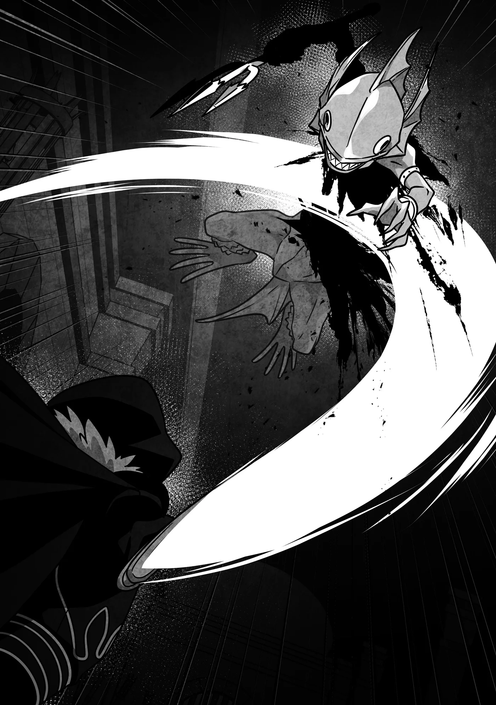

# Chương 332: Tập 14 Chương 3 - Tìm Kiếm Trong Mê Cung (3)

"C-Cái gì cơ?!"

Hiếm khi nào thấy Diego phản ứng thái quá đến vậy. Trái lại, Capitan trông vẫn hoàn toàn điềm tĩnh.

"Vốn dĩ Khí Lực là thứ sức mạnh ai cũng có sẵn trong người," chú ấy bảo. "Thế nên chẳng có chuyện không có tài năng đâu. Họa chăng ngoài kia có vài trường hợp ngoại lệ bất hạnh, nhưng cậu thì chắc chắn không phải rồi."

"Ý ông là... tôi cũng có thể dùng Khí Lực ư?"

"Phải. Chừng đó thì tôi dám chắc. Còn chuyện cậu tinh thông tới đâu thì lúc đó mới cần đến tài năng. Mà ngay cả thế, phần lớn vẫn là chuyện kiên nhẫn và khổ luyện. Dĩ nhiên, ở đây chúng ta có một trường hợp ngoại lệ để chứng minh rằng không phải lúc nào chuyện cũng đơn giản như vậy..." Capitan liếc nhìn về phía tôi.

"Ý ông là sao?" Diego hỏi. "Tôi tưởng Rentt dùng được Khí Lực cơ mà?"

Nói thêm thì, tôi đã kể cho Diego nghe chuyện mình có thể sử dụng cả Ma Lực, Khí Lực lẫn Thần Lực. Tôi nghĩ chia sẻ thông tin đó là điều nên làm, vì dẫu sao chúng tôi cũng cùng nhau đi thám hiểm mê cung. Nhưng tôi không nói với Niedz, Lukas hay Gahedd. Nhồi nhét cho họ những thông tin không cần thiết có lẽ chỉ khiến họ thêm bối rối. Còn với Diego thì tôi chẳng phải bận tâm chuyện đó.

Người bán đồ nguyền chỉ hơi ngạc nhiên một chút khi biết tôi có thể dùng Thần Lực. Từng là một tư tế, có lẽ anh ấy đã quen tiếp xúc với những người như tôi suốt rồi.

"Bây giờ thì dùng được, phải, nhưng trước đây đâu phải lúc nào cũng vậy," Capitan đáp. "Chính xác hơn là hồi đó thằng bé dùng được, nhưng dù có bỏ bao nhiêu công sức thì lượng tích trữ cũng chẳng tăng lên được tí nào. Đáng tiếc thật đấy, bởi nó là một trong những đứa hiếm hoi có biệt tài về sự cần cù. Cơ mà thằng bé lại mang một thể chất đặc dị khiến Khí Lực không thể lớn mạnh thêm—đó là điều mà nhờ có nó tôi mới nhận ra."

Nghe những lời của Capitan thì hơi nản lòng một chút, nhưng qua giọng điệu của chú ấy, tôi hiểu chú không hề xem đó là thất bại của tôi, mà là một bài học chú rút ra về giới hạn của bản thân trong vai trò người thầy. Về phần mình, tôi thấy chú chẳng có lý do gì phải thất vọng về bản thân cả—dạy được tôi cách sử dụng Khí Lực tự nó đã là một thành tựu lớn rồi, chưa kể chú còn dạy tôi cả kiếm thuật lẫn kỹ năng sinh tồn nữa. Không có chú ấy, tôi sẽ chẳng bao giờ có thể trở thành một mạo hiểm giả.

"Bất ngờ thật đấy—tôi thấy anh ấy trông rất cừ mà." Diego nhìn sang tôi. "Vậy ra Khí Lực từng là điểm yếu của anh à?"

"Không, giờ thì không còn nữa rồi," tôi nói thật. "Từ đó tới nay lượng tích trữ của tôi đã tăng lên. Ít nhất thì tôi nghĩ là vậy..."

Sở dĩ tôi không dám chắc chắn một trăm phần trăm là bởi tôi không biết có nên tin vào trực giác của mình hay không. Tôi cảm thấy bản thân mạnh dần lên kể từ khi bị biến thành Khô Lâu, nhưng suy cho cùng, tôi vẫn chưa hiểu tường tận Khí Lực là gì và vận hành ra sao. Dù sao thì đâu phải lúc nào tôi cũng có một người thầy ở bên để giải đáp mọi thắc mắc. Nói vậy thôi chứ hiện tại tôi đang đứng cạnh một chuyên gia rồi, nên tốt nhất là cứ hỏi cho bằng hết những gì có thể.

Capitan dường như hiểu được nỗi do dự của tôi. "Chắc chắn là có tăng—mà còn tăng rất nhiều nữa kia." Giọng chú ấy bớt phần nghiêm túc hơn. "Thú thật, nhìn thấy cháu tiến bộ nhanh đến mức nào làm chú phải tự nghi ngờ lại tất cả những gì mình từng biết đấy."

"Vậy điều gì đã tạo nên sự thay đổi đột ngột đó thế?" Diego hỏi. "Bản chất của Khí Lực vốn là vậy ư? Trì trệ suốt một thời gian dài rồi bỗng nhiên tăng vọt?"

"Với vài người thì có thể là vậy, nhưng trường hợp của Rentt là cá biệt. Tôi sẽ không đi sâu vào chi tiết đâu, vì đó là chuyện riêng tư. Có thể nói là thằng bé đã trải qua một sự thay đổi thể chất đột ngột."

Tôi biết Capitan nói năng úp mở là vì muốn giữ kẽ cho tôi, nhưng cách diễn đạt đó đúng là vòng vo hết chỗ nói. Thế nhưng ngay khi tôi thầm nghĩ rằng đòi hỏi Diego hiểu được ý tứ mơ hồ kia thì thật chẳng công bằng chút nào, người bán đồ nguyền lại khiến tôi ngạc nhiên.

"Tôi hiểu rồi. Tôi nghĩ mình đoán được ý ông," anh ấy bảo. "Hiếm hoi lắm mới có một Thánh Giả trải qua sự biến đổi tương tự. Một ngày nọ, Thần Lực của họ gần như chẳng đáng kể, rồi sau đó một loại nước ngâm thảo dược kỳ lạ hay thứ bí dược màu nhiệm nào đó đã làm thay đổi thể chất của họ mạnh mẽ đến mức ngay ngày hôm sau Thần Lực đã dâng trào cuồn cuộn."

Chà. Đúng là cựu tư tế có khác. Xem chừng anh ấy biết rất nhiều về những chuyện nội bộ trong Giáo Hội, và có lẽ cũng quen biết không ít Thánh Giả. Ít nhất điều đó cũng đồng nghĩa với việc anh ấy có cơ sở để liên hệ với trường hợp của tôi.

Dẫu vậy, tôi chưa từng ngờ rằng những người thuộc hàng giáo phẩm lại dùng các phương pháp như thế để tăng cường Thần Lực. Cảm giác như tôi vừa được nghe lỏm một bí mật trong nghề vậy. Cơ mà có lẽ tôi là người cuối cùng có tư cách chỉ trích kẻ khác khi nói đến chuyện dùng mánh lới đường tắt để gia tăng Ma Lực, Khí Lực hay Thần Lực.

Có điều tôi lại thấy tò mò về các loại nước ngâm thảo dược cùng những thứ bí dược màu nhiệm mà Diego vừa nhắc tới. Nghe chừng chúng khá là hữu dụng. Không biết liệu chúng có tác dụng với tôi không nhỉ...

"Mấy phương pháp anh vừa nói ấy—chúng có dễ kiếm không?" tôi hỏi.

Diego lắc đầu. "Dĩ nhiên là không rồi. Nước ngâm thảo dược thì còn đỡ, chứ người ta đã gọi là bí dược màu nhiệm thì đều có lý do cả. Chỉ có các dược sư của Giáo Hội mới nắm được công thức thôi. Ít nhất thì ở đền thờ Thần Giám Định chuyện là như vậy. Bọn tôi đặc biệt nghiêm ngặt về khoản đó, xét theo đặc thù giáo lý của mình."

Cũng có lý—một ngôi đền toàn các giám định sư thì có khi chỉ cần nhìn qua danh sách nguyên liệu cần mua là đã suy ra được công thức rồi. Phần còn lại chỉ là thử nghiệm và sai sót cho tới khi tìm ra cách điều chế chuẩn xác. Nghiên cứu sẽ dễ dàng hơn nhiều khi anh biết chắc chắn có một thành phẩm khả thi đang chờ ở đích đến, thay vì cứ lần mò trong vô vọng hướng tới một mục tiêu mơ hồ.

"Ừ, nghe hợp lý đấy," tôi thừa nhận. "Vậy tôi sẽ gác chuyện bí dược sang một bên. Thế còn nước ngâm thảo dược thì sao?"

"Thỉnh thoảng họ cũng phân phát cho các tín đồ, đôi khi còn đem bán một vài loại nữa," Diego nói. "Nhưng cũng có những loại họ giữ kín cho riêng mình. Nghe như thể anh đang muốn tìm mua một thang vậy, Rentt."

"Phải. Tôi từng bảo với anh là mình dùng được Thần Lực rồi đúng không? Nếu có cách để mạnh lên, tôi cũng muốn thử xem sao."

"Tôi hiểu mà. Cơ mà anh khao khát sức mạnh hơn vẻ ngoài nhiều đấy... À không, có lẽ dùng từ 'hơn ấn tượng anh mang lại' thì đúng hơn là 'vẻ ngoài'."

Ừ thì, chiếc mặt nạ đầu lâu và tấm áo chùng sẫm màu quả thực khá hợp với cái hình tượng thèm khát sức mạnh đó. Cơ mà hành xử của tôi thì sao chứ? Đúng là tôi không đến mức nghênh ngang đi khắp nơi lùng sục mọi cách để mạnh lên, nhưng... "Mục tiêu của tôi là một ngày nào đó trở thành Mithril Cấp mà," tôi nói. "Thế nên tôi cần sức mạnh. Càng nhiều càng tốt."

"À. Điều đó thì tôi hiểu. Dù sao thì nếu muốn đạt được mục tiêu của mình, tôi cũng cần sức mạnh." Diego quay sang. "Capitan."

"Sao cơ?"

"Ông dạy tôi cách dùng Khí Lực được không?"

◆◇◆◇◆

"Được thôi. Tôi không phiền đâu. Dù sao tôi cũng định dạy Rentt, Niedz và mấy cậu kia mà. Dạy bốn trò với năm trò thì khác gì nhau."

Diego tỏ vẻ ngạc nhiên khi thấy Capitan đồng ý lời thỉnh cầu của mình nhanh chóng đến vậy. "Không phải tôi muốn nói lời bất lợi cho bản thân đâu, nhưng ông chắc chứ?" anh ấy bảo.

"Khí Lực, ma pháp, hay bất kỳ kỹ năng hữu dụng nào—những thứ đó thường được người ta giấu nhẹm đi cơ mà, đúng không?"

Diego nói không sai. Phần lớn các ma pháp sư và học giả đều ghét việc chia sẻ bí mật nghiên cứu của mình cho kẻ khác. Một đệ tử chân truyền thì không sao—dù gì người ta cũng cần người kế thừa di sản—nhưng chuyện đó còn cách rất xa việc để cho cả thế giới cùng biết. Dĩ nhiên, thái độ thường sẽ thay đổi khi danh lợi xen vào... nhưng ngay cả khi đó, việc giấu lại những ngón nghề tinh túy nhất vẫn là chuyện thường tình.

Lối suy nghĩ này bắt nguồn từ quan niệm rằng việc chia sẻ những gì làm nên sự đặc biệt của bản thân chẳng khác nào tự bắn vào chân mình, và theo một khía cạnh nào đó thì điều ấy hoàn toàn đúng—nhất là trong các lĩnh vực ma thuật và võ thuật. Suy cho cùng, nếu chẳng ai biết ma pháp của anh vận hành ra sao, làm sao họ có thể phòng bị trước nó? Nghe thật khắc nghiệt, nhưng thực tế thế giới này vốn dĩ đã khắc nghiệt như vậy rồi.

Dẫu vậy, ngoài kia vẫn có rất nhiều người không nghĩ theo cách đó. Capitan chính là một ví dụ điển hình.

"Tôi hiểu vì sao người ta lại làm thế, nhưng lối nghĩ đó hơi thái quá so với tính tôi," chú ấy nói. "Tất nhiên là tôi không dạy bừa cho bất kỳ ai rồi, nhưng với những người đã có được sự tin tưởng nhất định từ tôi—thì tại sao lại không chứ? Chúng ta đang ở chung một tổ đội, cậu mạnh lên thì cũng giúp ích cho tôi mà thôi."

"Thế thì tôi chẳng cãi lại được rồi..."

"Vả lại, như tôi đã nói, ai cũng có Khí Lực. Nghĩa là chỉ cần khổ luyện đủ nhiều, ai cũng có thể học cách sử dụng nó. Nhưng đồng thời cậu cũng cần phải cần cù—đây không phải thứ có thể tiếp thu chỉ qua vài lời giảng giải. Cho nên việc tôi truyền đạt chút kiến thức của mình chẳng khiến tôi chịu thiệt thòi gì cả."

Giọng Capitan nghe đầy vẻ tự tin, và chú ấy hoàn toàn có lý do để nghĩ vậy. Cho dù hôm nay Diego có bắt đầu học cách sử dụng Khí Lực đi chăng nữa, anh ấy cũng chẳng đời nào đuổi kịp Capitan. Ý tôi là, tôi đã kiên trì suốt mười năm ròng rã mà vẫn chưa thể chạm tới được ngưỡng kỹ năng của người thầy cũ. Một phần là do chú ấy chưa dạy tôi những chi tiết tinh vi hơn, nhưng lý do lớn nhất hiển nhiên là thời gian. Khi người dẫn đầu cuộc đua cũng đang chạy miệt mài hệt như bạn, bắt kịp họ chẳng phải chuyện dễ dàng gì.

Diego tỏ vẻ bị thuyết phục trước lập luận của Capitan. "Nếu vậy thì tôi xin nhờ ông chỉ giáo cho," anh ấy nói. "Cảm ơn ông. Nói trước là tôi không định truyền rộng rãi ra ngoài đâu."

"Thật à?" Capitan bảo. "Tôi thì nghĩ cậu cứ thoải mái dạy cho bất kỳ ai cậu muốn. Tôi chẳng mất mát gì đâu."

"Ông chắc chứ?" Diego ngập ngừng. "Mà thôi, ông đã bảo cần cù là quan trọng nhất, nên tôi nghĩ mình cũng khó lòng gặp được học trò nào có triển vọng đâu. Chắc tới lúc đó rồi hẵng tính—giờ tôi lo xa quá rồi."

"Đúng vậy. Trước hết, chúng ta phải đảm bảo xem cậu có dùng được nó hay không đã."

Ngay khi Capitan vừa dứt lời, tôi nhận thấy trận chiến đang diễn ra đã bắt đầu đi đến hồi kết. "Họ làm tốt lắm," tôi lẩm bẩm. "Nhưng có lẽ cũng sắp đến lúc rồi."

Capitan gật đầu. "Trông như họ đã hạ được... hai con rồi. Vậy là còn lại..."

"Ba con," Diego tiếp lời, cũng gật đầu theo. "Nhưng sẽ vất vả đấy. Lukas và Gahedd trông có vẻ còn cầm cự thêm được một lúc, nhưng Niedz thì sắp kiệt sức rồi. Không có cậu ta tung đòn dứt điểm, hai người kia sẽ chẳng giải quyết được gì đâu."

Diego về cơ bản đã nói trúng phóc những gì tôi đang nghĩ trong đầu. Bộ ba vẫn đang chật vật chống đỡ các đòn tấn công của lũ Hạ Cấp Sahagin, nhưng những nhát chém của họ đã không còn chút lực nào nữa—bằng chứng là chúng không thể xuyên thủng lớp vảy của lũ quái vật được nữa.

"Tôi sẽ lên bọc lót cho họ," tôi lên tiếng.

Diego và Capitan gật đầu đồng ý, nhưng không ai bám theo khi tôi bước tới chen vào giữa những người bạn đồng hành Đồng Cấp và lũ Hạ Cấp Sahagin. Họ cũng hiểu rõ như tôi rằng trong một hành lang chật hẹp thế này, chỉ cần một người trong chúng tôi tham chiến là tốt hơn cả ba cùng nhảy vào.

Giờ chỉ còn lại câu hỏi ai sẽ là người xông lên, nhưng Capitan dường như muốn quan sát kỹ hơn chuyển động của những học trò tương lai của mình, còn ngọn giáo của Diego thì lại khó xoay trở trong một cuộc giao tranh hỗn loạn, chen chúc. Bằng phương pháp loại trừ, người còn lại chính là tôi.

Vừa thấy tôi tiến đến từ phía sau, Lukas đã nhận ra ngay. "Đại ca Rentt!" cậu ta thốt lên. "Đại ca tới giúp bọn tôi đấy à?!"

"Đại loại thế," tôi đáp. "Hai cậu ráng trụ vững thêm một chút nữa đi. Tôi lên bọc lót cho Niedz trước đã."

Ở phía trước, chân Niedz đã bắt đầu lảo đảo. Tôi thực sự ấn tượng trước những nỗ lực của cậu ta—dù rằng về mặt kỹ thuật thì chính chúng tôi đã ép cậu vào thế này. Cậu ta vẫn đang gạt đỡ các đòn đánh của con Hạ Cấp Sahagin, nhưng trông cứ như thể sắp đánh rơi thanh kiếm tới nơi. Rồi đúng lúc sự tập trung của cậu phân tán trong một khoảnh khắc ngắn ngủi, một trong những con quái vật cá đã chớp lấy sơ hở, bước tới đâm ngọn lao về phía Niedz.

Đòn đâm ấy không bao giờ chạm tới đích. Lẽ dĩ nhiên là vì tôi đã chặn đứng nó lại.

"R-Rentt?" Niedz hổn hển thốt lên giữa những nhịp thở dốc. "Chẳng phải anh bảo... là sẽ không... giúp cơ mà?" Mồ hôi cậu ta tuôn ra như tắm, và ánh mắt cho thấy cậu đã cận kề ngưỡng bất tỉnh hoàn toàn. Việc cậu ta vẫn còn đủ can trường để nở nụ cười mà nói ra những lời ấy quả là đáng nể thật.

"Cậu vẫn còn đủ sức để nói câu đó thì khéo chẳng cần tôi giúp đâu nhỉ," tôi trêu. "Hay là để tôi mặc kệ cậu đánh tiếp nhé?"

"Tha... tha cho tôi đi..."

Chẳng có gì bất ngờ; xem ra ngay cả Niedz cũng không đến nỗi ngốc nghếch tới mức tiếp tục làm ra vẻ cứng cỏi vào lúc này.

Tôi gật đầu, vung kiếm lên rồi truyền Khí Lực vào thân kiếm. Ma Lực sẽ giúp tăng cường khả năng chém đứt, nhưng đối phó với lớp vảy cứng cáp thì lựa chọn này chắc ăn hơn, chưa kể còn dễ dàng hơn nhiều. Khí Lực cũng có thể dùng để chém, nhưng tôi có thể bỏ qua toàn bộ công đoạn đó mà truyền thẳng lực đòn đánh vào tận lục phủ ngũ tạng của con quái vật.

Tôi vung lưỡi kiếm về phía con Hạ Cấp Sahagin, nhát kiếm lướt qua cơ thể nó ngọt xớt, để lại vết thương toác vỡ dữ dội từ bên trong.

Niedz trừng mắt nhìn tôi, vẻ mặt đầy kinh hãi. "Cái đòn đó... nhìn phát khiếp thật đấy," cậu ta thốt lên.

◆◇◆◇◆

Tôi nhanh chóng nhận ra rằng việc dùng Khí Lực để chém đứt—à thì, làm nổ tung—con Hạ Cấp Sahagin không phải là một ý kiến hay. Còn lý do tại sao ư, thì... Đó là bởi khi cơ thể nó vỡ tung, lớp vảy cứng như đá đã bắn ra tứ phía. May mắn là Niedz, Lukas và Gahedd không hề hấn gì vì tôi đã gạt phăng những mảnh vảy văng về phía chúng tôi, nhưng trong một trận cận chiến chật chội thế này, lặp lại điều đó có khi lại làm tổn thương đồng minh nhiều hơn là giúp ích cho họ.

Hừm. Tôi sẽ phải suy nghĩ kỹ lại về chuyện này rồi.

Gần Maalt, nơi tôi gắn bó phần lớn sự nghiệp mạo hiểm giả của mình, gần như không có bóng dáng con Hạ Cấp Sahagin nào, thế nên tôi có rất ít kinh nghiệm chiến đấu với chúng. Tôi tự nhắc nhở bản thân rằng mình vẫn cần phải tiếp tục trau dồi học hỏi thêm.

Dẫu vậy, tôi vẫn nắm được đại khái cách xử lý sao cho đúng đắn.

Con Hạ Cấp Sahagin mà Niedz vừa chạm trán sẽ chẳng còn cơ hội làm phiền ai được nữa, vậy nên tôi lao sang tiếp ứng cho Lukas và Gahedd. Thú thật thì phần tiếp theo này đáng lẽ còn dễ dàng hơn, bởi tôi sẽ tiếp cận lũ quái vật cá từ phía sau lưng chúng. Và vì bộ ba mạo hiểm giả Đồng Cấp có thực lực ngang ngửa với lũ Hạ Cấp Sahagin, điều đó đồng nghĩa với việc lũ quái vật sẽ không có lấy một chút thảnh thơi nào để mà bận tâm tới những gì diễn ra sau lưng mình.

Con thứ nhất mải mê tập trung vào trận chiến trước mặt đến mức chẳng hề nhận ra khi thanh kiếm tích tụ Ma Lực của tôi chém bay đầu nó, và con thứ hai cũng phải chịu chung số phận tương tự. Hai cái đầu Hạ Cấp Sahagin bay vút lên không trung—nhưng điều đó không có nghĩa là chúng tôi đã có thể hạ thấp cảnh giác.

Lukas, người dường như tưởng rằng trận chiến đã kết thúc khi thấy hai cái đầu bay lên, liền quay sang nhìn tôi. "Đại ca Rentt! Đại ca cứu— Oái!"

May thay, ánh mắt nghiêm khắc nhắc nhở mà tôi phóng về phía cậu ta đã truyền tải được thông điệp, và cậu đã phản xạ kịp thời. Phản xạ trước cái gì ư? Thì trước ngọn lao vừa đâm thẳng về phía cậu từ cái xác không đầu của một trong hai con Hạ Cấp Sahagin chứ đâu.

Lời này nói ra từ miệng tôi thì nghe hơi mỉa mai một chút, nhưng nếu cứ đinh ninh rằng quái vật bị chém đứt đầu là sẽ lăn ra chết ngay tắp lự, thì tức là đang tự rước họa vào thân đấy. Hạ Cấp Sahagin cũng không phải ngoại lệ—ít nhất thì sinh lực dồi dào trong cơ thể cũng đủ để chúng giãy giụa thêm chốc lát. Dĩ nhiên, vì không phải Undead như tôi nên các chức năng cơ thể của chúng sẽ suy giảm nghiêm trọng và chẳng bao lâu nữa sẽ thực sự chết hẳn... nhưng khoảng thời gian đó vẫn dài hơn nhiều so với lúc một con người gục ngã.

Lukas, người vừa kịp né được cú đâm của con Hạ Cấp Sahagin trong đường tơ kẽ tóc, liền đâm phập thanh kiếm vào cơ thể nó.

Độ bền bỉ của quái vật phần lớn nhờ vào lượng Ma Lực mà nó sở hữu, và dù vảy của Hạ Cấp Sahagin vẫn duy trì được độ cứng ngay cả khi nguồn cung cấp Ma Lực đã bị cắt đứt, thì việc các phiến vảy khép chặt lại với nhau thực chất là một chức năng sinh lý được duy trì nhờ lượng Ma Lực dự trữ của chính con quái vật. Nói cách khác, một khi tôi đã chém bay đầu nó, thanh kiếm của Lukas chẳng gặp chút khó khăn nào để tìm ra kẽ hở mà cắm ngập vào thân mình nó.

Dĩ nhiên, sau những gì vừa xảy ra, Lukas chẳng dại gì mà lơ là mất cảnh giác thêm lần nữa. Cậu rút mạnh lưỡi kiếm ra khỏi xác con quái vật rồi thủ thế sẵn sàng. "Mày muốn nữa không hả?!" cậu ta hét lên. "N-Ngon thì nhào vô xem nào!"

Có điều lũ Hạ Cấp Sahagin không bền bỉ đến mức ấy. Bất chấp lời khiêu chiến của Lukas, thân xác con quái vật cá từ từ đổ sụp xuống sàn. Nó vẫn còn co giật, nhưng quái vật vốn dĩ là như vậy. Khiến người ta rợn người cho tới tận hơi thở cuối cùng—thậm chí còn kéo dài thêm một lúc cho chắc ăn.

Dường như Lukas cũng ý thức được điều đó, bởi cậu ta trông chẳng có vẻ gì là bận tâm. Cảnh tượng ấy có thể khiến một người bình thường sợ hãi, nhưng với mạo hiểm giả thì đó là chuyện cơm bữa thường ngày.

Có một thoáng tôi từng nghĩ cậu ta không nhận ra ánh nhìn của tôi và mình sẽ phải ra tay can thiệp, nhưng xem chừng cậu đã bắt đầu bộc lộ những dấu hiệu trưởng thành. Có lẽ là nhờ các đối thủ lần này có trình độ tương đương với cậu ta. Hy vọng cậu sẽ tiếp tục phát huy được điều đó.

Còn về phần Gahedd, có vẻ cậu ta chưa từng lơ là cảnh giác ngay từ đầu, không giống như người bạn hay bồn chồn của mình. Cậu chắc chắn là người giữ được bình tĩnh tốt nhất trong bộ ba khi bước vào trận chiến. Tôi cho rằng đó là sự khác biệt về độ vững vàng của tâm lý. Tôi chẳng hề ra bất kỳ dấu hiệu nào cho cậu, thế nhưng cậu vẫn đứng thủ thế trước con Sahagin mất đầu còn lại. Cậu né tránh an toàn đòn tấn công liều mạng cuối cùng của nó, rồi đâm thẳng ngọn giáo vào giữa những phiến vảy nay đã lỏng lẻo—ngay trúng tim nó, không lệch một li. Ngay cả khi cái xác đổ gục xuống sàn, cậu vẫn cẩn thận quan sát nó thêm một lúc, dùng giáo chọc chọc vào nó từ một khoảng cách an toàn.

Ừ, cậu ta đích thực là người cẩn trọng nhất trong bộ ba.

"Mọi chuyện kết thúc êm đẹp là tốt rồi," tôi lẩm bẩm một mình. "Cơ mà thế này cũng mệt mỏi thật đấy..."

Dẫu cho cơ thể Undead của tôi hầu như chẳng biết đến khái niệm mệt mỏi là gì, nhưng trận chiến vừa rồi lại vắt kiệt sức lực theo một nghĩa khác. Chiến đấu một mình mà không phải lo lắng cho bất kỳ đồng đội nào xung quanh ư? Chuyện nhỏ. Nhưng vừa chiến đấu lại vừa phải không ngừng để mắt tới nhóm Niedz cùng một lúc? Khó khăn hơn nhiều.

Nếu họ yếu hơn nhiều—chẳng hạn như mạo hiểm giả Thiết Cấp—thì mọi chuyện đã đơn giản hơn bao nhiêu. Dù sao tôi cũng có thừa kinh nghiệm rèn giũa những điều cơ bản cho lính mới. Nhưng với mạo hiểm giả Đồng Cấp thì lại có quá nhiều điều phải lưu tâm. Trước hết là tôi luôn nơm nớp lo sợ họ sẽ mất mạng nếu tôi rời mắt khỏi họ dù chỉ trong chớp mắt. Điều đó khiến tôi tự hỏi liệu hồi xưa khi dạy dỗ tôi, Capitan có từng nếm trải thứ áp lực tương tự thế này hay không, và suy nghĩ ấy lại gợi lên một niềm biết ơn sâu sắc tự đáy lòng tôi.

Nhắc tới Capitan, tôi chắc chắn mình không phải người duy nhất quan sát những điều đó. Tôi nhìn về phía chú ấy—mong rằng chú sẽ có vài lời khuyên dành cho phương pháp chỉ dạy của mình—và thấy chú khẽ gật đầu một cái đầy dứt khoát với tôi.

Tôi thở phào nhẹ nhõm. Xem chừng những học trò Đồng Cấp của chúng tôi đã chật vật vượt qua được với mức điểm vừa đủ đỗ.
