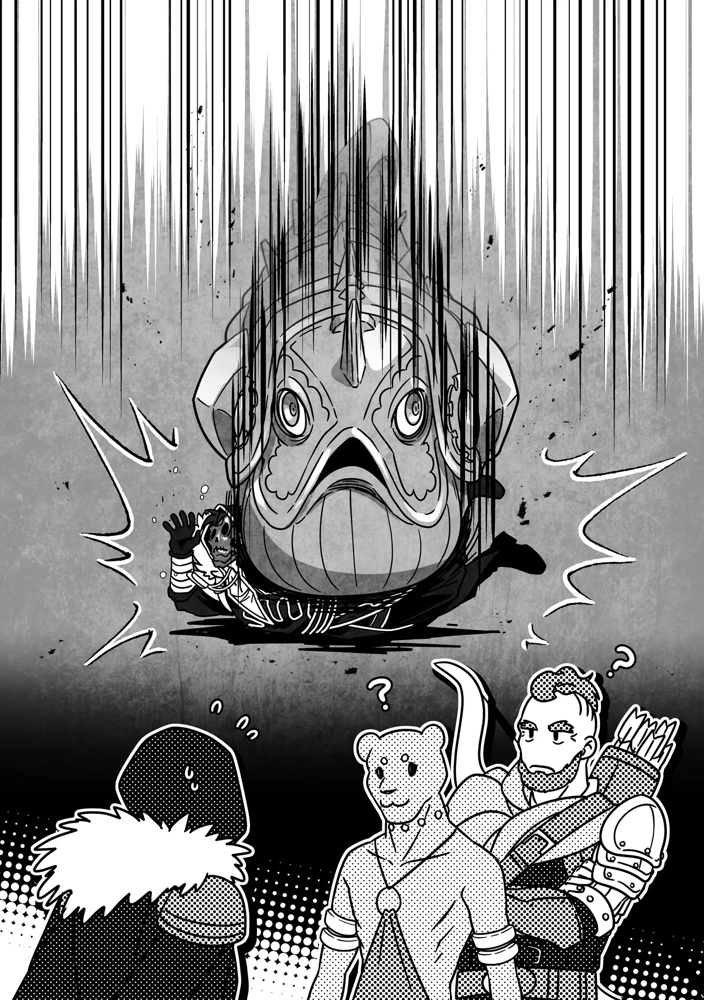
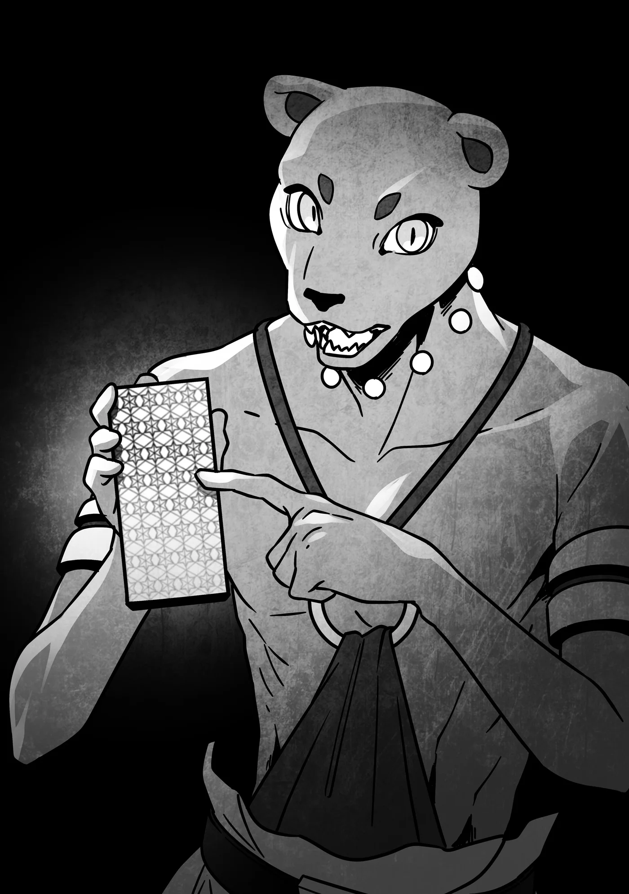

# Chương 333: Tập 14 Chương 3 - Tìm Kiếm Trong Mê Cung (4)

Có một điều chắc chắn là: chỉ dạy cho Niedz cùng các bạn của cậu ta cũng là cơ hội học hỏi quý báu đối với bản thân tôi. Nó giúp tôi ôn lại những điều căn bản, và thật bất ngờ, một vài điểm cần cải thiện mà tôi nhận thấy trong từng động tác của họ lại khiến tôi phải nhìn nhận lại chính những chuyển động của bản thân.

Dẫu vậy, tôi không thể cứ đứng ngoài khoanh tay rồi săm soi lỗi của họ mãi được. Dù cả ba người đều biết Diego và tôi thừa sức tự lo liệu—xét việc bọn tôi từng đánh bại họ tơi bời trong trận ẩu đả—nhưng cũng khó trách nếu họ nghĩ rằng chúng tôi chỉ đang lợi dụng họ làm bia dọn dẹp lũ quái vật cỏ rác để tiến sâu hơn vào mê cung.

Nghĩ vậy thì cũng chẳng hoàn toàn sai, nhưng nếu chúng tôi chỉ làm mỗi chuyện đó thì dần dà họ sẽ nảy sinh lòng ấm ức. Dù biết chúng tôi không hề có ác ý, nhưng khi bộ ba ngày một kiệt sức, khó tránh khỏi việc họ bắt đầu tự hỏi liệu chúng tôi có coi họ chẳng khác gì nô lệ hay không. Nảy sinh mối nghi ngờ như thế cũng là lẽ thường tình.

"Thế thì không ổn đâu," Capitan nói khi chúng tôi đứng trước một cánh cửa đá khổng lồ.

"Nên tôi nghĩ cũng đã đến lúc chúng ta phải đích thân ra tay rồi. Dù sao thì từ đây trở đi, e là bọn họ cũng chẳng tự xoay xở nổi nữa đâu."

"Đây là phòng thủ lĩnh ngăn cách giữa tầng trên và tầng giữa," Diego quan sát rồi gật đầu. "Cũng lâu lắm rồi tôi mới nhìn lại nơi này. Cơ mà có ba người chúng ta thì chắc sẽ ổn thôi."

"Hóa ra trước đây anh từng đến đây rồi à?" tôi hỏi.

"Lâu lắm rồi. Hồi đó, tôi..." Diego ngập ngừng bỏ lửng câu. "Mà thôi, chuyện đó không quan trọng. Cứ tập trung vào việc trước mắt đã. Anh cũng biết con quái vật bên trong căn phòng này là gì rồi đúng không?"

Rõ ràng Diego đang lảng tránh chủ đề này, nhưng tôi quyết định bỏ qua. Ai cũng có những chuyện bản thân không muốn nhắc tới. Nếu có ai hỏi tôi liệu mình có phải con người hay không, tôi cũng sẽ phải ậm ờ tìm cách thoái thác khỏi cuộc trò chuyện thôi. Nghĩ đến việc dọa người ta chết khiếp bằng cách giả làm trò diễn xiếc quái dị có thể xoay vặn đủ mọi khớp xương trên cơ thể nghe chừng cũng vui đấy, nhưng ngặt nỗi trò đó cũng đi kèm với nguy cơ tôi sẽ bị liệt vào diện quái vật cần tiêu diệt ngay tại chỗ.

"Biết chứ. Tôi đã thu thập chút thông tin rồi," tôi đáp. "Còn Capitan thì sao?"

"Tôi biết nó. Trước đây từng hé cửa nhìn trộm vào trong một lần rồi. Một mình tôi chắc cũng xử lý được thôi, nhưng lúc đó tôi muốn đợi tìm kiếm thảo dược khắp các tầng trên trước đã. Xem ra lúc này lại đúng là thời điểm thích hợp."

"Vậy sao?" Diego nói. "Thế thì vào thôi nhỉ. Cánh cửa sẽ tự đóng lại sau khi chúng ta bước vào trong đúng không?"

"Đúng thế," Capitan xác nhận. "Nên đám học trò cũng phải vào cùng chúng ta. Để chúng chờ ở đây cũng được, nhưng chắc cậu cũng biết đấy, chỗ này cách khu vực an toàn gần nhất khá xa."

Bỏ mặc Niedz cùng hai người kia ở ngoài này một mình chẳng khác nào tuyên án tử cho họ. Với tình trạng kiệt sức hiện tại, họ sẽ không tài nào quay trở lại khu vực an toàn được, nhất là khi vài con Hạ Cấp Sahagin mà họ từng hạ gục có lẽ giờ đã hồi sinh rồi.

"Này, này... đừng có tính tới chuyện đó chứ!" Niedz hoảng hốt kêu lên. "Bọn tôi sẽ vào cùng các anh mà, được chưa?! Có điều, ờ thì... các anh đừng trông mong bọn tôi giúp được gì nhiều trong trận chiến đấy nhé..."

Dù giọng điệu nghe có vẻ hoảng loạn, nhưng xem ra cậu ta vẫn đủ tỉnh táo để nhận thức được tình hình thực tế. Cách đây chưa lâu, hẳn cậu ta sẽ còn vênh váo khăng khăng rằng mình vẫn ổn. Còn giờ đây, tôi khá tin tưởng rằng cậu ta có thể giữ vững cảnh giác và tránh vướng chân trong lúc Capitan, Diego và tôi xử lý những khu vực nguy hiểm hơn ở phía trước.

Hỏi gì cơ? Tôi sẽ làm gì nếu cậu ta trông không có vẻ làm nổi chuyện đó ư? Thì tôi sẽ bỏ cậu ta lại phía sau rồi tiếp tục tiến sâu hơn thôi.

Đùa đấy. Nếu không nghĩ Niedz có thể giữ được bình tĩnh, tôi đã cho cả nhóm dừng chuyến thám hiểm hôm nay lại rồi. Chúng tôi đâu có vội đến mức đó, nên quay về lúc nào cũng là một lựa chọn. Đúng là kỳ thi thăng hạng Ngân Cấp đã cận kề, nhưng chậm lại một hai ngày cũng chẳng tạo ra khác biệt lớn, vậy nên tôi hoàn toàn có thể dành ra thêm vài ngày để đảm bảo bộ ba đạt yêu cầu.

Tôi không hề nghĩ kỳ thi sẽ dễ dàng chút nào, nhưng xét tổng thể, tôi cảm thấy cơ hội của mình cũng khá sáng sủa. Augurey từng nhận xét kỹ năng của tôi đạt tầm Ngân Cấp hồi hai chúng tôi cùng hợp tác ở vương đô. Đúng là tôi tới đây để khổ luyện thêm, nhưng cũng chỉ là để cho chắc chắn—dù không đạt được tất cả những gì mong muốn thì đó cũng chẳng phải cú sốc quá lớn đối với tôi.

"Niedz, Lukas, Gahedd—khi vào bên trong rồi, các cậu cố gắng bám sát rìa căn phòng hết mức có thể nhé," Diego căn dặn. "Thủ lĩnh sẽ định kỳ triệu hồi Hạ Cấp Sahagin, nên các cậu cứ tập trung vào chúng. Rentt, Capitan và tôi sẽ đối phó với chính con thủ lĩnh, các cậu đừng để nó làm phân tâm. Rõ chưa?"

Mấy cậu học trò ngoan ngoãn gật đầu. Khi đã tin chắc mọi người đều đồng lòng, Capitan đặt tay lên cánh cửa. Cánh cửa phát ra tiếng cọt kẹt chói tai khi trượt sang một bên, tạo ra một khoảng trống vừa đủ cho vài người cùng lọt qua.

Phản xạ tự nhiên khiến tôi muốn càu nhàu rằng chú ấy nên mở toang cánh cửa ra, bởi một ma pháp sư sở hữu hỏa lực cực mạnh như Lorraine có thể đứng từ ngoài giáng một đòn ma pháp uy lực tiêu diệt luôn con thủ lĩnh. Đúng là hành lang nối giữa phòng thủ lĩnh và cánh cửa thường có các kết giới phản ma pháp vô hình để ngăn chặn trò đó, nhưng chúng đâu phải không thể phá vỡ. Càng xuống sâu thì chúng càng kiên cố hơn, nhưng tôi tin chắc kết giới của một phòng thủ lĩnh tầng nông trong Mê Cung Các Con Gái Của Hải Thần chẳng thể làm khó nổi một ma pháp sư tầm cỡ như Lorraine.

Tôi chưa từng thấy cô ấy làm vậy bao giờ, nhưng có lẽ chí ít cô ấy cũng từng thử qua rồi. Tôi phải nhớ để hỏi cô ấy mới được.

Tôi bám theo sau Capitan khi chú ấy bước vào trong, còn Diego dẫn đám học trò theo sau tôi. Tất cả chúng tôi đều đã rút sẵn vũ khí, chuẩn bị cho một cuộc tập kích bất ngờ, nhưng có vẻ đây không phải kiểu phòng thủ lĩnh như vậy. Thay vào đó, một sinh vật khổng lồ đang lơ lửng ngay giữa căn phòng, tỏa ra thứ áp lực áp đảo khi lặng lẽ dõi mắt nhìn chúng tôi.

Con quái vật có tên Đại Khôi Ngư, quả đúng như tên gọi của nó, dài khoảng năm mét với toàn thân bao phủ bởi một lớp vảy kim loại. Dù vốn dĩ nó là quái vật thủy sinh, nghĩa là cần có nước mới sống nổi chứ đừng nói tới chuyện bơi lội vòng quanh, nhưng việc mê cung phá vỡ các quy luật tự nhiên thì chẳng có gì mới mẻ. Rõ ràng không gian trong căn phòng này có điều gì đó đặc biệt cho phép con quái vật "bơi" giữa không trung.

Hoặc giả, mê cung đã ban cho Đại Khôi Ngư—và chắc chắn đó là một con Đại Khôi Ngư, xét theo số lần nó từng bị săn trong quá khứ—khả năng bay lơ lửng và hít thở oxy. Người ta chưa từng phát hiện bất kỳ cơ quan nào mang lại những năng lực ấy bên trong cơ thể nó, nhưng có lẽ nó làm được điều đó nhờ vào Ma Lực.

Dẫu vậy, theo thông tin chúng tôi thu thập được thì đánh nhau với nó thế này cũng chẳng khác mấy so với khi ở dưới nước, nên tôi khá tự tin vào cơ hội chiến thắng của cả nhóm. Ngay từ đầu nó cũng đâu phải loài quái vật quá đỗi hùng mạnh.

Dĩ nhiên, đó là tôi đang nói dưới góc nhìn của bản thân ở thời điểm hiện tại. Một con Đại Khôi Ngư hoàn toàn có thể bóp nát Rentt của ngày xưa chỉ trong vỏn vẹn hai giây, thế nên tôi không thể mất cảnh giác được.

Capitan hô to ra hiệu: "Được rồi, lên nào!"

Diego và tôi tản ra hai phía căn phòng.

◆◇◆◇◆

Vì mục tiêu quá to lớn nên có lẽ tôi không cần phải bận tâm nhiều về độ chính xác. Cũng vì lý do đó, tung ra một đòn uy lực duy nhất dường như sẽ hiệu quả hơn việc cố bào mòn nó bằng vô số vết thương nhỏ lẻ.

Rõ ràng Capitan và Diego cũng có cùng suy nghĩ, bởi họ lao thẳng về phía Đại Khôi Ngư từ hai hướng khác nhau, dao săn và ngọn giáo nhắm thẳng vào lớp vảy của nó. Cả hai đều rất nhanh, nhưng với tư cách một bậc thầy về Khí Lực, Capitan còn nhanh hơn. Hẳn chú ấy đang dùng một kỹ thuật mà tôi không nhận ra, bởi dù Khí Lực rất thích hợp để cường hóa thể chất, tốc độ di chuyển của chú ấy không thể chỉ giải thích bằng mỗi điều đó.

"Gra a a a!"

Khi tiến đến vị trí ngay phía dưới Đại Khôi Ngư, Capitan bật nhảy lên cao và vung dao săn chém thẳng vào thân hình đồ sộ của nó. Lưỡi dao sắc bén xé toạc không khí, và...

Keng!

...bật nảy ngược trở lại kèm theo một tiếng ngân chói tai.

"Hừm."

Dù hẳn cũng có phần bất ngờ, nhưng Capitan đâu phải chiến binh tầm thường. Chú ấy lộn người lấy lại thăng bằng giữa không trung, rồi tiếp đất gọn gàng trên đôi chân của mình.

Thế nhưng điều đó không có nghĩa là chú ấy đã an toàn. Ngay khoảnh khắc chú ấy tấn công Đại Khôi Ngư, đôi mắt đờ đẫn của nó giật mạnh như một con rối dây cót, và chiếc đuôi bắt đầu quẫy mạnh mẽ vào không khí. Tuy người ta thường cho rằng hành động đó là vô nghĩa vì chúng tôi đâu có ở dưới nước, nhưng tất cả những ai có mặt tại đây đều hiểu rõ hơn thế. Nếu nó đã có thể lơ lửng giữa không trung, thì nó cũng bơi được trong không khí.

Quả nhiên, Đại Khôi Ngư lao vút về phía trước với tốc độ nhanh hơn nhiều so với những gì người ta có thể hình dung từ một sinh vật mang kích thước đồ sộ như vậy, thân hình khổng lồ của nó tạo ra một luồng sóng áp lực phía sau. Trong lúc nó di chuyển, một âm thanh gầm rừ vang lên từ cổ họng nó, vừa giống tiếng gầm rú chói tai vừa tựa như tiếng kim loại cọ xát ken két vào nhau, và mười ma pháp trận lập tức bừng sáng trên mặt đất.

"Đây là chuyện anh vừa nói lúc nãy đúng không?!" tôi hét lớn với Diego.

"Phải đấy!" tiếng anh ấy vọng lại từ đằng xa. "Niedz, Lukas, Gahedd! Hạ Cấp Sahagin tới kìa! Giao cả cho các cậu đấy—nhưng đừng có liều mạng!"

"Rõ rồi!"

Màn đối đáp chớp nhoáng đó vừa đủ thời gian để đám Hạ Cấp Sahagin hiện hình. Có tất cả mười con, tương ứng với số ma pháp trận xuất hiện—quá nhiều để đám học trò có thể tự mình đối phó. Họ có thể xử lý từng con một, nhưng chỉ cần hai con cùng xúm lại tấn công thì tình thế có thể nguy hiểm đến tính mạng. Vì lẽ đó, Capitan, Diego và tôi sẽ phải để mắt trông chừng và hỗ trợ để ngăn họ rơi vào bước đường cùng.

Dẫu vậy, con Đại Khôi Ngư này lại tỏ ra mạnh hơn tôi tưởng. Hay nói chính xác hơn là nó cứng hơn tôi nghĩ. Tôi đã chém nó một nhát, nhưng đòn đánh của tôi bật nảy ra mà chẳng gây được chút tổn thương nào. Xem chừng sẽ rất khó khăn nếu tôi chỉ truyền đơn thuần Ma Lực hoặc Khí Lực...

"Thứ này mà là thủ lĩnh tầng nông á?" Capitan cất tiếng. "Xem ra Mê Cung Các Con Gái Của Hải Thần danh bất hư truyền thật đấy!"

"Không, có gì đó không ổn!" Diego hô lên. "Lần trước ngọn giáo của tôi đã đâm xuyên qua lớp vảy của nó kia mà! Nếu lúc nào nó cũng mạnh thế này thì Lucaris đã chẳng còn mạo hiểm giả nào sống sót rồi!"

Điều đó khiến tôi ngạc nhiên. "Nghĩa là bình thường nó yếu hơn sao?" tôi hỏi.

"Dĩ nhiên rồi!"

"Nói mới nhớ, nó to hơn nhiều so với con tôi nhìn thoáng qua từ xa lần trước," Capitan cất giọng xen lẫn bực bội. "Áp lực nó tỏa ra cũng khủng khiếp hơn hẳn. Khốn thật... Quái vật biến dị ư?!"

Quái vật biến dị là hiện tượng hiếm hoi phá vỡ những quy tắc thông thường của mê cung. Những loài quái vật xuất hiện trong phòng thủ lĩnh vốn dĩ lần nào cũng phải giống nhau, chỉ có sự chênh lệch không đáng kể về kích thước và sức mạnh. Tỉ lệ chạm trán một con quái vật biến dị thấp đến mức chỉ những ai xui xẻo tột cùng mới vướng phải.

Chỉ những kẻ xui xẻo thôi ư? Chẳng hiểu sao tôi bắt đầu có cảm giác chuyện này là do lỗi của mình. Vận may của tôi chắc chắn là tệ nhất trong số tất cả những người đang có mặt ở đây rồi...

Capitan và Diego vẫn đang tìm cách xuyên thủng lớp phòng ngự của Đại Khôi Ngư thì một ý tưởng chợt lóe lên trong đầu tôi. "Để cháu phá một lỗ hổng trên lớp vảy của nó!" tôi hét lên. "Cả hai người hãy nhắm vào đó mà đánh!"

Nói đúng ra thì đó là lựa chọn duy nhất chúng tôi có. Tôi không dày dạn kinh nghiệm như Capitan, cũng chẳng chuẩn xác như Diego, nhưng nếu tất cả những gì chúng tôi cần chỉ là phá tung một lỗ hổng trên lớp phòng ngự của kẻ địch thì sao? Đó chính là lúc Ma Khí Dung Hợp Thuật của tôi phát huy tác dụng. Nếu trộn thêm Thần Lực vào thì khả năng thành công sẽ chắc chắn hơn, nhưng tôi không dám chắc liệu vũ khí của mình có chịu nổi hay không, vả lại trước mắt chúng tôi chắc chắn vẫn còn nhiều trận chiến nữa.

Capitan dường như nhận ra tôi đang nghĩ gì. "Hiểu rồi! Trông cậy cả vào cháu đấy, Rentt!" chú ấy hét lên trong lúc bắt đầu thu hút sự chú ý của Đại Khôi Ngư ra khỏi tôi.

Diego không tài nào biết được tôi sắp làm gì, nhưng xem ra anh ấy đã quyết định đặt niềm tin vào tôi—cũng giống như Capitan, anh ấy lập tức thay đổi chiến thuật. Bằng những đường giáo điêu luyện, anh ấy bắt đầu dồn đuổi toàn bộ đám Hạ Cấp Sahagin quanh khu vực ra xa.

Nhờ nỗ lực của cả hai người, tôi có thừa khoảng trống để chuẩn bị. Tôi tập trung rót Ma Lực và Khí Lực vào thanh kiếm, rồi khi nhìn thấy một sơ hở...

"Lên nào!" tôi hét lớn. "Hai người mau tránh ra!"

Đại Khôi Ngư lướt đi khá nhanh trong không khí, nhưng cũng chẳng nhanh hơn mấy so với những quái vật khác mà chúng tôi từng chạm trán ở các tầng trên. Bắt kịp tốc độ của nó thì đơn giản thôi; phá vỡ lớp giáp mới là phần hóc búa. Mặt khác, nếu chúng tôi làm được điều đó thì chiến thắng cầm chắc trong tay.

Khi đã ở ngay bên dưới con quái vật thủ lĩnh, tôi bật nhảy lên, mượn đà vung kiếm chém một nhát từ dưới lên.

Rầm!

Đòn đánh trúng đích, và một mảng vảy của Đại Khôi Ngư nổ tung từ bên trong bắn ra ngoài—đúng chuẩn hiệu quả mà Ma Khí Dung Hợp Thuật mang lại.

Khi tôi bắt đầu rơi xuống đất, Capitan và Diego lao vút qua tôi, bởi cả hai đã bật nhảy lên ngay sau tôi một nhịp. Họ nhắm vũ khí vào chỗ hổng trên lớp vảy của con quái vật, và...

"Thế là xong," tôi nói.

Lẽ ra tôi không nên vội thở phào, bởi đúng khoảnh khắc đó cái xác vô hồn của Đại Khôi Ngư bắt đầu rơi tự do từ trên không trung xuống. Tôi vừa kịp tiếp đất thì vội cuống cuồng lăn xả sang một bên trước khi nó nện ầm xuống sàn.

"Hai người không thể tính toán chỗ nó rơi một chút được à?" tôi càu nhàu trong lúc chúng tôi dọn dẹp nốt mấy con Hạ Cấp Sahagin còn lại.

"Tôi có cảm giác nếu bỏ lỡ cơ hội đó thì tình hình sẽ trở nên rắc rối to đấy," Capitan nói.

"Tôi từng nghe nói nó có thể mọc lại vảy chỉ trong chưa đầy một phút," Diego góp lời.

"Chúng ta thực sự chẳng còn lựa chọn nào khác đâu."

Nếu quả đúng như vậy thì tôi cũng chẳng còn lý do gì để phàn nàn. Dẫu sao thì chuyện Diego biết điều đó là một lẽ, nhưng chẳng lẽ Capitan chỉ đơn thuần cảm nhận được thôi ư? Đúng là đáng nể thật.

◆◇◆◇◆

"Hê. Rương kho báu kìa," Capitan hào hứng cất lời.

Bất kể ở mê cung nào, đánh bại quái vật trong phòng thủ lĩnh lúc nào cũng sẽ khiến một rương kho báu xuất hiện. Thế nhưng dù mang tên gọi như vậy, nó không phải lúc nào cũng mang hình dáng một chiếc rương. Rất nhiều lần, món đồ chỉ được bọc trong một tấm vải, nằm gọn trong chiếc bình gốm đơn sơ—hoặc nếu xui xẻo thì bị bọc kín bên trong một khối kim loại méo mó, lởm chởm gai góc.

Thứ nằm bên trong vật chứa đó cũng đa dạng khôn cùng, từ những món cực kỳ hữu dụng cho tới những thứ hoàn toàn vô giá trị. Dẫu vậy, đúng như người ta kỳ vọng, loại hữu dụng xuất hiện ở phòng thủ lĩnh phổ biến hơn nhiều, đặc biệt là khi so sánh với những món ma cụ rác mà người ta thường nhặt được rải rác khắp mê cung.

Sự đa dạng của chiến lợi phẩm dường như là vô tận. Đôi khi người ta chỉ nhận được những nguyên liệu thô đơn giản, nhưng có lúc lại tìm thấy món ma cụ mang cấu trúc bên trong phức tạp tới mức kỹ thuật thời nay không tài nào sao chép nổi. Càng tiến sâu vào mê cung thì phần thưởng càng có giá trị hơn—hiện tượng này bắt nguồn từ việc các vật phẩm đều được tạo tác nên từ Ma Lực của mê cung. Theo những gì tôi từng nghe kể thì khi xuống đủ sâu, việc những món đồ như ma kiếm đầy uy lực bắt đầu xuất hiện cũng chẳng phải chuyện hiếm.

Nếu may mắn tột cùng, người ta cũng có thể tình cờ bắt gặp những vật phẩm như thế ở các tầng nông, nhưng tôi ngờ rằng đó không phải lý do khiến Capitan phấn khích đến vậy.

"Hy vọng đó là hải linh thảo," tôi nhận xét.

Chú ấy gật đầu đáp lại. Dù sao thì đó cũng là mục đích chú ấy đến đây. Nếu chúng tôi tìm thấy chúng ngay tại đây, cả nhóm có thể rời khỏi nơi này, và chú ấy có thể dành toàn bộ thời gian còn lại để phụ đạo cho tôi. Dù tôi sẽ chiếm mất thời gian làm công việc thợ săn thường ngày của chú, nhưng đằng nào chú ấy cũng đã gác lại việc đó suốt một thời gian dài vì chuyện hải linh thảo rồi, vả lại đám đệ tử ở làng cũng thừa sức gánh vác trách nhiệm của chú trong lúc chú vắng mặt.

Tôi cũng dự định sẽ trả thù lao cho thời gian chú ấy bỏ ra, dù tôi biết chú có thể sẽ từ chối. Nhưng điều tôi muốn nói là chúng tôi càng sớm tìm thấy hải linh thảo thì càng tốt.

"Từ trước tới giờ chưa từng có ghi chép nào về việc con thủ lĩnh này rớt ra hải linh thảo cả đâu," Diego ái ngại nói.

Mặc kệ Capitan và tôi đang rầu rĩ vì tin sét đánh đó, Lukas hào hứng lên tiếng. "M-Mau mở ra xem đi ạ!" cậu ta vừa nói vừa tiến lại gần. Bất chấp việc hẳn đang kiệt sức sau trận chiến, đôi mắt cậu ta vẫn sáng lên lấp lánh.

Nói rõ hơn thì, chiếc rương kho báu này mang hình dáng một chiếc bình bắt bạch tuộc bám đầy hà với nắp đậy bằng gỗ, được buộc chặt bằng một sợi dây thừng.

Hừm. Thoạt nhìn thì cũng đầy hứa hẹn đấy, nhưng liệu nó có đáp ứng được kỳ vọng của chúng tôi không đây?

Lukas tháo sợi dây rồi mở nắp ra, để lộ...

"Một... thẻ gỗ ư?" Lukas nói với vẻ khó tin. "Thứ này là cái gì thế ạ?" Trong tay cậu ta, đúng như lời vừa thốt ra, là một vật trông chẳng khác gì một khúc gỗ bình thường.

Thế nhưng Diego dường như lại nghĩ khác. "Ồ? Món này tìm được là khá hời đấy."

"Nó có gì tốt vậy anh?" tôi hỏi.

Diego đón lấy miếng thẻ gỗ từ tay Lukas. "Nhìn đi. Anh có thấy những hoa văn tinh xảo được khắc trên bề mặt không?"

Giờ khi ghé sát lại quan sát kỹ hơn, tôi quả thực nhìn thấy thứ anh ấy đang nói tới. Dẫu vậy... "Thế thì có gì đặc biệt chứ?" tôi hỏi. "Chúng có giá trị nghệ thuật hay gì à?"

"Không, chẳng phải thứ như thế đâu. Món này..."—đến đây, anh ấy ngừng lại một chút để tạo bất ngờ—"...là một món Nguyền Cụ đấy."

Lukas, Gahedd và Niedz lập tức lùi bật ra sau.

Diego bật cười khẽ rồi tiếp tục: "Nói là vậy chứ chẳng có gì phải sợ đâu. Đứng một mình thì nó hoàn toàn không có tác dụng gì cả. Nhưng nếu anh kết hợp nó với những vũ khí có thể tìm thấy trong mê cung này, nó có thể ban cho chúng những thuộc tính hoặc hiệu ứng đặc biệt."

"Thật thế sao? Nghe có vẻ khá hữu dụng đấy chứ."

"Phải. Nhược điểm duy nhất là nó chỉ tác dụng lên vũ khí lấy từ chính mê cung này. Mà vì vũ khí chỉ có thể tìm thấy trong các rương kho báu từ tầng giữa trở xuống, nên hiện tại với chúng ta nó có lẽ khá vô dụng. Thậm chí chúng ta còn chẳng biết hiệu ứng của nó là gì nếu chưa thử nghiệm, hoặc phải đợi tới khi tôi quay lại mặt đất để đối chiếu hoa văn của nó với sách tra cứu."

"Trông khá phức tạp thật," tôi đồng tình. "Những ký hiệu này chính là thứ ban cho Nguyền Cụ sức mạnh của chúng sao?"

"Chưa hẳn," Diego nói. "Có những món chẳng hề có hoa văn nào cả. Cơ mà để nghe giải thích cặn kẽ hơn thì anh phải hỏi một học giả chuyên về nguyền rủa cơ. Họ có thể phân biệt chúng với ma cụ thông thường nhờ những kết giới đặc biệt không cho các vật phẩm bị nguyền rủa đi qua—dù thi thoảng vẫn có vài món Nguyền Cụ là ngoại lệ. Thành thật mà nói, ngay cả định nghĩa thế nào là 'Nguyền Cụ' cũng rất mơ hồ. Ngoài những món đã được ghi chép tường tận trong tài liệu ra, việc vạch rõ ranh giới phân biệt giữa chúng lúc nào cũng là một bài toán khó."

Lorraine cũng từng nói điều tương tự như vậy. Cô ấy tuyệt nhiên không phải chuyên gia về nguyền rủa, nhưng mọi hiện tượng liên quan đến Ma Lực đều là sở trường của cô. Vương Quốc Yaaran không có nhiều Nguyền Cụ cho lắm nên cô ấy chưa dành nhiều tâm huyết nghiên cứu về chúng, nhưng tôi tin chắc nếu tập trung vào lĩnh vực này, cô ấy sẽ đuổi kịp trình độ hiểu biết của một chuyên gia chỉ trong nháy mắt.

Hừm... Có khi tôi nên dẫn cô ấy đi cùng mới phải. Dẫu vậy, có lẽ cô ấy vẫn thấy rất thoải mái khi ở lại đó, xét việc cô học hỏi được biết bao điều từ bà Gharb và ông già tôi. Đến lúc tôi quay lại Hathara, khoảng cách trình độ giữa hai chúng tôi có lẽ sẽ còn bị nới rộng hơn nữa. Nghĩ đến thôi cũng thấy đáng sợ rồi.

"Muốn bàn tán gì thì cứ để lúc quay về thị trấn hãy bàn," Capitan ngắt lời.

"Chúng ta quay về sao?" tôi hỏi. "Sớm thế ạ?"

"Khi nào xuống tới tầng giữa thì về," chú ấy xác nhận. "Theo những gì tôi tìm hiểu thì ở đó có một thiết bị dịch chuyển đặc biệt."

"Thiết bị dịch chuyển sao?" tôi lặp lại. "Hiếm thật đấy." Bình thường những thứ đó chỉ xuất hiện ở các tầng sâu của mê cung. Kỹ thuật thời nay cũng chưa phát triển đến mức có thể sao chép được chúng. Mê Cung Nguyệt Ảnh cũng có một cái, nhưng đó cũng là trường hợp ngoại lệ hiếm hoi.

"Phải. Có nó thì sau này sẽ tiện hơn nhiều," Capitan nói. "Tôi còn nghe nói một khi đã dùng qua, trong những chuyến thám hiểm sau này ta có thể nhảy thẳng từ lối vào xuống tận tầng giữa. Thế nên tôi mới tính chọn đó làm mục tiêu cho ngày hôm nay. Dù sao thì tôi thấy nhóm Niedz cũng chẳng còn chút sức lực nào nữa rồi."

Tôi nhận thấy chú ấy nói đúng; bộ ba đang thở dốc, rõ ràng đã kiệt sức. Họ sẽ không tài nào tiếp tục thám hiểm thêm được nữa.

"Được rồi," tôi nói. "Vậy hôm nay dừng ở đó nhé. Niedz, Lukas, Gahedd—ráng chịu thêm một chút nữa. Hôm nay sắp xong việc rồi."

Bộ ba, bất chấp vẻ mệt mỏi lộ rõ trên mặt, gật đầu lia lịa.
