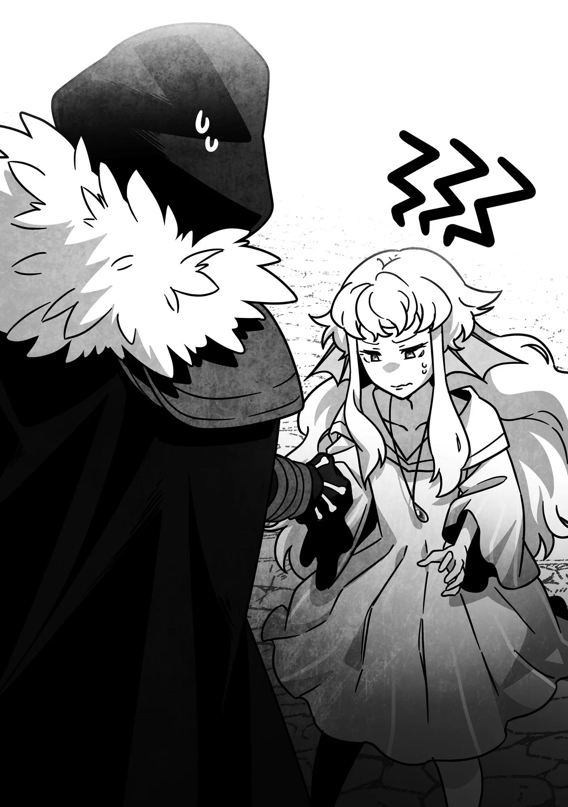

# Chương 335: Tập 14 Chương 4 - Trở Về và Phát Hiện Mới (2)

Hôm sau, chúng tôi quyết định nghỉ ngơi, vì thám hiểm mê cung liên tiếp nhiều ngày sẽ quá tải đối với cơ thể. Điều đó chẳng ảnh hưởng gì tới tôi, bởi tôi đâu biết mỏi mệt thể xác là gì, nhưng những người khác thì không được như vậy.

Đặc biệt là Niedz, Lukas và Gahedd, cả ba đều đã kiệt sức hoàn toàn. Nếu dắt họ vào mê cung trong tình trạng này, chắc chắn họ sẽ dính chấn thương nặng—hoặc tệ hơn. Dù kéo họ theo một phần là để trừng phạt những chuyện họ từng làm, nhưng điều đó không có nghĩa là tôi muốn họ gặp phải nguy hiểm tính mạng.

Dẫu vậy, công sức vắt kiệt mình vào hôm qua của họ đã đem lại quả ngọt—theo lời Capitan, cả ba đã chớm bộc lộ dấu hiệu có thể sử dụng Khí Lực. Thông thường, người ta phải trải qua quá trình khổ luyện bền bỉ, gắt gao mới đạt được điều đó. Bản thân tôi từng như vậy, và có lẽ với Capitan cũng thế.

Thế nhưng, chuyện gì cũng có ngoại lệ và đường tắt, và dường như Niedz, Lukas cùng Gahedd lại rơi vào trường hợp đó.

Cũng giống như tôi, bộ ba đó đã giậm chân tại chỗ ở Đồng Cấp suốt phần lớn sự nghiệp mạo hiểm giả, không sao bứt phá qua được giới hạn của bản thân. Nhận thấy tương lai phía trước mịt mờ, họ đâm ra cay đắng, bất cần đời, tiếp tục chiến đấu với quái vật chỉ để kiếm chút tiền còm lay lắt qua ngày. Đó là câu chuyện quá đỗi quen thuộc, chẳng ai thèm bận tâm. Cuối cùng, họ rồi cũng sẽ va phải bức tường ngăn cách—dù là do thể lực sa sút khi tuổi tác tăng lên hay dính phải chấn thương nghiêm trọng trong một chuyến làm nhiệm vụ—để rồi buộc phải giải nghệ.

Nhưng một ngã rẽ khác đã mở ra với nhóm Niedz: Họ gặp được Capitan, một bậc thầy về Khí Lực. Nhờ liều lĩnh gây sự với tôi, quỹ đạo cuộc đời của họ đã thay đổi ngoạn mục.

Theo lời Capitan, những ai đã chững lại đà phát triển lại ở vị thế thuận lợi hơn để thức tỉnh Khí Lực. Nguyên do là khi hạ gục quái vật, người ta sẽ hấp thụ một phần nhỏ sức mạnh của chúng—hoặc nhiều hơn thế rất nhiều nếu là một quái vật như tôi—và trong đó có cả Khí Lực. Suy cho cùng, đó chính là nguồn năng lượng của sự sống và thể lực. Nhiều loài quái vật vốn là sinh vật sống nên đương nhiên sở hữu sẵn nguồn năng lượng này.

Dĩ nhiên, cũng có những quái vật Undead hoàn toàn không có chút Khí Lực nào, hoặc những quái vật dạng ảo ảnh vô hình cấu thành hoàn toàn từ Ma Lực. Nhưng những quái vật như Goblin và Slime mà phần lớn mạo hiểm giả giao chiến—nhất là các mạo hiểm giả cấp thấp—đều là sinh vật sống.

Khô Lâu cũng là quái vật cấp thấp, nhưng những mê cung như Mê Cung Nguyệt Ảnh, nơi tầng trên lúc nhúc đầy rẫy chúng, thực ra lại khá hiếm hoi. Thông thường, Khô Lâu và những loài tương tự chỉ xuất hiện ở các tầng sâu hơn của mê cung, được triệu hồi làm quân tốt dưới trướng một Undead cấp cao.

Theo nghĩa đó, có thể nói Mê Cung Nguyệt Ảnh khá là kỳ dị. Vậy mà chẳng hiểu sao hầu hết các học giả lại ngó lơ nó. Giờ ngẫm lại, có lẽ là do những hoàn cảnh đặc thù bao quanh nơi ấy. Tôi không thể chỉ ra một lý do rõ ràng nào, nhưng trước hết, Mê Cung Nguyệt Ảnh chính là nơi tôi từng gặp người phụ nữ bí ẩn đã trao cho mình tấm áo chùng. Thêm nữa, thị trấn gần nhất lại là Maalt, nơi Laura đặt dinh cơ. Có lẽ bản thân vùng đất đó vốn đã mang nét gì đó đặc biệt rồi.

À, mà tôi lại lan man sang chuyện khác rồi. Ý tôi là việc huấn luyện của Niedz, Lukas và Gahedd dường như sẽ tiến triển tương đối nhanh chóng. Capitan từng nhắc rằng sau khi họ nghỉ ngơi xong xuôi trong ngày hôm nay, mục tiêu vào ngày mai là giúp họ sử dụng được mức Khí Lực tối thiểu. Một phần trong tôi từng băn khoăn liệu họ có thể tiến xa đến thế trong thời gian ngắn ngủi vậy không, nhưng tôi tin vào nhận định của người thầy cũ. Nếu chú ấy đã bảo làm được thì hẳn là có thể.

Còn về Diego, do anh ấy từng được một người thầy khác chỉ dẫn nền tảng Khí Lực nên Capitan bảo anh ấy sẽ nắm bắt lại trong chốc lát. Thực tế là hôm nay hai người họ định tranh thủ thời gian luyện tập trong lúc nhóm Niedz nghỉ ngơi, nên họ sẽ chẳng có mấy lúc rảnh rỗi... cơ mà có khi thế này vẫn tính là một ngày nghỉ. Dù sao thì họ cũng đâu phải đi đánh quái vật, vả lại không như bộ ba mạo hiểm giả kia, Capitan và Diego thừa sức chịu đựng thêm một chút huấn luyện.

Với kế hoạch như thế, họ sẽ không thể ra ngoài thị trấn. Tuy nhiên, vẫn cần có người đi mua sắm nhu yếu phẩm cho chuyến thám hiểm tiếp theo vào ngày kia. Trọng trách đó được giao cho tôi, đó là lý do hiện tại tôi đang rảo bước trên phố, nhẩm lại danh sách những món đồ mọi người nhờ mua để bảo đảm không bị sót.

Con phố tôi đang đi—một đại lộ chính gần nhà Diego—đông nghịt và ồn ã người qua lại ngược xuôi. Vì phần lớn những món tôi cần đều có ở các cửa hàng nằm dọc phố lớn nên tôi dự định lượn quanh khu vực này một lúc, nhưng vẫn không quên nâng cao cảnh giác. Diego từng cảnh báo tôi rằng Lucaris là một thành phố cảng tụ hội đủ loại người từ khắp nơi đổ về, và trong số đó không thiếu những thành phần bất hảo. Nghe bảo đặc biệt là trên các tuyến phố chính, hạng người này lại càng nhiều.

Cảm giác lúc đó hơi giống đứa trẻ được mẹ dặn dò đủ điều trước chuyến đi chơi một mình đầu đời, nhưng nhớ lại lần đầu tôi gặp Diego chính là sau khi bị nhóm Niedz tấn công, tôi chẳng thể phản bác lại lời anh ấy. Dẫu vậy...

"Đâu phải lúc nào chuyện như thế cũng xảy ra với mình được cơ chứ," tôi lẩm bẩm một mình.

Lời vừa dứt thì—

Rầm!

—ai đó đã đâm sầm vào tôi. Chính xác là đâm thẳng vào phần eo.

Thực ra tôi đã nhận thấy người đó lao tới và cố tránh sang một bên, nhưng đường phố quá đông đúc nên không thể né kịp—chưa kể nếu né xa hơn nữa, tôi sẽ đâm phải một phụ nữ đang mang thai. May mắn là nhờ gồng mình đón nhận cú va chạm, tôi đã tránh được việc va vào người phụ nữ kia. Nhưng xui xẻo là...

"Bị móc túi rồi..."

Tôi cảm nhận rất rõ lúc túi tiền bị giật khỏi thắt lưng. Tôi đã buộc dây khá chắc chắn, nhưng kẻ móc túi này rõ ràng là tay lão luyện. Đối phương dùng dao—và ra tay hết sức điêu luyện chỉ trong một thoáng sơ hở ngắn ngủi. Nếu khi nãy tôi vươn tay ra, có lẽ người đó đã rạch một đường ngang bàn tay hoặc cánh tay tôi rồi.

Chuyện đó thực ra chẳng hề hấn gì với tôi, nhưng tôi chợt lo không biết người xung quanh sẽ nhìn nhận thế nào nếu tôi bị dao chém trúng mà vẫn dửng dưng như không. Xem ra chính việc nghĩ ngợi quá nhiều đã làm hỏng việc của tôi.

May thay, tôi vẫn kịp nhìn thấy bóng kẻ móc túi đang lủi nhanh ra xa. Tôi lách qua những khoảng trống giữa đám đông, bám theo bóng lưng đang lẩn trốn kia.

◆◇◆◇◆

Tạm thời, tôi bám theo kẻ móc túi với tốc độ vừa phải. Chạy thục mạng đuổi theo chỉ khiến mình bị chú ý, vả lại trên phố chính lúc này cũng có quá nhiều người để làm vậy. Thay vì để mất dấu, tôi quyết định đợi tới khi ra đến chỗ thoáng đãng hơn rồi mới đuổi kịp.

May mắn là kẻ móc túi dường như không nhận ra tôi. Cách di chuyển của đối phương giống như đang muốn chuồn khỏi hiện trường vụ trộm hơn là cắt đuôi kẻ bám theo. Dường như đây cũng chẳng phải lần đầu tiên của người đó—đối phương chủ ý rảo bước nhanh chứ không chạy để tránh gây chú ý. Nhờ vậy mà tôi bám theo khá dễ dàng.

Chẳng mấy chốc, dòng người bắt đầu thưa thớt dần. Ngay khoảnh khắc kẻ móc túi lén lút nhìn quanh quất rồi toan lách vào một con hẻm nhỏ...

Tóm được!

"Cái—"

"Tôi nghĩ nhóc biết tại sao tôi muốn nói chuyện với nhóc rồi đấy," tôi nói, đồng thời siết chặt cánh tay kẻ móc túi. "Đi nào. Vào đây."

Tôi lôi kẻ móc túi vào trong hẻm. Tôi không thể để đối phương làm ầm ĩ lên rồi khiến người ta tưởng tôi mới là kẻ xấu. Rất nhiều tên tội phạm vặt vãnh rất ranh mãnh kiểu đó—tôi biết tỏng vì ở Maalt cũng chẳng thiếu gì hạng người như vậy.

Vì vậy, tôi cứ thế lôi tuột kẻ móc túi đi tiếp cho tới khi vào đủ sâu, nơi người của chính quyền hay mấy người qua đường tốt bụng không thể chõ mũi vào. Dù vậy, tên tội phạm bất hạnh kia chắc chắn chẳng chịu ngoan ngoãn đi theo, cứ vừa la hét vừa giãy giụa hòng thoát thân. Vài người gần đó có để ý thấy, nhưng dường như người dân Lucaris nói chung khá hiếm ai đủ dũng cảm để bước ra can ngăn một kẻ lạ mặt khoác áo chùng đen, đeo mặt nạ đầu lâu và lỉnh kỉnh kiếm giắt bên hông đang kéo lê một người vào ngõ hẻm.

Có lẽ rồi cũng sẽ có ai đó đi báo cho đội tuần tra của thành phố, nhưng tôi đã chủ động rảo bước thật nhanh vào sâu trong hẻm. Cho dù lát nữa có bị thẩm vấn, do chẳng có bằng chứng nào về hành vi sai trái nên tôi chỉ cần trả lời qua loa, mơ hồ là xong chuyện.

Ơ kìa, không biết có phải do tôi tự nghĩ quá lên không, chứ dạo gần đây suy nghĩ của tôi toàn hướng theo lối của kẻ phản diện thế này? Chà, tôi đâu có ý định làm hại kẻ móc túi hay gì đâu, nên chắc là vẫn ổn thôi.

Khi chúng tôi đã vào đủ sâu trong con hẻm, kẻ móc túi bỗng im bặt, mặc cho tôi kéo đi. Dường như đối phương nhận ra mình không còn đường thoát, bởi sắc mặt người đó cũng đã cắt không còn giọt máu. Có lẽ người đó nghĩ chuyến này mình tàn đời rồi, xét việc trông tôi thuần thục kéo người vào hẻm tối đến thế.

Nói công bằng thì đó cũng chẳng phải suy đoán vô lý. Nếu bị một mạo hiểm giả lôi đi như thế, thường thì cứ đinh ninh rằng mình sắp mất mạng là vừa.

"Trước hết," tôi cất tiếng. "Nhóc trả lại túi tiền cho tôi được chứ?"

"T-Tôi không biết anh đang..."

"Thôi nào. Giả ngây giả ngô ở đây rõ ràng là vô ích rồi. Cả tôi và nhóc đều biết thừa là chẳng có tác dụng gì đâu, đúng không?"

Ý tôi muốn nói là kẻ móc túi đừng phí thời gian đôi bên nữa, bởi cả hai đều biết rõ mười mươi ai là thủ phạm, nhưng hiển nhiên đối phương lại diễn giải câu nói đó theo một hướng hoàn toàn khác.

"Anh... nói phải..." đối phương cất giọng buông xuôi. "Đằng nào thì anh cũng có thể giết tôi rồi lục xác tìm nó. Đây—cầm lấy đi."

Tôi nhận lấy túi tiền, vừa cất đi vừa bất giác thấy mình chẳng khác nào một tên ác nhân tàn độc. Sao câu chuyện lại thành ra thế này được nhỉ? Chẳng phải tôi chỉ đang đòi lại túi tiền từ tay một kẻ móc túi thôi sao?

"Rồi sao?" kẻ móc túi hỏi. "Anh định làm gì tôi? Giao nộp cho đội tuần tra à? Hay giết tôi tại đây? Cứ làm cho xong phứt đi..."

Tôi lắc đầu. "Chẳng việc nào trong số đó cả. Chỉ là tôi nghe nói đồng bào của nhóc đều đã quay về quê nhà dưới biển. Thật không ngờ vẫn còn một người ở lại Lucaris."

Quả thực, chỉ nhìn thoáng qua diện mạo của kẻ móc túi là đủ thấy cô bé—bởi giờ tôi đã nhận ra đây là một bé gái—không phải là con người giống như các bạn hay tôi. Hoặc, ừm... ít nhất là giống các bạn. Thỉnh thoảng tôi lại quên khuấy mất rằng mình đâu còn được tính là người nữa.

Dù cô bé mang vóc dáng hình người xét theo nghĩa chung, nhưng lớp da trên cổ và hai cánh tay lại ráp ráp như có vảy, đôi tai có hình dạng như vây cá, và tròng mắt sáng rực rỡ hơn mắt người rất nhiều. Tất cả những đặc điểm đó đều thuộc về chủng tộc được gọi là ngư nhân.

Dĩ nhiên, tương tự như "thú nhân", từ "ngư nhân" là một danh từ chung rất khái quát để chỉ vô số chủng tộc. Cũng giống như thú nhân sói và thú nhân mèo khác biệt nhau về nhiều mặt, chẳng có hai tộc ngư nhân nào lại giống hệt nhau. Ở thị trấn Maalt vốn vắng bóng các chủng tộc Á Nhân nên tôi cũng chẳng phải chuyên gia về chủ đề này, nhưng ít nhất tôi cũng biết được chừng đó.

Có điều, tôi không tài nào phân biệt nổi kẻ móc túi này thuộc phân loài ngư nhân nào. Ngư nhân cá voi và ngư nhân cá mập rất dễ nhận biết nhờ thể hình đồ sộ hoặc hàm răng sắc nhọn lởm chởm, nhưng cô bé lại chẳng có đặc điểm nổi bật nào như thế—hoặc ít nhất là những nét có thể nhận ra ngay từ cái nhìn đầu tiên. Nếu không có lớp vảy và đôi tai kia, tôi thậm chí còn chẳng nhận ra cô bé là một ngư nhân, qua đó mới thấy thế giới ngoài kia đa dạng đến nhường nào.

Tuy nhiên, dường như cô bé lại hiểu lầm ánh mắt tò mò thực sự của tôi sang một ý khác. "Đúng thế, gần như ai cũng quay về rồi," cô bé nói. "Nhưng đừng tưởng như thế là không ai trả thù nếu anh đem bán tôi làm nô lệ nhé!"

Được rồi, tôi không thể phủ nhận cách ăn mặc của mình trông chẳng khác nào một kẻ buôn nô lệ. Nhưng nghe thế vẫn thấy hơi chạnh lòng. "Tôi đâu có định làm trò đó," tôi kiên nhẫn đáp. "Tôi chỉ muốn bảo nhóc đừng làm mấy chuyện thế này nữa thôi. Không phải ngư nhân ở Lucaris kiếm sống khá khẩm lắm sao? Tôi nghe nói ngay cả những đứa trẻ cỡ tuổi nhóc cũng có thể thu hoạch các nguyên liệu quý hiếm dưới đáy biển, nơi con người không thể với tới."

Đó chính là điều tôi không tài nào hiểu nổi. Nếu làm được như vậy thì cần gì phải nhọc công đi móc túi?

◆◇◆◇◆

"Giờ làm sao mà xuống nước được chứ," cô bé ngư nhân nghiến răng nói. "Tôi đã chậm chân. Tôi lỡ mất dịp quay về rồi."

"Không xuống nước được?" tôi lặp lại. "Tại sao lại không?"

"Anh biết chuyện ngư nhân quay về biển rồi đúng không?" cô bé nhăn nhó. "Vậy thì anh cũng phải biết tay chân của Ma Vương đang lảng vảng quanh vùng này chứ."

Thực ra tôi có nghe nói về chuyện đó. Đó là lý do mọi tàu thuyền trong thành phố lúc này đều đang nằm im bất động ở bến cảng. "Ừ, tôi biết chuyện đó," tôi đáp. "Nghĩa là chúng đang ngăn cản nhóc quay về hả?"

"Ừm. Thuộc hạ của Ma Vương Canhel—rất đông là đằng khác—đã chiếm lĩnh cả vùng biển này. Không chỉ mỗi mặt nước đâu—chúng còn lượn lờ quanh thành phố của bọn tôi dưới đáy biển nữa. Đến lúc tôi nhận ra mình nên chuồn khỏi đây thì đã quá muộn rồi. Nếu tôi thử trốn, chúng sẽ tóm được và giết chết tôi ngay."

Đối với Lucaris, tay chân của Ma Vương chưa hẳn là vấn đề gì quá to tát. Đúng là ngành đánh bắt và hàng hải đang bị đình trệ, nhưng xét trên thực tế thì chưa có thiệt hại nghiêm trọng nào xảy ra. Việc người dân thị trấn vẫn coi chủ đề này như những mẩu chuyện phiếm đơn thuần chính là minh chứng cho điều đó. Thế nhưng, xem chừng với ngư nhân thì tình hình lại nghiêm trọng hơn nhiều.

"Chuyện đó..." Tôi ngập ngừng một thoáng rồi nói tiếp. "Khổ cho nhóc thật. Cơ mà, nhóc đâu phải ngư nhân duy nhất còn kẹt lại Lucaris, đúng không? Sao không nhờ cậy những người khác trong thời gian này? Tôi nghe nói đồng bào của nhóc đoàn kết lắm cơ mà."

Chà, thay vì bảo ngư nhân có mối gắn kết đặc biệt bền chặt, có lẽ nói rằng con người quá lỏng lẻo trong mối quan hệ đồng loại thì đúng hơn. Việc các chủng tộc Á Nhân nói chung biết chăm lo cho đồng bào của mình là chuyện hết sức phổ biến, trong khi với con người thì chuyện đó lại bấp bênh hơn nhiều. Xét đến điều đó, thật kỳ lạ khi loài người lại có những tôn giáo hoàn toàn tôn sùng quyền tối thượng của nhân loại và bài xích các chủng tộc khác. Tôi đoán chắc con người chúng tôi vốn ngu ngốc như vậy đấy—ngu ngốc và hết thuốc chữa.

Cô bé nhìn tôi với vẻ ngờ vực. "Anh rành về ngư nhân thật đấy. Đúng là vậy, nhưng nếu tôi đến nhờ họ giúp đỡ, tôi chỉ làm họ thêm lo lắng mà thôi. Tôi..."

"Sao cơ?"

Cô bé lắc đầu. "Bỏ đi. Quan trọng hơn là anh định làm gì tôi đây? Tôi trả túi tiền cho anh rồi. Giờ tôi đi được chưa?"

Tôi ngẫm nghĩ một thoáng. Để cô bé lủi đi thì chẳng có gì to tát với tôi, nhưng xét theo hoàn cảnh cô bé vừa kể, tôi e là cô bé sẽ lại quay về con đường móc túi mà thôi.

Đồng thời, tôi cũng chẳng muốn giao cô bé cho chính quyền. Tôi từng chứng kiến sự kỳ thị mà các Á Nhân phải gánh chịu tại Lucaris, và tôi không tin đội tuần tra của thành phố sẽ đối xử công bằng với cô bé.

Điều đó gần như dẫn tôi đến một kết luận duy nhất: Có lẽ tốt nhất là xin lời khuyên từ một người hiểu rõ thành phố này hơn—cụ thể là Diego.

"Tôi chưa thể thả nhóc đi được," tôi nói. "Nhưng tôi hứa là mình không có ý hại nhóc đâu. Đi theo tôi một lát được chứ?"

Cô bé nhìn tôi đầy khó hiểu. "Vậy là anh tính biến tôi thành nô lệ thật đấy à?"

"Tôi đã bảo là không rồi mà. Chỉ là để cho chắc, nhưng nếu thuộc hạ của Ma Vương rút đi hết, nhóc có thể trở về nhà và tự xoay xở sinh sống mà không phải đi móc túi nữa, đúng không?"

Cô bé ngập ngừng gật đầu, như thể không hiểu sao tôi lại hỏi vậy. "Thì đúng là thế. Trước đây tôi vẫn kiếm tiền đúng như lời anh nói—bằng nghề lặn. Từ lúc không lặn được nữa, tôi có đi loanh quanh tìm việc khác, nhưng..."

"Chẳng tìm được việc nào, đúng không?"

Tôi sẽ chẳng lấy làm ngạc nhiên nếu có sự kỳ thị chen vào chuyện đó—nhưng có lẽ lúc đi tìm việc cô bé cũng chẳng gặp may. Đâu phải ai ở Lucaris cũng có ác cảm với Á Nhân. Diego vẫn sống tốt đấy thôi, và ngoài kia cũng có rất nhiều Á Nhân giống như anh ấy tự mở cơ sở kinh doanh riêng. Dẫu vậy, những chỗ đó đều nằm ở nơi hẻo lánh khuất nẻo, nên nếu không am tường thành phố này thì rất khó mà tìm ra.

"Nên cùng đường quá, nhóc mới phải đi ăn trộm à?" tôi hỏi.

"Đúng vậy. Tôi cứ nghĩ rồi kiểu gì cũng xoay xở được. Rồi anh thu hút sự chú ý của tôi vì trên người toàn mùi biển... Cơ mà anh đâu phải ngư nhân, đúng không?"

"Hử? Người tôi có mùi biển sao?" Tôi thoáng ngơ ngác một chút trước khi vỡ lẽ. "À. Hôm qua tôi có đi lặn. Chắc mùi biển vẫn chưa tan hết."

Tôi chẳng hề nhận ra người mình có mùi. Nhưng ngẫm lại, các giác quan của Á Nhân thường cảm nhận sự vật khác xa con người. Chẳng hạn, khứu giác của một số loài có thể nhạy bén gấp cả nghìn lần. Điều đó chưa chắc đã là chuyện tốt, bởi điểm yếu ấy rất dễ bị kẻ khác lợi dụng—nhưng dẫu sao đi nữa, có vẻ cô bé nói thật chuyện ngửi thấy mùi biển trên người tôi.

Nói cho rõ thì tôi vẫn tắm rửa đều đặn, nên đây tuyệt đối không phải là do vấn đề vệ sinh kém hay gì đâu. Sau ngần ấy thời gian ngâm mình dưới đó vào ngày hôm qua, tôi đoán việc vương lại chút mùi biển âu cũng là lẽ thường tình.

"Anh đi lặn à?" cô bé ngư nhân hỏi.

"Ừ, ở Mê Cung Các Con Gái Của Hải Thần," tôi giải thích. "Tôi là mạo hiểm giả."

Cô bé khẽ ồ lên thán phục. "Nghe có vẻ là mạo hiểm giả cừ khôi đấy. Chỗ đó chính là nơi tay chân của Ma Vương đang lảng vảng mà."

"Thế cơ à? Bên trong chẳng có con nào cả."

"Nhưng chúng ở quanh đó, đúng không? Trên mặt nước vùng đó nhung nhúc kỵ sĩ cưỡi Kelpie cơ mà."

"Vậy có lẽ là bọn tôi gặp may, vì chúng tôi chẳng chạm trán con nào cả. Nhưng tôi sẽ ghi nhớ điều đó và nâng cao cảnh giác vào lần tới."

Cô bé nghiêng đầu vẻ khó hiểu ra mặt. "Anh không thấy con nào thật sao...?"

"Chuyện đó lạ lắm à?" tôi hỏi rồi cất bước đi.

Cô bé lắc đầu rồi rảo bước đi theo. "Chắc là không. Tôi đoán đúng là anh chỉ gặp may thôi. Quan trọng hơn là chúng ta đang đi đâu đây?"

"Tới gặp một người quen của tôi. Giờ chắc anh ấy đang ở sân huấn luyện của hội." Theo tin tức mới nhất tôi nghe được thì Diego dự định luyện tập cùng Capitan. Tôi có thể đợi anh ấy ở cửa tiệm, nhưng xem chừng giải quyết việc này càng sớm thì càng tốt hơn.

"Anh định đánh tôi à...?"

"Nhóc thực sự phải sửa cái tính hay nghi thần nghi quỷ đó đi đấy. Dù tôi cũng hiểu được phần nào lý do nhóc nghĩ thế, nhưng mà... À phải rồi. Nhóc tên gì?"

"Tôi hả? Pherousa. Đứa con của biển xưa."

"Thế à? Còn tôi là Rentt, một mạo hiểm giả Đồng Cấp. Rất vui được gặp nhóc." Tôi chìa tay ra với vẻ hòa nhã nhất có thể.

Pherousa nhìn tôi bằng ánh mắt kỳ lạ, nhưng cuối cùng vẫn nắm lấy tay tôi và bắt tay.

"Anh kỳ quặc thật đấy nhỉ?" cô bé lẩm bẩm. "Sao cũng được. Dẫn đường đi. Đằng nào tôi cũng chẳng có nhiều lựa chọn."
