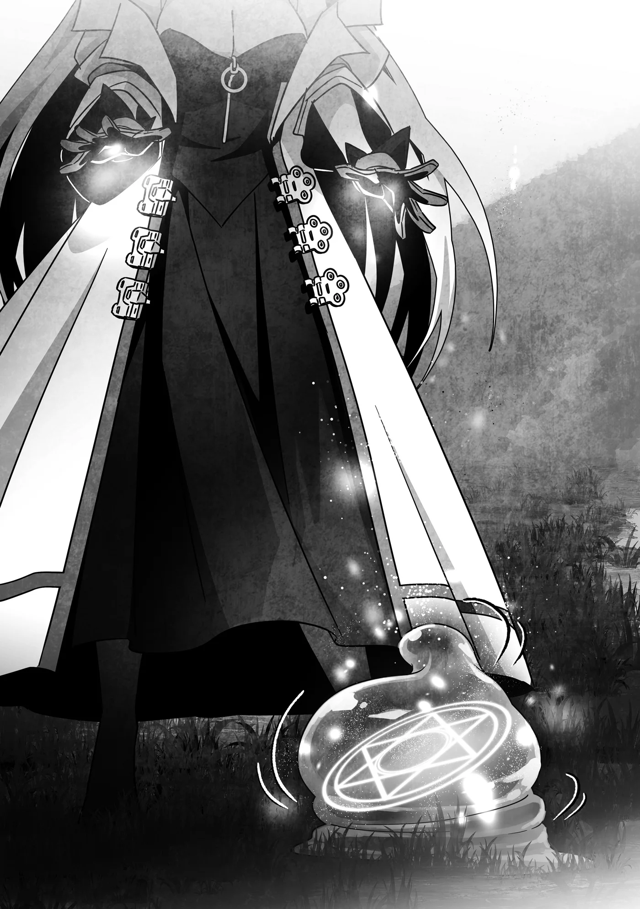

# Chương 339: Tập 14 Chương 5 - Khóa Huấn Luyện Người Thuần Hóa Quái Vật Của Lorraine (3)

"Có một con kìa," tôi nói.

"Đúng rồi," Ingo hạ giọng đáp. "Một con Slime bình thường không thể bình thường hơn."

Chúng tôi nấp sau vạt cỏ rậm, quan sát con Slime thường đang nhấp nhô trườn trên mặt đất trong rừng. Nó to cỡ một chú chó tầm trung, mang sắc lam nhạt và trong suốt tới mức nhìn xuyên sang phía bên kia được. Nó di chuyển chẳng nhanh mà cũng chẳng chậm. Đó là một con Slime thường bình dị đến mức hầu hết mạo hiểm giả sẽ chỉ bước qua mà chẳng thèm đoái hoài liếc lại lần thứ hai.

Thế nhưng Ingo và tôi lại mừng rỡ khi phát hiện ra nó. Dù sao thì theo lời ông ấy, đây là loài quái vật dễ thuần hóa nhất.

Đúng như vẻ ngoài của chúng, cấu tạo cơ thể Slime hoàn toàn là chất lỏng, với lượng cơ quan nội tạng ít ỏi tới mức tối thiểu, một cái lõi và một viên Ma Tinh có thể nhìn thấy từ bên ngoài. Bởi cơ thể chúng chỉ có bấy nhiêu, quá trình truyền Ma Lực của bản thân vào rồi biến chúng thành quyến thuộc là vô cùng đơn giản.

Dẫu vậy, điều đó không phải lúc nào cũng đúng. Những phân loài biến dị như Slime Độc có lẫn tạp chất trong cơ thể sẽ khiến công việc khó khăn hơn nhiều. Trường hợp một con Slime vừa mới nuốt thứ gì đó cũng tương tự, bởi cặn thức ăn còn sót lại trôi nổi bên trong cơ thể dạng thạch nhầy sẽ cản trở dòng chảy Ma Lực.

Với một người thuần hóa quái vật bậc thầy như Ingo, chuyện đó chẳng thành vấn đề. Còn tôi lại là tay mơ chưa từng có quyến thuộc nào trong đời. Vì lẽ đó, kế hoạch đặt ra là bắt đầu bằng một cá thể ít gây trở ngại nhất cho tôi. Ấy thế mà tôi đã thất bại với mọi con Slime thường bắt gặp từ nãy đến giờ. Con nào cũng chứa tạp chất làm tắc nghẽn dòng Ma Lực của tôi khi rót vào cơ thể chúng.

Có điều, xét theo độ trong suốt của cơ thể con này thì trông nó vô cùng triển vọng.

"Được rồi, Lorraine," Ingo nói. "Cháu biết phải làm gì rồi đấy. Đừng lo, ta tin chắc lần này cháu sẽ làm được thôi. Mà nếu không được, ta chỉ việc tìm một con khác là xong."

Ông ấy nói năng ôn tồn để tránh tạo áp lực cho tôi. Dù phương pháp thuần hóa quái vật của ông ấy không thuộc một nhánh ma pháp phổ biến, nó vẫn là ma thuật—và vẫn vận dụng Ma Lực, đồng nghĩa trạng thái tinh thần của người thi triển sẽ tác động rất lớn đến kết quả.

Thế nhưng lời động viên của ông ấy chỉ càng củng cố quyết tâm thành công của tôi lần này. Dĩ nhiên không phải vì thói kiêu ngạo muốn chứng tỏ danh tiếng thần đồng, nhưng nếu bảo lòng tự trọng của tôi không có chút tổn thương thì đúng là nói dối. Trước giờ tôi chưa từng gặp kỹ thuật điều khiển Ma Lực nào làm mình phải chật vật đến nhường này.

Mình làm được mà.

Dĩ nhiên, tôi thừa hiểu việc nghĩ ngợi quá nhiều có thể làm hỏng cơ hội của mình, nên trong thâm tâm, tôi tự trấn an rằng dẫu có thất bại cũng chẳng hề gì. Chuyện đó chẳng làm tôi mất mát gì nhiều.

Tôi gật đầu với Ingo rồi bò ra khỏi vạt cỏ rậm, hướng về phía con Slime. Chờ thời cơ thích hợp, tôi phóng chiếc ống nghiệm chứa máu đã truyền Ma Lực của mình đi. Chiếc ống cắm phập ngay giữa cơ thể con quái vật dạng thạch.

Nói đi cũng phải nói lại, chuẩn bị kỹ càng đến thế mà còn ném trượt thì tôi quả là nỗi xấu hổ của giới mạo hiểm giả Ngân Cấp...

Sau khi xác nhận ống thủy tinh đã găm trúng mục tiêu, tôi vận hành Ma Lực, tạo một ma pháp trận bên dưới con Slime. Theo lời Ingo, thứ này được gọi chính xác là ma pháp trận khế ước quyến thuộc. Cấu trúc cụ thể của nó khá phóng khoáng, bởi có những phần phải thay đổi tùy theo từng loài quái vật, khiến việc điều khiển nó trở nên khó khăn đến bất ngờ. Dẫu vậy, tới thời điểm này tôi đã luyện tập trên kha khá con Slime rồi, nên tôi nhanh chóng hoàn tất những điểm tinh chỉnh mà hầu như chẳng gặp trở ngại gì.

Tôi bắt đầu giải phóng Ma Lực nội tại, vươn nó về phía máu của mình nằm bên trong cơ thể con Slime. Chẳng mấy chốc...

"Nối được rồi!" tôi thốt lên.

"Làm tốt lắm," Ingo khen ngợi. "Cứ bình tĩnh rồi hoàn thành nốt đi cháu!"

Tôi mượn tiếng nói của ông ấy để lấy lại bình tĩnh. Dù khó lòng kìm được chút vui sướng khi mọi chuyện diễn ra suôn sẻ đến lúc này, cảm giác ấy nhanh chóng bị gạt phắt đi bởi nỗi lo rằng chỉ cần quá đà là sẽ chuốc lấy thất bại.

Giờ việc còn lại chỉ là dẫn Ma Lực xuyên qua cơ thể con Slime để kết nối với ma pháp trận bên dưới nó. Mình nhất định làm được!

Con Slime quằn quại lắc lư như thể muốn kháng cự ma thuật của tôi, nhưng cử động của nó dần yếu đi khi Ma Lực của tôi nắm quyền khống chế. Rồi tôi chạm tới ma pháp trận. Nó lập tức bừng nở, biến thành một khối trụ ba chiều bao trọn cơ thể con Slime.

Tôi tăng lượng Ma Lực rót vào con quái vật, và khối trụ bắt đầu co lại. Nó thu nhỏ dần, cuối cùng biến mất hoàn toàn vào bên trong con Slime.

"Câu chú mau," Ingo nhắc nhở.

Tôi đọc lại những lời ông ấy đã dạy tôi trước đó. "Bằng máu và Ma Lực làm vật hiến tế, ta lập nên khế ước này. Ngươi sẽ vì ta mà sống, và ta sẽ vì ngươi mà tồn tại. Contractus de Origo!"

Ma pháp trận bừng sáng chói lọi, y hệt như của Ingo lúc trước. Song lần này tôi đã có sự chuẩn bị từ trước, nheo mắt nhìn xuyên qua luồng sáng lóa.

Tôi chăm chú nhìn ma pháp trận từ từ dung hợp với lõi của con Slime. Khi cả hai đã hòa làm một hoàn toàn, ánh sáng lịm tắt, chỉ còn lại con Slime đang vui sướng nảy tưng tưng tại chỗ.

Trong lúc quan sát con Slime, một cảm giác khẽ gợn lên nơi rìa ý thức của tôi, như thể nó đang muốn nói điều gì đó. Theo bản năng, tôi nhận ra đây chính là mối liên kết giữa tôi và con quái vật dạng thạch—và nó đang truyền tới rằng tâm trạng nó đang rất tốt. Có lẽ cảm giác này cũng tương tự như sợi dây liên kết giữa Rentt và Edel.

"Làm tốt lắm, Lorraine!" Ingo nói. "Cháu thấy thế nào?"

"Kỳ lạ lắm bác," tôi đáp. "Gần như thể cháu đang ở bên ngoài cơ thể mình vậy..."

Ingo khẽ gật gù. "Xem ra cháu đã làm đúng cách rồi đấy," ông ấy nói, giọng đượm vẻ ngạc nhiên. "Ta phải thừa nhận, ta không ngờ cháu lại thành công nhanh đến thế."

"Thật vậy sao bác?" tôi hỏi.

"Phải. Riêng công đoạn truyền Ma Lực kéo dài cả năm trời cũng chẳng phải chuyện hiếm, và để lập khế ước thành công cũng có thể mất chừng ấy thời gian, thậm chí còn lâu hơn nữa. Dù sao thì trước giờ vẫn vậy." Giọng ông ấy thoáng vẻ trầm ngâm. "Nhưng có lẽ đúng là có những người sinh ra đã có sẵn thiên phú."

Ông ấy nói những lời đó chân thành đến mức tôi cảm thấy một thoáng tự hào khẽ dâng lên—thứ niềm kiêu hãnh mà tôi cứ ngỡ mình đã rũ bỏ từ lâu.

◆◇◆◇◆

"Giờ thì hôm nay kết thúc ở đây rồi quay về làng chứ nhỉ?" Ingo hỏi.

Tôi gật đầu, nhưng rồi chợt nghĩ ra một điều. "Có lẽ cháu không nên dắt con Slime này về cùng đâu bác nhỉ," tôi nói.

"Dĩ nhiên là không rồi," Ingo tán thành. "Chính vì thế trên đường về ta sẽ đi đường vòng một chút."

"Đi đâu vậy bác?" tôi tò mò hỏi.

Ông ấy cười toe toét. "Nói trước thì mất cả bất ngờ còn gì."

◆◇◆◇◆

Sau một hồi lội bộ qua khu rừng và băng qua vài tầng kết giới, chúng tôi tới một nơi khiến tôi kinh ngạc sững sờ.

"Thật không thể tin nổi!" tôi khẽ thốt lên.

Còn về lý do khiến tôi ngạc nhiên đến thế, ấy là bởi tôi không nghĩ mình có thể nhìn thấy cảnh tượng tương tự ở bất kỳ nơi nào khác trên cõi đời này. Đó là một bãi đất trống giữa những tán cây, rộng rãi tới mức có khi diện tích còn lớn hơn cả Làng Hathara. Thế nhưng, thay vì những dãy nhà cửa san sát, nơi đây chỉ có vài khoảng sân quây hàng rào cùng một căn nhà gỗ khá khang trang nằm ở tít góc xa.

Bên trong những khoảng rào ấy là đủ loại quái vật với mọi kích cỡ, hình thù và sắc màu—bao gồm cả con Lindblum tôi từng cưỡi trước đây.

"Bình tĩnh nào, bình tĩnh nào các nhóc," Ingo ôn tồn dỗ dành. "Không cần phải phấn khích quá thế đâu. Lorraine cũng đang ngạc nhiên chẳng kém gì tụi mày đâu, thấy chưa?"

Lũ quái vật lũ lượt bò, bước rồi nhảy cẫng về phía chúng tôi. Tôi nhận ra những con Slime, con Lindblum, một con Griffon, một con Hellhound, cùng vô số quái vật khác mà môi trường sống vốn chẳng hề thuộc về khu rừng như thế này. Không ít cá thể trong số chúng thuộc các chủng loài khét tiếng hung tợn, hễ thấy bóng người là lao vào tấn công. Ấy thế mà, trong mắt chúng chẳng có gì ngoài sự quấn quýt khi tụ tập quanh Ingo, con thì dúi đầu, con thì cọ mình vào người ông ấy hòng thu hút sự chú ý.

Xem chừng sự thân thiện của chúng không chỉ dành riêng cho mỗi ông ấy. Dù có phần dè dặt hơn trước tôi, vài con vẫn bước lại gần và chìa đầu ra như muốn được vuốt ve. Chúng đáng yêu đến mức tôi không thể không chiều theo—cách chúng lăn lộn trên cỏ làm tôi nhớ đến lũ chó mèo đến mức khó lòng tin nổi mình thực sự đang bị một đàn quái vật vây quanh.

Ingo bật cười khà khà. "Cháu thấy thế nào? Tuyệt vời lắm đúng không?"

Hiếm khi thấy ông ấy mang giọng điệu khoe khoang như vậy, nhưng tôi chẳng thể trách ông ấy được—nếu tất cả chỗ này đều là quyến thuộc của mình, hẳn tôi cũng muốn đem ra khoe thôi. Dẫu là vị quốc vương quyền lực nhất hay thương nhân giàu có nhất cũng chưa từng sở hữu một bầy quái vật phong phú đến nhường này.

"Đúng vậy thật bác," tôi đồng tình. "Cháu vẫn còn hơi choáng ngợp đây. Cháu đoán đây là một kiểu... trang trại quái vật sao bác?"

"Đại khái là vậy," Ingo nói. "Dù thực ra cũng có vài con ta nuôi thả ngoài rừng, để chúng sống hoang dã hết mức có thể. Nhưng chỉ những con mà người ta chẳng thèm đoái hoài thôi, vì dân làng cũng hay đi lại trong rừng mà. Rất khó có khả năng họ đụng độ quyến thuộc của ta, nhưng thử tưởng tượng xem nếu họ chạm trán, mà con đó lại là Hellhound hay Griffon... Hẳn sẽ làm náo loạn cả lên mất."

"Bác nói phải. Bị một phen hú vía xem chừng vẫn còn là nhẹ."

Cả Hellhound lẫn Griffon đều là những quái vật hùng mạnh. Bắt gặp chúng trong mê cung đã là một nhẽ, nhưng nếu chuyện đó xảy ra lúc người ta đi săn ngoài rừng thì sao? Đó sẽ là một thảm họa. Tệ hơn nữa, nơi này cách rất xa môi trường sống tự nhiên của chúng. Bất kỳ cuộc chạm trán bất ngờ nào cũng kéo theo nguy cơ dân làng hoảng loạn gửi ủy thác nhờ mạo hiểm giả hoặc kỵ sĩ đến điều tra khu vực.

Nếu Ingo là một người thuần hóa quái vật được công khai rộng rãi thì chẳng sao, song số người nắm giữ bí mật đó lại thực sự ít ỏi. Nếu một cuộc chạm trán Griffon bất ngờ khiến dân làng chẳng hay biết gì chạy đến nhờ Ingo phát ủy thác gọi mạo hiểm giả hay kỵ sĩ, ông ấy sẽ rơi vào thế tiến thoái lưỡng nan thực sự. Đó hẳn là mục đích của trang trại này—ngăn chặn những rắc rối như thế xảy ra ngay từ đầu.

"Mà, ta có mối liên kết với tất cả chúng nó, nên làm sao có chuyện chúng tấn công dân làng được," Ingo nói.

"Nhưng chỉ riêng việc tình cờ chạm mặt thôi cũng đủ gây náo loạn rồi bác," tôi trầm ngâm.

"Hóa ra đó là lý do có những tầng kết giới mà chúng ta băng qua trên đường vào đây."

"Bà Gharb giúp ta duy trì chỗ kết giới đó đấy," Ingo giải thích. "Trừ phi đi theo đúng trình tự tiến vào đã định sẵn, hoặc cháu là một ma pháp sư xuất chúng đủ sức giải trừ kết giới hoàn toàn, bằng không chẳng ai tới được đây đâu. Mà vế sau thì chắc cháu làm được đấy nhỉ, Lorraine."

"Không đâu bác, kết giới kiên cố cỡ đó sẽ tốn rất nhiều thời gian để tháo gỡ," tôi nói. "Vả lại một khi đã bị giải trừ, người ta sẽ cần chất xúc tác cùng một lượng thời gian đáng kể mới dựng lại được. Cháu đâu thể làm thế với bác được."

"Ta mừng khi nghe cháu nói vậy."

Tôi bật cười khẽ. "Vậy thì, lý do bác dẫn cháu tới đây là..."

"Đúng như cháu đoán đấy. Ta đâu thể mang quyến thuộc mới của cháu về làng được, nên trước mắt cứ để nó ở lại đây."

"Bác có chắc là ổn không?" tôi hỏi.

"Hử? Ý cháu là sao?"

"Cháu lo quyến thuộc của mình có khi lại đánh nhau với quyến thuộc của bác."

"À. Nỗi lo của cháu có cơ sở đấy. Mỗi quyến thuộc đều có tính khí riêng, chuyện chúng hòa thuận—hay xích mích—cũng chẳng khác gì con người với nhau cả. Cháu có thể ra nghiêm lệnh cấm chúng đánh nhau, nhưng gò bó quá mức có thể gây căng thẳng cho chúng."

"Vậy có nghĩa là..."

"Không, trường hợp này thì chắc ổn thôi. Quyến thuộc của cháu xem chừng sẽ hòa nhập tốt đấy. Nhìn kìa."

Tôi nhìn xuống và thấy con Slime của mình tiến lại gần hàng rào, vươn một phần cơ thể dạng thạch ra chạm vào chân con Griffon. Con quái vật to lớn hơn để mặc cho nó tiếp xúc mà chẳng hề tỏ vẻ khó chịu. Một vài sinh vật khác cũng tò mò dõi theo con Slime của tôi, nhưng trong mắt chúng chẳng hề có sự ngờ vực mà chỉ đơn thuần là tính hiếu kỳ.

"Cháu hiểu rồi. Xem ra chúng sẽ ổn thôi bác nhỉ."

Ingo khẽ ậm ừ tán thành trước khi như chợt nhớ ra điều gì. "À, phải rồi. Về con Slime của cháu."

"Sao thế bác?"

"Ở đây ta có kha khá Slime, nên nó có thể bị lẫn với đám đó. Dĩ nhiên cháu có thể phân biệt nó nhờ mối liên kết, nhưng lúc nào cũng chỉ gọi là 'Slime' nghe chừng tẻ nhạt quá, phải không?"

"Ý bác là...?"

"Đặt tên cho nó đấy, phải rồi. Ta đều đặt tên cho mọi quái vật của mình. Nếu cháu cần một lý do thực tế, thì việc đó cũng giúp kích hoạt Tiến Hóa Bản Thể dễ dàng hơn nữa."

"Thật sao bác?! Thú vị quá!"

"Có vài giả thuyết lý giải cho chuyện đó, nhưng ta có thể bàn sau. Thế nào, cháu thấy sao?"

"Cháu thấy chẳng có lý do gì để từ chối cả. Nếu vậy thì... Loren. Cháu sẽ gọi nó là Loren."

"Ồ?" Ingo cười trừ. "Ta định hỏi cái tên đó từ đâu ra, nhưng mà thôi... ta nghĩ chẳng cần hỏi nữa đâu."

Tôi thoáng thấy chút ngượng ngùng... nhưng đó là cái tên mà tôi nhất quyết giữ lấy.
